# 사전학습은 왜 돕는가 — Why Does Unsupervised Pre-training Help Deep Learning? (요약)

> **한 줄.** 새 알고리즘이 아니라 **실험으로 따지는 논문**이다. 층별 비지도 사전학습이 돕는 까닭으로 「학습 기준을 더 잘 내리게 해 준다(최적화)」와 「갈 수 있는 매개변수 구역을 좁혀 준다(정규화)」를 맞세운다. MNIST 에서는 **사전학습한 망이 학습 오차는 더 높고 시험 오차는 더 낮아** 정규화 쪽과 맞는다. 그런데 예시가 1 천만 개인 온라인 학습에서도 이득이 사라지지 않자, **앞쪽 예시가 들어갈 끌림 구역을 정하고 그 뒤로는 빠져나오지 못한다**는 설명으로 둘을 엮는다. 수치가 본문에 하나도 없고 전부 그림에 있다.

---

## Paper Metadata

| Item | Content |
|---|---|
| Title | Why Does Unsupervised Pre-training Help Deep Learning? |
| Authors | Dumitru Erhan, Aaron Courville, Yoshua Bengio, Pascal Vincent |
| 소속 | 넷 다 DIRO, Université de Montréal (몬트리올) |
| Conference / Journal | AISTATS 2010 (13th International Conference on Artificial Intelligence and Statistics), **JMLR W&CP 9권, 201\~208 쪽.** 파일 첫 쪽 아래에 이 문구가 그대로 있다 |
| Year | 2010 |
| 원문 | https://proceedings.mlr.press/v9/erhan10a.html |
| 코드 | 본문에 저장소 주소가 적혀 있지 않다 |
| Stored PDF | `papers/AISTATS10_Pretrain_Why_Does_Unsupervised_Pre_training_Help_Deep_Learning.pdf` (바탕화면에서 받은 이름은 `erhan10a.pdf`) |
| 왜 읽었는가 | DBN 노트가 남긴 빈칸 — **탐욕 사전학습의 몫과 미세조정의 몫이 갈려 있지 않다.** 그 빈칸을 직접 재 봤더니(MNIST 10,000 장) 사전학습이 이겼고, 라벨이 많을수록 차이가 줄었다. 남은 물음은 **규모를 올려도 그 차이가 남는가**였고, 이 논문의 6절이 예시 1 천만 개로 그것을 잰다 |
| 읽은 범위 | **2026-10-11 에 8 쪽을 전부 읽었다.** 곧 초록 · 1\~7절 · 식 (1)\~(3) · 그림 1\~7 과 캡션 · 각주 1\~6 · 참고 문헌 23 건의 목록. 참고 문헌의 본문은 읽지 않았다 |

### 저장한 파일의 상태

- **학회판(8 쪽)이다.** 같은 제목의 저널판(Erhan, Bengio, Courville, Manzagol, Vincent, Bengio, JMLR 11권, 2010)은 실험이 더 많은 긴 판이고, **이 노트는 그 판을 읽지 않았다.** 저널판의 수치나 실험을 이 노트에 옮기지 않는다.
- **글자 층이 살아 있다.** 식 (2) · (3) 은 글자가 흩어져 나와 쪽을 그림으로 띄워 맞췄다.
- **본문에 수치가 없다.** 결과 그림 일곱 중 여섯이 곡선이고 하나가 필터 그림이다. 이 노트의 표에 든 값은 **모두 원 그림을 꺼내 픽셀 단위로 눈금을 읽은 값**이다. 읽는 방법과 읽기 오차는 6.1절에 모아 적었다.

---

## 1. 용어

이 노트에서 쓸 이름을 먼저 정한다. 논문의 원래 용어는 괄호로 함께 적는다.

- **사전학습 (unsupervised pre-training)**: 라벨 없이 층을 하나씩 배워 쌓는 단계. 이 논문에서는 RBM 또는 잡음 제거 오토인코더로 한다. 작은 예시로, 3 층 망이면 첫 층을 784 픽셀 위에서 배우고, 그 층의 출력 위에서 둘째 층을 배우고, 다시 셋째 층을 배운다.
- **미세조정 (supervised fine-tuning)**: 사전학습이 끝난 가중치를 출발점으로 삼아, 라벨을 보고 망 전체를 역전파로 배우는 단계.
- **사전학습 없음 (without pre-training)**: 같은 모양의 망을 무작위 가중치에서 시작해 미세조정만 하는 것. 논문은 「standard feed-forward network」 라고도 부른다.
- **RBM 사전학습 / DBN**: 층마다 RBM 을 대조 발산으로 배워 쌓는 것. 논문은 이것으로 만든 망을 DBN 이라 부른다. **이 노트에서 DBN 은 「RBM 으로 사전학습한 망」 이라는 뜻으로만 쓴다** — 2006 년 논문의 위-아래 미세조정은 여기서 쓰지 않는다.
- **DAE 사전학습 / SDAE (stacked denoising auto-encoder)**: 층마다 **입력 일부를 망가뜨린 뒤 원래 입력을 되살리는** 오토인코더를 배워 쌓는 것. 망가뜨리는 비율이 하이퍼파라미터다.
- **최적화 가설 (optimization hypothesis)**: 사전학습이 학습 기준(학습 집합의 오차)을 **더 낮은 곳까지 내려가게** 해 준다는 설명. Bengio 외(2007).
- **정규화 가설 (regularization hypothesis)**: 사전학습이 미세조정이 **갈 수 있는 매개변수 구역을 좁혀**, 학습 오차는 덜 내려가더라도 일반화가 나은 곳에 머물게 한다는 설명. Erhan 외(2009b).
- **끌림 구역 (basin of attraction)**: 기울기 하강을 거기서 시작하면 같은 국소 최소로 굴러가는 출발점들의 모음. 작은 예시로, 골짜기가 둘인 곡면에서 능선 왼쪽 어디서 시작하든 왼쪽 골짜기에 닿으면 능선 왼쪽 전체가 그 골짜기의 끌림 구역이다.
- **NLL (negative log-likelihood)**: 정답 부류에 매긴 확률의 음의 로그. 작은 예시로, 정답에 0.9 를 매기면 $-\ln 0.9 = 0.105$ 이다. 그림 2 의 축이 이것이다.
- **InfiniteMNIST**: MNIST 숫자에 무작위 탄성 변형을 걸어 **예시를 끝없이 만들어 내는** 데이터(Loosli 외 2007). 이 논문은 1 천만 개를 쓴다.
- **온라인 오차 (online classification error)**: 온라인 학습에서 **아직 보지 않은 다음 묶음**에 대한 분류 오차. 그 묶음은 한 번도 학습에 안 쓰였으므로 시험 오차와 같은 성격이다. 묶음의 크기는 본문에 적혀 있지 않다.
- **%p (백분율 점)**: 두 오차율의 **차이**. 작은 예시로, 0.20% 와 0.05% 의 차이는 0.15 %p 이고 **비**는 4 배다. 이 노트는 11절에서 둘을 갈라 쓴다.

---

## 2. 한 문단 요약

2006 년 이후 깊은 망이 배워지게 된 것은 **층별 비지도 사전학습 + 지도 미세조정**이라는 공통 절차 덕이다. 그런데 사전학습이 왜 돕는지는 갈려 있었다. 논문은 앞선 실험 다섯(2절)을 정리한 뒤, 사전학습을 **「끌림 구역에 매기는 사전분포」로 적는 정규화 가설**(식 1\~3)을 세운다. MNIST 실험(5절)에서 층을 작게 하면 사전학습이 오히려 해롭고(그림 1), 아래 층을 더 많이 사전학습할수록 **학습 NLL 은 올라가고 시험 NLL 은 내려간다**(그림 2 위). Bengio 외(2007)가 「최적화」 의 근거로 쓴 「맨 위 층 20 유닛」 실험을 조기 종료 없이 다시 하자 역시 **사전학습 쪽 학습 NLL 이 더 높다**(그림 2 아래). 여기까지는 정규화 쪽이다. 그런데 InfiniteMNIST 1 천만 개 온라인 학습(6절)에서는 **사전학습의 이득이 사라지지 않고**(그림 3), 사전학습한 망이 **학습 집합 전체에서도** 오차가 낮다(그림 5) — 이번에는 최적화 쪽처럼 보인다. 논문은 둘을 이렇게 엮는다(7절). 비볼록한 학습에서는 **앞쪽 예시가 들어갈 끌림 구역을 정하고**(그림 4), 그 뒤로는 확률적 기울기 하강이 그 구역을 빠져나오지 못한다. 사전학습은 **그 출발 구역을 비지도 학습에 쓸모 있는 곳으로 고르는 장치**이고, 그래서 흔한 정규화와 달리 데이터가 늘어도 효과가 남는다. L1 · L2 벌점으로는 같은 이득이 나오지 않았다고 적는다(6.5절, 수치 없음).

---

## 3. 문제 — 두 설명이 맞선다 (논문 1 · 3절)

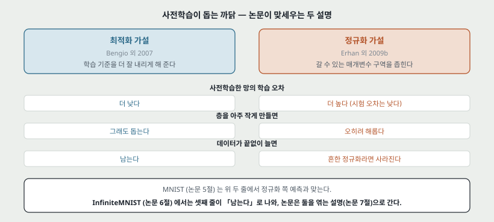

**논문이 문제를 적는 순서.** 깊은 구조가 필요하다는 이론 결과가 있다 → 깊은 망의 학습 기준은 비볼록이고 국소 최소가 많다 → Erhan 외(2009b)에서 **무작위 초기화 수백 번이 매번 다른 국소 최소로 갔고, 2\~3 층을 넘으면 사전학습 없는 순수 지도 학습이 계속 나빠졌다** → 2006 년 DBN 과 쌓은 오토인코더가 **층별 비지도 사전학습 + 지도 미세조정**으로 이 벽을 넘었다 → 그런데 **왜 넘는지**가 갈려 있다.

논문이 스스로 밝히는 목적은 **새 알고리즘을 내는 것이 아니라 있는 알고리즘을 실험으로 따지는 것**이다.

| | 최적화 가설 | 정규화 가설 |
|---|---|---|
| 제안 | Bengio 외 (2007) | Erhan 외 (2009b) |
| 한 줄 | 최적화가 쉬운 구역에서 시작하게 해 **학습 기준의 더 좋은 국소 최소**에 닿는다 | 미세조정이 탐색하는 구역을 **P(X) 를 잘 모델링하는 곳으로 제한**한다 |
| 예측: 사전학습한 망의 학습 오차 | 더 낮다 | 더 높다(시험 오차는 낮다) |
| 예측: 층을 아주 작게 하면 | 그래도 돕는다 | 오히려 해롭다(정규화가 겹친다) |
| 예측: 데이터가 끝없이 늘면 | 이득이 남는다 | 흔한 정규화라면 사라진다 |

논문은 둘이 **반드시 서로를 배제하지는 않는다**고 적고, 둘의 얽힘을 이해하는 것을 목표로 든다.

---

## 4. 앞선 실험 다섯 (논문 2절)

논문이 출발점으로 정리한 앞선 결과다. **이 절의 수치는 다른 논문의 것이고 이 논문에서 다시 잰 것이 아니다.**

| 이름 | 무엇을 봤는가 | 어느 가설과 맞는가 (논문의 말) |
|---|---|---|
| 일반화가 낫다 | 층 수 1\~5, 층 크기 · 학습률 · 반복 수를 검증 오차로 고르면 사전학습 쪽 시험 오차가 낮다. 데이터는 MNIST 규모 이하, **학습 예시 10,000\~50,000 개** | — |
| 최적화를 돕는다 | 학습 오차가 사전학습 유무와 상관없이 낮다(MNIST 에서 0 에 가깝다고 적는다). 그래서 Bengio 외(2007)가 **맨 위 층을 20 유닛으로 묶자**(원래 500 · 1000) 사전학습 없는 쪽 학습 오차가 더 높았다 | 최적화 |
| 서로 다른 국소 최소 | 무작위 초기화 **400 번**이 사전학습 유무와 상관없이 매번 다른 함수에 닿는다. **사전학습 있는 쪽과 없는 쪽이 닿는 함수 구역이 겹치지 않는다** | — |
| 분산이 작다 | 초기화 seed 에 따른 시험 오차의 분산이 사전학습 없는 쪽이 크고, 깊을수록 그 차이가 커진다 | 정규화. 다만 최적화도 배제하지 않는다 |
| 용량 조절 | 층을 모두 작게 묶으면 사전학습의 이점이 사라지고, 아주 작으면 사전학습 쪽이 나쁘다 | **정규화와 잘 맞고 순수 최적화와는 맞지 않는다** |

논문이 이것으로 세우는 전제 셋:

1. 깊은 망의 지도 학습 기준에는 국소 최소가 **한 층 망보다 더** 많다.
2. 무작위 초기화는 높은 확률로 **나쁜 국소 최소의 끌림 구역**에 떨어진다.
3. 사전학습은 **일반화가 나은 끌림 구역**에 초기화한다.

---

## 5. 정규화를 식으로 (논문 3절)

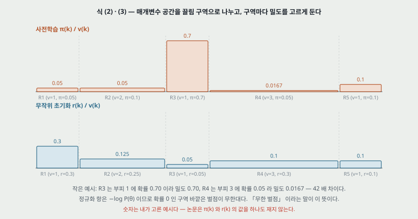

Erhan 외(2009b)의 정식화를 옮긴다. 정규화 항을 매개변수 사전분포의 음의 로그로 둔다.

$$\text{regularizer} = -\log P(\theta) \qquad (1)$$

사전학습한 모델의 사전분포는

$$P_{\text{pre-training}}(\theta) = \sum_k \mathbf{1}_{\theta \in R_k} \, \frac{\pi_k}{v_k} \qquad (2)$$

이고, 사전학습 없는 모델도 같은 꼴에 확률만 다르다.

$$P_{\text{no-pre-training}}(\theta) = \sum_k \mathbf{1}_{\theta \in R_k} \, \frac{r_k}{v_k} \qquad (3)$$

- $R_k$ 는 매개변수 공간의 **유계 구역을 나눈 조각**이고, 조각 하나가 **지도 기울기 하강의 끌림 구역 하나**다.
- $v_k$ 는 그 구역의 부피, $\pi_k$ 는 **사전학습이 끝났을 때 그 구역에 떨어질 확률**, $r_k$ 는 무작위 초기화가 거기 떨어질 확률이다.
- 그래서 구역 안에서는 밀도가 $\pi_k / v_k$ 로 고르다.

**작은 예시.** 구역이 다섯이고 부피가 1, 2, 1, 3, 1 이라 하자. 사전학습이 R3(부피 1)에 0.70 의 확률로 떨어지면 그 구역의 밀도는 0.70 이다. R4(부피 3)에 0.05 로 떨어지면 밀도는 0.0167 이다. 정규화 항으로 바꾸면 $-\ln 0.70 = 0.357$ 대 $-\ln 0.0167 = 4.09$ 다. 유계 구역 바깥은 확률이 0 이라 벌점이 무한대다 — 논문이 「**무한 벌점**」 이라고 부르는 것이 이것이다. 이 숫자는 내가 고른 예시이고, **논문은 $\pi_k$ 도 $r_k$ 도 하나도 재지 않는다.**

논문이 덧붙이는 직관은 이렇다. 출발점 하나를 고르는 것이 **매개변수에 숨은 제약을 거는 것**이고, 그 제약이 수많은 국소 최소 가운데 **어느 것을 원하는지**를 정한다.

그리고 이 정규화가 L1 · L2 같은 **매끄럽게 만드는 정규화와 다른 점**을 적는다. 이것은 입력 분포 $P(X)$ 의 복잡한 구조를 잡는 데 기대고, **참 조건부 분포 $P(Y \mid X)$ 와 $P(X)$ 가 $X$ 의 함수로서 구조를 나눠 갖는다**는 가정 위에 선다. 그래서 다른 준지도 방법처럼 **$P(X)$ 가 $P(Y \mid X)$ 를 배우는 데 도움이 되는 만큼만** 효과가 있다고 적는다.

> **읽으면서 걸린 것.** 논문은 「사전학습은 정규화다」 라고만 말하면 **그 효과의 크기를 깎아 말하는 셈**이라고 스스로 적는다. 핵심은 비지도 단계가 **확률적 기울기 하강이 지도 단계에서 탐색할 수 있는 구역**을 제한한다는 것이다. 곧 이 논문의 「정규화」 는 벌점 항이 아니라 **출발점이 거는 제약**이다.

---

## 6. 실험 설정 (논문 4절)

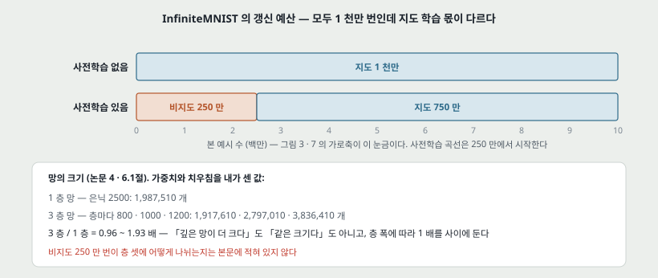

| 항목 | MNIST | InfiniteMNIST |
|---|---|---|
| 데이터 | 학습 60,000 · 시험 10,000, 28x28 | MNIST 숫자에 무작위 탄성 변형. 1 천만 개를 쓴다 |
| 모델 | RBM 사전학습 망(DBN) · DAE 사전학습 망(SDAE) · 사전학습 없는 망, **은닉 1\~3 층** | 같다 |
| 층 크기 | 층마다 같은 수. 하이퍼파라미터이고 최적값은 **보통 800\~1200** | 3 층 망 800\~1200, **1 층 망 2500** (그림 3 캡션) |
| 학습량 | 비지도 50 에폭 + 지도 50 에폭 | **비지도 250 만 번 + 지도 750 만 번** / 사전학습 없는 망은 **지도 1 천만 번** |
| 지도 목표 | 정답 부류의 NLL | 같다 |
| 하이퍼파라미터 고르기 | 검증 집합의 분류 오차 | **마지막 백만 개의 평균 온라인 오차** |
| 고르는 것 | 층 크기 · 비지도 학습률 · 지도 학습률 · 망가뜨리는 비율(SDAE) | 같다 |
| 갱신 | 모두 순수 확률적 기울기 하강(묶음 1). 비지도 단계는 층별 탐욕 | 같다 |

**읽을 때 조심할 것 둘.**

1. **InfiniteMNIST 의 가로축은 「본 예시 수」 이고 비지도 몫을 포함한다.** 그래서 그림 3 · 7 의 사전학습 곡선은 250 만에서 시작한다. 가로축의 같은 자리에서 **사전학습한 망은 지도 갱신을 250 만 번 덜 받았다** — 예를 들어 950 만 자리에서 사전학습 쪽은 지도 700 만 번, 없는 쪽은 950 만 번이다. **사전학습 쪽이 지도 학습량에서 불리한 채로 이긴다**는 뜻이다.
2. **비지도 250 만 번이 층 셋에 어떻게 나뉘는지는 본문에 없다.**

**망 크기를 세어 둔다.** 논문은 파라미터 수를 적지 않는다. 가중치와 치우침을 더해 내가 센 값이다.

| 망 | 계산 | 파라미터 |
|---|---|---:|
| 1 층, 은닉 2500 | $784 \times 2500 + 2500 \times 10 + 2500 + 10$ | 1,987,510 |
| 3 층, 층마다 800 | $784 \times 800 + 2 \times 800^2 + 800 \times 10 + 3 \times 800 + 10$ | 1,917,610 |
| 3 층, 층마다 1000 | 같은 꼴 | 2,797,010 |
| 3 층, 층마다 1200 | 같은 꼴 | 3,836,410 |

**3 층 망은 1 층 망의 0.96\~1.93 배**다. 논문은 「3 층이 1 층보다 일반화가 나쁘다」를 깊이의 어려움으로 읽는데(10절), 두 망의 크기가 층 폭에 따라 1 배를 사이에 두고 갈린다. 실제로 고른 폭이 적혀 있지 않아 **같은 크기에서 비교한 것인지 확인할 수 없다.**

### 6.1 이 노트가 그림의 값을 읽은 방법

PDF 에서 원 그림 이미지를 원래 해상도(가로 694\~1281 픽셀)로 꺼냈다. 축 틀의 픽셀 위치를 찾아 눈금과 맞추고, 곡선은 **색으로 가려 픽셀 좌표를 값으로 바꿨다.** 검은 선 둘(그림 3 의 점선 · 실선)처럼 색으로 안 갈리는 것은 **세로 두께가 2 픽셀 이상인 줄만 곡선으로 보고**(점선 격자는 1 픽셀) 위아래로 갈랐고, 확대한 그림을 눈으로 대조했다.

| 그림 | 눈금 1 칸의 픽셀 | 읽기 오차 | 노트에 옮긴 값 |
|---|---|---|---|
| 1 (층 크기) | 시험 오차 1 %p = 99.8 | ±0.1 %p (점과 오차 막대가 겹친다) | 점마다 |
| 2 (NLL 궤적) | 세로 10 배 = 240 | 1 픽셀 = 1%. **궤적 여러 개의 끝이 ±10% 안에서 흩어진다** | 마지막 에폭의 끝점 |
| 3 · 7 (온라인 오차) | 세로 10 배 = 152 · 147 | 1 픽셀 = 1.5\~1.6%. **곡선 자체가 출렁여서 읽기 오차보다 출렁임이 크다** | 백만 단위 창 넷(4.5\~5.5 · 6.5\~7.5 · 8.5\~9.5 · 9.5\~9.9)마다 0.1 백만 간격으로 읽어 **기하평균**하고, 창 안의 최솟값\~최댓값을 함께 적는다 |
| 4 (출력 분산) | 1 = 60 | ±0.05 | 점마다 |
| 5 (학습 집합 오차) | 0.05% = 96 | 점마다 오차 막대 ±0.01 이 그려져 있다 | 점들이 놓인 띠 |

---

## 7. MNIST: 층 크기를 바꾸면 (원 그림 1)

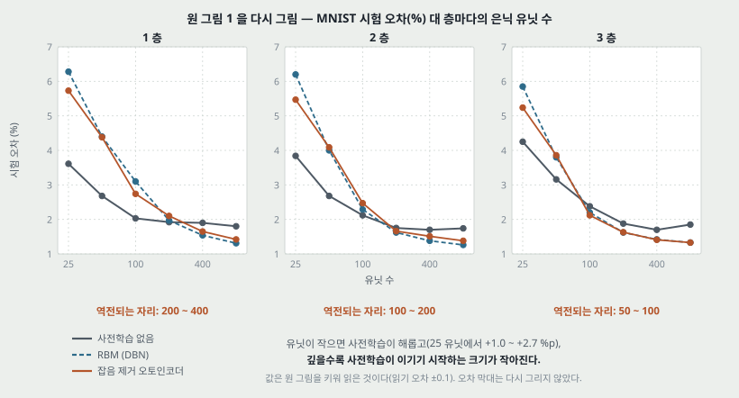

1 · 2 · 3 층 망에서 층마다의 은닉 유닛을 25 · 50 · 100 · 200 · 400 · 800 으로 바꾸며 시험 오차를 잰다. 논문의 문장은 하나다 — **DBN 도 SDAE 처럼, 작은 층에서 사전학습이 성능을 해친다.** 작은 층이 이미 정규화를 하고 있는데 사전학습이 정규화를 하나 더 얹어 **지나친 정규화**가 된다고 읽는다.

원 그림에서 읽은 값(시험 오차 %, 읽기 오차 ±0.1):

| 층 | 유닛 | 사전학습 없음 | RBM | DAE |
|---|---:|---:|---:|---:|
| 1 | 25 | 3.6 | 6.3 | 5.7 |
| 1 | 800 | 1.8 | 1.3 | 1.4 |
| 2 | 25 | 3.8 | 6.2 | 5.5 |
| 2 | 800 | 1.7 | 1.3 | 1.4 |
| 3 | 25 | 4.3 | 5.9 | 5.2 |
| 3 | 800 | 1.9 | 1.3 | 1.3 |

**사전학습 쪽이 이기기 시작하는 유닛 수**(그림에서 곡선이 엇갈리는 자리)를 읽으면 이렇다.

| 층 | 엇갈리는 자리 |
|---|---|
| 1 | 200 과 400 사이 |
| 2 | 100 과 200 사이 |
| 3 | 50 과 100 사이 |

**층이 깊을수록 엇갈리는 자리가 작은 쪽으로 옮겨 간다.** 논문은 이것을 적지 않는다. 25 유닛에서 사전학습이 해치는 폭도 1 층(+2.1\~+2.7 %p)보다 3 층(+1.0\~+1.6 %p)이 작다. 「깊을수록 사전학습의 정규화가 덜 지나치다」 와도, 「깊을수록 사전학습 없는 쪽이 최적화에서 더 손해를 본다」 와도 맞는 모양이라 **이 그림 하나로 둘을 가를 수 없다.**

**오차 막대가 무엇인지 캡션에 없다**(표준편차인지, seed 몇 개인지).

---

## 8. MNIST: 아래 k 층만 사전학습하면 (원 그림 2 위)

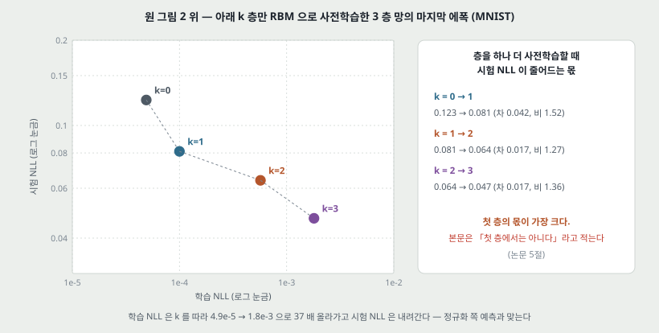

3 층 망에서 **아래 k 층만 RBM 으로 사전학습하고 나머지 위층은 무작위로 둔다.** k = 0(사전학습 없음) \~ 3(전부). 그림은 에폭마다의 (학습 NLL, 시험 NLL) 을 로그-로그로 찍은 궤적이고, 궤적이 오른쪽 위에서 시작해 왼쪽으로 간다.

마지막 에폭의 끝점(읽기 오차 ±10%):

| k | 학습 NLL | 시험 NLL | 시험 NLL 이 앞 칸에서 준 몫 |
|---:|---:|---:|---|
| 0 | 4.9e-5 | 0.123 | — |
| 1 | 1.0e-4 | 0.081 | 차 0.042, 비 1.52 |
| 2 | 5.7e-4 | 0.064 | 차 0.017, 비 1.27 |
| 3 | 1.8e-3 | 0.047 | 차 0.017, 비 1.36 |

**논문이 이 그림에서 세우는 것.** 더 많은 층을 사전학습할수록 일반화가 나아지고, **같은 에폭 뒤의 학습 오차는 오히려 나빠진다.** 표에서 학습 NLL 이 k = 0 → 3 에 **37 배** 올라가고 시험 NLL 은 0.123 → 0.047 로 내려간다. 정규화 쪽 예측과 맞는다.

**논문의 문장 하나가 그림과 맞지 않는다.** 본문은 「가장 큰 몫이 첫 층이나 첫 두 층의 사전학습에서 올 것으로 기대했다. **첫 두 층에서는 그렇고, 첫 층에서는 아니다**」 라고 적는다. 그런데 그림에서 읽으면 **첫 층의 몫이 차로도(0.042 대 0.017 · 0.017) 비로도(1.52 대 1.27 · 1.36) 가장 크다.** 본문이 그림 2 가 아닌 다른 지표(분류 오차)를 보고 썼을 수 있는데, 그 값은 이 판에 없다. 그리고 셋째 층의 몫이 크게 보이는 것은 로그 눈금이 만든 일그러짐이라고 덧붙인다 — 비로 보면 셋째 층(1.36)이 둘째 층(1.27)보다 큰 것이 그 말과 맞는다.

**각 조건의 궤적이 여러 개 겹쳐 있는데 몇 개인지 캡션에 없다.**

---

## 9. 맨 위 층 20 유닛, 조기 종료 없이 (원 그림 2 아래)

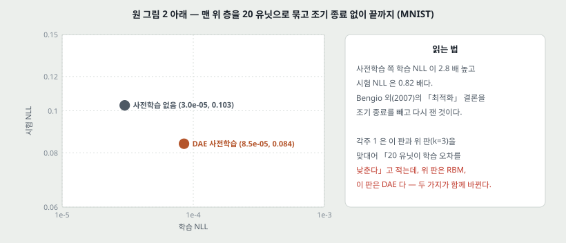

Bengio 외(2007)는 맨 위 층을 20 유닛으로 묶었을 때 **사전학습 없는 쪽 학습 오차가 더 높은 것**을 보고 사전학습이 최적화를 돕는다고 결론 냈다. 이 논문은 그 실험이 **검증 집합으로 조기 종료**를 했다는 데서 걸린다 — 학습 기준의 국소 최소에 닿을 때까지 돌리지 않았으니 「더 좋은 최소에 닿았다」 를 말할 수 없다는 것이다. 그래서 **조기 종료 없이** 다시 한다.

| 3 층 망, 맨 위 20 유닛 | 학습 NLL | 시험 NLL |
|---|---:|---:|
| 사전학습 없음 | 3.0e-5 | 0.103 |
| DAE 사전학습 | 8.5e-5 | 0.084 |

**끝까지 돌리면 사전학습 쪽 학습 NLL 이 2.8 배 높고 시험 NLL 은 0.82 배다.** 논문은 이것이 정규화 해석을 지지한다고 적고, 앞선 실험에서는 **조기 종료가 사전학습 없는 망이 자기 국소 최소로 내려가는 것을 막았을 수 있다**고 읽는다.

**각주 1 의 비교에 변수가 둘 섞여 있다.** 각주 1 은 그림 2 위(k = 3)와 아래를 맞대어 「맨 위 층을 묶으면 사전학습한 망이 **더 좋은 학습 오차**에 닿는다」 고 적는다. 읽은 값으로는 1.8e-3 대 8.5e-5 다. 그런데 **위 판은 RBM 사전학습, 아래 판은 DAE 사전학습**이다(위는 캡션에, 아래는 범례에 적혀 있다). 맨 위 층 크기와 사전학습 방법이 함께 바뀌어서, 학습 NLL 이 낮아진 몫이 어느 쪽인지 이 두 판으로는 가를 수 없다.

---

## 10. InfiniteMNIST: 이득이 사라지지 않는다 (원 그림 3, 논문 6 · 6.1절)

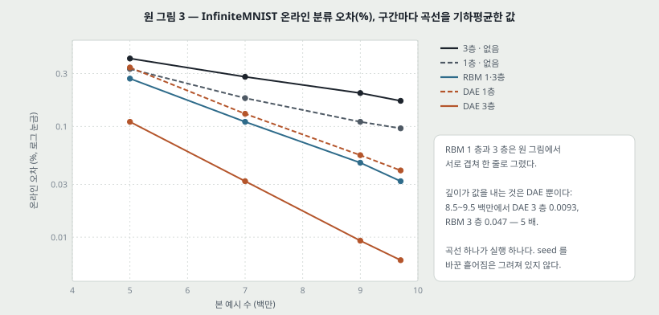

**논문이 세우는 예측.** 사전학습이 정규화라면 **예시가 늘수록 영향이 줄어야 한다.** L1 · L2 같은 정규화는 사전분포가 늘어나는 데이터의 가능도에 결국 압도되기 때문이다. 이것을 시험하려고 예시가 사실상 끝없는 온라인 학습을 본다. 온라인 학습에서 확률적 기울기 하강은 **일반화 오차를 직접 확률적으로 줄이는 것**이라, 온라인 오차가 좋다는 것은 학습 기준을 잘 최적화한다는 뜻이라고 적는다.

망 여섯의 온라인 오차(%, 창마다 기하평균, 괄호는 창 안의 최솟값\~최댓값):

| 망 | 4.5\~5.5 백만 | 6.5\~7.5 백만 | 8.5\~9.5 백만 | 9.5\~9.9 백만 |
|---|---:|---:|---:|---:|
| 3 층 · 사전학습 없음 | 0.41 (0.35\~0.48) | 0.28 (0.24\~0.31) | 0.20 (0.18\~0.23) | 0.17 (0.17\~0.18) |
| 1 층 · 사전학습 없음 | 0.33 (0.27\~0.46) | 0.18 (0.15\~0.22) | 0.11 (0.10\~0.13) | 0.096 (0.092\~0.10) |
| RBM 1 층 · 3 층 (겹침) | 0.27 (0.20\~0.36) | 0.11 (0.084\~0.15) | 0.047 (0.036\~0.078) | 0.032 (0.022\~0.040) |
| DAE 1 층 | 0.34 (0.25\~0.44) | 0.13 (0.10\~0.18) | 0.055 (0.035\~0.070) | 0.040 (0.034\~0.049) |
| DAE 3 층 | 0.11 (0.073\~0.17) | 0.032 (0.017\~0.053) | 0.0093 (0.0063\~0.015) | 0.0062 (0.0027\~0.015) |

RBM 1 층과 3 층은 원 그림에서 9.5 백만 끝까지 서로 엇갈리며 겹쳐서 **한 줄로 읽었다.**

**논문이 적는 관찰 셋.**

1. **사전학습 없는 3 층 망이 1 층 망보다 일반화가 나쁘다**(8.5\~9.5 백만에서 0.20 대 0.11). 데이터가 아주 많은 온라인 설정에서도 깊은 망을 최적화하는 것이 얕은 망보다 어렵다는 뜻으로 읽는다.
2. **3 층 SDAE 가 3 층 DBN 보다 일반화가 낫다**(0.0093 대 0.047, 5 배).
3. **가장 놀라운 것** — 예시가 늘어도 사전학습의 이득이 **사라지지 않고, 오히려 반대다.** 이것은 **최적화 쪽 설명을 지지하는 것처럼 보인다**고 적는다.

그리고 한 문단을 더 쓴다. 1 층 망은 이론상(보편 근사 정리) 용량과 데이터가 늘면 입력 분포를 나타낼 수 있어야 하는데, 사전학습 없이는 **늘어난 용량을 활용하지 못하는 것 같다** — 다시 최적화 쪽이다. 그런데 「최적화하기 쉬워 보이는」 1 층 망에서도 **비볼록 최적화의 출발점이 중요하다**는 것이 분명하므로 정규화 쪽 해석도 지지한다고 적는다.

**논문이 적지 않은 관찰 둘.**

- **RBM 은 3 층이 1 층보다 낫지 않다.** 두 곡선이 끝까지 겹친다. 깊이가 값을 내는 것은 DAE 쪽뿐이다.
- **이 그림의 곡선 하나가 실행 하나다.** seed 를 바꾼 흩어짐이 그려져 있지 않다. 15절에서 같은 조건으로 보이는 두 곡선이 1.2\~1.4 배 다르게 나오는 것을 보면, 실행 사이 흩어짐이 이 표의 일부 차이보다 클 수 있다.

---

## 11. 「사라지지 않는다」 를 무엇으로 재는가 — 내가 계산한 것

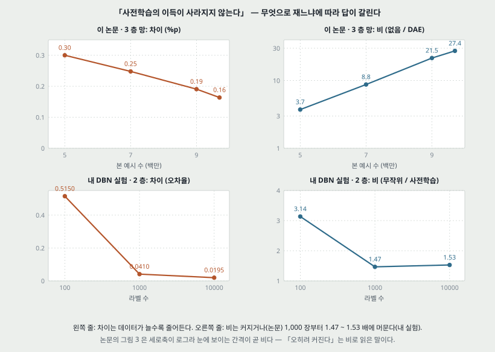

**여기서부터는 논문의 말이 아니라 10절의 표에서 내가 계산한 것이다.**

그림 3 은 세로축이 로그다. 로그 축에서 두 곡선 사이의 간격은 **차이가 아니라 비**다. 3 층 망 둘(사전학습 없음 대 DAE)을 두 가지로 재면 이렇다.

| 창 (백만) | 차이 (%p) | 비 (없음 / DAE) |
|---|---:|---:|
| 4.5\~5.5 | 0.30 | 3.7 |
| 6.5\~7.5 | 0.25 | 8.8 |
| 8.5\~9.5 | 0.19 | 21.5 |
| 9.5\~9.9 | 0.16 | 27.4 |

**비는 3.7 → 27.4 로 커지는데 차이는 0.30 → 0.16 %p 로 줄어든다.** 논문의 「사라지지 않는다, 오히려 반대다」 는 **비로 읽으면 맞고 차이로 읽으면 맞지 않는다.** 차이가 줄어드는 것은 두 곡선 모두 0 쪽으로 내려가니 당연한 면이 있어서, 이것만으로 「결국 사라진다」 고도 말할 수 없다. 1 층 망(없음 대 RBM)은 차이가 0.06 · 0.07 · 0.063 · 0.064 %p 로 **움직이지 않고** 비는 1.2 → 3.0 으로 커진다.

**내 DBN 실험과 같은 모양이다.** DBN 노트 20절의 라벨 수 실험(은닉 256 x 2 층, MNIST, seed 5 중앙값)을 같은 두 잣대로 다시 쓰면:

| 라벨 수 | 차이 (오차율) | 비 (무작위 / 사전학습) |
|---:|---:|---:|
| 100 | 0.5150 | 3.14 |
| 1,000 | 0.0410 | 1.47 |
| 10,000 | 0.0195 | 1.53 |

**1,000 장에서 10,000 장으로 갈 때 차이는 절반 아래로 줄고 비는 1.47 → 1.53 으로 머문다.** 그 실험을 하며 「60,000 장으로 올리면 차이가 사라질 수 있다」 고 적어 두었는데, **차이로 재면 그렇게 보일 수 있고 비로 재면 그렇지 않을 수 있다** — 물음을 다시 세울 때 잣대를 먼저 정해야 한다.

> **둘을 같은 실험으로 놓지 않는다.** 내 실험은 비지도 데이터 10,000 장을 고정하고 **라벨 수만** 바꿨다. 이 논문은 비지도 250 만 개 뒤에 **지도 예시를 계속 늘린다.** 모양이 같다는 것까지만 적는다.

---

## 12. 앞쪽 예시가 더 크게 남는가 (원 그림 4, 논문 6.2절)

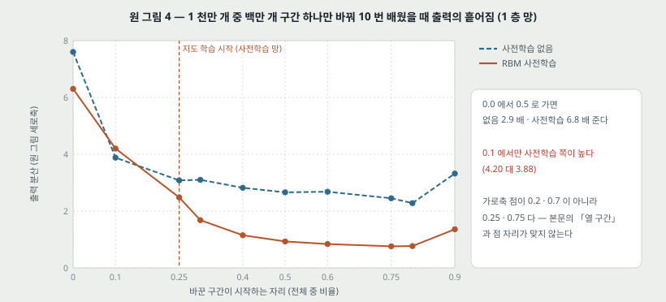

**물음.** 비볼록한 목표를 온라인으로 최적화할 때, **어느 시점에 본 예시가 결과를 더 많이 정하는가.** 볼록한 경우라면 앞쪽 예시가 더 크게 남을 까닭이 없다.

**절차.** 1 천만 개 중 **첫 백만 개만 10 번 다르게 뽑아** 망 10 개를 배우고, 나머지는 고정한다. 고정된 시험 집합에서 **망 출력의 분산**(함수 공간의 분산)을 잰다. 다음 백만 개를 같은 방식으로 바꿔 또 잰다. 1 층 망, 사전학습 없음 대 RBM 사전학습.

원 그림에서 읽은 값(읽기 오차 ±0.05):

| 바꾼 구간의 시작 | 0.0 | 0.1 | 0.25 | 0.3 | 0.4 | 0.5 | 0.6 | 0.75 | 0.8 | 0.9 |
|---|---:|---:|---:|---:|---:|---:|---:|---:|---:|---:|
| 사전학습 없음 | 7.60 | 3.88 | 3.08 | 3.10 | 2.82 | 2.66 | 2.68 | 2.45 | 2.28 | 3.32 |
| RBM 사전학습 | 6.30 | 4.20 | 2.48 | 1.68 | 1.15 | 0.93 | 0.84 | 0.76 | 0.77 | 1.36 |

**논문이 적는 것.** 앞쪽 예시가 뒤쪽보다 출력에 더 크게 남는다(0.0 에서 0.5 로 가며 없음 2.9 배 · 사전학습 6.8 배 준다). 그 분산이 **사전학습한 망에서 낮다.** 사전학습 망의 0.25 지점(지도 학습이 시작되는 자리)의 분산이 사전학습 없는 망보다 **뚜렷이(significantly)** 낮다(2.48 대 3.08). 그래서 사전학습을 **분산 줄이기 장치**로 볼 수 있고, 이것이 정규화 역할과 맞는다. 마지막으로 두 망 모두 **맨 끝 예시**에 대해서도 분산이 다시 올라간다(0.9 지점).

**읽을 때 걸린 것 넷.**

1. **0.1 지점에서는 사전학습 쪽 분산이 더 높다**(4.20 대 3.88). 「사전학습한 망에서 낮다」 는 열 점 중 아홉에서 맞는다.
2. **「뚜렷이」 에 검정이 없다.** 점마다 망 10 개의 분산 하나이고 오차 막대가 없다.
3. **캡션과 본문이 0.25 를 다르게 부른다.** 캡션은 「사전학습의 시작」, 본문은 「지도 학습에 쓰인 첫 예시」 라고 적는다. 6절 설정(비지도 250 만 번 뒤에 지도)으로는 본문 쪽이 맞다. 그리고 사전학습 망의 0.0 · 0.1 지점에서 바꾼 것은 **비지도 예시**다(각주 3).
4. **본문은 열 구간을 차례로 바꾼다고 적는데, 그림의 가로축 점은 0.2 · 0.7 대신 0.25 · 0.75 에 있다.** 0.25 는 사전학습이 끝나는 자리라 일부러 넣은 것으로 보이지만, 그렇다면 0.2 · 0.7 구간을 잰 점은 그림에 없다.

**세로축 이름이 「분산의 평균과 평균에 대한 표준편차(Mean of the variance and the std to the mean)」 로 적혀 있어** 정확히 무엇의 분산인지(소프트맥스 확률인지, 그 전의 값인지) 본문만으로는 모른다. 그래서 이 노트는 **두 곡선의 크기 비교만** 옮기고 값 자체의 뜻은 해석하지 않는다.

---

## 13. 학습 집합 오차를 순서대로 (원 그림 5, 논문 6.3절)

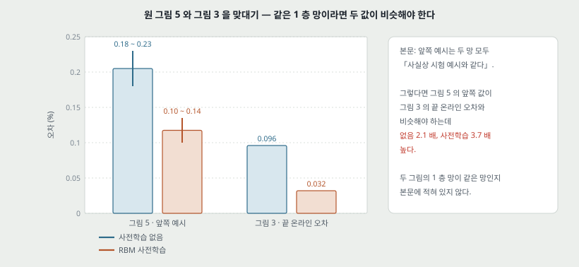

1 층 망 둘을 InfiniteMNIST 1 천만 개로 다 배운 뒤, **배운 순서 그대로** 학습 예시의 분류 오차를 잰다.

| | 처음 750 만 개 구간의 점들 | 맨 끝 점 |
|---|---|---:|
| 사전학습 없음 | 0.18\~0.23% | 0.125% |
| RBM 사전학습 | 0.10\~0.135% | 0.040% |

**논문이 적는 것 셋.**

1. 두 망 모두 **가장 나중에 본 예시**를 더 잘 맞힌다 — 확률적 기울기 하강의 자연스러운 결과다. **앞쪽 예시는 두 망 모두에게 사실상 시험 예시와 같다.**
2. **사전학습한 망이 학습 집합 전체에서 낫다.** 이것은 **최적화 쪽 설명과 잘 맞는다.** MNIST 에서는 사전학습 쪽 학습 오차가 더 높았던 것(Erhan 외 2009b, 이 논문의 8 · 9절)과 다르다.
3. 가장 최근에 본 예시에서조차 (가설대로라면 정규화된) 사전학습 망이 낫다. 정규화된 모델이라면 최근 예시에서 더 나빠야 할 것 같지만, 비볼록성 때문에 **두 망 모두 지도 최적화의 출발점에 묶여 있고**, 사전학습 망의 출발점은 일반화가 나은 끌림 구역이라는 것이다.

**그림 3 과 맞대면 값이 맞지 않는다.** 1번대로 앞쪽 예시가 시험 예시와 같다면, 그 오차는 다 배운 망의 시험 오차, 곧 **그림 3 의 끝 온라인 오차와 비슷해야** 한다. 그런데:

| 1 층 망 | 그림 5 · 앞쪽 예시 | 그림 3 · 9.5\~9.9 백만 온라인 오차 | 비 |
|---|---:|---:|---:|
| 사전학습 없음 | 0.18\~0.23% | 0.096% | 2.1 배 |
| RBM 사전학습 | 0.10\~0.135% | 0.032% | 3.7 배 |

**두 그림의 1 층 망이 같은 망인지(은닉 2500 인지) 본문에 적혀 있지 않다.** 그리고 그림 5 의 곡선은 **앞쪽이 뒤쪽보다 높지 않고** 750 만 개 구간 내내 같은 띠에 있다가 가로축 8.5\~9 백만 자리 뒤에서만 내려간다 — 「앞쪽 예시는 시험 예시와 같다」 면 「중간 예시도 시험 예시와 같다」 가 된다.

---

## 14. 필터 (원 그림 6, 논문 6.4절)

InfiniteMNIST 로 배운 층마다 1000 유닛의 3 층 망 둘의 필터를 본다. 첫 층은 가중치 그대로, 2 · 3 층은 **활성 최대화**(그 유닛을 가장 크게 켜는 입력을 입력 공간의 기울기 오름으로 찾는 것, Erhan 외 2009a)로 그린다.

| | 사전학습 직후 (DBN) | 미세조정 뒤 (DBN) | 순수 지도 망 |
|---|---|---|---|
| 1 층 | 획 · 점 · 고리 모양 | **눈으로는 바뀌지 않는다** | 얼룩 섞인 획 |
| 2 층 | 숫자 조각 | 조금 바뀐다 | 잡음에 가깝다 |
| 3 층 | 숫자 꼴 | 셋 중 가장 많이 바뀐다 | 잡음에 가깝다 |

**논문의 결론.** 비지도 학습이 망을 가중치 공간의 어느 구역에 「**붙잡아 둔다(stuck)**」. 지도 갱신 750 만 번도 가중치를 (적어도 눈으로는) 크게 바꾸지 못한다. 층마다 다르게 바뀌어 **첫 층이 가장 적게, 셋째 층이 가장 많이** 바뀐다. 순수 지도 망의 필터는 미세조정 뒤에도 DBN 과 **질적으로 다르다** — Erhan 외(2009b)의 「두 망이 함수 공간에서 서로 다른 구역을 탐색한다」 를 매개변수 공간에서 다시 확인한 것이라 적는다.

이것은 **눈으로 본 것**이고 수치가 없다. 「바뀌지 않는다」 는 가중치의 상대 변화량 같은 값으로 재지 않았다.

---

## 15. InfiniteMNIST: 아래 k 층만 사전학습 · 흔한 정규화 (원 그림 7, 논문 6.5절)

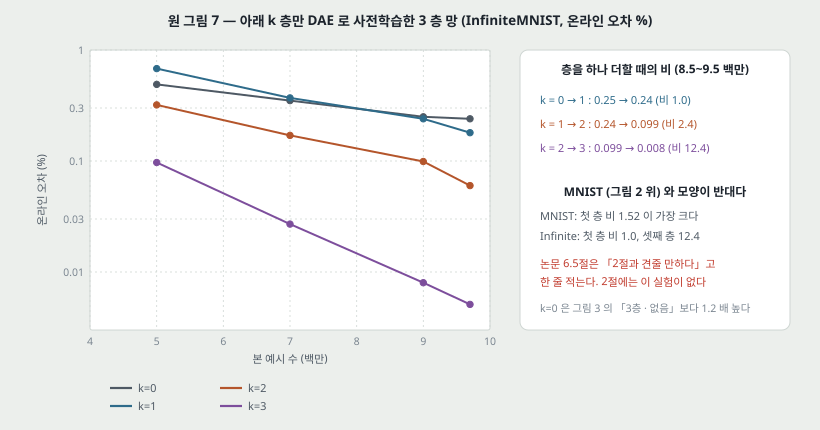

8절의 실험을 InfiniteMNIST 온라인 오차로 다시 한다. 이번에는 **DAE 로** 아래 k 층을 사전학습한다.

| k | 4.5\~5.5 백만 | 6.5\~7.5 백만 | 8.5\~9.5 백만 | 9.5\~9.9 백만 |
|---:|---:|---:|---:|---:|
| 0 | 0.49 (0.44\~0.58) | 0.35 (0.29\~0.41) | 0.25 (0.23\~0.27) | 0.24 (0.23\~0.25) |
| 1 | 0.68 (0.60\~0.81) | 0.37 (0.33\~0.43) | 0.24 (0.19\~0.29) | 0.18 (0.15\~0.19) |
| 2 | 0.32 (0.24\~0.44) | 0.17 (0.15\~0.22) | 0.099 (0.073\~0.13) | 0.060 (0.049\~0.10) |
| 3 | 0.097 (0.056\~0.16) | 0.027 (0.017\~0.038) | 0.0080 (0.0060\~0.012) | 0.0051 (0.0027\~0.012) |

**논문의 문장은 하나다** — 「결과가 2절의 결과와 견줄 만하다」. 그런데 **2절에는 이 실험이 없다**(2절은 앞선 논문 정리다). 8절의 그림 2 위를 가리킨 것으로 보인다. 그렇게 읽고 둘을 맞대면 **모양이 반대다.**

| 층을 하나 더 사전학습할 때의 비 | 첫 층 (0 → 1) | 둘째 층 (1 → 2) | 셋째 층 (2 → 3) |
|---|---:|---:|---:|
| MNIST, RBM, 시험 NLL (그림 2 위) | **1.52** | 1.27 | 1.36 |
| InfiniteMNIST, DAE, 온라인 오차 8.5\~9.5 백만 (그림 7) | 1.0 | 2.4 | **12.4** |

InfiniteMNIST 에서는 **첫 층만 사전학습하면 8.5\~9.5 백만 창에서 이득이 없고**(두 창의 범위가 겹친다), 마지막 창에서야 1.3 배가 된다. 셋째 층의 몫이 가장 크다. 데이터 · 사전학습 방법 · 지표가 함께 바뀌어서 어느 것 때문인지는 모른다. 다만 **8절의 본문 문장(「첫 층에서는 아니다」) 은 그림 2 위보다 이 그림 7 의 모양과 맞는다.**

**같은 조건이 두 그림에서 다르게 나온다.** k = 0 은 「사전학습 없는 3 층 망, 1 천만 번」 으로 그림 3 의 같은 망과 조건이 같아 보이는데, 8.5\~9.5 백만 창에서 0.25 대 0.20(1.2 배), 9.5\~9.9 백만 창에서 0.24 대 0.17(1.4 배)이다. 두 그림이 같은 실행인지 적혀 있지 않다. 다른 실행이라면 이 1.2\~1.4 배가 **실행 사이 흩어짐의 한 예**다.

**흔한 정규화로 대신할 수 있는가.** 사전학습 없는 망에 L1 · L2 가중치 벌점을 걸어 봤더니, 작은 벌점이 경우에 따라 도움이 될 수는 있지만 **사전학습만큼의 이득에는 전혀 못 미쳐(nowhere near)** 이 가설을 기각한다고 적는다. **표도 그림도 수치도 없다.** 벌점 크기를 얼마나 훑었는지도 없다.

---

## 16. 논의 — 둘을 엮는 설명 (논문 7절)

논문이 세우는 최종 그림이다.

1. 확률적 기울기 하강(SGD)의 궤적에 **작은 흔들림을 주면 초반에 더 큰 변화가 생긴다.** 초반에는 가중치가 커지며 망에 비선형성이 더해지기 때문이다.
2. 학습이 이어질수록 **SGD 가 갈 수 있는 구역이 점점 좁아진다.** 학습은 초반 흔들림이 정한 끌림 구역에 「**갇히고**」, 거기서 빠져나오기 어려워진다. 각주 5 는 이것이 겉으로는 신경과학 · 심리학의 **결정적 시기(critical period)** 처럼 보일 것이라 적는다.
3. 그래서 지도 데이터가 사실상 무한해도 SGD 는 **초반에 본 학습 데이터에 어느 정도 과적합**할 수 있다.
4. 사전학습은 지도 학습의 출발점을 정해 그 과정을 **비지도 학습에 쓸모 있는 매개변수의 끌림 구역**에 가두는 (영리한) 방법이다. 결과가 보여 주듯 **대규모에서도 효과가 이어진다.**
5. 그래서 흔한 정규화와 달리 **사전학습의 효과는 사라지지 않는다.**

**작은 데이터와 큰 데이터를 가른다.** 학습 집합이 작으면 과적합이 문제라 학습 오차를 줄이는 데 관심이 없고, 거기서 사전학습은 **일반화 면에서 더 나은 최소**를 찾게 돕는다. 대규모에서는(그림 5) **더 좋은 국소 최소를 찾는 것 자체가 중요해지고, 더 센 최적화 기법이 일반화에 큰 영향을 줄 것**이라 적는다.

**한 줄로 적으면**, 논문의 답은 「정규화냐 최적화냐」 가 아니라 **「비볼록 최적화의 출발점이 결과를 묶어 두는데, 사전학습이 그 출발점을 고른다」** 이다. 작은 데이터에서는 그 묶음이 정규화처럼 보이고, 큰 데이터에서는 최적화처럼 보인다.

---

## 17. 이 논문이 스스로 적은 한계와 앞으로 할 일

논문 7절의 끝이 적은 것 그대로다.

1. **앞쪽 예시의 영향이라는 발견은 앞으로의 연구로 확인해야 한다.** 그것이 확인되면 특히 대규모에서 **앞쪽 예시의 영향을 줄이는 알고리즘**을 생각해야 할 수 있다.
2. **커리큘럼 학습**(Bengio 외 2009 — 쉬운 예시에서 어려운 예시로 순서를 정하면 차이가 난다)과의 연결을 더 살펴야 한다.
3. **학습 단계가 하나뿐인 준지도 방법**(Larochelle · Bengio 2008, Weston 외 2008)을 분석해야 한다.
4. **$P(Y, X)$ 의 생성 모델을 배우는 것이 $P(Y \mid X)$ 만 배우는 것보다 왜 정규화 효과를 내는지**(Ng · Jordan 2002)를 이해하고 싶다. 각주 6 은 그 경우에는 **학습 집합이 커질수록 성능 차이가 준다**고 덧붙인다 — 이 논문의 사전학습과 반대 방향이다.
5. **Fisher 커널**(Jaakkola · Haussler 1999)을 쓰는 「사전학습」 에서도 이 결과가 서는지 보고 싶다.

그리고 마지막 문장은 자기 가설이 **많은 모의실험으로 잘 지지된다**고 적는다.

---

## 18. 논문이 적지 않은 것 — 내가 읽으며 짚은 자리

**여기서부터는 논문의 말이 아니라 내 것이다.**

**하나. 「사라지지 않는다」 는 비로 읽은 말이다**(11절). 3 층 망의 차이는 0.30 → 0.16 %p 로 줄고 비는 3.7 → 27.4 로 커진다. 그림 3 의 세로축이 로그라 눈에 보이는 간격이 비다. 논문의 결론이 틀렸다는 것이 아니라, **「무엇이 사라지지 않는가」 를 적지 않아** 읽는 사람이 차이로 읽으면 그림과 어긋난다는 것이다.

**둘. 온라인 실험에 seed 흩어짐이 없다.** 그림 3 · 7 은 곡선 하나가 실행 하나다. 같은 조건으로 보이는 두 곡선(그림 3 의 「3 층 · 없음」 과 그림 7 의 k = 0)이 1.2\~1.4 배 다르다. 그런데 이 논문의 중심 결론 하나(「앞쪽 예시가 결과를 정한다」)가 바로 **실행마다 결과가 갈린다**는 주장이다. 그러면 seed 를 바꾼 흩어짐이 표마다 있어야 차이를 판정할 수 있다. 이 판에는 그것이 그림 4 의 1 층 망 하나뿐이다.

**셋. 본문과 그림이 어긋나는 자리가 셋이다.**

| 자리 | 본문 | 그림에서 읽은 것 |
|---|---|---|
| 8절 · 그림 2 위 | 첫 층의 사전학습은 가장 큰 몫이 아니다 | 첫 층의 몫이 차로도 비로도 가장 크다 |
| 15절 · 그림 7 | 「2절의 결과와 견줄 만하다」 | 2절에 이 실험이 없다. 그림 2 위와 견주면 모양이 반대다 |
| 13절 · 그림 5 | 앞쪽 학습 예시는 시험 예시와 같다 | 그 오차가 그림 3 의 끝 온라인 오차의 2.1 · 3.7 배다 |

그리고 12절의 캡션-본문 어긋남(0.25 가 무엇의 시작인가)과 9절의 각주 1(사전학습 방법이 함께 바뀐다)이 있다. **학회판이라 저널판에서 고쳐졌을 수 있다** — 저널판을 읽을 때 이 다섯 자리를 먼저 맞춰 본다.

**넷. 「정규화」 와 「최적화」 를 가르는 잣대가 실험마다 다르다.** MNIST 에서는 **학습 오차가 높으면 정규화**로 읽고(8 · 9절), InfiniteMNIST 에서는 **학습 집합 오차가 낮으면 최적화**로 읽는다(13절). 그런데 InfiniteMNIST 의 학습 예시는 저마다 한 번씩만 보므로 학습 집합 오차가 시험 오차와 같은 성격이다 — **잣대 자체가 두 설정에서 같은 것을 재지 않는다.** 논문의 7절이 「작은 데이터에서는 정규화처럼, 큰 데이터에서는 최적화처럼 보인다」 로 엮는 것은 이 잣대 차이를 설명으로 바꾼 것으로도 읽힌다.

**다섯. 식 (2) 가 실험과 이어지지 않는다.** $\pi_k$, $r_k$, $v_k$ 를 하나도 재지 않고, 끌림 구역을 세는 방법도 없다. 식은 「출발점이 제약을 건다」 를 사전분포의 언어로 옮긴 것이지, 실험이 검증하는 양이 아니다. 무작위 초기화 400 번(2절)이 매번 다른 국소 최소에 닿았다는 것은 **구역의 수가 400 을 넘을 수 있다**는 것까지만 말한다.

**여섯. 1 층 망 2500 유닛과 3 층 망 800\~1200 유닛의 크기가 0.96\~1.93 배로 갈린다**(6절). 「사전학습 없는 3 층이 1 층보다 나쁘다」 를 깊이의 어려움으로 읽으려면 같은 크기에서 비교해야 하는데, 고른 폭이 적혀 있지 않다.

---

## 19. 읽을 때 헷갈리는 지점

**「DBN」 이 2006 년 논문의 DBN 이 아니다.** 여기서는 RBM 을 층별로 쌓고 **지도 역전파로 미세조정**한 망이다. 2006 년 논문의 위-아래 알고리즘과 연상 기억(맨 위 두 층)이 없다.

**「정규화」 가 벌점 항이 아니다.** 손실에 더하는 항이 없다. 출발점을 고르는 것이 곧 사전분포를 고르는 것이라는 뜻이고, 식 (1)\~(3) 은 그것을 사전분포로 **다시 적은** 것이다.

**그림 3 · 7 의 사전학습 곡선이 250 만에서 시작하는 것은 늦게 시작한 것이 아니다.** 가로축이 비지도 몫을 포함한 「본 예시 수」 라서다. 같은 가로 자리에서 사전학습 쪽이 **지도 갱신을 250 만 번 덜** 받았다.

**그림 2 의 축 이름 「log(train NLL)」 은 로그를 취한 값이 아니라 로그 눈금의 NLL 이다.** 눈금이 $10^{-5}$, $10^{-4}$ 로 적혀 있다.

**온라인 오차는 학습 오차가 아니다.** 아직 안 본 다음 묶음에 대한 오차라 시험 오차의 성격이다. 그래서 논문이 「좋은 온라인 오차 = 학습 기준을 잘 최적화한다」 고 적을 때의 학습 기준은 **일반화 오차 자체**다.

**사전학습 망의 그림 4 앞쪽 두 점(0.0 · 0.1)은 비지도 예시를 바꾼 것이다.** 사전학습 없는 망의 같은 점은 지도 예시를 바꾼 것이다. 두 곡선의 같은 가로 자리가 같은 종류의 예시가 아니다.

---

## 20. DBN 노트 · 실험과 맞춰 보기

DBN 노트와 그 실험이 남긴 물음에 이 논문이 어디까지 답하는지 적는다.

| DBN 노트 · 실험이 남긴 것 | 이 논문이 답한 것 | 남는 것 |
|---|---|---|
| 탐욕 사전학습의 몫과 미세조정의 몫이 갈려 있지 않다 | 사전학습 유무만 바꾼 비교를 MNIST · InfiniteMNIST 에서 한다. 같은 칸을 내가 MNIST 10,000 장으로 쟀을 때와 방향이 같다(사전학습이 이긴다) | 이 논문도 미세조정은 지도 역전파다. 2006 년의 위-아래 알고리즘에서 탐욕 단계가 필요했는지는 여전히 열려 있다 |
| 규모를 올려도 차이가 남는가 | 예시 1 천만 개에서 **비는 커지고 차이는 줄어든다**(11절) | 「남는다」 를 비로 재는지 차이로 재는지 먼저 정해야 한다. 내 실험도 같은 모양이다 |
| 차이가 깊이를 따라 커진다(+0.0130 → +0.0215 → +0.0245) | MNIST 에서 사전학습이 이기기 시작하는 층 크기가 깊을수록 작아진다(7절). InfiniteMNIST 에서 3 층 망의 비가 1 층 망보다 크다(11절) | 같은 크기 · 같은 seed 수에서 깊이만 바꾼 비교는 이 판에 없다 |
| 사전학습이 기울기를 키우지 않고 깊이에 걸쳐 편다(14.8 배 대 4.9 배) | 다루지 않는다. 대신 **첫 층 필터가 미세조정 뒤에도 눈으로는 바뀌지 않는다**는 것을 보인다(14절) | 「기울기를 편다」 와 「구역에 가둔다」 가 같은 현상의 두 얼굴인지는 이어서 재 볼 자리다 |

---

## 21. 다음에 읽을 것

**한계를 적고 그 한계를 푼 것이 다음 논문이다.** 이 논문이 남긴 자리에서 다섯을 꼽는다.

| 다음 | 이 논문의 어느 자리에서 나오는가 | 무엇을 확인하고 싶은가 |
|---|---|---|
| **같은 제목의 JMLR 2010 저널판** | 18절 셋 — 학회판의 본문-그림 어긋남 다섯 자리, 18절 둘 — seed 흩어짐 | 저널판에서 같은 그림이 어떻게 고쳐졌는지, 온라인 실험에 반복이 붙었는지 |
| **Erhan 외 (2009b)** — The difficulty of training deep architectures and the effect of unsupervised pre-training (AISTATS 2009) | 4절 — 앞선 실험 다섯 중 셋(400 초기화 · 분산 · 용량 조절)과 식 (2) 의 출처 | 함수 공간 시각화와 「두 구역이 겹치지 않는다」 를 무엇으로 쟀는지 |
| **Glorot · Bengio (AISTATS 2010)** — Understanding the difficulty of training deep feedforward neural networks | 같은 학회 · 같은 연구실. 이 논문은 출발점을 **비지도로** 고르고, 그 논문은 출발점을 **분산을 맞춘 무작위로** 고른다 | 사전학습 없이 초기화만으로 이 논문의 「사전학습 없음」 곡선이 얼마나 내려오는지 |
| **Hessian-free (Martens, ICML 2010)** — Deep learning via Hessian-free optimization | 16절 — 「대규모에서는 더 센 최적화가 일반화에 큰 영향을 줄 것」 | 더 센 최적화가 사전학습 없이 같은 자리에 닿는지. 오토인코더 노트도 같은 편을 꼽는다 |
| **Curriculum learning (Bengio 외, ICML 2009)** | 17절 1 · 2 — 앞쪽 예시가 결과를 정한다면, 앞쪽 예시를 고르는 것 | 「앞쪽에 무엇을 보이느냐」 가 사전학습의 대안이 되는지 |

읽는 순서로는 **저널판이 먼저**다. 이 노트가 짚은 어긋남 다섯이 고쳐졌는지에 따라 11 · 15 · 18절의 문장이 바뀐다. 그다음은 **Glorot · Bengio** — 같은 해 같은 학회에서 같은 문제에 다른 답을 낸 편이라, 둘을 나란히 놓아야 「사전학습이 필요한가」 에 답이 선다.

---

## 22. 돌려 볼 것

**아직 아무것도 돌리지 않았다.** 노트를 쓰며 「직접 재고 싶다」 가 된 것 셋을 적어 둔다. 셋 다 DBN 실험 폴더의 코드를 고쳐 쓰면 된다.

**하나. 내 DBN 실험의 라벨 축을 60,000 장까지 늘리고 차이와 비를 함께 적는다.** 11절에서 1,000 → 10,000 장의 비가 1.47 → 1.53 으로 머물렀다. 60,000 장에서 **차이는 줄고 비는 머무는지**, 아니면 비도 1 로 내려가는지가 「규모를 올려도 남는가」 에 대한 내 쪽의 답이다. seed 변동 폭을 함께 재서 판정 규칙을 미리 적는다.

**둘. 그림 4 를 작게 다시 해 본다.** MNIST 60,000 장을 여섯 구간으로 나누고, 한 구간만 다르게 뽑아(InfiniteMNIST 대신 같은 숫자에 다른 탄성 변형) 망 10 개를 배워 시험 출력의 분산을 잰다. **앞쪽 구간의 분산이 뒤쪽보다 큰지**, 그것이 사전학습 망에서 작은지를 본다. 세로축을 소프트맥스 확률의 분산으로 **정의하고** 시작한다 — 12절에서 원 그림의 세로축이 무엇인지 알 수 없었던 것을 되풀이하지 않는다.

**셋. 15절의 L1 · L2 문장을 수치로 바꾼다.** 사전학습 없는 2 층 망에 L2 벌점을 $10^{-6}$ 에서 $10^{-2}$ 까지 다섯 값으로 걸고, 가장 좋은 값이 사전학습과의 차이를 몇 %p 줄이는지 잰다.

---

## 23. 물어 두는 것

- **그림 3 과 그림 5 의 1 층 망이 같은 망인가.** 같다면 앞쪽 학습 예시 오차(0.18\~0.23%)가 끝 온라인 오차(0.096%)의 2.1 배인 것을 어떻게 읽는가(13절).
- **그림 4 의 세로축이 무엇의 분산인가.** 소프트맥스 출력이라면 값이 8 까지 올라갈 수 없을 것 같은데, 평균을 낸 단위가 적혀 있지 않다.
- **「초반에 가중치가 커지며 비선형성이 더해져 갈 수 있는 구역이 좁아진다」(16절 1 · 2) 를 잰 그림이 있는가.** 이 판에는 가중치 크기의 시간 변화가 없다. 7절의 설명 전체가 이 문장 위에 서 있다.
- **SDAE 3 층이 DBN 3 층보다 5 배 낮은 까닭**을 논문은 적지 않는다. RBM 은 3 층과 1 층이 겹치는데 DAE 는 3 층이 5.9 배 낮다(8.5\~9.5 백만, 0.0093 대 0.055).

---

## 24. 참고 문헌

이 노트가 인용한 편만 적는다. 원리는 원 출처를, 구현은 그 라이브러리의 편을 적는 규칙을 따른다.

- Erhan, D., Courville, A., Bengio, Y., and Vincent, P. (2010). Why does unsupervised pre-training help deep learning? **AISTATS 2010**, JMLR W&CP 9:201–208. — 이 노트의 대상.
- Erhan, D., Bengio, Y., Courville, A., Manzagol, P.-A., Vincent, P., and Bengio, S. (2010). Why does unsupervised pre-training help deep learning? **Journal of Machine Learning Research**, 11:625–660. — 같은 제목의 저널판. 이 노트는 읽지 않았다.
- Erhan, D., Manzagol, P.-A., Bengio, Y., Bengio, S., and Vincent, P. (2009b). The difficulty of training deep architectures and the effect of unsupervised pre-training. **AISTATS 2009**, 153–160. — 정규화 가설과 식 (2) · (3) 의 원 출처, 2절의 400 초기화 · 분산 · 용량 조절.
- Erhan, D., Bengio, Y., Courville, A., and Vincent, P. (2009a). Visualizing higher-layer features of a deep network. Technical Report 1341, Université de Montréal. — 14절의 활성 최대화.
- Bengio, Y., Lamblin, P., Popovici, D., and Larochelle, H. (2007). Greedy layer-wise training of deep networks. **NIPS 19**, 153–160. — 최적화 가설과 맨 위 층 20 유닛 실험의 원 출처.
- Hinton, G. E., Osindero, S., and Teh, Y. (2006). A fast learning algorithm for deep belief nets. **Neural Computation**, 18:1527–1554. — RBM 층별 사전학습의 원 출처.
- Vincent, P., Larochelle, H., Bengio, Y., and Manzagol, P.-A. (2008). Extracting and composing robust features with denoising autoencoders. **ICML 2008**. — 잡음 제거 오토인코더 사전학습의 원 출처.
- Loosli, G., Canu, S., and Bottou, L. (2007). Training invariant support vector machines using selective sampling. In **Large Scale Kernel Machines**, 301–320. MIT Press. — InfiniteMNIST 의 원 출처.
- LeCun, Y., Bottou, L., Bengio, Y., and Haffner, P. (1998). Gradient-based learning applied to document recognition. **Proceedings of the IEEE**, 86:2278–2324. — MNIST 의 원 출처.
- Bengio, Y., Louradour, J., Collobert, R., and Weston, J. (2009). Curriculum learning. **ICML 2009**. — 17절의 커리큘럼 학습.
- Ng, A. Y. and Jordan, M. I. (2002). On discriminative vs. generative classifiers: A comparison of logistic regression and naive Bayes. **NIPS 14**, 841–848. — 17절 4 와 각주 6.
- Bornstein, M. H. (1987). Sensitive periods in development: interdisciplinary perspectives. Lawrence Erlbaum Associates. — 각주 5 의 결정적 시기.

---

## 25. 경로

| 무엇 | 어디 |
|---|---|
| 원문 PDF | `papers/AISTATS10_Pretrain_Why_Does_Unsupervised_Pre_training_Help_Deep_Learning.pdf` |
| 원문 주소 | https://proceedings.mlr.press/v9/erhan10a.html |
| 이 노트의 그림 | `figures/AISTATS10_Pretrain/fig01_two_hypotheses.svg` 부터 `fig12_lineage.svg` 까지 열둘 |
| 그림을 만드는 코드 | `figures/AISTATS10_Pretrain/make_figures.py` — 원 그림에서 읽은 값을 상수로 들고 있어 바깥 데이터를 읽지 않는다. `python make_figures.py` 로 어디서나 다시 만든다 |
| 11절이 맞댄 내 실험 | `experiments/dbn_2006/` — 라벨 수 실험은 `results/E_label_scarcity.csv` |

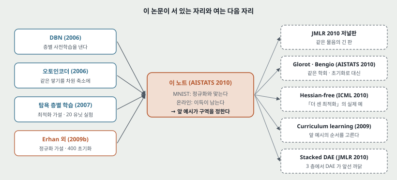
