# YOLO — You Only Look Once: Unified, Real-Time Object Detection (CVPR 2016, 요약)

> **한 줄.** 제안을 내고 다시 판정하는 단계를 없애, 이미지 전체를 망에 한 번 넣어 7 x 7 칸마다 상자 둘과 부류 20 을 **제곱 오차 회귀 하나**로 낸다. VOC 2007 mAP 63.4 · 45 fps, 작은 판 Fast YOLO 52.7 · 155 fps. 표 3 의 VOC 2012 는 57.9.

> **이 노트에서 가장 먼저 볼 자리 다섯.** (1) **「YOLO 의 AP 가 다른 방법보다 덜 떨어진다」 는 재는 방식을 고르면 뒤집힌다.** 비로는 YOLO 90.0% 대 DPM 87.5% 로 맞다. 점으로는 Picasso DPM -5.4 대 YOLO -5.9, People-Art DPM -11.2 대 YOLO -14.2 로 DPM 이 덜 빠진다(내 계산, 9절). (2) **「다른 실시간 검출기의 2 배」 는 학습 데이터가 다른 값의 비다.** Fast YOLO 는 2007 + 2012, 30Hz DPM 은 2007 로 배웠고 표 1 에 그대로 적혀 있다. 52.7 / 26.1 = 2.02 다(6절). (3) **같은 체계의 값이 두 벌이다.** Fast R-CNN 은 표 1 에서 70.0, 표 2 에서 71.8 이고, Faster R-CNN 은 이 편에서 7 · 18 fps, 그 원논문에서 5 · 17 fps 다(6 · 12절). (4) **「검출 성능을 곧장 최적화한다」 와 「맞지 않는다」 가 한 편에 다 있다.** 초록과 결론은 곧장(directly), 2.2절은 제곱 오차가 AP 와 「완전히 맞지는 않는다」, 2.4절은 「근사한다」 고 적는다(12절). (5) **「작은 물체에 약하다」 는 물체 크기로 잰 값이 아니다.** 표 3 에 크기별 AP 가 없고 부류 이름(병 · 양 · 모니터)으로 말한다. 그 부류의 차이도 「8 ~ 10%」 가 아니라 내가 빼니 7.0 ~ 14.2 점이다(8절).

---

## Paper Metadata

| Item | Content |
|---|---|
| Title | You Only Look Once: Unified, Real-Time Object Detection |
| Authors | Joseph Redmon, Santosh Divvala, Ross Girshick, Ali Farhadi |
| 소속 | University of Washington (Redmon · Divvala · Farhadi), Allen Institute for AI (Divvala · Farhadi), Facebook AI Research (Girshick) |
| Conference / Journal | **CVPR 2016**, 779-788쪽. 쪽 번호는 파일 꼬리에서 읽었다 |
| Year | 2016. arXiv v1 2015-06-08 ~ v5 2016-05-09 |
| DOI | arXiv:1506.02640. 파일에 DOI 는 찍혀 있지 않다 |
| 코드 | `http://pjreddie.com/yolo/` (원문). 이 노트는 코드를 보지 않았고 주소가 지금도 열리는지 확인하지 않았다 |
| Stored PDF | `papers/CVPR16_YOLO_You_Only_Look_Once_Unified_Real_Time_Object_Detection.pdf` |
| 왜 읽었는가 | 큰 틀 「분할 · 검출」 의 넷째 칸. YOLO 계열 가운데 첫 편을 골랐다. Faster R-CNN 노트에서 표 5 로 흉내만 낸 한 단계를 실제 체계로 본다 |
| 읽은 범위 | **2026-11-08 에 CVPR 판 10 쪽을 전부 읽었다.** 곧 Abstract · 1 ~ 6절 · 식 (1) ~ (3) · 표 1 ~ 3 · 그림 1 ~ 6 과 캡션 · 참고 문헌 38 건의 서지. 쪽 이미지로 식과 그림을 맞췄다. 참고 문헌의 편들과 YOLOv2 이후 계열, 코드는 읽지 않았다 |

### 저장한 파일의 상태

- **CVF Open Access 게재판 10 쪽이다.** 본문 8 쪽 + 참고 문헌 2 쪽.
- **arXiv v5 를 받아 숫자를 맞췄다.** 쪽수 10 · 표 3 · 그림 6 으로 같고, 소수 표기 숫자의 집합이 식별자 하나 말고 같다. 문장 하나하나를 대조하지는 않았다.
- 그림 5(a) 의 정밀도-재현율 곡선은 래스터라 값을 읽지 않았다. 수치는 그림 5(b) 의 표에서 옮겼다. 그림 4 의 비율은 글자 층에 있다.

---

## 1. 용어

- **한 단계 검출 (one-stage)**: 제안을 따로 내지 않고 조밀한 위치에서 곧장 상자와 부류를 내는 방식. 이 편의 용어는 「unified」 이고, 이 노트는 Faster R-CNN 노트와 같이 「한 단계」 라 부른다.
- **격자 칸 (grid cell)**: 입력을 $S \times S$ 로 나눈 칸. 물체 중심이 든 칸이 그 물체를 맡는다. 작은 예시로, $S = 7$, 입력 448 이면 칸 한 변이 64 픽셀이다.
- **상자 예측기 (bounding box predictor)**: 칸마다 $B = 2$ 개. 값은 $x, y, w, h$, 신뢰도 다섯. 학습 때 정답과 현재 IoU 가 가장 높은 쪽이 「맡는다(responsible)」.
- **신뢰도 (confidence)**: $\Pr(\text{Object}) \cdot \text{IOU}^{truth}_{pred}$. 물체 없는 칸의 목표는 0, 있는 칸의 목표는 IoU 다. 작은 예시로, 물체가 있고 IoU 가 0.7 이면 목표는 0.7 이다.
- **조건부 부류 확률**: $\Pr(\text{Class}_i \mid \text{Object})$. 칸마다 한 벌이라 상자 둘이 부류를 나눠 쓴다.
- **실시간 (real-time)**: 원문 정의는 30 fps 이상(4.1절). Faster R-CNN 제목의 「Towards Real-Time」 과 기준이 다르다.
- **FPS · 지연**: 45 fps 는 한 장 22.2 ms, 155 fps 는 6.5 ms 다(내 나눔).
- **위치 오차 · 배경 오차 (localization, background)**: 그림 4 의 판정. 위치는 부류가 맞고 $0.1 < IOU < 0.5$, 배경은 어떤 물체와도 $IOU < 0.1$ 이다. 상위 $N$ 개($N$ = 그 부류의 물체 수)만 본다.
- **백분율 점**: 원문은 「3.2%」 처럼 적는다. 이 노트는 mAP 차이를 「3.2 점」 으로 적는다.

---

## 2. 한 문단 요약

R-CNN 계열은 제안을 만들고 분류하고 상자를 다듬고 중복을 지우는 단계를 따로 다듬어야 해 느리다. 이 편은 검출을 회귀 한 번으로 바꾼다. 이미지를 448 x 448 로 줄여 망에 넣고, 출력 7 x 7 x 30 을 바로 읽어 문턱과 NMS 만 건다. 이미지 전체를 보니 배경 오차가 적고 그림 같은 다른 영역에도 덜 깨진다고 적으며, 대가는 위치 오차와 작은 물체다. 실험은 속도-mAP 비교(표 1), Fast R-CNN 과의 오차 분해(그림 4), 합치기(표 2), VOC 2012 순위표(표 3), 그림 데이터(그림 5)다.

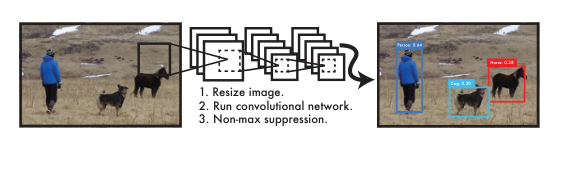

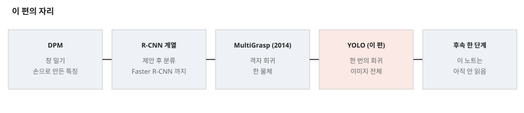

---

## 3. 문제 / 동기

**이 논문이 없앤 전제: 검출은 분류기를 여러 곳에 돌리는 일이다.**

원문의 문제 제기(1절)는 복잡한 체계가 느리고 단계별로 따로 학습해 최적화하기 어렵다는 것이다. 얻는 것을 셋으로 적는다.

1. **빠르다.** Titan X 에서 45 fps, 작은 판 150 fps 이상. 다른 실시간 체계의 2 배 넘는 mAP.
2. **전체를 본다.** Fast R-CNN 이 맥락을 못 봐 배경을 물체로 착각한다고 적고, YOLO 배경 오차가 그 절반 미만이라 적는다.
3. **일반화한다.** 자연 이미지로 배워 그림에 적용하면 DPM · R-CNN 을 넘는다.

그리고 같은 절에서 **「정확도는 뒤처지고 작은 물체 위치에 약하다」** 고 먼저 밝힌다.

---

## 4. 핵심 기술

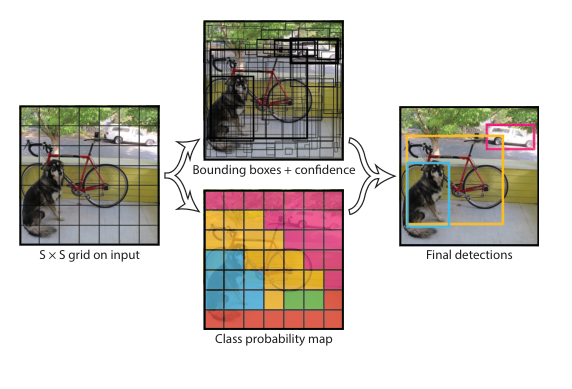

**① 출력.** $S \times S \times (B \cdot 5 + C)$. VOC 는 $S = 7$, $B = 2$, $C = 20$ 으로 7 x 7 x 30.

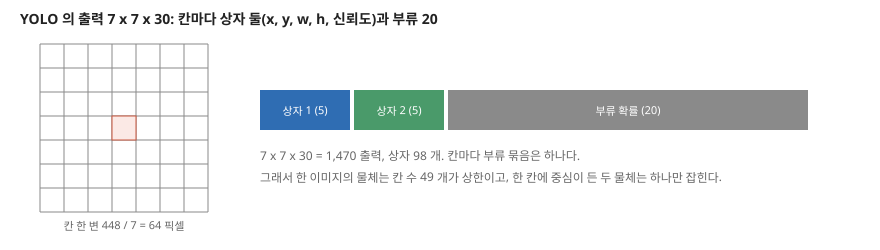

**② 시험 점수.** 식 (1): 부류 확률 x 신뢰도 = $\Pr(\text{Class}_i) \cdot \text{IOU}^{truth}_{pred}$. 상자 98 개에 부류별 점수가 나오고, 문턱과 NMS 를 건다. 원문은 NMS 가 mAP 를 2 ~ 3% 더한다고 적는다(표 없음).

**③ 망.** 합성곱 24 층 + 완전 연결 2 층. GoogLeNet 에서 착안했으나 Inception 대신 1 x 1 축소 뒤 3 x 3 을 쓴다. 활성 함수는 새는 ReLU(음수 쪽 기울기 0.1), 마지막 층은 선형.

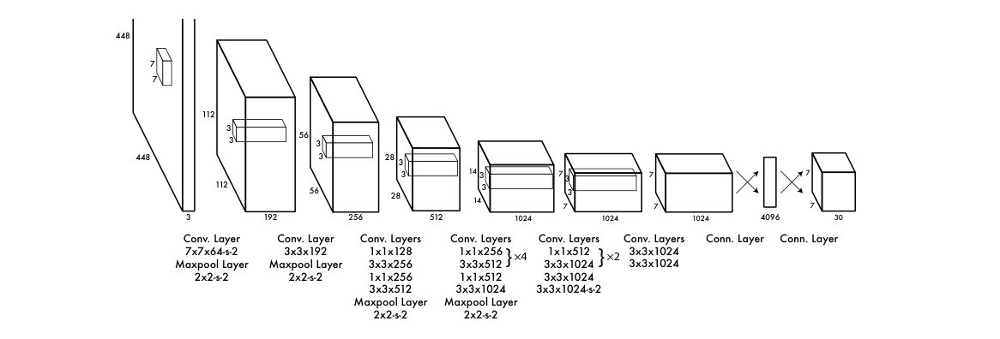

**④ 사전학습.** 앞 20 층 + 평균 풀링 + 완전 연결로 ImageNet 을 약 일주일 학습, 단일 자르기 top-5 88%. 뒤에 합성곱 4 층과 완전 연결 2 층을 무작위 초기화로 붙이고 입력을 224 에서 448 로 키운다.

**⑤ 손실.** 식 (3). 원문 기호 그대로 옮긴다.

$$\begin{aligned}&\lambda_{coord} \sum_{i=0}^{S^2} \sum_{j=0}^{B} \mathbb{1}^{obj}_{ij} \left[(x_i - \hat{x}_i)^2 + (y_i - \hat{y}_i)^2\right] + \lambda_{coord} \sum_{i=0}^{S^2} \sum_{j=0}^{B} \mathbb{1}^{obj}_{ij} \left[(\sqrt{w_i} - \sqrt{\hat{w}_i})^2 + (\sqrt{h_i} - \sqrt{\hat{h}_i})^2\right] \\ &+ \sum_{i=0}^{S^2} \sum_{j=0}^{B} \mathbb{1}^{obj}_{ij} (C_i - \hat{C}_i)^2 + \lambda_{noobj} \sum_{i=0}^{S^2} \sum_{j=0}^{B} \mathbb{1}^{noobj}_{ij} (C_i - \hat{C}_i)^2 + \sum_{i=0}^{S^2} \mathbb{1}^{obj}_i \sum_{c \in classes} (p_i(c) - \hat{p}_i(c))^2\end{aligned} \qquad (3)$$

$\lambda_{coord} = 5$, $\lambda_{noobj} = 0.5$.

- **왜 두 무게인가.** 물체 없는 칸이 많아 신뢰도 기울기를 압도하고 발산한다고 적는다. 작은 예시(내 계산)로, 물체 하나가 있는 이미지에서 상자 98 개 중 맡은 상자 1 개의 신뢰도 항은 무게 1, 나머지 97 개는 합쳐 $97 \times 0.5 = 48.5$ 다. 무게를 줄여도 항 수로는 48.5 배 남는다.
- **왜 제곱근인가.** 큰 상자와 작은 상자의 같은 편차를 달리 치려고 한다. 작은 예시(내 계산)로, 폭 0.1 → 0.2 의 제곱근 차는 0.131, 폭 0.8 → 0.9 는 0.054 로 2.41 배다. 원문은 「부분적으로(partially)」 푼다고 적고, 2.4절에서 이 문제가 남는다고 다시 적는다.

**⑥ 학습 설정.** 약 135 에폭, VOC 2007 · 2012 trainval(2012 시험 때는 2007 test 도 넣는다). 묶음 64, 운동량 0.9, 감쇠 0.0005. 학습률 처음 몇 에폭 $10^{-3}$ 에서 $10^{-2}$ 로 올리고, 그 뒤 $10^{-2}$ 75 에폭, $10^{-3}$ 30 에폭, $10^{-4}$ 30 에폭. 드롭아웃 0.5(첫 완전 연결 뒤). 증강은 무작위 축척 · 이동 최대 20%, HSV 노출 · 채도 최대 1.5 배.

**⑦ Fast YOLO.** 합성곱 9 층에 필터가 더 적다. 그 층별 구성은 적혀 있지 않아 파라미터를 세지 못했다.

### 파라미터 — 내가 세었다

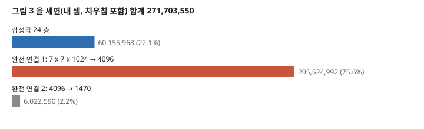

그림 3 을 치우침 포함으로 세면 **271,703,550** 이다. 합성곱 24 층 60,155,968(22.1%), 완전 연결 첫 층 205,524,992(75.6%), 둘째 층 6,022,590(2.2%)이다. 원문은 파라미터 수를 적지 않았다. 층 수는 원문 그림 그대로 24 로 맞고, 사전학습에 쓰는 앞 20 층은 22,403,136 이다.

**파라미터의 78% 가 완전 연결이다.** 이것이 「이미지 전체를 본다」 의 구현이다. 대가로 입력 크기가 448 로 고정되어, U-Net 이나 RPN 처럼 임의 크기를 받지 못한다. 그림 1 의 첫 단계가 「줄이기」 인 까닭이다. 가로세로 비를 유지하는지는 적혀 있지 않다.

**칸 제약에서 나오는 상한(내 셈).** 물체 수 상한은 칸 수 49 개, 칸마다 부류 하나다. 원문 2.4절의 「가까운 물체의 수를 제한한다」 를 수로 적은 것이다.

---

## 5. 평가 (읽은 범위)

- **데이터:** PASCAL VOC 2007 · 2012(20 부류), 그림 데이터 Picasso · People-Art(사람 부류).
- **지표:** mAP(IoU 0.5), FPS, 상위 $N$ 오차 분해, Picasso 는 AP 와 최고 F1.
- **비교 상대:** DPM 계열 · R-CNN 계열 · Poselets · D&T. 표 1 의 일부와 표 3 은 다른 편의 값이고, Faster R-CNN 의 속도와 그림 4 의 Fast R-CNN 검출은 저자가 재거나 공개 검출 결과를 쓴 값이다. 표 3 은 2015-11-06 순위표다.
- **장비:** Titan X, 묶음 없는 추론.

아래 절의 값이 이 조건에서 나온다. 조건이 표마다 달라 절마다 다시 적는다.

---

## 6. 속도와 mAP — 표 1

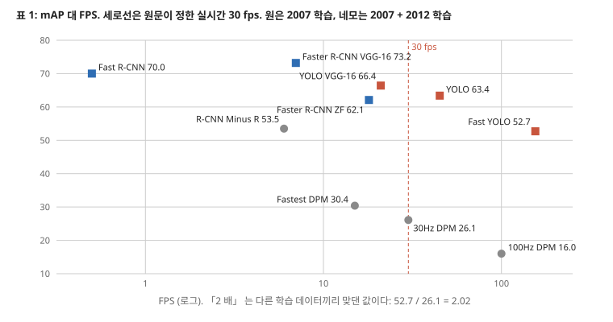

| 줄 | 학습 | mAP | FPS |
|---|---|---:|---:|
| 100Hz DPM | 2007 | 16.0 | 100 |
| 30Hz DPM | 2007 | 26.1 | 30 |
| **Fast YOLO** | 2007+2012 | **52.7** | **155** |
| **YOLO** | 2007+2012 | **63.4** | **45** |
| Fastest DPM | 2007 | 30.4 | 15 |
| R-CNN Minus R | 2007 | 53.5 | 6 |
| Fast R-CNN | 2007+2012 | 70.0 | 0.5 |
| Faster R-CNN VGG-16 | 2007+2012 | 73.2 | 7 |
| Faster R-CNN ZF | 2007+2012 | 62.1 | 18 |
| YOLO VGG-16 | 2007+2012 | 66.4 | 21 |

- **「2 배」 는 52.7 / 26.1 = 2.02 다.** 학습 데이터가 2007 + 2012 대 2007 이다. 같은 데이터로 맞춘 줄이 없다. Faster R-CNN 노트의 표 2 에서 데이터를 2007 에서 2007 + 2012 로 늘리면 SS 66.9 → 70.0, RPN 69.9 → 73.2 로 3.1 · 3.3 점 오른 예가 있다. 다만 DPM 에 같은 양을 옮길 근거는 없어 보정하지 않는다.
- **「10 mAP 높다 · 6 배 느리다」** 는 73.2 - 63.4 = 9.8, 45 / 7 = 6.43 이다. 「2.5 배 느리고 덜 정확」 은 45 / 18 = 2.5, 62.1 대 63.4 로 맞다.
- **같은 바탕 망의 맞댐이 가장 깨끗하다.** YOLO VGG-16 66.4 · 21 fps 와 Faster R-CNN VGG-16 73.2 · 7 fps, mAP 6.8 점과 속도 3 배를 맞바꾼다. 망이 같으니 표 1 에서 체계 차이만 남는 유일한 짝이다(다만 입력 크기 등 조건은 적혀 있지 않다). 원문은 이 줄을 「느려서」 뒤에서 쓰지 않는다고 적는다.
- **「가장 빠른 검출기」 는 「as far as we know」 를 달았다.** 결론에서는 그 단서 없이 「fastest general-purpose object detector in the literature」 라 적는다.

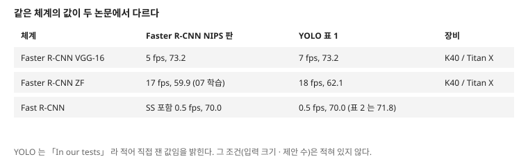

**Faster R-CNN 값이 원논문과 다르다.** 원논문은 VGG 5 fps · ZF 17 fps 이고 이 편은 「In our tests」 로 7 · 18 fps 를 적는다. 장비가 Titan X 와 K40 으로 다르니 측정이 다른 것은 이상하지 않다. 그래도 표의 mAP 는 원논문 값(73.2)이니 **같은 줄의 mAP 와 FPS 의 출처가 다르다.** ZF 62.1 은 내가 읽은 NIPS 판 표에 없는 값(NIPS 표 1 의 ZF 59.9 는 2007 학습)이고, 이 편은 그 조건을 적지 않았다.

---

## 7. 오차 분해와 합치기 — 그림 4 · 표 2

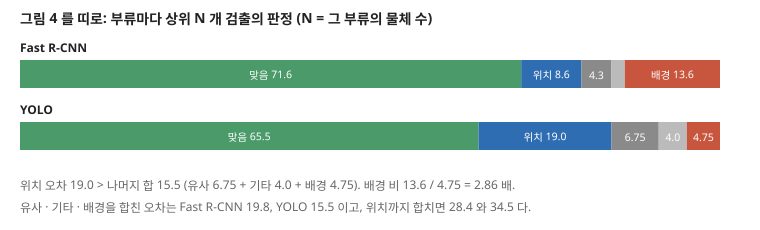

원문 주장을 다시 셈했다.

- 「위치 오차가 나머지 오차원의 합보다 크다」: 19.0 대 6.75 + 4.0 + 4.75 = 15.5 로 맞다.
- 「Fast R-CNN 이 배경을 약 3 배」: 13.6 / 4.75 = 2.86 으로 맞다. 「절반 미만」 도 맞다.
- **판정은 부류마다 상위 $N$ 개만 본 값이다.** 낮은 점수의 오류는 들어가지 않고, 곧 어떤 문턱의 거짓 양성률이 아니다. 「거짓 양성이 덜 난다」 는 초록 문장은 이 범위에서의 말이다.
- 전체 오류율은 YOLO 34.5, Fast R-CNN 28.4 로 YOLO 가 6.1 점 높다(내 뺄셈).

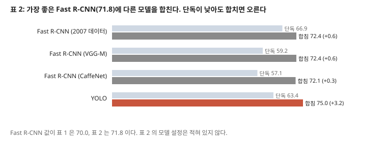

**표 2 의 논리는 이 편에서 가장 설득력 있는 비교다.** 단독 mAP 는 Fast R-CNN (2007 데이터) 66.9 가 YOLO 63.4 보다 높은데, 합친 이득은 +0.6 대 +3.2 다. 오류가 달라서라는 해석과 맞다. 다만 다음이 적혀 있지 않다.

- 합치는 식. 「YOLO 확률과 상자 겹침에 따른 가산」 이라고만 적었다. 그 무게를 어느 집합으로 골랐는지 적혀 있지 않다. 재는 것은 VOC 2007 test 다.
- 71.8 모델의 설정. 표 1 의 Fast R-CNN 은 70.0 이고 1.8 점 다르다.
- 반복과 흩어짐.

**「계산 시간이 의미 있게 늘지 않는다」** 는 Fast R-CNN 0.5 fps(2000 ms)에 22.2 ms 를 더하면 1.1% 다(내 나눔).

---

## 8. VOC 2012 — 표 3

표 3 은 공개 순위표 20 줄(2015-11-06)이다. 줄마다 부류 20 개 평균을 내가 내 보니 표기 mAP 와 차이가 0.05 안이다.

- **YOLO 57.9 는 20 줄 중 16 위다**(내가 표에서 셈). 원문 「R-CNN VGG 에 가깝다」 는 59.2 와의 1.3 점 차로 맞다.
- **Fast R-CNN + YOLO 70.7 은 9 위에서 4 위로 다섯 칸**으로 맞다. 다만 같은 70.7 인 MR CNN S CNN 과의 순서는 평균으로 70.66 대 70.73 이라 소수 둘째 자리에서 뒤집힌다. 순위표 순서와 표기 숫자가 다른 근거를 쓴 것일 수 있다.
- **합치기의 이득은 부류마다 다르다.** 20 부류 중 19 개가 오르고 dog 는 그대로다. 많이 오른 곳이 plant +6.7 · chair +5.2 · bottle +4.7, 적은 곳이 cat · bike +0.1 이다. 평균 +2.26 이 원문의 2.3 이다.

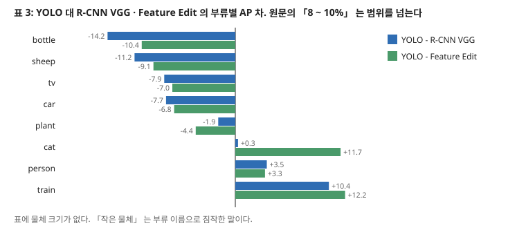

- **「병 · 양 · 모니터에서 R-CNN 이나 Feature Edit 보다 8 ~ 10% 낮다」** 를 빼 보면 R-CNN VGG 대비 -14.2 · -11.2 · -7.9, Feature Edit 대비 -10.4 · -9.1 · -7.0 이다. 범위가 7.0 ~ 14.2 점이다. 비교 줄을 무엇으로 고르느냐에 달렸다. 「R-CNN」 이라 부른 줄이 표에 여럿(R-CNN · R-CNN BB · R-CNN VGG · R-CNN VGG BB)이고 어느 것인지 적혀 있지 않다.
- **「작은 물체에 약하다」 를 물체 크기로 잰 표가 없다.** 병 · 양 · 모니터가 작은 부류라는 것은 원문의 짐작이고, 자동차(car)도 -7.7 이고 사람은 +3.5 다. 부류 난이도와 크기가 섞여 있다.

---

## 9. 일반화 — 그림 5

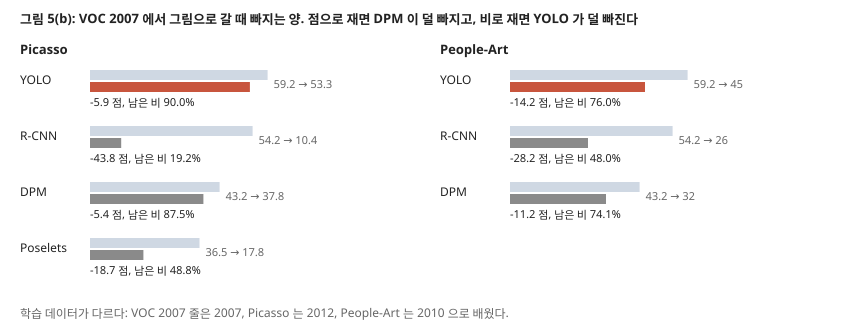

| 방법 | VOC 2007 AP | Picasso AP | Picasso 최고 F1 | People-Art AP | Picasso 차 · 비 | People-Art 차 · 비 |
|---|---:|---:|---:|---:|---:|---:|
| YOLO | 59.2 | 53.3 | 0.590 | 45 | -5.9 · 90.0% | -14.2 · 76.0% |
| R-CNN | 54.2 | 10.4 | 0.226 | 26 | -43.8 · 19.2% | -28.2 · 48.0% |
| DPM | 43.2 | 37.8 | 0.458 | 32 | **-5.4** · 87.5% | **-11.2** · 74.1% |
| Poselets | 36.5 | 17.8 | 0.271 | | -18.7 · 48.8% | |
| D&T | - | 1.9 | 0.051 | | | |

차 · 비는 내 계산이다.

- **「YOLO 의 AP 가 다른 방법보다 덜 떨어진다」 는 비로만 맞다.** 점으로는 DPM 이 두 데이터 모두 덜 빠진다. 다만 그림에서의 절대 AP 는 YOLO 가 가장 높아, 「그림에서 더 낫다」 는 어느 쪽으로도 맞다. 비의 차이도 2.5 · 1.9 점 비율이고 흩어짐이 없다.
- **학습 데이터가 줄마다 같지 않다.** VOC 2007 줄은 2007, Picasso 는 2012, People-Art 는 2010 으로 배웠다. 빠지는 양에 학습 데이터 차이가 섞여 있다. 곧 이 표의 「떨어짐」 은 같은 모델의 값이 아니다.
- **원인 설명은 재지 않은 말이다.** 「R-CNN 은 SS 가 자연 이미지에 맞춰져 있어서」, 「YOLO 는 크기와 모양을 모델링해서」 는 추정이고 원문도 앞부분에 「Prior work theorizes」 를 쓴다. 제안만 바꾼 R-CNN 줄이 없다.
- **사람 부류 하나다.** 초록의 「다른 영역에 일반화」 를 받치는 데이터는 그림 속 사람 검출 둘이다. 「highly generalizable」 · 「less likely to break down」 은 그보다 넓은 말이다.

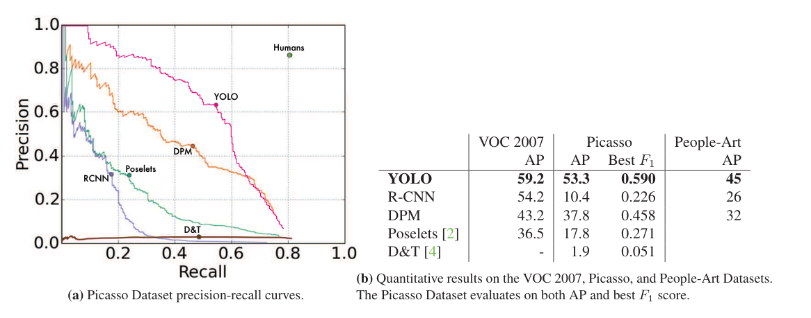

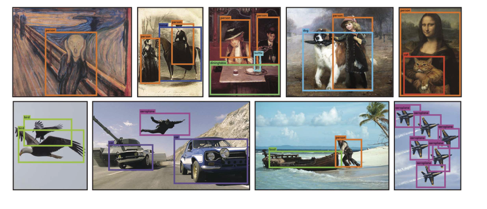

---

## 10. 실험 분석 (논문의 표 · 그림마다)

**직접 돌리지 않는다.** 논문이 낸 실험을 표 · 그림 하나씩 같은 틀로 읽는다. 값 읽기와 재계산은 「내가 센 것」으로 밝힌다.

| 표 · 그림 | 무엇을 바꿨나 (변인) | 무엇을 고정했나 | 결과 | 반복 수 · 흩어짐 | 주장이 결과보다 센가 |
|---|---|---|---|---|---|
| **표 1** (784쪽) | 체계 · 망 | VOC 2007 시험. **학습 데이터는 줄마다 다르다** | 6절 표 | 적혀 있지 않다 | **세다.** 「2 배」 는 학습 데이터가 다른 값의 비이고, Faster R-CNN 은 줄 안에서 출처가 갈린다 |
| **그림 1 · 2 · 3** | 없음(체계 · 모델 · 구조) | | 수치 없음. 내가 층과 파라미터를 세어 맞췄다 | 해당 없음 | 해당 없음 |
| **그림 4** (784쪽) | Fast R-CNN · YOLO | VOC 2007, 상위 N, Hoiem 도구, 20 부류 평균 | 맞음 71.6 · 65.5, 위치 8.6 · 19.0, 배경 13.6 · 4.75 | 적혀 있지 않다 | 수의 비는 맞다. **「거짓 양성이 덜 난다」 는 상위 N 범위**로 줄어야 한다 |
| **표 2** (784쪽) | 합칠 모델 | 가장 좋은 Fast R-CNN 71.8, VOC 2007 | +0.6 · +0.6 · +0.3 · +3.2 | 적혀 있지 않다 | 「significant」 에 검정이 없다. 합치는 식과 무게 고른 집합이 적혀 있지 않다 |
| **표 3** (785쪽) | 순위표의 체계 · 부류 | VOC 2012 서버, comp4 | YOLO 57.9, 합침 70.7, Fast R-CNN 68.4 | 적혀 있지 않다 | 「8 ~ 10%」 는 7.0 ~ 14.2 점이다. 「작은 물체」 는 크기로 재지 않았다 |
| **그림 5(a)** (786쪽) | 방법 | Picasso, 사람, VOC 2012 로 학습 | 곡선. 값은 읽지 않았다 | 곡선 하나씩 | 그림 5(b) 와 함께 읽는다 |
| **그림 5(b)** (786쪽) | 방법 · 데이터 | 사람 부류. 학습 데이터는 열마다 다르다 | 9절 표 | 적혀 있지 않다 | **세다.** 점으로는 뒤집히고, 「highly generalizable」 은 사람 부류 둘로 말한다 |
| **그림 6** (786쪽) | 없음(결과 예) | 인터넷 이미지 | 수치 없음 | 예시 | 「대체로 정확」 을 예시로 말한다. 사람을 비행기로 본 예를 스스로 적었다 |

**문장으로만 적힌 실험적 주장.** 「NMS 가 2 ~ 3% 더한다」, 「상자 예측기들이 특정 크기로 전문화되어 재현율이 오른다」, 「웹캠으로 실시간을 확인했다」, 「R-CNN 은 40 초 넘는다」(인용). 앞 둘은 표가 없고, 셋째는 값이 없다.

---

## 11. 이 논문이 스스로 적은 한계

2.4절이 이름을 달고 적는다. 이 큰 틀의 네 편 중 절을 따로 둔 유일한 편이다.

1. **칸마다 상자 둘 · 부류 하나.** 가까운 물체 수가 제한된다. 무리 지은 작은 물체(새 떼)에 약하다.
2. **새롭거나 드문 비 · 배치에 일반화가 약하다.** 상자를 데이터에서 배우기 때문이다.
3. **거친 특징으로 상자를 예측한다.** 내림 층이 여러 개다.
4. **손실이 큰 상자와 작은 상자의 오차를 같게 다룬다.** 작은 상자의 작은 오차가 IoU 에 더 크다.
5. **주된 오차 원인은 위치다.**
6. 정확도가 최신 체계에 뒤진다(1 · 4.4절).
7. 합친 체계는 YOLO 의 속도 이득을 받지 못한다(4.3절).

**4 번은 ⑤ 의 제곱근과 나란히 읽는다.** 제곱근으로 「부분적으로」 풀었고 남은 문제를 여기 적었다.

---

## 12. 원문 안의 어긋남 모음

| 자리 | 원문 | 맞대 보니 | 내 판단 |
|---|---|---|---|
| 초록 · 1절 · 결론 대 2.2 · 2.4절 | 「검출 성능을 곧장 최적화」 · 「곧장 대응하는 손실」 | 2.2절 「AP 와 완전히 맞지는 않는다」, 2.4절 「근사한다」 | 같은 편 안에서 어긋난다. 뒤쪽이 정확한 말이다 |
| 식 (3) | $\sum_{i=0}^{S^2}$, $\sum_{j=0}^{B}$ | $0$ 부터 $S^2$ 까지면 50 칸, $0$ 부터 $B$ 까지면 3 개다 | 위 끝이 하나 크다. 관례적인 표기 어긋남으로 읽는다 |
| 2.2절 일정 | 「약 135 에폭」, 첫 구간 + 75 + 30 + 30 | 뒤 셋의 합이 이미 135 다 | 첫 구간 길이가 적혀 있지 않고 합이 남지 않는다. 「약」 으로 적은 값이라 어긋남이라 하기는 어렵다 |
| 표 1 캡션 · 본문 | 「YOLO 는 작은 판보다 10 mAP」 | 63.4 - 52.7 = 10.7 | 맞음, 반올림 |
| 표 1 · 표 2 | Fast R-CNN 70.0 · 71.8 | 1.8 점 다르다 | 설정이 다른 것으로 읽히나 적혀 있지 않다 |
| 표 1 · 원논문 | Faster R-CNN 7 · 18 fps, ZF 62.1 | 원논문 NIPS 판 5 · 17 fps, ZF 는 2007 학습 59.9 | 이 편의 재측정. 조건이 적혀 있지 않다 |
| 표 3 캡션 · 4.4절 | 「forth」, 2.3% boost, 5 칸 | 70.7 - 68.4 = 2.3, 9 위 → 4 위 | 맞음. 「forth」 는 오자 |
| 1절 · 4.1절 | 「더 빠른 판은 150 fps 이상」, 155 fps | 어긋나지 않는다 | 어긋남 없음 |
| 초록 | 「two times the mAP」 | 2.02(다른 학습 데이터) | 6절 |

---

## 13. 논문이 적지 않은 것 — 내가 읽으며 짚은 자리

1. **크기별 값이 없다.** 큰 틀 앞 편의 Mask R-CNN 은 $AP_S$ · $AP_M$ · $AP_L$ 을 적었다. 시기가 이르고 VOC 지표라 그럴 수 있으나 「작은 물체」 를 말한 만큼 안 잰 것이 드러난다. **안 한 것이지 못 한 것이 아니다.**
2. **칸 제약의 비용을 재지 않았다.** 한 칸에 중심이 둘 든 물체가 VOC 에 얼마나 있는지, 놓치는 재현율이 얼마인지 없다. 재현율-제안 곡선(Faster R-CNN 그림 2)에 해당하는 그림이 이 편에 없다.
3. **높은 IoU 값이 없다.** mAP 는 IoU 0.5 다. 위치 오차가 주된 약점이라 적으면서 IoU 0.75 에서의 값을 내지 않았다. 또 그림 4 의 「위치」 는 $0.1 < IOU < 0.5$ 만 세므로 IoU 0.5 를 넘는 부정확은 「맞음」 에 든다.
4. **속도의 조건.** Titan X, 묶음 없음, 입력 448. CPU · 저전력 장치 값은 없다. 웹캠 시연의 fps 값도 없다.
5. **학습 시간이 없다.** 사전학습 「약 일주일」 만 있고 135 에폭의 시간은 적혀 있지 않다.

---

## 14. 앞 노트와 맞춰 보기

**Faster R-CNN 노트의 물음(「한 단계가 더 느리다」).** 그쪽 표 5 는 Fast R-CNN 을 고친 흉내(ZF, 53.9, 시간 값 없음)였고 제안 20k 때문에 느리다고 적었다. 여기 실제 체계는 상자 98 개에 45 fps 다. **곧 그 문장은 그쪽의 흉내 체계에 대한 말이었다.** 다만 mAP 쪽의 결론(같은 VGG 에서 6.8 점 낮음)은 그쪽 방향과 같다. 데이터가 같아도 체계와 측정자가 달라 4.8 점과 6.8 점을 같은 실험으로 보면 안 된다.

**Faster R-CNN 노트의 재현율 뒤집힘.** 그쪽 제안은 높은 IoU 재현율이 낮았고 뒤 단계가 보정했다. YOLO 는 뒤 단계가 없어 위치 오차가 그대로 남는다는 구도로 읽힌다. 내 해석이고 이 편이 잰 것은 아니다. 표 3 과 그림 4 가 방향은 맞춘다.

**Mask R-CNN 노트.** 그쪽 5 fps 대 여기 45 fps, 그쪽 COCO AP 대 여기 VOC mAP 라 값을 맞대지 못한다. 공통으로 쓰는 것은 「NMS 뒤 문턱」 뿐이다. 물체 별 마스크는 이 틀에서 나오지 않는다.

**ViT 노트.** 이미지를 칸으로 나눠 전체를 보는 생각은 닮았고, 여기는 완전 연결 층(75.6% 몫)이 그 일을 맡는다. 값으로 이어지는 비교는 없다.

**이상 탐지 노트들.** 「배경 오차」 가 공장의 거짓 경보와 이름이 닮았다. 다만 여기 값은 상위 N 범위라 AUROC · 거짓 양성률 고정 값과 맞대지 못한다.

---

## 15. 내가 가져갈 것

**하나. 표의 「학습」 열을 먼저 읽는다.** 표 1 은 그 열이 있어 2 배의 조건이 드러났다. 저자가 열을 숨기지 않았는데 문장은 그 조건을 빼고 쓴다. 표는 정직하고 문장이 센 경우가 있다.

**둘. 「덜 떨어진다」 는 점과 비를 모두 낸다.** 그림 5 에서 뒤집혔다. 내 연구의 「X 가 덜 나빠진다」 도 분모를 밝혀 적는다.

**셋. 공장 검사에 옮길 때의 조건.** 칸 64 픽셀, 칸마다 부류 하나, 입력 448 고정이다. 이미지를 448 로 줄이면 작은 결함이 몇 픽셀이 되는지부터 세어야 한다. 예를 들어 2000 픽셀 이미지의 한 변 20 픽셀 결함은 448 입력에서 4.5 픽셀이다(내 셈). 이 편의 설정 그대로는 그 크기를 재지 않았다. 속도가 필요한 자리에서 이 계열을 고른다면 후속 판의 격자와 앵커를 봐야 한다.

**넷. 지금 확인된 것은 여기까지다.** 논문이 잰 것은 VOC mAP · FPS · 상위 N 오차 분해 · 그림 속 사람의 AP 다. 논문이 말만 한 것은 NMS 의 몫, 일반화의 원인, 작은 물체 약점의 크기다. 내가 책상에서 센 것은 파라미터 · 차이 · 비 · 부류별 차이이고, 원인은 분해하지 않았다.

---

## 16. 남는 질문

- **칸 제약이 VOC 재현율에서 얼마를 잃나?** 칸에 중심이 둘 든 물체의 비율을 재야 한다.
- **작은 물체 약점의 크기는?** 크기별 AP 가 있는 후속 편 또는 COCO 값이 필요하다.
- **같은 학습 데이터로 맞추면 「2 배」 는 얼마인가?** DPM 을 2007 + 2012 로 다시 배운 값이 필요하다.
- **후속 YOLO 들이 칸 · 완전 연결 제약을 어떻게 고쳤나?** 이 큰 틀 밖이다. 사용자가 고른 큰 틀 다음을 정할 때 묻는다.

---

## 17. 다음에 읽을 것

**이 큰 틀(U-Net → Faster R-CNN → Mask R-CNN → YOLO)은 이 편으로 끝난다. 다음 큰 틀은 사용자가 정한다.** 아래는 이 노트 안에만 남겨 두는 후속 편이다.

| 논문 | 이 노트의 어느 자리에서 나오는가 | 무엇을 확인하고 싶은가 | 원문 참고 문헌 |
|---|---|---|---|
| **Diagnosing error in object detectors** (Hoiem 외, ECCV 2012) | 7절 | 그림 4 판정 도구의 정의 | [19] |
| **30Hz object detection with DPM v5** (Sadeghi · Forsyth, ECCV 2014) | 6절 | 2 배의 상대 | [30] |
| **Detecting people in cubist art** (Ginosar 외, 2014) · **The cross-depiction problem** (Cai 외, 2015) | 9절 | 그림 데이터의 정의 | [12] · [3] |
| **MultiGrasp** (Redmon · Angelova, 2014) | 3절 | 격자 회귀의 원형 | [26] |
| YOLO 후속판 · SSD — 이 편의 참고 문헌 밖이다 | 13 · 16절 | 칸 제약과 크기별 값 | **없다.** 서지를 맞추지 않았고 원문을 받지 않았다 |

---

## 18. 참고 문헌

- [10] Felzenszwalb, P. F. 외 (2010). Object detection with discriminatively trained part based models. TPAMI. — DPM. **읽지 않았다.**
- [13] Girshick, R. 외 (2014). Rich feature hierarchies for accurate object detection and semantic segmentation. CVPR. — **읽지 않았다.**
- [14] Girshick, R. B. (2015). Fast R-CNN. CoRR. — **읽지 않았다.**
- [19] Hoiem, D. 외 (2012). Diagnosing error in object detectors. ECCV. — **읽지 않았다.**
- [20] Lenc, K., Vedaldi, A. (2015). R-CNN minus R. arXiv:1506.06981. — **읽지 않았다.**
- [26] Redmon, J., Angelova, A. (2014). Real-time grasp detection using convolutional neural networks. CoRR. — **읽지 않았다.**
- [27] Ren, S. 외 (2015). Faster R-CNN. arXiv:1506.01497. — NIPS 판을 2026-11-08 에 읽었다.
- [30] Sadeghi, M. A., Forsyth, D. (2014). 30hz object detection with DPM v5. ECCV. — **읽지 않았다.**
- [31] Sermanet, P. 외 (2013). OverFeat. CoRR. — **읽지 않았다.**
- [33] Szegedy, C. 외 (2014). Going deeper with convolutions. CoRR. — GoogLeNet. **읽지 않았다.**
- [37] Yan, J. 외 (2014). The fastest deformable part model for object detection. CVPR. — **읽지 않았다.**

---

## 19. 경로

| 무엇 | 어디 |
|---|---|
| 원문 PDF (CVF 게재판, 10 쪽) | `papers/CVPR16_YOLO_You_Only_Look_Once_Unified_Real_Time_Object_Detection.pdf` |
| 이 노트 | `notes/CVPR16_YOLO_You_Only_Look_Once_Unified_Real_Time_Object_Detection.md` |
| 이 노트의 그림 (직접 그린 것) | `figures/CVPR16_YOLO/fig01_output_tensor.svg` 부터 `fig09_lineage.svg` 까지 아홉 |
| 이 노트의 그림 (원문에서 잘라 낸 것) | `figures/CVPR16_YOLO/paper_fig1_system.png` · `paper_fig2_model.png` · `paper_fig3_architecture.png` · `paper_fig5_generalization.png` · `paper_fig6_qualitative.png` |
| 그림을 만드는 코드 | `figures/CVPR16_YOLO/make_figures.py` — 바깥 데이터를 읽지 않으므로 `python make_figures.py` 로 어디서나 다시 만든다(표준 라이브러리만). 파라미터를 돌릴 때 찍는다 |
| 원문 그림을 잘라 내는 코드 | `figures/CVPR16_YOLO/crop_paper_figures.py` — PyMuPDF 가 필요하다 |
