# Latent Diffusion — High-Resolution Image Synthesis with Latent Diffusion Models (CVPR 2022, 요약)

> **한 줄.** 확산 모델을 픽셀에서 돌리지 않고, 먼저 배워 얼린 오토인코더의 **잠재 공간**에서 돌린다. 256 x 256 x 3 = 196,608 개의 수가 $f = 4$ 면 64 x 64 x 3 = 12,288 개(16 분의 1)로 준다. 손실 꼴은 DDPM 의 $\lVert \epsilon - \epsilon_\theta \rVert^2$ 그대로이고 입력만 $x_t$ 에서 $z_t$ 로 바뀐다(식 2). 조건은 UNet 층마다 **교차 주의**로 넣는다(식 3). 결과는 CelebA-HQ FID 5.11, ImageNet 부류 조건 FID 3.60(안내 $s = 1.5$, ADM-G 4.59), 메우기(inpainting) 9.39 다. 비용은 ImageNet 에서 271 V100-일로 ADM 916 의 0.30 배이고, 같은 250 걸음 초당 표본은 0.7 대 0.12 다.

> **이 노트에서 가장 먼저 볼 자리 다섯.** (1) **그림 6 캡션의 「같은 계산 예산」 이 맞지 않는다.** 그림 6 과 그림 17 의 곡선을 포개면 2M 걸음에 LDM-1 은 35.0, LDM-8 은 54.0 V100-일이 든다(10절, 내가 읽은 값, 표 18 의 79 일 / 2.9M 과 같은 비율이다). 본문의 「FID 차이 38」 은 같은 걸음에서의 값이고, 같은 35 V100-일에서는 31.5 다. (2) **식 (16) 의 부호와 교차 주의 차원 표기가 틀렸다.** 식 (16) 은 $+\sqrt{1-\alpha_t^2}\,\nabla$ 로 적혔는데 점수의 정의에서 유도하면 $-$ 다(17절). $W_Q$ · $W_V$ 의 모양은 서로 뒤바뀌어 있다(7절). (3) **표의 설정으로 UNet 을 다시 세면 18 행 중 14 행이 1.2% 안에서 맞고, 그래서 틀린 칸이 드러난다.** 표 12 의 교회 294M 은 256.40M 으로 세어져 표 18 의 256M 이 맞고, 표 13 의 LDM-4 391M 은 401.43M 으로 표 3 의 400M 이 맞다(9절). (4) **표 8 의 복원 성능은 $f$ 보다 잠재 수의 개수를 따른다.** 같은 4,096 개에서 KL $f = 8$ 과 $f = 16$ 의 PSNR 차이는 0.11 dB 이고 R-FID 차이는 0.03 이다(8절). 그리고 LDM-32 가 막힌 까닭으로 든 「너무 센 압축」 은 VQ 한 줄에서 잰 것이고 같은 $f = 32$ 의 KL $c = 64$ 는 R-FID 2.04 다. (5) **비용 배수에 첫 단계가 빠져 있다.** 「ADM 보다 4 배 적은 자원」 은 침실에서 232 / 60 = 3.87 이고 표 18 의 VQGAN-f-4 29 일을 더하면 2.61 이다(13절). 또 표 15 는 배치 1,200 의 모델도 「A100 한 장」 이라고 적는데 같은 짜임의 표 13 은 배치 40 이다.

---

## Paper Metadata

| Item | Content |
|---|---|
| Title | High-Resolution Image Synthesis with Latent Diffusion Models |
| Authors | Robin Rombach, Andreas Blattmann, Dominik Lorenz, Patrick Esser, Björn Ommer. **각주: 앞의 둘이 같은 기여(contributed equally)** |
| 소속 | Ludwig Maximilian University of Munich & IWR, Heidelberg University (Rombach · Blattmann · Lorenz · Ommer), Runway ML (Esser) |
| Conference / Journal | **CVPR 2022.** 받은 파일 안에는 학회 이름이 없다 — 첫 쪽 여백의 arXiv 표시뿐이고, 학회 이름은 파일 이름과 바깥에서 온 것이다 |
| Year | arXiv:2112.10752 **v2**, 2022-04-13 (첫 쪽 여백). PDF 생성 2022-04-14 |
| DOI | arXiv:2112.10752. 학회 판 DOI 는 파일에 없다 |
| 코드 | 첫 쪽에 `https://github.com/CompVis/latent-diffusion`. **이 노트는 코드를 보지 않았다** |
| Stored PDF | `papers/CVPR22_LDM_High_Resolution_Image_Synthesis_with_Latent_Diffusion_Models.pdf` (원본 이름 `2112.10752v2.pdf`) |
| 왜 읽었는가 | 2026-11-06 에 사용자가 고른 큰 틀 「확산 심화(DDIM → Score SDE → Latent Diffusion)」 의 셋째 칸. DDPM 노트의 비용 문제(한 장에 신경망 통과 1,000 번)와 오토인코더 · VAE 칸이 한 자리에서 만난다. 이 편이 낸 수는 전부 DDIM 표본 뽑기로 잰 값이다 |
| 읽은 범위 | **2026-11-06 에 45 쪽을 전부 읽었다.** 곧 Abstract · 1 ~ 6절 · 참고 문헌 109 건의 서지 · 부록 A ~ H · 식 (1) ~ (25) · 표 1 ~ 18 · 그림 1 ~ 34 와 캡션. 참고 문헌의 편들은 읽지 않았다. **ADM · SR3 · LaMa · StyleGAN 등 상대의 수치는 이 편이 옮겨 적은 값만 쓴다** |

### 저장한 파일의 상태

- **arXiv v2 다.** 부록 A 가 v1 과의 차이를 적는다: 글에서 이미지 모델을 1.45B 로 새로 배웠고, ImageNet 부류 조건 모델을 큰 배치로 다시 배웠고, 사용자 연구를 더했고, 그림 5 · 13 을 더했다. **CVPR 학회판은 받지 않았고 이 파일과 무엇이 다른지 확인하지 않았다.**
- **45 쪽 = 본문 9 쪽 + 참고 문헌 4 쪽(10 ~ 13 쪽) + 부록 32 쪽(14 ~ 45 쪽).** 부록의 뒤쪽 16 쪽(30 ~ 45 쪽)은 표본 그림이다.
- **글자 층이 살아 있다.** 식 (2) · (3) · (13) · (16) · (25), 교차 주의 차원, 표 2 · 5 · 6 · 13 · 18 은 쪽을 띄워 글자 층과 맞췄다. 부호와 표식은 띄운 쪽을 기준으로 옮겼다.
- **그림 2 · 6 · 7 · 17 은 PDF 안에 래스터다**(그림 6 왼쪽 562 x 301 픽셀, 오른쪽 404 x 301, 그림 7 왼쪽 557 x 301, 오른쪽 409 x 301, 그림 2 863 x 673). 벡터 좌표가 없어서 **눈금 선 픽셀로 축을 맞추고, 곡선 색으로 열마다 픽셀을 모아 평균해 읽었다.** 1 픽셀은 그림 6 FID 에서 0.82, 그림 7 왼쪽 log FID 에서 0.0093 이다. 그림 6 과 그림 17 을 맞대니 차이가 RMSE 0.18 ~ 0.28 FID 여서 읽기 오차를 이 크기로 본다. **이 값들은 원문이 숫자로 적은 값이 아니다.**
- **그림 1 · 2 · 3 · 6 · 7 · 17 은 잘라 넣었다.** 표본 그림(4 · 5 · 8 ~ 16 · 18 ~ 34)은 넣지 않았다.

---

## 1. 용어

이 노트에서 쓸 이름을 먼저 정한다. 논문의 원래 용어는 괄호로 함께 적는다. **「그림 N」 은 원문 그림이고, 이 노트가 그린 것은 「내 그림 N」 으로 부른다.**

- **잠재 공간 (latent space)**: 부호기 $\mathcal{E}$ 가 이미지를 옮긴 자리. $z = \mathcal{E}(x) \in \mathbb{R}^{h \times w \times c}$. 작은 예시로, 256 x 256 x 3 이미지가 $f = 4$, $c = 3$ 이면 64 x 64 x 3 이다.
- **첫 단계 (first stage)**: 오토인코더 $\mathcal{E}$ · $\mathcal{D}$ 와 그 학습. 원문은 「perceptual compression model」 로도 부른다. 작은 예시로, 표 18 의 VQGAN-f-4 는 55M · 29 V100-일이다.
- **줄임 배수 $f$ (downsampling factor)**: $f = H/h = W/w$. **LDM-$f$** 는 그 배수의 모델이고 LDM-1 은 픽셀 확산이다(첫 단계 없음). 작은 예시로, LDM-8 은 32 x 32 자리에서 돈다.
- **잠재 수의 개수**: $h \cdot w \cdot c$. **이 노트에서 쓰는 말이고 원문에는 이 열이 없다.** 작은 예시로, $f = 16$, $c = 16$ 은 16 x 16 x 16 = 4,096 개, $f = 8$, $c = 4$ 도 4,096 개다.
- **KL 정칙화 (KL-reg.)**: $z$ 에 표준 정규로 가는 KL 벌점을 무게 $\sim 10^{-6}$ 으로 건다(부록 G). VAE 와 같은 꼴인데 무게가 다르다. 작은 예시로, 복원 손실이 1 줄 때 KL 은 $10^6$ 줄어야 같은 값이다.
- **VQ 정칙화 (VQ-reg.)**: 코드북 $\lvert Z \rvert$ 개로 양자화한다. 다만 **양자화 층을 복호기 안으로 넣어** 확산은 양자화 전의 연속값 $z$ 위에서 돈다(부록 G). 작은 예시로, $f = 4$ 는 $\lvert Z \rvert = 8192$.
- **R-FID · R-IS**: 원본과 복원 사이의 FID · IS(표 8). 생성이 아니라 복원의 질이다. 작은 예시로, $f = 4$ VQ 는 R-FID 0.58. 원문이 정의 문장을 따로 두지 않아 그림 1 캡션의 「Reconstruction FIDs」 로 읽었다.
- **$\epsilon_\theta$ · $\tau_\theta$**: 잡음을 맞히는 시간 조건 UNet, 조건 $y$ 를 $M \times d_\tau$ 로 옮기는 부호기. 작은 예시로, 글 모델의 $\tau_\theta$ 는 길이 77, 폭 1,280, 깊이 32 다(표 17).
- **교차 주의 (cross-attention)**: 질의는 UNet 특징에서, 키 · 값은 $\tau_\theta(y)$ 에서 만든다. 작은 예시로, 32 x 32 층이면 자리 1,024 개가 낱말 77 개에 무게를 나눠 준다.
- **DDIM 걸음 · $\eta$**: 표본을 뽑을 때의 걸음 수와 잡음 크기. 원문 표의 「200-s」 는 200 걸음이고 그림 6 · 17 캡션은 같은 자리를 $\kappa$ 로 적는다.
- **안내 척도 $s$ (guidance scale)**: 분류기 없는 안내(classifier-free guidance, c.f.g.)의 세기. 작은 예시로, 표 3 의 LDM-4-G 는 $s = 1.5$, 그림 5 의 표본은 $s = 10$ 이다. 식은 이 파일에 없다.
- **FID · IS · Precision · Recall**: 표본과 실제의 특징 분포 거리, 분류기 점수, 표본이 실제 쪽에 드는 비율, 실제가 표본 쪽에 덮이는 비율. FID 는 낮을수록, 나머지는 높을수록 좋다. 작은 예시로, 표 3 은 FID 3.60 · Recall 0.48 이다.
- **V100-일 (V100-days)**: 계산 비용 단위. 이 편은 A100 에서 잰 날수에 **2.2 를 곱해** V100-일로 바꾼다(부록 F). 작은 예시로, 35 V100-일은 A100 15.9 일이다.
- **걸음 (train step · iteration)**: 파라미터 갱신 한 번. 본 이미지 수는 걸음 x 배치다. 작은 예시로, LDM-1 은 2M x 7 = 14M 장이다.

---

## 2. 한 문단 요약

픽셀 확산은 강력하지만 비싸다. 원문이 든 값으로 ADM 은 학습에 150 ~ 1,000 V100-일, 표본 50,000 장에 A100 한 장으로 5 일이다. 원문은 그림 2 를 들어 이미지의 비트 대부분이 지각되지 않는 세부에 쓰이는데, 기울기와 망 평가는 모든 픽셀에서 해야 한다고 적는다. 그래서 **압축과 생성을 가른다.** 먼저 지각 손실과 조각 판별기로 오토인코더를 배우고(잠재 분산을 묶는 KL 은 무게 $\sim 10^{-6}$, 또는 코드북을 크게 둔 VQ), 얼린 뒤 그 잠재에서 DDPM 의 손실로 UNet 을 배운다. UNet 이 2 차원 구조를 그대로 쓰니 VQGAN + Transformer 처럼 세게 압축할 필요가 없어 $f = 4$ ~ $8$ 을 쓴다는 것이 주장의 핵심이다. 조건은 $\tau_\theta$ 와 교차 주의로 넣고, 공간 정렬 조건은 이어 붙인다. $f$ 를 1 ~ 32 로 바꾼 실험에서 LDM-{4, 8, 16} 이 앞서고, 무조건 · 부류 · 글 · 배치 · 초해상도 · 메우기 여섯 과제에서 값을 낸다. 스스로 적은 한계는 GAN 보다 느린 표본 뽑기와 복원 정밀도가 상한이 되는 자리다.

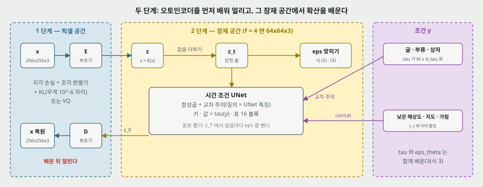

**내 그림 1.** 왼쪽 파란 칸을 먼저 끝내 얼리고, 가운데 노란 칸만 확산으로 배운다. 조건은 오른쪽에서 두 길로 들어온다. 표식 없는 수는 표 13 의 $f = 4$ 예다.

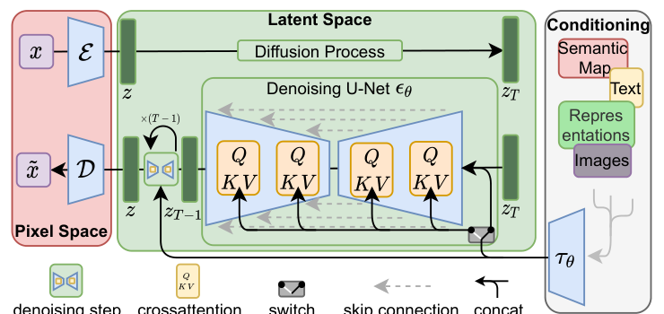

**원문 그림 3.** 같은 짜임의 원문 그림. 「switch」 가 교차 주의와 이어 붙이기 중 하나를 고른다.

---

## 3. 문제 / 동기 (1 · 2절)

**이 논문이 없앤 전제 하나: 고해상도 확산은 픽셀에서 해야 한다.**

- **원문이 든 비용.** 가장 강력한 확산 모델의 학습이 「hundreds of GPU days (e.g. 150 - 1000 V100 days in [15])」, 표본 50,000 장이 A100 한 장에 약 5 일, 걸음이 25 ~ 1,000. **내가 맞춘 값**: 50,000 / (5 x 86,400) = 초당 0.116 장이고 표 18 의 ADM 250 걸음 0.12 와 같은 자리다.
- **앞 두 단계 방법의 막힌 자리(원문의 말).** VQ-VAE · VQGAN 은 자기회귀 모델이 잠재를 1 차원 열로 다뤄 구조를 버리고, 그 학습이 되려면 압축을 세게 해야 해서 성능이 묶이거나(파라미터 수십억) 압축을 줄이면 계산이 비싸진다.
- **이 편의 답(원문의 말).** 확산 + UNet 은 잠재의 2 차원 구조를 쓰므로 더 높은 차원으로 「more gently」 키워진다. 그래서 압축 정도를 자유롭게 고른다. **이 「덜 세게」 를 같은 첫 단계 위에서 자기회귀와 확산을 맞대어 잰 행은 표 1 ~ 18 에 없다.** 표 8 은 첫 단계만 재고, 표 1 의 VQGAN+T 는 다른 첫 단계 위의 값이다.
- **함께 배우는 길과의 차이.** LSGM([93])은 부호기 · 복호기와 점수 사전분포를 함께 배워 재구성과 생성의 무게 맞추기가 어렵다고 적고, 이 편은 첫 단계를 얼려 그 무게 맞추기를 없앴다고 적는다. 값은 CelebA-HQ 5.11 대 LSGM 7.22 한 칸이다.
- **기여 여섯(1절).** 고해상도 확장, 여러 과제에서 경쟁력 + 비용 절감, 무게 맞추기 불필요, 공간 조건에서 합성곱 표본 뽑기로 $\sim 1024^2$, 교차 주의 조건, 사전학습 모델 공개.

---

## 4. 왜 잠재 공간인가 — 그림 1 · 2 (1절)

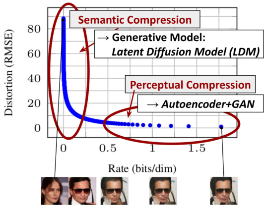

**원문 그림 2.** 학습된 DDPM 의 율-왜곡 곡선에 타원과 글자를 얹은 그림. 왼쪽 타원이 「의미 압축(LDM 이 맡는다)」, 오른쪽이 「지각 압축(오토인코더 + GAN 이 맡는다)」 이다. 캡션: 「Most bits of a digital image correspond to imperceptible details」, 「Data and images from [30]」.

- **원문의 논리.** 율의 대부분을 쓰는 끝 구간은 지각 세부이고 앞 구간에서 의미가 정해진다. 값으로는 율 0.12 에서 1.78 bits/dim 까지 쓰는 동안 왜곡이 RMSE 12.02 에서 0.95 로 준다(DDPM 노트의 표). 그러니 뒤 구간을 값싼 오토인코더에 맡긴다.
- **곡선이 어느 데이터인지 캡션에 없다. 내가 맞춰 봤다.** 픽셀로 읽으면 곡선 끝이 율 1.771 bits/dim 이다. DDPM 노트의 율-왜곡 표(CIFAR10 시험, 끝 1.77581 · RMSE 0.95, 900 걸음 0.11994 · 12.02)와 대조하니 끝 점과 (0.11994, 12.02) 자리의 파란 점이 1 픽셀 안에 든다. **곧 곡선은 32 x 32 CIFAR10 의 값으로 읽히는데, 아래 얼굴 그림은 CIFAR10 이 아니다.** 1 차원당 비트를 256 x 256 이미지로 옮겨도 같은 모양인지는 이 그림이 답하지 않는다.
- **타원은 재서 그은 것이 아니다.** RMSE 는 지각 거리가 아니고, 「지각되지 않는다」 를 잰 값은 이 그림에 없다. 타원의 경계는 손으로 그린 것이다.

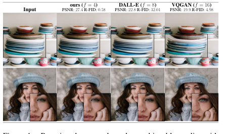

**원문 그림 1.** 복원 비교. 사진은 DIV2K 검증 집합 $512^2$, 수는 ImageNet 검증 집합. **사진과 수의 출처가 다르다**(캡션이 적는다). PSNR 순서는 $f$ = 4 (27.4) > DALL-E $f$ = 8 (22.8) > VQGAN $f$ = 16 (19.9) 이고, R-FID 순서는 0.58 < 4.98(VQGAN) < 32.01(DALL-E) 이라 **「덜 줄인다」 만으로 줄이 세워지지 않는다.** 두 비교 대상의 학습 방식 차이는 이 표에서 변인으로 안 잡힌다.

---

## 5. 첫 단계 — 오토인코더 (3.1절 · 부록 G)

**손실(식 25).**

$$L_{\text{Autoencoder}} = \min_{\mathcal{E}, \mathcal{D}} \max_{\psi} \Big( L_{rec}(x, \mathcal{D}(\mathcal{E}(x))) - L_{adv}(\mathcal{D}(\mathcal{E}(x))) + \log D_\psi(x) + L_{reg}(x; \mathcal{E}, \mathcal{D}) \Big) \qquad (25)$$

- $L_{rec}$ 는 지각 손실([106]), $D_\psi$ 는 조각 판별기([33]). 원문: 픽셀 L2 · L1 만 쓸 때의 흐림을 피하고 복원을 이미지 다양체에 묶는다.
- **원문이 적지 않은 것.** 적대 항의 무게, 지각 손실과 픽셀 손실의 비, 판별기를 언제부터 켜는지. 표 8 의 설정 칸에도 없다. 「[23] 을 따른다」 뿐이다.
- **KL.** $q_\mathcal{E}(z \mid x) = \mathcal{N}(z; \mathcal{E}_\mu, \mathcal{E}_{\sigma^2})$ 와 $\mathcal{N}(z; 0, 1)$ 의 KL 을 무게 $\sim 10^{-6}$ 으로. 잠재는 $z = \mathcal{E}_\mu(x) + \mathcal{E}_\sigma(x) \cdot \varepsilon$ 로 뽑는다. VAE 의 재매개변수화와 같은 꼴이다.
- **KL 무게가 작으니 $z$ 는 표준 정규가 되지 않는다(내 해석).** 그래서 다음 줄의 다시 재기가 필요하다. D.1 절이 「이 비가 매우 높다」 고 적는 자리가 여기다.
- **다시 재기.** 첫 배치에서 $\hat\sigma$ 를 내 $z \leftarrow z / \hat\sigma$. 원문은 「component-wise variance」 라 부르는데 식은 $b, c, h, w$ 전체를 한 번에 합해 **스칼라 하나**다(25절 어긋남).
- **VQ.** 양자화 앞의 $z$ 를 쓰고 양자화는 복호기의 첫 층으로 본다. D.1 절: VQ 공간은 분산이 1 에 가까워 다시 재지 않는다(분산 값은 적혀 있지 않다).
- **첫 단계는 OpenImages 로 배운다**(표 8 캡션). 표 18 은 VQGAN-f-4 55M · 29 V100-일, VQGAN-f-8 68M · 66 V100-일을 **「ImageNet 칸」 안에** 적는다. KL 첫 단계의 비용은 표 18 에 없다.

---

## 6. 확산 식 — 식 (1) · (2) 와 부록 B

$$L_{DM} = \mathbb{E}_{x, \epsilon \sim \mathcal{N}(0,1), t}\big[\lVert \epsilon - \epsilon_\theta(x_t, t) \rVert_2^2\big] \qquad (1)$$

$$L_{LDM} := \mathbb{E}_{\mathcal{E}(x), \epsilon \sim \mathcal{N}(0,1), t}\big[\lVert \epsilon - \epsilon_\theta(z_t, t) \rVert_2^2\big] \qquad (2)$$

**식이 새것이 아니다.** 식 (2) 는 식 (1) 에 $x \to z$ 만 넣은 것이다. 새 것은 그 $z$ 를 어디서 얻는가다. $t$ 는 $\{1, \ldots, T\}$ 에서 균등, 표 12 ~ 15 는 모두 $T = 1000$ · 선형 일정이다. **일정의 양 끝 값은 이 파일에 적혀 있지 않다.** 잠재의 분산이 바뀌면 같은 일정이 다른 SNR 이 되므로 이 빈칸은 작지 않다(17절).

**부록 B 는 Kingma 외(VDM, [45])의 표기로 DDPM 을 다시 적는다.** $q(x_t \mid x_0) = \mathcal{N}(x_t \mid \alpha_t x_0, \sigma_t^2 I)$, $\text{SNR}(t) = \alpha_t^2 / \sigma_t^2$. **여기 $\alpha_t$ 는 DDPM 의 $\sqrt{\bar\alpha_t}$ 다.** 같은 글자가 다른 양이라 부록 C 의 $\sqrt{1 - \alpha_t^2}$ 를 읽을 때 걸린다.

**식을 하나씩 맞춰 봤다(내가 유도한 것).**

| 식 | 내용 | 확인 |
|---|---|---|
| (5) ~ (7) | $\alpha_{t \mid s} = \alpha_t / \alpha_s$, $\sigma_{t \mid s}^2 = \sigma_t^2 - \alpha_{t \mid s}^2 \sigma_s^2$ | $x_t = \alpha_{t \mid s} x_s + \sigma_{t \mid s} \epsilon$ 의 분산이 $\sigma_t^2$ 이어야 한다. **맞다** |
| (9) | ELBO 분해 | $\sum_{t=1}^{T}$ 가 $t = 1$ 을 포함하고 재구성 항이 없다. $\sigma_0 = 0$ 이면 $\text{SNR}(0) = \infty$ 라 $t = 1$ 항의 무게가 무한이다. **DDPM 의 $L_0$ 자리가 이 식에는 안 보인다.** 원문이 설명하지 않는다 |
| (11) | 사후 분산 $\sigma_{t \mid t-1}^2 \sigma_{t-1}^2 / \sigma_t^2$ | 두 가우스의 정밀도 합과 식 (7) 로 **맞다** |
| (12) | 사후 평균 | 표준 꼴과 **맞다** |
| (13) | KL = $\frac{1}{2}(\text{SNR}(t-1) - \text{SNR}(t)) \lVert x_0 - x_\theta \rVert^2$ | 계수가 $\frac{\alpha_{t-1}^2 \sigma_{t \mid t-1}^2}{2 \sigma_t^2 \sigma_{t-1}^2}$ 이고 식 (7) 로 SNR 차와 같다. **맞다.** 인쇄는 왼쪽이 $p(x_{t-1})$ 로 적혀 $\mid x_t$ 와 닫는 괄호가 빠졌다 |
| (14) · (15) | $\epsilon$ 꼴로 바꾸기, 계수 $\sigma_t^2 / \alpha_t^2$ | **맞다** |

식 (13) · (15) 를 합치면 $\epsilon$ 꼴의 무게가 $\frac{1}{2}(\text{SNR}(t-1)/\text{SNR}(t) - 1)$ 이다. 부록 B 끝: 「각 항에 같은 무게를 주는 재가중이 식 (1) 을 낸다」. **곧 이 곡선을 버린 것이 $L_\text{simple}$ 이다.**

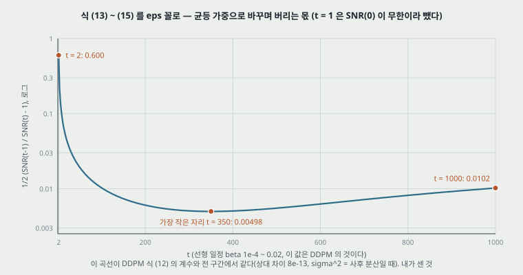

**내 그림 2(내가 센 것).** DDPM 의 선형 일정(beta 1e-4 ~ 0.02, **이 값은 DDPM 의 것이고 이 편에는 없다**)으로 그린 무게. DDPM 노트의 식 (12) 계수 $\beta_t^2 / (2\sigma_t^2 \alpha_t (1 - \bar\alpha_t))$ 와 $t = 2 \sim 1000$ 전 구간에서 상대 차이 $8 \times 10^{-13}$ 안으로 같다($\sigma_t^2$ 를 사후 분산으로 둘 때). 무게는 $t = 2$ 에서 0.600, 가장 작은 $t = 350$ 에서 0.00498(120 배 차이), $t \le 50$ 이 전체 무게 합의 32.5% 다. 원문이 「undersampling the initial denoising steps」 라 적은 자리의 크기다.

---

## 7. 조건 넣기 — 교차 주의 (3.3절 · E.2.1 · 식 3 · 표 16 · 17)

$$\text{Attention}(Q, K, V) = \text{softmax}\Big(\frac{Q K^{T}}{\sqrt{d}}\Big) \cdot V, \quad Q = W_Q^{(i)} \varphi_i(z_t), \; K = W_K^{(i)} \tau_\theta(y), \; V = W_V^{(i)} \tau_\theta(y)$$

$$L_{LDM} := \mathbb{E}_{\mathcal{E}(x), y, \epsilon \sim \mathcal{N}(0,1), t}\big[\lVert \epsilon - \epsilon_\theta(z_t, t, \tau_\theta(y)) \rVert_2^2\big] \qquad (3)$$

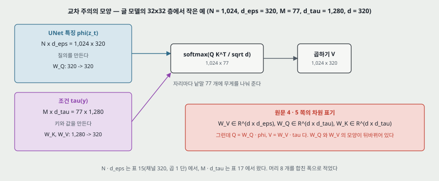

**내 그림 3.** 글 모델 32 x 32 층의 모양. 질의가 UNet 쪽, 키 · 값이 조건 쪽이다.

- **차원 표기가 틀렸다.** 원문 4 · 5 쪽: $W_V^{(i)} \in \mathbb{R}^{d \times d_\epsilon^i}$, $W_Q^{(i)} \in \mathbb{R}^{d \times d_\tau}$, $W_K^{(i)} \in \mathbb{R}^{d \times d_\tau}$. 그런데 $Q$ 는 $\varphi_i \in \mathbb{R}^{N \times d_\epsilon^i}$ 에 곱하고 $V$ 는 $\tau_\theta(y) \in \mathbb{R}^{M \times d_\tau}$ 에 곱한다. **$W_Q$ 와 $W_V$ 의 모양이 서로 바뀌어야 맞는다**(내가 맞춘 것).
- **$\tau_\theta$ 는 함께 배운다.** 식 (3) 은 $\tau_\theta$ · $\epsilon_\theta$ 를 함께 최적화한다. **사전학습된 BERT 를 쓰는 것이 아니다.** 원문의 「BERT-tokenizer」 는 낱말을 토큰으로 자르는 부분이고, 인코더는 표 17 의 깊이 32 · 폭 1,280 Transformer 다.
- **$\tau_\theta$ 의 블록(식 18 ~ 23).** LN → 자기 주의 + 지름길, LN → MLP + 지름길, 끝에 LN. ViT 와 같은 정규화 앞 꼴이다. 원문 각주: `x-transformers` 를 고쳐 썼다.
- **UNet 안의 블록(표 16).** ablated UNet 의 자기 주의 자리를 깊이 $T$ 의 얕은 Transformer 로 바꾼다. 순서를 원문은 (i) 자기 주의 (ii) MLP (iii) 교차 주의로 적는다. **Transformer 의 디코더는 자기 주의 → 교차 주의 → 앞먹임이라 순서가 다르다.** 구현이 어느 쪽인지는 이 파일로 못 가른다. 원문 뒤 문장 「(ii) (iii) 이 없으면 ablated UNet 과 같다」 도 그대로 둔다.
- **부류 조건도 교차 주의다.** $\tau_\theta$ 는 임베딩 층 하나($\zeta \in \mathbb{R}^{1 \times 512}$). 키가 하나뿐이면 소프트맥스 무게는 늘 1 이라 **교차 주의가 사실상 값 벡터를 자리마다 더하는 꼴이 된다(내 계산)**.
- **배치(layout)의 토큰.** 상자마다 $(l, b, c)$ 세 토큰. 표 17 의 길이 92 는 상자 30 개 x 3 + 2 로 맞지만 원문은 이 셈을 적지 않는다(내 짐작).
- **이어 붙이기.** 공간 정렬 조건(낮은 해상도, 지도, 가림)은 $z_t$ 에 이어 붙이고 $\tau_\theta$ 는 항등이다(4.4절). 작은 예시로, 초해상도는 $z$ 3 채널 + 낮은 해상도 3 채널 = 입력 6 채널이다(내 셈, 원문은 입력 채널 수를 안 적는다).
- **$\tau_\theta$ 에 $t$ 를 넣지 않은 이유.** 「추론이 느려지므로」 안 했고 뒤 과제로 남긴다(E.2.1).

---

## 8. 표 8 — 첫 단계의 복원 (4.1절 · D.2)

**잠재 수의 개수로 다시 놓았다(내가 센 것).** 표 8 에 해상도가 적혀 있지 않아 256 x 256 으로 셈했다.

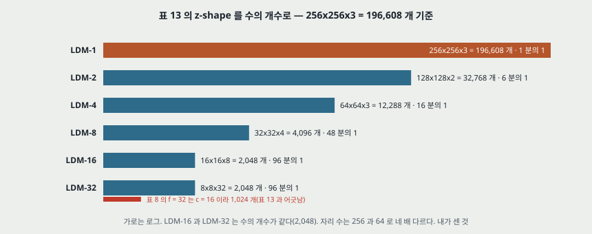

**내 그림 4.** 표 13 의 z-shape. LDM-16 과 LDM-32 는 2,048 개로 같고 자리 수만 네 배 다르다.

| $f$ | 정칙화 | $c$ | 잠재 수 | 196,608 의 몇 분의 1 | R-FID | PSNR |
|---:|---|---:|---:|---:|---:|---:|
| 2 | KL | 2 | 32,768 | 6 | 0.086 | 32.47 |
| 2 | VQ 2048 | 2 | 32,768 | 6 | 0.16 | 30.85 |
| 4 | KL | 3 | 12,288 | 16 | 0.27 | 27.53 |
| 4 | VQ 8192 | 3 | 12,288 | 16 | 0.58 | 27.43 |
| 8 | KL | 4 | 4,096 | 48 | 0.90 | 24.19 |
| 16 | KL | 16 | 4,096 | 48 | 0.87 | 24.08 |
| 32 | KL | 64 | 4,096 | 48 | 2.04 | 22.27 |
| 8 | VQ 16384 | 4 | 4,096 | 48 | 1.14 | 23.07 |
| 16 | KL | 8 | 2,048 | 96 | 2.63 | 21.94 |
| 16 | VQ 16384 | 8 | 2,048 | 96 | 5.15 | 20.83 |
| 32 | KL | 16 | 1,024 | 192 | 7.3 | 20.38 |
| 32 | VQ 16384 | 16 | 1,024 | 192 | 31.83 | 17.45 |

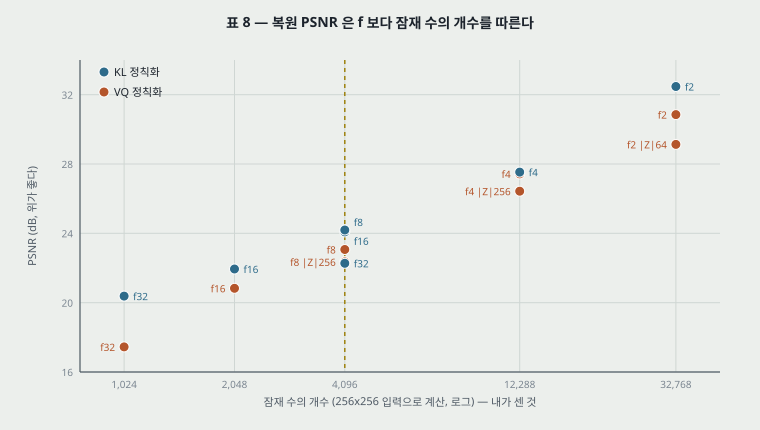

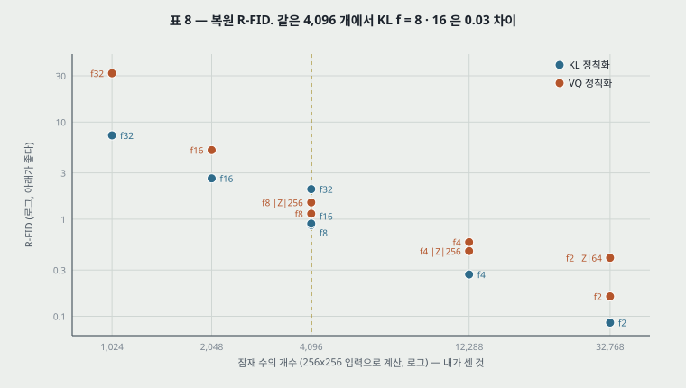

**내 그림 5 · 6(원문 표 8, 가로만 내가 센 것).** 점선이 4,096 개다.

**읽은 것 넷(내 해석).**

1. **복원은 $f$ 보다 잠재 수의 개수를 따른다.** 같은 4,096 개에서 KL $f = 8$ · $16$ 은 PSNR 차이 0.11 dB, R-FID 차이 0.03 이다. $f = 32$ 만 1.92 dB 떨어진다. 그런데 원문은 표 13 에서 $f$ 와 $c$ 를 함께 움직이고 「줄임 배수」 로만 부른다.
2. **VQ 와 KL 의 차이는 수의 개수가 가장 적은 칸에서 가장 크다.** 같은 칸의 PSNR 차이가 32,768 개에서 1.62, 12,288 개에서 0.10, 4,096 개에서 1.12, 2,048 개에서 1.11, 1,024 개에서 2.93 dB 이다. 한 방향은 아니고 1,024 개가 가장 크다. R-FID 는 1,024 개에서 31.83 대 7.3 이다.
3. **「$f$ = 32 는 너무 세다」 는 VQ 한 줄의 말이다.** 4.1절이 LDM-32 의 정체를 첫 단계 정보 손실로 돌리는데, 그림 6 의 모델은 VQ($\lvert Z \rvert$ = 16384)이고 같은 $f = 32$ 의 KL $c = 64$ 는 R-FID 2.04 다. 이 조합으로 확산을 배운 행은 없다.
4. **R-FID 가 FID 의 하한은 아니다.** 그림 6 끝에서 LDM-32 는 FID 86.5(5,000 표본, 학습 분포)인데 표 8 은 31.83(검증 분포)이다. 재는 대상이 달라 차를 그대로 빼지 않는다.

**표 13 과 표 8 이 다르다.** LDM-32 의 z-shape 는 표 13 에서 8 x 8 x 32(2,048 개, 원문 인쇄는 「88 x 8 x 32」), 표 8 에서 $c = 16$(1,024 개)이다. 이 둘 중 어느 첫 단계로 LDM-32 를 돌렸는지 이 파일로 못 가른다.

**PSIM 열의 정의는 이 파일에 없다.** VQGAN · DALL-E 행은 $c$ 가 코드 차원이라 위 표에 넣지 않았다.

---

## 9. 파라미터 다시 세기 (내가 센 것)

표 12 ~ 15 는 채널 · 곱 · 깊이 · 주의 해상도 · 머리 수를 준다. 이 값에 원문이 말한 「ablated UNet」 의 일반 꼴을 얹어 UNet 을 세었다. **표 16 이 안 적은 자리는 가정이다**: 잔차 블록 안의 그룹 정규화 · 합성곱 둘, 시간 임베딩 $4 \times$ 채널, 내리기 · 올리기 합성곱, 주의 블록 안의 게이트 MLP(앞쪽 선형 층이 $8 \times$ 폭을 내고 뒤쪽이 $4 \times$ 폭을 받는 꼴). 이 꼴은 내가 아는 구현의 모양이고 **이 노트는 코드를 열어 확인하지 않았다.**

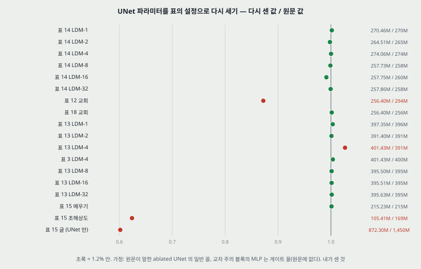

**내 그림 7.** 18 행 중 14 행이 1.2% 안이다.

| 행 | 설정 | 다시 센 값 | 원문 | 비 |
|---|---|---:|---:|---:|
| 표 14 LDM-1 | 192, 1,1,2,2,4,4 | 270.46M | 270M | 1.002 |
| 표 14 LDM-2 | 192, 1,2,2,4,4 | 264.51M | 265M | 0.998 |
| 표 14 LDM-4 (표 12 CelebA · FFHQ · 침실 같음) | 224, 1,2,3,4 | 274.06M | 274M | 1.000 |
| 표 14 LDM-8 | 256, 1,2,4 | 257.73M | 258M | 0.999 |
| 표 14 LDM-16 | 256, 1,2,4 | 257.75M | 260M | 0.991 |
| 표 14 LDM-32 | 256, 1,2,4 | 257.86M | 258M | 0.999 |
| **표 12 교회** | 192, 1,2,2,4,4, 주의 32 16 8 4 | 256.40M | **294M** | **0.872** |
| 표 18 교회 | 같은 설정 | 256.40M | 256M | 1.002 |
| 표 13 LDM-1 | 192, 1,1,2,2,4,4 + 교차 주의 | 397.35M | 396M | 1.003 |
| 표 13 LDM-2 | 192, 1,2,2,4,4 | 391.40M | 391M | 1.001 |
| **표 13 LDM-4** | 192, 1,2,3,5 | 401.43M | **391M** | **1.027** |
| 표 3 · 10 LDM-4 | 같은 설정 | 401.43M | 400M | 1.004 |
| 표 13 LDM-8 · 16 · 32 | 256, 1,2,4 | 395.50 · 395.51 · 395.63M | 395M | 1.001 ~ 1.002 |
| 표 15 메우기 | 128, 1,4,8, 입력 7(내 짐작, 값에 주는 몫 0.002%) | 215.23M | 215M | 1.001 |
| **표 15 초해상도** | 160, 1,2,2,4, 입력 6, 주의 칸 「-」 | 105.41M | **169M** | **0.624** |
| 표 15 글 (UNet 만) | 320, 1,2,4,4, 머리 8, 맥락 1,280 | 872.30M | 1.45B | 0.602 |

**세어 보고 알게 된 것.**

- **표 12 의 교회 294M 은 틀린 칸으로 읽힌다.** 표 18 의 같은 모델이 256M 이고 표 12 의 설정으로 세면 256.40M 이다.
- **표 13 의 LDM-4 391M 은 옆 칸(LDM-2)의 값과 같다.** 설정으로 세면 401.43M 이고 표 3 · 10 의 400M 과 맞는다. 표 15 는 같은 모델을 395M 으로 적어 **같은 설정에 값이 셋**이다.
- **게이트 MLP 는 표 13 다섯 행이 가리킨다.** 보통 MLP 로 세면 LDM-8 이 363.74M(원문 395M, 0.921)이고 게이트 꼴이면 395.50M 이다. 표 16 은 「MLP」 라고만 적는다.
- **표 15 초해상도의 칸은 설정과 안 맞는다.** 채널 160 은 주의 세 층을 넣어 117.74M, 잔차 블록 내리기 · 올리기까지 넣어도 133.45M 이다. 채널 192 와 주의 32 · 16 · 8 이면 169.51M 이다(짐작이고 원문이 적은 설정이 아니다).
- **4.5절의 big 387M** 은 채널 256 · 곱 1,2,3,4 · 3 층 주의 · 잔차 블록으로 내리기 · 올리기를 하면 387.2M 이 나온다. 원문은 채널을 적지 않는다.
- **표 18 의 ADM 552M** 도 같은 코드로 채널 256 · 곱 1,1,2,2,4,4 · 출력 6 채널이면 552.81M 이다. 이 설정은 ADM 쪽 값을 내가 넣은 것이고 **이 파일에 없다.** 세는 틀의 점검으로만 쓴다.
- **글 모델 1.45B 의 구성.** UNet 872.30M 은 1.45B 의 60.2% 다. 나머지를 $\tau_\theta$ 로 보면 표 17 의 깊이 32 · 폭 1,280 에 주의 내부 폭 512 ~ 1,280, MLP 4 배, 어휘 30,522(BERT 어휘, **이 파일에 없는 가정**)로 542.9 ~ 668.7M 이고, 합 1,415.2 ~ 1,541.0M 이 1.45B 를 감싼다. **이 가정대로면 표 2 의 「적은 파라미터」 칸 1.45B 중 39.8% 가 글 인코더다.**
- **배치 모델.** OpenImages 는 UNet 246.28M 에 $\tau_\theta$ 54.66M(어휘 가정 8,192)을 더해 300.9M 으로 306M 에 1.7% 못 미치고, COCO 는 312.24 + 54.66 = 366.9M 으로 345M 을 넘는다. 표 15 · 17 이 COCO 의 $\tau_\theta$ 를 따로 적지 않아 **이 줄은 못 맞췄다.**
- **E.2.1 의 참조 잘못.** 「UNet 의 초파라미터는 표 13 을 보라」 고 적는데 글 · 배치 모델의 UNet 은 표 15 다.

---

## 10. 그림 6 · 17 — 같은 걸음과 같은 비용 (4.1절 · D.5)

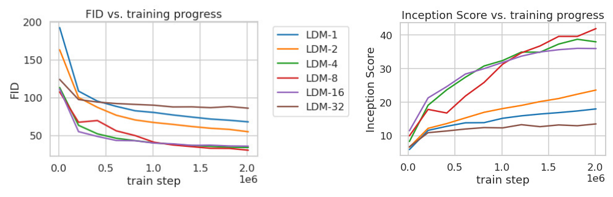

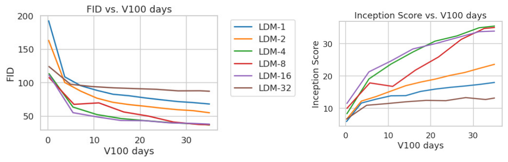

**원문 그림 6 · 17.** 위가 2M 걸음을 가로로, 아래가 35 V100-일을 가로로 한 같은 학습이다. FID 는 5,000 표본, 100 DDIM 걸음(E.3.5).

**원문의 말.** 그림 6 캡션: 「All models are trained on a single NVIDIA A100 with the same computational budget」. 본문: 같은 걸음, 같은 파라미터. LDM-{1, 2} 는 느리고, 큰 $f$ 는 일찍 멈추며, LDM-{4-16} 이 균형이고, 「2M 걸음 뒤 LDM-1 과 LDM-8 의 FID 차이가 38」. D.5: 「비슷한 결과(qualitatively similar results)」.

**내가 포갠 것.** 그림 17 의 가로축을 늘려 그림 6 에 겹치면 RMSE 0.18 ~ 0.28 FID 로 포개진다. 곧 **두 그림은 같은 실행이고 그림 17 은 35 일에서 잘린 것이다.**

| 모델 | 1M 걸음당 V100-일 | 2M 걸음까지 | 35 일에 간 걸음 | FID @2M | FID @35 일 | IS @2M | IS @35 일 |
|---|---:|---:|---:|---:|---:|---:|---:|
| LDM-1 | 17.5 | 35.0 | 2.00M | 68.5 | 68.4 | 18.0 | 18.0 |
| LDM-2 | 17.25 | 34.5 | 2.00M | 55.7 | 55.4 | 23.5 | 23.6 |
| LDM-4 | 26.0 | 52.0 | 1.35M | 34.4 | 37.0 | 38.0 | 35.4 |
| LDM-8 | 27.0 | 54.0 | 1.30M | 31.1 | 36.9 | 41.7 | 34.9 |
| LDM-16 | 26.0 | 52.0 | 1.35M | 36.1 | 38.1 | 36.0 | 33.9 |
| LDM-32 | 23.25 | 46.5 | 1.51M | 86.5 | 87.5 | 13.5 | 13.1 |

LDM-4 의 35 일 FID 는 빨강 · 보라 선에 가려 오차가 1 FID 까지 더 크다.

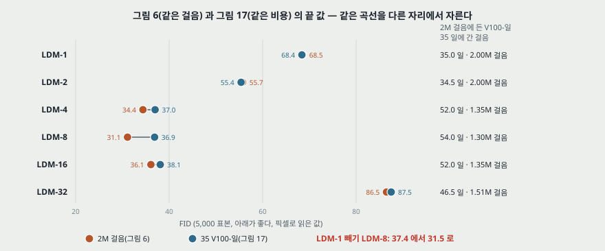

**내 그림 8(내가 읽은 값).**

- **캡션의 「같은 계산 예산」 은 맞지 않는다.** 그림 6 의 끝에서 LDM-8 은 LDM-1 의 1.54 배(54.0 / 35.0) 계산을 썼다.
- **교차 확인.** 표 18 의 LDM-8 은 2.9M 걸음에 79 V100-일이라 1M 당 27.24 일이다. 그림 17 에서 읽은 27.0 과 맞다. **서로 다른 표와 그림이 같은 속도를 준다.**
- **차이 38 은 31.5 가 된다.** 같은 걸음에서 내가 읽은 값이 37.4(68.5 − 31.1), 같은 35 일에서 31.5(68.4 − 36.9)다. 결론(잠재가 앞선다)은 그대로이고 크기가 16% 준다.
- **LDM-8 의 앞섬은 같은 비용에서 사라진다.** IS 는 2M 에서 41.7(LDM-4 38.0 위 3.7)인데 35 일에서 34.9 로 LDM-4 35.4 아래다. FID 도 36.9 · 37.0 · 38.1 로 묶인다. **「4 ~ 16 이 균형」 은 그대로고 「그중 8」 은 같은 비용으로는 안 잡힌다.** 반복이 없어 이 0.5 · 0.1 의 차이는 순서를 매기지 않는다.

**또 함께 움직이는 것들(표 13).**

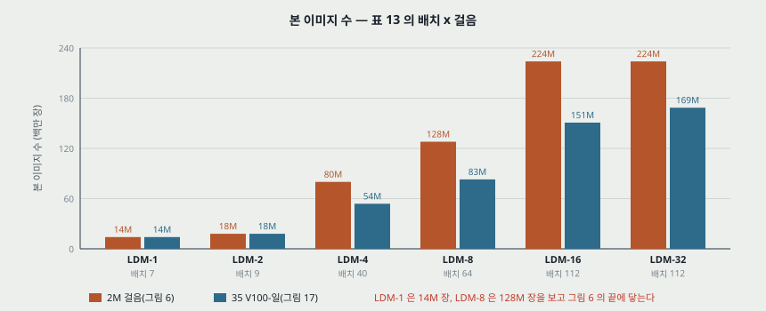

**내 그림 9(내가 센 것).** 배치가 7 · 9 · 40 · 64 · 112 · 112 라 **같은 2M 걸음에 본 이미지가 14M 대 224M, 16 배 차이다.** 같은 35 일에서도 14M · 18M · 54M · 83M · 151M · 169M 이다. 이것이 잠재 쪽 이득의 실체이기도 하다 — 같은 시간에 이미지를 5.9 배(LDM-8 / LDM-1) 더 본다. **다만 원문이 그것을 변인으로 적지 않는다.**

| 표 13 | LDM-1 | LDM-2 | LDM-4 | LDM-8 | LDM-16 | LDM-32 |
|---|---:|---:|---:|---:|---:|---:|
| 채널 | 192 | 192 | 192 | 256 | 256 | 256 |
| 곱 | 1,1,2,2,4,4 | 1,2,2,4,4 | 1,2,3,5 | 1,2,4 | 1,2,4 | 1,2,4 |
| 배치 | 7 | 9 | 40 | 64 | 112 | 112 |
| 학습률 | 4.9e-5 | 6.3e-5 | 8e-5 | 6.4e-5 | 4.5e-5 | 4.5e-5 |
| 학습률 / 배치(내가 나눈 값) | 7.0e-6 | 7.0e-6 | 2.0e-6 | 1.0e-6 | 4.0e-7 | 4.0e-7 |
| 교차 주의 해상도 | 32 16 8 | 32 16 8 | 32 16 8 | 32 16 8 | 16 8 4 | 8 4 2 |

- **E.3.5**: 「안정적으로 학습되는 한 학습률을 최대로 올렸다」. 곧 학습률은 모델마다 고른 값이다.
- **LDM-1 의 끝은 ADM 이 아니다.** 그림 6 의 LDM-1 은 35 V100-일에 FID 68.5(5,000 표본)이고 표 18 의 ADM 은 916 V100-일에 10.94(50,000 표본)다. **곧 이 그림은 작은 예산의 앞부분 비교이고, 픽셀 확산이 어디까지 가는지는 안 잰다.** LDM-1 이 본 이미지 14M 장은 ImageNet 130 만 장으로 11 에폭이다.
- **첫 단계 비용은 곡선에 없다.** 모든 곡선이 첫 단계 학습이 끝난 뒤의 날수다.

---

## 11. 그림 7 — 표본 뽑기 속도 (4.1절)

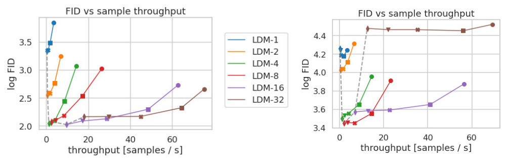

**원문 그림 7.** 왼쪽 CelebA-HQ, 오른쪽 ImageNet. 표식은 {10, 20, 50, 100, 200} DDIM 걸음(오른쪽에서 왼쪽), 점선은 200 걸음. 세로축이 **log FID** 다. 밑을 안 적었지만 ImageNet LDM-8 의 100 걸음 3.47 이 그림 6 의 31.1 과 맞아 자연 로그로 읽었다($e^{3.47} = 32.1$).

**200 걸음 값(내가 읽은 값, 읽기 오차 log FID ± 0.02 = CelebA 에서 FID ± 0.15). LDM-1 · 2 · 4 는 100 · 200 걸음 표식이 겹쳐 오차가 이보다 크다.**

| 모델 | CelebA log FID | CelebA FID | 초당 표본 | ImageNet log FID | ImageNet FID |
|---|---:|---:|---:|---:|---:|
| LDM-1 | 3.35 | 28.5 | 0.18(내 셈) | 4.26 | 70.8 |
| LDM-2 | 2.55 | 12.8 | - | 4.04 | 56.8 |
| LDM-4 | 2.02 | 7.5 | 1.3 | 3.50 | 33.1 |
| LDM-8 | 2.07 | 7.9 | 2.5 | 3.44 | 31.2 |
| LDM-16 | 2.02 | 7.5 | 9.7 | 3.57 | 35.5 |
| LDM-32 | 2.16 | 8.7 | 18.0 | 4.47 | 87.4 |

- **CelebA 에서 LDM-16 은 LDM-4 와 읽기 오차 안이고 7.5 배 빠르다(9.7 / 1.3, 표 18 의 LDM-4 1.07 로는 9.1 배).** 원문 「LDM-{4-8} outperform」 은 ImageNet 쪽에서 맞고 CelebA 쪽에서는 16 까지 같은 줄이다. LDM-32 도 FID 8.7 이다.
- **LDM-32 가 무너지는 곳은 ImageNet 이다**(87.4). 원문의 「복잡한 데이터는 압축을 줄여야 한다」 와 맞는다. 복잡도를 변인으로 둔 것은 두 데이터뿐이다.
- **표 14 의 별표.** 「500k 전에 수렴하면 가장 좋은 체크포인트로 FID 를 쟀다」. 곧 그림 7 왼쪽은 모델마다 시험 지표로 고른 지점이다.

**걸음 수를 빼면(내가 센 것).** 표본 하나의 시간 = 걸음 x (평가 하나) + 고정 몫으로 놓고 표식 둘에서 풀었다.

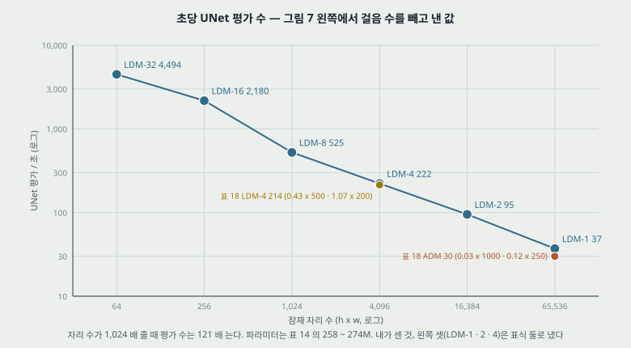

**내 그림 10.** 자리 수가 1,024 배 주는 동안 초당 평가 수는 121 배 는다(37 → 4,494). 파라미터는 258 ~ 274M 으로 묶었으니 **비용이 자리 수에 비례하지 않는다.** 채널 곱이 함께 달라져서다(1,1,2,2,4,4 대 1,2,4).

| 모델 | 잠재 자리 수 | 평가 / 초 | 고정 몫(복호) |
|---|---:|---:|---:|
| LDM-1 | 65,536 | 37.1 | 15.9 ms |
| LDM-2 | 16,384 | 95.2 | 39.9 ms |
| LDM-4 | 4,096 | 222.2 | 24.9 ms |
| LDM-8 | 1,024 | 524.9 | 19.0 ms |
| LDM-16 | 256 | 2,180 | 11.4 ms |
| LDM-32 | 64 | 4,494 | 11.1 ms |

- **첫 단계가 없는 LDM-1 에서 15.9 ms 가 나왔으니 이 열의 읽기 오차가 그 크기다.** LDM-1 · 2 · 4 는 표식 둘(10 · 20 걸음)로 낸 값이다.
- **표 18 과 맞는다.** LDM-4 의 0.43 x 500 = 215, 1.07 x 200 = 214 평가 / 초(내 그림 10 의 222 와 3.8% 차). ADM 은 0.03 x 1,000 = 30, 0.12 x 250 = 30 이다.
- **표 18 의 「35.7 배」 를 갈랐다.** 침실의 1.07 / 0.03 = 35.7 배는 평가 속도 7.1 배(214 / 30) x 걸음 5 배(1,000 / 200)다. **표본 속도 배수의 5 배는 걸음 수를 다르게 둔 몫이고, 그 칸의 FID 는 2.95 대 1.9 다.**

---

## 12. 표 1 — 무조건 생성 (4.2절)

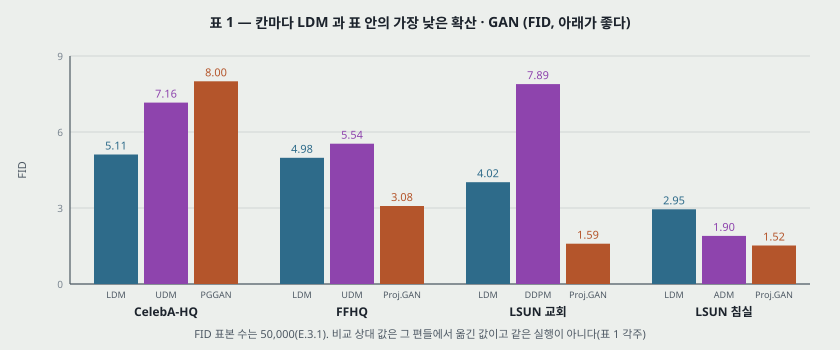

**내 그림 11(원문 표 1).**

| 데이터 (256 x 256) | LDM | FID | P / R | 표 안 최저 FID |
|---|---|---:|---|---|
| CelebA-HQ | LDM-4, 500 걸음 | 5.11 | 0.72 / 0.49 | **LDM** (UDM 7.16, LSGM 7.22, PGGAN 8.0) |
| FFHQ | LDM-4, 200 걸음 | 4.98 | 0.73 / 0.50 | ProjectedGAN 3.08, StyleGAN 4.16 |
| LSUN 교회 | LDM-8(KL), 200 걸음 | 4.02 | 0.64 / 0.52 | ProjectedGAN 1.59, StyleGAN2 3.86 |
| LSUN 침실 | LDM-4, 200 걸음 | 2.95 | 0.66 / 0.48 | ProjectedGAN 1.52, ADM 1.90, StyleGAN 2.35 |

- **FID 첫째는 넷 중 CelebA-HQ 하나다.** Abstract 도 무조건 쪽은 「highly competitive」 라 적어 세기가 맞다. 4.2절의 「new state-of-the-art」 는 CelebA-HQ 칸의 말이다. **그 칸만 500 걸음이고 나머지는 200 걸음이다.**
- **「확산 쪽 앞 값을 침실 빼고 다 넘는다」 는 표에서 맞다.** 침실의 「close to ADM」 은 차 1.05, 비 1.55 배다.
- **「Precision 과 Recall 에서 GAN 을 늘 넘는다」** 를 칸으로 세면 GAN 값이 있는 10 칸 중 9 칸이 위이고 침실 Recall 은 StyleGAN 과 0.48 로 같다(내가 센 것). 다만 FID 는 넷 중 셋에서 GAN 이 낮아 **「가능도 쪽이 넓게 덮는다」 는 FID 로는 안 받쳐진다.** 비교 상대의 P · R 은 다른 실행 값이다.
- **FID 표본 50,000, 참조는 학습 집합 전체**(E.3.1). **걸음 수를 고른 기준과 $\eta$ 는 표에 없고** 그림 28 ~ 31 캡션에서 일부 나온다(25절).
- **두 도구의 차이.** E.3.1 이 torch-fidelity 와 ADM 스크립트를 맞대어 7.76 대 7.77, 2.95 대 3.0 이라 적는다. **이 편 안에서 FID 의 흔들림을 재는 유일한 값이다.** 시작값 반복은 표 어디에도 없다.

---

## 13. 표 18 — 계산 비용 (부록 F)

**환산.** ADM 쪽이 V100-일을 적어 A100 일에 2.2 를 곱했다. 근거는 NVIDIA 블로그의 U-Net 속도 비([74]). **이 한 수가 LDM 쪽 모든 비용에 곱해진다.** 2.0 이면 9.1% 작고 2.5 면 13.6% 크다(내 셈).

| 칸 | 모델 | V100-일 | 초당 표본 | 파라미터 | FID |
|---|---|---:|---:|---:|---:|
| 침실 | ADM 1,000 걸음 | 232 | 0.03 | 552M | 1.9 |
| 침실 | LDM-4 200 걸음 1.9M | 60 (전체 칸 55) | 1.07 | 274M | 2.95 |
| 교회 | StyleGAN2 | 64 | - | 59M | 3.86 |
| 교회 | LDM-8 「100 걸음, 410K」 | 18 | 6.80 | 256M | 4.02 |
| CelebA | LDM-4 500 걸음 410K | 14.4 | 0.43 | 274M | 5.11 |
| FFHQ | StyleGAN2 | 32.13 | - | 59M | 3.8 |
| FFHQ | LDM-4 200 걸음 635K | 26 | 1.07 | 274M | 4.98 |
| ImageNet | VQGAN-f-4 첫 단계 | 29 | - | 55M | R-FID 0.58 |
| ImageNet | VQGAN-f-8 첫 단계 | 66 | - | 68M | R-FID 1.14 |
| ImageNet | ADM 250 걸음 | 916 | 0.12 | 554M | 10.94 |
| ImageNet | ADM-G 250 걸음 | 962 | 0.07 | 608M | 4.59 |
| ImageNet | LDM-4 250 걸음 178K | 271 | 0.7 | 400M | 10.56 |
| ImageNet | LDM-4-G $s$ = 1.5 | 271 | 0.4 | 400M | 3.60 |

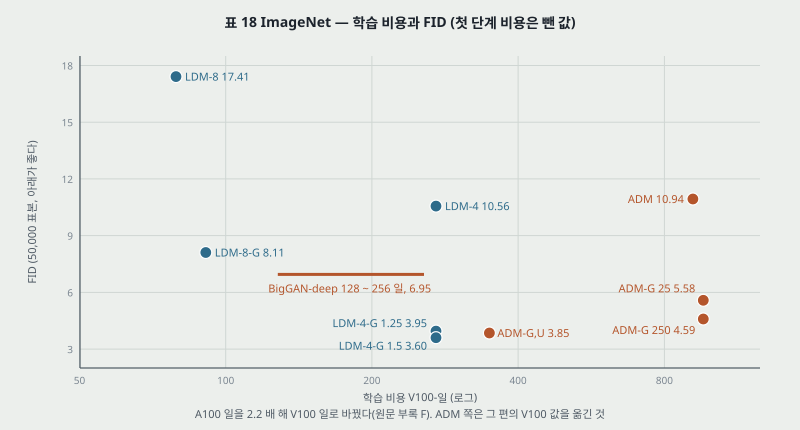

**내 그림 12(원문 표 18).**

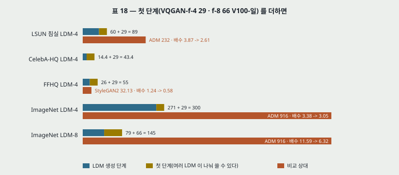

**내 그림 13(내가 더한 것).** **비교 줄의 비용에 첫 단계가 안 들어 있다.** 침실 3.87 배는 2.61 배로, ImageNet LDM-4 3.38 배는 3.05 배로, LDM-8 11.59 배는 6.32 배로 준다. CelebA 는 첫 단계 29 일이 생성 14.4 일의 2.01 배다. 첫 단계는 여러 LDM 이 나눠 쓰니 **나눠 쓴 수만큼 빼야 공정하고**, 그 수는 데이터 · 모델이 몇이냐에 달렸다. 원문은 「한 번만 배우면 된다」 고 적고 더하지 않는다.

**학습 속도를 내 봤다(내가 센 것).** V100-일 / 2.2 를 날수로 놓고 표 12 · 15 의 걸음과 배치를 넣었다.

| 모델 | A100 일 | 걸음 / 초 | 장 / 초 | 본 이미지 |
|---|---:|---:|---:|---:|
| 침실 LDM-4 (배치 48) | 27.3 | 0.806 | 38.7 | 91.2M |
| CelebA LDM-4 (48) | 6.5 | 0.725 | 34.8 | 19.7M |
| FFHQ LDM-4 (42) | 11.8 | 0.622 | 26.1 | 26.7M |
| ImageNet LDM-8 (64) | 35.9 | 0.935 | 59.8 | 185.6M |
| ImageNet LDM-4 (1,200) | 123.2 | 0.017 | 20.1 | 213.6M |

- **표 15 의 「A100 한 장」 은 다시 볼 자리다.** 캡션이 메우기 모델만 V100 여덟 장이고 나머지는 A100 한 장이라 적는데, 부류 조건 LDM-4 는 배치 1,200, 글 모델(1.45B)은 배치 680 이다. 같은 짜임의 표 13 LDM-4 는 배치 40 이다. 부록 A 는 「더 큰 배치로 다시 배웠다」 고 적는다. **장수가 다르면 271 V100-일의 환산도 달라진다.** 이 파일로는 못 가른다.
- **표 6 과 단위가 안 맞는다.** 표 6 의 학습 처리량은 0.11 ~ 0.35 「samples/sec」 인데 위 표는 20 ~ 60 장 / 초다. 표 6 의 처리량 x 시간 / 에폭은 8,181 · 8,824 · 8,364 · 8,392 로 **에폭당 8 천 몇 백 단위**가 나온다(내 셈). Places 의 학습 이미지 수는 이 파일에 없어 어느 쪽이 맞는지 못 가른다.

---

## 14. 표 3 · 10 — ImageNet 부류 조건 (4.3.1절 · D.4)

| 방법 | FID | IS | P | R | 파라미터 | 걸음 |
|---|---:|---:|---:|---:|---:|---|
| BigGAN-deep | 6.95 | 203.6 ± 2.6 | 0.87 | 0.28 | 340M | - |
| ADM | 10.94 | 100.98 | 0.69 | 0.63 | 554M | 250 |
| ADM-G | 4.59 | 186.7 | 0.82 | 0.52 | 608M | 250 |
| ADM-G, ADM-U | 3.85 | 221.72 | 0.84 | 0.53 | n/a | 2 x 250 |
| CDM | 4.88 | 158.71 ± 2.26 | - | - | n/a | 2 x 100 |
| LDM-8, 2.9M | 17.41 | 72.92 ± 2.6 | 0.65 | 0.62 | 395M | 200 |
| LDM-8-G, 분류기 10 | 8.11 | 190.43 ± 2.60 | 0.83 | 0.36 | 506M | 200 |
| LDM-8, 4.8M | 15.51 | 79.03 ± 1.03 | 0.65 | 0.63 | 395M | 200 |
| LDM-8-G, 4.8M | 7.76 | 209.52 ± 4.24 | 0.84 | 0.35 | 506M | 200 |
| LDM-4, 178K, 배치 1,200 | 10.56 | 103.49 ± 1.24 | 0.71 | 0.62 | 400M | 250 |
| LDM-4-G $s$ = 1.25 | 3.95 | 178.22 ± 2.43 | 0.81 | 0.55 | 400M | 250 |
| LDM-4-G $s$ = 1.5 | 3.60 | 247.67 ± 5.59 | 0.87 | 0.48 | 400M | 250 |

- **「ADM 을 넘는다」 의 값.** 안내 없이 10.56 대 10.94(차 0.38, FID 에 ± 없음)이고 안내로 3.60 대 4.59 다. 표 10 의 ADM-G, ADM-U 3.85 와는 0.25 차다. E.3.1 의 도구 차이(0.01 ~ 0.05)보다는 크고, 시작값 반복은 없다.
- **Recall 은 내준다.** $s = 1.5$ 에서 0.48 로 ADM-G 0.52, ADM-G,U 0.53, 안내 없는 자기 자신 0.62 아래다. $s = 1.25$ 면 FID 3.95 · Recall 0.55 다. **$s$ 를 고른 기준은 적혀 있지 않고, FID 참조가 학습 집합(E.3.1)이니 3.60 은 지표로 고른 $s$ 의 값이다**(내 해석). 표본 그림 26 · 27 은 $s$ = 5 · 3 으로 표의 $s$ 와 다르다.
- **안내의 값.** 분류기 없는 안내는 파라미터를 안 늘린다(400M 그대로). 표본 속도는 0.7 → 0.4(1.75 배)다. LDM-8-G 는 분류기로 111M(506 − 395, 내 셈)을 더한다.
- **더 배우면.** LDM-8 은 2.9M → 4.8M 에서 17.41 → 15.51, 안내 8.11 → 7.76. 표 18 의 비율로 4.8M 은 131 V100-일이다(내 셈). **비용 표의 79 일 값에는 7.76 이 아니라 8.11 이 짝이다.**
- **표 3 은 LDM-4 만이다.** 본문은 「$f \in \{4, 8\}$ 의 최고 모델을 표 3 · 그림 4 · D.4 에서」 라 적어 LDM-8 은 표 10 에서 봐야 한다.

---

## 15. 표 2 — 글에서 이미지 (4.3.1절 · E.3.2)

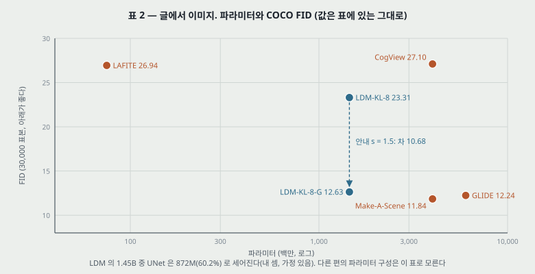

**내 그림 14(원문 표 2).** LAION-400M 으로 배운 LDM-KL-8(1.45B, 배치 680, 390K 걸음, 표 15)을 MS-COCO 검증 30,000 장에 대어 쟀다.

| 방법 | FID | IS | 파라미터 | 비고 |
|---|---:|---:|---:|---|
| CogView | 27.10 | 18.20 | 4B | 자기 순위 매기기, 거부율 0.017 |
| LAFITE | 26.94 | 26.02 | 75M | |
| GLIDE | 12.24 | - | 6B | 277 걸음, $s$ = 3 |
| Make-A-Scene | 11.84 | - | 4B | $s$ = 5 |
| LDM-KL-8 | 23.31 | 20.03 ± 0.33 | 1.45B | 250 걸음 |
| LDM-KL-8-G | 12.63 | 30.29 ± 0.42 | 1.45B | 250 걸음, $s$ = 1.5 |

- **「on par」 의 크기.** GLIDE 와 0.39, Make-A-Scene 과 0.79 차로 위다. IS 는 둘 다 칸이 비어 견줄 수 없다.
- **안내 하나가 10.68 을 낸다.** 같은 모델에서 23.31 → 12.63. **안내 없는 값으로 줄 세우면 AR 쪽과 같은 칸이 아니다.** 상대 네 줄의 값은 [109] · [26] 에서 옮겼다(각주).
- **그림 5 의 표본은 $s = 10$, 200 걸음이다.** FID 를 잰 $s = 1.5$ 의 표본이 아니다. 「일반화가 잘 된다」 는 프롬프트 일곱의 표본을 눈으로 본 판정이다.
- **표식 하나.** LDM-KL-8-G 줄에 ∗ 가 붙었는데 각주는 ∗ 를 「[26] 에서 온 값」 이라 적는다. 자기 값을 옮겼다는 뜻인지 표식 잘못인지 이 파일로 못 가른다.
- **COCO 는 학습 데이터가 아니다.** LAION 으로 배운 모델의 COCO FID 다. 상대들의 학습 데이터 조건은 이 표에 없다.

---

## 16. 표 9 — 배치에서 이미지 (D.3 · E.3.3)

| 방법 | COCO 256 | OpenImages 256 | OpenImages 512 |
|---|---:|---:|---:|
| LostGAN-V2 | 42.55 | - | - |
| OC-GAN | 41.65 | - | - |
| SPADE | 41.11 | - | - |
| VQGAN+T | 56.58 | 45.33 | 48.11 |
| LDM-8, 100 걸음 | 42.06 (처음부터) | - | - |
| LDM-4, 200 걸음 | 40.91 (OpenImages 미세조정) | 32.02 | 35.80 |

- **「COCO 모델이 최신 값에 닿는다」**: 처음부터 배운 42.06 은 OC-GAN 41.65 와 LostGAN 42.55 사이다. 미세조정한 40.91 이 SPADE 를 0.20 앞선다.
- **「nearly 11 의 차이」 가 표와 안 맞는다.** 원문 D.3 은 OpenImages 에서 Jahn 외([37])를 「거의 11」 앞선다 적는데 표 9 는 13.31(256)과 12.31(512)이다(내가 뺀 값).
- FID 는 COCO 2,048 장. 표본 수가 적어 다른 표의 FID 와 같은 칸에 안 놓는다.

---

## 17. 합성곱 표본 뽑기 · SNR · 이미지 안내 (4.3.2절 · D.1 · 부록 C)

**합성곱으로 키우기.** 256 으로 배운 모델을 더 큰 잠재에 그대로 돌린다. 공간 조건이 있으면 $1024 \times 384$ 까지 그림으로 보인다(그림 9 · 12 · 23 ~ 25). **큰 해상도의 FID 는 메우기 표 7 의 미세조정 줄 말고는 없다.** 나머지는 그림이다.

**잠재 분산이 결과를 바꾼다(D.1, 그림 15).** 원문이 $\text{Var}(z) / \sigma_t^2$ 라 부르는 비가 KL 공간에서 「매우 높아」 뒤집는 과정 앞쪽에 의미 세부를 몰아 넣는다고 적는다. $\hat\sigma$ 로 나누면 비가 준다. **값은 없고 세 줄의 표본 그림이 근거다.** 이 자리에 일정 양 끝 값과 $\hat\sigma$ 값이 있어야 수로 읽히는데 둘 다 없다.

**식 (16) — 분류기 안내(원문 부록 C).**

$$\hat\epsilon \leftarrow \epsilon_\theta(z_t, t) + \sqrt{1 - \alpha_t^2}\, \nabla_{z_t} \log p_\Phi(y \mid z_t) \qquad (16)$$

**부호가 틀렸다(내가 유도한 것).** 식 (4) 에서 $\nabla_{z_t} \log p(z_t) = -\epsilon / \sigma_t$ 이고 $\sigma_t = \sqrt{1 - \alpha_t^2}$ 다. 베이즈로 $\nabla \log p(z_t \mid y) = \nabla \log p(z_t) + \nabla \log p(y \mid z_t)$ 이니,

$$-\frac{\hat\epsilon}{\sigma_t} = -\frac{\epsilon_\theta}{\sigma_t} + \nabla \log p_\Phi(y \mid z_t) \;\;\Rightarrow\;\; \hat\epsilon = \epsilon_\theta - \sigma_t \nabla \log p_\Phi(y \mid z_t)$$

**$-$ 가 맞다.** 작은 예시로, 1 차원에서 $\sigma_t = 0.6$, $\epsilon_\theta = 1$, 조건 기울기 $= 0.5$ 면 원문 꼴은 1.3, 유도한 꼴은 0.7 이다. 뽑는 걸음은 $\hat\epsilon$ 을 빼므로 원문 꼴이면 $z_t$ 가 조건 확률이 **낮아지는** 쪽으로 간다. 띄운 쪽에서 + 를 확인했다. 원문이 「[15] 의 알고리즘은 이렇다」 고 옮긴 자리이니 인쇄 잘못으로 읽힌다(ADM 원문은 안 읽었다).

**이미지 안내(식 17).** $\log p_\Phi(y \mid z_t) = -\frac{1}{2} \lVert y - T(\mathcal{D}(z_0(z_t))) \rVert_2^2$. 분산 1 의 가우스 안내이고 $T$ 는 미분 가능한 변환이다. 그림 14: 256 표본을 $2 \times$ 바이큐빅으로 맞춰 512 를 뽑는다. 표 5 의 「guiding」 은 이것을 LPIPS 로 바꾼 것이다.

---

## 18. 초해상도 — 표 4 · 5 · 11 (4.4절 · D.6 · E.3.4)

| 방법 | FID 검증 / 학습 참조 | IS | PSNR | SSIM | 파라미터 | 장 / 초 |
|---|---:|---:|---:|---:|---:|---:|
| 이미지 회귀 | 15.2 | 121.1 | 27.9 | 0.801 | 625M | - |
| SR3 | 5.2 | 180.1 | 26.4 | 0.762 | 625M | - |
| LDM-4, 100 걸음 | 2.8 / 4.8 | 166.3 | 24.4 ± 3.8 | 0.69 ± 0.14 | 169M | 4.62 |
| LDM-4 big, 100 걸음 | 2.4 / 4.3 | 174.9 | 24.7 ± 4.1 | 0.71 ± 0.15 | 552M | 4.5 |
| LDM-4, 50 걸음, 안내 | 4.4 / 6.4 | 153.7 | 25.8 ± 3.7 | 0.74 ± 0.12 | 184M | 0.38 |
| LDM-4, 100 걸음, +15 에폭 | 2.6 / 4.6 | 169.76 ± 5.03 | 24.4 ± 3.8 | 0.69 ± 0.14 | - | - |
| Pixel-DM, 100 걸음, +15 에폭 | 5.1 / 7.1 | 163.06 ± 4.67 | 24.1 ± 3.3 | 0.59 ± 0.12 | - | - |

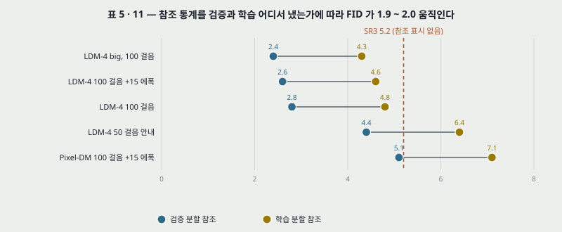

**내 그림 15(원문 표 5 · 11).**

- **「FID 에서 SR3 를 넘는다」 는 참조에 달렸다.** 같은 모델이 참조만 바꿔 1.9 ~ 2.0 움직인다(내가 뺀 값). 검증 참조면 2.8 대 5.2, 학습 참조면 4.8 대 5.2 다. **SR3 의 5.2 에는 참조 표시가 없다.** E.3.4 가 「검증 분할에서 표본을 뽑고, 참조를 학습 분할로도 냈다」 고만 적는다.
- **IS · PSNR · SSIM 은 SR3 가 위다.** 원문은 IS 만 적는다. PSNR 은 「흐림을 좋아한다」 고 적는데, 그 말은 [72] 를 옮긴 것이고 이 편이 잰 값은 아니다.
- **표 5 의 안내 줄 184M.** 안내에 첫 단계가 들어가 늘어난 수로 읽히는데 **169 → 184M 의 15M 은 설명이 없다.** 표 18 의 VQGAN-f-4 55M 과도 안 맞는다.
- **픽셀 대조.** 표 11 끝 두 줄. **본문은 「같은 걸음 수 · 비슷한 파라미터」, 캡션은 「같은 계산」 이라 적는다.** 10절이 보였듯이 이 둘은 다르다. Pixel-DM 의 파라미터는 표에 없고, 원문 각주가 정확히 맞출 수 없다고 적는다.
- **표 4 사용자 연구.** 19절에서 메우기와 함께 본다.
- **LDM-BSR.** 바이큐빅으로 배운 모델이 다른 입력에 일반화가 안 돼 Zhang 외([105])의 열화를 **완화해서** 쓴다. 파라미터 값은 코드에만 있고, 그림 18 · 19 만 있다.

---

## 19. 메우기 — 표 4 · 6 · 7 (4.5절 · E.2.2)

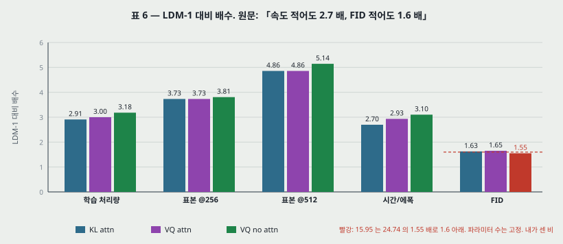

**내 그림 16(내가 나눈 비, 원문 표 6).**

| 표 6 | 학습 처리량 | 표본 @256 | 표본 @512 | 시간 / 에폭 | FID@2k 6 에폭 |
|---|---:|---:|---:|---:|---:|
| LDM-1 | 0.11 | 0.26 | 0.07 | 20.66 | 24.74 |
| LDM-4 KL, 주의 | 0.32 | 0.97 | 0.34 | 7.66 | 15.21 |
| LDM-4 VQ, 주의 | 0.33 | 0.97 | 0.34 | 7.04 | 14.99 |
| LDM-4 VQ, 주의 없음 | 0.35 | 0.99 | 0.36 | 6.66 | 15.95 |

- **「적어도 2.7 배」 는 맞다**(시간 / 에폭 20.66 / 7.66 = 2.70). **「FID 적어도 1.6 배」 는 한 줄이 아래다**: 24.74 / 15.95 = 1.55.
- **FID 는 2,000 표본, 6 에폭 값이다.** 끝까지 배운 비교가 아니다. 파라미터는 고정했다고 적는다.

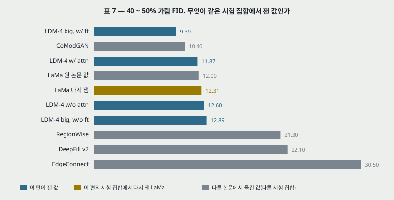

**내 그림 17(원문 표 7, 색만 내가 가름).**

| 표 7 | 40 ~ 50% FID | LPIPS | 전체 FID | LPIPS |
|---|---:|---|---:|---|
| LDM-4 big, 미세조정 | 9.39 | 0.246 ± 0.042 | 1.50 | 0.137 ± 0.080 |
| LDM-4 big | 12.89 | 0.257 ± 0.047 | 2.40 | 0.142 ± 0.085 |
| LDM-4 주의 | 11.87 | 0.257 ± 0.042 | 2.15 | 0.144 ± 0.084 |
| LDM-4 주의 없음 | 12.60 | 0.259 ± 0.041 | 2.37 | 0.145 ± 0.084 |
| LaMa 이 편이 다시 잼 | 12.31 | 0.243 ± 0.038 | 2.23 | 0.134 ± 0.080 |
| LaMa 원 논문 값 | 12.0 | 0.24 | 2.21 | 0.14 |
| CoModGAN | 10.4 | 0.26 | 1.82 | 0.15 |

- **새 최고 값의 조건.** 9.39 는 big 을 $512^2$ 에서 반 에폭 미세조정한 줄이다. **같은 시험 집합의 비교는 LaMa 한 줄이고, CoModGAN 10.4 는 원 시험 집합 값이다.** 원 시험 집합을 못 구해 다시 만들었다고 적는다(각주). 같은 LaMa 의 차가 0.31(40 ~ 50%), 0.02(전체)라 이 크기를 시험 집합 차이의 한 표본으로 볼 수 있고, 9.39 와 10.4 의 차 1.01 은 그보다 크다(내 비교).
- **미세조정 앞의 big 은 주의 없는 작은 모델보다 낮지 않다**: 12.89 대 12.60. 원문은 「추가 주의 모듈 때문이라고 **가설**을 세운다(hypothesize)」. 미세조정 없이 주의를 뺀 big 은 없다.
- **LPIPS 는 LaMa 가 낮다.** 0.246 대 0.243. 원문은 「LaMa 는 한 결과만 내서 평균에 가깝다」 로 설명한다. 이 설명을 잰 행은 없다. ± 의 뜻(표본별 표준편차로 읽힌다)이 적혀 있지 않다.

**표 4 사용자 연구.**

| 과제 | SR: Pixel-DM | SR: LDM-4 | 메우기: LaMa | 메우기: LDM-4 |
|---|---:|---:|---:|---:|
| 1: 정답 이미지 대비 선호 | 16.0% | 30.4% | 13.6% | 21.0% |
| 2: 두 모델 중 선호 | 29.4% | 70.6% | 31.9% | 68.1% |

- E.3.6: SR3 의 절차를 따라 **2 지선다, 3 초 보기.** **참가자 수, 시행 수, 신뢰 구간은 표 4 · E.3.6 어디에도 없다.** 차이의 크기를 판정할 값이 없다.
- 과제 1 은 50% 면 구분을 못 한다는 뜻이다. LDM-4 도 30.4% · 21.0% 로 정답에 진다.
- 비교 상대가 SR3 가 아니라 Pixel-DM 이다. 본문은 「SR3 를 따른다」 고 적는데 SR3 와의 사용자 비교는 없다.

---

## 20. 정성 그림들 (그림 4 · 5 · 8 ~ 16 · 18 ~ 34)

| 그림 | 무엇 | 숫자 |
|---|---|---|
| 4 · 26 ~ 31 | 데이터별 표본 | 캡션의 FID 뿐 |
| 5 · 13 | 글 프롬프트 | $s$ = 10 · 200 걸음, 그림 13 은 $> 256^2$ |
| 8 · 16 | 배치 | 표 9 |
| 9 · 12 · 23 · 24 · 25 | 지형 지도, 합성곱 뽑기 | 없음 |
| 10 · 18 · 19 · 20 | 초해상도 | 없음 |
| 11 · 21 · 22 | 메우기, 물체 지우기 | 없음 |
| 14 · 15 | 안내, 다시 재기의 효과 | 없음 |
| 32 · 33 · 34 | VGG 특징 최근접 10 장 | 눈 판정. 학습 데이터 복제 여부의 근거로 부록 H 가 싣는다. 거리 값은 없다 |

**모두 눈으로 보는 근거다.** 그림 32 ~ 34 는 5절이 말한 「학습 데이터를 드러낼 수 있다」 의 유일한 점검이고 세 데이터뿐이다.

---

## 21. 실험 분석 (논문의 표 · 그림마다)

**직접 돌리지 않는다.** 논문이 낸 실험을 표 · 그림 하나씩 같은 틀로 읽는다. 책상에서 낸 값은 「내가 센 것」 또는 「읽은 값」 으로 밝힌다.

| 표 · 그림 | 무엇을 바꿨나 (변인) | 무엇을 고정했나 | 결과 | 반복 수 · 흩어짐 | 주장이 결과보다 센가 |
|---|---|---|---|---|---|
| **표 8 · 그림 1** | $f$ · $c$ · 정칙화 · $\lvert Z \rvert$ | OpenImages 학습, ImageNet 검증. 해상도 적혀 있지 않음 | KL $f$ 8 · 16 · 32 @4,096: 24.19 · 24.08 · 22.27 dB | PSNR · R-IS 에 표본별 ±, 학습 반복 없음 | 「덜 줄인다」 만으로 안 세워진다. 수의 개수가 변인인데 열이 없다 |
| **그림 2** | 율 | 학습된 DDPM 하나 | 끝 1.771 bits/dim(읽은 값) | 없음 | 타원은 잰 것이 아니다. 데이터가 캡션에 없고 CIFAR10 표와 맞는다. **센 편** |
| **그림 6** | $f$ | 2M 걸음, A100, 파라미터. 배치 · 학습률 · 채널이 함께 움직임 | 5,000 표본 FID: 68.5 · 55.7 · 34.4 · 31.1 · 36.1 · 86.5(읽은 값) | 없음 | 「같은 계산 예산」 은 틀렸다(35 대 54 V100-일). 「차이 38」 은 맞다 |
| **그림 17** | $f$ | 35 V100-일 | 68.4 · 55.4 · 37.0 · 36.9 · 38.1 · 87.5(읽은 값) | 없음 | 「비슷한 결과」 는 큰 줄기만 맞다. LDM-8 의 IS 앞섬은 사라진다 |
| **그림 7** | $f$ · 걸음 · 데이터 둘 | CelebA 500k · ImageNet 2M, 5,000 표본 | CelebA 200 걸음 FID: 7.5 · 7.9 · 7.5 · 8.7(4 · 8 · 16 · 32), ImageNet 33.1 · 31.2 · 35.5 · 87.4 | 없음, CelebA 는 가장 좋은 체크포인트 | 「4-8 이 앞선다」 는 ImageNet 쪽. CelebA 는 16 까지 같다. **데이터 범위가 좁다** |
| **표 1** | 데이터 넷, 방법 | 256, FID 50,000 | 5.11 · 4.98 · 4.02 · 2.95 | P · R · FID 에 ± 없음, 상대는 문헌 값 | CelebA 만 500 걸음이고 그 칸만 첫째. 「consistently」 는 9 칸 / 10 칸이고 FID 는 반대 |
| **표 2** | 안내 유무 | COCO, 250 걸음 | 23.31 → 12.63 | IS 만 ± | 「on par」 는 값으로 맞다(0.39 · 0.79 차). 상대 값은 옮긴 것 |
| **표 3 · 10** | $f$ · 걸음 · 안내 · $s$ | ImageNet 256, 50,000 | 3.60 · 3.95 · 10.56 | IS 만 ± | FID 첫째는 맞다. Recall 은 ADM-G 아래고 $s$ 고른 기준이 없다 |
| **표 4** | 방법 | SR3 절차, 3 초 | 30.4 · 70.6 · 21.0 · 68.1% | **참가자 수 없음** | 「affirm」 을 판정할 값이 없다. **센 편** |
| **표 5 · 11** | 걸음 · 크기 · 안내 · 참조 집합 | ImageNet $\times 4$ | 2.8 / 4.8, SR3 5.2 | PSNR · SSIM ± 표본별 | 참조에 따라 1.9 ~ 2.0 움직인다. 「같은 걸음」 과 「같은 계산」 이 어긋남 |
| **표 6** | 첫 단계 · 주의 | 파라미터, Places | 2.70 배, 1.55 ~ 1.65 배 | 없음, 2,000 표본 6 에폭 | 「적어도 1.6」 은 한 줄이 1.55. 처리량 단위가 표 18 과 안 맞는다 |
| **표 7** | 방법 · 미세조정 | 512 조각 30,000 장 | 9.39, LaMa 12.31, CoMod 10.4 | LPIPS ± 뜻 없음 | 「새 최고」 는 시험 집합을 건너뛴 값이지만 차 1.01 이 LaMa 의 0.31 보다 크다 |
| **표 9** | 방법 · 미세조정 | 2,048 장 | 40.91, 32.02, 35.80 | 없음 | 본문 「거의 11」 은 표의 13.31 · 12.31 과 어긋남 |
| **표 18** | 방법 | A100 x 2.2 = V100 | 271 대 916 등 | 없음 | 첫 단계 비용이 빠졌고, 표본 속도 배수에 걸음 수 차이가 섞였다 |
| **그림 14 · 15** | 안내 · 다시 재기 | 지형 | 표본 | 없음 | 눈 판정. 세기가 맞다(「can help」) |
| **그림 32 ~ 34** | - | VGG-16 특징 | 최근접 10 장 | 세 데이터 | 복제 없음을 말하지 않고 그림만 싣는다. 세기가 맞다 |

**비교 상대가 같은 조건인가.** 같은 조건의 실행은 **그림 6 · 7 · 17(LDM-1 대 LDM-$f$), 표 6, 표 11 의 끝 두 줄, 표 7 의 LaMa 한 줄** 이다. ADM · StyleGAN · GLIDE · SR3 등은 그 편의 값이다. **픽셀 확산과 잠재 확산을 끝까지 같은 예산으로 맞댄 행은 없다.**

**반복과 흩어짐.** 시작값을 바꿔 학습을 되풀이한 행은 표 1 ~ 18 에서 찾지 못했다. ± 는 IS(표본 분할로 읽힌다), PSNR · SSIM · LPIPS(표본별로 읽힌다)에만 있고 FID 에는 없다. 이 편이 FID 의 흔들림을 재는 값은 두 도구의 차이(0.01 · 0.05) 하나다.

---

## 22. 이 논문이 스스로 적은 한계와 조건 (5절)

1. **표본 뽑기가 GAN 보다 느리다.** 「still slower than that of GANs」.
2. **높은 정밀도가 필요한 일에서는 복원이 병목이 될 수 있다.** $f = 4$ 의 손실은 「very small」 이지만 픽셀 수준 정확도가 필요하면 문제이고 초해상도 모델이 이미 「somewhat limited」 라고 「가정한다(assume)」. 값은 없다.
3. **두 단계의 분포 왜곡.** 적대 학습 + 가능도 목적의 조합이 데이터를 얼마나 잘못 나타내는지가 「중요한 연구 문제」 로 남는다.
4. **사회적 영향.** 조작 이미지와 허위 정보, 학습 데이터 노출, 데이터 편향. 값은 없다.
5. **$\tau_\theta$ 에 $t$ 를 넣는 일**은 뒤로 미뤘다(E.2.1).
6. **FID 절차를 통일할 필요**(E.3.1).

---

## 23. 논문이 적지 않은 것 — 내가 읽으며 짚은 자리

- **「near-optimal point」(Abstract).** 무엇의 최적인지 정의가 없다. 잰 것은 $f$ 여섯 점의 FID · 속도이고 그 안의 가운데 값이다.
- **「without degrading their quality」(6절).** 픽셀 확산과 같은 칸의 값은 ADM 대 LDM-4 부류 조건(10.94 · 10.56)과 침실(1.90 · 2.95)이다. 침실에서는 1.55 배 높다. 2절의 「almost no reduction in synthesis quality (see Fig. 1)」 의 그림 1 은 생성이 아니라 복원이다.
- **첫 단계의 몫을 뺀 칸이 없다.** 같은 $f$ 에서 첫 단계만 바꾼 FID 는 표 6(KL · VQ 15.21 · 14.99)과 4.2절의 말(「VQ 가 때로 낫다」)뿐이고, 교회만 KL 인 이유는 안 적었다.
- **「VQ 공간에서 때로 더 좋다」(4절)의 까닭.** 복원은 KL 이 위인데 생성은 VQ 가 위인 칸이 있다는 사실만 적는다. 표 1 의 넷 중 셋이 VQ, 교회가 KL 인 고른 기준이 없다.
- **일정 끝 값 · 초기화 · EMA · 옵티마이저.** 표 12 ~ 15 에 없다.
- **DDIM $\eta$ 와 걸음을 표마다 어떻게 골랐나.** 그림 28 ~ 31 의 캡션을 모아야 일부 나온다.
- **첫 단계 데이터와 생성 데이터의 차이.** OpenImages 로 배운 첫 단계로 얼굴 · 교회를 돈다. 그 데이터에서의 R-FID 는 없다. 표 8 은 ImageNet 검증이다.
- **첫 단계 복원이 FID 의 어디까지 묶는가.** 데이터별 복원 FID 를 표 1 옆에 놓는 행이 없다.

---

## 24. 읽을 때 헷갈리는 지점

- **「LDM-8」 이 표마다 다르다.** 표 13 은 VQ · 교차 주의 · 395M, 표 12 교회는 KL · 256M, 표 2 는 KL · 1.45B 다.
- **$\alpha_t$ 가 DDPM 과 다르다.** 부록 B 의 $\alpha_t$ 는 $\sqrt{\bar\alpha_t}$ 다.
- **「주의 없음」 은 첫 단계 안의 주의를 말한다.** 표 6 의 「w/o attn」 · 표 8 의 † 는 오토인코더 쪽이고, UNet 주의가 아니다.
- **VQ 정칙화인데 확산은 연속값 위에서 돈다.** 양자화는 복호기 안에 있다. VQGAN + Transformer 처럼 코드 번호를 모델링하지 않는다.
- **FID 표본 수가 표마다 다르다.** 표 1 · 10 은 50,000, 표 2 는 30,000, 그림 6 · 7 · 17 은 5,000, 표 6 은 2,000, 표 9 는 2,048 이다. 그림 6 의 31.1 과 표 10 의 17.41 은 걸음 · 표본 수가 함께 다르다.
- **「표 3 의 LDM-4」 는 그림 6 의 LDM-4 가 아니다.** 앞은 배치 1,200 · 178K, 뒤는 배치 40 · 2M 이다.
- **BERT 는 토크나이저뿐이다.** 7절.
- **R-FID 는 생성 값이 아니다.** 그림 1 · 표 8 은 복원이다.

---

## 25. 원문 안의 어긋남 모음

| # | 자리 | 내용 |
|---:|---|---|
| 1 | 식 (16) | 부호 $+$. 점수에서 유도하면 $-$ (17절) |
| 2 | 4 · 5 쪽 | $W_Q$ 와 $W_V$ 의 차원이 뒤바뀌었다 (7절) |
| 3 | 그림 6 캡션 | 「same computational budget」. 2M 걸음의 비용이 34.5 ~ 54.0 V100-일로 다르다 (10절, 읽은 값) |
| 4 | 표 12 대 18 | 교회 파라미터 294M 대 256M. 설정으로 세면 256.40M (9절) |
| 5 | 표 13 · 15 대 3 · 10 | 같은 LDM-4 가 391M · 395M · 400M. 세면 401.43M (9절) |
| 6 | 표 13 대 8 | LDM-32 의 $c$ 가 32 대 16. 표 13 인쇄는 「88 x 8 x 32」 |
| 7 | 표 15 초해상도 | 설정(채널 160)으로 169M 이 안 나온다 (9절) |
| 8 | 표 18 침실 | Generator 60, Overall 55. 분류기 없는 줄이라 같아야 한다 |
| 9 | 표 18 ADM-G,U | 329 + 30 = 359 인데 Overall 349 |
| 10 | 표 1 · 12 · 18 교회 | 4.02 가 「200-s」(표 1), 「100 steps, 410K」(표 18). 걸음은 표 12 가 500k |
| 11 | 그림 30 대 표 1 | 교회 LDM-8, 200 걸음 FID 4.48 대 4.02 |
| 12 | 그림 28 대 표 1 | CelebA-HQ, 500 걸음 FID 5.15 대 5.11 |
| 13 | 표 18 대 10 | LDM-8-G 8.11 이 100 걸음(표 18), 200 걸음(표 10) |
| 14 | 표 9 대 D.3 | 「nearly 11」 대 13.31 · 12.31 |
| 15 | 4.5절 대 표 6 | 「at least 1.6x」 대 24.74 / 15.95 = 1.55 |
| 16 | 4.2절 | 「(see Appendix E.3.5)」 인데 비용 값은 부록 F · 표 18 에 있다. 침실 비 3.87 을 「4-times」 로 |
| 17 | 표 11 캡션 대 D.6 | 「same amount of compute」 대 「same number of steps」 |
| 18 | 4.3.2절 대 표 15 | 의미 합성을 $f = 4$ 라 적는데 표 15 의 지형 칸은 $f = 8$, 32 x 32 x 4 |
| 19 | E.2.1 | 글 · 배치 UNet 을 표 13 에서 보라 적는데 표 15 다 |
| 20 | 부록 G | 「component-wise variance」 인데 식은 전체를 합한 스칼라 하나. 「codebook dimensionality $\lvert Z \rvert$」 는 코드북 크기다 |
| 21 | 표 2 | LDM-KL-8-G 에 각주 ∗(「[26] 에서 옮김」) |
| 22 | 표 15 메우기 | 학습률 1.0e-6. 같은 215M 의 지형 줄은 4.8e-5 / 48 = 1e-6 이라 이 칸만 배치를 안 곱한 값으로 읽힌다(내 짐작) |
| 23 | 표 5 | 행 이름에 「emphLDM-4」, LaTeX 찌꺼기 |
| 24 | 그림 6 · 17 캡션 | $\eta$ 대신 $\kappa$ |
| 25 | 식 (8) · (13) | $\int_z$ 인데 변수는 $x$. 식 (13) 왼쪽 $p(x_{t-1})$, 괄호 빠짐 |
| 26 | 표 12 | 「Iterations∗」 의 각주가 표 12 에 없다(표 14 에 있다) |

---

## 26. 앞 칸들과 맞춰 보기

- **DDPM.** 식 (1) 이 $L_\text{simple}$ 이고, 부록 B 의 무게가 DDPM 식 (12) 의 계수와 전 구간에서 같다(6절). 표 1 의 DDPM 7.89 · 4.9 는 DDPM 노트 표 3 과 같고, StyleGAN 교회 4.21 · StyleGAN2 3.86 · PGGAN 6.42 도 같다. **StyleGAN 침실만 2.35 대 2.65 로 다르다.** DDPM 노트의 2.65 와 율-왜곡 표 값은 저장한 12 쪽 PDF 의 글자 층에서 찾아지지 않아(`67.60` 0 건) 이 편으로는 못 가른다.
- **VAE.** KL 항과 재매개변수화의 꼴이 같다. 무게가 $\sim 10^{-6}$ 이라 VAE 의 「사전분포에 맞춘다」 는 쓰지 않는다. 복호기는 VAE 노트가 남긴 「픽셀별 가능도」 대신 지각 손실 + 판별기다.
- **GAN.** 판별기가 조각 단위로 첫 단계에만 들어간다. 원 GAN 노트의 게임은 복원을 또렷하게 하는 데만 쓰고, 분포 맞추기는 확산이 맡는다.
- **오토인코더.** 깊은 오토인코더가 복원을 낮춘 뒤 코드를 다른 모델에 쓰는 구도다. 오토인코더 칸의 「좁은 층」 이 $c = 3$ 의 64 x 64 격자로 공간을 남긴다.
- **Transformer.** 식이 Transformer 식 (1) 과 같고 $\sqrt{d}$ 도 같다. 질의 · 키 · 값의 출처가 인코더-디코더 주의 구도와 같다. 블록 순서만 다르다(7절).
- **ViT · BERT.** $\tau_\theta$ 가 정규화 앞 꼴이고 BERT 에서 온 것은 토크나이저뿐이다. 사전학습의 몫을 갈라 보는 BERT 노트의 물음은 여기서 첫 단계의 몫으로 돌아온다.
- **ResNet.** UNet 의 잔차 블록이다. 파라미터 세기 틀이 같다.
- **DDIM · Score SDE (원문에 적힌 범위).** 이 편의 수는 대부분 DDIM 걸음으로 잰다([84]). Score SDE([85])는 3.2절이 「denoising score-matching 을 닮았다」 고 부른 자리와, 1절의 「무조건 확산도 메우기 · 채색에 쓸 수 있다」 인용에 나온다. 두 편의 이론을 이 편이 더 쓰지 않는다.

---

## 27. 계보와 내가 가져갈 것

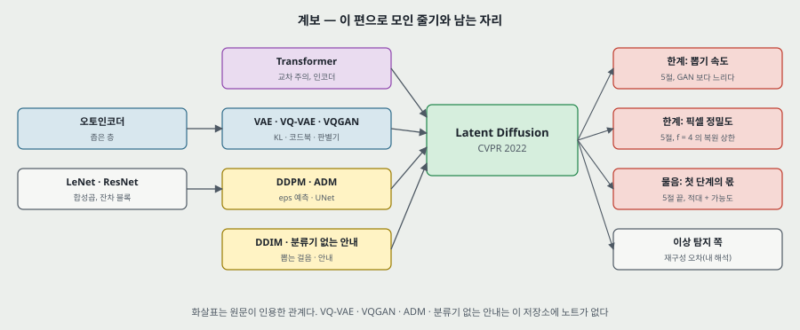

**내 그림 18.**

**하나. 닿는 자리 — 이미지 이상 탐지.** 재구성 기반 이상 탐지에서 복원 오차를 점수로 쓰면 5절의 한계가 곧바로 닿는다. $f = 4$ 의 PSNR 27.4 dB 는 RMSE 로 10.9(255 척도, 내 셈)이고 정상 이미지에도 이 복원 오차가 먼저 깔린다. 작은 결함을 볼 때는 첫 단계가 지우는 고주파가 문제의 자리일 수 있다(내 해석, 이 편에 이상 탐지 실험은 없다). PatchCore 의 특징 뱅크는 복원을 쓰지 않으니 이 한계와 무관하다.

**둘. 옮겨 쓸 수 있는 것.**

- **같은 실행의 두 그림을 포개 본다.** 그림 6 · 17 은 가로축만 다르다. 포개니 캡션이 틀렸다는 것과 걸음당 비용이 나왔다.
- **처리량을 걸음 수로 곱한다.** 「35.7 배」 가 7.1 x 5 로 갈렸다.
- **표의 설정으로 파라미터를 다시 센다.** 18 행 중 14 행이 맞으니 안 맞는 네 행이 눈에 띈다. 맞는 행이 많을수록 틀린 칸을 믿고 짚을 수 있다.
- **이름 뒤의 변인을 표로 편다.** 「$f$ 만 바꿨다」 는 그림에 배치 · 학습률 · 채널이 함께 있다.
- **이름이 없는 변인을 내 본다.** 「잠재 수의 개수」 열 하나로 표 8 이 다시 읽혔다.
- **식은 부호까지 유도한다.** 인용한 식도 틀릴 수 있다.

**셋. 지금 확인된 것은 여기까지다.**

- **논문이 잰 것**: 표 1 ~ 11 · 18 의 값, 그림 6 · 7 · 17 의 곡선. 모두 한 실행.
- **논문이 말만 한 것**: 그림 2 의 두 구간, UNet 이 더 높은 차원으로 잘 키워진다, 가능도 쪽이 넓게 덮는다, big 의 512 차이가 주의 때문이다, LaMa 는 평균에 가깝다, 표 4 의 「affirm」.
- **내가 책상에서 센 것**: 식 (5) ~ (15) · (16) 의 유도, 무게 곡선, 잠재 수의 개수, 파라미터 18 행, 걸음당 V100-일과 본 이미지 수, 평가 / 초, 첫 단계를 더한 배수, 학습 속도, 표 6 · 9 의 차와 비, 표 1 의 P · R 칸 세기.
- **픽셀로 읽은 것**: 그림 2 · 6 · 7 · 17 의 값. 원문이 숫자로 적지 않은 값이다.
- **가정**: 파라미터 세기의 UNet 꼴과 게이트 MLP, 어휘 30,522, DDPM 선형 일정, 256 x 256 입력.

---

## 28. 다음에 읽을 것

**큰 틀.** 이 편으로 2026-11-06 에 정한 확산 심화 세 칸이 끝난다. **그다음 큰 틀은 같은 날 산업 이상 탐지로 정했다.**

**자잘한 후속 편 — 이 편의 어느 자리에서 나왔나.** 모두 **읽지 않았고**, 원문 인용이다.

| 다음 | 이 노트의 어느 자리에서 나오는가 | 무엇을 확인하고 싶은가 |
|---|---|---|
| **ADM** — Diffusion Models Beat GANs on Image Synthesis (Dhariwal · Nichol, 2021, [15]) | 9 · 13 · 14 · 17절 — 비교 상대, UNet 의 출처, 식 (16) | 안내 식의 부호. 150 ~ 1,000 V100-일의 구성. 512 까지의 값 |
| **Classifier-Free Diffusion Guidance** (Ho · Salimans, 2021, [32]) | 14 · 15절 — 표 2 · 3 의 $s$ | 식이 이 파일에 없다. $s$ 로 FID 와 Recall 이 어떻게 맞바뀌나 |
| **VQGAN** — Taming Transformers (Esser 외, 2020, [23]) | 3 · 5 · 8절 — 첫 단계의 출처 | 적대 항 무게, 판별기 켜는 시점. 자기회귀가 1 차원 열에서 막힌 값 |
| **VQ-VAE** (van den Oord 외, 2017, [96]) · **VQ-VAE-2** (Razavi 외, 2019, [67]) | 5 · 8절 — VQ 정칙화 | 코드북 크기와 복원의 관계 |
| **LSGM** (Vahdat 외, 2021, [93]) | 3 · 12절 — 함께 배우는 길 | 무게 맞추기가 얼마나 어려운가. 7.22 의 조건 |
| **On Buggy Resizing Libraries ... FID** (Parmar 외, 2021, [64]) | 12절 — E.3.1 의 근거 | 전처리로 FID 가 얼마나 움직이나. 표들의 차이와 맞대기 |
| **Variational Diffusion Models** (Kingma 외, 2021, [45]) | 6절 — 부록 B 의 표기와 SNR | 식 (9) 의 $t = 1$ 처리 |
| **U-Net** (Ronneberger 외, MICCAI 2015, [71]) | 2 · 9절 — 골격의 원형 | 지름길 이어 붙이기가 파라미터에 주는 몫 |

---

## 29. 남는 질문

- **식 (16) 의 부호는 ADM 원문에서 어떤가.** ADM 을 읽으면 답이 난다.
- **LDM-32 는 어느 첫 단계로 돌았나($c$ = 32 · 16).** 코드 설정을 보면 답이 난다.
- **표 15 의 A100 한 장 · 배치 1,200 은 무슨 뜻인가.** 그리고 그때 2.2 배 환산이 그대로인가.
- **표 6 의 처리량 단위는 무엇인가.** 곱이 8 천 몇 백으로 일정한 까닭.
- **같은 $f$ 에서 VQ 와 KL 을 그림 6 처럼 돌리면.** 특히 $f = 32$ KL $c = 64$(R-FID 2.04) 의 생성 FID. 8절의 물음이고 이 파일로는 답이 없다.
- **같은 잠재 수의 개수에서 $f$ 를 바꾸면 생성은 어떻게 되나.** 복원은 같다(8절). 합성곱 UNet 은 자리 수가 다르니 비용과 FID 가 함께 움직일 것인데 잰 행이 없다.
- **픽셀 확산과 잠재 확산을 끝까지 같은 예산으로 돌리면.** 그림 6 은 앞부분이다.
- **시작값을 바꾸면 FID 가 얼마나 움직이나.** 표 3 의 0.25 차, 표 9 의 0.20 차를 판정할 값이 없다.
- **이상 탐지에서 첫 단계의 복원 오차가 얼마나 방해하나.** 이 편으로는 답이 안 나오고 새 실험이 있어야 한다.

---

## 30. 참고 문헌

이 노트가 부른 편만 적는다. 원리는 원 출처를, 구현은 그 라이브러리의 편을 적는 규칙을 따른다. 그림 코드는 파이썬 표준 라이브러리만 쓰고, 원문 그림을 잘라 내고 픽셀을 읽은 일에 PyMuPDF · NumPy · SciPy 를 썼다(이 노트의 수치 근거가 아니라 도구다). 번호는 원문의 번호다.

- Rombach, R. 외 (2022). High-resolution image synthesis with latent diffusion models. CVPR. arXiv:2112.10752v2. — 이 노트의 대상.
- [30] Ho, J. 외 (2020). Denoising diffusion probabilistic models. NeurIPS. — 앞 칸.
- [46] Kingma, D. P. and Welling, M. Auto-encoding variational Bayes. — 앞 칸. KL 정칙화.
- [27] Goodfellow, I. 외 (2014). Generative adversarial networks. — 앞 칸.
- [97] Vaswani, A. 외 (2017). Attention is all you need. — 앞 칸. 교차 주의.
- [14] Devlin, J. 외 (2018). BERT. — 앞 칸. 토크나이저.
- [84] Song, J. 외 (2021). Denoising diffusion implicit models. ICLR. · [85] Song, Y. 외 (2021). Score-based generative modeling through stochastic differential equations. ICLR. — 같은 큰 틀의 칸.
- [15] Dhariwal, P. and Nichol, A. (2021). Diffusion models beat GANs on image synthesis. — 비교 상대. **읽지 않았다.**
- [32] Ho, J. and Salimans, T. (2021). Classifier-free diffusion guidance. — **읽지 않았다.**
- [23] Esser, P. 외 (2020). Taming transformers for high-resolution image synthesis. · [96] van den Oord, A. 외 (2017). Neural discrete representation learning. · [67] Razavi, A. 외 (2019). VQ-VAE-2. · [66] Ramesh, A. 외 (2021). Zero-shot text-to-image generation. — 앞 두 단계 방법. **읽지 않았다.**
- [93] Vahdat, A. 외 (2021). Score-based generative modeling in latent space. — **읽지 않았다.**
- [45] Kingma, D. P. 외 (2021). Variational diffusion models. — 부록 B 의 표기. **읽지 않았다.**
- [71] Ronneberger, O. 외 (2015). U-Net. MICCAI. — **읽지 않았다.**
- [72] Saharia, C. 외 (2021). Image super-resolution via iterative refinement. · [88] Suvorov, R. 외. LaMa. · [107] Zhao, S. 외. CoModGAN. · [105] Zhang, K. 외 (2021). Designing a practical degradation model. — 과제별 비교 상대. **읽지 않았다.**
- [59] Nichol, A. 외. GLIDE. · [26] Gafni, O. 외 (2022). Make-A-Scene. · [17] Ding, M. 외 (2021). CogView. · [109] Zhou, Y. 외. LAFITE. — 표 2 의 상대. **읽지 않았다.**
- [41] Karras, T. 외. StyleGAN. · [42] StyleGAN2. · [76] Sauer, A. 외 (2021). Projected GANs. · [43] Kim, D. 외 (2021). UDM. — 표 1 의 상대. **읽지 않았다.**
- [29] Heusel, M. 외 (2017). FID. · [50] Kynkäänniemi, T. 외. Precision and recall. · [106] Zhang, R. 외. LPIPS. · [60] Obukhov, A. 외 (2020). torch-fidelity. · [64] Parmar, G. 외 (2021). On buggy resizing libraries. — 지표와 도구. **읽지 않았다.**
- [74] Salvator, D. NVIDIA Developer Blog, 2020. — A100 대 V100 의 2.2 배. **읽지 않았다.**
- 코드: `https://github.com/CompVis/latent-diffusion`(원문 첫 쪽). 이 노트는 코드를 보지 않았다.

---

## 31. 경로

| 무엇 | 어디 |
|---|---|
| 원문 PDF (arXiv v2, 45 쪽) | `papers/CVPR22_LDM_High_Resolution_Image_Synthesis_with_Latent_Diffusion_Models.pdf` |
| 이 노트 | `notes/CVPR22_LDM_High_Resolution_Image_Synthesis_with_Latent_Diffusion_Models.md` |
| 이 노트의 그림 (직접 그린 것) | `figures/CVPR22_LDM/fig01_two_stages.svg` 부터 `fig18_lineage.svg` 까지 열여덟 |
| 이 노트의 그림 (원문에서 잘라 낸 것) | `figures/CVPR22_LDM/paper_fig1_recon.png` · `paper_fig2_rate_distortion.png` · `paper_fig3_architecture.png` · `paper_fig6_training.png` · `paper_fig7_throughput.png` · `paper_fig17_v100days.png` |
| 그림을 만드는 코드 | `figures/CVPR22_LDM/make_figures.py` — 바깥 데이터를 읽지 않으므로 `python make_figures.py` 로 어디서나 다시 만든다(표준 라이브러리만). 파라미터 18 행 · 무게 곡선 · 본 이미지 수 · 평가 / 초 · 학습 속도를 돌릴 때 화면에 찍는다. 픽셀로 읽은 값은 상수로 들어 있다 |
| 원문 그림을 잘라 내는 코드 | `figures/CVPR22_LDM/crop_paper_figures.py` — PyMuPDF 가 필요하다 |
