# PatchCore — Towards Total Recall in Industrial Anomaly Detection (요약)

> **한 줄.** 정상 이미지만 가지고 결함을 찾는 문제에서, **ImageNet 으로 배운 망(WRN-50-2)을 얼린 채** 중간 두 단계(layer2 · layer3)의 특징을 3x3 이웃으로 평균해 **조각 특징**을 만들고, 정상 이미지의 조각을 **전부 기억 뱅크 하나에 모은 뒤 탐욕 코어셋으로 1\~25% 만 남긴다.** 시험 이미지는 조각마다 뱅크에서 가장 가까운 거리를 재고, **가장 먼 조각 하나의 거리**가 이미지 점수, 조각 거리를 제자리에 펼친 것이 분할 지도다. 학습되는 파라미터가 없다. MVTec AD 에서 이미지 AUROC 99.1(PatchCore-25%) · 픽셀 AUROC 98.1 · PRO 93.5, 큰 백본 셋을 묶고 320 으로 키우면 이미지 AUROC 99.6 이다. 뱅크를 100 배 줄여도(1%) 이미지 AUROC 가 99.0 으로 표에 적혀 있고, 시간은 0.6 초에서 0.17 초로 3.5 배 준다.

---

## Paper Metadata

| Item | Content |
|---|---|
| Title | Towards Total Recall in Industrial Anomaly Detection |
| Authors | Karsten Roth, Latha Pemula, Joaquin Zepeda, Bernhard Schölkopf, Thomas Brox, Peter Gehler. 첫 저자 각주: 「Amazon AWS 연구 인턴 중에 한 일」 |
| 소속 | Roth 는 University of Tübingen, 나머지 다섯은 Amazon AWS (파일 첫 쪽의 표기 그대로) |
| Conference / Journal | CVPR 2022. **파일 안에는 학회 이름이 적혀 있지 않다** — 첫 쪽 여백에 arXiv 표시만 있고, 학회 이름은 바깥에서 알고 있는 것이다 |
| Year | arXiv 첫 판 2021-06 (arXiv:2106.08265 의 번호 앞 네 자리), 저장한 둘째 판 2022-05-05 |
| 코드 | `github.com/amazon-research/patchcore-inspection` (초록 끝에 적혀 있다). 구현은 PyTorch, 최근접 탐색은 faiss (부록 A) |
| Stored PDF | `papers/CVPR22_PatchCore_Towards_Total_Recall_in_Industrial_Anomaly_Detection.pdf` |
| 왜 읽었는가 | 연구에서 쓰는 방법이다. 이 저장소의 Wide ResNet 노트가 「layer2 · layer3 를 고른 근거와 백본을 바꿔 잰 표가 이 논문에 있는가」를, ResNet 노트가 「단계 끝 출력을 쓰는가」를 다음 읽을 것으로 넘겼다 |
| 읽은 범위 | **2026-11-03 에 18 쪽을 전부 읽었다.** 곧 초록 · 1\~5절 · 감사 · 참고 문헌 60 건의 목록 · 부록 A · B · C.1\~C.5 · 식 (1)\~(8) · 알고리즘 1 · 표 1\~6 · 표 S1\~S6 · 그림 1\~6 · 그림 S1\~S6 과 캡션 |

### 저장한 파일의 상태

- **arXiv 둘째 판(v2, 2022-05-05)** 이다. 첫 쪽 왼쪽 여백에 `arXiv:2106.08265v2 [cs.CV] 5 May 2022` 가 찍혀 있고, PDF 생성 날짜가 2022-05-09 다. 학회 판과 수치가 다를 수 있다. 이 노트는 v2 의 수치만 옮긴다.
- **18 쪽 = 본문 8 쪽(1\~8) + 감사 · 참고 문헌 3 쪽(9\~11) + 부록 7 쪽(12\~18).** 부록 쪽에는 쪽 번호가 따로 없다.
- **글자 층이 살아 있다.** 표는 글자로 옮겼다. 식은 쪽을 220 dpi 로 띄워 맞췄다.
- **그림 4 · 5 · S4 · S5 · S6 은 PDF 안에 래스터 그림으로 들어 있다.** 원 해상도(1386x806 · 1011x450 · 2250x600 · 2250x900 · 1500x450 픽셀)로 꺼내 눈금선과 표식 중심을 픽셀로 찾아 값을 읽었다. 읽기 오차는 그 자리마다 적는다. 그림 6 은 표 S5 가 같은 값을 숫자로 주므로 표를 옮겼다. 그림 S3 상자 안의 숫자는 그림 안 글자라 200 dpi 로 띄워 읽었다.
- 연구실 폴더에 있던 같은 파일을 복사해 왔다. **연구실 폴더의 요약 문서는 읽지 않고 원문만 보고 새로 썼다.**

---

## 1. 용어

이 노트에서 쓸 이름을 먼저 정한다. 논문의 원래 용어는 괄호로 함께 적는다.

- **정상 / 이상 (nominal / anomalous)**: 결함 없는 것 / 있는 것. 논문은 라벨 $y_x \in \{0, 1\}$ 로 적는다(0 이 정상).
- **차가운 시작 (cold-start)**: 정상 이미지만으로 모델을 맞추는 설정. 각주가 단일 부류 분류(one-class classification)라고도 부른다고 적는다. 작은 예시로, MVTec AD 의 병(Bottle) 부류는 학습에 정상 209 장만 주고 시험에 정상과 결함을 섞어 83 장을 준다(부류별 수는 MVTec AD 데이터 논문의 값이다).
- **단계 (hierarchy level)** $j$: ResNet 꼴 망에서 **공간 해상도가 같은 블록 묶음의 끝 출력.** $j \in \{1, 2, 3, 4\}$ 가 torchvision 의 `layer1` \~ `layer4` 에 대응한다. 작은 예시로, 224 입력의 WRN-50-2 에서 $j = 2$ 는 512 x 28 x 28 이다(내가 센 것, 4절).
- **조각 특징 (patch feature)**: 특징 지도 한 칸 $(h, w)$ 의 $c^*$ 차원 벡터. 그 칸의 수용장이 1 픽셀보다 넓으므로 이미지의 한 조각을 대표한다. 작은 예시로, 224 입력의 layer2 격자는 28 x 28 이라 이미지 하나가 조각 특징 784 개가 된다.
- **이웃 크기 (patchsize)** $p$: 조각 특징 하나를 만들 때 평균하는 정사각 이웃의 한 변. **이미지 조각의 크기가 아니다** — 논문의 낱말이 「patchsize」라 헷갈리기 쉬워 이 노트는 「이웃 크기」로 부른다. 작은 예시로, $p = 3$ 이면 격자 9 칸을 평균한다.
- **기억 뱅크 (memory bank)** $\mathcal{M}$: 학습 이미지에서 나온 조각 특징을 모두 모은 집합. 부류마다 하나다.
  > **2026-11-07 UniAD(NeurIPS 2022)를 읽고 덧붙인다.** 「부류마다 하나다」 가 전제인 자리다. UniAD 가 모델 하나로 15 부류를 다루는 통합 설정을 내고 PaDiM 을 그 설정에서 돌렸지만(이미지 84.2 · 픽셀 89.5) PatchCore 는 표와 참고 문헌에 없다. 뱅크 하나에 15 부류를 넣은 값은 그 편에 없다.
- **코어셋 (coreset)**: 큰 집합 $\mathcal{A}$ 에서 푼 문제의 답을 작은 부분 집합 $\mathcal{S}$ 로 근사할 수 있게 고른 $\mathcal{S}$.
- **PatchCore-n%**: 뱅크를 원래 크기의 n% 로 줄인 것. 작은 예시로, PatchCore-1% 는 뱅크를 100 배 줄였다. 표에 따라 % 없이 `PatchCore-10` 으로도 적는다(같은 것).
- **덮는 반지름 (내 이름)**: 식 (5) 의 $\max_m \min_n \lVert m - n \rVert$ — 뱅크의 모든 점이 가장 가까운 뽑힌 점까지 가는 거리 중 최댓값. 논문에는 이름이 없다.
- **이미지 AUROC**: 이미지 점수로 정상과 이상을 가를 때의 ROC 곡선 아래 넓이. 1.0 이면 모든 이상 이미지가 모든 정상 이미지보다 점수가 높고, 0.5 면 무작위다. MVTec 에서는 **부류마다 재서 15 부류를 평균한다.**
- **픽셀 AUROC (pixelwise AUROC, 표에서 pwAUROC)**: 같은 넓이를 픽셀 하나하나를 표본으로 잰 것.
- **PRO (per-region overlap)**: 결함 영역을 연결 성분으로 나눠 영역마다 겹침을 재는 분할 지표. 큰 결함 하나가 작은 결함 여럿을 덮어 버리지 않게 하려는 것이다. **정의는 이 논문에 없고 [6](Uninformed Students)에 미룬다** — 어느 거짓 양성률까지 적분하는지 같은 세부도 이 논문에서는 알 수 없다.
- **오차 (Error)**: 표의 오차 칸은 100 − 점수다. 작은 예시로, AUROC 99.1 이면 오차 0.9.
- **재가중 (re-weighting)** $w$ 와 **이웃 수** $b$: 식 (7) 에서 가장 가까운 거리 $s^*$ 에 곱하는 수, 그리고 그 수를 낼 때 보는 뱅크 이웃의 개수.

---

## 2. 한 문단 요약

공장 검사에서는 정상 이미지는 쉽게 모이지만 결함의 종류를 미리 다 정할 수 없다. 앞선 방법 중 가장 잘 된 것은 **ImageNet 으로 배운 망의 특징을 적응 없이 쓰고, 시험 특징을 정상 특징과 맞대는** 쪽(DN2 · SPADE · PaDiM)이었다. 논문은 이 쪽의 약점을 둘로 본다 — 높은 단계 특징은 ImageNet 분류 쪽으로 치우쳐 있고, 이미지당 높은 단계 특징의 개수가 적다. 그래서 **중간 단계(layer2 · layer3)를 쓰고, 3x3 이웃 평균으로 수용장만 넓히고, 조각을 위치와 상관없이 뱅크 하나에 다 넣는다.** 뱅크가 크면 느리므로 식 (5) 의 덮는 반지름을 줄이는 탐욕 코어셋으로 줄인다. 시험 점수는 조각별 최근접 거리의 최댓값에 식 (7) 의 이웃 재가중을 곱한 것이다. MVTec AD 에서 이미지 AUROC 가 PaDiM 원 논문의 95.3 에서 99.1 로 올랐고, PRO 는 92.1 → 93.5, 1,725 장 중 오분류가 42 장이다. 부록 표 S6 에서 백본 다섯을 바꿔도 이미지 AUROC 가 98.6 \~ 99.1 안에 있다. 논문이 스스로 적은 한계는 하나 — **사전학습 특징이 옮겨 가는 만큼만 된다.**

---

## 3. 문제 — 적응 없는 특징 맞대기의 두 약점 (초록 · 1 · 2절)

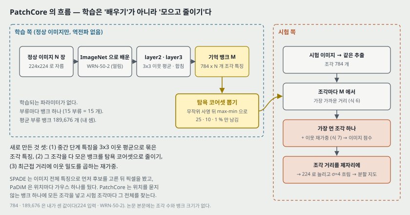

**논문이 문제를 적는 순서.** 사람은 정상을 몇 개만 보고도 이상을 가린다 → 공장 검사는 정상 이미지는 쉽고 결함 정의는 어렵다 → 분포 밖 검출 문제로 볼 수 있다 → 결함이 가는 긁힘부터 부품 빠짐까지 넓다(그림 1) → 앞선 연구는 오토인코더 · GAN · 정규화 흐름 같은 적응 방법이었고, 최근 [4](DN2) · [10](SPADE) 이 **ImageNet 특징을 적응 없이** 써서 검출과 위치 찾기 둘 다 강했다.

**그 쪽의 원리.** 시험 표본과 정상 표본의 **특징 맞대기**, 그리고 깊은 특징의 여러 축척을 쓰는 것. 낮은 단계의 고해상도 특징이 가는 결함을, 높은 단계 특징이 구조 결함과 이미지 수준 판정을 맡는다고 적는다.

**지적하는 약점 둘 (1절 문장 그대로의 뜻).**

1. **높은 단계에서 맞대기의 확신이 낮다.** ImageNet 으로 배운 높은 단계의 추상 특징은 공장 환경에 필요한 추상 특징과 겹치는 부분이 적다.
2. **시험 때 쓸 수 있는 정상 맥락이 적다.** 이미지당 뽑을 수 있는 높은 단계 특징의 개수가 적다(높은 단계일수록 격자가 작다).

**목표 셋.** 시험 때 쓸 수 있는 정상 정보를 최대로, ImageNet 부류 쪽 치우침을 작게, 추론은 빠르게.

**바탕에 깐 관찰.** 「조각 하나만 이상이어도 이미지는 이상으로 분류할 수 있다」([14, 56]). 그래서 이미지 점수를 조각 점수의 최댓값으로 둔다(7절).

**가까운 앞 연구 둘과의 차이 (2절).**

| | SPADE [10] | PaDiM [14] | PatchCore |
|---|---|---|---|
| 정상을 담는 방식 | 여러 단계의 특징 지도 뱅크 | 위치 $(h, w)$ 마다 평균 · 공분산 | 조각 특징 뱅크 **하나**, 위치 정보 없음 |
| 거리 | 최근접 거리(kNN) | 위치별 마할라노비스 거리 | 최근접 거리 + 이웃 재가중 |
| 픽셀 판정 전에 | 마지막 단계 전역 평균 특징의 kNN 으로 **이미지를 먼저 고른다** | 고르지 않는다 | 고르지 않는다 |
| 이미지 정렬 | — | 같은 위치끼리만 비교하므로 정렬에 기댄다 | 모든 조각이 뱅크 전체와 비교되므로 덜 기댄다 |
| 학습 · 시험 크기 | — | 같아야 한다 | 달라도 된다(17절 MTD 에서 쓴다) |

표의 「—」 는 이 논문이 그 칸을 적지 않은 자리다.

---

## 4. 조각 특징과 국소 이웃 집계 — 식 (1) · (2) · (3) (3.1절)

**왜 마지막 단계가 아닌가 (논문이 드는 두 이유).** 마지막 단계를 쓰면(DN2 · SPADE 의 이미지 단계) 국소 정보를 잃고, 매우 깊은 특징은 ImageNet 분류 과제로 치우쳐 있다. 그래서 「너무 일반적이지도, ImageNet 분류로 너무 치우치지도 않은」 **중간 단계**, ResNet 꼴이면 $j \in [2, 3]$ 을 쓴다.

**왜 이웃을 묶는가.** 조각 하나가 의미 있는 이상 맥락을 보려면 수용장이 넓어야 하고, 작은 위치 변화에 흔들리지 않아야 한다. 더 깊은 단계로 가거나 보폭 있는 풀링을 쓰면 수용장은 넓어지지만 특징이 ImageNet 쪽으로 가고 해상도가 준다. 그래서 **해상도를 그대로 두고 이웃만 평균한다.**

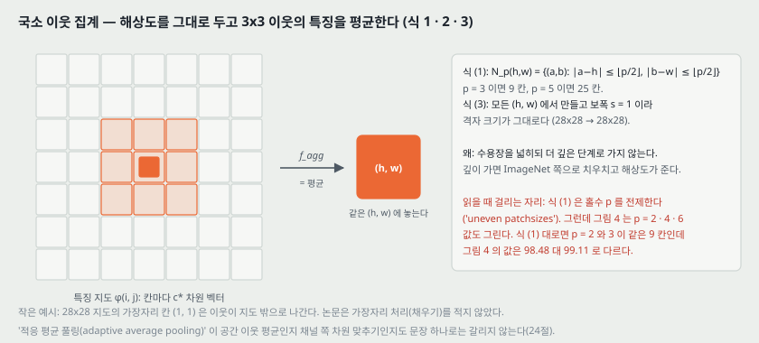

특징 지도 $\phi_{i,j} \in \mathbb{R}^{c^* \times h^* \times w^*}$ 의 칸 $(h, w)$ 주변 이웃은

$$\mathcal{N}_p^{(h,w)} = \lbrace (a, b) \mid a \in [h - \lfloor p/2 \rfloor, \ldots, h + \lfloor p/2 \rfloor],\ b \in [w - \lfloor p/2 \rfloor, \ldots, w + \lfloor p/2 \rfloor] \rbrace \qquad (1)$$

이고, 그 자리의 국소 인지 특징은

$$\phi_{i,j}\left(\mathcal{N}_p^{(h,w)}\right) = f_\text{agg}\left(\lbrace \phi_{i,j}(a, b) \mid (a, b) \in \mathcal{N}_p^{(h,w)} \rbrace\right) \qquad (2)$$

이다. $f_\text{agg}$ 는 **적응 평균 풀링(adaptive average pooling)** 이고, 결과는 「미리 정한 차원 $d$」의 벡터 하나라고 적는다. 이미지 하나의 조각 모음은

$$\mathcal{P}_{s,p}(\phi_{i,j}) = \lbrace \phi_{i,j}(\mathcal{N}_p^{(h,w)}) \mid h, w \bmod s = 0,\ h < h^*,\ w < w^*,\ h, w \in \mathbb{N} \rbrace \qquad (3)$$

이고, 보폭 $s$ 는 4.4.2절의 줄이기 실험을 빼고 늘 1 이다. **기본값은 $p = 3$** (4.4.1절, 13절).

**두 단계를 합치기.** $j$ 와 $j + 1$ 두 단계만 쓴다. $\mathcal{P}_{s,p}(\phi_{i,j+1})$ 을 **양선형으로 늘려** $\mathcal{P}_{s,p}(\phi_{i,j})$ 와 개수를 맞추고, 각 원소를 대응하는 낮은 단계 조각 특징과 「합친다(aggregating)」. **이어 붙이는지 더하는지는 문장에 없다.**

**내가 센 크기** (`make_figures.py` 셈 1. torchvision 꼴 WRN-50-2 는 보폭이 병목의 3x3 에 있다).

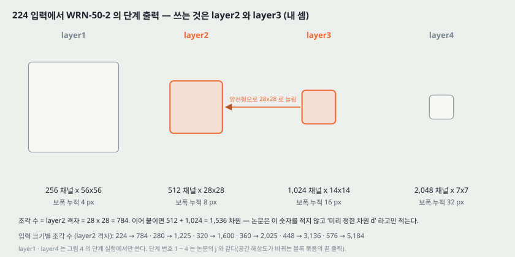

| 단계 | 224 입력의 출력 | 보폭 누적 | 쓰는가 |
|---|---|---:|---|
| layer1 ($j$ = 1) | 256 x 56 x 56 | 4 | 그림 4 실험에서만 |
| layer2 ($j$ = 2) | 512 x 28 x 28 | 8 | 쓴다 — 조각 격자 |
| layer3 ($j$ = 3) | 1,024 x 14 x 14 → 28 x 28 로 늘림 | 16 | 쓴다 |
| layer4 ($j$ = 4) | 2,048 x 7 x 7 | 32 | 쓰지 않는다 (mSTC 만 3+4) |

- **조각 수 = layer2 격자 = 28 x 28 = 784.** 입력이 280 이면 35 x 35 = 1,225, 320 이면 1,600, 448 이면 3,136, 576 이면 72 x 72 = 5,184 다.
- **두 단계를 이어 붙이면 512 + 1,024 = 1,536 차원이다. 그러나 논문은 이 수를 어디에도 적지 않고 「미리 정한 차원 $d$」라고만 적는다.** $d$ 가 1,536 인지, 그보다 작게 줄인 값인지는 이 파일로 알 수 없다(24절 셋, 30절).
- **논문 본문은 조각 수와 특징 지도 크기를 적지 않는다.** 위 표는 전부 내가 센 것이다.

---

## 5. 기억 뱅크 — 식 (4)

정상 학습 이미지 전부의 조각 모음을 합친 것이 뱅크다.

$$\mathcal{M} = \bigcup_{x_i \in \mathcal{X}_N} \mathcal{P}_{s,p}(\phi_j(x_i)) \qquad (4)$$

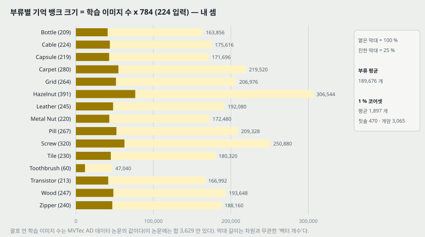

**내가 센 크기** (셈 2). 부류별 학습 이미지 수는 이 논문에 없어서 MVTec AD 데이터 논문의 값을 썼다. **그 합이 3,629 이고 이 논문이 적은 「전체 5,354 장, 그중 시험 1,725 장」의 차 3,629 와 같다** — 그래서 그 값을 그대로 쓴다.

| 무엇 | 값 |
|---|---:|
| 이미지당 조각 (224 입력) | 784 |
| 부류 평균 학습 이미지 | 241.93 장 |
| 부류 평균 뱅크 (100%) | 189,676 개 |
| 가장 큰 뱅크 · 가장 작은 뱅크 | Hazelnut 306,544 · Toothbrush 47,040 |
| 평균 뱅크의 25% · 10% · 1% | 47,419 · 18,968 · 1,897 개 |
| 15 부류 뱅크의 합 | 2,845,136 개 |
| 평균 뱅크를 float32 로 두면 | 1,536 차원이면 1.17 GB, 1,024 차원이면 0.78 GB (10^9 바이트) |

마지막 줄의 차원은 내가 가정한 두 값이다. 논문은 $d$ 도, 뱅크의 바이트 수도 적지 않는다.

---

## 6. 코어셋으로 뱅크 줄이기 — 식 (5) · 알고리즘 1 (3.2절)

**왜 줄이는가.** $\mathcal{X}_N$ 이 커지면 뱅크가 커지고 시험 시간과 저장이 늘어난다. SPADE 는 이 비용 때문에 마지막 단계 전역 평균 특징으로 이미지를 먼저 고르는 단계를 둬야 했고, 그것이 저해상도 · ImageNet 쪽 표현을 끌어들인다고 적는다. **무작위로 줄이면** 정상 특징이 덮던 범위를 잃는다(15절에서 잰다).

> **2026-11-07 SPADE 원문(arXiv v3)을 읽고 덧붙인다.** 먼저 고르는 단계의 손실을 잰 행은 SPADE 원문에 없다. 학습 전체를 갤러리로 쓴 행이 없고, 원문 표 7 은 kNN 10 장 대 무작위 10 장이다(평균 91.4 대 89.2, Grid 86.3 대 73.2. 캡션에 지표 이름이 없다). SPADE 는 이 단계를 비용(14쪽)과 함께 정확도(표 7)로도 내세운다. 「비용 때문에 둬야 했다」 는 PatchCore 쪽 표현이다.

**무엇을 지키며 줄이는가.** 시험 점수가 최근접 거리이므로, 뽑힌 집합 $\mathcal{M}_C$ 가 원래 뱅크와 **같은 범위를 덮게** 한다 — 최소최대 시설 배치(minimax facility location) 코어셋.

$$\mathcal{M}_C^* = \underset{\mathcal{M}_C \subset \mathcal{M}}{\arg\min} \ \max_{m \in \mathcal{M}} \ \min_{n \in \mathcal{M}_C} \lVert m - n \rVert_2 \qquad (5)$$

정확히 풀면 NP-난해라서 [48](Sener & Savarese)의 **탐욕 근사**를 쓰고, 고르는 시간을 줄이려고 [49](Small-GAN)처럼 **무작위 선형 사영** $\psi : \mathbb{R}^d \to \mathbb{R}^{d^*}$ ($d^* < d$) 를 먼저 건다(존슨-린덴스트라우스 정리).

**알고리즘 1 (옮김).**

```
입력: 사전학습 망 φ, 단계 j, 정상 이미지 X_N, 보폭 s, 이웃 크기 p, 코어셋 목표 l, 무작위 사영 ψ
M ← {}
for x_i in X_N:  M ← M ∪ P_{s,p}(φ_j(x_i))
M_C ← {}
for i in [0, ..., l−1]:
    m_i ← argmax_{m ∈ M − M_C}  min_{n ∈ M_C} ||ψ(m) − ψ(n)||_2
    M_C ← M_C ∪ {m_i}
M ← M_C
```

말로 하면, **지금까지 뽑힌 점에서 가장 먼 점을 하나씩 더한다.** 이렇게 뽑으면 뭉친 곳에서는 적게, 드문 곳에서도 하나씩은 뽑힌다.

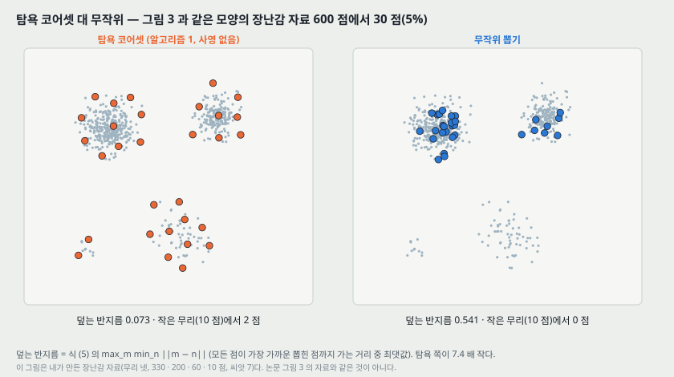

**내 장난감 셈 (셈 6. 논문 그림 3 과 같은 모양을 흉내 낸 자료이고 논문 자료가 아니다).** 무리 넷(330 · 200 · 60 · 10 점)에서 30 점(5%)을 뽑으면 덮는 반지름이 탐욕 0.073, 무작위 0.541 이다. 10 점짜리 작은 무리에서 탐욕은 2 점을 뽑고 무작위는 0 점을 뽑았다. 논문 그림 3 의 캡션도 「무작위는 다봉 분포에서 무리를 놓친다」고 적는다.

**논문이 적지 않은 것 넷.**

1. **식 (5) 에 크기 제약이 없다.** 그대로 읽으면 $\mathcal{M}_C = \mathcal{M}$ 이 덮는 반지름 0 으로 최적이다. 「$\lvert \mathcal{M}_C \rvert = l$ 」이 빠져 있다(알고리즘 1 의 $l$ 이 그 자리다).
2. **알고리즘 1 의 첫 반복이 정의되지 않는다.** $\mathcal{M}_C$ 가 비어 있으면 $\min_{n \in \mathcal{M}_C}$ 가 없다. 첫 점을 어떻게 고르는지(무작위인지) 적혀 있지 않다.
3. **$d^*$ 의 값이 없다.** 사영 뒤 차원이 몇인지 적혀 있지 않다.
4. **고르는 데 걸린 시간이 없다.** 내 셈(셈 2)으로 평균 부류 뱅크에서 10% 를 고르면 반복 18,968 번에 반복마다 뱅크 전체 189,676 개와 거리를 재므로 거리 계산이 $3.60 \times 10^9$ 번이다(25% 면 $8.99 \times 10^9$). 표 5 의 시간은 추론 시간뿐이다.

> **2026-11-07 Sener · Savarese 원문(arXiv v4)을 읽고 덧붙인다.** 빈칸 1 · 2 는 원전에는 없다. 원전 식 (5) 에는 $\lvert s^1 \rvert \le b$ 가 있고, 탐욕법은 이미 라벨이 있는 $s^0$ 에서 시작하므로 첫 걸음의 $\min$ 이 정의된다.

**원리의 원 출처.** 「가장 먼 점을 하나씩 더하는」 탐욕법은 k-센터 문제의 2-근사로 Gonzalez(1985)가 낸 것이다. 이 논문은 [48] 을 인용하고 Gonzalez 를 인용하지 않는다(참고 문헌 60 건에 없다). 사영 쪽 원리는 Johnson & Lindenstrauss(1984)이고 이 논문은 증명을 쉽게 다시 쓴 Dasgupta & Gupta(2003, [11])를 인용한다. **사영 공간에서 고른 점이 원래 공간에서도 2-근사인지는 이 논문이 다루지 않는다.**

> **2026-11-07 Sener · Savarese 원문(arXiv v4)을 읽고 덧붙인다.** (가) 그 편도 Gonzalez 를 인용하지 않는다(참고 문헌 51 건). 2-OPT 문장(6쪽)에는 인용이 없고, k-센터는 Wolf(2011), NP-난해는 Cook 외(1998)를 인용한다. **그래서 위의 「원 출처 Gonzalez(1985)」 는 두 논문 어디에서 온 것이 아니라 바깥 지식이고, 그 원문을 이 저장소에서 읽지 않았다.** (나) 보장의 기준은 덮는 반지름의 최적값이다. 원전은 사영을 다루지 않는다. 모든 쌍의 거리가 $(1 \pm \varepsilon)$ 로 보존되면 계수가 $2(1+\varepsilon)/(1-\varepsilon)$ 이다(내 유도, $\varepsilon$ = 0.1 에서 2.44). $d^*$ 이 원문에 없어 어느 $\varepsilon$ 인지는 말할 수 없다. (다) 원전의 정리 1 은 라벨과 학습 손실 0 위에 서므로 PatchCore 로 오지 않는다. 대신 반지름이 $r$ 이면 최근접 점수 오차가 $[0, r]$ 안이다(내 유도, 삼각 부등식).

---

## 7. 이상 점수 — 식 (6) · (7) (3.3절)

시험 이미지의 조각 모음 $\mathcal{P}(x^\text{test})$ 에서, 조각마다 뱅크의 최근접을 찾고 **그 거리가 가장 큰 조각**을 고른다.

$$m^{\text{test},*},\ m^* = \underset{m^\text{test} \in \mathcal{P}(x^\text{test})}{\arg\max}\ \underset{m \in \mathcal{M}}{\arg\min} \lVert m^\text{test} - m \rVert_2, \qquad s^* = \lVert m^{\text{test},*} - m^* \rVert_2 \qquad (6)$$

그리고 $m^*$ 둘레의 뱅크 이웃을 보고 점수를 고친다.

$$s = \left( 1 - \frac{\exp \lVert m^{\text{test},*} - m^* \rVert_2}{\sum_{m \in \mathcal{N}_b(m^*)} \exp \lVert m^{\text{test},*} - m \rVert_2} \right) \cdot s^* \qquad (7)$$

$\mathcal{N}_b(m^*)$ 는 뱅크에서 $m^*$ 와 가장 가까운 $b$ 개다. 논문의 말로는 「시험 조각에 가장 가까운 뱅크 특징 $m^*$ 가 그 자신의 이웃에서 멀다면(이미 드문 정상이라면) 이상 점수를 키운다」. 그리고 「최대 조각 거리만 쓰는 것보다 더 튼튼했다」고 적는다 — **그 비교의 수치는 없다.**

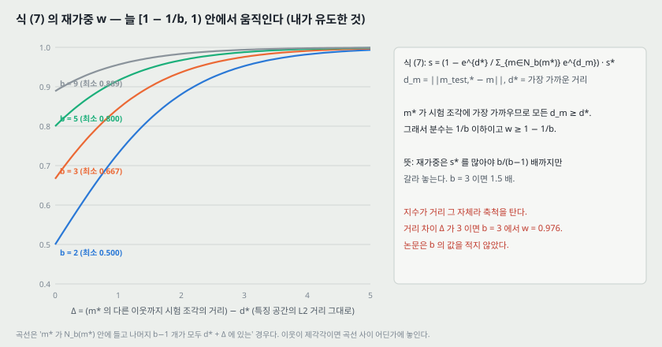

**내가 유도한 것 — $w$ 가 움직이는 범위.** $d_m = \lVert m^{\text{test},*} - m \rVert$ 라 하자. $m^*$ 가 시험 조각에 가장 가까운 뱅크 원소이므로 **모든 $m$ 에 대해 $d_m \ge d^* = s^*$** 다. 그러면 분모의 $b$ 개 항이 모두 $e^{d^*}$ 이상이라

$$\frac{e^{d^*}}{\sum_{m \in \mathcal{N}_b(m^*)} e^{d_m}} \le \frac{1}{b}, \qquad 1 - \frac{1}{b} \le w < 1 \qquad (9)$$

이다($m^*$ 자신이 $\mathcal{N}_b(m^*)$ 에 드는지와 상관없이 성립한다). 식 번호 (9) 는 이 노트가 붙인 것이다.

- **뜻.** 재가중은 이미지 점수를 많아야 $b/(b-1)$ 배까지만 갈라 놓는다. $b = 3$ 이면 1.5 배, $b = 9$ 면 1.125 배다(셈 5).
- **지수 안이 거리 그 자체라 축척을 탄다.** 이웃이 모두 $d^* + \Delta$ 에 있다고 두면 $w = 1 - 1/(1 + (b-1)e^\Delta)$ 다. $b = 3$ 에서 $\Delta = 1$ 이면 0.845, $\Delta = 3$ 이면 0.976 이다. 특징 공간의 거리 차이가 3 을 넘는 자리에서는 $w$ 가 0.976 과 1 사이에 있다는 뜻이다. **특징 거리가 실제로 어느 범위인지 논문은 적지 않는다.**
- **$b$ 의 값이 논문 어디에도 없다.**

**표기에서 걸리는 자리 둘.**

- 「$\mathcal{N}_b(m^*)$ 는 **시험 조각 특징 $m^*$** 에 대한 $b$ 개 최근접」이라고 적는데 $m^*$ 는 뱅크 원소다(시험 조각은 $m^{\text{test},*}$).
- 「식 7 (첫 줄)의 이미지 점수는 arg max 연산으로 조각마다 점수를 내야 한다」고 적는데, arg max 는 **식 (6) 의 첫 줄**에 있다.

---

## 8. 분할 지도 (3.3절 끝)

- 이미지 점수를 내려고 이미 **조각마다** 점수를 냈으므로, 그 점수를 **제자리(공간 위치)에 다시 펼치면** 분할 지도가 된다([14] 와 같은 방식).
- 원 입력 해상도에 맞추려고 **양선형 보간으로 늘리고**, **폭 $\sigma = 4$ 의 가우스로 흐린다.** 「이 값은 고르지 않았다」고 적는다. $\sigma$ 의 단위(입력 픽셀인지)는 적혀 있지 않다.
- **조각 점수가 무엇인지 따로 정의되어 있지 않다.** 식 (6) 안쪽의 최근접 거리로 읽는 것이 자연스럽지만(내 해석), 식 (7) 의 재가중이 조각마다도 걸리는지는 문장에 없다.

---

## 9. 실험 설정 — 데이터와 지표 (4.1절)

| 데이터 | 논문이 적은 것 | 내가 센 것 |
|---|---|---|
| **MVTec AD** [5] | 15 부류, 전체 5,354 장 중 시험 1,725 장. 부류마다 학습은 정상만, 시험은 정상 + 여러 결함 종류 + 결함 가면. **256 x 256 으로 줄이고 가운데 224 x 224 를 자른다.** 증강 없음(부류를 지키는 증강을 고르려면 사전 지식이 필요하므로) | 학습 3,629 장, 부류 평균 241.93 장 |
| **MTD** (Magnetic Tile Defects) [26] | 결함 없는 925 장 · 이상 392 장, 조명과 크기가 제각각. [42] 처럼 결함 없는 것의 20% 를 시험에 넣고 나머지로 학습 | 시험 정상 185 장, 학습 740 장 |
| **mSTC** (Mini ShanghaiTech Campus) [32] | 원 STC 영상의 학습 · 시험 프레임을 다섯째마다 하나씩 쓴 것. 장면 12 개, 보행자. 시험에는 싸움 · 자전거 같은 행동. 256 x 256 | — |

**지표.** MVTec 은 부류 평균 이미지 AUROC([2, 10, 14] 를 따름), 분할은 픽셀 AUROC 와 PRO([6] 을 따름).

**한 가지 짚을 것.** 224 가운데 자르기는 이미지 테두리 16 픽셀씩(256 기준)을 버린다. 부록 C.4 가 그렇게 잘려 결함이 사라진 시험 이미지 하나를 적는다(18절).

---

## 10. MVTec AD 이미지 수준 — 표 1 · 표 S1 (4.2절 · 부록 B)

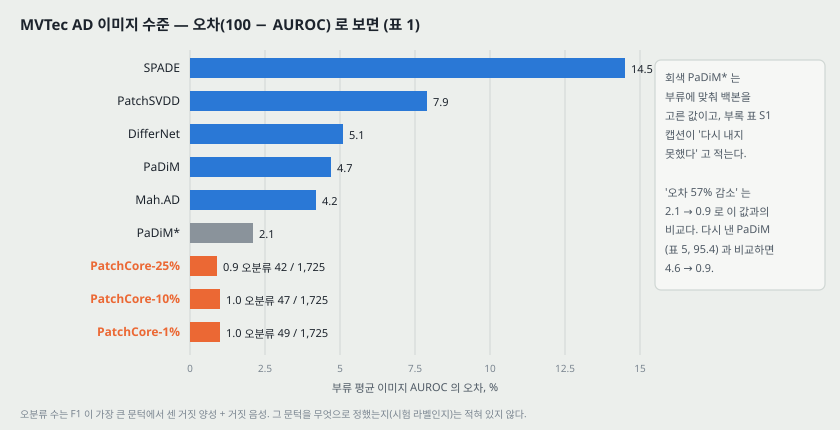

| 방법 | SPADE | PatchSVDD | DifferNet | PaDiM | Mah.AD | PaDiM* | PC-25% | PC-10% | PC-1% |
|---|---:|---:|---:|---:|---:|---:|---:|---:|---:|
| AUROC | 85.5 | 92.1 | 94.9 | 95.3 | 95.8 | 97.9 | **99.1** | 99.0 | 99.0 |
| 오차 | 14.5 | 7.9 | 5.1 | 4.7 | 4.2 | 2.1 | 0.9 | 1.0 | 1.0 |
| 오분류 | — | — | — | — | — | — | 42 | 47 | 49 |

- **오분류 수**는 F1 이 가장 큰 문턱에서 센 거짓 양성 + 거짓 음성이다. 다른 방법은 이미지별 점수가 없어 PatchCore 만 셌다고 적는다. 42 / 1,725 = 2.43%, 47 = 2.72%, 49 = 2.84% (내 셈).
- **「오차를 57% 줄였다」는 PaDiM\* 2.1 → 0.9 의 비교다.** PaDiM\* 는 표 1 캡션이 「문제마다 백본을 고른 결과」라 적고, **부록 표 S1 캡션이 「우리는 재현하지 못했다」고 적는 값이다.** 같은 논문이 다시 구현한 PaDiM(표 5)은 95.4, 오차 4.6 이고, 그것과 비교하면 4.6 → 0.9 다.
- **본문은 「부류의 3 분의 1 이 완벽하게 풀렸다」고 적고, 부록 B 는 「PatchCore-25% 가 15 중 6 을 푼다」고 적는다.** 표 S1 의 PatchCore-25 칸에서 100 을 세면 6 개(Bottle · Hazelnut · Leather · Metal Nut · Toothbrush · Transistor)다. 6/15 는 40% 이고 3 분의 1 은 5 다(25절).

**부록 표 S1 의 평균 맞춰 보기 (셈 3).** 부류 값이 소수 첫째 자리로 반올림돼 있으므로, 부류 값 평균과 인쇄된 평균은 ±0.10 안에서 다를 수 있다(부류 값 쪽 ±0.05 + 평균 쪽 ±0.05). PatchCore 세 줄(99.100 · 98.927 · 98.980)과 PatchSVDD · MahalanobisAD 는 그 폭 안이다. **DifferNet 줄만 부류 평균 94.687 이 인쇄된 94.9 와 0.213 다르다** — 다른 논문([42])의 값을 옮긴 줄이다.

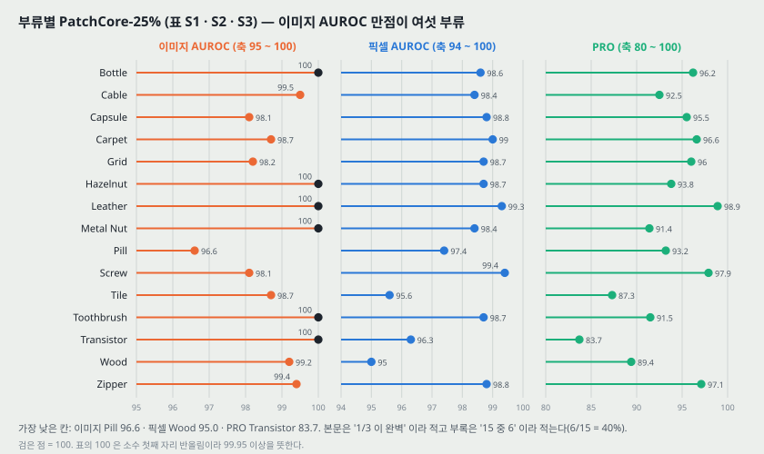

부류별로 가장 낮은 칸은 PatchCore-25% 의 이미지 AUROC 가 Pill 96.6, Screw 98.1, Capsule 98.1 이다.

---

## 11. MVTec AD 분할 — 표 2 · 3 · S2 · S3

| 픽셀 AUROC | AESSIM | γ-VAE+grad | CAVGA-Rw | PatchSVDD | SPADE | PaDiM | PC-25% | PC-10% | PC-1% |
|---|---:|---:|---:|---:|---:|---:|---:|---:|---:|
| 점수 | 87 | 88.8 | 89 | 95.7 | 96.0 | 97.5 | 98.1 | 98.1 | 98.0 |

| PRO | AESSIM | Student | SPADE | PaDiM | PC-25% | PC-10% | PC-1% |
|---|---:|---:|---:|---:|---:|---:|---:|
| 점수 | 69.4 | 85.7 | 91.7 | 92.1 | 93.4 | **93.5** | 93.1 |

**평균은 가장 높지만 부류별로 지는 칸이 있다 (셈 8, PatchCore-25% 기준).**

| 지표 | 상대 | 상대가 높은 부류 |
|---|---|---|
| 픽셀 AUROC | SPADE | 2 — Capsule 99.0 대 98.8, Hazelnut 99.1 대 98.7 |
| 픽셀 AUROC | PaDiM | 3 — Carpet 99.1 대 99.0, Toothbrush 98.8 대 98.7, **Transistor 98.5 대 96.3** |
| PRO | SPADE | 5 — Hazelnut · Metal Nut(94.4 대 91.4) · Pill · Toothbrush · **Transistor 87.4 대 83.7** |
| PRO | PaDiM | 3 — Toothbrush · Transistor · Wood(91.1 대 89.4) |

**Transistor 는 PatchCore 가 이미지 AUROC 100 인데 PRO 가 83.7 로 15 부류 중 가장 낮다.** 이미지는 다 맞히고 결함 자리를 덜 맞힌다는 뜻이다. Transistor 의 결함 종류(부품이 빠지거나 자리가 바뀜)와 연결 짓는 해석은 논문에 없다.

표 S2 · S3 의 PatchCore 줄 평균은 모두 ±0.10 안에서 인쇄된 평균과 맞는다(셈 3).

> **2026-11-07 SPADE 원문(arXiv v3)과 맞춰 본다.** 원문 표 S3 의 SPADE 행 중 Tile 75.6 은 SPADE 원문 표 3 · 6 의 75.9 와 다르다. 나머지 14 칸과 표 S2 의 15 칸은 같다. 평균은 어느 쪽이든 91.7 이다(내 계산 91.71 · 91.73). SPADE v1 · v2 는 읽지 않아 판 차이인지는 가리지 못했다.

---

## 12. 큰 입력 · 큰 백본 · 묶기 — 표 4 · 표 S4 (4.2절 끝 · 부록 B)

코어셋 1% 가 시험 시간을 줄이므로 그 몫을 **입력을 키우고 망을 묶는 데** 쓴다. 「기본 해상도의 PatchCore-10% 보다 짧은 추론 시간을 지킨다」고 적는다 — **그 시간 수치는 표에 없다.**

| 설정 (모두 PatchCore-1%) | 이미지 AUROC | 픽셀 AUROC | PRO | 인쇄된 오차 |
|---|---:|---:|---:|---|
| DenseNet-201 & ResNeXt-101 & WRN-101 (2+3), 320 | **99.6** | 98.2 | 94.9 | 0.4 · 1.8 · **5.6** |
| WRN-101 (2+3), 280 | 99.4 | 98.2 | 94.4 | 0.6 · 1.8 · 5.6 |
| WRN-101 (1+2+3), 280 | 99.2 | **98.4** | **95.0** | 0.8 · 1.6 · 5.0 |

- **첫 줄 PRO 의 오차 칸이 5.6 인데 100 − 94.9 = 5.1 이다**(25절).
- 셋을 어떻게 묶었는지(점수를 더하는지, 정규화하는지) 적혀 있지 않다.
- **layer1 을 더하면 픽셀 · PRO 는 오르고 이미지 AUROC 는 0.2 내려간다.** 14절의 그림 4 와 같은 방향이다.
- 표 S4 의 부류별 평균은 인쇄된 평균과 ±0.10 안에서 맞는다(셈 3). (2,3) 280 의 이미지 AUROC 만점 부류는 6 개다.

조각 수는 280 입력이면 1,225, 320 입력이면 1,600 이다(내 셈). 같은 학습 이미지 수에서 뱅크는 224 대비 1.56 · 2.04 배가 된다.

---

## 13. 추론 시간 — 표 5 (4.3절)

| 방법 | (이미지, 픽셀, PRO) | 초 / 이미지 |
|---|---|---:|
| PatchCore-100% | (99.1, 98.0, 93.3) | 0.6 |
| PatchCore-10% | (99.0, 98.1, 93.5) | 0.22 |
| PatchCore-1% | (99.0, 98.0, 93.1) | 0.17 |
| PatchCore-100% + IVFPQ | (98.0, 97.9, 93.0) | 0.2 |
| SPADE (다시 구현, WRN-50) | (85.3, 96.6, 91.5) | 0.66 |
| PaDiM (다시 구현, WRN-50) | (95.4, 97.3, 91.8) | 0.19 |

시간에는 백본의 앞 계산이 들어 있다. 근사 최근접 탐색(IVFPQ)은 이미지 AUROC 를 1.1 점 잃고 시간은 PatchCore-1% 보다 길다. 「코어셋과 근사 탐색을 합치면 더 줄일 수 있다」고 적는다 — **합친 실험은 없다.**

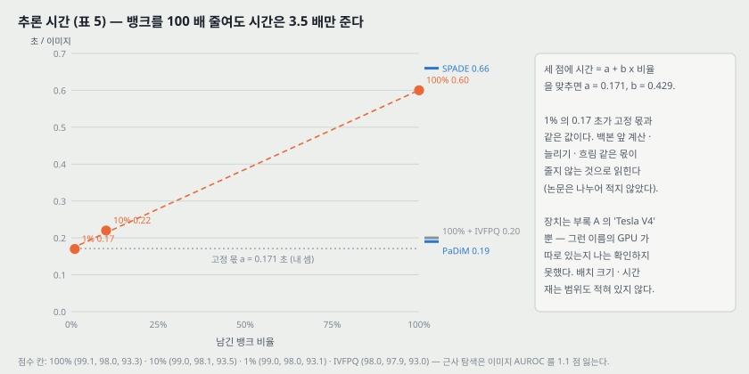

**내가 맞춘 직선 (셈 4).** 세 점에 「시간 = $a$ + $b$ x 뱅크 비율」을 최소제곱으로 맞추면 $a$ = 0.171 초, $b$ = 0.429 초이고, 세 점이 직선에서 0.006 초 안에 있다. **1% 에서는 직선 시간 0.175 초 중 0.171 초(98%)가 뱅크 크기와 상관없는 고정 몫이다.** 그래서 뱅크를 1% 아래로 더 줄여도 시간은 0.17 초 아래로 가지 않는다고 읽힌다. 고정 몫이 백본 계산인지, 늘리기 · 흐림 같은 후처리인지, 데이터 읽기인지 논문은 나누어 적지 않았다.

**장치와 조건.** 부록 A 는 「Nvidia Tesla V4」라고만 적는다. **그 이름의 GPU 가 따로 있는지 나는 확인하지 못했다**(T4 나 V100 의 오기일 수 있다는 것은 내 짐작이다). 배치 크기, 시간을 재는 범위(데이터 읽기 포함 여부), 반복 수가 없다.

**인용 규칙대로 가른다.** IVFPQ 의 원리는 역파일 + 곱 양자화로 Jégou, Douze, Schmid(2011)가 낸 것이고, 구현은 faiss(Johnson, Douze, Jégou, [27])다. 이 논문은 IVFPQ 에 [27] 만 단다.

---

## 14. 이웃 크기와 단계 — 그림 4 · 그림 S5 (4.4.1절 · 부록 C.5)

그림 4 의 값은 본문에 없다. 원 그림 이미지에서 눈금선과 표식 중심을 픽셀로 찾아 읽었다. 이웃 크기 쪽은 1 점이 이미지 53.75 px · 픽셀 117.5 px · PRO 32.5 px 이라 표식 중심 ±1 px 의 읽기 오차가 ±0.02 · ±0.01 · ±0.03 점이다.

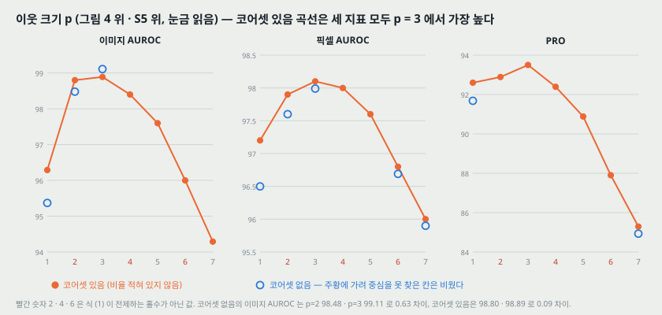

| $p$ | 1 | 2 | 3 | 4 | 5 | 6 | 7 |
|---|---:|---:|---:|---:|---:|---:|---:|
| 이미지 AUROC, 코어셋 있음 | 96.29 | 98.80 | 98.89 | 98.40 | 97.60 | 96.00 | 94.29 |
| 이미지 AUROC, 코어셋 없음 | 95.37 | 98.48 | **99.11** | 겹침 | 겹침 | 겹침 | 겹침 |
| 픽셀 AUROC, 코어셋 있음 | 97.20 | 97.90 | **98.10** | 98.00 | 97.60 | 96.80 | 96.00 |
| 픽셀 AUROC, 코어셋 없음 | 96.50 | 97.60 | 97.99 | 겹침 | 겹침 | 96.69 | 95.90 |
| PRO, 코어셋 있음 | 92.60 | 92.89 | **93.50** | 92.39 | 90.88 | 87.90 | 85.29 |
| PRO, 코어셋 없음 | 91.68 | 겹침 | 겹침 | 겹침 | 겹침 | 겹침 | 84.93 |

「겹침」은 표식이 주황 표식 아래에 겹쳐 중심을 못 찾은 칸이다. 눈으로 보면 두 곡선이 그 칸에서 같은 자리를 지난다.

- 논문은 「지역성과 전역 맥락 사이의 뚜렷한 최적」이라 적고 $p = 3$ 을 고른다. **코어셋 없는 이미지 AUROC 에서는 $p$ = 2 와 3 이 0.63 점 차이(98.48 대 99.11)라 뚜렷하고, 코어셋 있는 쪽에서는 0.09 점 차이(98.80 대 98.89)다.** 반복 수와 흩어짐이 없어 0.09 점 차이로 순서를 매기지 않는다.
- **「코어셋 있음」이 몇 % 인지 적혀 있지 않다.** PRO 의 $p = 3$ 값이 코어셋 있음 93.50 · 없음 93.3 이라 표 5 의 10%(93.5) · 100%(93.3)와 맞는다 — 10% 로 읽힌다(내 대조).
- **짝수 $p$.** 식 (1) 은 「홀수 이웃 크기」를 전제하고, $\lfloor p/2 \rfloor$ 로 쓰면 $p = 2$ 와 3 이 같은 9 칸이다. 그런데 그림은 $p = 2$ 와 3 을 다른 값으로 그린다. **짝수 $p$ 를 실제로 어떻게 만들었는지 적혀 있지 않다**(25절).

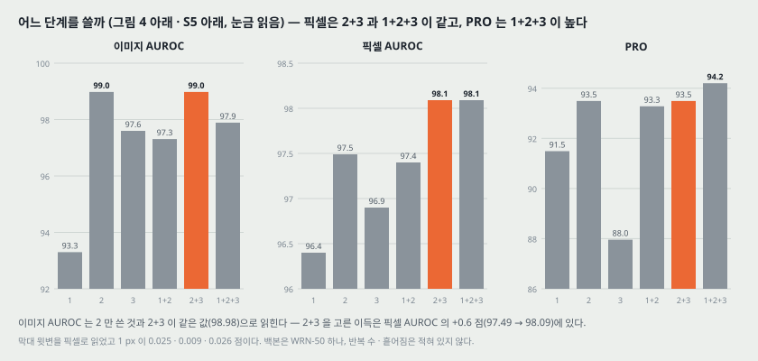

**단계 조합 (막대 윗변을 읽었고 1 px 이 0.025 · 0.009 · 0.026 점).**

| 단계 | 1 | 2 | 3 | 1+2 | **2+3** | 1+2+3 |
|---|---:|---:|---:|---:|---:|---:|
| 이미지 AUROC | 93.30 | 98.98 | 97.60 | 97.31 | **98.98** | 97.89 |
| 픽셀 AUROC | 96.40 | 97.49 | 96.90 | 97.40 | **98.09** | 98.09 |
| PRO | 91.49 | 93.49 | 87.96 | 93.28 | **93.49** | **94.20** |

- 논문은 「2 단계만으로도 최고 성능에 닿지만, 다음 단계를 더하면 이득이 있어 2+3 을 기본으로 했다」고 적는다. **읽은 값으로는 이미지 AUROC 에서 2 와 2+3 이 같고(98.98), 이득은 픽셀 AUROC 의 +0.60 점(97.49 → 98.09)이다. PRO 는 2 와 2+3 이 같다(93.49).**
- **PRO 만 보면 1+2+3 이 0.71 점 높다**(94.20 대 93.49). 픽셀 AUROC 는 2+3 과 같다. 이미지 AUROC 는 1.09 점 낮다. 2+3 은 이미지 AUROC 를 지키는 선택으로 읽힌다(내 해석). 12절의 큰 백본 실험도 같은 방향이다.
- **3 단계 하나만 쓰면 PRO 가 87.96 으로 가장 낮다.** 14 x 14 격자를 늘려 쓰니 결함 위치가 거칠어지는 것과 맞는 모양이다(내 해석, 논문은 이 칸을 말하지 않는다).
- **이 실험은 WRN-50 한 백본, 224 한 크기에서만 했다.** 백본마다 다시 고르지 않았다(18절).

---

## 15. 뱅크를 줄이는 세 방법 — 그림 5 · 그림 S6 · 식 (8) (4.4.2절)

세 방법을 맞세운다. 탐욕 코어셋, 무작위, **학습한 대리점(proxy)**. 셋째는 대리점 $\lvert \mathcal{P} \rvert = p_\text{target} \cdot \lvert \mathcal{M} \rvert$ 개를 두고 다음 재구성 목적을 줄인다.

$$\mathcal{L}_\text{rec}(m_i) = \left\lVert m_i - \sum_{p_k \in \mathcal{P}} \frac{e^{\lVert m_i - p_k \rVert_2}}{\sum_{p_j \in \mathcal{P}} e^{\lVert m_i - p_j \rVert}} p_k \right\rVert_2^2 \qquad (8)$$

**인쇄된 식 그대로 옮겼다.** 지수가 양수라 **멀리 있는 대리점일수록 가중치가 크다.** 재구성이라면 가까운 대리점에 큰 가중치를 주는 $e^{-\lVert \cdot \rVert}$ 가 자연스러워 부호가 빠진 것으로 보이지만, 논문이 실제로 어느 쪽을 썼는지는 알 수 없다. 분모의 노름 아래첨자도 인쇄본에서 $p_k$ 로 찍혀 있다(25절). 그리고 대리점 개수를 본문 다음 줄에서 「$N$ 개」로 적어, 식 (1) 의 $\mathcal{N}$ 과 겹친다.

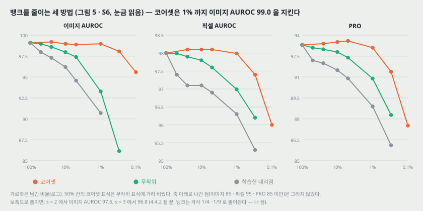

**그림 5 · S6 에서 읽은 값.** 가로축은 로그 눈금이고 $10^0$ 과 $10^{-2}$ 사이가 246 px 다. 표식의 가로 위치를 로그로 되돌리면 100 · 50 · 25 · 10 · 5 · 1 · 0.3 · 0.1 % 가 나온다(0.3 은 $10^{-2.52}$ 로 읽혔다). 세로 1 px 이 이미지 0.048 · 픽셀 0.010 · PRO 0.029 점이다.

| 남긴 비율 | 100 | 50 | 25 | 10 | 5 | 1 | 0.3 | 0.1 |
|---|---:|---:|---:|---:|---:|---:|---:|---:|
| 이미지, 코어셋 | 99.1 | 겹침 | 99.19 | 98.97 | 98.88 | 98.97 | 98.06 | 95.58 |
| 이미지, 무작위 | 99.1 | 98.97 | 98.59 | 97.97 | 97.39 | 93.28 | 86.15 | 축 밖 |
| 이미지, 대리점 | 99.1 | 97.97 | 97.29 | 96.19 | 94.57 | 90.70 | 축 밖 | 축 밖 |
| 픽셀, 코어셋 | 98.0 | 겹침 | 98.10 | 98.10 | 98.10 | 97.99 | 97.40 | 96.00 |
| 픽셀, 무작위 | 98.0 | 97.99 | 97.90 | 97.80 | 97.60 | 96.99 | 96.20 | 축 밖 |
| PRO, 코어셋 | 93.3 | 겹침 | 93.39 | 93.51 | 93.59 | 93.10 | 91.38 | 87.52 |
| PRO, 무작위 | 93.3 | 93.10 | 92.99 | 92.79 | 92.39 | 90.89 | 88.28 | 축 밖 |

100% 칸은 세 계열이 한 점에서 시작해 표 5 의 값을 적었다.

- **1% 에서 무작위는 이미지 AUROC 가 93.28 로 5.8 점 떨어지고 코어셋은 98.97 이다.** 이 논문에서 차이가 가장 큰 비교이고, 「코어셋이 낫다」는 결론은 이 칸에서는 반복 수가 없어도 흔들리지 않는 크기다.
- 「50% \~ 10% 사이에서는 줄이지 않은 것보다 부분적으로 오른다」 — 읽은 값으로 이미지 +0.09(25%), 픽셀 +0.10(25 \~ 5%), PRO +0.29(5%)다. **흩어짐이 없는 0.1 점 안팎의 차이다.**
- 「줄이지 않은 뱅크는 시험 때 뱅크 원소의 30% 미만만 쓰이고, 1% 코어셋은 95% 에 가깝게 쓰인다」 — 어느 부류 · 몇 장에서 센 것인지 적혀 있지 않다.

**보폭으로 줄이면 (4.4.2절 끝).** $s = 2$ 에서 이미지 AUROC 97.6, $s = 3$ 에서 96.8. 위치 0, $s$, $2s$, ... 를 남긴다고 세면 뱅크가 25.0% · 12.8% 로 줄어든다(셈 8, 내 셈). **25% 코어셋(99.1)보다 1.5 점, 그보다 작은 10% 코어셋(99.0)보다 2.2 점 낮다.** 논문은 「해상도 맥락이 줄어서」라고 적는다.

---

## 16. 적은 표본 — 그림 6 · 표 S5 (4.5절 · 부록 C.1)

부류마다 정상 학습 이미지를 1 \~ 50 장만 쓴다. SPADE · PaDiM 은 같은 WRN-50 으로 다시 구현했다.

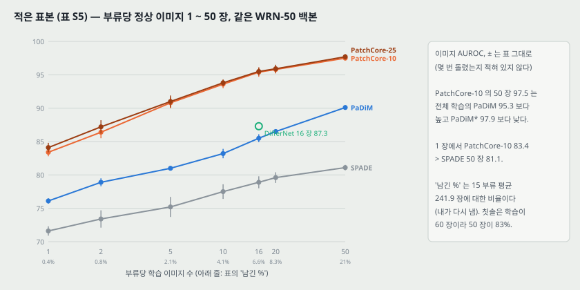

| 장 수 | 1 | 2 | 5 | 10 | 16 | 20 | 50 |
|---|---:|---:|---:|---:|---:|---:|---:|
| 남긴 % (표) | 0.4 | 0.8 | 2.1 | 4.1 | 6.6 | 8.3 | 21 |
| 이미지 AUROC SPADE | 71.6 ± 0.7 | 73.4 ± 1.3 | 75.2 ± 1.5 | 77.5 ± 1.1 | 78.9 ± 0.9 | 79.6 ± 0.8 | 81.1 ± 0.4 |
| 이미지 AUROC PaDiM | 76.1 ± 0.4 | 78.9 ± 0.6 | 81.0 ± 0.2 | 83.2 ± 0.7 | 85.5 ± 0.6 | 86.5 ± 0.3 | 90.1 ± 0.3 |
| 이미지 AUROC PatchCore-10 | 83.4 ± 0.6 | 86.4 ± 0.9 | 90.8 ± 0.8 | 93.6 ± 0.6 | 95.4 ± 0.7 | 95.8 ± 0.6 | 97.5 ± 0.3 |
| 이미지 AUROC PatchCore-25 | 84.1 ± 0.7 | 87.2 ± 1.0 | 91.0 ± 0.9 | 93.8 ± 0.5 | 95.5 ± 0.6 | 95.9 ± 0.6 | 97.7 ± 0.4 |
| 픽셀 AUROC PatchCore-10 | 92.0 ± 0.2 | 93.1 ± 0.2 | 94.8 ± 0.1 | 96.2 ± 0.1 | 96.8 ± 0.3 | 96.9 ± 0.3 | 97.8 ± 0.0 |
| PRO PatchCore-10 | 82.4 ± 0.3 | 85.1 ± 0.3 | 88.7 ± 0.2 | 90.9 ± 0.1 | 91.8 ± 0.2 | 92.0 ± 0.2 | 93.0 ± 0.1 |

DifferNet 은 16 장 이미지 AUROC 87.3 하나다. 나머지 줄(SPADE · PaDiM 의 픽셀 · PRO, PatchCore-25 의 픽셀 · PRO)은 그림 13 을 만드는 파일에 상수로 들어 있다.

- **± 가 몇 번 돌린 것의 무엇(표준편차인지)인지 적혀 있지 않다.** 이 논문에서 흩어짐이 붙은 유일한 표다.
- **「남긴 %」는 장 수를 15 부류 평균 학습 이미지 241.93 장으로 나눈 값이다** — 일곱 칸 모두 내가 다시 낸 값과 소수 첫째 자리까지 맞는다(셈 7). 부류마다 학습 이미지 수가 달라서, 학습이 60 장인 Toothbrush 에서는 50 장이 83% 다.
- 「정상 학습 데이터의 5 분의 1 로 앞선 최고 성능에 닿는다」 — 50 장(21%)의 97.5 · 97.7 은 PaDiM 95.3 보다 높고 PaDiM\* 97.9 보다 낮다. **어느 「앞선 최고」와 비교한 것인지에 따라 참 · 거짓이 갈린다.**
- 「이미지 수준 뱅크를 쓰는 [10](SPADE)과 비교해 5 장 / 1 장으로 같은 위치 찾기 · 검출 성능」 — 표에서 이 문장의 짝을 찾지 못했다. 1 장의 이미지 AUROC 83.4 는 전체 학습 SPADE 85.5(표 1) · 85.3(표 5)보다 낮고, 5 장의 픽셀 AUROC 94.8 은 전체 학습 SPADE 96.0 · 96.6 보다 낮다. **50 장 SPADE(81.1 · 96.2)와 비교하면** 1 장 이미지 AUROC 는 넘고(83.4) 5 장 픽셀 AUROC 는 못 넘는다(94.8). 어느 짝을 뜻했는지 적혀 있지 않다(25절).

---

## 17. 다른 데이터 — 표 6 (4.6절)

| 데이터 · 지표 | 비교 셋 (표 6 의 값) | PatchCore-10 |
|---|---|---:|
| mSTC 픽셀 AUROC | CAVGA-Ru 85 · SPADE 89.9 · PaDiM 91.2 | **91.8** |
| MTD 이미지 AUROC | GANomaly 76.6 · 1-NN 80.0 · DifferNet 97.7 | **97.9** |

- **mSTC 는 단계 3 · 4 를 썼다.** 「자연 이미지에 가까운 맥락이라 더 깊은 특징을 쓴다, 그 밖의 하이퍼파라미터는 고르지 않았다」고 적는다. 기본값(2+3)을 데이터에 따라 바꾼 유일한 자리다.
- **MTD 는 이미지 크기가 제각각이라 PaDiM 처럼 위치에 묶인 방법은 바로 쓸 수 없다**고 적는다. DifferNet 과의 차이 0.2 점을 「살짝 넘는다」고 적는데 흩어짐이 없다.

---

## 18. 백본을 바꾸면 — 표 S6 (부록 C.2)

이 저장소의 Wide ResNet 노트가 물은 표다.

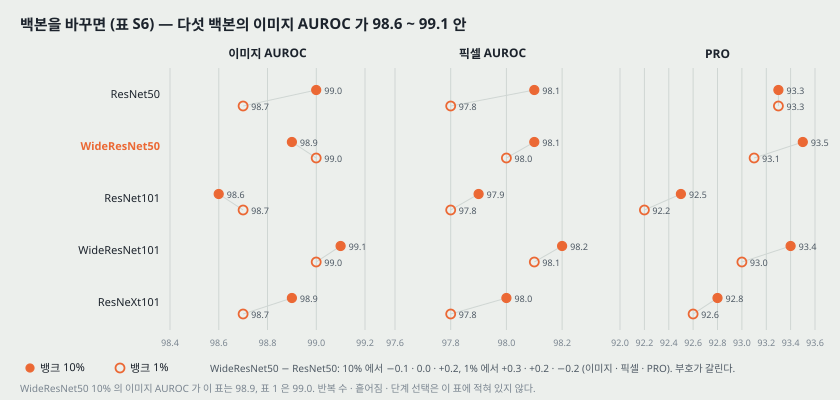

| 백본 | 뱅크 % | 이미지 AUROC | 픽셀 AUROC | PRO |
|---|---:|---:|---:|---:|
| ResNet50 | 10 | 99.0 | 98.1 | 93.3 |
| ResNet50 | 1 | 98.7 | 97.8 | 93.3 |
| WideResNet50 | 10 | 98.9 | 98.1 | 93.5 |
| WideResNet50 | 1 | 99.0 | 98.0 | 93.1 |
| ResNet101 | 10 | 98.6 | 97.9 | 92.5 |
| ResNet101 | 1 | 98.7 | 97.8 | 92.2 |
| WideResNet101 | 10 | 99.1 | 98.2 | 93.4 |
| WideResNet101 | 1 | 99.0 | 98.1 | 93.0 |
| ResNeXt101 | 10 | 98.9 | 98.0 | 92.8 |
| ResNeXt101 | 1 | 98.7 | 97.8 | 92.6 |

- 논문은 「대체로 안정적이다. WideResNet50 은 SPADE · PaDiM 과 맞대기 위해 골랐다」고 적는다. **곧 WRN-50 을 고른 이유는 성능이 아니라 비교 상대와 같은 백본을 쓰기 위해서다.**
- **ResNet-50 대 WRN-50(WRN − R50).** 10% 에서 이미지 −0.1 · 픽셀 0.0 · PRO +0.2, 1% 에서 +0.3 · +0.2 · −0.2. 부호가 지표와 비율마다 갈린다. 반복 수와 흩어짐이 없어 순서를 매기지 않는다.
- **같은 이름의 같은 설정이 두 표에서 다르다.** WideResNet50 10% 의 이미지 AUROC 가 표 S6 은 98.9, 표 1 은 99.0 이다. 표 S1 의 부류 값 평균은 98.927 이라 둘 다 반올림 폭(±0.10) 안이다 — 같은 실행인지 다른 실행인지는 알 수 없다.
- **백본마다 어느 단계를 썼는지 이 표에 없다.** 14절의 단계 실험은 WRN-50 에서만 했다.
- **내가 센 것.** 다섯 백본 모두 layer2 · layer3 출력이 512 · 1,024 채널이다(병목의 출력 채널은 폭 · 갈래와 상관없이 같다). 그래서 **다섯 백본의 뱅크는 개수도 차원도 같고**, 이 표는 같은 크기의 뱅크에 담긴 특징의 질을 비교한 것이 된다.

---

## 19. 이미지 크기와 이웃 크기 — 그림 S4 (부록 C.3)

입력을 288 · 360 · 448 로, $p$ 를 3 · 5 · 7 · 9 로 바꾼 여덟 줄이다(표 4 의 280 · 320 과는 다른 크기다). 막대 오른쪽 끝을 읽었고 1 px 이 이미지 0.006 · 픽셀 0.0016 · PRO 0.007 점이다. 점선(기준 = 224, $p$ = 3)도 같은 방식으로 읽었다.

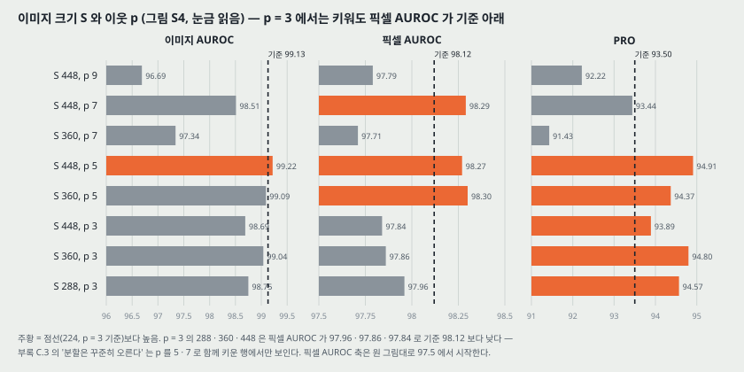

| 줄 | 이미지 AUROC | 픽셀 AUROC | PRO |
|---|---:|---:|---:|
| **기준 (224, $p$ 3)** | **99.13** | **98.12** | **93.50** |
| 288, $p$ 3 | 98.75 | 97.96 | 94.57 |
| 360, $p$ 3 | 99.04 | 97.86 | 94.80 |
| 448, $p$ 3 | 98.69 | 97.84 | 93.89 |
| 360, $p$ 5 | 99.09 | 98.30 | 94.37 |
| 448, $p$ 5 | 99.22 | 98.27 | 94.91 |
| 360, $p$ 7 | 97.34 | 97.71 | 91.43 |
| 448, $p$ 7 | 98.51 | 98.29 | 93.44 |
| 448, $p$ 9 | 96.69 | 97.79 | 92.22 |

- 논문은 「검출은 살짝 오르고 포화하고, **분할은 꾸준히 오른다**」고 적는다. **읽은 값으로 $p = 3$ 인 세 크기는 픽셀 AUROC 가 모두 기준보다 낮다**(97.96 · 97.86 · 97.84 대 98.12). 기준보다 높은 픽셀 AUROC 는 $p$ 를 5 · 7 로 함께 키운 셋뿐이다. PRO 는 $p$ = 3 에서 셋 다 기준보다 높다. 곧 「꾸준히」 는 PRO 에서만 맞고 픽셀 AUROC 에서는 $p$ 를 함께 바꿔야 나온다.
- **내 셈 (셈 8).** 이웃 창 한 변은 layer2 격자 간격으로 $p$ x 8 픽셀이다. 224 · $p$ 3 은 이미지 한 변의 10.7%, 448 · $p$ 3 은 5.4%, 448 · $p$ 5 는 8.9%, 448 · $p$ 7 은 12.5% 다. **입력을 키우면 같은 $p$ 의 창이 이미지에서 차지하는 몫이 줄어든다** — 큰 입력에서 $p$ 를 함께 키운 줄이 나은 것과 맞는 모양이다(내 해석, 수용장이 아니라 격자 간격으로 센 것이다).
- 이 그림의 뱅크 비율과 백본은 적혀 있지 않다.

---

## 20. 남은 오분류 — 그림 S1 · S2 · S3 (부록 B · C.4)

**F1 최적 문턱에서 거짓 양성 19 장 + 거짓 음성 23 장 = 42 장.** 표 1 의 PatchCore-25% 오분류 42 와 같다. 그림 S1 · S2 에 하나하나 띄웠다(타일 수를 세어 19 · 23 과 맞음을 확인했다).

- **거짓 양성(그림 S1)의 원인 셋.** 라벨이 애매한 것(이상이라 불러도 될 변화), 정상 변동이 큰 것, 배경 변동. 앞의 것은 방법으로 풀기 어렵고, 정상 변동 쪽은 **정상 데이터에 맞춘 적응**으로 다룰 수 있다고 적는다. 그리고 「PatchCore 가 적응 방법들보다 나으므로 적응은 PatchCore 같은 사전학습 방법과 함께 갈 때 가장 유망하다」고 적는다.
- **거짓 음성(그림 S2)의 원인.** 위치는 잘 찾았는데 점수가 낮은 것(후처리로 다룰 수 있다고 적는다), 정상 변동, 높은 해상도면 잡을 수 있는 가는 결함, 못 찾은 것. **하나는 가운데 자르기가 결함을 잘라 낸 경우다.** 원인별 개수는 내가 세지 않았다(그림 테두리 색으로 셀 수 있다).
- **그림 S3** 은 부류별 PR · ROC 곡선이고 상자 안에 숫자 둘을 적는다.

| | 전체 재현율에서 오차 | 최적 문턱에서 오차 |
|---|---:|---:|
| PatchCore-1 | 6.93 | 2.44 |
| PatchCore-10 | 5.72 | 2.52 |
| SPADE (다시 구현) | 21.62 | 15.10 |
| PaDiM (다시 구현) | 9.45 | 6.03 |

**단위가 적혀 있지 않다.** 최적 문턱 오차가 PatchCore-1 < PatchCore-10 인데, 표 1 의 오분류 수는 1% 49 > 10% 47 로 순서가 반대다. 그래서 그림 S3 의 숫자는 표 1 의 개수를 1,725 로 나눈 비율(2.84% · 2.72%)이 아니다 — 부류별 비율의 평균 같은 다른 셈으로 보이지만 어느 셈인지는 알 수 없다(25절).

---

## 21. 구현 (부록 A)

- Python 3.7, PyTorch. 장치는 「Nvidia Tesla V4 GPU」(13절).
- 사전학습 가중치는 **torchvision 과 PyTorch Image Models(timm)** 에서 가져왔다. 어느 모델을 어디서 가져왔는지, 가중치 판(torchvision 의 V1 · V2 같은)은 적혀 있지 않다.
- 기본 백본은 SPADE · PaDiM 과 맞대려고 WideResNet50.
- 조각 특징은 **블록 2 와 3 의 마지막 출력**을 모아 만든다 — 단계 끝 출력이다.
- 최근접 탐색과 거리 계산은 모두 **faiss** [27].

**적혀 있지 않은 것 (재현에 필요한데 이 파일에 없는 값).** 조각 특징 차원 $d$, 사영 차원 $d^*$, 재가중 이웃 수 $b$, 코어셋 첫 점, 이웃 평균의 가장자리 처리, 두 단계를 합치는 방식, 가우스 $\sigma$ 의 단위, F1 문턱을 정한 자료, 시간 재는 조건, 반복 수. 코드 저장소에서 확인할 값들이다(30절).

---

## 22. 이 논문이 스스로 적은 한계

1. **사전학습 특징이 옮겨 가는 만큼만 된다**(5절 Limitations). 문제 영역에 맞게 적응하지 않고도 잘 되지만, 쓸 수 있는 범위는 사전학습 특징의 전이성이 정한다. 특징 적응과 합치는 것은 뒤 연구로 남긴다.
2. **남은 거짓 양성은 라벨의 애매함과 큰 정상 변동에서 온다**(부록 C.4). 앞의 것은 방법으로 풀기 어렵다.
3. **남은 거짓 음성 일부는 해상도와 자르기 탓이다**(부록 C.4).
4. **사회적 영향**(Broader Impact): 공장 검사에 집중해 부정적 영향은 제한적이고, 논란 있는 영역의 검출 시스템에 쓰일 수는 있지만 그 쓰임을 바꿀 만한 개선은 아니라고 적는다.

---

## 23. 논문이 적지 않은 것 — 내가 읽으며 짚은 자리

**하나. 흩어짐이 표 S5 하나에만 있다.** 표 1 \~ 6 · S1 \~ S4 · S6 과 그림 4 · 5 · S4 에 반복 수와 흩어짐이 없다. 그런데 결론의 여럿이 0.1 \~ 0.3 점 차이 위에 서 있다 — 단계 2 대 2+3 의 이미지 AUROC(차이 0), 코어셋 50 \~ 10% 의 「부분적 상승」(+0.09 \~ +0.29), 백본 비교(−0.3 \~ +0.3), MTD 의 「살짝 넘음」(+0.2). 표 S5 의 이미지 AUROC ± 가 0.2 \~ 1.5 라는 것과 나란히 보면 이 차이들로 순서를 매기기 어렵다. **차이가 흩어짐보다 확실히 큰 것은 코어셋 대 무작위(1% 에서 5.7 점)와 다른 방법들과의 비교 쪽이다.**

**둘. 「오차 57% 감소」의 상대가 재현되지 않은 값이다.** 10절. 논문이 직접 다시 낸 PaDiM(95.4)과 비교하면 4.6 → 0.9 로 80% 감소라, 결론의 방향은 같고 수치만 달라진다.

**셋. F1 최적 문턱을 무엇으로 정했는지 없다.** 오분류 42 · 그림 S1 · S2 가 모두 그 문턱 위에 있다. 시험 라벨로 정한 문턱이면 실제 배치에서 얻을 수 있는 수치보다 낙관적이다(내 판단). 부류마다 문턱을 따로 정했는지도 적혀 있지 않다.

**넷. 재가중 식 (7) 의 몫을 재지 않았다.** 7절에서 유도했듯 $w$ 는 $[1 - 1/b, 1)$ 안이고, 「더 튼튼했다」의 수치는 없다. 그림 4 · 5 처럼 재가중을 끈 줄이 없다.

**다섯. 코어셋이 줄이는 몫은 0.43 초 쪽이다.** 13절의 직선. 1% 에서 고정 몫 0.171 초가 0.175 초의 98% 라, 뱅크를 1% 아래로 줄여도 시간은 0.17 초 아래로 가지 않는다(내 셈, 세 점 직선 맞춤이라 점이 더 있으면 바뀔 수 있다).

**여섯. 단계 선택의 근거는 WRN-50 · 224 한 조건이고, PRO 만 보면 1+2+3 이 높다.** 14절. 2+3 은 이미지 AUROC 를 지키는 선택이다.

**일곱. 부록 C.3 의 「분할은 꾸준히 오른다」가 그림 S4 의 픽셀 AUROC 와 맞지 않는다.** 19절. 이웃 크기를 함께 키워야 오른다.

**여덟. 코어셋을 고르는 시간 · 기억 사용량이 없다.** 6절의 셈으로 평균 부류 10% 에 거리 계산 $3.60 \times 10^9$ 번이다. 「현실적인 공장 쓰임에 매력적」이라는 주장의 학습 쪽 비용이 비어 있다.

**아홉. 적은 표본의 「5/1 장」 문장의 짝이 없다.** 16절.

---

## 24. 읽을 때 헷갈리는 지점

- **「patchsize」는 이웃 크기다.** 이미지에서 잘라 내는 조각 크기가 아니다. 이미지 조각의 크기는 단계의 수용장이 정하고 논문은 그 값을 적지 않는다.
- **「단계 1 · 2 · 3」은 layer1 · 2 · 3 이다.** conv1 이 아니다. 4.4.1절은 「WideResNet50 의 첫 세 블록을 1 \~ 3 으로 번호 붙인다」고 적는다.
- **$d$ 와 1,536.** 두 단계를 합친 차원을 이 노트(와 이 저장소의 ResNet · WRN 노트)는 1,536 으로 셌다. 논문은 적응 평균 풀링이 「미리 정한 차원 $d$ 의 벡터 하나」를 낸다고만 적는다. 공간 이웃 평균과 차원 맞추기가 한 연산인지 두 연산인지 문장 하나로는 갈리지 않는다.
- **그림 5 의 가로축 이름은 「Subsampling Percentage」인데 눈금은 비율이다.** $10^0$ 이 100%, $10^{-2}$ 가 1% 다.
- **「PatchCore-10」 과 「PatchCore-10%」 는 같은 것이다.** 표 6 · S1 \~ S5 는 % 를 뺀다.
- **식 (3) 의 $h < h^*$.** 1 부터 세면 마지막 행 $h^*$ 가 빠진다. 0 부터 세면 맞는다. 다른 식에서는 $h \in \lbrace 1, \ldots, h^* \rbrace$ 로 쓴다.
- **표 5 의 SPADE · PaDiM 은 다시 구현한 것이고 표 1 \~ 3 의 SPADE · PaDiM 은 원 논문의 값이다.** 이미지 AUROC 가 SPADE 85.3 대 85.5, PaDiM 95.4 대 95.3 으로 다르다.
- **4.4절 첫 문장은 「국소 인지 조각 특징(§3.3)」이라 적지만** 그 내용은 3.1절이다.

---

## 25. 원문 안의 어긋남 모음

| 자리 | 한쪽 | 다른 쪽 | 내가 확인한 것 |
|---|---|---|---|
| 4.2절 대 부록 B | 「부류의 3 분의 1 이 완벽」 | 「15 중 6 을 푼다」 | 표 S1 의 PatchCore-25 에서 100 이 6 개. 6/15 = 40% |
| 표 4 첫 줄 | PRO 94.9 | 오차 5.6 | 100 − 94.9 = 5.1. 둘째 줄 94.4 의 오차 5.6 과 같은 값이 찍혀 있다 |
| 표 1 대 표 S6 | WRN-50 10% 이미지 99.0 | 98.9 | 부류 평균 98.927 — 둘 다 반올림 폭 안 |
| 식 (1) 대 그림 4 | 홀수 이웃 크기, $\lfloor p/2 \rfloor$ | $p$ = 2 · 4 · 6 도 그림 | 식대로면 $p$ = 2 와 3 이 같은 이웃인데 값이 98.48 대 99.11 |
| 3.3절 | 「식 7 (첫 줄)의 arg max」 | arg max 는 식 (6) 첫 줄 | — |
| 3.3절 | $\mathcal{N}_b(m^*)$ 를 「시험 조각 특징 $m^*$」의 이웃이라 부름 | $m^*$ 는 뱅크 원소 | — |
| 식 (5) · 알고리즘 1 | 크기 제약이 없다 · 첫 반복의 min 이 빈 집합 위 | — | 6절 |
| 식 (8) | 지수 부호가 양수, 분모 노름 아래첨자 $p_k$ | — | 15절 |
| 그림 S3 대 표 1 | 최적 문턱 오차 1% 2.44 < 10% 2.52 | 오분류 1% 49 > 10% 47 | 같은 양이 아니다 |
| 표 S1 DifferNet 줄 | 평균 94.9 | 부류 평균 94.687 | 반올림 폭 ±0.10 밖 (셈 3) |
| 4.5절 | 「5/1 장으로 SPADE 와 같은 성능」 | 표 S5 · 표 1 · 표 5 | 짝을 찾지 못함 (16절) |
| 부록 C.3 대 그림 S4 | 「분할은 꾸준히 오른다」 | $p$ = 3 의 세 크기 모두 픽셀 AUROC 가 기준 아래 | 19절 |
| 4.4절 첫 줄 | 「(§3.3)」 | 내용은 3.1절 | — |
| 부록 A | 「Tesla V4」 | — | 그 이름의 GPU 를 확인하지 못함 |

---

## 26. Wide ResNet · ResNet 노트와 맞춰 보기

| 그 노트들이 물은 것 · 적은 것 | 이 논문에서 | 판정 |
|---|---|---|
| WRN 노트 — layer2 512 x 28 x 28 · layer3 1,024 x 14 x 14, 조각 784 | 논문은 크기를 적지 않는다. 부록 A 가 「블록 2 · 3 의 마지막 출력」, 4.1절이 224 자르기를 적어 그 조건에서 내가 다시 센 값이 같다 | **맞다** (내 셈끼리 맞춘 것) |
| WRN · ResNet 노트 — 「이어 붙인 채널 512 + 1,024 = 1,536」 | 논문은 「미리 정한 차원 $d$」만 적는다 | **두 노트의 1,536 은 합치기 전 채널 수로 읽어야 한다.** 논문이 1,536 차원을 쓴다고 적은 것은 아니다 |
| WRN 노트 25절 넷째 — 백본을 바꾼 비교가 있는가 | 표 S6 에 다섯 백본 x 10% · 1% | **있다.** ResNet-50 대 WRN-50 차이 −0.3 \~ +0.3, 부호가 갈린다. 흩어짐이 없다 |
| WRN 노트 25절 넷째 — layer2 · layer3 를 고른 근거 | 그림 4 아래 · S5 아래 (WRN-50, 224) · 3.1절의 두 이유 | **있다, 다만 한 백본 · 한 크기에서만.** 이득은 픽셀 AUROC +0.6 쪽 |
| WRN 노트 26절 D — MVTec 한 부류에서 R50 대 WRN-50-2 | 표 S6 은 15 부류 평균만 준다 | **아직 열려 있다.** 부류별 · 흩어짐까지 보려면 돌려야 한다 |
| ResNet 노트 21절 셋 — 단계 끝 대 단계 가운데 블록 | 부록 A: 단계 끝 출력을 쓴다. 가운데 블록과 비교한 실험은 없다 | **쓰는 것은 확인, 비교는 열려 있다** (ResNet 노트 23절 D) |
| ResNet 노트 21절 셋 — 「layer1 은 너무 국소적, layer4 는 ImageNet 에 맞춰짐」을 PatchCore 쪽 설명으로 적음 | 3.1절은 마지막 단계의 두 문제(국소 정보 상실 · ImageNet 치우침)와 「너무 일반적이지 않게」를 적는다. layer1 단독은 그림 4 에서 이미지 AUROC 93.30 | **대체로 맞다.** 「layer1 이 너무 국소적」은 논문 문장이 아니라 그림 4 의 값에서 읽히는 것이다 |
| WRN 노트 15.2절 — 연구 코드가 부르는 가중치는 어느 것인가 | 「torchvision 과 timm 에서」만 적는다 | **열려 있다** |
| ResNet 노트 — 576 입력이면 72 x 72 = 5,184 조각 | 셈 1 도 같다 | 맞다 |

**두 노트에서 고칠 만한 자리 (이 노트에서는 고치지 않았다).**

- Wide ResNet 노트 24절 둘째 문단 첫 줄과 그림 `fig15_patchcore` 의 「이어 붙인 채널은 512 + 1,024 = 1,536」, ResNet 노트 21절 셋의 같은 문장 — 「논문은 차원을 『미리 정한 $d$』로만 적는다, 1,536 은 합치기 전 채널 수다」를 덧붙여야 한다.
- Wide ResNet 노트 25절 넷째 행의 「백본을 바꾼 비교가 있는지」 — 표 S6 이 있다는 것과 그 범위(−0.3 \~ +0.3, 흩어짐 없음), 단계 근거가 WRN-50 · 224 한 조건이라는 것을 날짜 단 인용 블록으로 적을 수 있다.

---

## 27. 계보

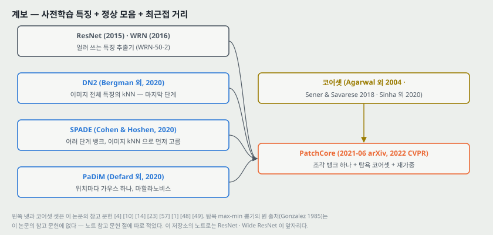

- **DN2 (Bergman 외 2020, [4])**: 이미지 전체 특징(마지막 단계)의 kNN. 적응 없는 ImageNet 특징으로 검출이 된다는 것을 보였다.
- **SPADE (Cohen & Hoshen 2020, [10])**: 여러 단계 뱅크, 이미지 kNN 으로 먼저 고른 뒤 픽셀 kNN.
- **PaDiM (Defard 외 2020, [14])**: 위치마다 가우스 하나, 마할라노비스 거리.
- **코어셋 줄기**: Agarwal 외 2004 ([1]) → Sener & Savarese 2018 ([48], 능동 학습의 탐욕 코어셋) → Sinha 외 2020 ([49], Small-GAN, 사영 뒤 탐욕). 첫 저자의 앞 연구 [41](거리 학습)도 탐욕 코어셋을 쓴다고 2절에 적는다.
- **이 저장소의 노트로는** ResNet → Wide ResNet 이 이 논문의 특징 추출기 자리다. 「깊은 망을 배워지게 만드는 장치」 묶음의 끝(WRN-50-2)이 여기서 **얼린 특징 추출기**로 쓰인다.

이 논문 뒤에 나온 편은 이 노트에서 다루지 않는다.

---

## 28. 다음에 읽을 것

| 논문 | 이 노트의 어느 자리에서 나오는가 | 무엇을 확인하고 싶은가 |
|---|---|---|
| **PaDiM** — A Patch Distribution Modeling Framework for Anomaly Detection and Localization (Defard 외, ICPR Workshops 2021, arXiv:2011.08785) | 3 · 10 · 13절 — 가장 가까운 비교 상대, 「PaDiM\*」 의 출처 | 부류마다 백본을 고른 97.9 가 어떤 설정인지. 위치별 가우스가 정렬에 얼마나 기대는지 |
| **SPADE** — Sub-Image Anomaly Detection with Deep Pyramid Correspondences (Cohen & Hoshen, arXiv:2005.02357) | 3 · 6 · 16절 — 이미지를 먼저 고르는 단계 | 먼저 고르는 단계가 픽셀 성능을 얼마나 잃게 하는지. **2026-11-07 에 읽었다. 잃는 값은 그 편에 없다(6절 인용 블록)** |
| **Uninformed Students** (Bergmann 외, CVPR 2020) | 1 · 9절 — PRO 의 정의를 이 편에 미룬다 | PRO 를 어느 거짓 양성률까지 적분하는지. 연구에서 쓰는 PRO 와 같은 정의인지 |
| **Active Learning for CNNs: A Core-Set Approach** (Sener & Savarese, ICLR 2018) — 원 출처 Gonzalez(1985)와 함께 | 6절 — 탐욕 코어셋의 출처 | 탐욕법의 보장(2-근사)이 무엇을 기준으로 한 것인지. 사영 뒤에도 남는지. **2026-11-07 에 읽었다. 답은 6절 끝 인용 블록** |
| **Product Quantization for Nearest Neighbor Search** (Jégou, Douze, Schmid, TPAMI 2011) | 13절 — IVFPQ 의 원리 | 표 5 의 IVFPQ 가 이미지 AUROC 를 1.1 점 잃은 이유가 양자화 오차인지 |

읽는 순서로는 **PaDiM 이 먼저**다. 표 1 의 비교 기준과 PatchCore 의 설계(위치 없는 뱅크)가 그 편과의 차이로 설명된다.

---

## 29. 돌려 볼 것

노트를 쓰며 나온 물음 중 **직접 잴 수 있는 것 여섯**이다. **아직 실험 폴더를 만들지 않았고 돌리지 않았다.** 돌리게 되면 질문과 가설을 먼저 적는 규칙대로 폴더를 만든다.

| 무엇 | 이 노트의 어느 자리 | 묻는 것 |
|---|---|---|
| A | 7 · 23절 넷 | 식 (7) 재가중을 끈 것 · $b$ = 3 · 9 를 MVTec 15 부류에서 바꿔, 이미지 AUROC 가 얼마 달라지는가. 그리고 실제 특징 거리 $d^*$ 와 $\Delta$ 가 어느 범위인지 찍어 $w$ 의 분포를 본다 |
| B | 14 · 15 · 23절 하나 | 코어셋 첫 점(씨앗) 다섯과 사영 씨앗 다섯으로 같은 설정을 돌려, **이미지 AUROC 의 흩어짐이 0.1 점보다 큰가.** 그 폭으로 23절 하나의 비교들을 다시 판정한다 |
| C | 13 · 23절 다섯 | L4 에서 100 · 10 · 1% 의 시간을 백본 · 탐색 · 늘리기 · 흐림으로 나눠 잰다. 고정 몫 0.171 초가 무엇인지 |
| D | 26절 (WRN 노트 26절 D · ResNet 노트 23절 D) | MVTec 부류별로 **ResNet-50 대 WRN-50-2**, **단계 끝 대 단계 가운데 블록**을 바꿔, B 의 흩어짐보다 큰 차이가 나는가 |
| E | 19절 | 이웃 창이 이미지에서 차지하는 몫을 고정한 채(224 · $p$ 3 ≈ 448 · $p$ 5 · 7) 입력 크기만 바꿔 픽셀 AUROC 가 오르는가 |
| F | 14 · 25절 | 공개 코드에서 짝수 $p$ 를 어떻게 만드는지(채우기 · 창 위치) 읽고, $p$ = 2 와 3 이 다른 창인지 확인한다 — 돌리기 전에 읽어서 닫을 수 있는 것 |

---

## 30. 물어 두는 것

- **$d$ · $d^*$ · $b$ 의 값.** 공개 코드의 기본값이 이 논문의 표를 낸 값과 같은지.
- **코어셋 첫 점은 어떻게 고르나.** 무작위라면 씨앗이 결과를 얼마나 흔드는지(29절 B).
- **F1 최적 문턱은 시험 라벨로 정했나, 부류마다인가.**
- **그림 4 의 「코어셋 있음」은 몇 % 인가.** PRO 값으로는 10% 로 읽힌다.
- **표 S5 의 ± 는 몇 번 돌린 것의 무엇인가.**
- **그림 S3 의 오차 숫자는 무엇을 센 것인가.**
- **표 4 의 묶기는 어떻게 합쳤나.**
- **「Tesla V4」 는 무슨 장치인가.**
- **연구 코드가 부르는 WRN-50-2 가중치가 이 논문의 표를 낸 가중치와 같은가**(torchvision 의 어느 판인지).

---

## 31. 참고 문헌

이 노트가 부른 편만 적는다. 원리는 원 출처를, 구현은 그 라이브러리의 편을 적는 규칙을 따른다. 그림 코드는 파이썬 표준 라이브러리만 쓰고, 원 그림 눈금을 읽을 때는 pymupdf · Pillow · numpy · scipy 를 썼다(그 스크립트는 저장소에 넣지 않았고, 읽은 값을 `make_figures.py` 에 상수로 적었다).

- Roth, K., Pemula, L., Zepeda, J., Schölkopf, B., Brox, T., and Gehler, P. (2022). Towards total recall in industrial anomaly detection. CVPR. arXiv:2106.08265 (v2, 2022-05). — 이 노트의 대상.
- Bergman, L., Cohen, N., and Hoshen, Y. (2020). Deep nearest neighbor anomaly detection. arXiv:2002.10445. — DN2, 마지막 단계 kNN(참고 문헌 4).
- Cohen, N. and Hoshen, Y. (2020). Sub-image anomaly detection with deep pyramid correspondences. arXiv:2005.02357. — SPADE(참고 문헌 10). 2026-11-07 에 읽었다.
- Defard, T., Setkov, A., Loesch, A., and Audigier, R. (2021). PaDiM: A patch distribution modeling framework for anomaly detection and localization. ICPR Workshops. — PaDiM(참고 문헌 14).
- Bergmann, P., Fauser, M., Sattlegger, D., and Steger, C. (2019). MVTec AD — a comprehensive real-world dataset for unsupervised anomaly detection. CVPR. — 데이터. 부류별 이미지 수의 출처(참고 문헌 5).
- Bergmann, P., Fauser, M., Sattlegger, D., and Steger, C. (2020). Uninformed students: Student-teacher anomaly detection with discriminative latent embeddings. CVPR. — PRO 의 정의(참고 문헌 6).
- Huang, Y., Qiu, C., and Yuan, K. (2018). Surface defect saliency of magnetic tile. The Visual Computer. — MTD(참고 문헌 26).
- Liu, W., Luo, W., Lian, D., and Gao, S. (2018). Future frame prediction for anomaly detection — a new baseline. CVPR. — STC(참고 문헌 32).
- Rudolph, M., Wandt, B., and Rosenhahn, B. (2021). Same same but DifferNet. WACV. — DifferNet, MTD 규약(참고 문헌 42).
- Gonzalez, T. F. (1985). Clustering to minimize the maximum intercluster distance. Theoretical Computer Science 38: 293-306. — 탐욕 max-min 뽑기의 원 출처. **이 논문의 참고 문헌에는 없다.**
- Sener, O. and Savarese, S. (2018). Active learning for convolutional neural networks: A core-set approach. ICLR. — 이 논문이 따른 탐욕 코어셋(참고 문헌 48). 2026-11-07 에 읽었다.
- Sinha, S., Zhang, H., Goyal, A., Bengio, Y., Larochelle, H., and Odena, A. (2020). Small-GAN: Speeding up GAN training using core-sets. ICML. — 사영 뒤 탐욕(참고 문헌 49).
- Agarwal, P. K., Har-Peled, S., and Varadarajan, K. R. (2004). Geometric approximation via coresets. Combinatorial and Computational Geometry 52. — 코어셋의 정의(참고 문헌 1. 원 논문의 저자 표기가 「Pankaj Agarwal, Sariel Har, Peled Kasturi, and R Varadarajan」으로 깨져 있다).
- Johnson, W. B. and Lindenstrauss, J. (1984). Extensions of Lipschitz mappings into a Hilbert space. Contemporary Mathematics 26. — 무작위 사영의 원 출처. **이 논문의 참고 문헌에는 없다.**
- Dasgupta, S. and Gupta, A. (2003). An elementary proof of a theorem of Johnson and Lindenstrauss. Random Structures & Algorithms 22(1). — 이 논문이 인용한 증명(참고 문헌 11).
- Jégou, H., Douze, M., and Schmid, C. (2011). Product quantization for nearest neighbor search. IEEE TPAMI 33(1). — IVFPQ 의 원리. **이 논문의 참고 문헌에는 없다.**
- Johnson, J., Douze, M., and Jégou, H. (2019). Billion-scale similarity search with GPUs. IEEE Transactions on Big Data. — faiss, 최근접 탐색 구현(참고 문헌 27).
- He, K., Zhang, X., Ren, S., and Sun, J. (2016). Deep residual learning for image recognition. CVPR. — ResNet 백본(참고 문헌 23).
- Zagoruyko, S. and Komodakis, N. (2016). Wide residual networks. BMVC. — WRN-50 · 101 백본(참고 문헌 57).
- Xie, S., Girshick, R., Dollár, P., Tu, Z., and He, K. (2017). Aggregated residual transformations for deep neural networks. CVPR. — ResNeXt-101 백본(참고 문헌 55).
- Paszke, A. 외 (2019). PyTorch: An imperative style, high-performance deep learning library. NeurIPS. — 구현(참고 문헌 37).
- Wightman, R. (2019). PyTorch image models. `https://github.com/rwightman/pytorch-image-models`. — 사전학습 가중치 일부(참고 문헌 53).

---

## 32. 경로

| 무엇 | 어디 |
|---|---|
| 원문 PDF (arXiv v2, 본문 8 + 참고 문헌 3 + 부록 7 쪽) | `papers/CVPR22_PatchCore_Towards_Total_Recall_in_Industrial_Anomaly_Detection.pdf` |
| 이 노트 | `notes/CVPR22_PatchCore_Towards_Total_Recall_in_Industrial_Anomaly_Detection.md` |
| 이 노트의 그림 | `figures/CVPR22_PatchCore/fig01_pipeline.svg` 부터 `fig16_lineage.svg` 까지 열여섯 |
| 그림을 만드는 코드 | `figures/CVPR22_PatchCore/make_figures.py` — 바깥 데이터를 읽지 않으므로 `python make_figures.py` 로 어디서나 다시 만든다. 단계별 크기 · 조각 수 · 뱅크 크기 · 탐욕 뽑기 계산 횟수 · 부록 표 평균 대조 · 시간 직선 · 재가중 범위 · 장난감 코어셋 · 부류별 비교를 이 파일이 계산해 화면에도 찍는다(셈 1 \~ 8) |
