# Reverse Distillation — Anomaly Detection via Reverse Distillation from One-Class Embedding (CVPR 2022, 요약)

> **한 줄.** ImageNet 으로 사전학습한 부호기를 **얼려 선생**으로 두고, 학생은 같은 꼴의 부호기가 아니라 **거꾸로 선 복호기**로 둔다. 학생은 이미지를 보지 못하고, 선생의 세 단계 특징을 합쳐 줄인 **병목 부호(OCBE)** 만 받아 선생의 세 단계 특징을 되살린다. 정상만 배웠으니 결함 자리에서는 못 되살리고, 선생과 학생 특징의 코사인 거리가 이상 지도가 된다. MVTec AD 이미지 AUROC 98.5 · 픽셀 AUROC 97.8 · PRO 93.9.

> **이 노트에서 가장 먼저 볼 자리 다섯.** (1) **제목의 「거꾸로(reverse)」 는 따로 재지 않았다.** 원문이 꼽는 장점 둘(선생과 학생의 꼴이 다르다, 높은 층부터 증류한다)을 빼고 같은 백본 · 같은 학습으로 돌린 「보통 증류」 줄이 없다. 잰 것은 병목의 몫(표 5: 학습하는 병목 +1.9, 여러 단계 합치기 +0.6)이고, 사전학습 블록을 그대로 병목으로 쓴 「Pre」 줄이 이미 96.0 으로 PaDiM 95.5 보다 높다(9절). (2) **상대 열은 확인한 열마다 원 출처와 15 칸이 모두 같다.** 그런데 표 1 의 PaDiM · US 이미지 AUROC 열은 **DRAEM 표 1 과 15 칸이 모두 같다.** DRAEM 이 「our implementation」 이라 적은 값이다. 이 편은 DRAEM 을 인용하지도, 표에 넣지도 않았다. PaDiM 평균 95.5(부류 평균 95.42, PaDiM 원문 95.3)도 함께 옮겨졌다(6절). (3) **표 2 의 SPADE 픽셀 AUROC 평균 96.5 는 부류 15 값으로 내면 96.03 이다.** SPADE 원문이 인쇄한 평균은 96.0 이고, 표 3 도 96.5 를 다시 쓴다(7절). (4) **부류별로는 지는 칸이 이기는 칸보다 많다.** 이미지 AUROC 는 이김 5 · 같음 3 · 짐 7, 픽셀 AUROC 와 PRO 는 둘 다 이김 7 · 짐 8 이다. 평균은 세 지표 모두 1 위다. 「SOTA 를 2.5% 넘는다」 는 인쇄 평균으로 98.5 − 96.1 = 2.4 다(6 · 7절). (5) **그림 5 의 「겹치지 않는 분포」 는 그림과 표 둘 다와 어긋난다.** 15 칸 중 여러 칸에서 정상(파랑)과 이상(빨강)이 겹쳐 보이고, 이미지 AUROC 가 100 이 아닌 부류가 11 이라 그 부류들에서는 점수 범위가 반드시 겹친다(10절).

---

## Paper Metadata

| Item | Content |
|---|---|
| Title | Anomaly Detection via Reverse Distillation from One-Class Embedding |
| Authors | Hanqiu Deng, Xingyu Li |
| 소속 | Department of Electrical and Computer Engineering, University of Alberta |
| Conference / Journal | **CVPR 2022**, 9737-9746쪽. 쪽 번호는 파일 꼬리에서 읽었다 |
| Year | 2022. arXiv:2201.10703 (지난 검색에서 본 번호, arXiv 판은 받지 않았다) |
| DOI | 파일에 찍혀 있지 않다 |
| 코드 | 원문에 코드 주소가 없다. 검색에서 본 저장소는 `github.com/hq-deng/RD4AD` 다. 이 노트는 코드를 보지 않았다 |
| Stored PDF | 본문 한 파일. 경로는 19절 |
| 왜 읽었는가 | 큰 틀 「산업 이상 탐지 2막」(DRAEM → Reverse Distillation → SimpleNet → EfficientAD)의 둘째 칸. UniAD 노트가 「2절에 들지만 표에 없다, 증류 계열의 통합 값」 으로 남긴 편이고, DRAEM 노트가 「DRAEM 의 PRO 를 이 편이 어떻게 옮겨 적는지」 를 물은 편이다 |
| 읽은 범위 | **2026-11-11 에 CVF 게재판 10 쪽을 전부 읽었다.** 곧 Abstract · 1 ~ 5절 · 식 (1) ~ (3) · 표 1 ~ 7 · 그림 1 ~ 7 과 캡션 · 참고 문헌 50 건의 서지. 표 1 의 굵은 칸은 글꼴로 읽었다. 그림 5 · 6 은 220 dpi 로 잘라 눈으로 봤다. **보충 자료는 받지 않아 읽지 않았다.** 본문이 보충 자료로 미룬 것은 셋이다(학생 복호기 설계, 더 많은 성공 · 실패 예시, 새것 탐지의 실험 설정과 부류별 값). 참고 문헌의 편들과 코드는 읽지 않았다 |

### 저장한 파일의 상태

- **CVF Open Access 게재판 10 쪽이다.** 본문 8 쪽 + 참고 문헌 2 쪽.
- **arXiv 판은 받지 않아 숫자를 대조하지 않았다.**
- 표 1 ~ 7 의 값은 PDF 글자 층에서 옮겼고, 상수로 `figures/CVPR22_RD/data_rd.py` 에 두었다.

---

## 1. 용어

- **지식 증류 (knowledge distillation, KD)**: 큰 망(선생)의 출력이나 중간 특징을 작은 망(학생)이 따라 하게 배우는 일. 이상 탐지에서는 **정상만으로** 학생을 배운다. 그러면 결함 자리에서 학생이 선생을 못 따라가고, 그 차이가 이상 점수가 된다.
- **선생 E (teacher encoder)**: ImageNet 으로 사전학습한 부호기. 이 편의 기본은 WideResNet50(이 저장소의 Wide ResNet 노트가 다룬 WRN-50-2)이고, 학습 내내 **얼려 둔다.**
- **학생 D (student decoder)**: 선생과 대칭인 꼴을 거꾸로 세운 복호기. 선생의 내려 뽑기(커널 1 · 보폭 2 합성곱)에 맞춰 올려 뽑기(커널 2 · 보폭 2 전치 합성곱)를 둔다. 자세한 층 구성은 보충 자료에 있다고 적혀 있다.
- **거꾸로 증류 (reverse distillation)**: 원문이 붙인 이름. 「거꾸로」 는 두 뜻이다. 선생은 부호기 · 학생은 복호기로 꼴이 거꾸로이고, 깊은 층(의미)부터 얕은 층(질감) 쪽으로 되살린다.
- **OCBE (one-class bottleneck embedding)**: 선생과 학생 사이의 학습하는 병목. **MFF**(multi-scale feature fusion, 선생의 세 단계 특징을 3 x 3 보폭 2 합성곱으로 크기를 맞춰 이어 붙이고 1 x 1 합성곱으로 묶는다)와 **OCE**(one-class embedding, ResNet 의 넷째 잔차 블록을 학습시켜 부호를 줄인다)로 이뤄진다. 출력이 학생의 입력 $\phi$ 다.
- **이상 지도 $M^k$**: $k$ 번째 단계에서 선생 특징과 학생 특징의 자리마다 코사인 거리(1 − 코사인 유사도). 작은 예시(내 셈): 선생이 (1, 0), 학생이 (1, 1) 이면 코사인 0.707 이라 거리 0.293 이다. 학생이 (2, 0) 이면 크기는 두 배여도 방향이 같아 거리 0 이다. **코사인은 크기 차이를 보지 않는다.**
- **AD · AL**: 원문의 표기. AD(anomaly detection)는 이미지 단위 검출, AL(anomaly localization)은 픽셀 단위 위치.
- **PRO (per-region overlap)**: 결함 영역 하나하나의 겹침을 평균한 값이라, 큰 결함과 작은 결함을 같은 무게로 센다. 표 5 ~ 7 은 같은 지표를 「RPO」 라 적는다.
- **새것 탐지 (one-class novelty detection)**: 부류 하나만으로 배우고 다른 부류를 「새것」 으로 가르는 일. MNIST · CIFAR10 처럼 **이미지 전체**가 다른 경우다.
- **Image Size 128 · 256**: 표 1 · 2 의 열 묶음. 입력을 그 크기로 줄였다는 뜻이다.
- **백분율 점**: 원문은 「2.5%」 처럼 적는다. 이 노트는 AUROC 의 차를 「2.5 점」 으로 적는다.

---

## 2. 한 문단 요약

증류 계열 이상 탐지(Uninformed Students · MKD)는 선생과 학생이 같거나 비슷한 꼴이고 같은 이미지를 받는다. 원문은 이 때문에 결함에서도 학생이 선생을 따라가 버려 차이가 사라진다고 본다(1절). 해법은 둘이다. 학생을 복호기로 바꿔 이미지 대신 줄인 부호만 주고, 그 병목을 정상 패턴만 통과하도록 학습한다(OCBE). 결함은 「정상에 얹힌 섭동」 이라 좁은 병목을 지나지 못한다는 것이 원문의 그림이다. 실험은 MVTec AD 검출(표 1) · 위치(표 2) · 비용(표 3), 새것 탐지(표 4), 끈 실험 셋(표 5 병목 · 표 6 백본 · 표 7 단계)이다.

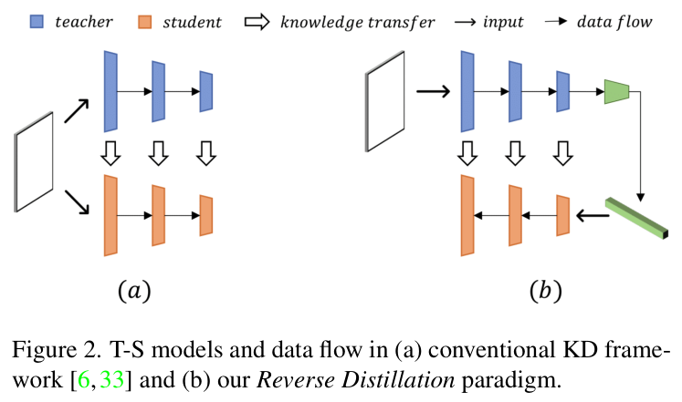

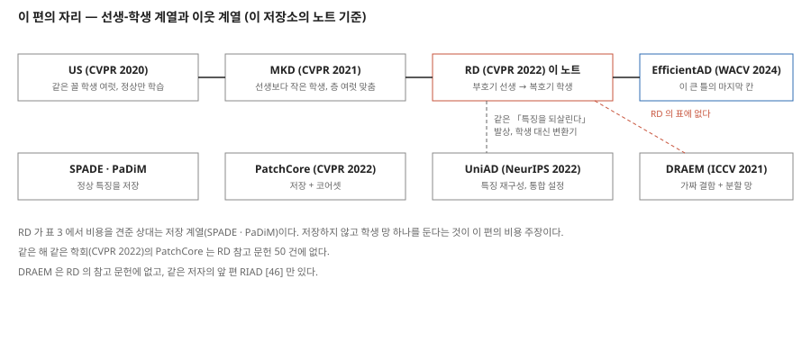

---

## 3. 문제 / 동기

**이 논문이 없앤 전제: 증류로 이상을 잡으려면 학생이 선생과 같은 꼴로 같은 이미지를 받아야 한다.**

원문이 적은 앞선 증류 계열의 문제(1 · 3.1절)는 둘이다.

1. **꼴이 같거나 비슷하다.** 원문은 MKD 의 말을 빌려 「non-distinguishing filters」 라 부른다. 같은 꼴이면 처음 보는 입력에도 학생이 선생과 비슷하게 반응한다는 뜻이다.
2. **같은 데이터가 같은 방향으로 흐른다.** 선생과 학생이 같은 원 이미지를 받는다.

학생을 작게 만드는 앞선 해법(MKD · STPM)은 표현력이 약해져 위치를 정밀하게 못 찾는다고 적는다. **이 진단 자체를 잰 실험은 없다.** 「같은 꼴의 학생에서 결함 차이가 사라진다」 는 원문 문장(3.1절, 「vanishes sometimes」)에 수치가 없고, 같은 백본으로 보통 증류를 돌린 줄도 없다(9 · 13절).

---

## 4. 핵심 기술

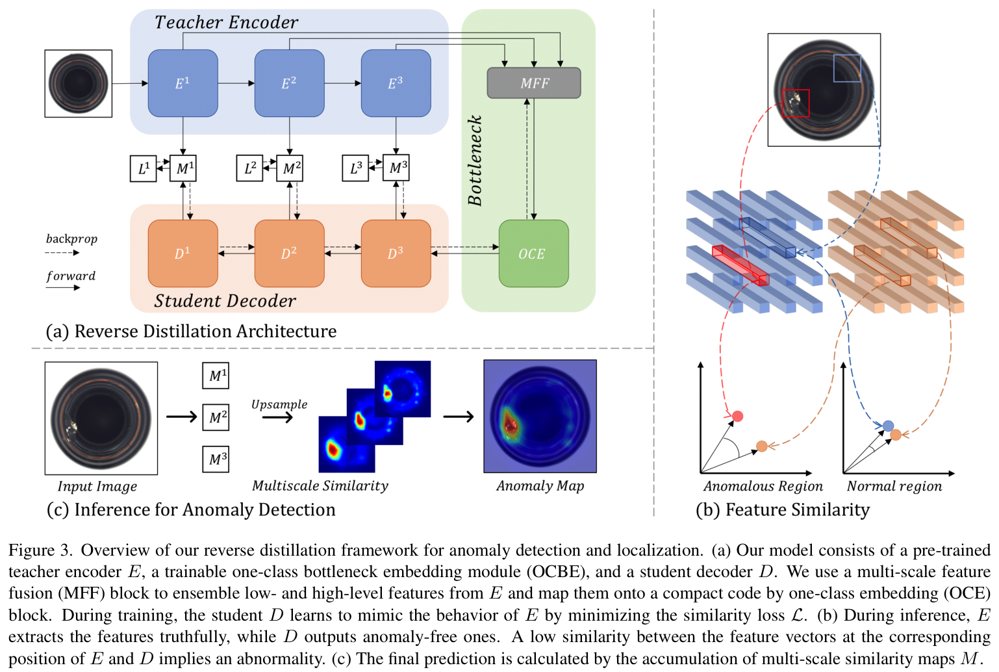

**① 선생과 학생 (3.1절).** 선생 $E$ 는 얼린 WRN-50-2, 학생 $D$ 는 그것을 뒤집은 복호기. $k$ 번째 블록 쌍의 특징은 $f_E^k = E^k(I)$, $f_D^k = D^k(\phi)$ 이고 둘 다 $C_k \times H_k \times W_k$ 다. 원문은 어느 블록을 쓰는지 이름으로 적지 않지만, 그림 3 이 $E^1 \sim E^3$ 셋과 넷째 잔차 블록(OCE)을 그리므로 ResNet 의 1 ~ 3 단계로 읽힌다. 그렇게 읽고 256 x 256 입력을 WRN-50-2 에 넣으면 세 특징은 256 x 64 x 64 · 512 x 32 x 32 · 1024 x 16 x 16 이다(내가 torchvision 으로 잰 모양).

**② 증류 손실 (식 1 · 2).**

$$M^k(h, w) = 1 - \frac{f_E^k(h, w)^\top f_D^k(h, w)}{\lVert f_E^k(h, w) \rVert \, \lVert f_D^k(h, w) \rVert} \qquad (1)$$

$$\mathcal{L}_{KD} = \sum_{k=1}^{K} \left\{ \frac{1}{H_k W_k} \sum_{h=1}^{H_k} \sum_{w=1}^{W_k} M^k(h, w) \right\} \qquad (2)$$

$K$ 는 쓰는 단계 수(표 7 로 보면 3). **단계마다 자리 평균을 낸 뒤 같은 무게로 더한다.** 64 x 64 지도의 한 자리와 16 x 16 지도의 한 자리는 손실에서 16 배 다른 무게를 받는다(내 셈). 코사인을 고른 까닭은 「높은 · 낮은 차원 정보의 관계를 더 정확히 잡는다」 는 인용 [37, 49] 하나다.

**③ 병목 OCBE (3.2절, 그림 4).** 선생의 마지막 블록 출력을 학생에게 바로 주면 두 문제가 있다고 적는다. 높은 차원이라 군더더기가 많고, 의미 층 하나에서 얕은 층의 질감까지 되살리기 어렵다. 그래서 MFF 가 세 단계를 합치고, OCE(넷째 잔차 블록, 학습함)가 줄인다. 부호기-복호기에 흔한 건너뛰기 연결은 **결함 정보를 학생에게 흘리므로 쓰지 않는다**고 적는다.

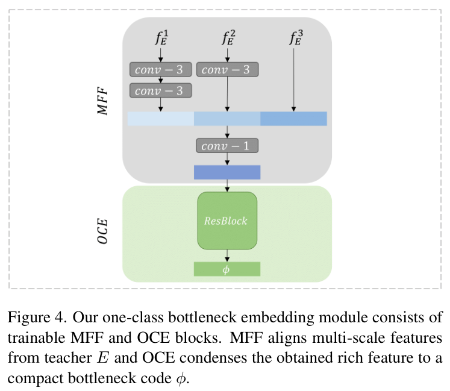

**④ 점수 (3.3절).** 위치는 세 지도를 이미지 크기로 쌍선형 확대해 더한 뒤 가우스 거르개($\sigma = 4$)로 부드럽게 한다.

$$S_{AL} = \sum_{i=1}^{L} \Psi(M^i) \qquad (3)$$

검출 점수는 $S_{AL}$ 의 **최댓값**이다. 작은 결함에서 평균이 불리하기 때문이라 적는다. **새것 탐지(4.2절)에서는 지도의 합을 쓴다.** 왜 바꿨는지는 적혀 있지 않다.

**⑤ 학습 설정 (4.1절).** 부류마다 따로 학습(「one category at a time」). Adam, $\beta = (0.5, 0.999)$, 학습률 0.005, 200 에폭, 묶음 16. 입력은 128 또는 256 으로 줄인다. 증강은 적혀 있지 않다.

**적혀 있지 않은 설정.** 자르기 · 정규화, MFF · OCE 의 채널 수, 학생 복호기의 층 구성(보충 자료로 미룸), 학습 시간과 장비, 반복 수, 에폭을 고른 기준, 새것 탐지의 입력 크기 · 백본, 표 3 의 측정 조건(묶음 크기, 입력 크기, 메모리가 무엇을 셌는지).

---

## 5. 평가 (읽은 범위)

- **데이터:** MVTec AD 15 부류(표 1 · 2 · 3 · 5 · 6 · 7), MNIST · Fashion-MNIST · CIFAR10 · Caltech-256(표 4).
- **지표:** MVTec 은 이미지 AUROC, 픽셀 AUROC, PRO. **픽셀 AP 는 없다.** 새것 탐지는 이미지 AUROC.
- **비교 상대:** 표 1 은 MKD(128) · GT · GANomaly · US · PSVDD · DAAD · MetaFormer · PaDiM · CutPaste, 표 2 는 MKD(128) · US · MF · SPADE · PaDiM · RIAD · CutPaste. **상대 값을 원 논문에서 옮겼는지 저자가 돌렸는지 적혀 있지 않다.** 6 · 7절에서 열마다 대조했다.
- **장비 · 시간:** 표 3 의 「Intel i7 에서 초」 뿐이다. 학습 장비는 없다.
- **반복:** 어느 표에도 반복 수와 흩어짐이 없다.

---

## 6. MVTec 검출 — 표 1

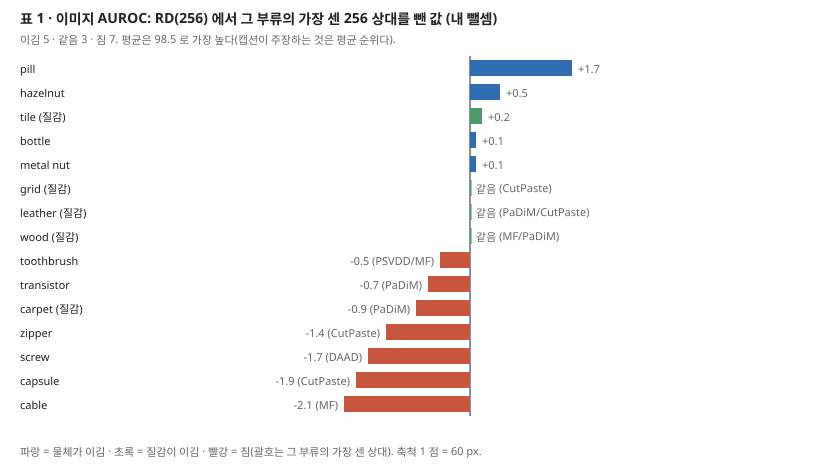

| | GT | GN | US | PSVDD | DAAD | MF | PaDiM | CutPaste | RD |
|---|---:|---:|---:|---:|---:|---:|---:|---:|---:|
| 인쇄 평균 | 67.2 | 76.2 | 87.7 | 92.1 | 89.5 | 95.8 | 95.5 | 96.1 | **98.5** |
| 부류 15 평균 (내 셈) | 67.23 | 76.15 | 87.72 | 92.07 | 89.53 | 95.81 | **95.42** | 96.16 | 98.46 |
| 질감 5 평균 (내 셈) | 58.50 | 77.54 | 91.52 | 94.54 | 90.98 | 95.46 | 98.76 | 97.52 | 99.48 |
| 물체 10 평균 (내 셈) | 71.60 | 75.45 | 85.82 | 90.84 | 88.80 | 95.99 | 93.75 | 95.48 | 97.95 |

128 열은 MKD 87.8 · RD 96.5 이고, 평균은 반올림 폭 안이다.

- **평균은 PaDiM 하나 말고 반올림 폭 ±0.05 안이다.** PaDiM 은 95.42 인데 95.5 로 인쇄되었다. **DRAEM 표 1 과 같은 어긋남이다.** 아래 대조로 까닭이 나온다.
- **「SOTA 를 2.5% 넘는다」 는 인쇄 평균으로 2.4 다.** 98.5 − CutPaste 96.1 = 2.4, 부류 평균으로는 98.46 − 96.16 = 2.30. MF 와는 2.7, PaDiM 과는 3.0 이다. 2.5 가 나오는 열은 없다.
- **부류별로는 이김 5 · 같음 3 · 짐 7 이다(256 열 여덟과 견줌).** 진 일곱은 cable −2.1(MF) · capsule −1.9(CutPaste) · screw −1.7(DAAD) · zipper −1.4(CutPaste) · carpet −0.9(PaDiM) · transistor −0.7(PaDiM) · toothbrush −0.5(PSVDD · MF)다. 캡션이 주장하는 것은 「질감 · 물체 · 전체 평균에서 1 위」 이고, 그것은 맞다.
- **캡션은 「부류마다 위 둘을 굵게」 라 적는다.** 같은 값을 한 자리로 세면 grid 하나가 어긋난다. 위 두 값은 100 과 96.7(PaDiM)인데 96.7 은 굵지 않다. leather · wood · toothbrush 는 둘째 값을 굵게 했다.

**상대 열을 다른 표와 맞대 봤다(내 대조).**

| RD 표 1 의 열 | 맞댄 곳 | 같은 칸 |
|---|---|---:|
| PSVDD | PatchSVDD 원 논문 부류별 값(PatchCore 노트 표 S1 로 옮긴 값) | 15 / 15 |
| **PaDiM** | **DRAEM 표 1 의 PaDiM 열** | **15 / 15** |
| **US** | **DRAEM 표 1 의 US 열** | **15 / 15** |
| GN | DRAEM 표 1 의 GANomaly 열 | 0 / 15 |

- **PaDiM 원 논문은 이미지 AUROC 를 부류별로 내지 않았고(평균 95.3 하나), US 원 논문은 MVTec 이미지 AUROC 를 내지 않았다**(DRAEM 노트 6절에서 확인한 것). DRAEM 은 그림 7 캡션에서 이 둘을 「our implementation」 이라 적었다. 곧 **이 편의 두 열은 DRAEM 저자가 돌린 값과 같고, 이 편은 DRAEM 을 참고 문헌 50 건 어디에도 두지 않았다.** 같은 저자의 앞 편 RIAD [46] 는 있다. 이 편이 값을 DRAEM 에서 옮겼는지, 다른 경로로 같은 값에 이르렀는지는 이 편으로 가를 수 없다. 30 칸이 소수 첫째 자리까지 모두 같다는 것만 확인된다.
- **표 3 의 PaDiM 이미지 값 95.5 도 같은 출처다.** PaDiM 원 논문의 WRN-50-2 값은 95.3 이다.
- **GN 열은 DRAEM 의 GANomaly 열과 한 칸도 같지 않다.** 평균도 76.2 대 78.2 다. 출처가 적혀 있지 않다. CutPaste · MF · DAAD · GT · MKD 열은 원 논문을 갖고 있지 않아 대조하지 않았다.

---

## 7. MVTec 위치 — 표 2

| | US | MF | SPADE | PaDiM | RIAD | CutPaste | RD |
|---|---:|---:|---:|---:|---:|---:|---:|
| 픽셀 AUROC (인쇄) | - | - | **96.5** | 97.5 | 94.2 | 96.0 | **97.8** |
| 픽셀 AUROC 부류 15 평균 (내 셈) | | | **96.03** | 97.50 | 94.15 | 95.97 | 97.81 |
| PRO (인쇄) | 91.4 | 90.1 | 91.7 | 92.1 | - | - | **93.9** |
| PRO 부류 15 평균 (내 셈) | 91.40 | 90.09 | 91.73 | 92.11 | | | 93.93 |

128 열은 MKD 90.7 / - · RD 97.0 / 89.9 다.

- **SPADE 의 픽셀 AUROC 평균만 반올림 폭 밖이다.** 부류 15 값으로 내면 96.03 이고, 질감 92.94 · 물체 97.57 로 같은 표의 소계(92.9 · 97.6)와는 맞는다. **SPADE 원 논문의 인쇄 평균은 96.0 이다**(SPADE 노트). 표 3 도 SPADE 를 「85.5/96.5/91.7」 로 적어 같은 값을 다시 쓴다. 0.47 점 부풀어 있으나 이 편의 순위(RD 97.8 이 1 위)는 바뀌지 않는다.
- PaDiM PRO 의 질감 소계 93.2 는 부류 값으로 93.14 라 반올림 폭을 0.01 넘는다. 전체 평균 92.1 은 맞다.
- **상대 열 여섯은 원 출처와 15 칸이 모두 같다(내 대조).** PaDiM 픽셀 AUROC · PRO(PaDiM 원문), SPADE 픽셀 AUROC · PRO(SPADE 원문), US PRO(Uninformed Students 원문 표 3 의 여러 수용장 열), RIAD 픽셀 AUROC(DRAEM 표 2 의 RIAD 열). 표 1 과 달리 이 표의 PaDiM 은 원 논문 값이다.
- **「두 지표 모두 SOTA 를 넘는다(97.8 · 93.9)」 는 평균으로 맞다.** 픽셀 AUROC 는 PaDiM 97.5 보다 0.3, PRO 는 PaDiM 92.1 보다 1.8 높다.

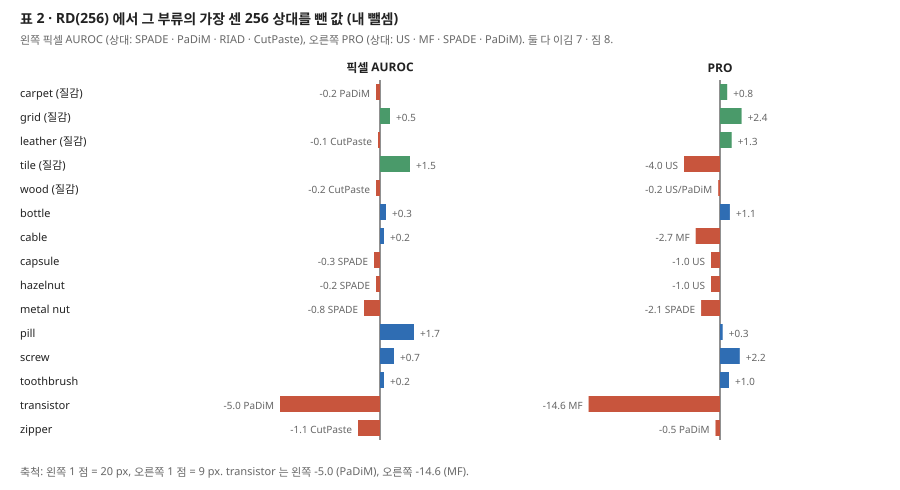

- **부류별로는 픽셀 AUROC · PRO 둘 다 이김 7 · 짐 8 이다(256 열과 견줌).** 픽셀 AUROC 의 짐 여덟 중 일곱은 1.1 점 이내이고, transistor 만 −5.0(PaDiM)이다. PRO 는 transistor −14.6(MF) · tile −4.0(US) · cable −2.7(MF) · metal nut −2.1(SPADE)가 크다. 캡션의 「robust」 는 평균을 두고 한 말로 읽힌다.
- **transistor 는 RD 의 가장 낮은 부류다.** 픽셀 AUROC 92.5 · PRO 78.0 둘 다 15 부류 중 맨 아래다. 원문은 이것을 한계 절에서 다룬다(11절).

---

## 8. 비용 — 표 3

| | 추론 시간 (초, Intel i7) | 메모리 (MB) | AD / AL / PRO |
|---|---:|---:|---|
| SPADE (WRN50) | 1.40 | 1,400 | 85.5 / 96.5 / 91.7 |
| PaDiM (WRN50) | 0.95 | 3,800 | 95.5 / 97.5 / 92.1 |
| RD (WRN50) | 0.31 | 352 | 98.5 / 97.8 / 93.9 |

**메모리 칸을 셈으로 맞춰 봤다(내 계산).**

- **PaDiM 3,800 MB 는 공분산 행렬의 크기와 맞는다.** 56 x 56 자리마다 550 x 550 공분산을 4 바이트로 두면 56 · 56 · 550 · 550 · 4 = 3,794,560,000 바이트 = 3,794.6 MB 다. 자리 수 · 차원 550 은 PaDiM 원 논문의 설정(224 입력, 무작위로 고른 550 차원)이다. 이 편은 무엇을 셌는지 적지 않았으니 「맞는 셈이 하나 있다」 까지다.
- **RD 352 MB 는 선생만으로는 나오지 않는다.** torchvision 의 WRN-50-2 를 세면 1 ~ 3 단계까지 24,862,528 개 = 99.5 MB, 망 전체(넷째 단계 · 분류 층 포함) 68,883,240 개 = 275.5 MB 다(4 바이트). 352 MB 는 망 전체보다 크니 학생과 OCBE 가 함께 들어간 값으로 읽힌다. 학생 구성이 보충 자료에 있어 이 편으로는 맞추지 못한다.
- **SPADE 1,400 MB 는 내 셈과 맞지 않는다.** SPADE 노트의 가정(1 ~ 3 단계를 56 x 56 에 이어 붙인 1,792 차원, 4 바이트, 부류 평균 학습 241.9 장)으로 내면 5.4 GB 다. 어떤 저장 방식을 셌는지 적혀 있지 않다.
- **추론 시간은 CPU 하나의 값이고, 묶음 크기 · 입력 크기 · 반복 수가 없다.** 이상 점수 지도를 만들고 부드럽게 하는 단계를 넣었는지도 적혀 있지 않다.
- **세 줄은 입력 크기가 다를 수 있다.** RD 는 256 이고 PaDiM 원 설정은 224 자르기다. 표 3 은 이 조건을 적지 않는다.

---

## 9. 끈 실험 — 표 5 · 6 · 7

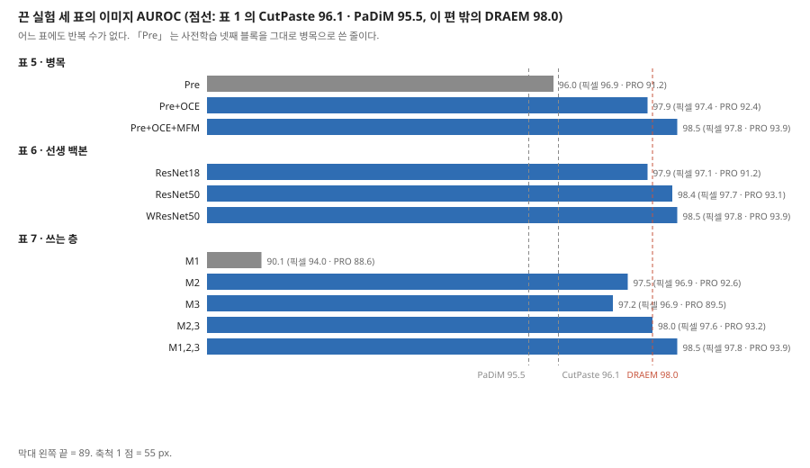

| 표 | 줄 | AD | AL | PRO | 앞 줄과의 차 (내 뺄셈) |
|---|---|---:|---:|---:|---|
| 5 | Pre (사전학습 넷째 블록을 병목으로. 학습 여부는 적혀 있지 않고, 학습하는 OCE 와 대비되어 얼린 것으로 읽힌다) | 96.0 | 96.9 | 91.2 | |
| 5 | Pre + OCE (병목 학습) | 97.9 | 97.4 | 92.4 | +1.9 · +0.5 · +1.2 |
| 5 | Pre + OCE + MFF (여러 단계 합치기) | 98.5 | 97.8 | 93.9 | +0.6 · +0.4 · +1.5 |
| 6 | 선생 ResNet18 | 97.9 | 97.1 | 91.2 | |
| 6 | 선생 ResNet50 | 98.4 | 97.7 | 93.1 | +0.5 · +0.6 · +1.9 |
| 6 | 선생 WRN50 | 98.5 | 97.8 | 93.9 | +0.1 · +0.1 · +0.8 |
| 7 | $M^1$ 만 | 90.1 | 94.0 | 88.6 | |
| 7 | $M^2$ 만 | 97.5 | 96.9 | 92.6 | |
| 7 | $M^3$ 만 | 97.2 | 96.9 | 89.5 | |
| 7 | $M^2 + M^3$ | 98.0 | 97.6 | 93.2 | |
| 7 | $M^1 + M^2 + M^3$ | 98.5 | 97.8 | 93.9 | $M^2 + M^3$ 대비 +0.5 · +0.2 · +0.7 |

**짚을 자리 다섯.**

1. **「거꾸로」 를 뺀 줄이 없다.** 이 편이 내세우는 것은 (가) 선생 부호기 · 학생 복호기의 다른 꼴, (나) 깊은 층부터의 증류 순서, (다) OCBE 셋이다. 표 5 는 (다)만 가른다. (가) · (나)를 빼고 같은 WRN50 · 같은 학습으로 돌린 「보통 증류」 줄이 없어, 표 1 의 이득 가운데 「거꾸로」 의 몫은 이 편에서 나오지 않는다. 같은 계열과의 비교는 MKD(128 열에만 있고, 원문 말로는 선생보다 작은 학생. 백본과 손실은 이 편에 적혀 있지 않다)와 US(꼴이 같은 학생 여럿) 둘이다.
2. **사전학습 블록을 그대로 쓴 「Pre」 가 이미 표 1 의 세 상대를 넘는다.** 96.0 은 PaDiM 95.5 · MF 95.8 보다 높고 CutPaste 96.1 보다 0.1 낮다. 1절의 「reverse distillation 만으로 앞선 방법과 비슷하다」 와 맞는 값이다. CutPaste 위로 올리는 몫(+2.5)은 OCBE 가 낸다.
3. **표 5 는 2 x 2 가 아니다.** MFF 만 넣고 OCE 를 학습하지 않는 줄이 없다. MFF 의 몫 +0.6 은 「OCE 를 학습한 위에서」 의 값이다.
4. **선생을 ResNet18 로 줄여도 97.9 다.** 표 1 의 256 상대 모두(CutPaste 96.1 까지)보다 높다. WRN50 과의 차는 AD 0.6 · AL 0.7 · PRO 2.7 이다. PRO 쪽 차가 가장 크다.
5. **단계 하나만 쓰면 $M^2$ 가 낫다는 원문 말은 AD · PRO 로 맞고, AL 은 $M^3$ 와 같다(96.9).** $M^3$ 만 쓰면 PRO 가 89.5 로 $M^2$ 보다 3.1 낮다. $M^1$ 만 쓰면 AD 90.1 로 표 1 의 PSVDD(92.1)보다 낮다.

**어느 표에도 반복이 없다.** 표 6 의 ResNet50 · WRN50 차(AD 0.1 · AL 0.1)는 순서를 매길 근거가 없다.

---

## 10. 점수 분포 · 새것 탐지 · 예시 — 그림 5 · 표 4 · 그림 6 · 7

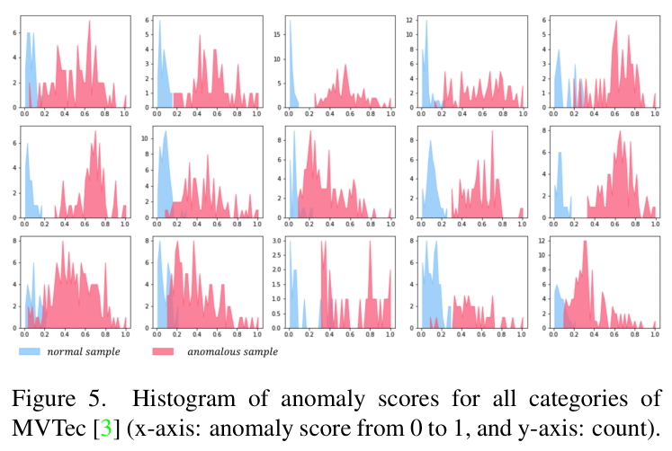

**그림 5 와 「겹치지 않는 분포」.** 4.1절은 「정상(파랑)과 이상(빨강)의 겹치지 않는 분포가 강한 검출 능력을 보인다」 고 적는다. 맞대 보면 두 가지가 어긋난다.

- **그림 자체에서 겹침이 보인다.** 15 칸 중 셋째 줄 왼쪽 두 칸, 첫째 줄 다섯째 칸 등에서 파랑과 빨강이 같은 점수 구간에 함께 있다(눈으로 읽음). 칸마다 부류 이름이 없어 어느 부류인지 모른다.
- **표 1 로도 겹침이 나온다(내 논리).** 한 부류의 이미지 AUROC 가 100 보다 작으면, 그 부류 안에 정상보다 점수가 낮거나 같은 이상 이미지가 적어도 한 쌍 있다. RD 의 256 열에서 100 인 부류는 grid · leather · bottle · metal nut 넷뿐이니 **나머지 11 부류는 점수 범위가 반드시 겹친다.**
- x 축이 「0 에서 1」 인데, 점수를 부류마다 어떻게 0 ~ 1 로 맞췄는지 적혀 있지 않다.

| | MNIST | F-MNIST | CIFAR10 | Caltech-256 |
|---|---:|---:|---:|---:|
| LSA | 97.5 | 92.2 | 64.1 | - |
| OCGAN | 97.3 | 87.8 | 65.7 | - |
| HRN | 97.6 | 92.8 | 71.3 | - |
| DAAD | 99.0 | - | 75.3 | - |
| MKD | 98.7 | 94.5 | 84.5 | - |
| G2D | - | - | - | 95.7 |
| OiG | - | - | - | 98.2 |
| **RD** | **99.3** | **95.0** | **86.5** | **99.9** |

**표 4 (새것 탐지).** 네 열 모두 RD 가 가장 높다. 같은 증류 계열 MKD 와는 0.6 · 0.5 · 2.0 점 차다. 다만 (가) 점수를 최댓값이 아니라 **지도의 합**으로 바꿨고 까닭이 없다, (나) 입력 크기 · 백본 · 실험 규약은 보충 자료로 미뤘다, (다) Caltech-256 의 두 상대는 다른 세 열의 상대와 다르고 규약이 같은지 적혀 있지 않다. 반복 수는 없다.

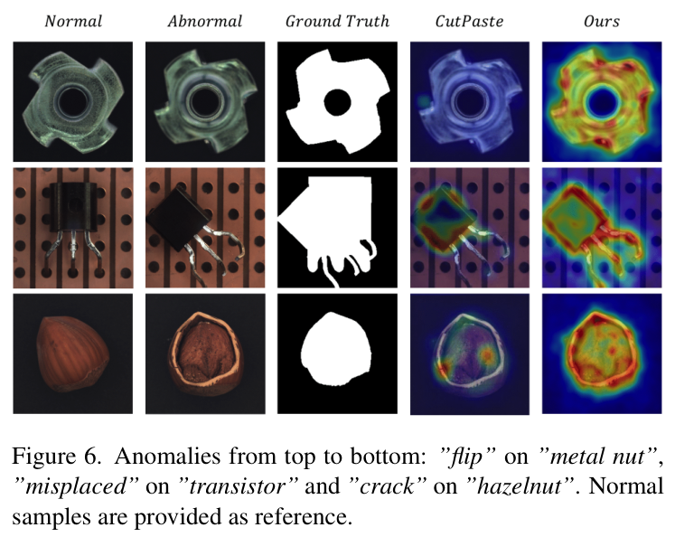

**그림 6 · 7.** 그림 6 은 큰 결함 셋(metal nut 뒤집힘 · transistor 자리 벗어남 · hazelnut 갈라짐)에서 CutPaste 의 지도가 결함 일부에만 반응하고 RD 는 영역 전체에 반응하는 예시다. 2절의 「CutPaste 는 큰 결함과 전역 구조 이상을 못 잡는다」 의 근거가 이 그림 하나다. **CutPaste 의 지도를 누가 어떤 설정으로 만들었는지 적혀 있지 않다.** 그림 7 은 작은 결함 일곱의 예시다.

---

## 11. 이 논문이 스스로 적은 한계

**한계 문단이 하나 있다(4.1절 「Limitations」).**

1. **transistor 의 위치가 약하다.** 원문은 「예측과 정답의 해석 차이」 로 설명한다. 자리를 벗어난 결함에서 RD 는 옮겨 간 자리를 짚는데 정답은 옮겨 간 자리와 원래 자리를 둘 다 덮는다(그림 6 둘째 줄). 더 넓은 수용장의 층이 낫다며 세 값을 든다. 2 · 3 단계를 쓰면 94.5, 3 단계만 쓰면 97.3, 입력을 128 로 줄이면 97.6 이다(지표 이름은 「AUROC」 뿐이나, 표 2 의 128 열 transistor 픽셀 AUROC 가 97.6 이라 픽셀 AUROC 로 읽힌다).
   - **이 세 값은 시험 집합에서 고른 설정이다.** 원문은 이것을 본 표에 쓰지 않았다(256 · 세 단계로 고정). 맞는 처리다.
   - **「검출은 좋은데」 는 순위로 보면 약하다.** transistor 의 이미지 AUROC 96.7 은 RD 15 부류 중 넷째로 낮고(cable 95.0 · capsule 96.3 · pill 96.6 다음) PaDiM 97.4 보다 낮다.

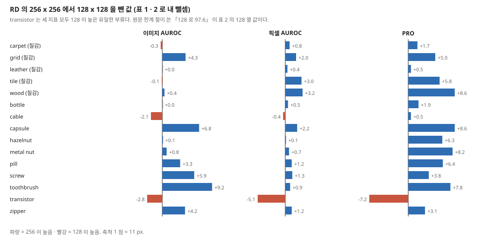

2. **128 열과 256 열을 맞대면 transistor 만 세 지표가 모두 128 에서 높다(내 뺄셈).** 이미지 −2.8 · 픽셀 −5.1 · PRO −7.2(256 − 128). cable 은 이미지 · 픽셀 둘이 128 에서 높고 PRO 는 256 이 0.5 높다. 나머지 13 부류에서 PRO 는 모두 256 이 높다(+0.5 ~ +8.6). 「transistor 는 큰 구조를 봐야 한다」 는 원문 설명과 맞는 방향이다.

---

## 12. 원문 안의 어긋남 모음

| 자리 | 원문 | 맞대 보니 | 내 판단 |
|---|---|---|---|
| 4.1절 | 「exceeds SOTA by 2.5%」 | 98.5 − 96.1 = 2.4 (부류 평균으로 2.30) | 2.5 가 나오는 열이 없다 |
| 4.1절 · 그림 5 | 「non-overlap distribution」 | 그림에서 겹침이 보이고, AUROC 가 100 이 아닌 11 부류는 반드시 겹친다 | 그림 · 표 둘 다와 어긋난다 |
| 표 2 · 표 3 | SPADE 픽셀 AUROC 평균 96.5 | 부류 15 평균 96.03, SPADE 원문 인쇄 96.0 | 반올림 폭 밖 0.47. 표 3 에도 옮겨졌다 |
| 표 1 · 표 3 | PaDiM 이미지 AUROC 평균 95.5 | 부류 15 평균 95.42, PaDiM 원문 95.3 | DRAEM 표 1 의 어긋남이 그대로 있다 |
| 표 1 | PaDiM · US 부류별 열 | DRAEM 표 1 과 30 칸이 모두 같다 | 출처를 적지 않았고 DRAEM 을 인용하지 않았다 |
| 표 2 | PaDiM PRO 질감 소계 93.2 | 부류 값으로 93.14 | 반올림 폭 밖 0.01 |
| 표 1 캡션 | 「top two ... in bold」 | grid 의 둘째 값 96.7(PaDiM)만 굵지 않다 | 굵게 하는 규칙이 부류마다 다르다 |
| 표 2 | CutPaste 전체 평균 「96.0-」 | 다른 칸은 「값/-」 꼴 | 빗금 빠짐 |
| 초록 | 학생이 「teacher model's one-class embedding」 을 받는다 | 3.2절은 OCBE 를 학생과 함께 학습한다 | 선생의 것이 아니라 학습하는 병목의 출력이다 |
| 3.1절 | 학생이 이상에서 다르게 반응할 것이라는 기대에 [11, 26] | [11] MemAE · [26] 기억 안내 정상성, 서지로 보면 기억을 단 오토인코더 논문 | 증류 논문 인용 자리에 재구성 논문이 있다. 서지로만 본 판단이다 |
| 4.1절 | 「SPADE (WResNet50) [7, 29]」 | [29] 는 PANDA | SPADE 의 출처는 [7] 하나다 |
| 4.3절 | 「Tab. 6 displays qualitative comparisons」 | 표 6 캡션 「Quantitative comparison」 | 낱말 오기 |
| 식 (2) 대 식 (3) | 합의 첨자 $k = 1 \ldots K$ | 식 (3) 은 $i = 1 \ldots L$ | 같은 단계 수의 두 이름 |
| 3.3절 | 점수 지도 $S_{I^q}$ | 바로 뒤 식은 $S_{AL}$ | 표기 어긋남 |
| 3.1 · 5절 대 표 5 | MFF | 표 5 · 4.3절은 「MFM」 | 같은 블록의 두 이름 |
| 3.1절 | 「OCEB module」 | 다른 곳은 OCBE (아홉 번) | 오기 |
| 표 5 ~ 7 | 「RPO」 | 4.1절 · 표 2 는 PRO | 오기 |
| 본문 넷 | 「reserve distillation」 | 다른 곳은 reverse distillation | 오기 |
| 그림 1 캡션 | 「Fig. Fig. 2(a)」 | | 중복 |
| 표 3 캡션 | 「inference time (second on Intel i7)」 | 묶음 · 입력 크기 · 장 단위 여부가 없다 | 셈을 다시 할 조건이 없다 |

---

## 13. 논문이 적지 않은 것 — 내가 읽으며 짚은 자리

1. **「거꾸로」 의 몫을 재는 줄이 없다.** 9절 1. 같은 백본 · 같은 손실로 학생을 같은 꼴 부호기로 둔 줄 하나면 가를 수 있었다. **안 한 것이지 못 한 것이 아니다.**
2. **「같은 꼴이면 결함 차이가 사라진다」 는 진단에 수치가 없다.** 3절.
3. **DRAEM 이 표에 없다.** DRAEM(ICCV 2021, arXiv 2021-08)은 같은 학회 판인 DAAD · MF(둘 다 ICCV 2021)와 같은 시기에 나왔다. 이 편 표 1 의 두 열이 DRAEM 표와 같다(6절). 14절에서 두 편의 표를 맞대 봤다.
4. **흩어짐이 없다.** 표 6 의 0.1 차, 표 4 의 0.3 ~ 0.6 차는 순서를 매길 근거가 없다.
5. **보충 자료로 미룬 것이 재현에 필요한 부분이다.** 학생 복호기의 층 구성. 코드에는 있을 수 있으나 이 노트는 보지 않았다.
6. **검출 점수(최댓값)와 새것 탐지 점수(합)가 다르다.** 이유가 없다. 표면 결함은 작고, 새것은 이미지 전체라는 차이로 읽을 수 있지만 내 해석이다.
7. **코사인 거리는 특징의 크기를 보지 않는다(1절 용어의 예시).** 학생이 방향은 맞고 크기만 틀리면 정상으로 센다. 결함이 특징의 크기만 바꾸는 경우가 있는지는 이 편이 다루지 않는다. 재지 않은 내 물음이다.

---

## 14. 앞 노트와 맞춰 보기

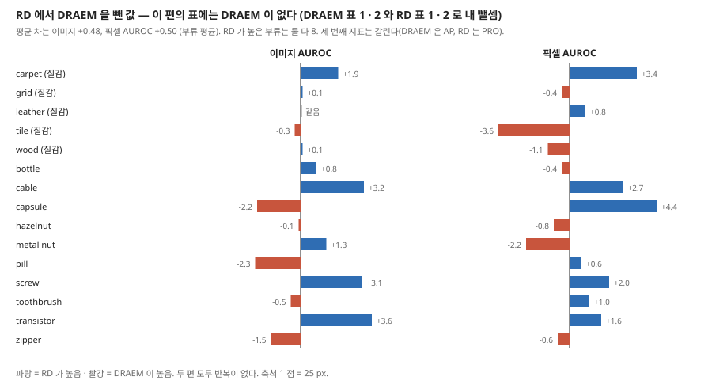

**DRAEM 노트.** 두 편의 표를 맞대면(내 뺄셈, 둘 다 부류별 학습 · 반복 없음):

- **이미지 AUROC** 평균 RD 98.46 대 DRAEM 97.98(+0.48). RD 가 높은 부류 8 · 같음 1 · 낮음 6. RD 는 transistor +3.6 · cable +3.2 · screw +3.1 에서, DRAEM 은 pill −2.3 · capsule −2.2 · zipper −1.5 에서 높다.
- **픽셀 AUROC** 평균 97.81 대 97.31(+0.50). RD 가 높은 부류 8 · 낮음 7. RD 는 capsule +4.4 · carpet +3.4 에서, DRAEM 은 tile −3.6 · metal nut −2.2 에서 높다.
- **세 번째 지표는 갈린다.** DRAEM 은 픽셀 AP 를 내고 PRO 를 안 냈고, RD 는 PRO 를 내고 AP 를 안 냈다. **DRAEM 노트 16절의 물음 「DRAEM 의 PRO 는 얼마인가」 는 이 편으로 풀리지 않는다.** RD 는 DRAEM 을 표에 넣지 않았다.
- **DRAEM 노트 13절의 가설(±45 도 회전 증강이 transistor 를 깎았다)과 맞대면.** RD 는 증강을 적지 않았는데 transistor 가 역시 가장 낮은 부류다(픽셀 92.5, DRAEM 90.9). 같은 표의 PaDiM 은 97.5 다. 곧 transistor 가 약한 것은 회전 증강 없이도 나온다. 회전 가설을 버릴 근거는 아니지만, **transistor 의 약점을 회전 하나로 설명하는 것은 이 값과 맞지 않는다.** RD 원문은 정답 마스크가 원래 자리까지 덮는 것과 수용장을 원인으로 든다(11절).

**UniAD 노트.** 「2절에 들지만 표에 없다, 증류 계열이 통합 설정에서 어떤지」 를 물었다. **이 편은 부류마다 따로 학습하고 통합 설정 실험이 없어 답하지 못한다.** 두 편은 구조가 닮았다. 둘 다 얼린 사전학습 특징을 「되살리고」 그 차이를 점수로 쓴다. UniAD 는 변환기로 같은 층의 특징을 되살리고, RD 는 병목을 거친 복호기로 세 단계를 되살린다. 둘 다 「결함까지 되살려 버리는」 지름길을 막는 장치(UniAD 의 이웃 가림 주의 · 층별 질의 · 특징 흔들기, RD 의 좁은 병목 · 건너뛰기 연결 없음)를 둔다.

**PatchCore · SPADE · PaDiM 노트.** RD 의 비용 주장(표 3)은 저장 계열과 견준 것이다. 표 2 의 SPADE · PaDiM 값은 원 논문 값 그대로다(PaDiM 원 값은 PatchCore 노트 표 S2 · S3 의 PaDiM 행과 같은 값). 같은 해 CVPR 의 PatchCore(이미지 99.1 · 픽셀 98.1 · PRO 93.4, PatchCore 노트)는 RD 참고 문헌에 없다. 두 편의 값을 놓으면 이미지 · 픽셀 AUROC 는 PatchCore 가, PRO 는 RD 가 0.5 높다. 서로 다른 논문의 한 번 실행 값이다.

**Wide ResNet · ResNet 노트.** 선생 WRN-50-2 의 1 ~ 3 단계는 24,862,528 개로 망 전체(68,883,240)의 36.1% 다(내 셈). PatchCore 가 2 · 3 단계를 쓰는 것과 견주면, RD 는 1 단계까지 쓰고 그 몫이 AD +0.5 · PRO +0.7 이다(표 7).

**[Uninformed Students 노트](https://github.com/chlee1027/beyond-mvtec/blob/main/papers/notes/CVPR20_Uninformed_Students_Student_Teacher_Anomaly_Detection_with_Discriminative_Latent_Embeddings.md)(`beyond-mvtec` 저장소).** 표 2 의 US PRO 열은 원 논문의 여러 수용장 묶음 값과 15 칸이 같다. 같은 증류 계열인데 US 는 이미지 · 픽셀 AUROC 를 내지 않아 표 1 의 US 열은 다른 사람이 돌린 값이다(6절).

---

## 15. 내가 가져갈 것

**하나. 「이름이 된 장치」 를 뺀 줄이 있는지 본다.** 이 편의 제목은 「거꾸로」 인데, 표가 가르는 것은 병목이다. 끈 실험 표를 볼 때 줄 이름이 아니라 「제목의 주장을 뺀 줄이 있는가」 부터 센다. DRAEM 에서는 「함께 배운다」 가, 이 편에서는 「거꾸로」 가 빠져 있었다.

**둘. 상대 열의 출처를 칸 단위로 맞대 본다.** 이 편은 원 논문 값(표 2)과 다른 논문 저자가 돌린 값(표 1)을 섞어 쓴다. 표 1 의 PaDiM 은 95.5, 표 2 의 PaDiM 은 원 논문 값이라, 같은 상대도 표마다 출처가 다르다. 부류별 값이 있으면 15 칸을 다 맞대는 것이 값싸고 확실하다.

**셋. 평균 다시 내기는 매번 한다.** 이 편에서도 두 칸(SPADE 96.5, PaDiM 95.5)이 걸렸다. 둘 다 순위를 바꾸지는 않지만, 다른 편으로 옮겨질 때 출처를 추적하는 손잡이가 된다.

**넷. 입력 크기는 부류마다 다르게 작용한다.** 128 → 256 에서 14 부류의 PRO 가 오르고 transistor 만 −7.2 다. `beyond-mvtec` 에서 설정 순위를 볼 때 입력 크기를 부류별로 함께 찍어 두면 이런 갈림을 놓치지 않는다.

**다섯. 지금 확인된 것은 여기까지다.** 논문이 잰 것은 MVTec 의 세 지표(한 번씩), 병목 · 백본 · 단계의 끈 실험, 새것 탐지 네 데이터셋, CPU 시간 · 메모리 한 번이다. 논문이 말만 한 것은 같은 꼴 학생의 실패, 「거꾸로」 의 이득, 그림 5 의 겹치지 않음, CutPaste 의 큰 결함 실패다. 내가 책상에서 센 것은 평균 · 이김과 짐 · 상대 열 대조 · DRAEM 과의 차 · 128 대 256 · 메모리 셈 · WRN 파라미터 수이고, 원인은 분해하지 않았다.

---

## 16. 남는 질문

- **같은 WRN50 으로 보통 증류(같은 꼴 학생, 같은 이미지)를 돌리면 몇인가?** 「거꾸로」 의 몫이 그 차다. 이 큰 틀의 EfficientAD 가 같은 꼴의 학생을 다시 쓰므로, 그 편의 끈 실험에서 비슷한 줄이 나오는지 본다.
- **DRAEM 의 PRO 는 얼마인가?** 이 편으로 풀리지 않았다. SimpleNet · EfficientAD 의 표에서 찾는다.
- **표 1 의 PaDiM · US 열이 DRAEM 과 같은 까닭은?** 코드 저장소나 arXiv 판에 출처가 적혀 있는지 보면 갈린다. arXiv 판은 받지 않았다.
- **보충 자료의 학생 구성으로 352 MB 가 맞춰지는가?** 보충 자료를 받지 않았다.
- **코사인 거리가 크기만 바뀐 결함을 놓치는가?** 13절 7.
- **반복 seed 의 흩어짐은?** 표 6 의 0.1 차를 가르려면 필요하다.

---

## 17. 다음에 읽을 것

**이 큰 틀(DRAEM → Reverse Distillation → SimpleNet → EfficientAD)의 다음 칸은 SimpleNet(CVPR 2023)이다.** 아래는 이 노트 안에서 나온 후속 편이다.

| 논문 | 이 노트의 어느 자리에서 나오는가 | 무엇을 확인하고 싶은가 | 원문 참고 문헌 |
|---|---|---|---|
| **MKD** — Multiresolution knowledge distillation for anomaly detection (Salehi 외, CVPR 2021) | 3 · 9 · 10절 | 「non-distinguishing filters」 의 원 출처, 128 입력의 까닭 | [33] |
| **STPM** — Student-teacher feature pyramid matching for anomaly detection (Wang 외, 2021) | 3절 | 같은 꼴 선생 · 학생의 여러 단계 맞춤. 「거꾸로」 를 뺀 줄의 가장 가까운 대역 | [39] |
| **CutPaste** (Li 외, CVPR 2021) | 6 · 7 · 10절 | 표 1 · 2 의 둘째 자리, 그림 6 의 지도를 누가 만들었나 | [23] |
| **MetaFormer** (Wu 외, ICCV 2021) | 6 · 7절 | transistor PRO 92.6 의 조건 | [40] |
| **DAAD** — Divide-and-assemble (Hou 외, ICCV 2021) | 6절 | screw 98.7 의 조건 | [16] |
| **Similarity-preserving KD** (Tung · Mori, ICCV 2019) | 4절 ② | 코사인을 고른 근거 | [37] |

---

## 18. 참고 문헌

- [3] Bergmann, P. 외 (2019). MVTec AD. CVPR. — `beyond-mvtec` 저장소에서 2026-11-03 에 읽었다.
- [4] Bergmann, P. 외 (2020). Uninformed students. CVPR. — `beyond-mvtec` 저장소에서 2026-11-03 에 읽었다.
- [7] Cohen, N., Hoshen, Y. (2020). Sub-image anomaly detection with deep pyramid correspondences. — SPADE. 2026-11-07 에 읽었다.
- [8] Defard, T. 외 (2021). PaDiM. ICPR. — `beyond-mvtec` 저장소에서 2026-11-03 에 읽었다.
- [14] He, K. 외 (2016). Deep residual learning for image recognition. CVPR. — 2026-09-29 에 읽었다.
- [16] Hou, J. 외 (2021). Divide-and-assemble. ICCV. — **읽지 않았다.**
- [23] Li, C.-L. 외 (2021). CutPaste. CVPR. — **읽지 않았다.**
- [33] Salehi, M. 외 (2021). Multiresolution knowledge distillation for anomaly detection. CVPR. — **읽지 않았다.**
- [37] Tung, F., Mori, G. (2019). Similarity-preserving knowledge distillation. ICCV. — **읽지 않았다.**
- [39] Wang, G. 외 (2021). Student-teacher feature pyramid matching for anomaly detection. — **읽지 않았다.**
- [40] Wu, J.-C. 외 (2021). Learning unsupervised metaformer for anomaly detection. ICCV. — **읽지 않았다.**
- [43] Yi, J., Yoon, S. (2020). Patch SVDD. ACCV. — **읽지 않았다.** 부류별 값은 PatchCore 노트의 표 S1 로 대조했다.
- [44] Zagoruyko, S., Komodakis, N. (2016). Wide residual networks. BMVC. — 2026-10-04 에 읽었다.
- [46] Zavrtanik, V. 외 (2021). Reconstruction by inpainting for visual anomaly detection. Pattern Recognition. — RIAD. **읽지 않았다.**
- 이 편 밖: Zavrtanik, V. 외 (2021). DRAEM. ICCV. — 2026-11-10 에 읽었다. **RD 의 참고 문헌에는 없다.**
- 이 편 밖: Roth, K. 외 (2022). Towards total recall in industrial anomaly detection. CVPR. — PatchCore. 2026-11-03 에 읽었다. **RD 의 참고 문헌에는 없다.**

---

## 19. 경로

| 무엇 | 어디 |
|---|---|
| 원문 PDF (CVF 게재판, 10 쪽) | `papers/CVPR22_RD_Anomaly_Detection_via_Reverse_Distillation_from_One_Class_Embedding.pdf` |
| 이 노트 | `notes/CVPR22_RD_Anomaly_Detection_via_Reverse_Distillation_from_One_Class_Embedding.md` |
| 이 노트의 그림 (직접 그린 것) | `figures/CVPR22_RD/fig01_tab1_margin.svg` 부터 `fig06_lineage.svg` 까지 여섯 |
| 이 노트의 그림 (원문에서 잘라 낸 것) | `figures/CVPR22_RD/paper_fig2_kd_vs_rd.png` · `paper_fig3_overview.png` · `paper_fig4_ocbe.png` · `paper_fig5_histogram.png` · `paper_fig6_large_defects.png` |
| 표 값 상수 | `figures/CVPR22_RD/data_rd.py` — 이 편의 표 1 ~ 7 과, 대조에 쓴 앞 노트의 원 논문 값(DRAEM · PaDiM · SPADE · US · PatchSVDD) |
| 그림과 다시 계산한 값을 만드는 코드 | `figures/CVPR22_RD/make_figures.py` — 표준 라이브러리만 쓰고 바깥 데이터를 읽지 않는다. `python make_figures.py` 로 평균 · 이김과 짐 · 대조 · DRAEM 과의 차 · 128 대 256 · 메모리 셈을 찍고 그림 여섯을 쓴다 |
| 원문 그림을 잘라 내는 코드 | `figures/CVPR22_RD/crop_paper_figures.py` — PyMuPDF 가 필요하다 |
| WRN-50-2 파라미터 수 | 8 · 14절의 24,862,528 · 68,883,240 은 torchvision 0.26 의 `wide_resnet50_2(weights=None)` 를 세어 낸 값이다. 스크립트에 넣지 않았다(PyTorch 가 필요하다) |
