# SimpleNet — SimpleNet: A Simple Network for Image Anomaly Detection and Localization (CVPR 2023, 요약)

> **한 줄.** PatchCore 와 같은 방식으로 얼린 WRN50 의 2 · 3 단계 조각 특징(1,536 차원)을 뽑는다. 거기에 **치우침 없는 FC 한 층(적응기)** 을 씌우고, 적응된 정상 특징에 **가우스 잡음(σ = 0.015)** 을 더해 가짜 이상 특징을 만든다. **2 층 MLP 판별기**가 둘을 가르도록 배운다. 추론에서는 잡음을 빼고 판별기 출력의 음수가 자리마다 이상 점수다. MVTec AD I-AUROC 99.6 · P-AUROC 98.1, 그림 2 에서 77 FPS.

> **이 노트에서 가장 먼저 볼 자리 다섯.** (1) **표 1 의 상대 열 둘에 다른 값이 들어 있다.** AE-SSIM 열의 「I-AUROC」 15 칸은 MVTec AD 원문의 **픽셀** 분할 ROC AUC 와 같고, 「P-AUROC」 열은 **PRO** 다(PaDiM 원문 표 III 의 AE-SSIM 열을 통째로 옮겼고, wood 60.5 를 60.3 으로 적었다). PaDiM 의 I-AUROC 열은 질감 다섯 칸이 RD 표 1 의 PaDiM 열이고, **물체 열 칸과 평균 셋(95.5 · 96.0 · 95.8)은 RD 표 1 의 바로 옆 MetaFormer 열**이다. 순위 1 위는 바뀌지 않는다(7절). (2) **그림 2 의 PaDiM 두 점은 픽셀 AUROC 다.** y 값 97.5 · 96.7 이 PaDiM 원문 표 III 의 픽셀 AUROC 평균과 같고, 표 1 의 PaDiM I-AUROC 95.8 은 그림의 y 축(97.0 부터) 밖이다. 「PatchCore-10%」 점의 99.1 은 PatchCore 원문의 25% 값이다. 「8 배 빠르다」 는 77.42 / 10.50 = 7.37 이다(8절). (3) **그림 5 의 σ 곡선은 표 1 과 같은 값을 내지 않는다.** 기본값 σ = 0.015 에서 그림의 평균 선은 I 99.50 · P 98.06 이고 표 1 은 99.6 · 98.1 이다. 부류 값은 screw I 가 1.68, tile P 가 2.46 낮다. 그림 속 부류 선 15 개를 평균하면 I 는 σ = 0.010, P 는 σ = 0.025 가 가장 높다. 「0.015 가 가장 좋다」 는 그림에 그려진 평균 선으로만 맞다(10절). (4) **모든 설정(단계 · 조각 크기 · σ · 적응기 · 손실)을 MVTec AD 시험 집합의 값으로 골랐고, 어느 표에도 반복이 없다.** 고른 설정과 다음 후보의 차는 I 로 0.0(ResNet50) \~ 0.4 점이다. 적응기를 뺀 줄(99.2)도 PatchCore 99.1 보다 높다(9절). (5) **「1 위」 문장들이 같은 값을 세어 넣었다.** I 「15 부류 중 9」 는 같은 값 6 을 포함한 수이고 혼자 1 위는 3 이다. P 「4」 는 표로 세면 3 이다. P 평균 98.1 은 PatchCore 와 같고, CIFAR-10 86.5 는 RevDist 와 같은데 「outperforms」 라 적는다. 「오류 55.5% 감소」 는 인쇄 평균으로 55.56%, 부류 평균으로 52.59% 다(6 · 12절).

---

## Paper Metadata

| Item | Content |
|---|---|
| Title | SimpleNet: A Simple Network for Image Anomaly Detection and Localization |
| Authors | Zhikang Liu, Yiming Zhou, Yuansheng Xu, Zilei Wang (교신) |
| 소속 | Department of Automation, University of Science and Technology of China(Liu · Wang), Meka Technology Co., Ltd(Zhou · Xu) |
| Conference / Journal | **CVPR 2023** (이 저장소의 파일 이름과 목록이 적어 둔 게재처다. **받은 arXiv v2 본문에는 학회 이름이 찍혀 있지 않다**) |
| Year | 2023. arXiv:2303.15140v2, 2023-03-28 (첫 쪽 여백에서 읽었다) |
| DOI | 파일에 찍혀 있지 않다 |
| 코드 | 초록에 `github.com/DonaldRR/SimpleNet` 이 적혀 있다. 서론 끝은 「Code will be publicly available」 이라 적는다. **이 노트는 코드를 보지 않았다** |
| Stored PDF | 본문 한 파일. 경로는 22절 |
| 왜 읽었는가 | 큰 틀 「산업 이상 탐지 2막」(DRAEM → Reverse Distillation → SimpleNet → EfficientAD)의 셋째 칸. DRAEM(이미지에 가짜 결함)과 같은 「가짜 이상으로 판별기를 배운다」 계열인데 가짜를 **특징 공간**에 만든다. RD 노트가 「DRAEM 의 PRO 를 SimpleNet · EfficientAD 의 표에서 찾는다」 고 남긴 편이다 |
| 읽은 범위 | **2026-11-14 에 arXiv v2 10 쪽을 전부 읽었다.** 곧 Abstract · 1 \~ 5절 · 식 (1) \~ (11) · 알고리즘 1 · 표 1 \~ 5 · 그림 1 \~ 8 과 캡션 · 참고 문헌 31 건의 서지. 그림 2 · 4 · 5 · 6 · 7 은 PDF 의 벡터 경로 좌표로 값을 읽었다(5절). **본문은 보충 자료를 언급하지 않는다.** 참고 문헌의 편들과 코드는 읽지 않았다. 대조에 쓴 원 논문(MVTec AD · Uninformed Students · PaDiM)은 `beyond-mvtec` 저장소에 받아 둔 PDF 에서 해당 표만 다시 열었다 |

### 저장한 파일의 상태

- **arXiv v2 10 쪽이다.** 본문 8 쪽 + 참고 문헌 2 쪽. 쪽 번호와 학회 머리글이 없다.
- **CVF 게재판은 받지 않아 숫자를 대조하지 않았다.**
- 표 1 \~ 5 의 값은 PDF 글자 층에서 옮겼고, 그림에서 읽은 값과 함께 상수로 `figures/CVPR23_SimpleNet/data_simplenet.py` 에 두었다.

---

## 1. 용어

- **조각 특징 (local feature, $o_{h,w}$)**: 백본 단계 $l$ 의 특징 지도에서 자리 $(h, w)$ 둘레 $p \times p$ 이웃을 평균(적응 평균 풀링)한 벡터를, 두 단계 것을 같은 크기로 키워 이어 붙인 것(식 1 \~ 3). PatchCore 의 특징 추출과 같다고 원문이 적는다. 작은 예시(내 셈): 224 x 224 를 WRN50 에 넣으면 2 단계 28 x 28 x 512, 3 단계 14 x 14 x 1024 이고, 3 단계를 28 x 28 로 키워 이으면 **자리 784 개 x 1,536 차원**이다.
- **적응기 (Feature Adaptor, $G_\theta$)**: 조각 특징을 「목표 영역」 으로 옮기는 층. 기본은 **치우침 없는 FC 한 층, 입력 · 출력 1,536**. 파라미터 2,359,296 개(내 셈)로 WRN50 의 줄기 + 1 \~ 3 단계 24,862,528 개의 9.5% 다. 출력이 **적응 특징** $q_{h,w}$ 다.
- **가짜 이상 특징 (anomalous feature, $q^-$)**: 적응 특징에 성분마다 독립인 가우스 잡음을 더한 것, $q^- = q + \epsilon$. 기본 $\sigma = 0.015$. 작은 예시(내 셈): 1,536 차원에서 잡음 벡터 길이의 기댓값은 $\sigma\sqrt{1536} = 0.588$ 이다.
- **판별기 (Discriminator, $D_\psi$)**: 자리마다 정상 정도를 실수 하나로 내는 2 층 MLP. 선형 · 배치 정규화 · Leaky ReLU(기울기 0.2) · 선형. **숨은 층 크기는 적혀 있지 않다.**
- **잘린 L1 손실 (truncated $l_1$ loss)**: 정상 출력은 $th^+ = 0.5$ 위로, 가짜 이상 출력은 $th^- = -0.5$ 아래로 밀고 그 너머는 벌점이 0 인 손실(식 7). 작은 예시(내 셈): $D(q) = 0.7$ 이면 정상 쪽 벌점 0, $D(q) = 0.2$ 면 0.3. $D(q^-) = -0.8$ 이면 이상 쪽 벌점 0, $D(q^-) = 0$ 이면 0.5.
- **I-AUROC · P-AUROC**: 원문의 표기. 이미지 단위 검출 AUROC 와 픽셀 단위 AUROC. **이 편은 PRO 와 픽셀 AP 를 내지 않는다.**
- **새것 탐지 (one-class novelty detection)**: 한 부류만으로 배우고 다른 부류를 「새것」 으로 가르는 일. 이 편은 CIFAR-10 에서 잰다.
- **점**: AUROC 의 차를 「0.4 점」 처럼 적는다. 원문은 「0.4%」 로 적는다.
- **시험 집합**: MVTec AD 의 test 몫. 이 편은 검증 몫을 따로 두었다는 문장이 없다.

---

## 2. 한 문단 요약

원문은 앞선 방법을 셋으로 나눈다(1 · 2절). 재구성 계열은 결함까지 재구성해 버린다. 합성 계열(DRAEM · CutPaste)은 가짜 결함이 실제와 달라 정상 경계가 느슨해진다. 임베딩 계열(PaDiM · PatchCore · CS-Flow)은 ImageNet 특징을 그대로 써 영역 차이가 있고, 공분산 역행렬이나 최근접 검색이 느리다. SimpleNet 의 답은 셋이다. 적응기로 특징을 목표 영역에 맞추고, 가짜 결함을 이미지가 아니라 특징 공간에 잡음으로 만들고, 통계 모형 대신 작은 판별기를 쓴다. 실험은 MVTec AD 검출 · 위치(표 1), 속도(그림 2), 끈 실험(표 2 · 3 · 4, 그림 4 \~ 7), CIFAR-10 새것 탐지(표 5)다.

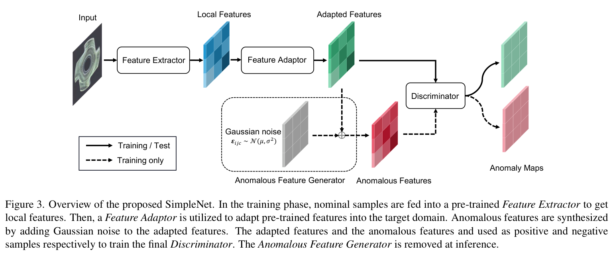

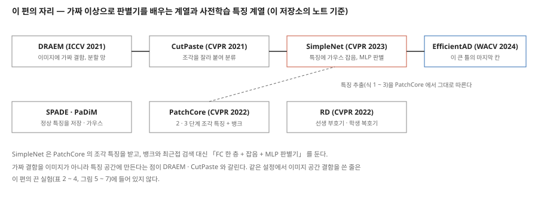

---

## 3. 문제 / 동기

**이 논문이 없앤 전제: 가짜 결함으로 판별기를 배우려면 결함을 이미지 위에 그려야 하고, 사전학습 특징은 그대로 써야 한다.**

원문이 적은 앞선 계열의 문제(1 · 2절)는 넷이다.

1. **재구성 계열은 결함도 재구성한다.** 원문은 [10, 19, 31] 을 들고 수치는 없다.
2. **합성 계열의 가짜 결함은 실제와 닮지 않았다.** 그 특징이 정상에서 멀리 떨어지면 「느슨한 경계」 를 배워, 티가 덜 나는 결함이 정상 쪽에 들어간다고 적는다. **이 진단을 잰 실험은 없다.**
3. **임베딩 계열은 ImageNet 특징을 그대로 쓴다.** 산업 이미지와 분포가 달라 「mismatch」 가 생길 수 있다고 적는다. 적응기의 몫은 표 3 에서 잰다(9절).
4. **통계 모형이 느리거나 메모리를 많이 쓴다.** 공분산 역행렬(PaDiM), 뱅크 최근접 검색(PatchCore), 정규화 흐름(CS-Flow), 선생 · 학생 두 번 통과(증류). 속도는 그림 2 하나로 잰다(8절).

「가짜 결함을 특징 공간에 만드는 것이 이미지 공간보다 낫다」 는 3.3절의 주장(「it outperforms those manipulated methods」)은 표 1 의 DRAEM · CutPaste 와 견준 값뿐이다. 백본 · 판별기 · 학습을 같게 두고 가짜 결함을 만드는 자리만 바꾼 줄은 없다(16절).

---

## 4. 핵심 기술

**① 특징 추출 (3.1절).** 식 (1) 은 자리 $(h, w)$ 의 $p \times p$ 이웃이고, 식 (2) 는 그 안을 적응 평균 풀링으로 묶은 $z^{l,i}_{h,w}$, 식 (3) 은 단계들을 가장 큰 지도 크기 $(H_0, W_0)$ 로 선형 보간해 이어 붙인 것이다. 기본은 WRN50 의 2 · 3 단계, $p = 3$ 이다. 백본은 얼린다(알고리즘 1 의 `F.detach()`).

**② 적응기 (3.2절, 식 5).** $q^i_{h,w} = G_\theta(o^i_{h,w})$. 기본은 치우침 없는 1,536 → 1,536 FC. 원문은 「한 층이 가장 낫다」 를 실험으로 찾았다고 적는다(표 3).

**③ 가짜 이상 특징 (3.3절, 식 6).**

$$q^{i-}_{h,w} = q^{i}_{h,w} + \epsilon, \quad \epsilon \sim \mathcal{N}(0, \sigma^2 I) \qquad (6)$$

3.3절은 $\mathcal{N}(\mu, \sigma^2)$ 로, 4.3절은 $\mathcal{N}(0, \sigma^2)$ 로 적는다. 평균 $\mu$ 를 0 이 아닌 값으로 쓴 실험은 없다.

**④ 판별기와 손실 (3.4 · 3.5절, 식 7 · 8).**

$$l^i_{h,w} = \max\big(0,\, th^+ - D_\psi(q^i_{h,w})\big) + \max\big(0,\, -th^- + D_\psi(q^{i-}_{h,w})\big) \qquad (7)$$

$$\mathcal{L} = \min_{\theta, \psi} \sum_{x^i \in \mathcal{X}_{train}} \sum_{h,w} \frac{l^i_{h,w}}{H_0 W_0} \qquad (8)$$

3.5절은 $th^+ = 0.5$, $th^- = -0.5$ 라 적는다. 4.3절은 「둘 다 0.5」 라 적는다. 식 (7) 에 $th^- = 0.5$ 를 넣으면 이상 쪽 벌점이 $\max(0, D(q^-) - 0.5)$ 가 되어, 이상 출력이 0.5 이하면 벌점이 0 이다. 정상 쪽 문턱(0.5 이상)과 사이가 없어진다. 3.5절의 값이 식과 맞는 쪽이다. 알고리즘 1 의 `th_ = -th = 0.5` 는 파이썬으로는 대입이 되지 않는 줄이고, `th = -0.5` 로 읽으면 정상 쪽 벌점이 `max(0, -0.5 - s)` 가 되어 식 (7) 과 부호가 다르다(15절).

**⑤ 점수 (3.6절, 식 9 \~ 11).** 추론에서 잡음 생성은 버린다. 자리 점수 $s^i_{h,w} = -D_\psi(q^i_{h,w})$, 이를 입력 크기로 보간하고 가우스 거르개($\sigma = 4$)로 부드럽게 한 것이 위치 지도다. 이미지 점수는 지도의 **최댓값**이다. 새것 탐지(4.8절)도 「similarity map 의 최댓값」 이라 적는다. 「similarity map」 은 다른 곳에 나오지 않는 말이다.

**⑥ 학습 설정 (4.1 · 4.3절).** 256 으로 줄이고 224 로 가운데 자르기, 증강 없음. 부류마다 따로 학습. Adam, 학습률 적응기 0.0001 · 판별기 0.0002, 가중치 감쇠 0.00001, **160 에폭 · 묶음 4**. 부류별 학습 이미지 수로 반복을 세면 2,400(toothbrush 60 장) \~ 15,680(hazelnut 391 장), 15 부류 평균 9,717 반복이다(내 셈, 마지막 묶음을 버리지 않는다고 놓았다).

**적혀 있지 않은 설정.** 판별기 숨은 층 크기. **평가한 모형이 어느 에폭의 것인지.** 검증 몫. 시간 측정 조건(묶음 크기 · 정밀도 · 무엇을 시간에 넣었나). 그림 4 의 표준편차를 어느 표본으로 셌는지. CIFAR-10 의 입력 크기 · 백본. 반복 수와 흩어짐.

---

## 5. 평가 (읽은 범위) · 그림을 읽은 방법

- **데이터:** MVTec AD 15 부류(표 1 \~ 4, 그림 2 · 4 \~ 7), CIFAR-10(표 5).
- **지표:** I-AUROC, P-AUROC. **PRO · 픽셀 AP 는 없다.** 그림 8 의 분할 문턱은 「부류마다 모든 점수로 F1 을 계산해」 정했다고 적어, 시험 정답으로 고른 문턱이다.
- **비교 상대:** 표 1 은 AE-SSIM · RIAD · DRAEM · CutPaste · CS-Flow · PaDiM · RevDist · PatchCore. **값을 원 논문에서 옮겼는지 저자가 돌렸는지 적혀 있지 않다.** 7절에서 열마다 대조했다.
- **장비:** 「Nvidia GeForce GTX 3080ti」 와 Intel Xeon E5-2680 v3. 모든 방법을 같은 장비에서 쟀다고 적는다(4.6절).
- **반복:** 어느 표 · 그림에도 반복 수와 흩어짐이 없다. 그림 7 의 옅은 띠는 「손실 흔들림의 범위」 라 적혀 있고, 무엇에 걸친 범위인지는 적혀 있지 않다.

**그림을 읽은 방법.** 그림 2 · 4 · 5 · 6 · 7 은 래스터가 아니라 PDF 벡터 경로다. PyMuPDF 로 경로의 꼭짓점 좌표(pt, 소수 둘째 자리)와 눈금 글자의 좌표를 뽑아 선형으로 환산했다. 눈금 1 칸은 그림 2 에서 FPS 10 = 22.78 pt · I-AUROC 0.5 = 21.40 pt, 그림 5 왼쪽에서 I-AUROC 1 = 21.36 pt 이다. 좌표의 끝자리 0.01 pt 는 AUROC 0.0005 이하라, 읽기 오차는 그림을 그린 프로그램의 반올림이 정한다. 그림 2 의 점은 표식 상자의 가운데를 읽었다(표식 폭 3.4 pt = FPS 1.5 · AUROC 0.08). 그림 4 는 막대 상자 좌표로 읽었고, 패널마다 막대 높이 합이 1,515 \~ 1,535 로 차원 수 1,536 에 1 \~ 21 모자란다. 모자란 까닭은 가리지 않았다.

---

## 6. MVTec 검출 · 위치 — 표 1

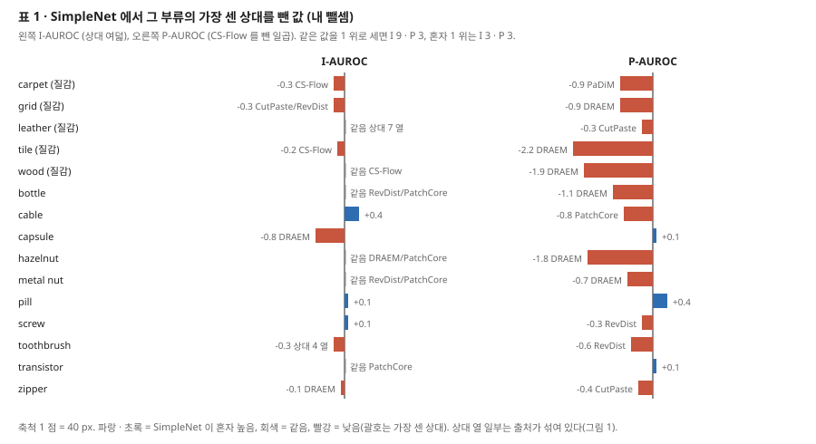

| | AE-SSIM | RIAD | DRAEM | CutPaste | CS-Flow | PaDiM | RevDist | PatchCore | SimpleNet |
|---|---:|---:|---:|---:|---:|---:|---:|---:|---:|
| I 인쇄 평균 | 87 | 91.7 | 98.0 | 96.1 | 98.7 | **95.8** | 98.5 | 99.1 | **99.6** |
| I 부류 15 평균 (내 셈) | 86.87 | 91.65 | 97.98 | **96.16** | 98.72 | **96.91** | 98.46 | 99.10 | 99.57 |
| P 인쇄 평균 | 69.4 | 94.2 | 97.3 | 96.0 | - | 97.5 | 97.8 | 98.1 | **98.1** |
| P 부류 15 평균 (내 셈) | 69.45 | 94.15 | 97.31 | 95.97 | | 97.50 | 97.81 | 98.07 | 98.12 |

- **반올림 폭 ±0.05 밖은 셋이다.** PaDiM I 는 인쇄 평균이 칸들과 맞지 않는다(질감 칸 평균 98.76 인데 95.5, 전체 96.91 인데 95.8). 까닭은 7절. CutPaste I 96.16 → 96.1 은 RD 표 1 의 같은 값을 그대로 옮긴 것이다(RD 노트에서도 걸렸다). **SimpleNet 의 물체 평균 99.5 는 부류 10 값으로 99.44 다.** 물체 1 위(PatchCore 99.17)는 바뀌지 않는다.
- **「15 부류 중 9 에서 가장 높다」(4.4절) 는 같은 값을 넣은 수다.** 혼자 1 위는 cable +0.4 · pill +0.1 · screw +0.1 셋이고, 같은 값이 여섯(leather · wood · bottle · hazelnut · metal nut · transistor), 낮은 칸이 여섯(capsule −0.8 DRAEM · carpet −0.3 CS-Flow · grid −0.3 · toothbrush −0.3 · tile −0.2 CS-Flow · zipper −0.1 DRAEM)이다.
- **「15 부류 중 4 에서 가장 높다」(4.5절, P-AUROC) 는 표로 세면 3 이다.** capsule +0.1 · pill +0.4 · transistor +0.1. 나머지 12 부류는 낮고, 큰 차는 tile −2.2 · wood −1.9 · hazelnut −1.8 로 셋 다 DRAEM 이 높다.
- **「질감 99.8 · 물체 99.5 로 새 SOTA」 의 질감은 CS-Flow 99.8 과 같은 값이다.** P-AUROC 의 전체 98.1 · 물체 98.4 도 PatchCore 와 같은 값이다. 4.5절은 이것을 「best ... 98.1% P-AUROC」 · 「new SOTA of 98.4%」 라 적는다.
- **「오류 0.9% → 0.4%, 55.5% 감소」 는 (0.9 − 0.4) / 0.9 = 55.56% 다.** 부류 15 평균으로는 PatchCore 오류 0.900 · SimpleNet 0.427 로 52.59% 다. 반올림 폭 0.05 는 오류 0.4 의 12.5% 이고, 부류 평균으로 내면 감소율이 2.97 점 작다.
- **PatchCore 와 부류별로 맞대면(내 뺄셈) I 는 높음 8 · 같음 5 · 낮음 2, P 는 높음 7 · 낮음 8 이다.** P 평균 차는 0.05 점이다.

---

## 7. 표 1 의 상대 열은 어디서 왔나

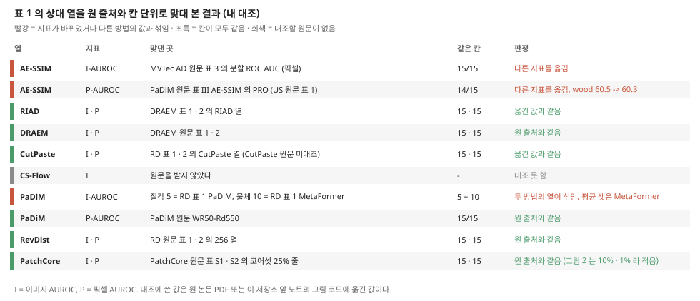

**열마다 15 칸을 원 출처나 앞 노트의 표와 맞댔다(내 대조).**

| 표 1 의 열 | 맞댄 곳 | 같은 칸 |
|---|---|---:|
| **AE-SSIM 「I-AUROC」** | **MVTec AD 원문 표 3 의 AE (SSIM) 분할 ROC AUC (픽셀)** | **15 / 15** |
| **AE-SSIM 「P-AUROC」** | **PaDiM 원문 표 III 의 AE-SSIM 열의 PRO** (= Uninformed Students 원문 표 1 의 SSIM-AE PRO) | **14 / 15** (wood 60.5 를 60.3 으로) |
| RIAD I · P | DRAEM 표 1 · 2 의 RIAD 열 | 15 · 15 |
| DRAEM I · P | DRAEM 원문 표 1 · 2 | 15 · 15 |
| CutPaste I · P | RD 표 1 · 2 의 CutPaste 열 (CutPaste 원문은 받지 않았다) | 15 · 15 |
| CS-Flow I | 원문을 받지 않아 대조하지 않았다 | |
| **PaDiM 「I-AUROC」 질감 5** | **RD 표 1 의 PaDiM 열** (= DRAEM 표 1, DRAEM 저자의 구현) | **5 / 5** (물체는 0 / 10) |
| **PaDiM 「I-AUROC」 물체 10** | **RD 표 1 의 MetaFormer 열** | **10 / 10** |
| PaDiM P | PaDiM 원문 WR50-Rd550 | 15 / 15 |
| RevDist I · P | RD 원문 표 1 · 2 의 256 열 | 15 · 15 |
| PatchCore I · P | PatchCore 원문 표 S1 · S2 의 코어셋 **25%** 줄 | 15 · 15 (10% 줄과는 I 6 / 15, 1% 줄과는 5 / 15) |

- **AE-SSIM 열은 PaDiM 원문 표 III 을 통째로 옮긴 것으로 읽힌다.** 그 표는 위치 찾기 표이고 칸이 「(AUROC%, PRO%)」 튜플이다. 열 머리(「Reconstruction-based / Embedding ...」 묶음)와 질감 · 물체 · 전체 평균 「78/56.7 · 91/75.8 · 87/69.4」 가 같다. SimpleNet 표 1 은 칸을 「I-AUROC%/P-AUROC%」 로 읽게 적어, **픽셀 AUROC 가 이미지 열에, PRO 가 픽셀 열에** 놓였다. AE-SSIM 의 이미지 AUROC 는 MVTec AD 원문이 내지 않았다(원문 표 2 는 정상 이미지와 이상 이미지를 각각 맞게 가른 비율이다).
- **PaDiM I 열은 두 방법의 값이 섞였다.** 질감 다섯은 PaDiM(99.8 · 96.7 · 100 · 98.1 · 99.2), 물체 열은 MetaFormer(99.1 · 97.1 · 87.5 · 99.4 · 96.2 · 90.1 · 97.5 · 100 · 94.4 · 98.6)이고, 평균 셋은 MetaFormer 의 것(95.5 · 96.0 · 95.8)이다. RD 표 1 에서 MF 열이 PaDiM 열 바로 왼쪽에 있다. **PaDiM 원문의 이미지 AUROC 평균은 95.3 이고, RD 표 1 의 PaDiM 평균은 95.5(칸으로 95.42)다.** 이 편 표 1 의 95.8 은 둘 다 아니다.
- **PaDiM 의 부류별 이미지 AUROC 는 PaDiM 원문에 없다**(RD 노트 6절). 그래서 이 열은 처음부터 남의 구현값일 수밖에 없고, 이 편은 그 출처를 적지 않았다.
- **세 어긋남 모두 SimpleNet 의 1 위를 바꾸지 않는다.** AE-SSIM 과 PaDiM 은 평균 순위 아래쪽이다. 다만 PaDiM 은 그림 2 에서 다른 값(픽셀 AUROC)으로 다시 나온다(8절).

---

## 8. 속도 — 그림 2

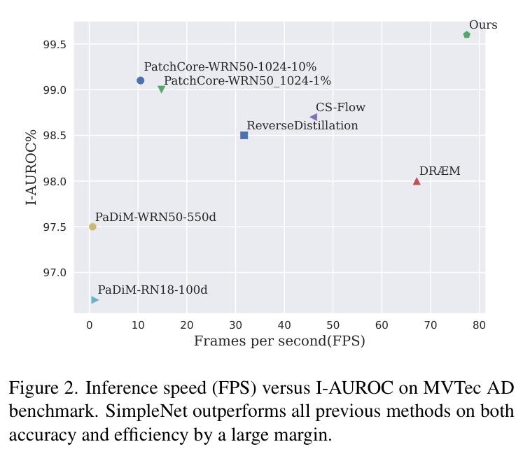

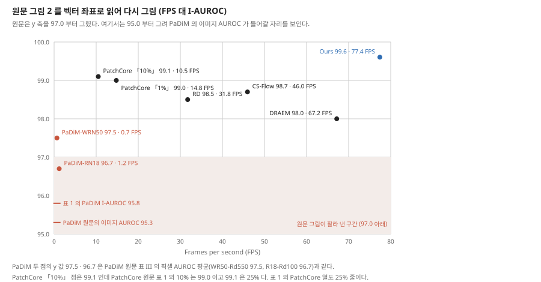

| 그림 2 의 점 (원문 이름) | FPS (내가 읽음) | I-AUROC (내가 읽음) | 대조 |
|---|---:|---:|---|
| Ours | 77.42 | 99.60 | 초록 「77 FPS」 와 맞다 |
| DRÆM | 67.17 | 98.00 | 표 1 과 같다 |
| CS-Flow | 45.96 | 98.70 | 표 1 과 같다 |
| ReverseDistillation | 31.75 | 98.50 | 표 1 과 같다 |
| PatchCore-WRN50_1024-1% | 14.79 | 99.00 | PatchCore 원문 1% 99.0 |
| **PatchCore-WRN50-1024-10%** | 10.50 | **99.10** | **PatchCore 원문 10% 는 99.0, 99.1 은 25%** |
| **PaDiM-WRN50-550d** | 0.67 | **97.50** | **PaDiM 원문 표 III 의 픽셀 AUROC 평균 97.5. 표 1 의 I-AUROC 는 95.8** |
| **PaDiM-RN18-100d** | 1.21 | **96.70** | **PaDiM 원문 표 III 의 R18-Rd100 픽셀 AUROC 평균 96.7** |

- **PaDiM 두 점은 이미지 AUROC 축에 픽셀 AUROC 를 찍었다.** 표 1 의 95.8 이든 PaDiM 원문 95.3 이든, 그림의 y 축 아래 끝(97.0) 밖이다.
- **「PatchCore 보다 8 배 가깝게 빠르다」(4.6절) 는 「10%」 점과 견주면 77.42 / 10.50 = 7.37 배, 「1%」 점과 견주면 5.23 배다.** 표 1 의 PatchCore(25%) 속도 점은 그림에 없다.
- **「정확도 · 효율 둘 다 큰 차이로 앞선다」(그림 2 캡션).** 속도에서 다음 자리 DRAEM 과는 1.15 배, 정확도에서 PatchCore 와는 0.5 점이다.
- **측정 조건이 적혀 있지 않다.** 묶음 크기, 입력 크기, 정밀도, 최근접 검색을 GPU 로 했는지(PatchCore), 지도 보간 · 가우스 거르개를 시간에 넣었는지, 몇 번 재서 무엇을 냈는지. PatchCore 원문의 자기 측정(10% 0.22 초 · 1% 0.17 초, PatchCore 노트)과는 장비가 달라 견주지 않는다. 두 측정 모두 1% 가 10% 보다 빠른 순서는 같다(이 편 1.41 배, PatchCore 원문 1.29 배).
- **장비 이름 「GTX 3080ti」 는 없는 제품명이다.** RTX 3080 Ti 로 읽힌다.

---

## 9. 끈 실험 — 표 2 · 3 · 4, 그림 6

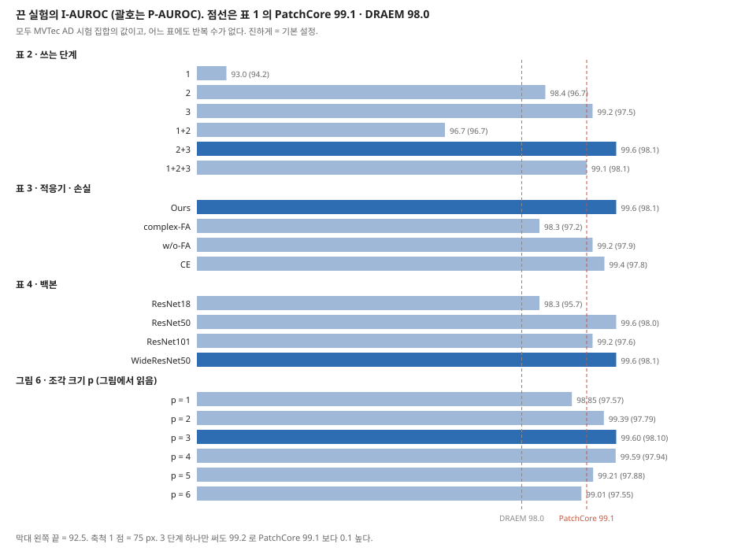

| 표 · 그림 | 줄 | I-AUROC | P-AUROC | 기본 줄과의 차 (내 뺄셈) |
|---|---|---:|---:|---|
| 표 2 | 1 단계 | 93.0 | 94.2 | −6.6 · −3.9 |
| 표 2 | 2 단계 | 98.4 | 96.7 | −1.2 · −1.4 |
| 표 2 | 3 단계 | 99.2 | 97.5 | −0.4 · −0.6 |
| 표 2 | 1 + 2 | 96.7 | 96.7 | −2.9 · −1.4 |
| 표 2 | **2 + 3 (기본)** | **99.6** | **98.1** | |
| 표 2 | 1 + 2 + 3 | 99.1 | 98.1 | −0.5 · 0.0 |
| 표 3 | 적응기 없음 (w/o-FA) | 99.2 | 97.9 | −0.4 · −0.2 |
| 표 3 | 비선형 적응기 (complex-FA) | 98.3 | 97.2 | −1.3 · −0.9 |
| 표 3 | 교차 엔트로피 손실 (CE) | 99.4 | 97.8 | −0.2 · −0.3 |
| 표 4 | ResNet18 | 98.3 | 95.7 | −1.3 · −2.4 |
| 표 4 | ResNet50 | 99.6 | 98.0 | 0.0 · −0.1 |
| 표 4 | ResNet101 | 99.2 | 97.6 | −0.4 · −0.5 |
| 그림 6 | $p$ = 1 · 2 · **3** · 4 · 5 · 6 (내가 읽음) | 98.85 · 99.39 · **99.60** · 99.59 · 99.21 · 99.01 | 97.57 · 97.79 · **98.10** · 97.94 · 97.88 · 97.55 | $p = 4$ 는 I −0.01 · P −0.16 |

**짚을 자리 다섯.**

1. **모두 시험 집합에서 고른 설정이다.** 단계(표 2), 조각 크기(그림 6), σ(그림 5), 적응기(표 3), 손실(표 3)이 모두 MVTec AD 시험 값의 최댓값 줄이고, 그 값이 표 1 에 그대로 쓰였다. 검증 몫을 두었다는 문장이 없다.
2. **적응기를 뺀 줄(99.2 · 97.9)이 이미 PatchCore(99.1 · 98.1)와 I 로 0.1 높고 P 로 0.2 낮다.** 원문이 첫째로 꼽은 「영역 편향을 줄이는 적응기」 의 몫은 I +0.4 · P +0.2 이고, 3 단계만 쓰던 것을 2 + 3 으로 바꾼 몫(I +0.4 · P +0.6)과 같은 크기다. 나머지는 「얼린 특징 + 잡음 + 판별기」 가 낸다.
3. **「가짜 결함을 특징 공간에 만든다」 와 「판별기」 를 따로 빼는 줄은 없다.** 표 3 의 줄은 적응기 꼴과 손실만 바꾼다. 같은 적응 특징에 PatchCore 식 최근접 거리를 쓴 줄, 이미지 공간 가짜 결함을 같은 판별기에 준 줄이 있으면 원문의 둘째 · 셋째 직관을 가를 수 있다.
4. **표 4 의 ResNet50 은 I 가 WRN50 과 같다(99.6).** 원문은 WRN50 을 고른 까닭을 「PaDiM · PatchCore 와 견주려고」 라 적는다. 「결과가 백본에 대체로 안정적」 이라는 문장은 I 98.3 \~ 99.6, P 95.7 \~ 98.1 의 폭과 함께 읽어야 한다. ResNet18 의 P 는 2.4 점 낮다.
5. **반복이 없다.** 고른 설정과 다음 후보의 차가 I 0.0(ResNet50) · 0.01(그림 6, $p$ = 3 대 4) · 0.2(CE) · 0.4(w/o-FA, 3 단계, ResNet101) 다. 10절에서 보듯 같은 기본 설정으로 보이는 두 결과(표 1 과 그림 5 의 σ = 0.015)가 I 평균으로 0.10 갈린다.

---

## 10. 잡음의 크기와 특징 공간 — 그림 5 · 그림 4

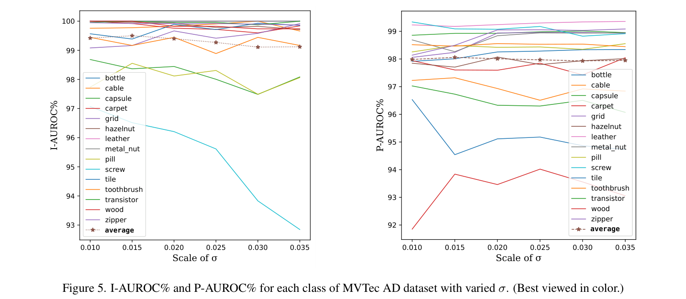

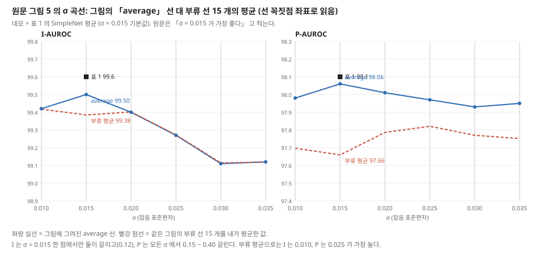

**그림 5 (σ 를 0.010 \~ 0.035 로 바꿈).** 원문은 「σ = 0.015 가 균형을 이뤄 가장 좋다」 고 적는다. 선 16 개(부류 15 + average)의 꼭짓점을 읽어 맞대면(내 셈):

| σ | 0.010 | **0.015** | 0.020 | 0.025 | 0.030 | 0.035 |
|---|---:|---:|---:|---:|---:|---:|
| I · 그림의 average 선 | 99.42 | **99.50** | 99.40 | 99.27 | 99.11 | 99.12 |
| I · 부류 선 15 개 평균 | **99.42** | 99.38 | 99.40 | 99.27 | 99.11 | 99.12 |
| P · 그림의 average 선 | 97.98 | **98.06** | 98.01 | 97.97 | 97.93 | 97.95 |
| P · 부류 선 15 개 평균 | 97.70 | 97.66 | 97.79 | **97.82** | 97.77 | 97.75 |

- **I 는 σ = 0.015 한 점에서만 average 선이 부류 평균보다 0.12 높고, 나머지 다섯 점은 0.005 안에서 같다.** P 는 모든 점에서 0.15 \~ 0.40 높다. 그림의 average 가 그 그림의 부류 선을 평균한 값이 아니다. 무엇의 평균인지 원문에 적혀 있지 않다.
- **「0.015 가 가장 좋다」 는 average 선으로만 맞다.** 부류 선 평균으로는 I 가 0.010, P 가 0.025 에서 가장 높다. 부류마다 보면 σ = 0.015 에서 자기 최댓값에 닿는 부류가 I 6 · P 1(cable)이다. I 의 여섯 가운데 다섯은 0.015 에서 100 인 부류이고(bottle · leather · metal nut 은 여섯 σ 모두 100), 0.015 에서 혼자 가장 높은 부류는 pill 하나다.
- **σ = 0.015 의 그림 값은 표 1 과 같지 않다.** 평균은 I 99.50 대 99.6, P 98.06 대 98.1 이고, 부류 값의 차가 0.1 점 이상인 부류가 I 8 · P 11 이다. 가장 큰 차는 screw I −1.68(96.52 대 98.2), tile P −2.46(94.54 대 97.0)이다. **같은 기본 설정이면 서로 다른 실행이고, 다른 설정이면 무엇이 다른지 적혀 있지 않다.**
- **σ 를 키우면 screw 의 I 가 97.07 → 92.85 로 4.2 점 떨어진다.** 원문의 「큰 σ 는 느슨한 경계 → 놓침」 과 맞는 방향인 부류는 screw · hazelnut · wood 처럼 줄어드는 쪽이고, grid 는 0.035 에서 가장 높다(99.92).

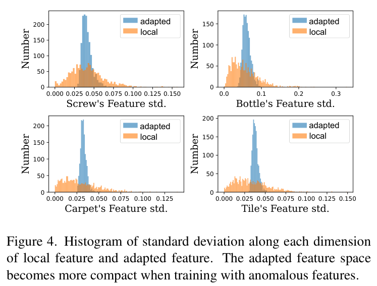

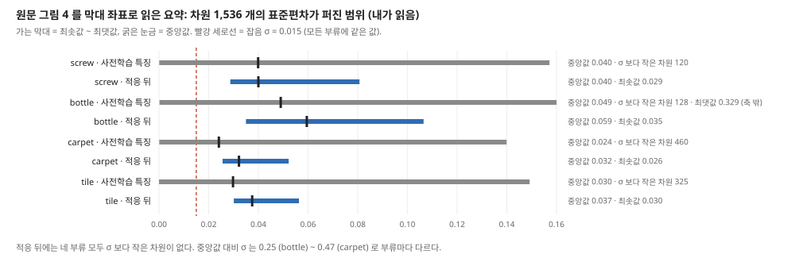

**그림 4 (차원마다의 표준편차 히스토그램, 사전학습 특징 대 적응 특징).** 막대 좌표로 읽어 요약했다(내가 읽음).

| 부류 | 사전학습 특징 중앙값 · 범위 | 적응 특징 중앙값 · 범위 | σ / 적응 중앙값 | 사전학습 특징에서 σ 보다 작은 차원 |
|---|---|---|---:|---:|
| screw | 0.040 · 0.000 \~ 0.157 | 0.040 · 0.029 \~ 0.081 | 0.38 | 120 |
| bottle | 0.049 · 0.000 \~ 0.329 | 0.060 · 0.035 \~ 0.107 | 0.25 | 128 |
| carpet | 0.024 · 0.000 \~ 0.140 | 0.032 · 0.026 \~ 0.052 | 0.47 | 460 |
| tile | 0.030 · 0.000 \~ 0.149 | 0.038 · 0.030 \~ 0.056 | 0.40 | 325 |

- **「compact」 는 차원 사이 표준편차가 고르게 모였다는 뜻으로 읽힌다.** 범위가 좁아졌고(screw 0.157 → 0.052 폭), 중앙값은 네 부류 모두 같거나 커졌다. 3.3절의 「각 차원의 표준편차가 일정해진다」 와 맞고, 「특징 공간이 촘촘해진다」 를 부피가 줄었다는 뜻으로 읽으면 이 그림과 맞지 않는다.
- **캡션의 「가짜 이상 특징으로 학습할 때」 를 가르는 대조가 없다.** 그림은 적응 전 · 후만 비교한다. 적응기는 가짜 이상 없이 배울 길이 이 손실에 없어, 「가짜 이상 때문」 과 「FC 한 층 때문」 이 갈리지 않는다.
- **잡음 σ = 0.015 는 적응 특징의 가장 작은 차원 표준편차(0.026 \~ 0.035)보다 작다.** 한 차원씩 보면 가짜 이상은 정상의 흩어짐 안에 있고, 1,536 차원을 합친 길이(기댓값 0.588)로 갈린다. 중앙값 대비 비는 bottle 0.25 에서 carpet 0.47 까지 1.9 배 다르다. **σ 하나를 모든 부류에 쓰므로 부류마다 가짜 이상이 정상에서 떨어진 정도가 다르다.**
- **적응기가 없으면(표 3 w/o-FA) 차원 120 \~ 460 개에서 잡음이 정상의 흩어짐보다 크다.** 이 줄의 I 가 0.4 낮은 까닭이 여기에 있는지는 이 편이 재지 않았다. 내 해석이다.

---

## 11. 학습 곡선 — 그림 7

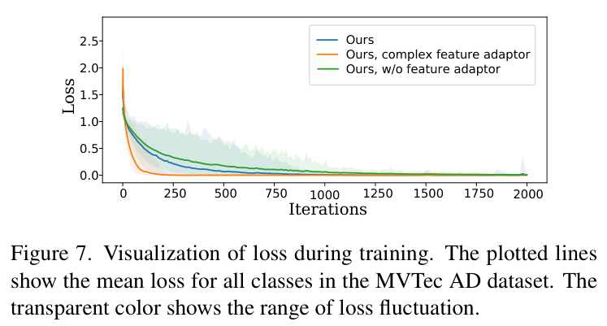

| 손실 평균 선 (내가 읽음) | 1.0 아래 | 0.5 아래 | 0.2 아래 | 0.1 아래 |
|---|---:|---:|---:|---:|
| Ours | 16 반복 | 115 | 269 | 426 |
| 적응기 없음 | 22 | 143 | 425 | 775 |
| 비선형 적응기 | 13 | 43 | 71 | 91 |

- **「적응기가 빨리 수렴하게 돕는다」 는 Ours 와 적응기 없음 사이로 맞다(0.1 아래까지 426 대 775 반복).** 손실이 가장 빨리 0 에 닿는 것은 비선형 적응기이고, 그 줄의 점수가 가장 낮다(98.3). 원문의 「과적합일 수 있다」 는 이 둘을 함께 놓은 추측이다.
- **x 축은 2,000 반복에서 끝난다.** 부류별 학습은 2,400 \~ 15,680 반복(4절 ⑥)이라, 그림은 학습의 12.8% \~ 83.3% 만 보인다. 그 뒤 손실이 어떤지, 평가한 모형이 몇 번째 에폭의 것인지는 적혀 있지 않다.
- 선은 「모든 부류의 평균 손실」 이다. 부류마다 반복 수가 다르니 가장 짧은 toothbrush 도 2,400 반복이라 2,000 반복 안에 학습이 끝나는 부류는 셈으로 없다. 그림의 점은 모두 15 부류의 평균이다.

---

## 12. 새것 탐지 — 표 5

| | LSA | DSVDD | OCGAN | HRN | DAAD | DisAug CLR | IGD | MKD | RevDist | **SimpleNet** |
|---|---:|---:|---:|---:|---:|---:|---:|---:|---:|---:|
| CIFAR-10 I-AUROC | 64.1 | 64.8 | 65.6 | 71.3 | 75.3 | 80.0 | 83.68 | 84.5 | **86.5** | **86.5** |
| RD 표 4 의 같은 칸 | 64.1 | | **65.7** | 71.3 | 75.3 | | | 84.5 | 86.5 | |

- **「이 방법들을 앞선다」(4.8절) 는 RevDist 와 같은 값(86.5)이다.**
- **여섯 상대 가운데 다섯이 RD 표 4 와 같은 값이고 OCGAN 만 0.1 다르다(65.6 대 65.7).** 값을 옮겨 왔다면 「공정한 비교를 위해 모두 ImageNet 으로 사전학습했다」 는 문장의 사전학습 여부는 원 논문들의 설정이고 이 편이 맞춘 것이 아니다. 원 논문들의 설정은 이 노트에서 확인하지 않았다.
- **본문이 상대로 꼽은 VAE [2] · AnoGAN [27] 은 표에 없다.** 본문은 IGD · DisAug CLR 이 자기지도 학습을 더하면 91.25 · 92.4 라 적는다. 두 값 모두 SimpleNet 86.5 보다 높고 표에는 들어 있지 않다.
- 입력 크기(CIFAR-10 은 32 x 32), 백본, 부류별 값, 반복이 적혀 있지 않다.

---

## 13. 실험 분석 — 표 · 그림마다

| 표 · 그림 | 무엇을 바꿨나 | 무엇을 고정했나 | 결과 | 반복 · 흩어짐 | 주장이 결과보다 센가 |
|---|---|---|---|---|---|
| 표 1 | 방법 아홉 | MVTec AD 시험 집합, 부류별 학습 | I 99.6 · P 98.1 (P 는 PatchCore 와 같음) | 없음 | 「9 / 15」 는 같은 값 포함(혼자 3), 「4 / 15」 는 3. 상대 열 둘의 값이 다른 지표 · 다른 방법이다(7절) |
| 그림 2 | 방법 여덟 | 「같은 장비」 | Ours 77.42 FPS · DRAEM 67.17 | 없음, 측정 조건 없음 | 「8 배」 는 7.37. PaDiM 점은 픽셀 AUROC. 「큰 차이」 는 속도 1.15 배 · 정확도 0.5 점 |
| 표 2 | 쓰는 단계 여섯 조합 | WRN50, 나머지 기본 | 2 + 3 이 99.6 · 98.1 | 없음 | 「3 단계만으로 SOTA」 는 99.2 > 99.1 로 맞다. 시험 집합에서 고름 |
| 그림 6 | 조각 크기 1 \~ 6 | 나머지 기본 | $p$ = 3 이 99.60 · 98.10, $p$ = 4 는 99.59 | 없음 | 「분명한 최적」 이라 적기엔 I 차가 0.01 이다 |
| 표 3 | 적응기 꼴, 손실 | 나머지 기본 | 적응기 없음 −0.4, 비선형 −1.3, CE −0.2 | 없음 | 「FC 한 층이 가장 낫다」 는 한 번 실행의 0.4 점 차 |
| 표 4 | 백본 넷 | 나머지 기본 | ResNet50 = WRN50 (I 99.6) | 없음 | 「대체로 안정」 은 P 2.4 점 폭과 함께 |
| 그림 4 | 적응 전 · 후 | 부류 넷 | 표준편차 범위가 좁아지고 중앙값은 같거나 커짐 | 해당 없음 | 「가짜 이상으로 학습할 때 compact」 의 원인을 가르는 대조가 없다 |
| 그림 5 | σ 여섯 값 | 나머지 기본 | average 선은 0.015 에서 최고 | 없음 | 부류 선 평균으로는 I 0.010 · P 0.025. 0.015 의 값이 표 1 과 다르다 |
| 그림 7 | 적응기 셋 | 2,000 반복까지 | 적응기 있음이 없음보다 빨리 내려감 | 띠가 무엇의 범위인지 적혀 있지 않음 | 수렴 순서는 그림과 맞다 |
| 표 5 | 방법 열 | CIFAR-10, 부류 하나씩 | 86.5 | 없음 | 「앞선다」 는 RevDist 와 같은 값. 상대 값은 RD 표 4 와 같은 칸이 다섯 |

---

## 14. 이 논문이 스스로 적은 한계

**한계 절이 없다.** 스스로 약점에 가깝게 적은 문장은 셋이다.

1. **σ 의 양 끝.** 큰 σ 는 느슨한 경계로 놓침이 늘고, 작은 σ 는 학습이 불안정해져 판별기가 정상으로 일반화하지 못한다(4.7절). 둘 다 그림 5 의 곡선으로만 보였고, 「불안정」 을 잰 값(손실 곡선, 실행 사이 흩어짐)은 없다.
2. **비선형 적응기는 과적합할 수 있다**(4.7절, 「One possible reason」). 그림 7 에서 그 줄의 손실이 91 반복 만에 0.1 아래로 내려가는 것과 맞는 방향이다.
3. **합성 계열 일반에 대해** 「결함이 다양하고 예측할 수 없어 모든 이상을 담은 집합을 만드는 것은 불가능하다」 고 적는다(2절). 자기 방법의 가우스 잡음에도 같은 말이 걸리는지는 다루지 않는다.

---

## 15. 원문 안의 어긋남 모음

| 자리 | 원문 | 맞대 보니 | 내 판단 |
|---|---|---|---|
| 표 1 AE-SSIM 열 | 「I-AUROC / P-AUROC」 | MVTec AD 원문의 픽셀 ROC AUC 15 / 15, PRO 14 / 15 | 지표가 바뀌어 들어갔다 |
| 표 1 AE-SSIM wood | 73/60.3 | PaDiM 표 III · US 표 1 은 60.5 | 옮기며 바뀐 칸. metal nut 도 60.3 이다 |
| 표 1 PaDiM I 열 | 99.8 · 96.7 ... 95.8 | 질감 = RD 표 1 PaDiM, 물체 · 평균 = RD 표 1 MetaFormer | 옆 열이 섞였다 |
| 표 1 SimpleNet 물체 평균 | 99.5 | 부류 10 값으로 99.44 | 반올림 폭 밖 0.06 |
| 표 1 CutPaste I 평균 | 96.1 | 부류 15 값으로 96.16 | RD 표 1 의 어긋남을 그대로 옮겼다 |
| 4.4절 | 「highest score for 9 out of 15」 | 혼자 1 위 3, 같은 값 6 | 같은 값을 센 수 |
| 4.5절 | 「highest score for 4 out of 15」 (P) | 표로 세면 3 | 하나 많다 |
| 4.5절 | 「the best anomaly detection performance of 98.1% P-AUROC」 | PatchCore 도 98.1. 지표는 위치 | 같은 값이고, 「detection」 은 「localization」 의 오기 |
| 4.4절 | 텍스처 「new SOTA of 99.8%」 | CS-Flow 99.8 | 같은 값 |
| 초록 · 4.4절 | 「reducing the error by 55.5%」 | 55.56% (부류 평균으로 52.59%) | 버림이고, 부류 평균으로는 3 점 작다 |
| 그림 2 | PaDiM 두 점 97.5 · 96.7 | PaDiM 원문의 픽셀 AUROC | 이미지 축에 픽셀 값 |
| 그림 2 | 「PatchCore-WRN50-1024-10%」 99.1 | PatchCore 원문 10% 는 99.0, 25% 가 99.1 | 이름과 값이 다른 줄 |
| 그림 2 캡션 | 「by a large margin」 | 속도 1.15 배(DRAEM), 정확도 0.5 점(PatchCore) | 셈과 함께 읽을 말 |
| 4.6절 | 「nearly 8× faster than PatchCore」 | 7.37 배 (「10%」 점), 5.23 배 (「1%」 점) | 반올림해 8 |
| 4.6절 · 초록 | 「GTX 3080ti」 | RTX 3080 Ti 로 읽힌다 | 제품명 오기 |
| 그림 5 | average 선 | 같은 그림 부류 선 평균과 I 0.12(σ = 0.015 만) · P 0.15 \~ 0.40 다름 | 무엇의 평균인지 적혀 있지 않다 |
| 그림 5 대 표 1 | 기본값 σ = 0.015 | I 99.50 대 99.6, 부류 차 최대 screw −1.68 · tile P −2.46 | 다른 실행 또는 적히지 않은 설정 차 |
| 4.7절 | 「σ = 0.015 reaches the balance and yield the best performance」 | 부류 선 평균으로는 I 0.010 · P 0.025 | average 선으로만 맞다 |
| 4.8절 | 「Our method outperforms these comparison methods」 | RevDist 와 같은 86.5 | 같은 값 |
| 표 5 | OCGAN 65.6 | RD 표 4 는 65.7 (나머지 다섯은 같음) | 옮기며 바뀐 칸으로 읽힌다 |
| 4.8절 | 상대로 VAE [2] · AnoGAN [27] | 표 5 에 없다 | 본문과 표가 다르다 |
| 3.5절 대 4.3절 | $th^+ = 0.5$, $th^- = -0.5$ / 「both set to 0.5」 | 식 (7) 에 맞는 것은 3.5절 | 4.3절 오기 |
| 알고리즘 1 | `th_ = -th = 0.5` · `max(0, th-s)` | 파이썬으로 대입되지 않는 줄, `th = -0.5` 로 읽으면 식 (7) 과 부호가 다르다 | 의사 코드 오기 |
| 알고리즘 1 | `loss.backward()` 다음 줄에 `F = F.detach()` | 기울기를 막는 줄이 역전파 뒤에 있다 | 순서 오기. 「F 를 얼린다」 는 뜻은 읽힌다 |
| 3.3절 대 4.3절 | $\mathcal{N}(\mu, \sigma^2)$ / $\mathcal{N}(0, \sigma^2)$ | $\mu \neq 0$ 실험은 없다 | 표기 어긋남 |
| 식 (1) | $(h', y')$, $y' \in [w - \lfloor p/2 \rfloor, \ldots]$ | 둘째 좌표는 $w'$ 여야 한다 | 글자 오기 |
| 식 (3) 뒤 | $o^i \in \mathbb{R}^{H_0 \times H_0 \times C}$ | $H_0 \times W_0$ | 글자 오기 |
| 식 (10) · (11) | $(h, w) \in W_0 \times H_0$ | 다른 곳은 $H_0 \times W_0$ | 순서 어긋남 |
| 그림 4 캡션 | 「compact when training with anomalous features」 | 적응 전 · 후만 비교, 중앙값은 같거나 커짐 | 원인을 가르지 않은 문장 |
| 그림 3 캡션 | 「the anomalous features and used as」 | 「are used」 | 낱말 오기 |
| 표 1 | 「Hazelhut」 | Hazelnut | 낱말 오기 |
| 서론 끝 대 초록 | 「Code will be publicly available」 / 코드 주소 | v2 에서 두 문장이 함께 있다 | 판 갱신 때 남은 문장 |

---

## 16. 논문이 적지 않은 것 — 내가 읽으며 짚은 자리

1. **「특징 공간에 가짜 이상」 의 몫을 재는 줄이 없다.** 같은 백본 · 적응기 · 판별기에 이미지 공간 가짜 결함(DRAEM 의 펄린 잡음이나 CutPaste)을 준 줄 하나면 둘째 직관을 가를 수 있었다. **안 한 것이지 못 한 것이 아니다.** DRAEM 노트의 「함께 배운다」, RD 노트의 「거꾸로」 에 이어 세 편째 같은 꼴이다.
2. **「판별기가 통계 모형보다 낫다」 를 재는 줄이 없다.** 같은 적응 특징에 최근접 거리(PatchCore)나 가우스(PaDiM)를 쓴 줄이 없어, 셋째 직관은 그림 2 의 속도로만 뒷받침된다.
3. **설정을 모두 시험 집합에서 골랐다.** 9절 1.
4. **흩어짐이 없다.** 그런데 같은 기본 설정으로 보이는 두 결과(표 1, 그림 5 의 σ = 0.015)가 평균 I 0.10 · P 0.04 갈린다(그림의 average 선 기준). 이 크기가 실행 사이 흩어짐이면 표 2 \~ 4 의 0.1 \~ 0.4 차는 그 안에 들 수 있다.
5. **평가한 모형의 에폭이 적혀 있지 않다.** 160 에폭 중 마지막인지, 다른 기준으로 고른 것인지 이 편으로 알 수 없다. 코드에는 있을 수 있으나 이 노트는 보지 않았다.
6. **PRO 가 없다.** 같은 해 비교 상대 RD · PatchCore 는 PRO 를 내고, 작은 결함을 같은 무게로 세는 지표가 이 편의 표에서 빠졌다.
7. **σ 하나를 모든 부류에 쓴다.** 그림 4 의 네 부류만으로도 적응 특징의 표준편차 중앙값이 1.85 배 다르다(10절).
8. **판별기의 숨은 층 크기, 시간 측정 조건, CIFAR-10 의 입력 크기가 없다.**

---

## 17. 앞 노트와 맞춰 보기

**PatchCore 노트.** SimpleNet 의 특징 추출(2 · 3 단계, $p = 3$, 적응 평균 풀링)은 PatchCore 를 따른다고 적고, 표 2 · 그림 6 이 고른 값도 같다. 다른 점은 PatchCore 가 이어 붙인 특징을 1,024 로 줄이는데(그림 2 의 「1024」) SimpleNet 은 1,536 을 그대로 둔다는 것이다. 성능은 표 1 의 PatchCore(25%)와 견주면 I +0.47 · P +0.05(부류 평균, 내 뺄셈)이고, PRO 는 SimpleNet 이 내지 않아 견줄 수 없다(PatchCore 원문 PRO 93.4 · 93.5).

**Reverse Distillation 노트.** RD 의 열(RevDist)은 원문과 30 칸이 모두 같다. 그런데 표 1 의 PaDiM · CutPaste 열과 표 5 의 다섯 칸이 RD 표와 같아, **이 편은 RD 의 표를 상대 값의 출처로 쓴 것으로 읽힌다.** RD 의 PaDiM 열은 DRAEM 저자의 구현값이었으니(RD 노트 6절), SimpleNet 의 PaDiM 질감 칸은 DRAEM → RD → SimpleNet 으로 두 번 옮겨진 값이고, 옮기는 사이 물체 칸에 MetaFormer 가 섞였다. RD 노트가 남긴 물음 둘은 이 편으로 풀리지 않는다. **DRAEM 의 PRO 는 이 편에 없다**(PRO 를 내지 않는다). **같은 꼴 학생의 보통 증류 줄**도 없다. RD 와 부류별로 맞대면 I 는 SimpleNet 높음 11 · 같음 3 · 낮음 1, P 는 높음 7 · 낮음 8 이다.

**DRAEM 노트.** 같은 「가짜 이상 + 판별」 계열이다. DRAEM 은 이미지에, SimpleNet 은 특징에 가짜를 만든다. 표 1 의 DRAEM 열은 원문과 같다. 부류별로 SimpleNet 이 높은 부류는 I 9 · P 9 이고, P 에서 DRAEM 이 높은 여섯 가운데 tile −2.2 · wood −1.9 · hazelnut −1.8 이 크다. **DRAEM 노트의 transistor 가설(±45 도 회전 증강이 깎았다)과 맞대면,** 증강이 없는 방법 가운데에서도 transistor P 는 갈린다. SimpleNet 97.6 · PaDiM 97.5 · PatchCore 96.3 은 높고, RD 92.5 는 낮다(DRAEM 90.9). 얼린 특징의 거리나 판별로 점수를 내는 쪽이 높고 되살리는 쪽이 낮게 놓인다. 서로 다른 논문의 한 번 실행 값을 늘어놓은 것이라 원인을 가르지 않는다.

**UniAD 노트.** UniAD 는 통합 설정(모든 부류를 망 하나로)을 다뤘다. SimpleNet 은 부류마다 따로 학습하고 통합 설정 실험이 없다.

**Wide ResNet 노트.** 적응기 FC 2,359,296 개는 WRN50 의 1 \~ 3 단계 24,862,528 개의 9.5% 다. 추론에서 통과하는 망은 백본(3 단계까지) + FC + 판별기다.

**[MVTec AD 노트](https://github.com/chlee1027/beyond-mvtec/blob/main/papers/notes/CVPR19_MVTecAD_Comprehensive_Real_World_Dataset_for_Unsupervised_Anomaly_Detection.md) · [PaDiM 노트](https://github.com/chlee1027/beyond-mvtec/blob/main/papers/notes/ICPRW21_PaDiM_Patch_Distribution_Modeling_Framework_for_Anomaly_Detection_and_Localization.md)(`beyond-mvtec` 저장소).** 7절의 AE-SSIM 대조는 두 원문 PDF 의 표(MVTec AD 표 3, PaDiM 표 III)를 다시 열어 한 것이다. `beyond-mvtec` 의 물음(MVTec AD 에서 매긴 설정 순위가 다른 데이터셋에서도 유지되나)에 이 편은 사례 하나를 보탠다. 단계 · 조각 크기 · σ 를 모두 MVTec AD 시험 집합에서 골랐다.

---

## 18. 내가 가져갈 것

**하나. 평균 줄은 칸에서 다시 낸다.** PaDiM 열은 칸 평균이 96.91 인데 인쇄 평균이 95.8 이었고, 그 어긋남을 따라가니 옆 열이 섞인 자리가 나왔다. RD 노트에서 세운 습관이 이 편에서 다시 값을 냈다.

**둘. 상대 열은 지표까지 맞댄다.** AE-SSIM 열은 값이 원 출처와 15 칸 모두 같았는데, **지표가 달랐다.** 「같은 숫자」 만 보면 놓친다. 원 출처의 표 머리에서 그 칸이 무슨 지표인지까지 본다.

**셋. 벡터 그림은 좌표로 읽는다.** 그림 5 의 0.12 차, 그림 2 의 PaDiM 97.5 · PatchCore 99.1 은 눈으로 읽어서는 가르기 어려운 크기다. PDF 경로 좌표로 읽으면 눈금 환산만으로 값이 나온다. 앞으로 그림 눈금 읽기는 벡터인지 먼저 본다.

**넷. 「n 부류에서 1 위」 는 같은 값 처리를 확인한다.** 이 편의 9 는 혼자 1 위로 3 이다. MVTec AD 처럼 100 이 많은 표에서는 같은 값이 수를 크게 바꾼다.

**다섯. 지금 확인된 것은 여기까지다.** 논문이 잰 것은 MVTec AD 의 I · P-AUROC(한 번씩), 단계 · 조각 크기 · σ · 적응기 · 손실 · 백본의 끈 실험(모두 시험 집합), 속도 한 번, CIFAR-10 한 표다. 논문이 말만 한 것은 합성 계열의 느슨한 경계, 특징 공간 가짜의 우위, 판별기의 효율(속도 말고), 「compact」 의 원인이다. 내가 책상에서 센 것은 평균 · 1 위 수 · 상대 열 대조 · 그림 다섯의 좌표 읽기 · 특징 크기 · 파라미터 · 반복 수이고, 원인은 분해하지 않았다.

---

## 19. 남는 질문

- **같은 백본 · 판별기에 이미지 공간 가짜 결함을 주면 몇인가?** 「특징 공간」 의 몫이 그 차다. 이 큰 틀의 마지막 칸 EfficientAD 의 표에 SimpleNet 이 들어 있으면, 그 편이 SimpleNet 을 어떻게 돌렸는지(옮긴 값인지)부터 본다.
- **그림 5 와 표 1 의 차(screw I 1.68)는 실행 사이 흩어짐인가, 설정 차인가?** 이 편으로 가를 수 없다. 코드의 기본 설정과 체크포인트 고르기를 보면 일부가 갈린다.
- **σ 를 부류마다 특징 표준편차에 맞춰 바꾸면 어떤가?** 10절의 1.9 배 차를 줄이는 쪽이다. 재지 않은 내 물음이다.
- **DRAEM 의 PRO 는 얼마인가?** RD · SimpleNet 둘 다 풀지 못했다. EfficientAD 에서 찾는다.
- **SimpleNet 의 PRO 는 얼마인가?** 이 편에 없다. 다른 편이 다시 돌린 값이 있으면 출처와 함께 적는다.
- **반복 seed 의 흩어짐은?** 표 3 의 0.2 차를 가르려면 필요하다.

> 2026-11-16: EfficientAD 를 읽었다(노트 `WACV24_EfficientAD`). 네 가지가 이 절에 닿는다.
> - **「그 편이 SimpleNet 을 어떻게 돌렸나」: 공식 코드로 다시 돌렸다.** 공식 코드는 학습 중 시험 이미지로 거듭 평가해 그 최댓값을 낸다고 그 편이 적는다. 그것을 끈 마지막 모형의 MVTec AD 이미지 AU-ROC 는 98.2 로 이 편 99.6 보다 1.4 낮다. 16절 5(평가한 모형의 에폭)가 그 편의 말로 풀린다. 코드는 보지 않았다. 가운데 자르기를 껐는지는 그 편에 적혀 있지 않다.
> - **「SimpleNet 의 PRO」: 그 편의 설정에서 AU-PRO(FPR 30%)는 MVTec AD 89.6 · VisA 68.9 · LOCO 64.6 이다.** 같은 표의 PatchCore 는 92.7 · 79.7 · 70.4 다. VisA · LOCO 의 이미지 AU-ROC(87.9 · 77.6)는 열 방법 중 9 위다.
> - **「DRAEM 의 PRO」 는 이 큰 틀 안에서 풀리지 않았다.** 그 편 표에 DRAEM 이 없다.
> - **「이미지 공간 가짜 결함과 견준 줄」 은 그 편에도 없다.** 그 편은 가짜 이상 계열이 아니다.
---

## 20. 다음에 읽을 것

**이 큰 틀(DRAEM → Reverse Distillation → SimpleNet → EfficientAD)의 다음 칸이자 마지막 칸은 EfficientAD(WACV 2024)다.** 아래는 이 노트 안에서 나온 후속 편이다.

> 2026-11-16: EfficientAD 를 읽었다(노트 `WACV24_EfficientAD`). 이 큰 틀(DRAEM → Reverse Distillation → SimpleNet → EfficientAD)은 끝났고, 다음 큰 틀은 아직 정하지 않았다.

| 논문 | 이 노트의 어느 자리에서 나오는가 | 무엇을 확인하고 싶은가 | 원문 참고 문헌 |
|---|---|---|---|
| **CS-Flow** — Fully convolutional cross-scale-flows for image-based defect detection (Rudolph 외, WACV 2022) | 6 · 7 · 8절 | 표 1 에서 유일하게 대조 못 한 열, 질감 99.8 의 조건, 픽셀 값을 안 낸 까닭 | [24] |
| **CFLOW-AD** (Gudovskiy 외, WACV 2022) | 3절 | 정규화 흐름이 「메모리를 많이 쓴다」 는 이 편의 진단 | [12] |
| **Explainable deep one-class classification** (Liznerski 외, ICLR 2021) | 3 · 4절 | 3.3절이 「바깥 데이터로 결함을 만든다」 고 묶은 편, 가짜 이상의 다른 원형 | [18] |
| **DisAug CLR** — Learning and evaluating representations for deep one-class classification (Sohn 외, ICLR 2021) | 12절 | 표 5 의 80.0 과 자기지도를 더한 92.4 의 조건 | [28] |
| **IGD** — Deep one-class classification via interpolated gaussian descriptor (Chen 외, AAAI 2022) | 12절 | 83.68 과 91.25 의 조건 | [5] |

---

## 21. 참고 문헌

- [3] Bergmann, P. 외 (2019). MVTec AD. CVPR. — `beyond-mvtec` 저장소에서 2026-11-03 에 읽었다. 7절 대조에 표 3 을 다시 열었다.
- [4] Bergmann, P. 외 (2020). Uninformed students. CVPR. — `beyond-mvtec` 저장소에서 2026-11-03 에 읽었다. 7절 대조에 표 1 을 다시 열었다.
- [5] Chen, Y. 외 (2022). Interpolated gaussian descriptor. AAAI. — **읽지 않았다.**
- [6] Defard, T. 외 (2021). PaDiM. ICPR. — `beyond-mvtec` 저장소에서 2026-11-03 에 읽었다. 7 · 8절 대조에 표 III 을 다시 열었다.
- [7] Deng, H., Li, X. (2022). Reverse distillation. CVPR. — 2026-11-11 에 읽었다.
- [11] Goodfellow, I. 외 (2014). Generative adversarial nets. NIPS. — 2026-10-04 에 읽었다.
- [12] Gudovskiy, D. 외 (2022). CFLOW-AD. WACV. — **읽지 않았다.**
- [17] Li, C.-L. 외 (2021). CutPaste. CVPR. — **읽지 않았다.** 표 1 의 값은 RD 표 1 · 2 와 대조했다.
- [18] Liznerski, P. 외 (2021). Explainable deep one-class classification. ICLR. — **읽지 않았다.**
- [19] Perera, P. 외 (2019). OCGAN. CVPR. — **읽지 않았다.**
- [22] Roth, K. 외 (2022). Towards total recall in industrial anomaly detection. CVPR. — PatchCore. 2026-11-03 에 읽었다.
- [24] Rudolph, M. 외 (2022). CS-Flow. WACV. — **읽지 않았다.**
- [26] Salehi, M. 외 (2021). MKD. CVPR. — **읽지 않았다.**
- [28] Sohn, K. 외 (2021). Learning and evaluating representations for deep one-class classification. ICLR. — **읽지 않았다.**
- [30] Zavrtanik, V. 외 (2021). DRAEM. ICCV. — 2026-11-10 에 읽었다.
- [31] Zavrtanik, V. 외 (2021). Reconstruction by inpainting. Pattern Recognition. — RIAD. **읽지 않았다.** 표 1 의 값은 DRAEM 표 1 · 2 와 대조했다.
- 이 편 밖: Wu, J.-C. 외 (2021). MetaFormer. ICCV. — **읽지 않았다.** 7절의 MetaFormer 값은 RD 표 1 의 열이다. **SimpleNet 의 참고 문헌에는 없다.**

---

## 22. 경로

| 무엇 | 어디 |
|---|---|
| 원문 PDF (arXiv v2, 10 쪽) | `papers/CVPR23_SimpleNet_A_Simple_Network_for_Image_Anomaly_Detection_and_Localization.pdf` |
| 이 노트 | `notes/CVPR23_SimpleNet_A_Simple_Network_for_Image_Anomaly_Detection_and_Localization.md` |
| 이 노트의 그림 (직접 그린 것) | `figures/CVPR23_SimpleNet/fig01_value_sources.svg` 부터 `fig07_lineage.svg` 까지 일곱 |
| 이 노트의 그림 (원문에서 잘라 낸 것) | `figures/CVPR23_SimpleNet/paper_fig2_fps.png` · `paper_fig3_overview.png` · `paper_fig4_feature_std.png` · `paper_fig5_sigma.png` · `paper_fig6_patch_size.png` · `paper_fig7_loss.png` |
| 표 값 · 그림에서 읽은 값 상수 | `figures/CVPR23_SimpleNet/data_simplenet.py` — 이 편의 표 1 \~ 5, 그림 2 · 4 · 5 · 6 · 7 에서 읽은 값, 대조에 쓴 원 논문 값(MVTec AD · US · PaDiM · RD · DRAEM · PatchCore) |
| 그림과 다시 계산한 값을 만드는 코드 | `figures/CVPR23_SimpleNet/make_figures.py` — 표준 라이브러리만 쓰고 바깥 데이터를 읽지 않는다. `python make_figures.py` 로 평균 · 1 위 수 · 상대 열 대조 · 오류 감소율 · 속도 배수 · 그림 5 의 평균 대조 · 그림 4 의 잡음 비 · 특징 크기 · 반복 수 · 표 5 대조를 찍고 그림 일곱을 쓴다 |
| 원문 그림을 잘라 내는 코드 | `figures/CVPR23_SimpleNet/crop_paper_figures.py` — PyMuPDF 가 필요하다 |
| 그림 좌표를 읽은 방법 | 5절. PyMuPDF 의 `get_drawings()` 로 경로 꼭짓점과 막대 상자를, `get_text("dict")` 로 눈금 글자 위치를 뽑아 선형 환산했다. 이 읽기 코드는 저장소에 넣지 않았고 읽은 값만 상수 파일에 두었다 |
| 대조에 다시 연 원문 표 | MVTec AD 표 3 · Uninformed Students 표 1 · PaDiM 표 III — `beyond-mvtec` 저장소 `papers/pdf/` 의 PDF |
