# WinCLIP — Zero-/Few-Shot Anomaly Classification and Segmentation (CVPR 2023, 요약)

> **한 줄.** 얼린 CLIP 으로 학습 없이 결함을 가린다. 「정상 · 결함」 을 적은 문장 242 개(상태 낱말 11 x 문장 틀 22)를 글 부호기에 넣고, 쪽마다 평균해 **원형 둘**을 만든다. 이미지 임베딩과 두 원형의 두 부류 소프트맥스가 이미지 점수다(4.1절). 분할은 이미지를 **창(2x2 · 3x3 조각)으로 가린 채 CLIP 이미지 부호기에 다시 넣어** 창마다 클래스 토큰을 얻고, 창 점수를 화소마다 **조화 평균**으로 모은다(4.2절). 정상 이미지가 1 \~ 4 장 있으면(WinCLIP+) 그 조각 특징을 기억해 두고 최근접 코사인 거리를 더한다(4.3절). MVTec AD 0 장 분류 AUROC 91.8 · 분할 pAUROC 85.1, 1 장 93.1 · 95.2 다. **배우는 파라미터가 없다.**

> **이 노트에서 가장 먼저 볼 자리 다섯.** (1) **보충 자료 표 10(MVTec AD 부류별 분류 AUROC)의 PatchCore 4 장 열 15 행이 2 장 열과 (평균, 표준편차)까지 모두 같다.** 그 열의 평균은 86.31 인데 Mean 행에는 88.8 이 적혀 있다. 열을 잘못 옮긴 것으로 읽힌다(15절). (2) **「1 장에서 PatchCore 보다 9.7% 높다」 의 70.7% 가 세 부류(Screw +42.0 · Grid +35.9 · Metal nut +25.3)에서 나온다.** 세 부류는 PatchCore 1 장이 44.4 · 63.6 · 73.4 인 곳이고, 나머지 열둘의 평균 차는 +3.56 이다. 같은 문장의 「VisA 에서 5.3%」 는 표 1 · 4 의 어느 지표 차와도 맞지 않는다(1 장 AUROC 차는 3.9)(8 · 9절). (3) **CLIP 노트가 걱정한 「질감에 약하다」 가 여기서는 반대로 나온다.** 0 장 분류 AUROC 는 질감 다섯이 평균 99.64(셋이 100.0), 물체 열이 87.90 이다. 분할은 Tile 77.6 처럼 질감도 낮은 부류가 있다(9절). (4) **Patch-token 의 pAUROC 22.4 는 우연(50)보다 27.6 낮다.** 원문은 「언어와 정렬되지 않았다」 로 읽지만, 이 값은 점수 순위가 거꾸로 서 있다는 뜻이다. 부호를 뒤집으면 77.6 이다. One-class 설계의 AUROC 34.2 도 같은 꼴이다(6 · 7절). (5) **언어가 분할에 무엇을 보태는지 가르는 줄이 없다.** 5.2절은 「언어 프롬프트가 보탠 값」 이라 적지만, 그 근거는 백본 · 기억 방식이 다른 PatchCore 와의 비교다. 정상 참조 쪽 지도와 언어 쪽 지도를 화소에서 합치는 식도 본문 · 보충 자료에 없다(10 · 16절).

---

## Paper Metadata

| Item | Content |
|---|---|
| Title | WinCLIP: Zero-/Few-Shot Anomaly Classification and Segmentation |
| Authors | Jongheon Jeong\*†, Yang Zou\*, Taewan Kim, Dongqing Zhang, Avinash Ravichandran, Onkar Dabeer (\* 공동 기여, † Amazon 인턴 중 작업) |
| 소속 | AWS AI Labs (다섯), KAIST (Jeong) |
| Conference / Journal | **CVPR 2023**, 19606 \~ 19616 쪽 (CVF 공개판 쪽 아래에 찍혀 있다) |
| Year | 2023 |
| DOI | 파일에 찍혀 있지 않다 |
| 원 출처 | [CVF 공개판](https://openaccess.thecvf.com/content/CVPR2023/html/Jeong_WinCLIP_Zero-Few-Shot_Anomaly_Classification_and_Segmentation_CVPR_2023_paper.html) (본문 · 보충 자료) · [arXiv 2303.14814](https://arxiv.org/abs/2303.14814) (v1 하나, 본문 + 부록 21 쪽). 2026-11-17 에 두 주소가 열리고 저자 · 제목이 맞는 것을 확인했다 |
| 코드 | 본문 · 보충 자료에 저자 코드 주소가 없다. 적힌 주소는 OpenCLIP 과 PatchCore 공식 구현 둘이다 |
| Stored PDF | 본문 · 보충 자료 두 파일. 경로는 22절 |
| 왜 읽었는가 | 큰 틀 「CLIP 계열 제로샷 이상 탐지(CLIP → WinCLIP → AnomalyCLIP)」 의 둘째 칸. CLIP 노트가 남긴 물음 셋(조각 단위 유사도를 어떻게 얻나, 정상 · 결함을 어떤 글로 적나, 질감 차이에 둔한 특징으로 질감 부류를 가르나)을 이 편이 처음 다룬다 |
| 읽은 범위 | **2026-11-17 에 읽었다.** 본문 1 \~ 8 쪽 전부(1 \~ 6절, 표 1 \~ 8, 그림 1 \~ 5 와 캡션), 참고 문헌 목록(9 \~ 11 쪽)은 인용 번호를 맞출 때만 봤다. 보충 자료 A(실험 설정, 그림 6), B(CLIP 백본 PatchCore · 백본별, 표 8 · 9), C(그림 7 \~ 11 캡션과 실패 사례 글), D(부류별 표 10 \~ 21 — 값은 스크립트로 읽었다, 5절). **미독: 보충 자료 그림 7 \~ 11 의 이미지 자체(캡션과 글만 읽었다), 그림 1 · 5 의 개별 사례.** 읽지 않은 것의 내용은 이 노트에 옮기지 않는다 |

### 저장한 파일의 상태

- **본문은 CVF 공개판(11 쪽)이다.** 첫 쪽에 「워터마크를 빼면 채택판과 같다, 최종판은 IEEE Xplore」 라고 찍혀 있다. 2026-11-17 전에 받아 두었다.
- **보충 자료는 CVF 판(11 쪽)을 2026-11-17 에 받았다.** 앞서 INDEX 에 「CVF 주소에서 받지 못했다」 고 적었는데, 같은 날 CVF 논문 쪽의 보충 자료 링크로 받혔다.
- **arXiv v1(21 쪽, 2023-03-26)은 받아 대조만 하고 저장하지 않았다.** 본문 1 \~ 11 쪽의 소수점 숫자 498 개가 CVF 본문과 차례대로 모두 같다(arXiv 번호와 참고 문헌 하나의 쪽수 「87.1 \~ 87.12」 만 arXiv 에 더 있다). 부록 12 \~ 21 쪽의 숫자는 CVF 보충 자료와 모두 같고, 글자가 다른 자리는 인용 번호 · 각주 번호 · 쪽 번호뿐이다.
- 본문 · 보충 자료의 값은 `figures/CVPR23_WinCLIP/data_winclip.py`, 부류별 표 12 개는 `appendix_classwise.json` 에 두었다.

---

## 1. 용어

- **분류 · 분할 (AC · AS, anomaly classification · segmentation)**: 이미지 하나에 결함 여부를 답하는 것이 분류, 화소마다 답하는 것이 분할이다. 둘 다 [0, 1] 점수를 내고 문턱으로 자른다(3절).
- **0 장 · K 장 (zero-shot · K-normal-shot)**: 0 장은 그 부류의 이미지를 한 장도 쓰지 않는다. K 장은 그 부류의 **정상** 이미지 K 장(1 · 2 · 4, 끈 실험에서 8)을 쓴다. 결함 이미지와 분할 정답은 쓰지 않는다. 원문은 few-shot 과 few-normal-shot 을 같은 뜻으로 쓴다고 각주에 적는다.
- **상태 낱말 (state word)**: 「flawless [o]」 · 「damaged [o]」 처럼 물체의 상태를 적는 말. [o] 는 데이터셋이 주는 물체 이름(bottle 등)이다. 정상 쪽 일곱, 결함 쪽 넷이다(보충 자료 그림 6).
- **문장 틀 (template)**: 「a photo of a [c].」 처럼 상태 낱말 [c] 를 넣는 문장. 22 개다. 작은 예시: 「a photo of a [c] for visual inspection.」 에 「flawless bottle」 을 넣으면 「a photo of a flawless bottle for visual inspection.」 이다.
- **원형 (class prototype)**: 한 쪽(정상 또는 결함) 문장 전부의 글 임베딩 평균. 정상 원형은 7 x 22 = 154 문장, 결함 원형은 4 x 22 = 88 문장의 평균이다(내 셈).
- **조합 프롬프트 묶음 (CPE, compositional prompt ensemble)**: 상태 낱말 x 문장 틀의 모든 조합을 만들어 원형 둘을 내는 이 편의 장치(4.1절).
- **창 (window)**: 조각 격자에서 $k \times k$ 조각만 남기고 나머지를 가리는 이진 마스크 $\mathbf{w}_{ij}$. 작은 창은 2 x 2 조각(32 x 32 화소), 중간 창은 3 x 3 조각(48 x 48 화소)이다. 작은 예시(내 셈): 입력 240 화소에서 조각 격자가 15 x 15 이고, 보폭 1 이면 작은 창 196 개 · 중간 창 169 개다.
- **창 임베딩 (window embedding)**: 창으로 가린 이미지를 CLIP 이미지 부호기에 넣어 얻은 클래스 토큰. 원문 기호 $\mathbf{F}^{\mathtt{W}}_{ij}$.
- **조각 토큰 (patch token, penultimate feature)**: ViT 마지막 층에서 클래스 토큰이 아닌 조각 자리의 출력. 원문 기호 $\mathbf{F}^{\mathtt{P}}$. CLIP 학습에서 글과 직접 맞추지 않은 특징이다.
- **기준 연결 (reference association)**: 정상 이미지의 특징을 기억 $\mathbf{R}$ 에 두고, 시험 특징마다 가장 가까운 기억과의 코사인 거리 $\tfrac{1}{2}(1 - \cos)$ 를 점수로 쓰는 것(식 4). SPADE · PatchCore 의 최근접 거리와 같은 꼴이다.
- **pAUROC · PRO · F1-max**: 화소 단위 ROC 곡선 넓이, 결함 영역별 겹침(Per-Region Overlap), 가장 좋은 문턱에서의 F1. 보충 자료 A 는 정상 화소가 압도적으로 많아 AUROC 가 부풀려 보인다고 적고 F1-max 를 함께 낸다.
- **점**: 지표의 차를 「3.9 점」 처럼 적는다. 원문은 「3.9%」 로 적는다.

---

## 2. 한 문단 요약

원문의 물음은 이것이다(1절). 산업 결함 검사는 장면마다 모형을 따로 배우고, 정상 이미지가 수백 \~ 수천 장 있어야 높은 점수가 나온다. 이 편은 그 전제를 둘 다 줄인다. 0 장에서는 CLIP 의 이미지-글 유사도만으로, 1 \~ 4 장에서는 거기에 정상 이미지 몇 장의 기억을 더해 판정한다. 가설은 「언어가 0 장 · 적은 장 이상 탐지에서 오히려 더 중요하다」 이다. 정상 · 결함은 맥락에 따라 바뀌는 상태이고(찢어진 청바지의 구멍), 받아들일 만한 흠과 결함을 글이 가를 수 있다는 것이 근거다. 실험은 MVTec AD · VisA 두 벤치마크에서 0 · 1 · 2 · 4 장의 분류 · 분할(표 1 · 4), 많은 장 방법과의 비교(표 2), 끈 실험(표 3 · 5 · 6 · 7 · 8)이다. 보충 자료는 프롬프트 목록 · 전처리 · CLIP 백본 PatchCore · 백본별 0 장 · 실패 사례 · 부류별 표를 싣는다.

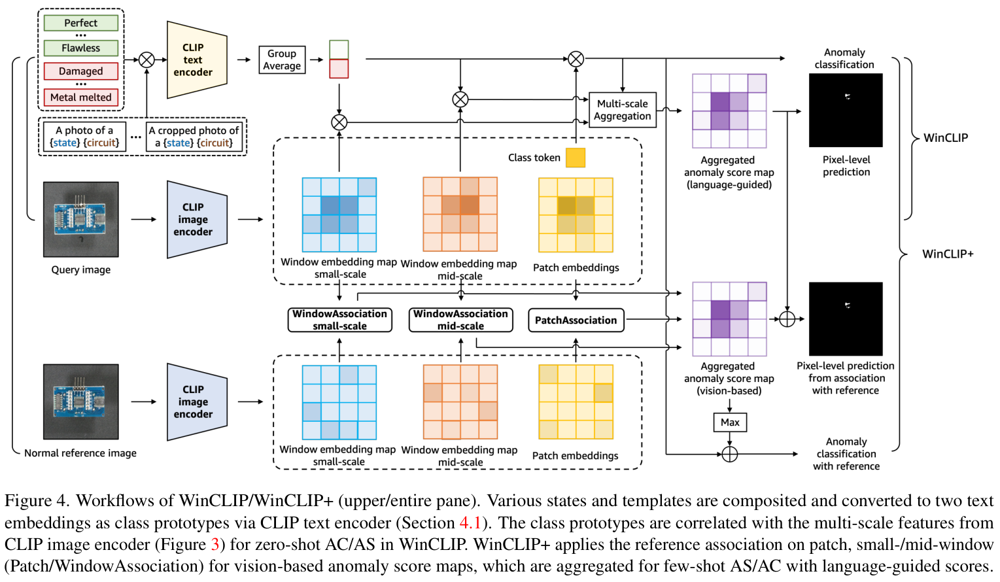

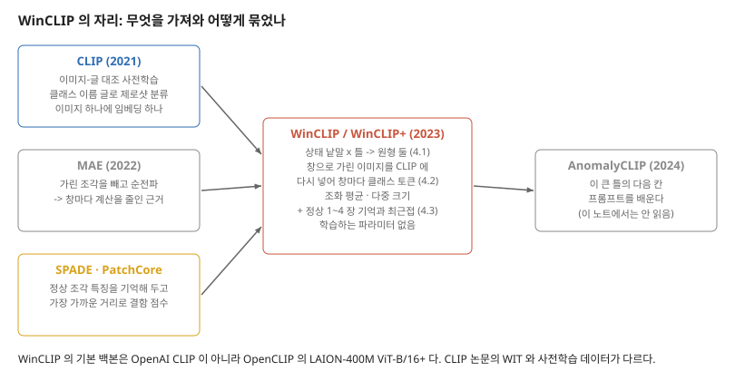

---

## 3. 문제 / 동기

**이 논문이 없앤 전제: 결함 탐지 모형은 장면마다 정상 이미지 수백 장 이상으로 따로 배운다.**

원문이 적은 문제는 셋이다.

1. **결함은 드물고 모양이 넓게 퍼져 있다**(1절). 그래서 앞선 연구는 정상 이미지만 쓰는 한 부류(one-class) 방식에 모였다. 정상 이미지가 많으면 공개 벤치마크에서 점수가 높지만, 적은 장에서는 아직 개선할 자리가 있다고 적는다.
2. **장면마다 모형을 배우는 방식은 긴 꼬리의 검사 과제로 늘리기 어렵다**(1절). 그래서 0 장을 본다. 그런데 회로 기판의 부품 빠짐처럼 **정상 이미지를 봐야 정의되는 결함**이 있어 적은 장도 함께 본다.
3. **CLIP 은 이미지 전체 임베딩과 글만 맞추도록 배웠다**(1절). 화소 단위 분할에 쓸, 글과 정렬된 조밀한 특징을 꺼내기가 쉽지 않다. 그리고 「normal」 · 「anomalous」 두 낱말을 그대로 클래스로 넣는 단순한 프롬프트는 효과가 없었다고 적는다(표 3).

원문은 「우리가 아는 한 언어로 이끄는 0 장 이상 분류 · 분할을 처음 탐구한다」 고 적는다(1절 기여 둘째).

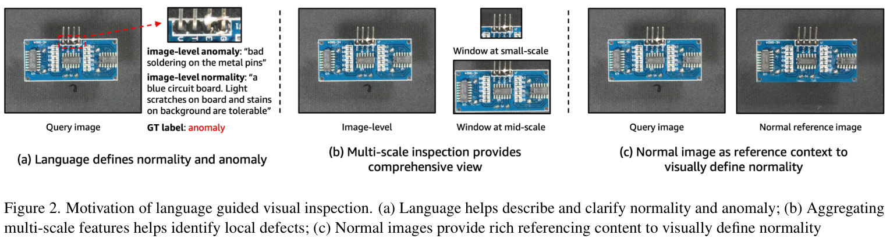

그림 2 의 (a) 는 납땜 결함은 글로 적고 배경의 작은 흠은 받아들이는 예, (b) 는 여러 크기의 창, (c) 는 정상 참조 이미지다. 세 칸이 4.1 · 4.2 · 4.3절에 하나씩 대응한다.

---

## 4. 핵심 기술

**① 두 부류 설계 (4.1절).** CLIP 의 0 장 분류(식 1)를 「normal [o]」 대 「anomalous [o]」 두 부류로 쓴다(CLIP-AC). 비교로 정상 문장 하나만 쓰는 한 부류 설계(점수 $= -\langle f(x), g(s^-) \rangle$)도 시험한다.

$$p(s = s_i \mid x ; S) = \frac{\exp\big(\langle f(x), g(s_i) \rangle / \tau\big)}{\sum_{s \in S} \exp\big(\langle f(x), g(s) \rangle / \tau\big)} \qquad (1)$$

원문은 $\tau$ 를 「온도 하이퍼파라미터」 라 적고 값을 적지 않는다. CLIP 은 이 값을 배우므로, 얼린 CLIP 의 배운 값을 그대로 쓴 것인지 따로 정한 것인지 알 수 없다.

**② 조합 프롬프트 묶음 (4.1절, 보충 자료 그림 6).** 상태 낱말(정상 7 · 결함 4)과 문장 틀 22 개의 모든 조합을 글 부호기에 넣고, 쪽마다 임베딩을 평균해 원형 둘을 만든다. 이 원형 둘로 식 1 을 계산한 이미지 점수를 원문은 $\mathrm{ascore}_0$ 로 적는다. **결함 쪽 확률이 $\mathrm{ascore}_0$ 라는 것은 내 해석이고, 원문은 「$\mathbb{R}^d \to [0, 1]$ 인 점수 모형」 이라고만 적는다.** 부류별 결함 낱말(「bad soldering」 등)을 더할 수 있다고 적고, 그 효과는 표 7 에서 VisA 셋으로만 본다.

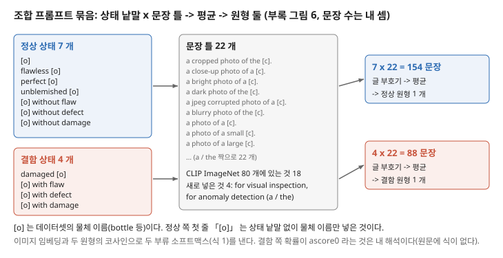

- **정상 쪽 첫 줄이 물체 이름 그 자체 「[o]」 다.** 상태 낱말 없이 「a photo of a bottle.」 같은 문장이 정상 원형에 들어간다.
- **문장 틀 22 개 가운데 18 개는 CLIP 의 ImageNet 80 개 목록에 같은 문장이 있다**(내 대조, 22절의 CLIP 저장소 노트북과 문자열로 맞췄다). 새로 넣은 넷은 「for visual inspection」 · 「for anomaly detection」 을 붙인 a · the 짝이다. 원문은 CLIP 묶음이 「시행착오로 고른 틀이고 "a cartoon [c]" 처럼 이상 탐지에 맞지 않는 것을 포함한다」 고 적는다. 「a cartoon {}.」 은 그 80 개 안에 있다(내 대조). **22 개를 어떻게 골랐는지는 이 편에도 적혀 있지 않다.**

**③ 창으로 가린 이미지에서 조밀한 특징 (4.2절, 그림 3).** 창 $\mathbf{w}_{ij}$ 마다

$$\mathbf{F}^{\mathtt{W}}_{ij} := f(x \odot \mathbf{w}_{ij}) \qquad (2)$$

다. ViT 에서는 가린 조각을 아예 빼고 남은 조각만 넣는다(MAE 와 같은 방식이라 적는다). 작은 창은 조각 4 개 + 클래스 토큰, 중간 창은 9 개 + 클래스 토큰이 들어가는 순전파다. 창 임베딩은 **클래스 토큰**이라 CLIP 학습에서 글과 맞춘 자리의 출력이다. 원문은 이것이 조각 토큰보다 글과 잘 정렬되는 까닭이라 적는다. CNN 에도 쓸 수 있다고 적는다(CLIP ResNet 은 주의 풀링 앞 특징 지도에 같은 방식을 썼다고 보충 자료 B 가 적는다).

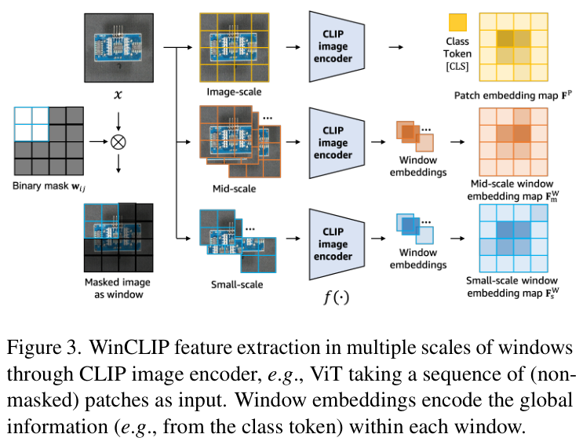

**④ 조화 평균과 여러 크기 (4.2절).** 창 점수 $\mathbf{M}^{\mathtt{W}}_{0,uv}$ 는 창 임베딩과 원형 둘의 유사도로 낸 결함 점수이고, 창이 덮는 화소마다 나눠 준다. 화소 $(i, j)$ 의 점수는 그 화소를 덮는 창들의 **조화 평균**이다.

$$\bar{\mathbf{M}}^{\mathtt{W}}_{0,ij} := \left( \frac{1}{\sum_{u,v} (\mathbf{w}_{uv})_{ij}} \sum_{u,v} \frac{(\mathbf{w}_{uv})_{ij}}{\mathbf{M}^{\mathtt{W}}_{0,uv}} \right)^{-1} \qquad (3)$$

원문은 「정상 예측(0)으로 더 무게를 둔다」 고 적는다.

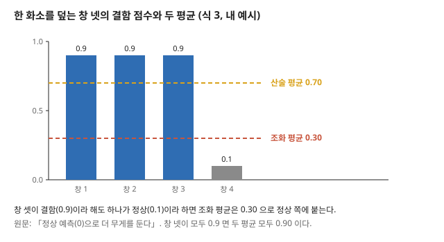

작은 예시(내 셈): 한 화소를 창 넷이 덮고 점수가 0.9 · 0.9 · 0.9 · 0.1 이면 산술 평균 0.70, 조화 평균 0.30 이다. 창 하나만 「정상」 이라 해도 그 화소는 정상 쪽에 붙는다. 넷이 모두 0.9 면 두 평균 모두 0.90 이다. **점수가 0 인 창이 있으면 식 3 은 0 으로 나누게 되는데, 그 처리는 적혀 있지 않다.** 크기는 작은 창 · 중간 창 · 이미지 전체(클래스 토큰 하나)의 셋이고, 셋을 모을 때도 조화 평균을 쓴다. 이미지 전체 점수는 화소마다 같은 값 하나다.

**⑤ WinCLIP+ (4.3절).** 정상 이미지 K 장에서 기억 셋을 만든다. 작은 창 임베딩 $\mathbf{R}^{\mathtt{W}}_s$, 중간 창 임베딩 $\mathbf{R}^{\mathtt{W}}_m$, 조각 토큰 $\mathbf{R}^{\mathtt{P}}$ 다. 시험 특징마다

$$\mathbf{M}_{ij} := \min_{r \in \mathbf{R}} \tfrac{1}{2}\big(1 - \langle \mathbf{F}_{ij}, r \rangle\big) \qquad (4)$$

를 내고, 셋을 산술 평균한다.

$$\mathbf{M}^{\mathtt{W}} := \tfrac{1}{3}\big(\mathbf{M}^{\mathtt{P}} + \mathbf{M}^{\mathtt{W}}_s + \mathbf{M}^{\mathtt{W}}_m\big) \qquad (5)$$

분할은 이것을 언어 쪽 지도 $\bar{\mathbf{M}}^{\mathtt{W}}_0$ 와 「합친다(fusing)」 고만 적는다. **어떻게 합치는지(산술 · 조화 · 무게)는 본문 · 보충 자료 어디에도 식이나 문장으로 없다**(그림 4 에는 ⊕ 기호만 있다). 분류는

$$\mathrm{ascore}_{\mathtt{W}}(x) := \tfrac{1}{2}\Big(\mathrm{ascore}_0\big(f(x)\big) + \max_{ij} \mathbf{M}^{\mathtt{W}}_{ij}\Big) \qquad (6)$$

이다. 조각 토큰은 글과 정렬되지 않았지만 정상 · 결함을 정의하는 데는 여전히 쓸모 있다고 적는다. **기억을 줄이는 장치(PatchCore 의 코어셋)는 없다.** K 가 4 이하라 기억 크기가 작다(작은 창 기억은 장당 196 개, 내 셈).

**⑥ 설정 (5절, 보충 자료 A).** OpenCLIP 구현과 공개 무게를 쓰고, 따로 적지 않으면 **LAION-400M 으로 배운 ViT-B/16+** 다. ViT-B/16 에서 이미지 임베딩 768 → 896, 글 임베딩 512 → 640, 입력 224 → 240(조각 196 → 225 개)으로 바꾼 모형이라 적는다. 전처리는 OpenCLIP 의 것(채널 표준화, Pillow bicubic 크기 조정)이고 짧은 변을 240 으로 맞춘다. **비교 상대도 크기만 240 으로 맞추고 나머지 전처리는 각자 원래대로 둔다.** VisA 처럼 정사각형이 아닌 이미지는 짧은 변 크기의 정사각 타일을 긴 변을 따라 보폭 최대 0.8 배로 잘라 예측을 평균한다. 1500 x 1000 이미지면 1000 x 1000 타일 2 개다(내 셈). SPADE · PaDiM 은 저자들이 다시 구현했고, PatchCore 는 공식 구현(WRN-50-2, ImageNet)을 썼다.

**적혀 있지 않은 설정 (읽은 범위).** 온도 $\tau$ 의 값, 문장 틀 22 개와 상태 낱말 11 개를 고른 방법과 데이터, 창 크기(2 · 3)와 조화 평균을 고른 데이터, 멀티 크롭(표 3 (d))의 자르기 수와 방식, 분할에서 언어 지도와 참조 지도를 합치는 식, 0 으로 나누기 처리, K 장을 고르는 5 개 seed 가 방법끼리 같은 이미지인지, PatchCore 의 코어셋 비율 · 층 · 이웃 크기(공식 구현의 기본값인지).

---

## 5. 평가 (읽은 범위) · 값을 읽은 방법

- **데이터:** MVTec AD(15 부류, 질감 5 · 물체 10)와 VisA(12 부류). 원문은 해상도를 700² \~ 1024²(MVTec AD) · 1.5K x 1K 안팎(VisA)이라 적는다. 부류 수는 본문에 적혀 있지 않고 부류별 표 10 \~ 21 의 행 수로 셌다.
- **지표:** 분류는 AUROC · AUPR · F1-max, 분할은 pAUROC · PRO · F1-max.
- **비교 상대:** 0 장 분류는 CLIP-AC 와 CLIP 의 ImageNet 프롬프트 묶음을 붙인 CLIP-AC, 0 장 분할은 Trans-MM(트랜스포머 해석 방법)과 MaskCLIP(CLIP 기반 의미 분할). 적은 장은 SPADE · PaDiM · PatchCore 를 **같은 K 장으로 저자들이 돌렸다.** 표 2 의 많은 장 방법들은 다른 논문에서 옮긴 값으로 읽힌다(표에 출처 번호만 있고 다시 돌렸다는 문장은 없다).
- **장비:** 표 8 의 시간은 Amazon EC2 G4dn 인스턴스에서 잰 이미지당 시간이다. 원문은 인스턴스 이름만 적는다.
- **반복:** 표 1 · 4 와 부류별 표는 「무작위 seed 5 개의 평균과 표준편차」 다. 0 장 줄은 ±0.0 이다(정상 이미지를 고르는 무작위가 없다). **표 3 · 5 · 6 · 7 · 8 과 보충 자료 표 9 는 표준편차가 없다.** 표 8 의 시간만 평균 ± 표준편차가 있다.

**부류별 표를 읽은 방법.** 보충 자료 표 10 \~ 21 은 PDF 글자 층에서 부류 이름 다음에 오는 「값±값」 13 개를 차례대로 읽었다(열은 0 장 WinCLIP, 그리고 1 · 2 · 4 장마다 SPADE · PaDiM · PatchCore · WinCLIP+). 12 개 표 모두 행 수가 맞았다(MVTec AD 15 + Mean, VisA 12 + Mean). 첫 행(Bottle)은 PDF 글자와 눈으로 맞췄다. 본문 표 1 · 4 의 값 156 개(방법 열 13 x 지표 3 x 표 넷)는 부록 Mean 행과 모두 같았다.

---

## 6. 0 장 분류 — 표 1 의 0 장 줄, 표 3

| | MVTec AD AUROC | AUPR | F1-max | VisA AUROC | AUPR | F1-max |
|---|---:|---:|---:|---:|---:|---:|
| CLIP-AC | 74.0 | 89.1 | 88.5 | 59.3 | 67.0 | 74.4 |
| + CLIP 프롬프트 묶음 | 74.1 | 89.5 | 87.8 | 58.2 | 66.4 | 74.0 |
| WinCLIP | **91.8** | **96.5** | **92.9** | **78.1** | **81.2** | **79.0** |

- **CLIP 의 ImageNet 80 개 묶음은 이 과제에서 AUROC 를 +0.1(MVTec AD) · −1.1(VisA) 바꾼다**(내 뺄셈). CLIP 노트에서 ImageNet 분류에 +3.5 점이던 장치다.
- **WinCLIP 의 오름은 MVTec AD +17.8 · VisA +18.8 로 비슷하다**(내 뺄셈). 끈 실험(표 3 · 5 · 6 · 8)이 모두 MVTec AD 에서만 돌았으니, 설계를 MVTec AD 를 보며 골랐더라도 VisA 에서 같은 크기의 오름이 나온다는 뜻이다. VisA 를 설계에 쓰지 않았다는 문장은 원문에 없다(표 7 은 VisA 에서 돌렸다).

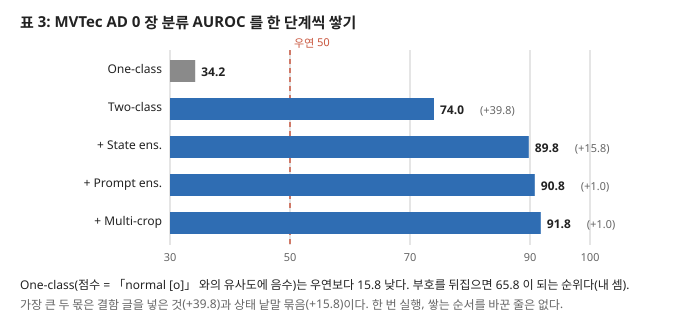

**표 3 (MVTec AD 0 장 분류 쌓기).** One-class 34.2 → Two-class 74.0(+39.8) → 상태 낱말 묶음 89.8(+15.8) → 프롬프트 묶음 90.8(+1.0) → 멀티 크롭 91.8(+1.0)이다. 원문은 「상태 묶음이 더 큰 몫」 이라 적는다. 맞다.

- **One-class 34.2 는 우연(50)보다 15.8 낮다.** 점수가 「normal [o]」 와의 유사도에 음수를 붙인 것이니, 결함 이미지가 정상 이미지보다 「normal [o]」 문장에 **더 가깝다**는 뜻이다. 부호를 뒤집으면 65.8 이 되는 순위다(내 셈). 원문은 「Two-class 가 크게 앞선다」 고만 적고 이 뒤집힘은 다루지 않는다.
- **표 3 은 한 순서로만 쌓았다.** 상태 묶음 없이 프롬프트 묶음만 넣은 줄, 멀티 크롭만 넣은 줄이 없어 각 몫은 「앞 단계 위에 더한 값」 이다.
- 마지막 줄 91.8 이 표 1 의 WinCLIP 이니, **표 1 의 WinCLIP 은 멀티 크롭을 쓴 값이다.** 멀티 크롭은 AlexNet 논문을 인용하고 자르기 수 · 방식은 적혀 있지 않다.

---

## 7. 0 장 분할 — 표 4 의 0 장 줄, 표 8

| | MVTec AD pAUROC | PRO | F1-max | VisA pAUROC | PRO | F1-max |
|---|---:|---:|---:|---:|---:|---:|
| Trans-MM | 57.5 | 21.9 | 12.1 | 49.4 | 10.2 | 3.1 |
| MaskCLIP | 63.7 | 40.5 | 18.5 | 60.9 | 27.3 | 7.3 |
| WinCLIP | **85.1** | **64.6** | **31.7** | **79.6** | **56.8** | **14.8** |

0 장 분할은 앞선 연구가 없어 다른 문제용 방법 둘을 옮겨 왔다고 적는다. **F1-max 는 MVTec AD 31.7 · VisA 14.8 이다.** 보충 자료 A 가 스스로 「적은 장 분할은 아직 풀리지 않았다, 가장 좋은 모형도 F1-max 60% 아래」 라 적는다(적은 장 기준 문장이고, 0 장은 그보다 낮다).

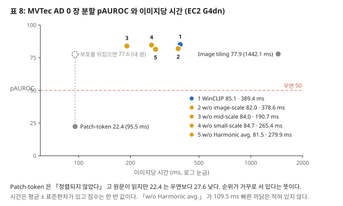

**표 8 (MVTec AD 0 장 분할, 끈 실험과 시간).**

| | pAUROC | PRO | F1-max | 이미지당 ms |
|---|---:|---:|---:|---:|
| Patch-token | 22.4 | 2.3 | 8.0 | 95.5 ± 18.8 |
| Image tiling | 77.9 | 57.5 | 25.5 | 1442.1 ± 62.2 |
| WinCLIP | **85.1** | **64.6** | **31.7** | 389.4 ± 18.5 |
| w/o image-scale | 82.0 | 63.0 | 29.5 | 378.6 ± 20.2 |
| w/o mid-scale | 84.0 | 61.6 | 30.5 | 190.7 ± 13.9 |
| w/o small-scale | 84.7 | 63.6 | 30.6 | 265.4 ± 15.9 |
| w/o Harmonic avg. | 81.5 | 60.5 | 27.3 | 279.9 ± 22.8 |

- **Patch-token 의 pAUROC 22.4 는 우연보다 27.6 낮다.** 원문은 「조각 토큰은 언어와 정렬되지 않았다」 고 읽는다. 정렬이 없으면 순위가 무작위라 50 언저리가 나와야 하는데, 22.4 는 결함 화소가 정상 화소보다 **체계적으로 낮은** 점수를 받는다는 뜻이다. 부호를 뒤집으면 77.6 으로 Image tiling(77.9)과 같은 자리이고 시간은 15 분의 1 이다(내 셈). PRO · F1-max 는 이렇게 뒤집어 계산할 수 없다. **원문은 이 뒤집힘을 다루지 않는다.** 이 값이 다음 칸(AnomalyCLIP)에서 다시 나오는지 본다(19절).
- **WinCLIP 은 Image tiling 보다 3.70 배 빠르고 pAUROC 가 7.2 높다**(내 셈). Image tiling 은 이미지를 조각으로 잘라 각각 크기를 키워 넣는 방식이고, 자르는 크기 · 수는 적혀 있지 않다.
- **시간을 빼 보면(내 셈)** 이미지 크기 10.8 ms · 중간 창 198.7 ms · 작은 창 124.0 ms 이고, 셋을 빼고 남는 몫이 55.9 ms 다. 중간 창 / 작은 창의 시간 비 1.60 은 토큰 수 비 1.72(1,690 대 980)에 가깝고 창 수 비 0.86(169 대 196)과는 멀다. 입력 240 · 보폭 1 로 셌다.
- **「w/o Harmonic avg.」 가 109.5 ms 빠르다.** 평균 방식을 바꿔 시간이 이만큼 줄 까닭이 계산으로는 보이지 않는다. 무엇으로 바꿨는지(산술 평균인지, 창을 겹치지 않게 한 것인지) 적혀 있지 않다.
- **「w/o image-scale」 은 시간 10.8 ms 로 pAUROC 3.1 을 낸다.** 이미지 크기 점수는 화소마다 같은 값이다. pAUROC 는 시험 이미지 전체의 화소를 한 번에 세워 재므로, 결함 이미지의 화소 전부를 함께 올리는 이미지 단위 신호가 화소 지표를 올린다(내 해석). 원문은 「자기 주의로 이미지 맥락을 담은 특징이 포괄적 위치 찾기에 기여한다」 고 적는다.
- 점수는 한 번 값이고 표준편차가 없다. 시간의 표준편차 13.9 \~ 22.8 ms 는 점수 차와 무관한 실행 사이 흔들림이다.

---

## 8. 적은 장 — 표 1 · 4 의 1 · 2 · 4 장 줄, 표 2

| MVTec AD | 분류 AUROC 1 · 2 · 4 장 | 분할 pAUROC 1 · 2 · 4 장 |
|---|---|---|
| SPADE | 81.0 · 82.9 · 84.8 | 91.2 · 92.0 · 92.7 |
| PaDiM | 76.6 · 78.9 · 80.4 | 89.3 · 91.3 · 92.6 |
| PatchCore | 83.4 · 86.3 · 88.8 | 92.0 · 93.3 · 94.3 |
| WinCLIP+ | **93.1 · 94.4 · 95.2** | **95.2 · 96.0 · 96.2** |

| VisA | 분류 AUROC 1 · 2 · 4 장 | 분할 pAUROC 1 · 2 · 4 장 |
|---|---|---|
| SPADE | 79.5 · 80.7 · 81.7 | 95.6 · 96.2 · 96.6 |
| PaDiM | 62.8 · 67.4 · 72.8 | 89.9 · 92.0 · 93.2 |
| PatchCore | 79.9 · 81.6 · 85.3 | 95.4 · 96.1 · 96.8 |
| WinCLIP+ | **83.8 · 84.6 · 87.3** | **96.4 · 96.8 · 97.2** |

본문 문장을 표에 맞대면(셈 5):

- **「1 장 MVTec AD 에서 PatchCore 보다 9.7%」 는 분류 AUROC 차로 맞다**(93.1 − 83.4). **「1 장 VisA 에서 5.3%」 는 맞는 칸이 없다.** VisA 1 장 차는 분류 3.9 · 2.3 · 1.4, 분할 1.0 · 4.6 · 3.3 이다. 같은 문장의 MVTec AD 쪽이 분류 AUROC 였으니 VisA 쪽도 3.9 로 읽어야 한다.
- **VisA 1 장의 분류 AUROC 차 3.9 는 두 방법의 표준편차(WinCLIP+ 4.0 · PatchCore 2.9)보다 작다.** seed 5 개가 두 방법에서 같은 정상 이미지를 고르는지 적혀 있지 않아, 짝지은 차의 흩어짐은 알 수 없다.
- **「모든 지표에서 큰 차로 앞선다」(5.1절)는 36 칸 중 35 칸에서 맞다.** VisA 4 장 분류 F1-max 는 WinCLIP+ 84.2 · PatchCore 84.3 이다. 보충 자료 A 도 「모든 지표에서 앞선다」 고 적는다.
- **「MVTec AD 에서 0 장 WinCLIP 이 앞선 방법들의 적은 장 판을 넘는다」** 는 지표 셋 모두 PatchCore 4 장보다 높아 맞다(91.8 > 88.8, 96.5 > 94.5, 92.9 > 92.6). F1-max 차 0.3 은 PatchCore 4 장의 표준편차 1.6 안이다. 원문이 「On MVTec-AD」 로 범위를 좁혀 적었고, VisA 에서는 0 장 78.1 이 SPADE 1 장 79.5 보다 낮다.
- **「1 · 2 · 4 장 WinCLIP+ 가 0 장 WinCLIP 보다 낫다」** 는 MVTec AD 분류 AUPR 에서 1 장 96.5 · 0 장 96.5 로 같다. AUROC 차 1.3 은 1 장의 표준편차 2.0 안이다.

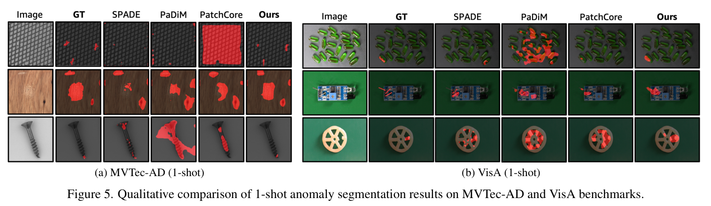

그림 5 는 1 장 분할의 정성 비교다. 원문은 「모든 경우 WinCLIP+ 의 마스크가 정답에 더 모인다」 고 적는데, 보인 사례를 어떻게 골랐는지는 적혀 있지 않다. 이 노트는 개별 사례를 읽지 않았다.

**표 2 (많은 장 방법과).** 4 장 WinCLIP+ 95.2 · 96.2 가 CutPaste(전체 학습 이미지) 95.2 · 96.0 과 같은 자리이고, 0 장 WinCLIP 91.8 이 DifferNet 16 장 87.3 · TDG 10 장 78.0 보다 높다. **PatchCore 전체 학습 이미지 줄 99.6 · 98.2 는 PatchCore 원문의 백본 셋 묶음 · 입력 320 판의 값과 같다**(PatchCore 노트 표의 「DenseNet-201 & ResNeXt-101 & WRN-101, 320」 줄). 표 1 의 PatchCore 는 WRN-50-2 · 입력 240 이라, 표 1 과 표 2 의 PatchCore 는 다른 설정이다. RegAD 의 「4 + agg.」 는 대상 부류만 4 장이고 다른 부류의 학습 이미지는 다 쓰는 설정이라 적는다.

---

## 9. 부류별 — 보충 자료 표 10 \~ 21

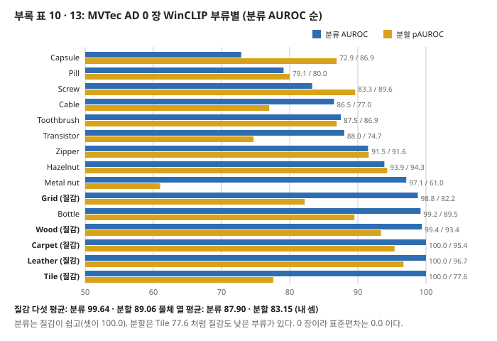

**0 장 WinCLIP, MVTec AD (내 평균).**

| | 분류 AUROC | pAUROC | PRO | 분할 F1-max |
|---|---:|---:|---:|---:|
| 질감 다섯 (Carpet · Grid · Leather · Tile · Wood) | **99.64** | 89.06 | 71.50 | 38.42 |
| 물체 열 | 87.90 | 83.15 | 61.11 | 28.26 |

- **분류는 질감이 쉽다.** Carpet · Leather · Tile 이 100.0 이고 Grid 98.8 · Wood 99.4 다. 가장 낮은 셋은 Capsule 72.9 · Pill 79.1 · Screw 83.3 이다. CLIP 노트에서 질감 데이터셋(DTD −16.6)과 부록 C 의 고주파 질감 관찰을 경고로 가져왔는데, **산업 질감 부류의 이미지 단위 판정에서는 그 경고가 나타나지 않았다.** DTD 는 질감의 종류를 47 개로 가르는 과제이고 여기서는 같은 질감 안의 흠을 가르는 과제라, 두 관찰이 서로 어긋나는 것은 아니다.
- **분할은 다르다.** Tile 의 pAUROC 77.6 은 15 부류 중 넷째로 낮다. 가장 낮은 것은 Metal nut 61.0 이고, Metal nut 의 분류 AUROC 는 97.1 이다. **분류가 맞아도 위치는 틀리는 부류가 있다.**
- **VisA 0 장 분류는 PCB2 51.2(우연과 1.2 차) · Macaroni2 63.7 · Pipe fryum 69.7 이 가장 낮다.** 분할은 Macaroni2 59.3 · PCB1 61.2 가 가장 낮다.

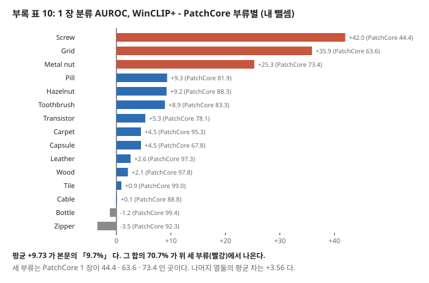

**1 장 WinCLIP+ − PatchCore (MVTec AD 분류 AUROC, 내 뺄셈).** 15 부류 차의 평균이 9.73 으로 본문의 「9.7%」 다. **그 합 145.9 의 70.7% 가 Screw +42.0 · Grid +35.9 · Metal nut +25.3 에서 나온다.** PatchCore 1 장이 Screw 44.4(우연 아래) · Grid 63.6 · Metal nut 73.4 인 부류다. 나머지 열둘의 평균 차는 +3.56 이고, Bottle −1.2 · Zipper −3.5 는 PatchCore 가 높다. Metal nut 은 0 장 WinCLIP 분류가 이미 97.1 이라, 이 부류의 차는 정상 참조보다 글 쪽 점수에서 나온 몫이 크다고 읽힌다(부류별로 글을 끈 줄은 없다).

**WinCLIP+ 가 세 비교 상대를 모두 넘은 부류 수(내 셈).**

| | 1 장 | 2 장 | 4 장 |
|---|---|---|---|
| MVTec AD 분류 AUROC | 11 / 15 | 9 / 15 | 8 / 15 |
| MVTec AD pAUROC | 9 / 15 | 8 / 15 | 7 / 15 |
| VisA 분류 AUROC | 7 / 12 | 5 / 12 | 6 / 12 |
| VisA pAUROC | 6 / 12 | 5 / 12 | 4 / 12 |

평균 행에서는 WinCLIP+ 가 36 칸 중 35 칸에서 1 위인데, 부류로 세면 VisA 에서 12 중 4 \~ 7 부류다. MVTec AD 에서는 장 수가 늘수록 준다(분류 11 → 9 → 8, 분할 9 → 8 → 7). **평균의 승리가 부류 몇에 몰려 있다**는 것이 9.7 점 분해와 같은 그림이다.

---

## 10. WinCLIP+ 의 끈 실험 — 표 5 · 6, 보충 자료 표 8

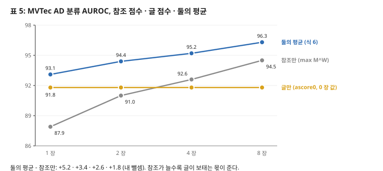

**표 5 (MVTec AD 분류 AUROC).** 참조만(max $\mathbf{M}^{\mathtt{W}}$)은 1 · 2 · 4 · 8 장에서 87.9 · 91.0 · 92.6 · 94.5, 글만($\mathrm{ascore}_0$)은 91.8 고정, 둘의 평균은 93.1 · 94.4 · 95.2 · 96.3 이다. 둘의 평균 − 참조만 = +5.2 · +3.4 · +2.6 · +1.8 로 **참조가 늘수록 글이 보태는 몫이 준다**(내 뺄셈). 원문의 「8 장처럼 참조가 더 나은 곳에서도 글 점수가 도움이 된다」 는 맞다. **8 장 값은 표 1 에 없고 이 표에만 있다.**

**표 6 (MVTec AD 분할 pAUROC).** 조각 토큰 기억만 94.5 · 94.8 · 95.4 · 95.8, 중간 창을 더하면 95.1 · 95.7 · 96.3 · 96.6, 작은 창까지 더하면 95.2 · 96.0 · 96.2 · 96.5 다. **4 · 8 장에서는 작은 창을 뺀 줄이 더 높다**(96.3 > 96.2, 96.6 > 96.5). 차가 0.1 이고 반복이 없어 순서를 매길 수는 없다. 원문은 「창 특징이 지역 정보를 보탠다」 고 적는다.

- **표 6 의 세 줄 모두 언어 쪽 지도를 합친 값으로 읽힌다**(마지막 줄 1 장 95.2 가 표 4 의 WinCLIP+ 와 같다). **언어 쪽 지도를 뺀 분할 줄이 없다.** 그래서 5.2절의 「WinCLIP+ 가 앞선 것은 언어 프롬프트가 보탠 값을 보인다」 는 이 표로 확인되지 않는다. 표 4 의 비교 상대는 백본(WRN-50-2 대 CLIP ViT-B/16+)과 기억 방식이 함께 다르다.

**보충 자료 표 8 (같은 CLIP 백본의 PatchCore).** 이 표가 백본 차이를 일부 가른다.

| MVTec AD 1 장 | 분류 AUROC | pAUROC | PRO |
|---|---:|---:|---:|
| PatchCore WRN-50-2 | 83.4 | 92.0 | 79.7 |
| PatchCore ViT-B/16+ 6 · 9 층 (hidden) | 79.9 | 91.8 | 74.1 |
| PatchCore ViT-B/16+ 마지막 층 (last) | 83.3 | 92.3 | 74.5 |
| WinCLIP+ | 92.7 | 95.2 | 87.1 |

- **CLIP 백본으로 바꿔도 PatchCore 는 오르지 않는다**(원문도 그렇게 적는다). 그러니 표 1 의 차는 백본만의 몫이 아니다.
- **표 5 와 맞대면(내 맞댐, 두 표가 같은 실행인지는 적혀 있지 않다)** 같은 ViT-B/16+ 1 장에서 PatchCore(last) 83.3 → 참조만 87.9 → 둘의 평균 93.1 이다. 기억 방식 차(단순 최근접 + 창 기억 셋)가 +4.6, 글이 +5.2 다.
- **「ViT 에서는 PatchCore 가 마지막 층에서 더 낫다」 는 분류에서만 맞다.** 2 · 4 장의 PRO · F1-max 는 hidden 이 높다(2 장 −1.1 · −1.6, 4 장 −2.3 · −2.2, last − hidden).
- **이 표의 WinCLIP+ 분류 값은 표 1 과 다르다**(15절). AUROC 가 1 · 2 · 4 장 모두 0.4 낮다.

---

## 11. 백본 · 부류별 결함 낱말 — 보충 자료 표 9, 본문 표 7

**보충 자료 표 9 (MVTec AD 0 장, OpenCLIP 백본별).**

| 백본 | 입력 | 분류 AUROC | 분할 pAUROC |
|---|---:|---:|---:|
| RN50 | 224 | 79.8 | 65.6 |
| RN101 | 224 | 79.2 | 62.4 |
| RN50x4 | 288 | 81.9 | 71.3 |
| RN50x16 | 384 | 82.3 | 65.3 |
| ViT-B/16 | 224 | 86.1 | 71.1 |
| **ViT-B/16+** | 240 | **90.8** | **85.1** |
| ViT-L/14 | 224 | 86.1 | 64.4 |

- 원문은 「ViT 가 ResNet 보다 낫고, 더 큰 모형 · 해상도에서 이득이 보인다」 고 적는다. **뒤 문장은 쌍 셋에서 어긋난다.** RN50 → RN101 은 둘 다 내리고(79.8 → 79.2, 65.6 → 62.4), RN50x4 → RN50x16 은 분할이 6.0 내리고, ViT-B/16 → ViT-L/14 는 분류가 같고 분할이 6.7 내린다.
- **어느 무게(OpenAI 판인지 LAION 판인지)를 썼는지 적혀 있지 않다.** ViT-B/16+ 는 LAION-400M 판이 기본이라 적었으니, 이 표는 구조와 사전학습 데이터가 함께 바뀐 비교일 수 있다.
- **분할에서 ViT-B/16+ 의 85.1 이 둘째(71.3)보다 13.8 높다.** 기본값이 이 표의 최댓값 칸이고, 표는 MVTec AD 시험 집합의 값이다. 백본을 이 표로 골랐는지는 적혀 있지 않다.
- ViT-B/16+ 의 분류 90.8 은 표 1 의 91.8 이 아니라 표 3 (c)(멀티 크롭 전)의 90.8 과 같다. 표 9 는 멀티 크롭 없이 잰 값으로 읽힌다.
- 원문은 ResNet 의 분할이 낮은 까닭을 「특징 지도 한 칸이 32 화소라 흐리다」 로 추측한다. ViT-L/14(한 칸 14 화소)의 분할 64.4 가 ViT-B/16(16 화소)의 71.1 보다 낮아, 칸 크기 하나로는 설명되지 않는다.

**표 7 (VisA 0 장 분류, 부류별 결함 낱말을 더하면).** PCB2 51.2 → 56.5(+5.3) · PCB4 79.6 → 82.7(+3.1) · Pipe fryum 69.7 → 70.4(+0.7), 12 부류 평균 78.1 → 78.9(+0.8)다. 평균 오름 0.8 은 반올림 값이라 12 배 하면 9.0 \~ 10.2 이고, 보인 셋의 합이 9.1 이라(내 셈) **나머지 아홉 부류의 오름은 합쳐 −0.1 \~ 1.1 이다.** 낱말을 아홉 부류에도 넣었는지, 넣은 낱말이 무엇인지는 적혀 있지 않다. PCB2 는 더해도 56.5 로 우연과 6.5 차다.

---

## 12. 실패 사례 — 보충 자료 C (글만 읽음)

원문이 꼽은 0 장 WinCLIP 의 실패는 넷이다(그림 11 캡션과 글, 이미지는 읽지 않았다).

1. **논리 이상**: 케이블의 축이 잘못 놓임, 캡슐의 글자 빠짐, PCB1 의 축전기 빠짐, PCB3 의 휜 부품. 정상 참조 이미지가 있어야 정의된다고 적고 WinCLIP+ 가 덜어 준다고 적는다(얼마나인지는 수치가 없다).
2. **작은 결함**: 카펫 · 나무 · 캡슐 · Macaroni1. 더 지역적인 특징이 도울 것이라 추측하고 향후 과제로 둔다.
3. **결함이 아닌 벗어남**: 알약 · 헤이즐넛의 작은 점, 캐슈의 다른 재료, PCB2 의 설계된 구멍과 받아들일 만한 긁힘. 「더 풀어 적은 글과 상태를 더 잘 이해하는 사전학습 모형」 이 덜어 줄 것이라 가설로 적는다.
4. **위치 주변 오차**: 병 · 타일 · PCB4 · Fryum 에서 결함 자리는 짚지만(원문 「roughly localize」) 그 둘레의 화소가 틀린다. 원문은 「rough localization 으로 결함 자리를 설명하기에 충분하다」 며 작은 문제로 둔다. 이 판단의 근거 수치는 없다.

작은 결함은 9절의 Tile 분할 77.6 과 닿는다. 내 셈으로 작은 창(32 화소)은 240 입력 한 변의 13.3% 이고, 원본 1024 화소 이미지에서는 136.5 화소 x 136.5 화소다(넓이 1.78%). 이보다 작은 흠은 창 하나 안에서 다른 내용과 섞인다.

---

## 13. 실험 분석 — 표 · 그림마다

| 표 · 그림 | 무엇을 바꿨나 | 무엇을 고정했나 | 결과 | 반복 · 흩어짐 | 주장이 결과보다 센가 |
|---|---|---|---|---|---|
| 표 1 · 4 0 장 | 방법 셋 | ViT-B/16+, 데이터 둘 | 분류 +17.8 · +18.8, 분할 85.1 · 79.6 | 결정적(±0.0) | 0 장 분할 비교 상대가 다른 문제용이라 원문도 「옮겨 왔다」 고 적는다 |
| 표 1 · 4 적은 장 | 방법 넷 x 장 수 셋 | 입력 240, 같은 K | 35 / 36 칸 1 위 | seed 5, 표준편차 | 「모든 지표」 는 1 칸 어긋남. 「VisA 5.3%」 는 맞는 칸이 없다 |
| 표 2 | 장 수 · 방법 | MVTec AD | 4 장 = CutPaste 전체 | 출처마다 다름 | PatchCore 99.6 은 백본 셋 묶음 · 320 판 |
| 표 3 | 장치를 하나씩 쌓음 | MVTec AD 0 장 | 34.2 → 91.8 | 없음 | 쌓는 순서 하나뿐. One-class 34.2 의 뒤집힘을 다루지 않는다 |
| 표 5 | 점수 둘의 유무 x 장 수 넷 | MVTec AD | 글의 몫 +5.2 → +1.8 | 없음 | 「서로 보완」 은 맞다 |
| 표 6 | 기억 셋의 유무 | MVTec AD | 4 · 8 장은 작은 창 없는 줄이 0.1 높다 | 없음 | 언어 지도를 뺀 줄이 없어 「언어가 분할에 보탠다」 를 못 가른다 |
| 표 7 | 부류별 낱말 유무 | VisA 0 장 | 평균 +0.8, PCB2 +5.3 | 없음 | 보인 셋의 합 9.1 이 12 부류 오름 합(9.0 \~ 10.2, 반올림 범위)의 89 \~ 101% (내 셈) |
| 표 8 | 특징 · 크기 · 평균 방식 | MVTec AD 0 장 | WinCLIP 85.1, 3.70 배 빠름 | 시간만 | 조각 토큰을 「정렬 안 됨」 으로 읽지만 값은 거꾸로 정렬 |
| 보충 표 8 | PatchCore 백본 · 층 | MVTec AD, 장 수 | CLIP 백본 PatchCore 가 오르지 않음 | seed 5 | 「마지막 층이 낫다」 는 분류에서만 |
| 보충 표 9 | 백본 일곱 | MVTec AD 0 장 | B/16+ 가 분할 13.8 앞섬 | 없음 | 「큰 모형에서 이득」 이 쌍 셋에서 어긋남, 무게 출처가 적혀 있지 않다 |
| 보충 표 10 \~ 21 | 부류 | 표 1 · 4 와 같음 | 질감 0 장 분류 99.64 | seed 5 | 표 10 의 PatchCore 4 장 열이 2 장 열의 복사로 읽힌다 |

---

## 14. 이 논문이 스스로 적은 한계

1. **글만으로는 정의되지 않는 결함이 있다**(4.3절, 보충 자료 C). 금속 너트의 「뒤집힘」, 케이블 축의 자리처럼 정상 이미지와 맞대야 하는 논리 이상이다. 이것이 WinCLIP+ 를 만든 까닭이다.
2. **조각 토큰은 언어와 정렬되지 않았다**(4.2절). CLIP 학습에서 글과 직접 맞추지 않았고, 자기 주의로 이미 전역 맥락을 섞었다고 추측한다(「We conjecture」).
3. **적은 장 분할은 아직 풀리지 않았다**(보충 자료 A). pAUROC 가 95% 를 넘어도 F1-max 는 60% 아래다.
4. **작은 결함 · 결함이 아닌 벗어남에 약하다**(보충 자료 C). 더 지역적인 특징과 상태를 더 잘 이해하는 사전학습 모형을 향후 과제로 둔다.
5. **산업 데이터로 한 시각-언어 사전학습이 향후 방향이다**(6절).

---

## 15. 원문 안의 어긋남 모음

| 자리 | 원문 | 맞대 보니 | 내 판단 |
|---|---|---|---|
| 보충 표 10 | PatchCore 4 장 열 15 행, Mean 88.8 | 15 행이 2 장 열과 (평균, 표준편차)까지 같다. 열 평균 86.31 | 2 장 열을 옮겨 적은 것으로 읽힌다. Mean 88.8 은 표 1 과 같다 |
| 보충 표 11 · 17 (AUPR) | Mean 행 | 26 칸 중 20 칸에서 Mean 이 부류 평균보다 0.12 \~ 0.36 높다. 다른 지표 표 열 개는 반올림 한계(0.10) 안 | AUPR 만 Mean 을 다르게 셈한 것으로 보인다. 까닭은 적혀 있지 않다 |
| 5.1절 | 「by 5.3% on 1-shot VisA」 | VisA 1 장 차는 분류 3.9 · 2.3 · 1.4, 분할 1.0 · 4.6 · 3.3 | 맞는 칸이 없다 |
| 5.1절 · 보충 A | 「outperforms ... across all metrics」 | VisA 4 장 분류 F1-max 84.2 대 PatchCore 84.3 | 36 칸 중 1 칸 어긋남 |
| 보충 표 8 대 본문 표 1 | WinCLIP+ 분류 92.7 · 94.0 · 94.8 | 표 1 은 93.1 · 94.4 · 95.2. AUROC 가 장 수마다 0.4 차, 분할 값은 같다 | 다른 설정의 값이 들어간 것으로 보인다. 설명이 없다 |
| 보충 표 8 머리글 | 왼쪽 셋 「pAUROC · PRO · F1-max」, 오른쪽 셋 「AUROC · AUPR · F1-max」 | 왼쪽 값(83.4 · 92.2 · 90.5)이 표 1 의 분류 값 | 머리글의 두 묶음이 바뀌어 있다 |
| 보충 표 9 대 본문 표 1 | ViT-B/16+ 분류 90.8 | 표 1 은 91.8, 표 3 (c) 는 90.8 | 멀티 크롭 없이 잰 값으로 읽힌다 |
| 보충 B | 「performance benefits from larger models or resolutions in both types」 | 표 9 의 쌍 셋에서 내린다 | 문장이 표보다 세다 |
| 보충 B | 「PatchCore performs better with the last layer」 | 2 · 4 장 분할 PRO · F1-max 는 hidden 이 높다 | 분류에서만 맞다 |
| 보충 자료 | 표 번호 8 · 9 | 본문에도 표 8 이 있다(다른 표) | 번호가 겹친다 |
| 4.1절 | 「a non-trial performance」 | non-trivial | 낱말 오기 |
| 4.3절 | 「approachs」 · 「it still useful」 | approaches · it is still useful | 글 오기 |
| 참고 문헌 [13] | 「Hinton, Krizhevsky, Sutskever ... 25(1106-1114):1」 | 같은 논문의 [19] 는 Krizhevsky · Sutskever · Hinton | 저자 순서 · 서지가 뒤섞였다 |
| 참고 문헌 [43] | 「Max Welling and Thomas N Kipf」 | GCN 논문의 저자 순서는 Kipf · Welling(바깥 지식) | 저자 순서 오기 |

---

## 16. 논문이 적지 않은 것 — 내가 읽으며 짚은 자리

1. **분할에서 언어 지도와 참조 지도를 합치는 식이 없다.** 분류(식 6)는 적었는데 분할은 「fusing」 한 낱말이다. 재현하려면 코드를 봐야 한다.
2. **언어 지도를 뺀 분할 줄이 없다.** 그래서 「언어가 적은 장 분할에 보탠다」 는 이 편 안에서 가려지지 않는다(10절).
3. **설계를 고른 데이터가 적혀 있지 않다.** 프롬프트 242 문장, 창 크기 2 · 3, 조화 평균, 백본 ViT-B/16+ 를 고른 끈 실험이 모두 MVTec AD 시험 집합의 값이다. 「without further tuning」(초록)은 「부류마다 조정하지 않았다」 의 뜻이고 「설계를 시험 집합을 안 보고 정했다」 의 뜻은 아니다. CLIP 노트의 같은 물음(프롬프트를 고른 데이터)이 이어진다. 다만 VisA 에서 오름의 크기가 같았다(6절).
4. **조각 토큰과 One-class 의 「우연 아래」 를 다루지 않는다.** 둘 다 CLIP 공간에서 결함 이미지 · 결함 화소가 「정상」 쪽 글에 더 가깝다는 신호다. 왜 그런지가 다음 칸의 물음이 된다.
5. **반복이 적은 장 표에만 있다.** 0 장은 결정적이라 흩어짐이 없지만, 표 3 · 9 의 설계 선택은 한 번 값이고 프롬프트 · 창 크기를 바꿨을 때의 흩어짐은 알 수 없다.
6. **사전학습 데이터에 MVTec AD · VisA 가 들어 있었는지 확인하지 않는다.** LAION-400M 은 웹에서 모은 4 억 쌍이고, MVTec AD 이미지는 2019 년부터 공개되어 있다. 읽은 범위에 겹침 검사가 없다. CLIP 노트 4절 · 부록 C 의 겹침 검사는 OpenAI 의 WIT 에 대한 것이라 여기 백본에는 적용되지 않는다.

---

## 17. 앞 노트와 맞춰 보기

**CLIP 노트.** 식 1 · 프롬프트 묶음 · 클래스 토큰이 그 편의 장치다. 그런데 **백본이 OpenAI CLIP 이 아니라 OpenCLIP 의 LAION-400M ViT-B/16+ 다.** CLIP 노트에서 짚은 WIT 의 특성(출처 · 겹침 검사)은 여기 기본 모형에 그대로 옮겨지지 않는다. CLIP 노트 11절의 「클래스 이름이 유일한 정보면 생기는 다의어 문제」 는, 여기서는 상태 낱말을 덧붙이는 것으로 다룬다. CLIP 노트 19절의 경고 둘(질감 · 고주파)은 분류에서는 나타나지 않고(질감 99.64), 분할의 작은 결함 실패(12절)로 나타난다.

**SPADE · PatchCore 노트.** 식 4 는 SPADE 의 조각 최근접 거리를 코사인으로 쓴 것이고, 코어셋 · 이웃 평균 · 점수 재가중이 없다. 보충 자료 각주는 PatchCore 를 「조각 기억에 여러 기법(지역 조각 모으기, 군집, 점수 재가중)을 더한 것」 이라 적고, 단순한 연결이 ViT 에서는 더 낫다고 읽는다(10절). PatchCore 노트의 99.6 이 표 2 에 그대로 옮겨져 있다(8절).

**ViT 노트.** 창 계산이 가능한 것은 ViT 가 조각 수가 바뀌어도 그대로 돌기 때문이다. 가린 조각을 빼고 넣으면 자리 임베딩만 남은 조각에 맞춰 붙인다(원문은 MAE 를 인용한다. MAE 는 이 저장소에 노트가 없다).

**VisA · MVTec AD (beyond-mvtec 저장소 노트).** VisA 노트에서 짚은 「정렬이 덜 된 부류」 둘(Capsules · Macaroni2) 가운데 Macaroni2 가 0 장 분류 63.7 · 분할 59.3 으로 VisA 에서 가장 낮은 축이다. MVTec AD 노트에서 짚은 「무작위 회전으로 찍은 부류」(Metal nut · Screw · Hazelnut) 가운데 Metal nut 의 0 장 분할 61.0 이 15 부류 중 가장 낮다. 회전과의 관계는 이 편이 다루지 않는다.

**EfficientAD 노트.** 그 편에서 짚은 「시험 값으로 설정 고르기」 가 여기서도 16절 3 으로 나온다. 그 편은 논리 이상을 자기부호기로 다뤘고, 이 편은 같은 문제를 「정상 참조 몇 장」 으로 다룬다(12절 1).

---

## 18. 내가 가져갈 것

**하나. 평균의 차를 부류로 나눠 본다.** 「9.7 점」 의 70.7% 가 세 부류였고, 부류로 세면 VisA 4 장 pAUROC 에서 12 중 4 부류만 1 위였다. 표가 부류별 값을 주면 승수 · 평균 · 위 몇 부류의 몫을 함께 낸다. CLIP 노트의 「승수와 평균을 함께 본다」 와 같은 규칙이다.

**둘. 우연 아래 값은 「정렬 없음」 이 아니라 「거꾸로 정렬」 이다.** AUROC 가 50 보다 많이 낮으면 신호가 있다는 뜻이다. Patch-token 22.4 와 One-class 34.2 를 다음 칸에서 다시 본다.

**셋. 부록 표는 Mean 행을 다시 셈해 본다.** 표 10 의 한 열이 통째로 다른 열의 복사였고, Mean 행만 맞는 값이었다. 부류 평균과 Mean 이 0.10 넘게 갈리는 칸을 기계적으로 찾았다.

**넷. 「제로샷」 · 「튜닝 없이」 의 범위를 확인한다.** 여기서는 부류마다 조정하지 않는다는 뜻이고, 프롬프트 · 창 · 백본은 MVTec AD 시험 값을 보며 고른 것으로 읽힌다(적혀 있지 않다). VisA 에서 같은 크기로 오른 것이 그 걱정을 일부 덜어 준다.

**다섯. 지금 확인된 것은 여기까지다.** 논문이 잰 것은 두 데이터셋 0 · 1 · 2 · 4 장의 분류 · 분할 여섯 지표(seed 5), MVTec AD 끈 실험 다섯(한 번 값), CLIP 백본 PatchCore(seed 5), 백본 일곱(한 번 값), 부류별 표다. 논문이 말만 한 것은 조각 토큰이 정렬되지 않은 까닭, ResNet 분할이 흐린 까닭, 실패 사례의 원인, 「rough localization 으로 충분하다」 는 것이다. 내가 책상에서 센 것은 프롬프트 수 · 창 수 · 토큰 수 · 시간 나누기 · 조화 평균 예시 · 표 문장 대조 · 부류별 평균과 분해 · 승수 · 부록 Mean 대조 · 표 7 의 덧셈이다.

---

## 19. 남는 질문

- **CLIP 공간에서 결함이 왜 「정상」 쪽 글에 더 가깝게 놓이나?** One-class 34.2 와 Patch-token 22.4 가 같은 방향이다. AnomalyCLIP 이 조각 토큰을 쓰는지, 쓴다면 이 뒤집힘을 어떻게 다루는지 본다.
- **프롬프트를 손으로 고르지 않고 배우면 얼마나 오르나?** 이 편의 242 문장은 고른 방법이 적혀 있지 않다. AnomalyCLIP(「object-agnostic prompt learning」)이 다음 칸이다.
- **언어 지도와 참조 지도를 화소에서 어떻게 합치나?** 코드에 있을 수 있다. 저자 코드 주소가 원문에 없어, 찾는다면 바깥 구현에서 찾아야 한다.
- **보충 표 10 의 PatchCore 4 장 부류별 값은 실제로 얼마인가?** Mean 88.8 이 2 장 86.3 보다 2.5 높으니 부류 값도 달라야 한다. 원문만으로는 알 수 없다.
- **LAION-400M 에 MVTec AD · VisA 이미지가 들어 있었나?** 읽은 범위에 검사가 없다.

---

## 20. 다음에 읽을 것

**이 큰 틀(CLIP → WinCLIP → AnomalyCLIP)의 다음 칸이자 마지막 칸은 AnomalyCLIP(ICLR 2024)이다.** 원문(arXiv v8)은 받아 두었다. 아래는 이 노트 안에서 나온 후속 편이다.

| 논문 | 이 노트의 어느 자리에서 나오는가 | 무엇을 확인하고 싶은가 | 원문 참고 문헌 |
|---|---|---|---|
| **MaskCLIP** — Extract free dense labels from CLIP (Zhou 외, ECCV 2022) | 7절 | 0 장 분할 비교 상대. CLIP 에서 조밀한 특징을 꺼내는 다른 길(조각 토큰을 손보는 쪽)이 무엇인가 | [55] |
| **RegAD** — Registration based few-shot anomaly detection (Huang 외, ECCV 2022) | 8절 표 2 | 「4 + agg.」 설정, 물체를 가리지 않는 정합 망 | [14] |
| **Discovering states and transformations in image collections** (Isola 외, CVPR 2015) | 2 · 3절 | 「상태」 개념의 원 출처 | [17] |
| **LAION-400M** (Schuhmann 외, 2021) · **OpenCLIP** (Ilharco 외, 2021) | 4절 ⑥, 16절 6 | 기본 백본의 사전학습 데이터, ViT-B/16+ 의 정의, 겹침 검사가 있는가 | [37] · [16] |
| **CoOp** — Learning to prompt for vision-language models (Zhou 외, IJCV 2022) | 19절 | 프롬프트를 배우는 원 출처. AnomalyCLIP 앞에 볼 자리 | [56] |
| **MAE** — Masked autoencoders are scalable vision learners (He 외, CVPR 2022) | 4절 ③ | 가린 조각을 빼고 넣는 계산 | [12] |

---

## 21. 참고 문헌

- Radford, A. 외 (2021). CLIP. ICML. — 2026-11-17 에 PMLR 게재판으로 읽었다.
- Roth, K. 외 (2022). PatchCore. CVPR. — 2026-11-03 에 arXiv v2 로 읽었다.
- Cohen, N. & Hoshen, Y. (2020). SPADE. arXiv. — 2026-11-07 에 arXiv v3 로 읽었다.
- Dosovitskiy, A. 외 (2020). ViT. — 2026-11-05 에 ICLR 2021 게재판으로 읽었다.
- Zou, Y. 외 (2022). VisA (SPot-the-Difference). ECCV. — beyond-mvtec 저장소에 노트가 있다.
- Bergmann, P. 외 (2019). MVTec AD. CVPR. — beyond-mvtec 저장소에 노트가 있다.
- Defard, T. 외 (2021). PaDiM. ICPR. — beyond-mvtec 저장소에 노트가 있다.
- Zhou, C. 외 (2022). MaskCLIP. ECCV. — **읽지 않았다.**
- Chefer, H. 외 (2021). Trans-MM. ICCV. — **읽지 않았다.**
- Huang, C. 외 (2022). RegAD. ECCV. — **읽지 않았다.**
- Li, C.-L. 외 (2021). CutPaste. CVPR. — **읽지 않았다.**
- Schuhmann, C. 외 (2021). LAION-400M. · Ilharco, G. 외 (2021). OpenCLIP. — **읽지 않았다.**
- He, K. 외 (2022). MAE. CVPR. — **읽지 않았다.**
- Zhou, K. 외 (2022). CoOp. IJCV. — **읽지 않았다.**
- 이 편 밖: Zhou, Q. 외 (2024). AnomalyCLIP. ICLR. — 이 큰 틀의 다음 칸, 원문을 받아 두었다.

---

## 22. 경로

| 무엇 | 어디 |
|---|---|
| 원문 PDF (CVF 공개판 본문 11 쪽) | `papers/CVPR23_WinCLIP_Zero_Few_Shot_Anomaly_Classification_and_Segmentation.pdf` |
| 원문 보충 자료 (CVF 판 11 쪽) | `papers/CVPR23_WinCLIP_Zero_Few_Shot_Anomaly_Classification_and_Segmentation_Supplemental.pdf` |
| 이 노트 | `notes/CVPR23_WinCLIP_Zero_Few_Shot_Anomaly_Classification_and_Segmentation.md` |
| 이 노트의 그림 (직접 그린 것) | `figures/CVPR23_WinCLIP/fig01_harmonic_example.svg` 부터 `fig08_lineage.svg` 까지 여덟 |
| 이 노트의 그림 (원문에서 잘라 낸 것) | `figures/CVPR23_WinCLIP/paper_fig2_motivation.png` · `paper_fig3_window_features.png` · `paper_fig4_workflow.png` · `paper_fig5_qualitative.png` |
| 본문 · 보충 자료 표 값 상수 | `figures/CVPR23_WinCLIP/data_winclip.py` — 표 1 \~ 8, 보충 자료 표 8 · 9, 프롬프트 목록, 입력 설정 |
| 부류별 표 12 개 | `figures/CVPR23_WinCLIP/appendix_classwise.json` — 보충 자료 표 10 \~ 21, (평균, 표준편차) |
| 그림과 다시 계산한 값을 만드는 코드 | `figures/CVPR23_WinCLIP/make_figures.py` — 표준 라이브러리만 쓴다. `python make_figures.py` 로 셈 1 \~ 8(조화 평균 · 프롬프트 수 · 표 3 · 창과 토큰과 시간 · 표 1 · 4 문장 대조 · 부류별 · 부록 Mean 대조 · 표 2 · 5 · 6 · 7)을 찍고 그림 여덟을 쓴다 |
| 원문 그림을 잘라 내는 코드 | `figures/CVPR23_WinCLIP/crop_paper_figures.py` — PyMuPDF 가 필요하다 |
| 프롬프트 틀 대조에 쓴 CLIP 목록 | CLIP 저장소 `notebooks/Prompt_Engineering_for_ImageNet.ipynb` 의 `imagenet_templates`(80 개), 2026-11-17 에 받아 문자열로 맞췄다. 저장소에 넣지 않았다 |
