# AnoDDPM — Anomaly Detection with Denoising Diffusion Probabilistic Models using Simplex Noise (CVPR Workshops 2022, 요약)

> **한 줄.** 정상 이미지로만 DDPM 을 배운 뒤, 검사 이미지를 사슬 끝까지 보내지 않고 **되돌림 시점 $\lambda$ 까지만** 잡음을 넣었다가 되돌려 원본과의 제곱 오차로 결함을 찾는다. 가우스 흰 잡음은 낮은 주파수를 덜 건드려 큰 결함이 복원되어 버린다고 보고, 잡음을 **낮은 주파수에 전력이 몰린 simplex 잡음**으로 바꾼다. 뇌 MRI 22 스캔에서 Dice 0.383 · IoU 0.269 · AUC 0.863(가우스 판 0.009 · 0.004 · 0.601, f-AnoGAN 0.128 · 0.093 · 0.789).

> **이 노트에서 가장 먼저 볼 자리 다섯.** (1) **수치가 있는 데이터는 의료 뇌 MRI 뿐이다.** 산업 쪽 근거는 MVTec AD 15 부류 중 가죽 하나, 이미지 두 장을 흑백으로 복원해 보인 그림 5 이고 수치가 없다. 그런데 결론은 「의료와 비의료 모두에서 유의미한 향상」 이라 적는다(7 · 8절). (2) **$\lambda$ = 250 은 평가 데이터에서 격자 탐색으로 골랐다**(655쪽). 원문 3.6절에 이상 데이터를 나눈 검증 집합이 없고, 잡음 설정과 문턱을 어느 집합으로 골랐는지는 적혀 있지 않다(9절). (3) **표 1 의 가우스 판은 simplex 에 맞춘 $\lambda$ = 250 에서 잰 값으로 읽힌다.** 그림 4 벡터 좌표에서 가우스 곡선의 봉우리는 $\lambda$ = 544 · 598(Dice 0.219 · 0.373)이고 $\lambda$ = 250 에서는 0.009 · 0.000 이다. 다만 각자 봉우리끼리 맞대도 슬라이스 둘에서 simplex 가 앞선다(0.888 대 0.219, 0.694 대 0.373)(10절). (4) **표 1 의 ± 는 뜻이 적혀 있지 않고, f-AnoGAN 행은 같은 표의 다른 행과 같은 뜻으로 읽히지 않는다.** Dice 와 IoU 의 관계로 필요한 표준편차를 내면 simplex 0.261(표 0.258) · Context Encoder 0.218(표 0.209) 인데 f-AnoGAN 은 0.284(표 0.001)다(내 계산, 12절). (5) **「더 빠른 학습」 과 「고해상도로 확장된다」 에 수치가 없다.** 알고리즘 1 은 $t$ 를 1 에서 $T$ 까지 고루 뽑아 전체 사슬을 학습하고, 재구성 시간은 초 단위로 한 군데도 없으며, 실험 입력은 256 x 256 하나다(4 · 14절).

---

## Paper Metadata

| Item | Content |
|---|---|
| Title | AnoDDPM: Anomaly Detection with Denoising Diffusion Probabilistic Models using Simplex Noise |
| Authors | Julian Wyatt, Adam Leach, Sebastian M. Schmon, Chris G. Willcocks |
| 소속 | Durham University. Department of Computer Science (Wyatt · Leach · Willcocks), Department of Mathematical Sciences (Schmon) |
| Conference / Journal | **CVPR 2022 Workshops** (Proceedings of the IEEE/CVF CVPR Workshops), CVF Open Access 의 NTIRE 목록, 650-656쪽. 쪽 번호는 파일 꼬리와 CVF 쪽 메타데이터가 같다. 첫 쪽 머리에 「CVF 가 제공하는 Open Access 판이고 워터마크 말고는 채택본과 같으며 최종본은 IEEE Xplore」 라고 찍혀 있다 |
| Year | 2022. 접수 · 게재 날짜는 파일에 없다 |
| DOI | 파일에 없다. 원문은 CVF Open Access |
| 코드 | 원문 653쪽에 `https://github.com/Julian-Wyatt/AnoDDPM`(MIT 라이선스). **이 노트는 코드를 보지 않았다** |
| Stored PDF | `papers/CVPRW22_AnoDDPM_Anomaly_Detection_with_Denoising_Diffusion_Probabilistic_Models_using_Simplex_Noise.pdf` |
| 왜 읽었는가 | 2026-11-06 에 사용자가 정한 큰 틀 「산업 이상 탐지(SPADE → 코어셋 → AnoDDPM → UniAD)」 의 셋째 칸. DDPM 을 재구성 기반 이상 탐지에 쓰는 절차와, 순방향으로 어디까지 보낼지를 고르는 문제를 원문으로 확인한다 |
| 읽은 범위 | **2026-11-07 에 7 쪽을 전부 읽었다.** 곧 Abstract · 1 ~ 6절 · 식 (1) ~ (10) · 알고리즘 1 · 2 · 하이퍼파라미터 표 · 표 1 · 그림 1 ~ 6 과 캡션 · 참고 문헌 29 건의 서지. 쪽 이미지를 함께 띄워 식과 그림을 맞췄다. 참고 문헌의 편들과 코드는 읽지 않았다. **f-AnoGAN · Context Encoder 수치는 이 편이 잰 값만 쓴다** |

### 저장한 파일의 상태

- **CVF Open Access 게재판 7 쪽**이다. arXiv 판은 확인하지 않았다.
- **본문 6 쪽(650~655) + 참고 문헌 끝 1 쪽(656).** 글자 층이 살아 있다. 다만 식 몇 개는 글자 층이 라텍스 원문 조각으로 깨져 있어 쪽 이미지로 맞췄다.
- **그림 4 · 6 은 PDF 안에 벡터로 들어 있다.** 그림 4 는 곡선마다 점 1,000 개, 그림 6 은 곡선마다 꺾은선 1,800 ~ 2,799 토막이어서 좌표를 꺼내 값을 읽었다. 눈금 좌표로 환산했고 그림 4 의 가로 위치는 $\lambda$ 한 칸 안에서 어긋날 수 있다.
- **그림 2(a) 는 칸마다 190 x 190 픽셀 이미지 한 장이다.** 7 x 7 = 49 장을 꺼내 칸마다 쟀다(5절). 그림 1 · 3 · 5 는 래스터 그림이라 값을 읽지 않고 눈으로만 봤다.

---

## 1. 용어

이 노트에서 쓸 이름을 먼저 정한다. 논문의 원래 용어는 괄호로 함께 적는다.

- **부분 확산 (partial diffusion)**: 잡음을 사슬 끝 $T$ 까지 넣지 않고 중간 시점까지만 넣은 뒤 거기서 되돌리는 절차. 작은 예시로, $T$ = 1000 에서 250 까지만 보내면 역방향 신경망 통과가 250 번으로, 전체의 0.25 다.
- **되돌림 시점 $\lambda$ (release time $t$, parameterised timestep $\lambda$)**: 잡음을 그만 넣고 되돌리기 시작하는 시점. 원문은 $\lambda$ 와 「release time $t$」 를 함께 쓰고, 앞선 DDPM 정리에서 $t_0$ 라 적은 것과 같은 자리다. 이 노트는 $\lambda$ 로 통일한다. 작은 예시로, 원문 기본값은 뇌 영상 $\lambda$ = 250, 가죽 그림은 $\lambda$ = 150 이다.
- **신호 계수 $\sqrt{\bar\alpha_t}$**: 시점 $t$ 의 이미지에 원본이 곱해져 남는 계수. 작은 예시로, 선형 일정에서 $t$ = 250 이면 0.724, $t$ = 500 이면 0.280 이다(내 계산, 3절).
- **가우스 판 · simplex 판**: 같은 U-Net 을 가우스 잡음으로 배운 AnoDDPM 과 simplex 잡음으로 배운 AnoDDPM. 원문 표는 뒤쪽을 그냥 「AnoDDPM $\mathcal{L}_s$」 라 적고 그림 6 범례는 「Simplex $\mathcal{L}_s$」 라 적는다.
- **simplex 잡음 (simplex noise)**: 격자의 꼭짓점에 무작위 기울기를 두고 내적을 보간해 만드는 매끈한 잡음(Perlin 잡음 계열). 격자를 정사각형 대신 정삼각형으로 둔다. 이웃 픽셀끼리 값이 이어져 있어 흰 잡음과 다르다.
- **옥타브 수 $N$ · 시작 주파수 $\nu$ · 감쇠 $\gamma$ (octave, starting frequency, decay)**: 주파수가 다른 잡음 $N$ 벌을 더하는 설정. 뒤 벌의 진폭은 앞 벌의 $\gamma$ 배다. 작은 예시로, 기본값 $N$ = 6, $\gamma$ = 0.8 이면 진폭이 1 · 0.8 · 0.64 · 0.512 · 0.41 · 0.328 이고 첫 벌이 분산의 38.7% 를 차지한다(내 계산, 벌끼리 독립이라 둠).
- **오차 지도 $E_{sq}$ · 분할 $E_{seg}$**: $E_{sq} = (x_0 - \hat{x}_0)^2$, $E_{seg}$ 는 그 값이 문턱 0.5 를 넘는 픽셀. 작은 예시로, 원본과 복원의 차가 0.8 인 픽셀은 제곱이 0.64 라 결함으로 칠해진다.
- **슬라이스 · 스캔 (slice, scan/volume)**: 3 차원 MRI 한 벌이 스캔이고, 그 한 단면이 슬라이스다. 평가는 22 스캔에서 4 장씩 뽑아 88 장이다(내가 곱한 값).
- **Dice · IoU · AUC**: 앞 둘은 예측과 정답이 겹치는 정도. 예측 100 픽셀, 정답 100 픽셀, 겹침 50 픽셀이면 Dice 는 2 x 50 / 200 = 0.5, IoU 는 50 / 150 = 0.333 이다. AUC 는 여기서 **픽셀 단위** ROC 곡선 아래 넓이다. 이미지 한 장을 정상 · 이상으로 가른 값이 아니다.
- **평가 데이터 (anomalous dataset)**: 종양 22 스캔. 원문에 이 안을 조정용과 보고용으로 나눈 문장이 없어 「시험 집합」 이라 부르지 않는다.

---

## 2. 한 문단 요약

재구성 기반 이상 탐지는 정상 데이터로 생성 모델을 배워, 검사 이미지를 「정상이었다면 이랬을」 이미지로 옮기고 차이를 본다. 이 편은 그 자리에 DDPM 을 넣고 두 가지를 바꾼다. 첫째, 사슬 전체가 필요 없다고 보고 $\lambda$ 까지만 보낸다. 둘째, 가우스 흰 잡음은 전 주파수에 고르게 잡음을 얹으니 낮은 주파수의 큰 덩어리(큰 종양)가 $x_\lambda$ 에 그대로 남아 복원되어 버린다고 진단하고, 낮은 주파수에 전력이 몰린 simplex 잡음으로 바꾼다. 재는 데이터는 정상 뇌 MRI 125 스캔으로 배우고 종양 MRI 22 스캔으로 평가한 것이고, 표 1 하나와 ROC 그림 하나, 슬라이스 둘의 $\lambda$ 곡선이 수치 근거 전부다.

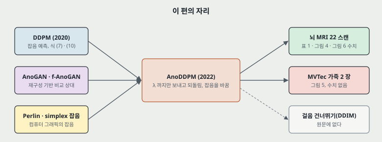

---

## 3. 문제 / 동기

**이 논문이 없앤 전제: 확산 모델을 쓰려면 사슬 전체를 돌아야 하고, 잡음은 가우스여야 한다.**

원문이 적는 순서는 이렇다.

- **GAN 쪽의 한계.** AnoGAN 은 수백 번의 역전파로 잠재 벡터를 다듬어 추론이 느리고, f-AnoGAN 은 Wasserstein GAN 과 부호기로 빠르게 한다. 원문은 이 흐름에 견주어 DDPM 의 장점을 「작은 데이터를 더 잘 잡고, 표본 질이 낫고, 학습이 안정적」 이라 적는다(651쪽). 그 문장에 인용이 없고 결론은 GAN 의 한계로 [27] 을 든다. **이 편이 그 셋을 잰 자리는 없다.**
- **DDPM 쪽의 한계.** 긴 사슬 때문에 규모를 키우기 어렵고 뽑기가 느리다(650쪽).
- **가우스 잡음의 한계(원문의 진단).** 자연 이미지의 주파수 분포는 거듭제곱 꼴이라 낮은 주파수가 이미지에 더 많이 기여하는데, 가우스 흰 잡음은 스펙트럼이 고르다. 그래서 부분 확산한 이미지의 낮은 주파수 성분이 덜 망가지고 큰 이상 구역이 그대로 재구성된다(651 ~ 652쪽).
- **가정.** 「이상 이미지와 정상 이미지가 둘 다 거듭제곱 꼴을 따른다는 가정 아래」 잡음도 비슷한 거듭제곱 꼴로 바꾸려 한다(652쪽). **이 가정을 잰 자리는 없고 지수 값도 적혀 있지 않다.** 인용 [18] · [25] 를 읽지 않았으므로 자연 이미지의 지수를 이 노트에 옮기지 않는다.

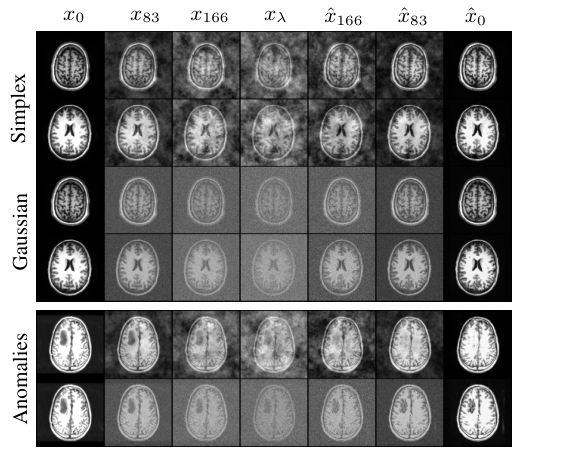

**시점을 얼마로 보내면 얼마나 망가지는가(내 계산).** 원문에 없는 표다. 식 (7) 과 선형 일정(1e-4 ~ 0.02, $T$ = 1000)으로 계산했다.

| $t$ | $\beta_t$ | 신호 계수 $\sqrt{\bar\alpha_t}$ | 잡음 계수 $\sqrt{1-\bar\alpha_t}$ | 신호 대 잡음 $\bar\alpha_t / (1 - \bar\alpha_t)$ | 원문의 자리 |
|---:|---:|---:|---:|---:|---|
| 83 | 0.00173 | 0.963 | 0.271 | 12.64 | 그림 1 의 $x_{83}$ |
| 150 | 0.00307 | 0.888 | 0.460 | 3.72 | 그림 5 의 $\lambda$ |
| 166 | 0.00339 | 0.865 | 0.502 | 2.98 | 그림 1 의 $x_{166}$ |
| 250 | 0.00506 | 0.724 | 0.690 | 1.10 | 기본 $\lambda$ |
| 500 | 0.01004 | 0.280 | 0.960 | 0.085 | 그림 3 아래 |
| 750 | 0.01502 | 0.058 | 0.998 | 0.003 | 그림 3 아래 |
| 1000 | 0.02000 | 0.006 | 1.000 | 0.00004 | 그림 4 끝 |

**이 표는 가우스 판에만 그대로 맞는다.** simplex 판은 같은 계수를 쓰지만 $\epsilon$ 의 크기가 분산 1 로 맞춰졌다는 문장이 없다(5절).

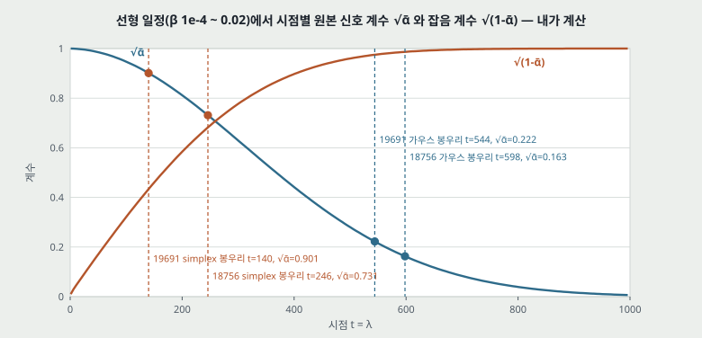

---

## 4. 핵심 기술

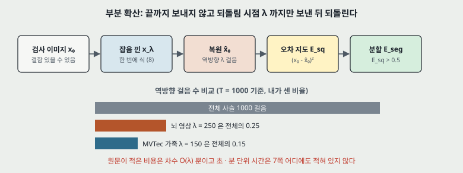

**① 부분 확산.** 검사 이미지 $x_0$ 를 식 (8) 로 한 번에 $x_\lambda$ 까지 보낸다.

$$x_\lambda = x_0 \sqrt{\bar\alpha_\lambda} + \epsilon \sqrt{1 - \bar\alpha_\lambda} \qquad (8)$$

그다음 $t = \lambda, \dots, 1$ 로 역방향 걸음을 돌려 $\hat{x}_0$ 를 얻는다. 원문은 이것을 「입력 질의에 조건을 건 DDPM」 으로 볼 수 있다고 적고, 추론 효율을 $\mathcal{O}(\lambda)$ 라 적는다(652쪽).

**② 점수.** $E_{sq} = (x_0 - \hat{x}_0)^2$ 를 히트맵으로 보이고, 「순진한 문턱(naïve threshold)」 0.5 로 $E_{seg}$ 를 낸다(653쪽). 이미지 하나당 점수 하나를 내는 단계는 없다.

**③ simplex 잡음.** 시작 주파수 $\nu = 2^{-6}$, 옥타브 $N = 6$, 감쇠 $\gamma = 0.8$ 이 기본값이다(「달리 적지 않으면」, 652쪽). 잡음을 만들 때마다 씨앗을 섞고, 3 차원 잡음 함수에서 조각 $t$ 를 잘라 쓴다. 2 차원 함수에서 뽑으면 인공물이 생긴다고 적는다. 옥타브마다 주파수를 몇 배로 올리는지는 적혀 있지 않고, 이어지는 내 계산은 두 배로 둔 값이다.

원문은 그림 2(b) 를 들어 낮은 주파수 하나는 가우스로 근사되지 않지만 옥타브를 늘리면 가까워진다고 적고, 「DDPM 이 잡음을 가우스 분포에서 뽑는다고 가정하므로 이것이 paramount 하다」 고 적는다(652쪽).

**④ 학습 — 알고리즘 1.** 정상 표본만 쓴다.

$$\nabla_\theta \lVert \epsilon - \epsilon_\theta(x_0 \sqrt{\bar\alpha_t} + \sqrt{1 - \bar\alpha_t}\, \epsilon, t) \rVert^2, \quad t \sim \text{Uniform}(\{1, \dots, T\}), \quad \epsilon \sim \text{Simplex}(\nu = 2^{-6}, N = 6, \gamma = 0.8)$$

DDPM 의 $\mathcal{L}_\text{simple}$ 과 꼴이 같고 $\epsilon$ 의 분포만 다르다. **$t$ 를 $T$ 까지 뽑으므로 학습에서 사슬을 줄이지 않는다.**

**⑤ 추론 — 알고리즘 2.** 인쇄된 줄을 옮기면 다음과 같다(어긋남은 14절).

$$x_{t-1} = \frac{1}{\sqrt{\alpha_t}} \left( x_t - \frac{1 - \alpha_t}{\sqrt{1 - \bar\alpha_t}} \epsilon_\theta(x_t, t) \right) + \tilde\beta_t z, \quad z \sim \text{Simplex}(2^{-6}, 6, 0.8)$$

**설정(653쪽).** 확산 걸음 1000 · 선형 일정 · 채널 128 · 채널 배수 1, 1, 2, 3, 4 · 머리 2 · 주의 해상도 32, 16, 8 · 드롭아웃 0 · EMA 0.9999 · AdamW · 학습률 1e-4 · $\beta_1, \beta_2$ = 0.9, 0.999 · 배치 1 · 학습 슬라이스 100 x 5000(곱하면 500,000, 내 계산). U-Net 은 Dhariwal · Nichol 의 것이고 단일 NVIDIA Titan Xp 12GB, PyTorch. 라이브러리 판 번호는 없다.

## 5. 가우스와 무엇이 다른가 — 내가 쟀다

원문은 그림 2 를 눈으로 보이고 「주파수 분포를 정밀하게 조절한다(precisely control)」 고 적는다(652쪽). 스펙트럼을 잰 수는 없다. 그림 2(a) 의 49 칸에서 이미지를 꺼내 쟀다. **칸마다 이미지 한 장이고, 원 잡음이 아니라 그림으로 저장된 값이다.**

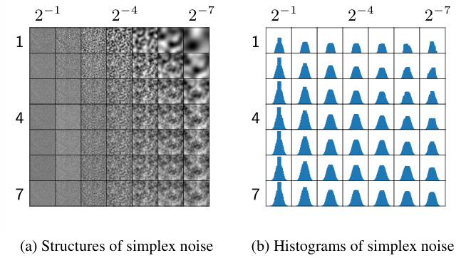

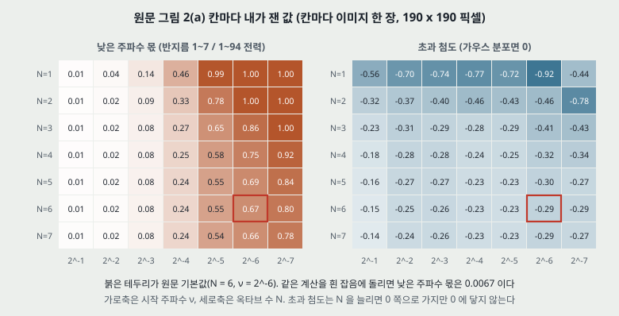

| 칸 | 낮은 주파수 몫 (반지름 1 ~ 7 / 1 ~ 94 의 전력) | 초과 첨도 (가우스면 0) | 스펙트럼 기울기 (반지름 4 ~ 40) |
|---|---:|---:|---:|
| $N$ = 1, $\nu = 2^{-6}$ | 1.00 | -0.92 | -4.16 |
| **$N$ = 6, $\nu = 2^{-6}$ (기본값)** | **0.67** | **-0.29** | **-2.75** |
| $N$ = 7, $\nu = 2^{-7}$ | 0.78 | -0.27 | -2.75 |
| $N$ = 6, $\nu = 2^{-1}$ | 0.01 | -0.15 | 0.03 |
| 흰 잡음(같은 계산을 무작위 200 장에 돌림) | 0.0067 | 재지 않았다 | 재지 않았다 |

읽은 것 셋.

1. **낮은 주파수 몫은 원문의 진단과 같은 방향이다.** 기본값의 0.67 은 흰 잡음의 0.0067 의 100 배다(분모 흰 잡음). 그림으로 저장된 값을 잰 것이라 스펙트럼의 절대 크기가 아니라 비로만 읽는다.
2. **기울기는 진폭 규칙에서 내가 낸 값과 맞는다.** 옥타브마다 주파수를 두 배로 올린다고 두면 벌마다 전력 $\gamma^{2k}$ 가 넓이 $f^2$ 에 퍼지므로 $f^{2\log_2\gamma - 2} = f^{-2.64}$ 이고, 재면 띠에 따라 -2.48(반지름 3 ~ 12) ~ -2.98(12 ~ 48)이다. **두 배는 내 가정이다.**
3. **「가우스에 가까워진다」 는 주변 분포 이야기이고, 0 에 닿지 않는다.** $\nu = 2^{-6}$ 열에서 초과 첨도가 $N$ = 1 의 -0.92 에서 $N$ = 6 의 -0.29 로 가고 $N$ = 7 도 -0.29 다. 더 중요한 것은, **히스토그램은 픽셀 하나의 분포만 본다**는 점이다. 이 잡음의 요점이 이웃 픽셀끼리의 상관인데, 식 (1) · (7) 은 공분산을 $\mathbf{I}$ 로 적는다. 원문은 그 공분산을 다시 적거나, $\epsilon$ 이 비가우스일 때 한 번에 가는 식 (8) 과 걸음을 쌓은 식 (1) 이 같은 분포를 주는지를 유도하지 않는다. 원문에 $\epsilon$ 을 분산 1 로 맞췄다는 문장도 없다. **이 문단의 판단은 내 것이다. 코드를 읽지 않았으므로 정규화를 안 했다는 뜻은 아니다.**

---

## 6. 평가 (읽은 범위)

- **학습 데이터(정상)**: NFBS 저장소 T1 MRI 125 스캔(256 x 256 x 192). 머리뼈를 벗기지 않은 영상을 쓴다. 256 x 192 축면 슬라이스를 $i \in [40, 100]$ 에서 무작위로 고른다. ±3 도 회전, 가로 0.02 · 세로 0.09 평행 이동, 가운데 235 자르기, 256 x 256 으로 크기 조정. **100 스캔 학습 · 25 스캔 시험으로 나눈다.**
- **평가 데이터(이상)**: 에든버러 대학 CCBS 의 뇌종양 T1 MRI 22 스캔(256 x 256 x 156). BrainSuite 로 자기장 불균일을 보정하고, 축면을 가운데 175 x 240 으로 잘라 256 x 256 으로 조정. 종양이 있는 슬라이스 4 장을 같은 간격으로 쓴다.
- **산업 데이터**: MVTec AD 가죽 부류. 흑백으로 바꾸고 1024 x 1024 에서 256 x 256 을 무작위로 자른다. 수치 없음(8절).
- **지표**: Dice · IoU · Precision · Recall(문턱 0.5) · AUC(픽셀 ROC). 표 1 의 AUC 는 스캔마다 평균, 그림 6 은 모든 이미지를 펼쳐서 잰다.
- **비교 상대**: Context Encoder([12] 의 방법), f-AnoGAN([20] 의 방법), 가우스 판. 앞 둘은 캡션의 「평가한 지표」 · 「우리가 계산했다」 로 보아 저자가 잰 값으로 읽힌다. **상대의 학습 설정(반복 수 · 데이터)은 표 1 캡션 두 줄 말고는 적혀 있지 않다.** 다른 논문에서 옮겼다는 문장은 없다.
- **장비**: 단일 Titan Xp 12GB. **재구성 시간은 적혀 있지 않다.**

| 표 1 (655쪽, 문턱 0.5) | Dice | IoU | Precision | Recall | AUC |
|---|---:|---:|---:|---:|---:|
| Context Encoder | 0.252 ± 0.209 | 0.162 ± 0.149 | 0.258 ± 0.223 | 0.279 ± 0.234 | 0.707 ± 0.150 |
| f-AnoGAN | 0.128 ± 0.001 | 0.093 ± 0.003 | 0.362 ± 0.009 | 0.080 ± 0.003 | 0.789 ± 0.001 |
| AnoDDPM 가우스 | 0.009 ± 0.012 | 0.004 ± 0.006 | 0.006 ± 0.009 | 0.032 ± 0.044 | 0.601 ± 0.074 |
| AnoDDPM simplex | **0.383 ± 0.258** | **0.269 ± 0.204** | **0.373 ± 0.269** | **0.468 ± 0.283** | **0.863 ± 0.107** |

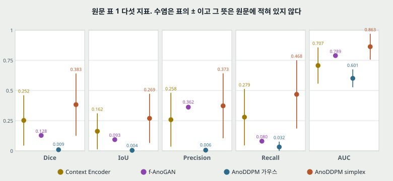

---

## 7. 실험 분석 (논문의 표 · 그림마다)

**직접 돌리지 않는다.** 논문이 낸 실험을 표 · 그림 하나씩 같은 틀로 읽는다. 값 읽기와 재계산은 「내가 센 것」으로 밝힌다.

| 표 · 그림 | 무엇을 바꿨나 (변인) | 무엇을 고정했나 | 결과 | 반복 수 · 흩어짐 | 주장이 결과보다 센가 |
|---|---|---|---|---|---|
| **그림 1** (650쪽) | 잡음 종류(simplex · 가우스), 정상 · 이상 입력 | $\lambda$ = 250, 같은 U-Net | 이미지 행 여섯. 수치 없음. 5 행(simplex)은 종양 자리가 정상처럼 복원되고 6 행(가우스)은 종양이 남아 보인다 | 이상 입력 한 장의 두 행. 반복 없음 | 「가우스는 복원에 실패한다」 를 한 장으로 보인다. 그림 4 에서는 $\lambda$ 를 키우면 가우스 Dice 가 0.219 · 0.373 까지 오르므로 $\lambda$ = 250 조건을 붙여야 한다 |
| **그림 2(a)** (652쪽) | $\nu = 2^{-1} \dots 2^{-7}$, $N$ = 1 ... 7 | $\gamma$ 는 적혀 있지 않다 | 이미지 49 칸. 왼쪽 열은 고운 무늬, 오른쪽 열은 큰 덩어리. 수치 없음 | 칸마다 한 장 | 「주파수 분포를 정밀하게 조절한다」 를 그림으로만 보인다. 내가 잰 낮은 주파수 몫은 0.01 ~ 1.00 으로 움직여 조절된다는 것은 맞고, 「정밀」 을 재는 기준은 없다 |
| **그림 2(b)** (652쪽) | 위와 같음 | 위와 같음 | 히스토그램 49 칸. 그림에 눈금이 보이지 않아 수치를 읽을 수 없다 | 칸마다 한 장 | **세다.** 「가까워진다」 는 내 계산에서 초과 첨도 -0.92 → -0.29 로 맞지만, 픽셀별 분포만 보여 식 (7) 의 공분산 $\mathbf{I}$ 는 건드리지 않는다. 검정 값 없음 |
| **그림 3 위** (653쪽) | $\nu = 2^{-1} \dots 2^{-6}$ | 같은 환자 한 장. $\lambda$ 는 캡션에 없다(기본 250 으로 읽힌다) | 행 여섯. 낮은 $\nu$ 쪽에서 $E_{seg}$ 가 종양 모양에 가까워진다. 수치 없음 | 한 장, 반복 없음 | 본문은 「최대 주파수가 커지면 종양이 더 많이 망가진다」 고 적는데 그림은 $\nu$ 가 **작아지는** 쪽이다. 14절 |
| **그림 3 가운데** | 환자 | $\nu = 2^{-6}$, $\lambda$ = 250 | 행 셋 | 캡션이 **「고른 표본(curated samples)」** 이라 적는다 | 고른 것을 고른 것이라 적어 주장은 세지 않다. 다만 대표성 근거로 쓸 수 없다 |
| **그림 3 아래** | 가우스 $\lambda$ = 250, 500, 750 | 같은 환자 한 장 | 뒤로 갈수록 $E_{seg}$ 가 뇌 전체로 번진다. 수치 없음 | 한 장 | 「가우스가 분명히(clear) 더 질 좋은 표본을 낸다」 에 표본 질을 잰 수가 없다. FID 등 한 줄도 없다 |
| **그림 4** (654쪽) | $\lambda$ = 1 ... 1000, 잡음 둘 | 환자 19691 의 슬라이스 171, 환자 18756 의 슬라이스 170 | 봉우리 Dice: simplex 0.888(140) · 0.694(246), 가우스 0.219(544) · 0.373(598). IoU 는 10절 | 띠가 그려져 있고 뜻과 반복 수가 없다. 내가 읽으니 평균에 대칭이고 0 아래로 내려간다(-0.118) | **세다.** 「최적 $t$ 가 크기 말고도 다른 것에 달렸다」 를 슬라이스 **둘**로 말한다. 종양 크기는 수로 적혀 있지 않다 |
| **격자 탐색** (655쪽, 그림 없음) | $\lambda$ | 평가 데이터 | 「$\lambda$ = 250 이 최적」. 표 · 곡선 없음 | 없음 | 격자 칸과 기준 지표가 없다. **평가 데이터에서 골랐으므로 표 1 의 simplex 값은 조정이 들어간 값이다** |
| **표 1** (655쪽) | 방법 넷 | 문턱 0.5, 평가 데이터 22 스캔. **입력 크기 · 재는 구역은 행마다 다르다** | 위 표 | ± 뜻 없음. 11절 · 12절 | **세다.** 「유의미하게(significantly)」 에 검정이 없고, 「+25.5%」 는 백분율 점이며 상대는 f-AnoGAN 하나다 |
| **그림 5** (654쪽) | 잡음 둘, 가죽 이미지 둘 | $\lambda$ = 150, 문턱은 위 두 행 0.15 · 아래 두 행 0.2 로 **행 짝마다 옮겼다** | 행 넷, 수치 없음. 가우스 행의 $\hat{x}_0$ 에 결함 자취가 남아 보인다 | 이미지 둘, 반복 없음. 캡션이 「예비(Preliminary)」 라 적는다 | **세다.** 캡션은 「예비 · 정성」 인데 본문은 「훌륭한 재구성 · 다른 분야에서도 잘 된다」, 결론은 「의료와 비의료 모두에서 유의미한 향상」 이다 |
| **그림 6** (654쪽) | 방법 넷 | 모든 이상 이미지 픽셀을 펼침 | 범례 AUC 0.89 · 0.80 · 0.73 · 0.59. 내 적분 0.8858 · 0.7972 · 0.7292 · 0.5938 | 곡선 하나씩. 흩어짐 없음 | 「slightly better than randomly」(0.59) · 「generally better than f-AnoGAN」 은 곡선과 맞는다. 14절의 인용 어긋남이 있다 |

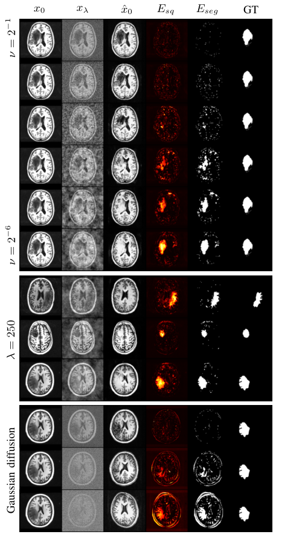

하이퍼파라미터 표(653쪽)는 설정을 적은 표라 실험 행에 넣지 않았다. **그림 없이 문장으로만 적힌 실험적 주장**(「더 빠른 학습」 · 「작은 데이터로 안정적」 · 「고해상도로 확장」)은 10 · 14절에 모았다.

## 8. 산업 쪽에 닿는 범위

**큰 틀 이름이 「산업 이상 탐지」 이지만 이 편의 수치는 전부 의료 뇌 MRI 다.** 산업 데이터에 닿는 것은 다음이 전부다.

- 쓰는 데이터: MVTec AD 15 부류 중 **가죽 하나**, 그림에 **이미지 둘**(원문이 다른 부류를 돌렸다는 문장은 없다).
- 조건: 흑백 변환, 1024 x 1024 에서 256 x 256 무작위 자르기, $\lambda$ = 150, 문턱 0.15 · 0.2. 뇌 영상의 $\lambda$ = 250 · 문턱 0.5 와 다르고, 어떻게 골랐는지 적혀 있지 않다. 정상 가죽으로 몇 번 배웠는지, simplex 설정이 같은지도 적혀 있지 않다.
- 수치: **없다.** 이미지 AUROC · 픽셀 AUROC · PRO 어느 것도 없다. 그래서 MVTec 을 쓰는 PatchCore 같은 편과 같은 칸에 놓을 수 없다.
- 안 잰 것: 표 1 · 그림 6 은 모든 슬라이스가 종양을 담고 있어 **정상 이미지에서의 거짓 경보**를 재지 않는다. 앞서 떼어 둔 정상 25 스캔의 결과는 어디에도 적혀 있지 않다. 공장 검사처럼 정상이 대부분인 자리에서 이 방법이 어떤지는 **이 편이 재지 않았다.** 불가능하다는 뜻이 아니다.
- 원문이 꼽은 다음 자리: x 선 수하물 보안, 생물 이미지, 위조품, 컬러 이미지, 3 차원 이미지(655쪽). **공장 결함 검사는 꼽힌 목록에 없다.**

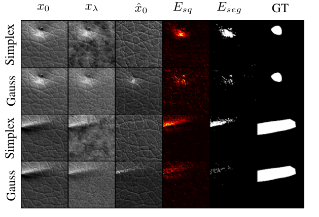

**그림 5 의 범위에서 말할 수 있는 것은 여기까지다.** 가죽 이미지 두 장에서 simplex 판의 복원에 결함 자취가 가우스 판보다 덜 남아 보인다. 눈으로 본 판단이다.

## 9. $\lambda$ 와 잡음 설정을 어느 집합으로 골랐는가

| 무엇 | 원문의 말 | 어느 집합으로 | 판정 |
|---|---|---|---|
| $\lambda$ = 250 | 「격자 탐색으로 이 데이터 집합에 최적임을 경험적으로 찾았다」(655쪽) | 「이 데이터 집합(this particular data set)」. 앞 문장이 그림 4 의 종양 환자 둘이고 3.6절에 나눈 집합이 없다 | **평가 데이터로 골랐다고 읽는다**(내 판단). 정답 마스크 없이는 Dice 곡선을 그릴 수 없다 |
| $\nu, N, \gamma$ = $2^{-6}$, 6, 0.8 | 「달리 적지 않으면 쓴다」(652쪽) | 적혀 있지 않다 | 그림 3 위가 $\nu$ 만 바꿔 평가 환자 한 장에서 보인다. 고른 절차는 없다 |
| 문턱 0.5 | 「순진한 문턱」(653쪽) | 적혀 있지 않다 | 재구성 값의 범위가 적혀 있지 않아 0.5 가 원본 값 차이로 얼마인지 말할 수 없다 |
| 가죽의 $\lambda$ = 150 · 문턱 0.15 · 0.2 | 「옮겼다(moved)」(654쪽) | 적혀 있지 않다 | 이미지 쌍마다 다른 문턱이라 고정 규칙이 아니다 |
| f-AnoGAN 의 제곱 오차 | 「이것이 더 좋은 결과를 줘서」(655쪽 표 캡션) | 적혀 있지 않다 | **상대의 점수 규칙도 결과를 보고 골랐고, 상대에게 유리한 쪽이다** |

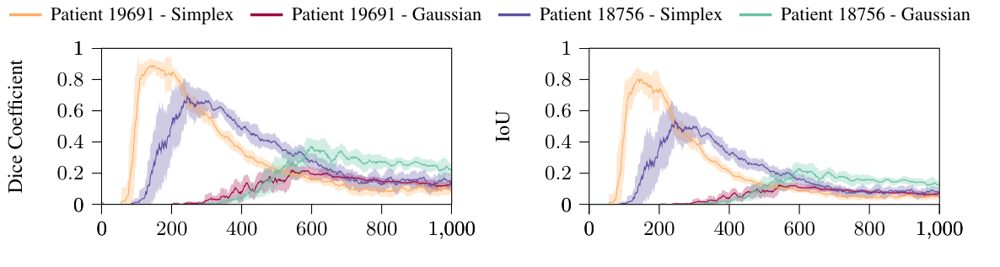

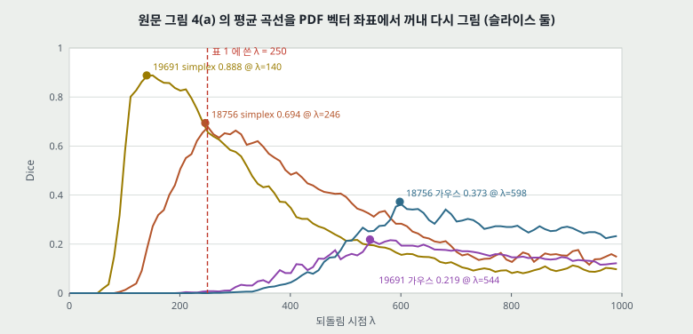

## 10. 그림 4 — 벡터 좌표에서 꺼낸 값

곡선마다 점 1,000 개를 꺼냈다(내가 읽은 값). 괄호 안은 띠의 아래 · 위 값이다. **띠의 뜻은 적혀 있지 않다.**

| 곡선 | 봉우리 Dice | 봉우리 $\lambda$ | $\lambda$ = 250 의 Dice (띠) | 봉우리 IoU | $\lambda$ = 250 의 IoU |
|---|---:|---:|---:|---:|---:|
| 19691 simplex | 0.888 | 140 | 0.655 (0.596 ~ 0.713) | 0.802 | 0.489 |
| 18756 simplex | 0.694 | 246 | 0.680 (0.572 ~ 0.787) | 0.537 | 0.524 |
| 19691 가우스 | 0.219 | 544 | 0.009 (-0.003 ~ 0.020) | 0.124 | 0.004 |
| 18756 가우스 | 0.373 | 598 | 0.000 (0.000 ~ 0.001) | 0.231 | 0.000 |

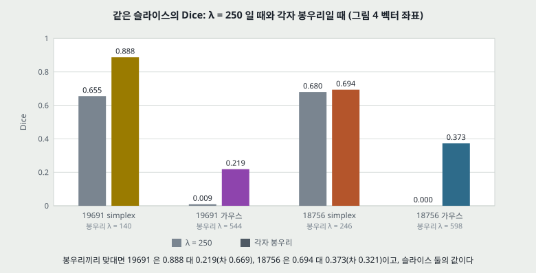

- **가우스 판은 simplex 의 최적 자리에서 재였다.** 표 1 의 가우스 Dice 0.009 는 그림 4 의 $\lambda$ = 250 값(19691 은 0.009, 18756 은 0.000)과 같은 크기이고, 봉우리 값(0.219 · 0.373)과는 다르다. 표 1 캡션에 $\lambda$ 가 없어 「달리 적지 않으면 250」 으로 읽고, 이 일치도 그렇게 읽히는 근거로 둔다. 가우스의 봉우리는 544 · 598 이다. **원문에 가우스 판을 각자의 최적 $\lambda$ 에서 전체 22 스캔으로 잰 값은 없다.**
- **그래도 슬라이스 둘에서는 각자 최적끼리 맞대도 simplex 가 앞선다.** 차이가 0.669 · 0.321 이고 두 칸의 띠가 겹치지 않는다(0.839 ~ 0.938 대 0.158 ~ 0.279, 0.605 ~ 0.783 대 0.317 ~ 0.429). 「가우스가 $\lambda$ 탓에만 진 것」 은 아니다. 다만 둘은 원문이 「큰 종양 둘」 이라 적은 슬라이스이고, 평가에 쓴 88 장에 드는지는 적혀 있지 않다.
- **두 슬라이스의 $\lambda$ = 250 값은 표 1 평균보다 높다.** 0.655 · 0.680 대 평균 0.383.
- **한 값으로 고정해 잃는 몫.** 19691 은 $\lambda$ 140 에서 250 으로 가면 Dice 가 0.888 → 0.655(0.233 감소)이고, 18756 은 0.694 → 0.680(0.014 감소)이다. $\lambda$ 를 스캔마다 고르는 규칙은 원문에 없다.
- **봉우리 왼쪽 벽이 가파르다.** 19691 simplex 는 $\lambda$ = 100 에서 0.540(띠 0.231 ~ 0.850), 150 에서 0.887(0.848 ~ 0.926)이다. 18756 은 100 에서 0.013, 150 에서 0.261 이다. 같은 $\lambda$ = 100 이 한쪽은 띠의 폭 0.619, 다른 쪽은 Dice 0.013 이다. **실행마다 값이 흔들리는 자리가 있다는 뜻으로 읽되, 띠의 뜻이 적혀 있지 않으니 내 해석이다.**
- **「최적 $t$ 는 크기만으로 정해지지 않는다」 를 재려면 크기가 수로 있어야 한다.** 원문은 「큰 종양 둘」 이라고만 적고 픽셀 수가 없다. 표본 둘이라 이 말은 가설이다.
- **신호 계수로 옮기면(내 계산).** simplex 봉우리 $\sqrt{\bar\alpha}$ = 0.901 · 0.731, 가우스 봉우리 0.222 · 0.163 이다. 다만 두 잡음의 크기가 같다는 문장이 없어 이 계수로 두 잡음을 맞대면 안 된다.

## 11. 표 1 — 초록의 세 숫자

초록의 「+25.5% Dice · +17.6% IoU · +7.4% AUC」 를 표에서 뺐다(내 계산).

| 상대 | Dice 차 | IoU 차 | Precision 차 | Recall 차 | AUC 차 |
|---|---:|---:|---:|---:|---:|
| **f-AnoGAN (초록의 값)** | **+0.255** | **+0.176** | +0.011 | +0.388 | **+0.074** |
| Context Encoder | +0.131 | +0.107 | +0.115 | +0.189 | +0.156 |
| 가우스 판 | +0.374 | +0.265 | +0.367 | +0.436 | +0.262 |

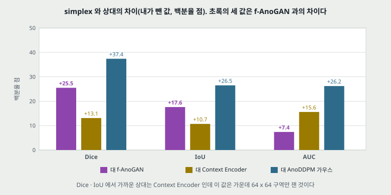

- **초록의 「%」 는 백분율 점이다.** 비로 쓰면 Dice 2.99 배 · IoU 2.89 배 · AUC 1.09 배다(분모 f-AnoGAN).
- **Dice · IoU 에서 차이가 가장 작은 상대는 f-AnoGAN 이 아니라 Context Encoder 다**(0.252 · 0.162). 초록이 f-AnoGAN 하나와 견주는 까닭을 원문은 적지 않는다. AUC 만은 f-AnoGAN 과의 차이가 가장 작다. 다만 Context Encoder 값은 가운데 구역만 쟀다.
- **Precision 은 f-AnoGAN 과 0.011 차이다.** 표의 ± 0.269 의 0.04 배다(분모 ±). 결론이 「segmentation (DICE, IoU) and classification metrics (AUC)」 만 꼽는 것과 맞다. **f-AnoGAN 과 갈리는 자리는 Recall 이다**(0.080 대 0.468, 차 0.388).
- **「유의미하게」 에 검정이 없다.** 원문에 p 값이 없다. Dice 차 0.255 는 simplex 의 ± 0.258 의 0.99 배다. ± 가 22 스캔의 표준편차라면 표준오차는 0.055 이고 차이는 그 4.6 배다(내 계산, 가정). 쌍을 맞춘 검정을 재지 않았으므로 판정은 하지 않는다.
- **「분류 지표(classification metrics)」 라는 이름.** 결론이 AUC 를 이렇게 부르지만 여기서 AUC 는 픽셀 값이다. 이미지 분류를 잰 수는 없다.

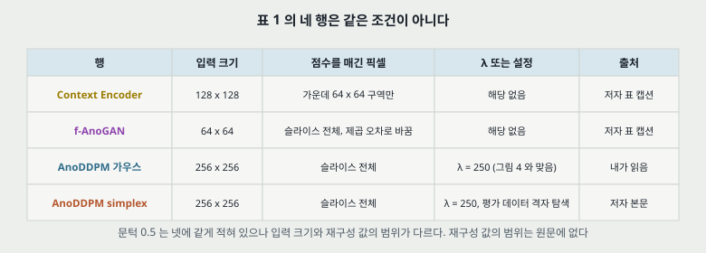

**네 행이 같은 조건이 아니다.** Context Encoder 는 128 x 128 슬라이스의 **가운데 64 x 64 구역만** 재고, f-AnoGAN 은 64 x 64 슬라이스를 제곱 오차로 잰다(캡션). AnoDDPM 두 행은 256 x 256 전체다. 가운데 구역 밖의 종양은 Context Encoder 의 계산에 들어가지 않을 수 있고, 배경 비율도 행마다 다르다. **입력 크기를 맞춰 다시 돌린 행은 없다.** 비교 상대의 값은 저자가 잰 것으로 읽히나 학습 설정은 적혀 있지 않다.

## 12. 표 1 의 ± 를 Dice 와 IoU 로 시험한다

표본 하나에서는 $\text{IoU} = D / (2 - D)$ 가 늘 성립한다. 이 함수가 볼록하므로 표본별 평균을 내면 평균 IoU 가 $\bar{D} / (2 - \bar{D})$ 이상이고, 그 틈이 Dice 의 흩어짐에서 온다. 이계 근사로 틈 $\approx \sigma^2 \cdot 2 / (2 - \bar{D})^3$ 이다(내 유도). 표의 값으로 계산했다.

| 행 | $\bar{D}/(2-\bar{D})$ | 표의 IoU | 틈 | 틈에 필요한 $\sigma$ | 표의 Dice ± | Precision · Recall 의 조화 평균(표의 Dice 와 맞대기) |
|---|---:|---:|---:|---:|---:|---:|
| Context Encoder | 0.144 | 0.162 | 0.018 | **0.218** | **0.209** | 0.268 (0.252) |
| f-AnoGAN | 0.068 | 0.093 | 0.025 | **0.284** | **0.001** | 0.131 (0.128) |
| 가우스 판 | 0.005 | 0.004 | -0.0005 (반올림 안) | 0.000 | 0.012 | 0.010 (0.009) |
| simplex 판 | 0.237 | 0.269 | 0.032 | **0.261** | **0.258** | 0.415 (0.383) |

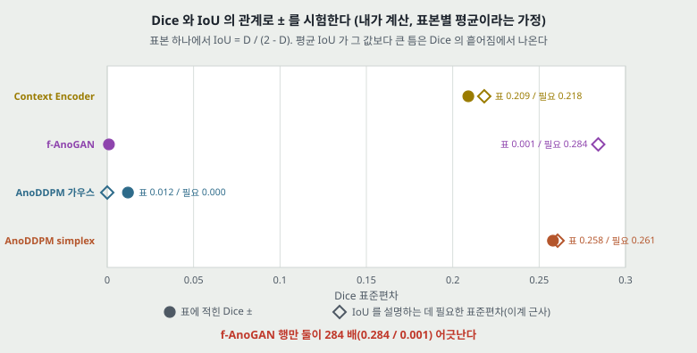

- **simplex 와 Context Encoder 의 ± 는 표본별 표준편차로 읽으면 맞는다.** 필요한 값과 표의 값 차이가 0.003 · 0.009 다.
- **f-AnoGAN 은 맞지 않는다.** Dice 표준편차가 0.001 이면 평균 $\bar{D}$ = 0.128 에서 평균 IoU 의 위 경계가 0.0684 다(점 둘 분포를 뒤져 낸 수). 표의 0.093 은 그보다 0.025 크다. 같은 행의 Precision · Recall 로 내도 Dice 는 0.131 로 표와 맞고 IoU 는 0.070 으로 표와 맞지 않는다.
- **읽는 법 둘.** 하나는 f-AnoGAN 의 ± 가 다른 행과 달리 반복 실행의 흩어짐 같은 다른 양이라는 것이고, 다른 하나는 IoU 0.093 이 다른 집계의 값이라는 것이다. **원문으로는 가릴 수 없다.** 어느 쪽이든 f-AnoGAN 의 ± 0.001 을 simplex 의 ± 0.258 과 나란히 읽으면 안 된다. 초록의 「+17.6% IoU」 는 이 0.093 에서 나온 값이고, 0.068 ~ 0.070 을 쓰면 차이가 0.199 ~ 0.201 이 된다. 곧 이 어긋남은 저자에게 불리한 쪽이다.
- **가정.** 넷 다 같은 표본에서 낸 표본별 평균이라는 가정이다. 표 1 캡션의 「AUC 는 스캔마다 평균」 말고 Dice · IoU 의 집계 단위는 적혀 있지 않다.

## 13. 그림 6 — 곡선 넓이와 낮은 거짓 양성률

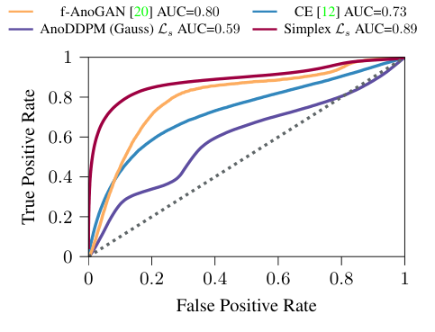

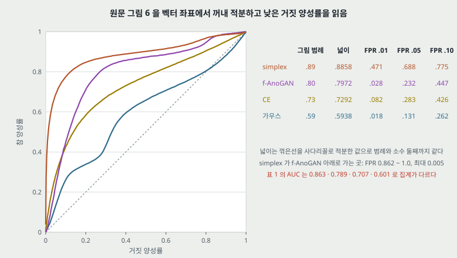

- **범례의 AUC 는 곡선과 맞는다.** 꺾은선을 사다리꼴로 적분하면 0.8858 · 0.7972 · 0.7292 · 0.5938 로 범례 0.89 · 0.80 · 0.73 · 0.59 와 소수 둘째까지 같다(내 계산).
- **표 1 의 AUC 와 다르다.** 0.863 · 0.789 · 0.707 · 0.601 이고 그림 6 과의 차는 +0.027 · +0.011 · +0.023 · -0.011 이다(그림 값에서 표 값을 뺌). 집계 방식이 달라서 그렇다고 캡션으로 읽히지만 까닭을 적은 문장은 없다. 초록은 표 값을 쓴다.
- **곡선 왼쪽 끝이 전체 넓이보다 뚜렷하다.** 거짓 양성률 0.01 에서 참 양성률이 simplex 0.471, f-AnoGAN 0.028, CE 0.082, 가우스 0.018 이다. 거짓 양성률 0.05 까지의 넓이를 그 폭으로 나누면 0.557 · 0.104 · 0.164 · 0.060 이다(내 계산). **나는 이 편의 근거 중 이 자리를 초록의 +7.4 보다 먼저 본다(내 판단)** — 다만 픽셀 수준이고 상대의 입력 크기가 다르다.
- **「대체로(generally)」 는 맞다.** simplex 가 f-AnoGAN 아래로 가는 곳은 거짓 양성률 0.862 ~ 1.0 이고 차이는 최대 0.005 다.
- **픽셀 ROC 의 분모.** 머리뼈를 벗기지 않은 영상 전체라 배경 픽셀이 음성에 들어가는지, 뇌 마스크를 썼는지 적혀 있지 않다. 배경은 오차가 0 에 가까워 맞히기 쉬우므로 분모에 따라 AUC 가 달라진다(내 판단). 수치로 재지 않았다.

## 14. 원문 안의 어긋남 모음

| 자리 | 원문 | 어긋나는 것 | 처리 |
|---|---|---|---|
| 651쪽 식 (9) | $\mu_\theta = \frac{1}{\alpha_t}(\dots)$ | 알고리즘 2 와 DDPM 은 $\frac{1}{\sqrt{\alpha_t}}$. 250 걸음의 곱으로 1.908 대 1.381 이다(내 계산) | 인쇄 오류로 읽는다 |
| 651쪽 $\bar\alpha_t$ | $\prod_{i=0}^{T} \alpha_i$ | $\prod_{i=1}^{t}$ 라야 시점마다 값이 달라진다 | 인쇄 오류로 읽는다 |
| 653쪽 알고리즘 2 의 6 행 | 잡음 항 $+\tilde\beta_t z$ | 식 (2) 의 분산이 $\tilde\beta_t$ 이니 표준편차는 $\sqrt{\tilde\beta_t}$. $t$ = 250 에서 0.07093 대 0.00503, 14.1 배(내 계산) | 코드를 안 읽어 실제로 어느 쪽이 돌았는지 확인하지 않았다 |
| 653쪽 알고리즘 2 의 5 행 | 「$t > 0$ 이면 Simplex, 아니면 $z = 0$」 | 3 행의 고리가 $t = \lambda, \dots, 1$ 이라 $t > 0$ 이 늘 참이다. DDPM 은 $t > 1$ | 인쇄대로면 마지막 걸음에도 잡음이 든다 |
| 651쪽 식 (7) 과 652쪽 알고리즘 1 | 식 (7) 은 공분산 $\mathbf{I}$, 알고리즘 1 은 $\epsilon \sim$ Simplex | 상관이 있는 잡음은 공분산이 $\mathbf{I}$ 가 아니다 | 5절. 원문은 유도하지 않는다 |
| 654쪽 본문 대 그림 3 | 「최대 주파수가 커질수록 더 망가진다」 | 그림은 $\nu = 2^{-1} \to 2^{-6}$ 로 시작 주파수가 **작아지는** 쪽에서 더 망가진다. 내 낮은 주파수 몫도 0.01 → 0.67 이다 | 낱말이 그림과 반대로 읽힌다. $N$ 고정 여부도 적혀 있지 않다 |
| 654 ~ 655쪽의 인용 | 그림 6 캡션 「anomalous MRI image [16]」, 655쪽 「anomalous dataset [16]」 | [16] 은 **정상 학습 데이터** NFBS 다. 이상 데이터는 [14] | 인용 번호 오류로 읽는다 |
| 650쪽 초록 대 표 | 「+25.5%」 | 표로는 백분율 점 | 11절 |
| 650쪽 대 알고리즘 1 | 「사슬이 짧아 추론과 **학습**이 빠르다」 | 알고리즘 1 은 $t \sim \{1, \dots, T\}$ 이고 그림 4 는 $\lambda$ = 1000 까지 쓴다. 한 걸음의 비용이 같으니 학습은 짧아지지 않는다 | **근거 없이 적힌 문장으로 읽는다.** 학습 시간 수치 없음 |
| 650 · 655쪽 대 설정 | 「고해상도로 확장된다」 · 「성능을 유지함을 보장한다(ensures)」 | 실험 입력이 256 x 256 하나다. 가죽도 1024 에서 256 으로 잘랐다. 해상도를 변인으로 둔 행이 없다 | **잰 것보다 세다.** f-AnoGAN 은 64 x 64 라 그 상대보다 큰 것은 맞다 |
| 655쪽 결론 | 「비의료 응용에서도 유의미한 향상」 | 근거가 수치 없는 그림 5 뿐이다 | **잰 것보다 세다.** 8절 |
| 655쪽 결론 | 「큰 데이터가 필요 없는 안정적 학습」 | 학습 곡선 · 데이터 크기 변인 없음. 학습은 100 스캔 하나 | 잰 것보다 세다 |
| 653쪽 설정 | 채널 배수 다섯 · 주의 해상도 32, 16, 8 | 다섯 단계면 네 번 줄여 256 → 16 이라 8 x 8 에 닿지 않는다(내가 셈, 코드 미확인) | 코드를 봐야 안다 |

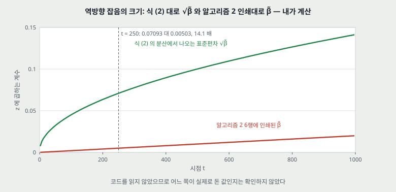

---

## 15. 이 논문이 스스로 적은 한계

1. **simplex 판의 표본 질이 떨어진다(「slight decrease」, 수치 없음).** 뒤 $t$ 로 보낼수록 그렇다고 적고, 잡음 함수의 비대칭을 원인으로 추정한다(「likely」, 655쪽). 다른 잡음 함수를 후속 과제로 든다.
2. **알고리즘이 확률적이다.** $x_\lambda$ 를 여러 번 뽑아 재구성을 평균하는 것을 후속 과제로 든다(655쪽). **곧 이 편의 수는 한 번 뽑기로 읽는다**(그렇다고 명시한 문장은 없다).
3. **고주파 정보 곁의 종양을 잘 못 나눈다.** 뇌 이랑과 고랑 곁이고, 구역마다 잡음 양을 달리하는 메우기를 후속 과제로 든다.
4. **없어야 할 구조를 만들어 넣는다.** 해당 슬라이스에 있으면 안 되는 측뇌실 같은 구조가 복원에 들어간 표본이 있었다. 슬라이스를 조건으로 건 안내 확산을 후속 과제로 든다.
5. **최적 $\lambda$ 가 이상의 크기만으로 정해지지 않는다**(655쪽). $\lambda$ = 250 은 「이 데이터 집합에」 최적이라 적어 일반화하지 않는다.
6. **3 차원 · 컬러 · 다른 분야는 아직 안 했다.** x 선 수하물 보안 · 생물 이미지 · 위조품을 꼽는다.
7. **가우스 잡음은 표본 질은 낫지만** $\lambda$ 를 키우면 세부가 사라지고 $\lambda$ = 750 에서 다른 표본이 나온다(654쪽).

---

## 16. 논문이 적지 않은 것 — 내가 읽으며 짚은 자리

- **재구성 시간 · 학습 시간.** 숫자가 없다. 추론 비용은 $\mathcal{O}(\lambda)$ 뿐이다. 내가 곱해 볼 재료(이미지당 초)도 원문에 없다.
- **반복 수.** 표 1 · 그림 4 · 그림 6 어디에도 실행 수가 없다. 씨앗을 「섞는다」 는 말만 있다.
- **정상 이미지에서의 거짓 경보.** 8절.
- **이미지 수준 탐지.** 점수를 한 장에 한 값으로 모으는 규칙이 없다.
- **걸음을 건너뛰는 추론.** DDIM 은 참고 문헌 29 건에 없고 본문에서 걸음을 건너뛰지 않는다(`DDIM` · `implicit` · `respac` 을 글자 층에서 찾아 0 건). 같은 방법으로 `FID` · `validation` · `p-value` · `seconds` 도 0 건이다. 그림 4 는 $\lambda$ 를 바꿀 뿐 걸음 간격은 1 이다.
- **데이터 사이 차이의 몫.** 학습은 NFBS, 평가는 다른 기관의 스캔이다. 평가 쪽에만 자기장 불균일 보정을 적었고 학습 쪽에는 그런 문장이 없다. 재구성 오차는 이런 차이에서도 나올 수 있는데, 다른 기관의 정상 스캔으로 잰 대조가 없다.
- **슬라이스 범위.** 학습은 $i \in [40, 100]$, 그림 4 의 평가는 슬라이스 170 · 171 이다. 두 스캔의 번호가 같은 해부학 위치를 가리키는지 적혀 있지 않고 스캔 크기도 다르다(192 대 156). 없어야 할 구조가 나온다는 한계 4 와 닿을 수 있어 **남는 질문으로 둔다.**
- **가로세로 비.** 평가 자르기 175 x 240 을 256 x 256 으로 조정하면 가로 1.463 배 · 세로 1.067 배이고, 학습은 235 를 256 으로 두 방향 1.089 배다(내 계산). 원문은 평가 쪽을 「학습 집합의 가로세로 비를 유지하려고」 한다고 적는데, 복셀 간격이 적혀 있지 않아 이 수만으로 확인하지 못했다.

---

## 17. 앞 노트와 맞춰 보기

**DDPM 정리의 「이상 탐지 관점」 문단.** 「정상으로 $\epsilon_\theta$ 를 배우고 $t_0$ 까지 보내고 복원해 차이를 이상 점수로」 라는 절차는 **원문과 같다.** 다만 셋을 고쳐 읽어야 한다.

| 앞선 정리의 문장 | 원문 |
|---|---|
| 「DDPM 의 두 식을 직접 가져다 쓴다」 | 꼴은 같으나 제안 방법은 $\epsilon$ 을 simplex 로 바꾼다. 가우스 판은 비교 상대이고 표 1 에서 Dice 0.009 다 |
| 「$t_0$ 선택이 신호 계수 표와 바로 연결된다. 0.63(t=300) ~ 0.28(t=500) 이 맞바꿈 자리」 | **원문에 없는 연결이다.** 원문은 신호 계수를 쓰지 않고 평가 데이터의 격자 탐색으로 고른다. 그림 4 의 봉우리는 simplex 가 $\sqrt{\bar\alpha}$ 0.901 · 0.731, 가우스가 0.222 · 0.163 이라 어느 쪽도 그 구간 안에 들지 않는다. 표본은 슬라이스 둘이다 |
| 「작으면 결함까지 복원되고 크면 정상 구조까지 바뀐다」 | 원문 문장은 「큰 $\lambda$ 가 큰 이상을 없앤다」 와 「$\lambda$ = 750 에서 다른 표본」(654쪽)이고 그림 4 곡선 모양과 맞는다. 맞는 문장이다 |
| 「역방향 스텝 수만큼 지연이 옮겨진다」 | 원문의 $\mathcal{O}(\lambda)$ 와 맞는다. 시간 수치는 없다 |

**DDIM 정리가 남긴 물음 「걸음을 줄이면 이상 탐지 성능이 어떻게 되나」.** **이 편에 답이 없다.** 이 편이 줄인 것은 **출발 시점**이고 걸음 간격은 1 그대로다. 그림 4 는 $\lambda$ 를 바꾼 곡선이지 걸음을 건너뛴 곡선이 아니다. 한계 2(확률적)를 보면 결정적 재구성이 값이 있을 수 있으나 그것은 내 해석이고, 이 편은 재지 않았다.

**Wide ResNet.** 원문의 U-Net 이 Wide ResNet 을 바탕으로 한다는 한 문장(653쪽)이 있다. PatchCore 가 쓰는 WRN-50-2 처럼 ImageNet 으로 배운 망을 얼려 쓰는 것과는 다르고, 이 U-Net 은 정상 MRI 로 처음부터 학습한다.

**PatchCore.** 같은 칸에 놓을 수 없다. PatchCore 는 MVTec AD 전 부류의 수치를 내고 이 편은 그림 두 장이며, 배우는 방법(얼린 특징 대 처음부터 생성 모델)이 다르다. 맞댄 수는 원문에도 없다.

---

## 18. 내가 가져갈 것

**하나. 닿는 자리 — 재구성 기반 이상 탐지의 절차와 그 대가.** $\lambda$ 까지 보내고 되돌려 오차를 본다는 절차는 분명히 적혀 있고, 모델 하나로 $\lambda$ 를 바꿔 볼 수 있다. 산업 이상 탐지 쪽으로 옮기려면 원문이 안 잰 것 셋이 먼저 필요하다: 정상 이미지의 거짓 경보, 이미지 수준 점수, 부류 전체의 수.

**둘. 옮겨 쓸 수 있는 따져 볼 자리.**

- **조정 집합.** 이상 탐지에서는 정답을 쓰는 조정 집합을 어디서 얻느냐가 늘 문제다. 「$\lambda$ 를 어디서 골랐나」 는 다른 편을 읽을 때도 묻는다.
- **상대를 어떤 설정에서 쟀나.** 가우스 판처럼 제안 방법에 맞춘 값에서 잰 상대를 찾는다. 그리고 각자 최적끼리 맞대도 순서가 유지되는지를 함께 본다. 이 편은 슬라이스 둘에서 유지됐다.
- **± 의 뜻.** Dice 와 IoU 관계로 ± 를 시험하는 12절의 계산은 다른 분할 논문에도 그대로 쓴다.
- **문턱 고정 지표와 문턱 없는 지표를 함께 본다.** 가우스 판은 Dice 0.009 인데 AUC 0.601 이다. 문턱 0.5 를 넘는 픽셀이 없으면 Dice 가 바닥으로 가므로, 이 값은 순위 능력과 오차 크기를 함께 잰 것이다.
- **벡터 그림은 좌표를 꺼낸다.** 곡선 넷의 봉우리와 ROC 넓이가 이렇게 나왔다.

**셋. 지금 확인된 것은 여기까지다.**

| 갈래 | 내용 |
|---|---|
| 논문이 잰 것 | 뇌 MRI 22 스캔에서 표 1, 그림 6. 슬라이스 둘의 $\lambda$ 곡선 |
| 논문이 말만 한 것 | 비의료 응용에서의 향상, 고해상도 확장, 빠른 학습, 작은 데이터에서의 안정, 격자 탐색의 결과, 가우스의 표본 질 우위 |
| 내가 책상에서 낸 것 | 그림 4 봉우리 값, 그림 6 넓이와 낮은 거짓 양성률, 표 1 차이, Dice · IoU 시험, 신호 계수 표, 그림 2 칸별 낮은 주파수 몫 · 초과 첨도 · 기울기, 알고리즘 2 잡음 항의 비 |

---

## 19. 남는 질문

- **가우스 판을 각자 최적 $\lambda$ 에서 22 스캔으로 재면 표 1 이 어떻게 되나.** 이 편에 없다. 슬라이스 둘의 차이는 0.669 · 0.321 이다.
- **조정 집합을 나누면 simplex 의 0.383 은 얼마가 되나.** 이 편에 없다.
- **이미지 수준 AUROC 와 정상 이미지 거짓 경보는 얼마인가.** MVTec 전 부류를 잰 뒤 편이 필요하다.
- **잡음을 바꾼 것이 뒤 편의 산업 방법에 남았는가.** 확산으로 산업 데이터를 잰 뒤 편들을 읽어야 답이 나온다.
- **걸음을 건너뛰어도 성능이 유지되는가.** 이 편에 없다.
- **알고리즘 2 의 $\tilde\beta_t z$ 가 코드에서도 그런가.** 저장소를 읽으면 확인된다. 인쇄된 값이 식 (2) 와 $t$ = 250 에서 14.1 배 다른 자리다.
- **f-AnoGAN 의 ± 0.001 은 무엇인가.** 원문으로는 가릴 수 없다.
- **학습 슬라이스 범위와 평가 슬라이스 번호가 같은 해부학 위치인가.** 16절.

---

## 20. 다음에 읽을 것

| 논문 | 이 노트의 어느 자리에서 나오는가 | 무엇을 확인하고 싶은가 | 원문 참고 문헌 |
|---|---|---|---|
| **f-AnoGAN** (Schlegl 외, Medical Image Analysis 2019) | 11 · 12절 | 표 1 의 상대. 원 점수 규칙과 입력 크기, ± 0.001 이 어디서 오는가 | [20] |
| **Improving Noise** (Perlin, SIGGRAPH 2002) | 3 · 5절 | 잡음 함수의 정의. 옥타브와 주파수 배수 | [13] |
| **Origins of scaling in natural images** (Ruderman, Vision Research 1997) · **Modelling the power spectra of natural images** (van der Schaaf · van Hateren, 1996) | 3절 | 원문이 말만 한 거듭제곱 꼴의 지수 | [18] · [25] |
| **Unsupervised Brain Anomaly Detection and Segmentation with Transformers** (Pinaya 외, 2021) | 3절 | 같은 뇌 영상 재구성 방법의 비교 | [15] |
| 확산으로 산업 데이터를 잰 뒤 편 — 후보: **DiffusionAD** (Zhang 외, TPAMI 2025, arXiv:2303.08730) · **DDAD** (Mousakhan 외, arXiv 2023. 게재처는 찾은 범위에서 확인하지 못했다) | 8 · 19절 | MVTec 전 부류의 이미지 AUROC 와 걸음 수 | **없다.** 2026-11-07 에 후보로 골랐다. 서지는 웹 검색으로 맞췄고 원문은 안 받았다. 읽고 이 자리에 맞는 편인지 가린다 |
| 뇌 쪽 확산 이상 탐지의 다른 길 — 후보: **Diffusion Models for Medical Anomaly Detection** (Wolleb 외, MICCAI 2022, arXiv:2203.04306) | 17절 | 결정적 부호화 + 안내. DDIM 정리의 물음과 닿는지 | **없다.** 2026-11-07 에 후보로 골랐다. 서지는 웹 검색으로 맞췄고 원문은 안 받았다 |

---

## 21. 참고 문헌

- [7] Ho, J., Jain, A., Abbeel, P. (2020). Denoising diffusion probabilistic models. NeurIPS. — 2026-11-06 전에 읽었다.
- [5] Dhariwal, P., Nichol, A. (2021). Diffusion models beat GANs on image synthesis. — U-Net 출처. **읽지 않았다.**
- [11] Nichol, A., Dhariwal, P. (2021). Improved denoising diffusion probabilistic models. — 코사인 일정. **읽지 않았다.**
- [20] Schlegl, T. 외 (2019). f-AnoGAN. Medical Image Analysis 54: 30-44. — 비교 상대. **읽지 않았다.**
- [21] Schlegl, T. 외 (2017). AnoGAN. IPMI. — **읽지 않았다.**
- [12] Pathak, D. 외 (2016). Context encoders. CVPR. — 비교 상대. **읽지 않았다.**
- [13] Perlin, K. (2002). Improving noise. SIGGRAPH. — simplex 잡음의 인용. **읽지 않았다.**
- [2] Bergmann, P. 외 (2019). MVTec AD. CVPR. — 그림 5 의 가죽 부류.
- [14] Pernet, C., Gorgolewski, K., Whittle, I. (2016). A neuroimaging dataset of brain tumour patients. — 평가 데이터. **읽지 않았다.**
- [16] Puccio, B. 외 (2016). The preprocessed connectomes project repository. GigaScience 5(1). — 정상 학습 데이터 NFBS. **읽지 않았다.**
- [18] Ruderman, D. L. (1997). Origins of scaling in natural images. · [25] van der Schaaf, A., van Hateren, J. H. (1996). Modelling the power spectra of natural images. — 거듭제곱 꼴의 인용. **읽지 않았다.**
- [22] Shattuck, D. W., Leahy, R. M. (2002). BrainSuite. — 불균일 보정 도구. **읽지 않았다.**
- [27] Xiao, Z., Kreis, K., Vahdat, A. (2022). Tackling the generative learning trilemma with denoising diffusion GANs. ICLR. — 「모드 포괄」 의 인용. **읽지 않았다.**
- [28] Zagoruyko, S., Komodakis, N. (2016). Wide residual networks. — U-Net 바탕의 인용.
- 코드: `https://github.com/Julian-Wyatt/AnoDDPM`(원문 653쪽). 이 노트는 코드를 보지 않았다.

---

## 22. 경로

| 무엇 | 어디 |
|---|---|
| 원문 PDF (CVF 게재판, 7 쪽) | `papers/CVPRW22_AnoDDPM_Anomaly_Detection_with_Denoising_Diffusion_Probabilistic_Models_using_Simplex_Noise.pdf` |
| 이 노트 | `notes/CVPRW22_AnoDDPM_Anomaly_Detection_with_Denoising_Diffusion_Probabilistic_Models_using_Simplex_Noise.md` |
| 이 노트의 그림 (직접 그린 것) | `figures/CVPRW22_AnoDDPM/fig01_pipeline.svg` 부터 `fig12_lineage.svg` 까지 열둘 |
| 이 노트의 그림 (원문에서 잘라 낸 것) | `figures/CVPRW22_AnoDDPM/paper_fig1_process.png` · `paper_fig2_simplex.png` · `paper_fig3_qualitative.png` · `paper_fig4_sweep.png` · `paper_fig5_mvtec_leather.png` · `paper_fig6_roc.png` |
| 그림을 만드는 코드 | `figures/CVPRW22_AnoDDPM/make_figures.py` — 바깥 데이터를 읽지 않으므로 `python make_figures.py` 로 어디서나 다시 만든다(표준 라이브러리만). 신호 계수 · Dice 와 IoU 의 틈 · 잡음 항의 비를 돌릴 때 찍는다 |
| 원문 그림을 잘라 내는 코드 | `figures/CVPRW22_AnoDDPM/crop_paper_figures.py` — PyMuPDF 가 필요하다 |
