# 단순 순환망 — Finding Structure in Time (요약)

> **한 줄.** 시간을 입력 벡터의 자리로 펼치지 않고, **은닉층의 활성을 다음 걸음의 입력 쪽에 그대로 복사해 두는 것(문맥 유닛)** 만으로 망에 기억을 준다. 복사 연결은 무게 1.0 으로 고정하고 학습하지 않으며, 나머지 연결은 1986 년의 역전파로 배운다. 과제는 다섯 단계로 커진다 — 시간 XOR(비트 3,000 개), 자음 뒤 모음 개수가 정해진 글자 열, 낱말 경계를 지운 글자 열, 낱말 순서만 주어진 짧은 문장, 그리고 학습한 망에 처음 보는 낱말(zog)을 넣는 시험. 모든 과제는 **다음 입력을 맞히는 것** 이고, 근거는 오차가 시간을 따라 오르내리는 그림과 은닉 활성의 계통수다. **실행 횟수 · 학습률 · 시험 집합 성능은 적혀 있지 않다.**

> **이 노트와 앞 노트의 관계.** 역전파(1986) 노트 9절이 같은 자리를 남겼다 — 「되먹임이 있는 망은 시간으로 펼쳐 층처럼 다루면 같은 절차가 돈다. 다만 이 절에는 실험 결과가 없다.」 이 편은 **펼치지 않는 쪽** 을 고른다. 은닉 상태를 복사해 입력처럼 두면 역전파는 한 걸음 안에서 끝나고, 이력을 저장할 필요가 없다. 그 대가를 원문 204 쪽이 스스로 적는다 — 기억이 활성 함수에 거듭 걸려 지수로 줄고, 오차를 늦게 넣는 과제에서는 성능이 나빴다. 이 두 문장이 로드맵 다음 칸(LSTM)이 받는 자리다(23절).

---

## Paper Metadata

| Item | Content |
|---|---|
| Title | Finding Structure in Time |
| Authors | Jeffrey L. Elman (단독) |
| 소속 | Center for Research in Language, University of California, San Diego (La Jolla). 감사의 글에 McClelland · Jordan · Rumelhart · Zipser 등이 적혀 있다 — Jordan(1986)이 이 구조의 앞자리다 |
| Conference / Journal | **Cognitive Science 14(2):179–211, 1990** |
| Year | 1990. 접수 · 게재 날짜는 이 파일에 적혀 있지 않다 |
| DOI | 10.1207/s15516709cog1402_1 |
| 코드 | 본문에 적혀 있지 않다 (1990 년 논문이다) |
| 지원 | 해군연구청(Office of Naval Research) 계약과 육군 항전(Army Avionics, Ft. Monmouth) 계약 |
| Stored PDF | `papers/CogSci90_Elman_Finding_Structure_in_Time.pdf` (바탕화면에서 받은 이름은 `Cognitive Science - March 1990 - Elman - Finding Structure in Time.pdf`, 복사해 넣었고 바탕화면 원본은 남겼다) |
| 왜 읽었는가 | 로드맵 갈래 A(퍼셉트론 → … → Diffusion)를 2026-11-03 에 끝냈고, 갈래 B(순차 데이터)의 첫 칸 RNN 의 대표 논문이다. 역전파 노트 9절의 「되먹임 망」 이 결과 없이 남긴 자리를 받는다 |
| 읽은 범위 | **2026-11-04 에 33 쪽(원문 179–211 쪽)을 전부 읽었다.** 본문 다섯 절과 결론, 표 1–5, 그림 1–9 와 캡션, 각주 1–8, 참고 문헌 목록. 참고 문헌의 편들은 읽지 않았다 |

### 저장한 파일의 상태

- **스캔본이다.** 쪽마다 300 dpi 이미지 한 장(2,550 × 3,300 픽셀)이고, 그 위에 글자 인식 층이 얹혀 있다. 글자 층에는 인식 오류가 섞여 있다 — 소속이 「University of Calcfornia, San Riego」 로, 표 1 · 2 · 5 의 숫자가 흩어져 나온다. **숫자 · 표 · 그림은 전부 쪽을 그림으로 띄워 눈으로 맞췄다.**
- 쪽마다 오른쪽 가장자리에 Wiley 내려받기 도장(2026-11-03)이 찍혀 있다. 원문 쪽 번호는 PDF 쪽 번호 + 178 이다.
- **그림 3 · 4 · 5 · 6 의 곡선 값은 본문에 없다.** 축 상자와 눈금 자리를 픽셀로 찾고 꺾이는 점의 높이를 읽었다. 읽기 오차는 그 자리마다 적는다. 그림 4 · 5 · 6 의 세로축에는 숫자 눈금이 없고 「0 -y- 1」 · 「0 -y- 3.5」 처럼 범위만 찍혀 있다.
- 원문 그림 3 · 4 · 5 · 6 · 7 · 8 · 9 는 다시 그리지 않고 잘라 넣었다(그 절마다). 다시 그린 그림 열다섯은 내가 읽은 값과 계산을 담는다.

---

## 1. 용어

이 노트에서 쓸 이름을 먼저 정한다. 원문의 용어는 괄호로 함께 적는다.

- **단순 순환망 (simple recurrent network, SRN)**: 은닉층의 활성을 다음 걸음에 입력 쪽으로 되돌리는 망. 원문 그림 2 의 이름이다. 지금은 흔히 「Elman 망」 이라 부른다. 작은 예시로, 시간 XOR 의 망은 입력 1 · 은닉 2 · 문맥 2 · 출력 1 개 유닛이다.
- **문맥 유닛 (context units)**: 직전 걸음의 은닉 활성을 그대로 담는 유닛. 은닉 유닛과 한 대 한으로 이어지고(무게 1.0 고정, 학습 안 함), 위로는 은닉 유닛 전부에 이어진다(학습함). 작은 예시로, 걸음 $t-1$ 의 은닉 활성이 $(0.2, 0.9)$ 면 걸음 $t$ 의 문맥은 $(0.2, 0.9)$ 다. 첫 걸음의 문맥은 0.5 로 둔다(182 쪽).
- **상태 유닛 (state units)**: Jordan(1986) 망에서 **출력** 을 되받는 유닛. 원문 그림 1 에서 상태 유닛은 자기 자신에게도 되먹임이 있다. 문맥 유닛과 받는 자리가 다르다(4절).
- **걸음 (time step, cycle)**: 입력 하나를 넣고 출력 하나를 내는 한 번. 원문은 「cycle」 · 「time step」 · 「input cycle」 을 섞어 쓴다. 작은 예시로, 3,000 비트 열을 한 번 통과하면 3,000 걸음이다.
- **통과 (pass, presentation)**: 학습 열 전체를 처음부터 끝까지 한 번 보여 주는 것. 원문은 「pass」 · 「presentation」 을 섞어 쓴다. 작은 예시로, 시간 XOR 은 600 번 통과 = 1,800,000 걸음이다.
- **예측 과제 (prediction task)**: 걸음마다 **다음 입력** 을 출력으로 맞히게 하는 것. 정답은 따로 없고 입력 열을 한 칸 민 것이 과녁이다. 작은 예시로, 입력 열이 `1 0 1 0 0 0` 이면 과녁 열은 `0 1 0 0 0 …` 다.
- **과녁 (target)**: 그 걸음에 맞혀야 할 출력. 원문 그림 4 · 5 · 6 의 괄호 안 글자가 과녁이다(입력이 아니다).
- **원문의 RMS 오차**: 원문이 「root mean squared error」 라고 부르는 값. **원문 그림 3 · 6 의 높이와 문장 과제의 「15.5」 는 제곱근을 씌운 값으로는 나올 수 없고, 제곱 오차의 합으로 읽어야 맞는다**(16절). 이 노트는 원문의 수를 옮길 때 「원문의 RMS」 라고 적고, 그 뜻을 16절에서 가른다. 작은 예시로, 출력 31 개 중 하나만 1 인 과녁에 출력을 모두 0 으로 내면 제곱 오차의 합이 1.0 이고, 원문은 이 값을 「1.0」 이라 적는다.
- **확률 벡터 (likelihood vector)**: 문장 과제에서, 학습 말뭉치에서 지금까지 같은 낱말 열로 시작한 문장들을 모아 다음 낱말의 상대 빈도를 낸 벡터. 시험에서만 과녁 대신 쓴다. 작은 예시로, 「woman」 다음에 오는 낱말이 말뭉치에서 smash 40%, eat 60% 면 그 두 자리가 0.4 · 0.6 이고 나머지가 0 이다(수는 내가 고른 것).
- **유형 · 출현 (type · token)**: 낱말 하나(boy)가 유형이고, 말뭉치 안에서 그 낱말이 나온 한 번 한 번이 출현이다. 작은 예시로, 문장 말뭉치에는 유형이 29 개, 출현이 27,534 개(원문의 세 수 가운데 하나, 9절)다.
- **계통수 (hierarchical cluster diagram)**: 벡터들을 가까운 것부터 묶어 올라간 나무. 가로축이 합쳐지는 거리다. 원문은 거리의 종류와 묶는 규칙(연결 방식)을 적지 않는다.

---

## 2. 한 문단 요약

시간이 걸리는 행동(말, 운동)을 연결주의 망에서 다루는 흔한 방법은 시간을 입력 벡터의 자리로 펼치는 것인데, 그러면 입력을 모아 둘 버퍼가 필요하고, 가장 긴 패턴에 입력층을 맞춰야 하며, 한 칸 밀린 같은 모양이 먼 벡터가 된다(3절). 원문은 대신 **시간을 처리에 미치는 효과로 나타내자** 고 하고, Jordan(1986)의 되먹임 망을 고쳐 **은닉 활성을 문맥 유닛에 복사해 다음 걸음의 입력에 덧붙인다**(4절). 이 망에 다섯 과제를 준다. 시간 XOR 에서는 맞힐 수 있는 자리에서만 오차가 내려가고(그림 3), 자음 뒤 모음 개수가 정해진 글자 열에서는 모음 자리의 오차가 낮고 자음 자리가 높으며, 비트별로 보면 「자음이다」 는 맞히고 「어느 자음인가」 는 못 맞힌다(그림 4 · 5). 낱말 경계를 지운 글자 열에서는 낱말 첫 글자에서 오차가 오르고 낱말 안에서 내려간다(그림 6). 낱말을 서로 직교하는 부호로 준 짧은 문장에서는, 은닉 활성을 낱말별로 평균 내 묶은 계통수가 동사 · 명사, 생물 · 무생물, 사람 · 동물 같은 갈래로 갈린다(그림 7). 처음 보는 낱말 zog 를 man 자리에 넣으면 zog 의 은닉 활성이 사람 쪽 가지에 들어가고(그림 8), 같은 낱말의 출현들은 문장 안의 위치에 따라 다시 갈린다(그림 9). 결론은 넷 — 시간으로 바꾸면 문제의 풀이가 바뀐다, 시간을 따라 변하는 오차가 구조의 단서다, 의존이 길어져도 구조가 있으면 어려워지지 않는다, 표현이 계층을 품는다.

---

## 3. 문제 — 시간을 공간으로 펼치면 (원문 180–181 쪽)

**원문이 드는 단점 셋.** 시간 순서를 벡터의 자리에 대응시키는 방법(Cottrell 외 1987, Elman · Zipser 1988 등이 쓴 것)에 대해:

1. **버퍼가 필요하다.** 입력을 모아 한꺼번에 내놓을 장치가 있어야 하고, 생물이 그런 이동 레지스터를 쓰는지 분명하지 않다. 버퍼 내용을 **언제** 볼지도 정해야 한다.
2. **길이에 단단한 한계가 생긴다.** 입력층을 가장 긴 패턴에 맞춰야 하고, 모든 입력 벡터를 같은 길이로 만들게 된다. 말처럼 길이가 바뀌는 패턴에 비교할 만한 표현을 주기 어렵다.
3. **상대 위치와 절대 위치를 가르지 못한다.** 원문의 두 벡터 `[0 1 1 1 0 0 0 0 0 1]` 과 `[0 0 0 1 1 1 0 0 0 1]` 은 같은 모양이 밀린 것인데 기하로는 멀다. 망이 둘을 비슷하게 다루도록 배울 수는 있지만 그 비슷함은 **가르친 사람이 준 것** 이고 새 패턴으로 일반화되지 않는다.

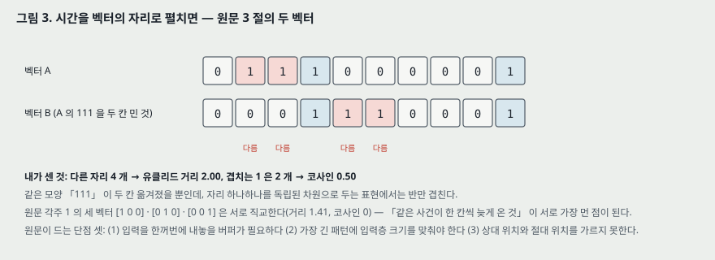

**내가 센 것(그림 3).** 두 벡터는 열 자리 중 넷이 다르다 — 유클리드 거리 2.00, 1 이 겹치는 자리는 둘이라 코사인 0.50 이다. 각주 1 의 세 벡터 `[1 0 0]` · `[0 1 0]` · `[0 0 1]` 은 서로 직교한다(거리 1.41, 코사인 0). 곧 「같은 사건이 한 칸씩 늦게 온 것」 셋이 이 표현에서는 서로 가장 먼 점들이다.

**원문이 원하는 것.** 시간을 입력의 한 차원으로 두지 말고 **처리에 미치는 효과로** 나타낸다 — 망에 기억을 준다.

---

## 4. 망 — 문맥 유닛 (원문 182–184 쪽, 그림 1 · 2)

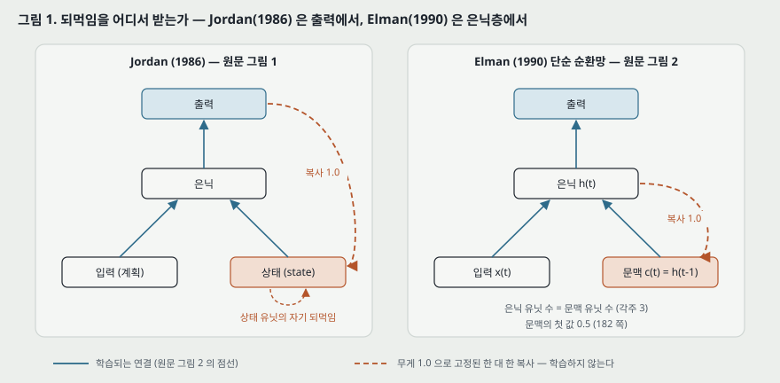

**앞자리 — Jordan(1986).** 정적인 패턴(「계획」)에서 순서 있는 출력(「행동」 열)을 내는 망으로, **출력** 을 상태 유닛에 한 대 한(무게 1.0)으로 되먹이고, 상태 유닛은 자기 자신에게도 되먹임을 갖는다(원문 그림 1). 원문은 이 되먹임이 「망에 기억을 주는 것」 이라고 적는다.

**바꾼 것 — 은닉을 되받는다.** 입력층에 **문맥 유닛** 을 덧붙인다. 이 유닛들은 바깥 세계와 닿지 않는다는 뜻에서 「숨은」 유닛이다. 한 걸음의 순서는 이렇다(원문 182 쪽).

1. 걸음 $t$ 에 입력 유닛이 열의 원소 하나를 받는다. 문맥 유닛의 첫 값은 0.5 다(각주 2: 활성 함수가 0 과 1 사이로 묶여 있다).
2. 입력 유닛과 문맥 유닛이 함께 은닉 유닛을 켜고, 은닉 유닛이 출력 유닛을 켠다.
3. 은닉 유닛이 문맥 유닛으로 되먹인다 — 다음 걸음의 문맥은 **이번 걸음 은닉 값 그대로** 다.
4. 학습하는 걸음이면 출력을 과녁과 견주어 역전파(Rumelhart · Hinton · Williams 1986)로 연결을 걸음마다 고친다(원문 「incrementally」). **되먹임 연결은 1.0 으로 고정하고 고치지 않는다.**

각주 3: 은닉 유닛과 문맥 유닛은 한 대 한으로 이어져 **수가 같고**, 문맥 → 은닉은 모든 쌍이 이어진다.

**식으로 적으면 — 내가 적은 식이다. 원문에는 식이 하나도 없다.** 편향을 쓰는지는 적혀 있지 않아 괄호에 두었다.

$$\mathbf{h}_t = \sigma\left(W_{xh}\mathbf{x}_t + W_{ch}\mathbf{c}_t\ (+\ \mathbf{b}_h)\right), \qquad \mathbf{c}_t = \mathbf{h}_{t-1}, \qquad \mathbf{c}_1 = 0.5 \cdot \mathbf{1} \qquad (1)$$

$$\hat{\mathbf{y}}_t = \sigma\left(W_{hy}\mathbf{h}_t\ (+\ \mathbf{b}_y)\right), \qquad \text{과녁 } \mathbf{y}_t = \mathbf{x}_{t+1} \qquad (2)$$

$\sigma$ 는 로지스틱 함수다(원문은 「0.0 과 1.0 사이로 묶는 활성 함수」 라고만 적는다). 학습되는 무게는 $W_{xh}$ · $W_{ch}$ · $W_{hy}$ 셋이다.

**원문이 붙인 해석.** 앞먹임 망의 은닉 유닛은 입력을 출력에 맞게 다시 부호화한다. 이 구조에서는 은닉 유닛이 **외부 입력과 직전 내부 상태를 함께** 원하는 출력으로 옮겨야 하므로, 그 표현이 「시간 문맥에 민감」 해진다. 그 기억은 글자 그대로의 기록이 아니고 「과제와 자극에 크게 의존하는」 기억이다(184 쪽).

---

## 5. 무엇이 역전파되는가 — 원문이 적지 않은 자리

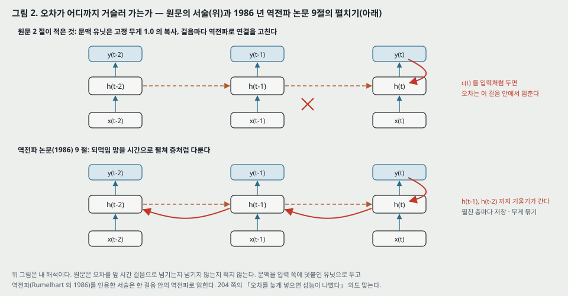

원문은 오차를 **앞 시간 걸음으로 넘기는지 넘기지 않는지** 적지 않는다. 적은 것은 「문맥 유닛은 입력 쪽에 덧붙인 유닛」, 「되먹임은 1.0 고정」, 「역전파로 연결을 고친다」 셋이다. 이 셋을 그대로 읽으면 **문맥 $\mathbf{c}_t$ 를 그 걸음의 상수 입력으로 두는 역전파** 가 된다(내 해석).

$$\frac{\partial E_t}{\partial W_{ch}} = \boldsymbol{\delta}_t\,\mathbf{c}_t^{\top}, \qquad \boldsymbol{\delta}_t = \sigma'(\cdot) \odot \left(W_{hy}^{\top}\,\boldsymbol{\varepsilon}_t\right) \qquad (3)$$

$\boldsymbol{\varepsilon}_t$ 는 출력 쪽 오차 신호다. $\mathbf{c}_t = \mathbf{h}_{t-1}$ 도 $W$ 에 달려 있지만 식 (3) 은 그 몫을 버린다. 역전파 노트 9절의 펼치기(지금 이름으로 BPTT)는 그 몫을 $\mathbf{h}_{t-1}, \mathbf{h}_{t-2}, \dots$ 로 따라가며 더한다. 그러려면 걸음마다 은닉 상태를 저장하고, 펼친 층들의 무게를 묶어야 한다.

**이 해석과 맞는 원문의 문장 둘.** (1) 204 쪽: 「예비 작업에서, 오차를 망에 늦게 넣는 과제의 성능이 나빴다」 — 한 걸음 역전파라면 과녁이 입력보다 여러 걸음 뒤에 올 때 그 사이의 은닉 상태로 오차가 가지 않는다. (2) 같은 쪽: 예측 과제는 「매 학습 걸음마다 되먹임(feedback)을 준다」 는 것을 이 망에 맞는 학습 방식으로 든다.

**그래도 두 걸음 이상의 기억이 생기는 까닭(내 해석).** 은닉 상태 $\mathbf{h}_{t-1}$ 은 걸음 $t-1$ 의 과녁을 맞히도록 배운 것이고, 그 안에 $\mathbf{c}_{t-1} = \mathbf{h}_{t-2}$ 가 들어 있다. 곧 먼 과거는 **각 걸음의 예측에 쓸모 있었던 만큼만** 다음 상태로 넘어간다. 6 · 7절의 실험이 모두 「다음 입력이 곧바로 무언가를 알려 주는」 예측 과제인 것과 맞는다.

---

## 6. 실험 하나 — 시간 XOR (원문 185–187 쪽, 그림 3)

**과제.** 두 비트를 차례로 넣고 그 XOR 을 셋째 비트로 넣는다. 그다음 두 비트 쌍은 무작위로 고르고, 이어 붙여 끊김 없는 열을 만든다. 원문의 예시 열 `1 0 1 0 0 0 0 1 1 1 1 0 1 0 1` 은 세 자리마다 XOR 이 맞다(내가 확인함). 학습 열은 **3,000 비트**, 망은 입력 1 · 은닉 2 · 문맥 2 · 출력 1, 과제는 걸음마다 다음 비트를 맞히는 것, 열을 **600 번** 통과한다.

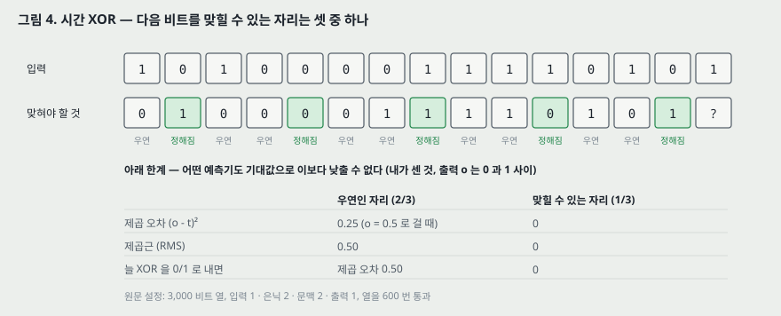

**맞힐 수 있는 자리는 셋 중 하나다.** 첫째 비트를 받은 뒤 둘째 비트는 50% 다. 둘째를 받으면 셋째(XOR)가 정해진다. 셋째를 받은 뒤 다음 쌍의 첫 비트는 다시 50% 다(원문 185 쪽).

**결과 — 그림 3.** 12 걸음 창에서의 오차를 1,200 번 평균했다(본문은 「1,200 cycles」, 캡션은 「1200 trials」). 원문의 말: 「맞힐 수 있는 자리에서 오차가 내려가고, 다른 자리에서는 높다」. 그리고 망은 **모든 자리에서 직전 두 비트의 XOR 을 내려 하는데, 그 사실이 평균에 가려진다** 고 적는다 — 출력 활성을 보면 그렇다는 말이고, 그 활성은 보이지 않는다.

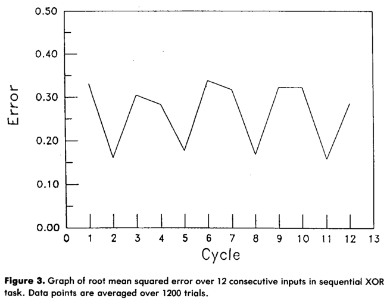

*원문 그림 3 (잘라 넣은 것).*

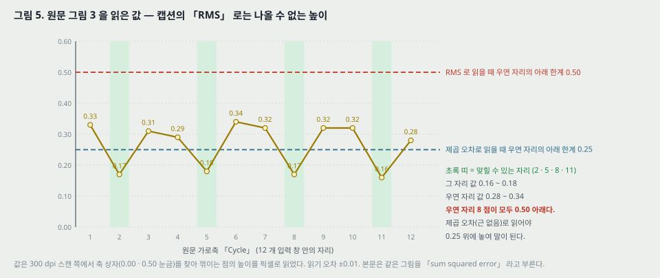

**내가 읽은 값.** 맞힐 수 있는 자리(2 · 5 · 8 · 11)가 0.16 ~ 0.18(평균 0.170), 우연인 자리 여덟이 0.28 ~ 0.34(평균 0.314). 읽기 오차 ±0.01. 두 무리가 겹치지 않으므로 「맞힐 자리에서 내려간다」 는 그림으로 선다.

**캡션의 「root mean squared error」 와 맞지 않는다(내가 센 것).** 우연인 자리의 과녁은 직전 입력과 상관없는 동전이다. 출력 $o \in [0, 1]$ 이 무엇이든 기대 제곱 오차는 $\frac{1}{2}o^2 + \frac{1}{2}(1-o)^2 \ge 0.25$ 이고, 그 제곱근은 0.50 이상이다. 읽은 값 0.28 ~ 0.34 는 0.50 아래이므로 제곱근 값일 수 없다. **제곱 오차(근 없음)로 읽으면 0.25 위에 놓여 맞는다.** 본문은 같은 그림을 「sum squared error」 라고 부르고, 출력이 하나라 합이 곧 그 값이다. 1/2 을 붙인 제곱 오차라면 우연 자리 값은 0.25 를 넘을 수 없어 이것도 맞지 않는다.

**그렇게 읽으면 알게 되는 것 둘(내가 센 것).** (1) 맞힐 수 있는 자리의 0.17 은 아래 한계 0 에서 멀다 — 출력을 0.5 에 두는 것(0.25)보다 0.08 낮을 뿐이다. 원문의 「closely follows the above schedule」 은 오르내리는 **모양** 에 대한 말로 읽어야 한다. (2) 우연 자리의 0.31 은 0.25 보다 높고, 늘 0/1 로 XOR 을 내는 예측기의 0.50 보다 낮다. 「모든 자리에서 XOR 규칙을 쓴다」 는 원문의 말과 같은 방향이지만, 출력이 0 이나 1 에 붙어 있지는 않다는 뜻이다.

**은닉 유닛 둘이 한 일(원문 186–187 쪽).** 한 유닛은 같은 비트가 이어질 때(1 만 또는 0 만), 다른 유닛은 비트가 번갈아 올 때 크게 켜진다 — 「높은 · 낮은 주파수에 민감한 유닛」. 앞먹임 망이 두 비트를 한꺼번에 받을 때의 풀이와 다르다는 것이 원문의 요점이고, 원문은 「시간으로 바꾸면 문제의 성격이 바뀔 수 있다. 더 쉬운지 어려운지는 분명하지 않다」 고 적는다. **이 해석의 근거가 되는 활성 값이나 그림은 실려 있지 않다.**

**예측 과제를 고른 까닭.** 자기 연상(입력을 그대로 내기)은 시간 구조 없이도 풀리므로 쓸모가 없다. 다음 입력을 맞히는 과제는 풀려면 시간 구조에 민감해야 한다(187 쪽).

---

## 7. 실험 둘 — 글자 열의 구조 (원문 187–191 쪽, 표 1, 그림 4 · 5)

**과제.** XOR 보다 비트가 많고(6 비트), 기억이 길며(최대 세 걸음), 길이가 바뀌는 패턴. 자음 b · d · g 를 무작위로 **1,000 개** 늘어놓고, b → ba, d → dii, g → guuu 로 바꾼다. 글자 여섯을 표 1 의 6 비트 벡터로 넣는다. 망은 입력 6 · 은닉 20 · 문맥 20 · 출력 6, 열은 끝에서 처음으로 되감기고, **200 번** 통과한다. **시험은 같은 규칙으로 다른 무작위 순서에서 만든 열이다** — 이 논문에서 학습 열과 다른 열로 잰 유일한 과제다.

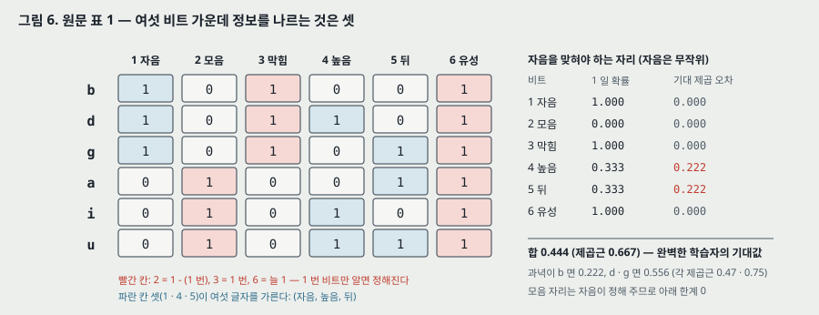

**표 1 을 맞춰 본 것(내가 센 것).** 여섯 비트 중 셋은 1 번(자음)에서 정해진다 — 2 번(모음)은 1 번의 반대, 3 번(막힘)은 1 번과 같고, 6 번(유성)은 여섯 글자 모두 1 이다. 글자 여섯을 가르는 것은 1 · 4 · 5 번(자음, 높음, 뒤) 셋이다. 열의 기댓값 길이는 자음 1,000 개 × (2 + 3 + 4)/3 = 3,000 글자다.

**자음 자리의 아래 한계(내가 센 것).** 자음은 무작위라 다음 자음을 맞혀야 하는 자리에서는 완벽한 학습자도 틀린다. 1 · 2 · 3 · 6 번 비트는 정해지고, 4 번(높음)은 d 만 1 이라 1 일 확률 1/3, 5 번(뒤)은 g 만 1 이라 1/3 이다. 비트마다 확률을 내는 예측기의 기대 제곱 오차는 $2 \times \frac{1}{3} \cdot \frac{2}{3} = 0.444$ 이고, 과녁이 b 면 0.222, d · g 면 0.556 이다. 모음 자리는 직전 자음이 모음과 개수를 정하므로 아래 한계가 0 이다.

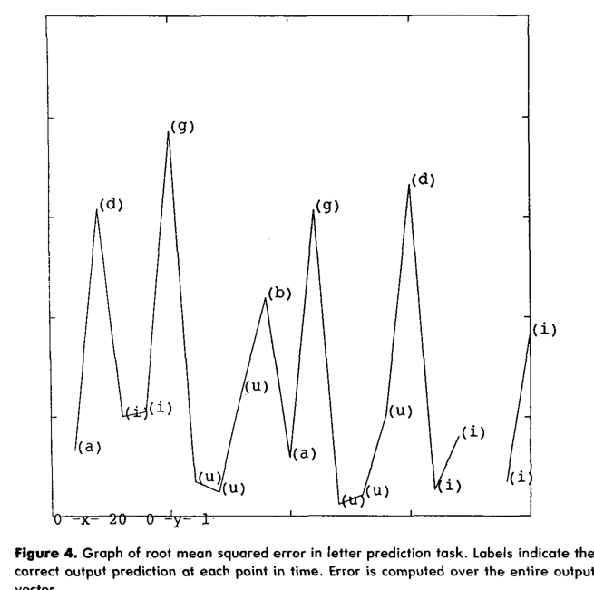

*원문 그림 4 (잘라 넣은 것). 괄호 안 글자는 과녁이다.*

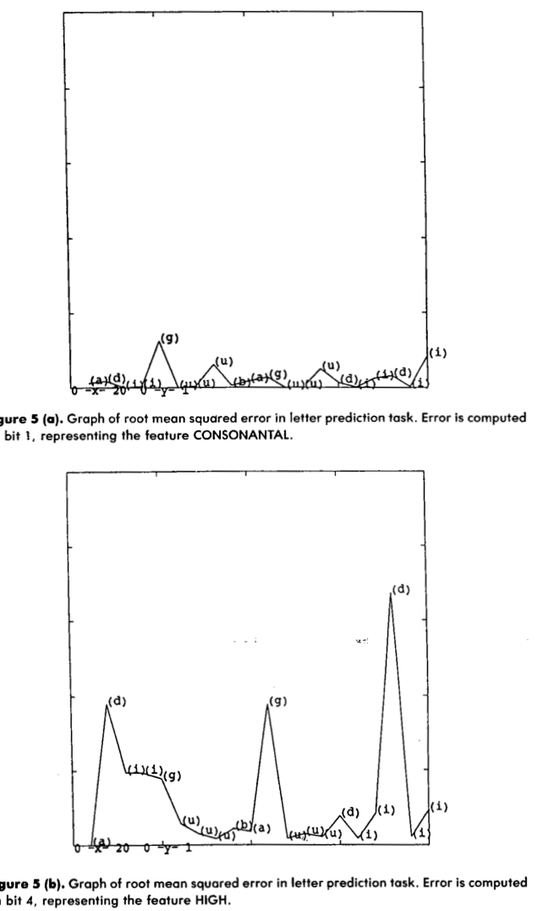

*원문 그림 5(a) · 5(b) (잘라 넣은 것).*

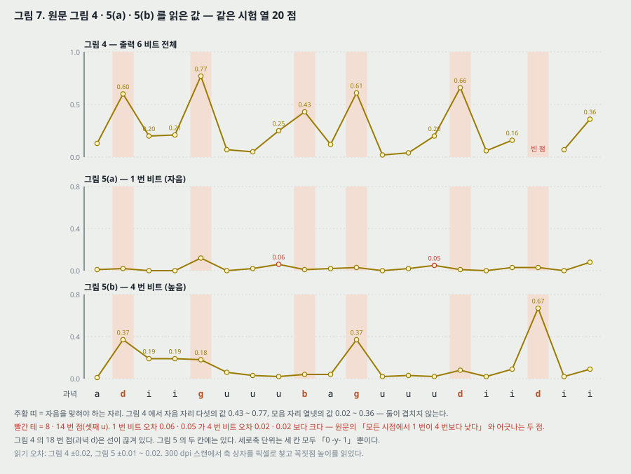

**원문의 말과 내가 읽은 값.**

| 원문 | 내가 읽은 값 (같은 시험 열 20 점) | 판정 |
|---|---|---|
| 자음을 맞힐 때 오차가 높고 모음을 맞힐 때 낮다 (그림 4) | 자음 자리 다섯 0.43 ~ 0.77, 모음 자리 열넷 0.02 ~ 0.36 (±0.02) | 두 무리가 겹치지 않는다 — 선다 |
| 망은 모음이 몇 개 올지 안다 | 셋째 u(8 · 14 번 점)에서 그림 4 가 0.25 · 0.20, 첫째 · 둘째 u 는 0.02 ~ 0.07 | 가장 긴 모음 열의 마지막 자리에서 오차가 오른다 — 개수 세기가 가장 긴 열에서 덜 맞는다 |
| 1 번 비트 오차는 4 번 비트보다 「모든 시점에서」 낮다 (그림 5) | 20 점 중 8 · 14 번에서 1 번 비트 0.06 · 0.05, 4 번 비트 0.02 · 0.02 (±0.01) | **두 점에서 어긋난다.** 나머지 18 점에서는 같거나 낮다 |
| 앞먹임 망은 바로 앞 입력에서 다음으로의 전이 확률은 배우지만 두 입력을 넘는 패턴은 못 배운다 | 이 비교 실험은 실려 있지 않다 | 말로만 적었다 |

**4 번 비트(높음)를 자음 자리에서 보면(내가 센 것).** 과녁이 d 인 세 자리에서 0.37 · 0.08 · 0.67, g 인 두 자리에서 0.18 · 0.37, b 에서 0.04 다. 확률 1/3 을 내는 예측기라면 d 에서 0.667, b · g 에서 0.333 이다. 18 번 점(d, 0.67)은 그 값과 같고, 15 번 점(d, 0.08)은 망이 「높음」 을 0.92 로 걸어 맞힌 자리다. 자음이 무작위이므로 점 여섯으로는 망이 확률을 내는지 한쪽에 거는지 가를 수 없다.

**그림 4 의 18 번 점이 그려져 있지 않다.** 17 번(i)에서 선이 끊기고 19 번(i)에서 다시 시작한다. 그림 5 의 두 칸에는 18 번(과녁 d)이 있다. 그림 4 · 5 의 세로축 단위는 「0 -y- 1」 뿐이고, 그림 4 캡션은 「root mean squared error … over the entire output vector」, 본문은 「sum squared error over all 6 bits」 라고 적는다. 그림 4 의 값만으로는 어느 쪽인지 가를 수 없다(16절).

**원문의 교훈(191 쪽).** 「의존이 길어져도 반드시 더 어렵지는 않다. 의존에 구조가 있으면 그 구조가 학습을 쉽게 할 수 있다.」 근거는 XOR 과 이 과제를 견준 것인데, **두 과제는 은닉 크기(2 대 20) · 통과 수(600 대 200) · 입력 크기 · 오차의 종류가 모두 달라** 「의존 길이」 하나만 바꾼 비교가 아니다(18절).

---

## 8. 실험 셋 — 「낱말」 이라는 단위 (원문 191–194 쪽, 표 2, 그림 6)

**물음.** 낱말 경계를 표시하지 않은 글자 열에서 다음 글자를 맞히게 하면, 「낱말」 에 해당하는 무언가가 생기는가. 원문은 언어학에서도 「음소 · 형태소 · 낱말」 의 경계가 분명하지 않다는 데서 시작한다(191 쪽).

**데이터.** 낱말 **15 개** 의 어휘로 문장 생성기가 길이 4 ~ 9 낱말의 문장 **200 개** 를 만들고, 이어 붙여 낱말 **1,270 개**, 글자 **4,963 개** 의 열을 만든다. 글자마다 5 비트 벡터를 준다. 망은 입력 5 · 은닉 20 · 문맥 20 · 출력 5, 열을 **10 번** 통과한다. 원문: 오차는 그때 「relatively high」 였고, 열 전체를 외우려면 「10 번보다 훨씬 많은(far more than 10)」 통과가 필요했을 것이다.

**내가 센 것.** 문장 하나에 낱말 1,270 / 200 = 6.35 개, 낱말 하나에 글자 4,963 / 1,270 = 3.91 개.

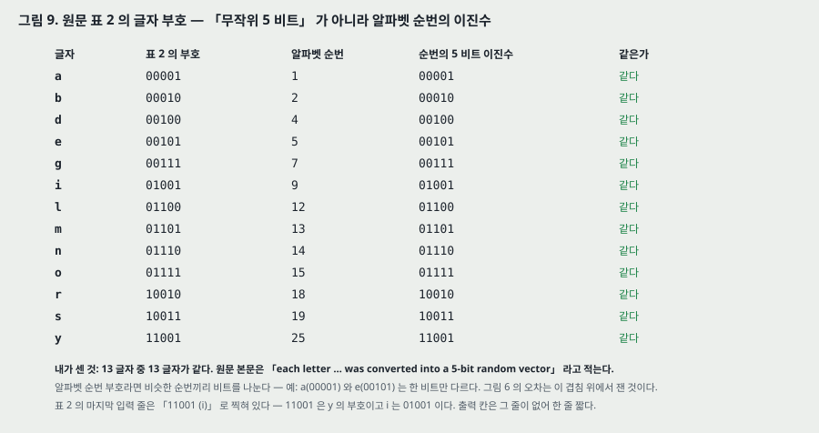

**표 2 의 부호는 무작위가 아니다(내가 센 것).** 본문은 「each letter … was converted into a 5-bit random vector」 라고 적는다. 표 2 에 나온 13 글자의 부호는 **13 개 모두 알파벳 순번의 5 비트 이진수** 다(a = 00001, b = 00010, … y = 11001 = 25). 이 부호에서는 순번이 가까운 글자끼리 비트를 나눈다 — a(00001) 와 e(00101) 는 한 비트만 다르다. 그림 6 의 오차는 이 겹침 위에서 잰 것이다. 표 2 의 마지막 입력 줄은 「11001 (i)」 로 찍혀 있는데 11001 은 y 의 부호이고, 출력 칸은 그 줄이 없어 한 줄 짧다.

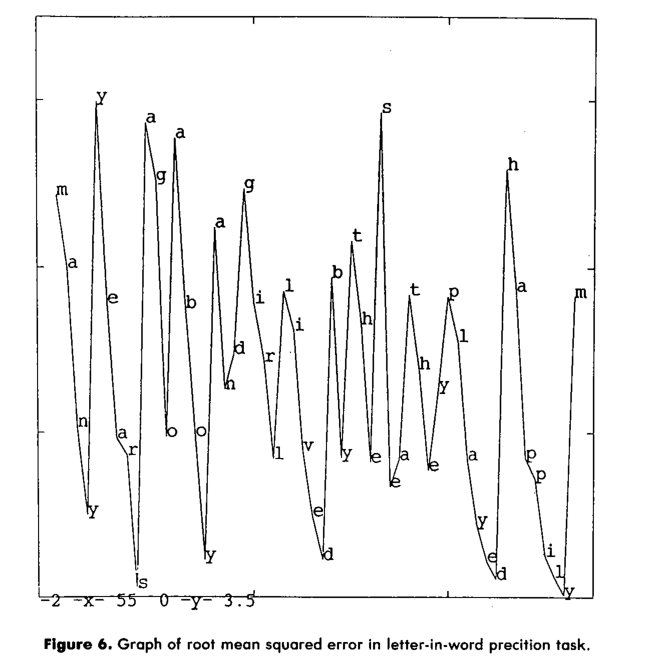

*원문 그림 6 (잘라 넣은 것). 점마다 적힌 글자는 그 자리에서 맞혀야 할 글자다.*

**결과 — 그림 6.** 원문: 새 낱말이 시작하는 자리에서 오차가 높고, 낱말을 더 받을수록 내려간다. 오차는 범주가 아니라 공기(co-occurrence) 통계를 반영하므로 경계 기준이 상대적이고, 「they」 의 y 처럼 모호한 자리가 생기며, 자주 같이 나오는 여러 낱말이 한 덩이로 잡힐 수도 있다 — 아이들이 관용구를 한 낱말처럼 다루는 것과 같다고 적는다(MacWhinney 1978).

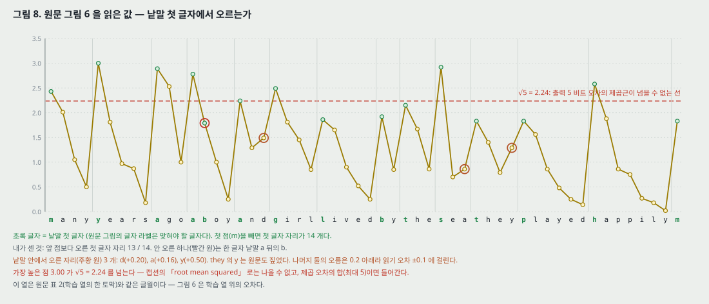

**내가 읽은 값(읽기 오차 ±0.1).** 그림 6 의 54 점은 「many years ago a boy and girl lived by the sea they played happily」 와 다음 낱말의 m 이다. 첫 점을 빼면 낱말 첫 글자 자리가 14 개다.

- **앞 점보다 오른 첫 글자 자리: 14 개 중 13 개.** 오르지 않은 하나는 한 글자 낱말 「a」 뒤의 b(boy)다 — a 자체가 첫 글자 자리여서 이미 높았다(2.78 → 1.79).
- **낱말 안에서 오른 자리: 셋.** and 의 d(+0.20), sea 의 a(+0.16), they 의 y(+0.50). they 의 y 는 원문도 짚었다. 나머지 둘의 오름은 0.20 이하라 읽기 오차 ±0.1 에 걸린다.
- 곧 「앞 점보다 오르면 경계」 라는 규칙 하나로 이 토막을 자르면 경계 14 개 중 13 개를 잡고, 낱말 안에 경계를 하나(they 의 y) ~ 셋 더 넣는다. **원문은 이런 셈을 하지 않았다.** 「boundaries are relative」 를 이 토막에서 수로 옮긴 것이 위 셋이다.

**이 열은 학습 열이다(내가 확인함).** 표 2 의 제목이 「Fragment of Training Sequence」 이고, 그림 6 의 54 글자가 표 2 의 글월과 같은 글월이다. 낱말 경계가 오차에 나타나는지는 **학습한 열 위에서** 본 것이다. 15 낱말 어휘로 만든 200 문장이라 같은 글월이 되풀이되는지도 적혀 있지 않다.

**원문 스스로 단 단서(193 쪽).** 「이 시뮬레이션을 낱말 습득의 모형으로 받아들이면 안 된다」 — 예측은 언어 학습자의 주된 목표가 아니고, 소리의 공기는 낱말을 정하는 정보의 일부일 뿐이며, 말이 쓰이는 환경과 언어 문맥이 같은 무게로 중요하다. 이 실험이 보이는 것은 「경계의 단서가 될 정보가 신호 안에 있고, 단순 순환망이 그것을 뽑을 수 있다」 는 데까지라고 적는다.

---

## 9. 실험 넷 — 낱말 순서에서 품사 찾기 (원문 194–201 쪽, 표 3 · 4 · 5, 그림 7)

**물음.** 영어의 낱말 순서 규칙은 많고 복잡하며, 흔히 추상 구조(Chomsky 1957, 1965)와 기호 처리로 설명한다. 표면의 낱말 열만 보고 망이 그 추상 구조의 일부라도 배울 수 있는가(194–195 쪽).

**데이터(원문 195–197 쪽).**
- 범주: 본문은 「Thirteen classes of nouns and verbs」, **표 3 은 12 줄** 이다(NOUN-HUM · ANIM · INANIM · AGRESS · FRAG · FOOD, VERB-INTRAN · TRAN · AGPAT · PERCEPT · DESTROY · EAT). 한 낱말이 여러 범주에 들 수 있다(break 는 AGPAT 과 DESTROY 둘 다). 낱말은 **29 개**. 그림 7 의 잎이 29 개다(내가 셈 — 동사 11, 명사 18).
- 틀: 본문은 「15 sentence templates」, **표 4 는 16 줄** 이다. 두 낱말 틀이 넷(HUM INTRAN · HUM AGPAT · ANIM AGPAT · INANIM AGPAT), 세 낱말 틀이 열둘.
- 두 · 세 낱말 문장 **10,000 개** 를 만들고, 낱말마다 31 비트 중 한 비트만 켠 벡터를 준다(29 + 남겨 둔 2 비트). 원문은 「서로 직교하고 품사나 뜻에 대해 아무것도 반영하지 않는다」 고 적는다. 문장 사이에 끊김 없이 이어 붙인다.
- 망: 입력 31 · 은닉 150 · 문맥 150 · 출력 31. 과제는 다음 낱말 맞히기, 열을 **6 번** 통과.

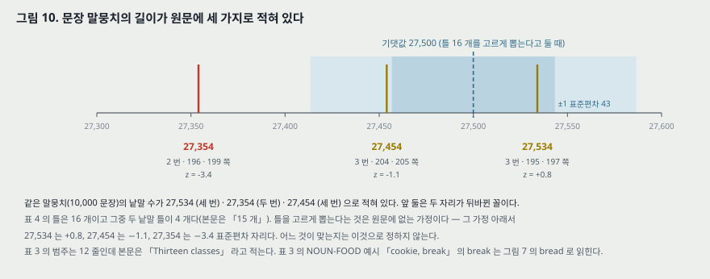

**말뭉치 길이가 세 가지로 적혀 있다.** 27,534(195 · 197 쪽, 세 번) · 27,354(196 · 199 쪽, 두 번) · 27,454(204 · 205 쪽, 세 번). 쪽 이미지에서 여덟 자리를 모두 맞춰 봤다. **틀 16 개를 고르게 뽑는다고 두면**(원문에 없는 가정) 문장당 2.75 낱말, 10,000 문장의 기댓값 27,500 · 표준편차 43 이고, 세 수의 z 는 +0.8 · −3.4 · −1.1 이다. 이것으로 어느 수가 맞는지는 정하지 않는다.

**결과 1 — 실제 다음 낱말과의 오차(197 쪽).** 학습 뒤 원문의 RMS 0.88. 출력이 31 개 중 하나만 켜지는 성긴 과녁이라 망은 모든 출력을 끄는 것을 금방 배우고, 그것만으로 처음 무작위 값 「~15.5」 가 1.0 으로 떨어진다. 원문: 「이렇게 보면 0.88 은 인상적이지 않다.」

**결과 2 — 확률 벡터와의 오차(198 쪽).** 다음 낱말은 정해지지 않으므로 망은 가능한 다음 낱말들의 빈도를 출력해야 한다. 학습 말뭉치에서 지금까지 같은 낱말로 시작한 문장들을 모아 다음 낱말의 확률을 내고(1절 「확률 벡터」), 그것을 과녁 삼아 시험하면 **원문의 RMS 0.053 (SD 0.100)**, 출력과 확률 벡터의 **코사인 평균 0.916 (SD 0.123)**. 원문은 출력 합이 1 이 아닐 수 있어 길이를 뗀 코사인을 함께 적었다. **둘 다 학습 집합 위의 값이다**(원문 「on the training set」 · 「on training items」). 비교 기준(예: 앞 낱말 하나만 보는 예측기의 값)은 없다.

**결과 3 — 계통수(그림 7).** 학습 뒤 무게를 얼리고 말뭉치를 한 번 더 통과시켜 낱말 출현마다 은닉 벡터(150 차원)를 모은다. 같은 낱말의 출현을 평균 내 29 개 벡터를 만들고 계통수로 묶는다.

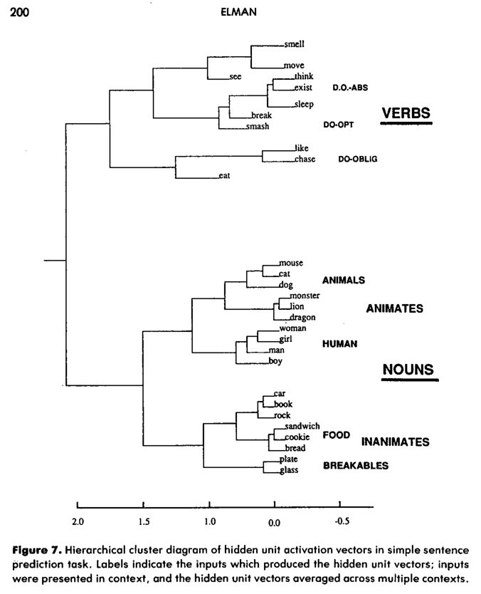

*원문 그림 7 (잘라 넣은 것).*

원문이 읽은 갈래: 동사와 명사가 크게 갈리고, 동사는 목적어가 필요한 것 · 없는 것 · 있어도 되는 것으로, 명사는 생물과 무생물로, 생물은 사람과 동물로, 동물은 큰 것과 작은 것으로, 무생물은 깨지는 것 · 먹는 것 · 행위자 없는 능동 동사의 주어로 갈린다. 「chase · break · smash 앞에 늘 오는 무리가 있다는 데서 큰 동물을 한 무리로 추론한다」 (199 쪽).

**짚을 것 셋.**
1. **평균이 만드는 무늬(각주 6).** 원문 각주가 Tony Plate 의 지적을 그대로 싣는다 — 은닉 활성은 앞 입력에 크게 달려 있고 앞 입력은 범주마다 다르게 분포하므로, **학습하지 않아도** 같은 범주 낱말들의 평균 벡터가 서로 비슷해질 수 있다. 그래서 출현 단위로 다시 묶어 확인해야 한다고 적는다. 그 확인은 11절에 「수치 결과로 보면 나무가 같다」 는 문장 하나로 나온다 — 수치는 없다.
2. **가로축 라벨(그림 12).** 그림 7 · 8 의 가로축은 간격이 같은 눈금 다섯에 「2.0 1.5 1.0 0.0 −0.5」 가 찍혀 있다. 한 칸만 1.0 이고 나머지는 0.5 다. 잎 선이 「0.0」 눈금 좌우에서 끝나므로, 이 노트는 앞 셋을 0.5 씩 내린 「1.5 1.0 0.5 0.0 −0.5」 로 읽는다(읽기 B). 거리의 종류와 묶는 규칙은 적혀 있지 않다.
3. **표 3 의 예시 「cookie, break」.** NOUN-FOOD 의 예시에 break 가 있다. 그림 7 의 먹는 것 갈래는 sandwich · cookie · bread 라 bread 의 오식으로 읽힌다.

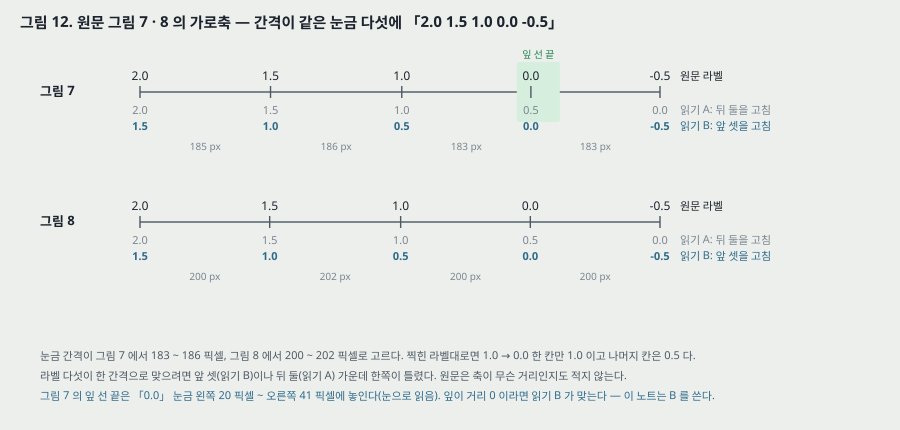

**원문이 강조한 셋(200–201 쪽).** 범주가 계층을 이룬다(dragon 은 큰 동물이면서 [−사람, +생물] 명사), 계층이 「부드럽고 암묵적」 이다, 그리고 망은 범주의 **내용** 을 모른다 — 구조 정보를 실제 세계에 붙일(ground) 정보가 없다. McClelland 의 비유가 각주 7 에 있다: 「라디오만 듣고 말을 배우는 것과 같다.」

---

## 10. 새 낱말 zog (원문 201–203 쪽, 그림 8)

**절차.** 학습한 망을 얼린다. 학습에 없던 비트 패턴을 낱말 zog 에 주고, man 이 올 수 있는 자리마다 man 대신 zog 를 넣어 **새 문장 10,000 개** 를 만든다. 한 번 통과시켜 은닉 활성을 모으고 같은 방식으로 묶는다.

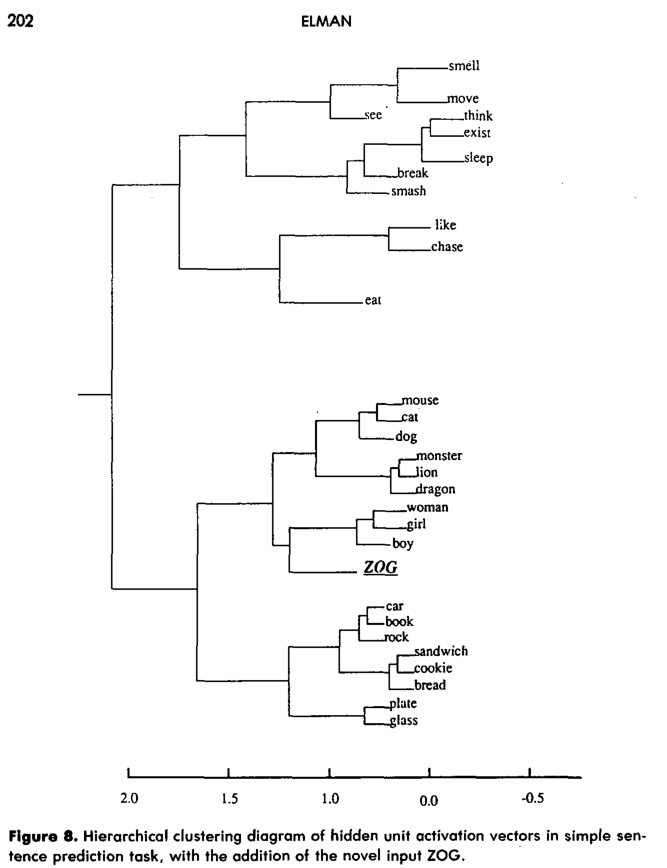

*원문 그림 8 (잘라 넣은 것). man 이 없고 ZOG 가 있다.*

**원문의 말.** zog 의 내부 표현은 학습 말뭉치에서 man 이 다른 낱말들과 맺던 관계를 그대로 맺는다. 망은 어떤 문맥에서 「man 이나 그와 아주 비슷한 것」 을 기대한다. 실제 언어 학습자가 낱말 순서의 단서로 새 낱말의 뜻을 짐작하는 것과 같다고 적는다.

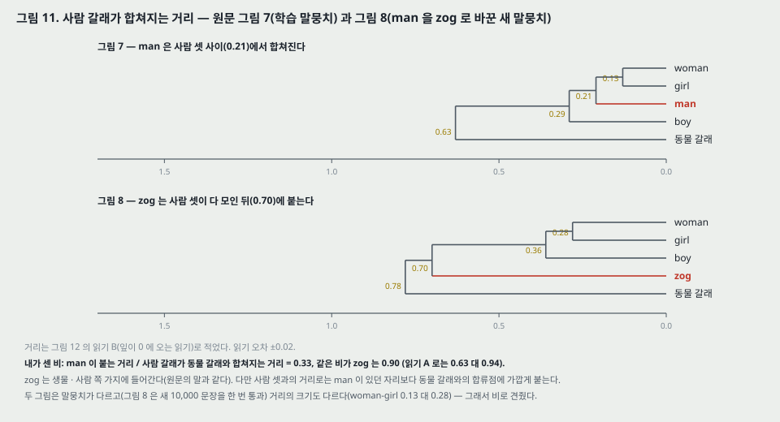

**내가 읽은 값(읽기 B, 읽기 오차 ±0.02).** 그림 7 에서 man 은 woman · girl 에 0.21 에서 붙고, boy 가 0.29 에서 붙으며, 사람 갈래가 동물 갈래와 0.63 에서 합쳐진다. 그림 8 에서는 woman · girl 0.28, boy 0.36, **zog 0.70**, (사람 + zog) 가 동물 갈래와 0.78 에서 합쳐진다. 두 그림은 말뭉치가 다르고 거리 크기도 다르므로 비로 견주면 — man 이 붙는 거리 / 사람-동물 합류 거리 = **0.33**, 같은 비가 zog 는 **0.90** (읽기 A 로는 0.63 대 0.94).

**판정.** zog 가 생물 · 사람 쪽 가지에 들어간다는 것은 그림에서 선다. 「man 과 같은 관계」 는 **가지 소속** 까지이고, 사람 셋과의 거리로는 man 이 있던 자리보다 동물 갈래와의 합류점에 가깝게 붙는다. 원문은 zog 와 man 의 거리를 수로 적지 않는다.

**zog 의 입력 무게(내 해석).** 31 비트 중 2 비트가 「뒤 시뮬레이션용」 으로 남겨져 있었다(195 쪽). zog 의 비트가 그중 하나라면 그 비트에서 은닉으로 가는 무게는 학습 중 입력이 늘 0 이라 처음 무작위 값 그대로다. 곧 zog 의 은닉 활성은 **문맥(앞 낱말들)과 학습되지 않은 무게** 로만 정해진다. 그렇다면 그림 8 은 「망이 새 낱말에 man 과 비슷한 표현을 주었다」 보다 「man 이 오던 문맥이 은닉 상태를 그쪽으로 데려다 놓았다」 에 가깝고, 이것은 각주 6 의 평균 무늬와 같은 자리다. 원문은 zog 에 어느 비트를 줬는지 적지 않는다.

---

## 11. 유형과 출현 (원문 203–207 쪽, 그림 9)

**원문의 논지.** 고전적 기호는 보통 범주를 가리키고, 분산 표현은 문맥에 크게 달려 있다. 극단으로 가면 「John 이 나오는 문맥마다 다른 John」 이 생겨 문제로 보일 수 있지만, 원문은 이것이 오히려 **유형과 출현을 함께 나타내는 방법** 이라고 주장한다(203 쪽). 아날로그 유닛이면 원리상 유한한 유닛으로 개념 수에 한계가 없고, 은닉 유닛이 입력 표현과 시간 문맥 부호화를 함께 맡으므로 「원리상 무한한 기억」 도 가능하다고 적고, 곧바로 실제로는 유한하다고 적는다(17절 1).

**확인 1 — 출현 전부를 묶었다(205 쪽).** 출현 27,454 개(이 쪽의 수)를 모두 묶은 나무는 「그릴 수 없지만, 수치 결과로 보면 그림 7 과 같고 잎마다 출현들이 더 갈라진다. 어떤 낱말의 출현도 다른 낱말의 가지에 잘못 들어가지 않았다.」 **수치는 실려 있지 않다.**

**확인 2 — boy 와 girl 의 출현(그림 9).** 출현들은 문장 안의 위치로 다시 갈린다 — 문장 첫머리의 boy 끼리, 문장 끝의 boy 끼리 모이고(「with some exceptions」), girl 에서도 같은 무늬가 나온다. 첫머리 낱말은 앞 문장(사실상 잡음) 뒤에 오므로 그 낱말에 대한 기대가 「명사가 온다」 뿐이라 함께 모인다고 설명한다.

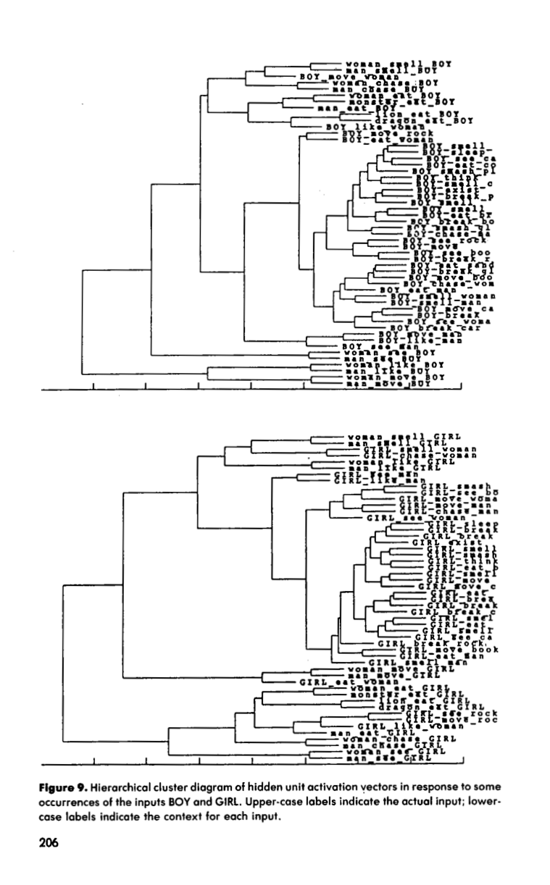

*원문 그림 9 (잘라 넣은 것). 위가 BOY, 아래가 GIRL.*

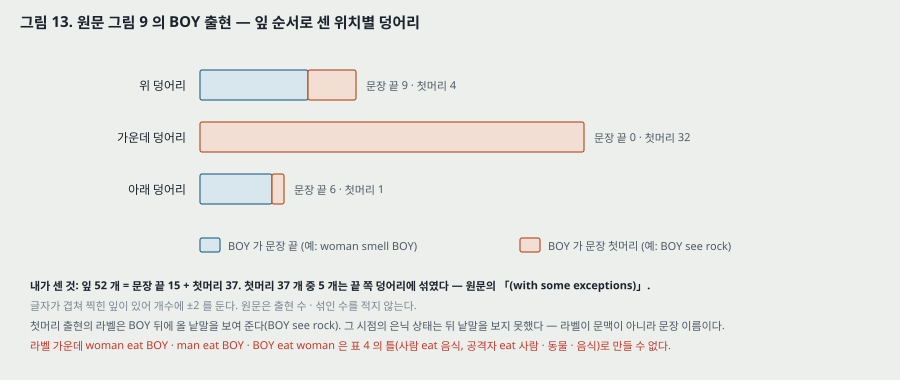

**내가 센 것(잎 글자가 겹쳐 ±2).** BOY 의 잎 52 개 = 문장 끝 15 + 첫머리 37. 잎 순서로 보면 첫머리 37 개 중 32 개가 가운데 한 덩어리에 모이고, 5 개(BOY move woman · BOY like woman · BOY move rock · BOY eat woman · BOY see man)는 문장 끝 출현들의 덩어리에 섞인다. 문장 끝 15 개는 모두 가운데 덩어리 밖에 있다. 원문은 출현 수 · 섞인 수를 적지 않는다.

**라벨에 대해 둘.**
- **첫머리 출현의 라벨은 BOY 뒤의 낱말을 보여 준다**(BOY see rock). 그 걸음의 은닉 상태는 뒤 낱말을 아직 보지 못했다. 캡션은 「lower-case labels indicate the context」 라고 적지만, 첫머리 출현에서는 라벨이 그 표현을 정한 문맥이 아니라 그 출현이 든 **문장의 이름** 이다. 섞인 5 개가 왜 섞였는지는 라벨로 알 수 없다(앞 문장이 정한다).
- **라벨 중 일부는 표 4 의 틀로 만들 수 없다.** woman eat BOY · man eat BOY · BOY eat woman 은 「사람 eat 사람」 이고, 표 4 에서 eat 뒤에 사람이 오는 틀은 공격자(NOUN-AGRESS) 주어뿐이다. 표 5 의 토막(「dog move mouse mouse move」)도 표 4 로 만들 수 없는 열을 담는다. 생성기가 표 4 보다 넓었는지, 표 4 가 덜 실렸는지는 적혀 있지 않다.

**기하로 본 해석(205–207 쪽).** 은닉 활성은 높지만 고정된 차원의 공간에서 점을 고르고, 망은 그 공간을 「중요한 관계가 공간 관계로 옮겨지도록」 짠다. 명사는 한 영역, 동사는 다른 영역에 놓이고, 같은 유형의 출현들은 함께 모이되 서로 다르며, 「John1 과 John2 의 관계가 Mary1 과 Mary2 의 관계와 같다」. 기호 체계가 색인 · 묶기(binding)로 하는 유형 / 출현 구분을 그 연산 없이 해낸다는 것이 결론이다.

---

## 12. 결론 절의 네 주장 (원문 207–209 쪽)

| 원문 결론 | 근거가 된 실험 | 근거의 모양 |
|---|---|---|
| 시간으로 바꾸면 문제의 성격이 바뀐다 — 시간 XOR 의 풀이는 상태 변화 탐지와 주파수에 민감한 유닛이었다 | 6절 | 은닉 유닛 둘의 행동을 말로 적었다. 활성 값 · 그림 없음 |
| 시간을 따라 변하는 오차가 시간 구조의 단서다 | 6 · 7 · 8절 | 그림 3 · 4 · 5 · 6 — 오차의 오르내림 |
| 의존을 늘려도 반드시 성능이 나빠지지 않는다 | 7절과 6절의 비교 | 망 크기 · 통과 수 · 입력이 모두 다른 두 과제를 견줬다 |
| 시간 · 기억의 표현은 과제에 크게 달려 있다. 기억은 따로 떨어진 하위 체계가 아니다 | 4절의 구조 | 구조에 대한 해석. 기억을 따로 둔 구조와 견준 실험은 없다 |
| 표현은 평평하지 않고 계층을 품는다. 유형 / 출현 구분이 드러난다 | 9 · 10 · 11절 | 계통수 셋. 평균 무늬(각주 6)의 확인 수치 없음 |

원문은 바로 뒤에 「여기 결과는 예비적이고, 답보다 물음을 더 많이 낳는다」 고 적는다(208 쪽).

---

## 13. 설정 — 무엇이 적혀 있고 무엇이 없나

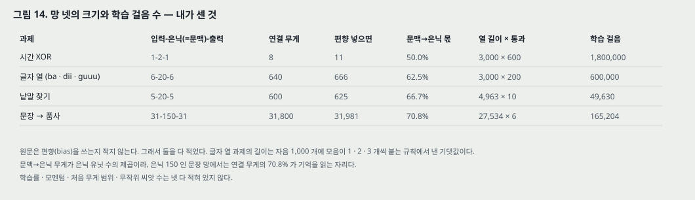

| 과제 | 입력-은닉(=문맥)-출력 | 연결 무게 (편향 넣으면) | 학습 열 · 통과 | 학습 걸음 | 시험 |
|---|---|---|---|---|---|
| 시간 XOR | 1-2-1 | 8 (11) | 3,000 비트 × 600 | 1,800,000 | 학습 열 |
| 글자 열 | 6-20-6 | 640 (666) | 3,000 글자(기댓값) × 200 | 600,000 | **다른 무작위 열** |
| 낱말 찾기 | 5-20-5 | 600 (625) | 4,963 글자 × 10 | 49,630 | 학습 열(표 2 와 같은 글월) |
| 문장 → 품사 | 31-150-31 | 31,800 (31,981) | 27,534 낱말 × 6 | 165,204 | 학습 집합 |

**내가 센 것.** 연결 무게 = 입력×은닉 + 은닉×은닉(문맥→은닉) + 은닉×출력. 문맥 → 은닉 몫이 50.0 · 62.5 · 66.7 · 70.8% 로 은닉이 클수록 커진다 — 문장 망에서는 연결 무게의 70.8% 가 기억을 읽는 자리다. 문장 과제의 걸음 수는 세 길이 가운데 27,534 로 셌다.

**적혀 있지 않은 것.** 학습률 · 모멘텀 · 처음 무게의 범위 · 무작위 씨앗 수 · 실행 횟수 · 편향 유무 · 오차를 앞 걸음으로 넘기는지(5절) · 계통수의 거리와 연결 방식 · zog 의 비트 · 낱말 찾기 문장 생성기의 규칙(각주 4 는 「다음 시뮬레이션 프로그램의 단순한 판」 이라고만 적는다) · 장비.

---

## 14. 평가 (읽은 범위)

- **데이터셋**: 넷 다 생성한 열이다 — XOR 비트 3,000, 글자 열(자음 1,000 개), 15 낱말 200 문장의 글자 열 4,963, 29 낱말 10,000 문장의 낱말 열.
- **지표**: 원문의 RMS 오차(뜻은 16절), 확률 벡터와의 RMS · 코사인, 은닉 활성의 계통수.
- **비교 상대**: **없다.** 앞먹임 망 · 시간을 자리로 펼친 망 · Jordan 망과 같은 과제에서 견준 결과가 없다. 「앞먹임 망은 두 입력을 넘는 패턴을 못 배운다」(7절) · 「앞먹임 망의 XOR 풀이와 다르다」(6절)는 말로만 있다.
- **장비**: 적혀 있지 않다. 204 쪽에 「시뮬레이션을 돌린 기계의 수치 정밀도가 유한하다」 는 말만 있다.

| 과제 | 본문이 적은 수 | 그림에만 있는 것 |
|---|---|---|
| 시간 XOR | 600 통과, 1,200 번 평균 | 그림 3 의 곡선 (내가 읽음: 0.16 ~ 0.34) |
| 글자 열 | 200 통과 | 그림 4 · 5 (세로축 숫자 없음) |
| 낱말 찾기 | 10 통과, 오차 「relatively high」 | 그림 6 (세로축 숫자 없음) |
| 문장 | RMS 0.88 (모두 끄면 1.0, 처음 ~15.5), 확률 벡터 RMS 0.053 (SD 0.100), 코사인 0.916 (SD 0.123) | 그림 7 · 8 · 9 |

---

## 15. 실험 분석 (논문의 표 · 그림마다)

직접 돌리지 않는다. 표 · 그림 하나씩 같은 틀로 읽는다. 「내가 센 것」 은 쪽 이미지에서 읽거나 계산한 값이다.

| 표 · 그림 | 무엇을 바꿨나 (변인) | 무엇을 고정했나 | 결과 | 반복 수 · 흩어짐 | 주장이 결과보다 센가 |
|---|---|---|---|---|---|
| 그림 3 (시간 XOR) | 바꾼 것이 없다 — 12 걸음 창 안의 **자리** 를 따라 오차를 본다 | 망 1-2-1, 3,000 비트, 600 통과 | 맞힐 자리 0.16 ~ 0.18, 우연 자리 0.28 ~ 0.34 (내가 읽음 ±0.01) | 1,200 번 평균 한 곡선. 망을 몇 번 배웠는지, 평균의 흩어짐은 없다 | 「closely follows the schedule」 은 모양으로는 선다. 맞힐 자리 0.17 은 출력 0.5(0.25)보다 0.08 낮을 뿐이다. 캡션의 RMS 로는 우연 자리 값이 나올 수 없다(16절) |
| 표 1 · 그림 4 (글자 열) | 자리(자음을 맞히나 모음을 맞히나) | 망 6-20-6, 200 통과, **다른 무작위 열로 시험** | 자음 자리 0.43 ~ 0.77, 모음 자리 0.02 ~ 0.36 (±0.02) | 시험 열 20 걸음 한 토막. 다른 토막 · 다른 실행 없음 | 「자음 높고 모음 낮다」 는 선다. 「몇 개 올지 안다」 는 셋째 u 에서 오차 0.20 · 0.25 로 가장 긴 열에서 약해진다. 18 번 점이 빠졌다 |
| 그림 5 (비트별) | 비트(1 번 자음 대 4 번 높음) | 그림 4 와 같은 시험 열 20 걸음 | 1 번 0.00 ~ 0.12, 4 번 0.01 ~ 0.67 (±0.01 ~ 0.02) | 한 토막 | 「모든 시점에서 1 번이 낮다」 는 8 · 14 번 점(1 번 0.06 · 0.05 대 4 번 0.02 · 0.02)에서 어긋난다 |
| 표 2 · 그림 6 (낱말 찾기) | 자리(낱말 안의 몇째 글자인가) | 망 5-20-5, 10 통과 | 첫 글자 14 자리 중 13 자리에서 앞 점보다 오름, 낱말 안에서 오른 자리 3 (±0.1) | **학습 열** 한 토막(54 글자). 시험 열 없음 | 「경계가 오차로 드러난다」 는 이 토막에서 선다. 경계 기준은 원문도 「상대적」 이라 적었다. 「5 비트 무작위 부호」 는 표 2 와 맞지 않는다(13 글자 모두 알파벳 순번) |
| 본문 수 (문장, 197–198 쪽) | 과녁(실제 다음 낱말 대 확률 벡터) · 지표(RMS 대 코사인) | 망 31-150-31, 6 통과 | RMS 0.88 (모두 끄면 1.0), 확률 벡터 RMS 0.053 (SD 0.100), 코사인 0.916 (SD 0.123) | 학습 집합 위의 평균과 표준편차. 실행 하나 | 「확률을 근사하도록 배웠다」 는 학습 집합에서만 잰 것이고, 기준선(앞 낱말 하나만 보는 예측기)이 없어 0.916 이 얼마나 높은지 가를 자리가 없다 |
| 그림 7 (계통수) | 바꾼 것이 없다 — 낱말 29 개의 평균 은닉 벡터를 묶는다 | 학습한 망, 학습 말뭉치 한 번 더 통과 | 동사 / 명사, 생물 / 무생물, 사람 / 동물 등의 갈래. 합류 거리 0.09 ~ 1.58 (읽기 B, 내가 읽음 ±0.02) | 나무 하나. 거리 종류 · 연결 방식 없음 | 각주 6 이 스스로 「학습 없이도 생길 수 있다」 고 적는다. 그 확인(출현 단위 묶기)은 수치 없이 문장 하나다. 학습하지 않은 망의 나무가 없다 |
| 그림 8 (zog) | 낱말 하나(man → zog, 새 비트) | 얼린 망, 새 문장 10,000 개 한 번 | zog 가 사람 셋 뒤 0.70 에서 붙고, 사람+zog 가 0.78 에서 동물과 합쳐진다 (읽기 B) | 나무 하나 | 「man 과 같은 관계」 는 가지 소속까지 선다. 거리 비는 man 0.33 대 zog 0.90 이다 |
| 그림 9 (출현) | 바꾼 것이 없다 — BOY · GIRL 출현을 묶는다 | 얼린 망, 학습 말뭉치 | BOY 52 출현 중 첫머리 37 개의 32 개가 한 덩어리 (내가 셈 ±2) | 나무 둘. 어떤 출현을 골랐는지(「some occurrences」) 기준이 없다 | 「with some exceptions」 는 5 / 37 이다. 첫머리 출현의 라벨은 그 표현을 정한 문맥이 아니다 |

**짚은 자리 — 비교의 짝.** 이 논문의 모든 그림에는 **같은 조건에서 돌린 비교 상대가 없다**. 그림 3 · 4 · 5 · 6 은 한 망의 오차를 자리에 따라 본 것이고, 그림 7 · 8 · 9 는 한 망의 은닉을 묶은 것이다. 「앞먹임 망은 못 한다」 와 「학습하지 않아도 생길 수 있다」 는 둘 다 돌려서 견줄 수 있었던 자리인데 결과가 없다. 다른 논문에서 옮긴 값도 없다.

---

## 16. 원문의 「RMS」 는 무엇인가 — 세로축 셋을 맞춰 본 것

원문은 그림 3 · 4 · 5 · 6 의 캡션과 문장 과제의 수를 모두 「root mean squared error」 라고 부르고, 본문 두 곳(그림 3 · 4 설명)은 「sum squared error」 라고 부른다. 출력과 과녁이 0 과 1 사이에 있다는 것만으로 가를 수 있는 자리가 셋이다(내가 센 것).

| 자리 | 원문의 값 | 제곱근이면 넘을 수 없는 선 | 판정 |
|---|---|---|---|
| 그림 3, 우연 자리 | 0.28 ~ 0.34 (내가 읽음) | 아래로 0.50 (출력 하나, 동전 과녁) | 제곱근으로는 나올 수 없다. 제곱 오차(아래 한계 0.25, 위 한계 1)와 맞는다 |
| 그림 6, 첫 글자 자리 | 최대 3.00 (내가 읽음 ±0.1), 2.24 를 넘는 점 일곱 | 위로 $\sqrt{5} = 2.24$ (출력 5 비트) | 제곱근으로는 나올 수 없다. 제곱 오차의 합(최대 5)과 맞는다 |
| 문장 과제의 처음 값 | 「~15.5」 | 위로 $\sqrt{31} = 5.57$ (출력 31 비트), 비트 평균의 제곱근이면 1 | 제곱근으로는 나올 수 없다. 제곱 오차의 합(최대 31)과 맞는다 |

**그래서 이 노트는 원문의 「RMS」 를 제곱 오차의 합으로 읽는다.** 그 읽기에서 「모두 끄면 1.0」 도 맞는다(켜져야 할 비트 하나의 제곱 오차 1). 그림 4 · 5 는 값이 0 과 1 사이라 어느 쪽으로도 들어가 가를 수 없다. 확률 벡터와의 0.053 도 같은 식으로 잰 값이라고 보지만, 원문은 따로 적지 않는다.

**「15.5」 를 하나 더 보면.** 출력 31 개가 모두 0.5 이면 제곱 오차의 합은 $31 \times 0.25 = 7.75$ 다. 15.5 는 그 두 배이고, 비트당 평균 제곱 오차 0.5 에 해당한다 — 처음 출력이 0.5 에서 한쪽으로 쏠려 있었다는 뜻이 된다. 원문은 처음 무게 범위를 적지 않아 확인할 수 없다.

---

## 17. 이 논문이 스스로 적은 한계

1. **기억은 실제로 유한하다(204 쪽).** 원리상 아날로그 유닛은 무한한 기억을 줄 수 있지만, 기계의 수치 정밀도가 유한하고, **활성 함수가 기억에 거듭 걸려 지수로 줄어들며**, 학습 방식이 망의 용량을 다 쓰기에 알맞지 않을 수 있다.
2. **오차를 늦게 넣는 과제에서 성능이 나빴다(204 쪽, 예비 작업).** 예측 과제는 매 걸음 되먹임을 준다.
3. **단순 순환망의 표현 용량은 열린 물음이다(204 쪽).** Servan-Schreiber 외(1988)를 가리킨다.
4. **낱말 찾기는 낱말 습득의 모형이 아니다(193 쪽).** 예측은 학습자의 주된 목표가 아니고, 소리의 공기는 낱말을 정하는 정보의 일부다.
5. **망은 범주의 내용을 모른다(201 쪽).** 구조 정보를 실제 세계에 붙일 정보가 없어, 원문의 말로 「실제 학습자가 가진 것보다 훨씬 적은(much less) 정보」 로 배운다.
6. **평균한 은닉 벡터의 계통수는 통계적 무늬일 수 있다(각주 6).** 출현 단위로 확인해야 한다.
7. **문장 과제의 RMS 0.88 은 인상적이지 않다(197 쪽).** 출력이 확률 합 1 을 지키지 않아도 된다는 점도 스스로 짚는다(198 쪽).
8. **결과는 예비적이다(208 쪽).** 계통수는 상태들의 스냅숏이라 **상태 사이의 시간 관계(궤적, 끌개)를 잃는다.** 주성분 분석과 위상 그림을 연구 중이라고 적는다(Elman 1989).
9. **기억 용량을 더 잘 정의된 과제로 재야 한다(209 쪽).** 유한 상태 자동기로 만든 열로 실험 중이라고 적는다.
10. **최악의 경우 낱말 하나가 규칙 하나다(각주 5).** 글자 순서 규칙은 낱말 수만큼 늘 수 있다.

---

## 18. 논문이 적지 않은 것 — 내가 읽으며 짚은 자리

**하나. 같은 조건의 비교 상대가 없다.** 앞먹임 망, 시간을 자리로 펼친 망, Jordan 망, 펼친 역전파(BPTT)로 배운 같은 망 — 어느 것도 같은 과제에서 돌리지 않았다. 3절의 문제 제기(펼치면 나쁘다)와 결론의 「간단하지만 놀랍도록 강력하다」 사이를 잇는 측정이 없다.

**둘. 실행 하나, 흩어짐 없음.** 모든 그림이 한 번 배운 망 하나의 결과로 읽힌다. 씨앗을 바꾸면 그림 7 의 갈래가 같은지, 그림 3 의 0.17 이 얼마나 흔들리는지 알 수 없다. 학습률 등 설정도 없어 다시 돌릴 수 없다(13절).

**셋. 시험 집합이 하나뿐이다.** 다른 열로 잰 것은 글자 열(그림 4 · 5)뿐이다. 낱말 찾기(그림 6)와 문장 과제(확률 벡터 · 그림 7 · 9)는 학습한 열 위의 값이다. 문장 과제는 29 낱말 · 16 틀이라 시험 문장을 따로 뽑아도 학습 문장과 겹칠 수 있다 — 그래서 더 「외웠나 일반화했나」 를 가를 시험이 필요한 자리였다. 그림 8(zog)만 새 문장이다.

**넷. 「의존이 길어도 어렵지 않다」 는 통제된 비교가 아니다**(7 · 12절). XOR 과 글자 열은 은닉 크기 · 통과 수 · 입력 크기가 모두 다르다. 같은 망에 의존 길이만 바꾼 열(예: 모음 개수 2 · 3 · 4 · 6)을 주는 실험이었으면 선다.

**다섯. 학습 규칙에서 시간 방향이 빠졌다**(5절). 오차를 앞 걸음으로 넘기는지가 없다. 결론의 「기억은 처리와 떼어 낼 수 없다」 는 이 학습 규칙(한 걸음 역전파로 보이는 것)에 달려 있을 수 있는데, 그 의존이 논의되지 않는다.

**여섯. 원문의 「RMS」 가 정의되지 않았다**(16절). 캡션 넷과 본문 둘이 이름을 달리 부르고, 세 자리의 값은 제곱근으로 읽으면 나올 수 없다.

**일곱. 평균 무늬를 스스로 짚고도 닫지 않았다**(9 · 10 · 11절). 각주 6 이 「학습 없이도 생길 수 있다」 고 적었으니, **학습하지 않은(무작위 무게) 망에 같은 말뭉치를 통과시켜 묶은 나무** 하나면 닫히는 자리다. 실린 것은 출현 단위 묶기가 「같은 나무」 였다는 문장이다. zog 도 같은 자리에 있다 — 입력 무게가 학습되지 않은 비트라면 zog 의 표현은 문맥만으로 정해진다.

**여덟. 그림 9 의 라벨 일부가 표 4 와 맞지 않는다**(11절). 말뭉치를 만든 규칙이 표 4 와 같은지 알 수 없게 된다.

---

## 19. 읽을 때 헷갈리는 지점

**괄호 안 글자는 과녁이다.** 그림 4 · 5 · 6 의 글자는 그 자리에서 **맞혀야 할** 글자이지 입력이 아니다. 그림 6 의 「y」 가 높다는 것은 y 를 맞히기 어렵다는 뜻이다.

**문맥 유닛과 상태 유닛.** 문맥은 은닉을, Jordan 의 상태는 출력을 되받는다. 문맥 유닛에는 자기 되먹임이 없다.

**「Cycle」 축.** 그림 3 의 가로축 1 ~ 12 는 학습 회수가 아니라 12 걸음 창 안의 자리다.

**말뭉치 길이 셋.** 27,534 · 27,354 · 27,454 는 같은 말뭉치다(9절).

**범주 13 대 12, 틀 15 대 16.** 본문 수와 표의 줄 수가 다르다. 이 노트는 표를 따른다.

**그림 7 · 8 의 가로축.** 찍힌 라벨이 고른 간격이 아니다. 이 노트의 거리는 읽기 B(「1.5 1.0 0.5 0.0 −0.5」)다(9절, 그림 12).

**은닉 「150-bit vectors」.** 199 쪽은 은닉 활성을 「150-bit vectors」 라고 부르지만 값은 0 과 1 사이의 실수다.

**Elman 망과 「SRN」.** 같은 것이다. 원문은 그림 2 캡션과 본문에서 「simple recurrent network」 를 쓴다.

---

## 20. 원문 안의 어긋남 모음

| 자리 | 원문 | 짚을 것 |
|---|---|---|
| 그림 3 캡션 대 본문 | 캡션 「root mean squared error … averaged over 1200 trials」, 본문 「sum squared error … averaged over 1,200 cycles」 | 이름 둘 · 단위 둘. 값은 제곱근이 아닌 쪽과 맞는다(16절) |
| 그림 4 캡션 대 본문 | 캡션 RMS, 본문 「sum squared error over all 6 bits」 | 같은 어긋남 |
| 그림 4 | 18 번 점(과녁 d)이 없다 | 그림 5 의 두 칸에는 있다 |
| 191 쪽 | 「first bit … consistently lower than … fourth bit, and at all points in time」 | 8 · 14 번 점에서 어긋난다(7절) |
| 192 쪽 | 「each letter … converted into a 5-bit random vector」 | 표 2 의 13 글자 모두 알파벳 순번 이진수(8절) |
| 표 2 마지막 줄 | 입력 「11001 (i)」 | 11001 은 y. i 는 01001. 출력 칸이 한 줄 짧다 |
| 그림 6 캡션 | 「root mean squared error」, 「precition」 | 최대 3.00 은 √5 를 넘어 제곱근일 수 없다. prediction 의 오식 |
| 195 쪽 | 「Thirteen classes」 | 표 3 은 12 줄 |
| 195 쪽 | 「15 sentence templates」 | 표 4 는 16 줄 |
| 표 3 | NOUN-FOOD 예시 「cookie, break」 | 그림 7 의 bread 로 읽힌다 |
| 195 · 196 · 197 · 199 · 204 · 205 쪽 | 27,534 · 27,354 · 27,454 | 같은 말뭉치의 세 길이(9절) |
| 그림 7 · 8 가로축 | 「2.0 1.5 1.0 0.0 −0.5」, 간격은 고름 | 한 칸만 1.0. 앞 셋이나 뒤 둘 중 한쪽이 틀렸다(그림 12) |
| 그림 9 캡션 | 「lower-case labels indicate the context」 | 첫머리 출현에서는 뒤 낱말이다. 「사람 eat 사람」 라벨은 표 4 로 만들 수 없다 |
| 199 쪽 | 「150-bit vectors」 | 실수 값이다 |
| 205 쪽 | 「the various types of a token」 | 뜻으로는 「a type 의 tokens」 다 |
| 철자 | extend(temporal extent) · paralielize · randomizaiton · nerworks · fo · Johni · Maryz | 글자 층의 인식 오류와 원문 오식이 섞여 있다. 쪽 이미지로 확인한 것은 randomizaiton · precition · fo |

---

## 21. 역전파 노트와 맞춰 보기

| 역전파 노트의 자리 | 그 노트에 적은 것 | 이 편 | 판정 |
|---|---|---|---|
| 9절 되먹임 망 | 시간으로 펼쳐 층처럼 다룬다. 출력 이력을 저장하고 무게를 묶는다. **실험 결과 없음** | 펼치지 않는다 — 은닉을 복사해 입력처럼 둔다. 이력 저장 · 무게 묶기가 필요 없다. 실험 다섯을 싣는다 | **결과 없던 자리를 다른 길로 채웠다.** 펼친 쪽과의 비교는 없다 |
| 12절 $0.25^5$ | 로지스틱 기울기의 최댓값 0.25 가 층마다 곱해져 줄어든다 | 204 쪽 「활성 함수가 기억에 거듭 걸려 지수로 줄어든다」 는 **순방향 기억** 에 대한 말이다. 기울기 감쇠는 말하지 않는다 | **같은 수학, 다른 쪽.** 아래 예시 |
| 8절 가족 트리 | 은닉 유닛이 국적 · 세대 · 갈래의 축을 스스로 만든다 | 은닉 활성의 계통수가 품사 · 생물 · 사람 갈래로 갈린다 | **같은 주장의 시간 판.** 이 편은 유닛 하나가 아니라 벡터 묶음으로 읽는다 |
| 15절 다음에 읽을 것 「깊이의 문제」 | Hochreiter 1991 · Bengio 외 1994 | 이 편의 204 쪽 두 문장이 그 자리와 닿는다 | 다음 칸 LSTM 으로 넘긴다 |

**순방향 기억이 줄어드는 작은 예시(내가 계산한 것).** 입력 없이 $h \leftarrow \sigma(w h)$ 를 되풀이하면서 처음 값 0.9 와 0.1 의 차이를 따라가면, $w = 1$ 에서 0.8 → 0.186 → 0.042 → 0.0095 → 0.0021 로 걸음마다 0.22 ~ 0.23 배로 줄어든다(네 걸음 뒤 0.0021). $w = 4$, 편향 −2 이면 0.66 → 0.58 → 0.52 → 0.48 → 0.45 로 걸음마다의 비가 0.88 ~ 0.93 이다. 곧 원문의 「지수로 준다」 는 무게에 따라 그 비가 크게 달라지고, 배우는 무게가 이 비를 정한다. 기울기도 같은 $\sigma'$ 과 $W_{ch}$ 의 곱을 거꾸로 거친다 — 그 쪽을 정리한 것이 23절의 편들이다.

---

## 22. 내가 가져갈 것

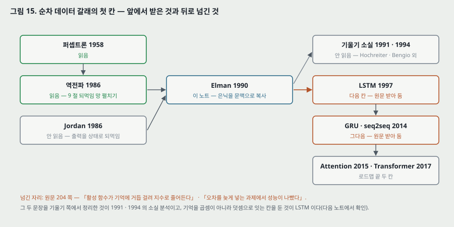

**하나. 기억을 어디에 둘지가 구조의 첫 결정이다.** Jordan 은 출력을, Elman 은 은닉을 되받는다. 무엇을 되받느냐가 「무엇을 기억할 수 있느냐」 를 정한다 — 출력을 되받으면 망이 낸 답만 기억하고, 은닉을 되받으면 답을 내는 데 쓴 내부 상태를 기억한다. 다음 칸(LSTM)은 같은 질문에 「기억을 따로 두고 문을 단다」 로 답한다. 이상 탐지에서 시계열 모델을 읽을 때도 **상태가 무엇을 담는지** 를 먼저 적는 습관으로 옮긴다.

**둘. 옮겨 쓸 수 있는 것 — 그림의 세로축을 아래 · 위 한계로 확인한다.** 이 노트에서 가장 쓸모 있었던 책상 확인은 「과녁이 동전이면 어떤 예측기도 0.25 아래로 못 간다」 같은 한계 하나로 그림의 단위를 가른 것이다(16절). 다른 논문에서도 지표의 정의가 흐릴 때 **정의마다 나올 수 있는 값의 범위** 를 먼저 적고 그림과 맞춘다. 그리고 「학습 없이도 생길 수 있다」 는 각주 6 의 물음 — **무작위 망으로 같은 분석을 돌린 기준선이 있는가** — 를 표현을 시각화하는 모든 그림에 묻는다. 사전학습 특징을 쓰는 이상 탐지(PatchCore 등)에서도 같은 물음이 선다.

**셋. 지금 확인된 것은 여기까지다.** 논문이 잰 것은 오차의 오르내림(그림 3 ~ 6)과 학습 집합 위의 확률 근사(0.053 · 0.916)이고, 계통수 셋은 한 번 배운 망의 그림이다. 논문이 말만 한 것은 은닉 유닛 둘의 주파수 해석, 앞먹임 망과의 차이, 출현 단위 묶기의 「같은 나무」 다. 내가 책상에서 센 것은 그림 3 의 값과 아래 한계, 표 1 의 비트 중복과 자음 자리 한계, 그림 4 · 5 · 6 의 읽은 값과 셈, 표 2 의 부호, 말뭉치 길이 셋, 그림 7 · 8 의 축과 합류 거리, 그림 9 의 출현 수, 망 넷의 파라미터 수다. 실험은 돌리지 않았다.

---

## 23. 다음에 읽을 것

**한계를 적고 그 한계를 푼 것이 다음 논문이다.** 이 노트의 17절 1 · 2(기억이 지수로 준다, 오차를 늦게 넣으면 나쁘다)를 받는 편이 로드맵 다음 칸이다.

| 다음 | 이 노트의 어느 자리에서 나오는가 | 무엇을 확인하고 싶은가 |
|---|---|---|
| **Long Short-Term Memory** (Hochreiter · Schmidhuber, Neural Computation 1997) — 로드맵 다음 칸, 원문 받아 둠 | 17절 1 · 2, 21절 — 기억이 활성 함수를 거듭 지나며 줄어드는 것 | 오차가 오래 머무는 자리(기억 칸)를 어떻게 만들었나. Elman 망과 같은 과제(시간 지연이 긴 열)에서 견줬나. 학습 규칙이 이 편처럼 잘린 역전파인가 |
| **Learning long-term dependencies with gradient descent is difficult** (Bengio · Simard · Frasconi, IEEE TNN 1994) — 후보 | 21절 — 이 편은 순방향 기억만 말하고 기울기 감쇠는 말하지 않는다 | 기울기 쪽에서 「오래 기억하는 것」 과 「잡음에 강한 것」 이 맞선다는 주장이 어떤 조건인가 |
| **Encoding sequential structure in simple recurrent networks** (Servan-Schreiber · Cleeremans · McClelland, CMU 기술 보고서 CMU-CS-88-183, 1988) — 후보, 원문 참고 문헌에 있다 | 17절 3 · 9 — 표현 용량과 유한 상태 자동기 열 | 이 편이 「열린 물음」 으로 남긴 용량을 문법으로 통제한 열에서 쟀는가 |
| **Finding structure in time 의 후속 — Distributed representations, simple recurrent networks, and grammatical structure** (Elman, Machine Learning 1991) — 후보 | 17절 8 — 계통수가 시간 관계를 잃는다, 주성분 궤적을 연구 중 | 은닉 궤적의 주성분 그림으로 무엇을 보였나 |

읽는 순서로는 **LSTM 이 먼저** 다(로드맵 순서). Bengio 외 1994 는 LSTM 노트가 같은 자리를 다루는지 보고 고른다.

---

## 24. 남는 질문

- **오차를 앞 걸음으로 넘겼는가.** 원문이 적지 않는다. 같은 저자의 뒤 글(23절 넷째 줄)이 학습 규칙을 적는지 보면 답이 나올 수 있다 — 읽지 않았다.
- **원문의 「RMS」 의 정의.** 이 노트는 값의 범위로 「제곱 오차의 합」 이라 읽었다. 확률 벡터 0.053 도 같은 정의인지는 남는다.
- **그림 7 · 8 가로축의 바른 라벨과 거리의 종류.** 읽기 B 를 썼다. 같은 내용의 기술 보고서 판을 구하면 맞춰 본다.
- **말뭉치 길이 셋 중 어느 것이 맞는가.**
- **학습하지 않은 망의 계통수는 어떤 모양인가.** 각주 6 의 물음이고, 원문은 답하지 않는다. 다음 노트들 가운데 표현 분석에 무작위 기준선을 둔 편이 있으면 이 자리에 적는다.
- **zog 에 준 비트가 남겨 둔 2 비트 중 하나인가.**
- **그림 9 의 「사람 eat 사람」 문장은 어디서 왔는가.**

---

## 25. 참고 문헌

이 노트가 부른 편만 적는다. 원리는 원 출처를, 구현은 그 라이브러리의 편을 적는 규칙을 따른다. 그림 코드는 파이썬 표준 라이브러리만 쓰고, 원문 그림을 잘라 낸 코드와 쪽 이미지에서 값을 읽은 일만 PyMuPDF 를 썼다(PyMuPDF 는 논문이 따로 없어 적지 않는다).

- Elman, J. L. (1990). Finding structure in time. Cognitive Science, 14(2):179–211. doi:10.1207/s15516709cog1402_1 — 이 노트의 대상.
- Rumelhart, D. E., Hinton, G. E., and Williams, R. J. (1986). Learning representations by back-propagating errors. Nature, 323:533–536. — 앞서 읽음. 원문이 인용한 것은 같은 저자들의 PDP 책 판(Learning internal representations by error propagation, PDP vol. 1, 318–362)이다.
- Jordan, M. I. (1986). Serial order: A parallel distributed processing approach. Tech. Rep. 8604, Institute for Cognitive Science, UCSD. — 원문 그림 1 의 망. **읽지 않았다.**
- Servan-Schreiber, D., Cleeremans, A., and McClelland, J. L. (1988). Encoding sequential structure in simple recurrent networks. CMU-CS-88-183. — 용량 물음. **읽지 않았다.**
- Williams, R. J. and Zipser, D. (1988). A learning algorithm for continually running fully recurrent neural networks. Tech. Rep. 8805, ICS, UCSD. — 원문이 「기억을 주는 다른 제안」 으로 든 편. **읽지 않았다.**
- Waibel, A., Hanazawa, T., Hinton, G., Shikano, K., and Lang, K. (1987). Phoneme recognition using time-delay neural networks. ATR Tech. Rep. TR-1-0006. — 같은 자리. **읽지 않았다.**
- Elman, J. L. (1989). Structured representations and connectionist models. CRL Tech. Rep. 8901, UCSD. — 주성분 위상 그림(17절 8). **읽지 않았다.**
- Hinton, G. E., McClelland, J. L., and Rumelhart, D. E. (1986). Distributed representations. In PDP vol. 1, 77–109. — 분산 표현의 장점(각주 8). **읽지 않았다.**
- Chomsky, N. (1957). Syntactic Structures. Mouton. / (1965). Aspects of the Theory of Syntax. MIT Press. — 9절의 추상 구조 논의.
- MacWhinney, B. (1978). The acquisition of morphophonology. Monographs of the SRCD, 43. — 8절의 관용구 덩이.
- Hochreiter, S. and Schmidhuber, J. (1997). Long short-term memory. Neural Computation, 9(8):1735–1780. — 다음에 읽을 것. **원문 참고 문헌에는 없다(뒤에 나온 편).**
- Bengio, Y., Simard, P., and Frasconi, P. (1994). Learning long-term dependencies with gradient descent is difficult. IEEE Transactions on Neural Networks, 5(2):157–166. — 다음에 읽을 것 후보. **원문 참고 문헌에는 없다. 읽지 않았다.**

---

## 26. 경로

| 무엇 | 어디 |
|---|---|
| 원문 PDF (스캔본, 33 쪽 = 원문 179–211 쪽) | `papers/CogSci90_Elman_Finding_Structure_in_Time.pdf` |
| 이 노트 | `notes/CogSci90_Elman_Finding_Structure_in_Time.md` |
| 앞서 읽은 역전파 노트 | `notes/Nature86_Backprop_Learning_representations_by_back_propagating_errors.md` |
| 이 노트의 그림 (직접 그린 것) | `figures/CogSci90_Elman/fig01_jordan_vs_elman.svg` 부터 `fig15_lineage.svg` 까지 열다섯 |
| 이 노트의 그림 (원문에서 잘라 낸 것) | `figures/CogSci90_Elman/paper_fig3_xor_error.png`, `paper_fig4_letter_error.png`, `paper_fig5_bit_error.png`, `paper_fig6_word_error.png`, `paper_fig7_cluster_tree.png`, `paper_fig8_zog_tree.png`, `paper_fig9_token_trees.png` |
| 그림을 만드는 코드 | `figures/CogSci90_Elman/make_figures.py` — 바깥 데이터를 읽지 않으므로 `python make_figures.py` 로 어디서나 다시 만든다(표준 라이브러리만). 3 · 4 · 5 · 6 · 9 · 10 · 14 번 그림의 수는 이 파일이 계산해 화면에도 찍는다. 원문 그림에서 읽은 값은 파일 머리의 `READ_*` 상수에 적어 두었다 |
| 원문 그림을 잘라 내는 코드 | `figures/CogSci90_Elman/crop_paper_figures.py` — PyMuPDF 가 필요하다 |
