# 사전 활성 ResNet — Identity Mappings in Deep Residual Networks (요약)

> **한 줄.** 잔차 블록에서 **지름길 $h$ 와 덧셈 뒤 연산 $f$ 가 둘 다 항등이면** 깊은 블록의 특징이 얕은 블록의 특징에 잔차를 더한 합이 되고(식 4), 기울기에는 가중치를 거치지 않는 「1 +」 항이 생긴다(식 5). 지름길에 상수 배 · 게이트 · 1x1 합성곱 · 드롭아웃을 넣은 다섯 변형은 ResNet-110 CIFAR-10 에서 모두 원래(6.61%)보다 나빴고(6.91 ~ 20% 초과, 표 1), 덧셈 뒤 ReLU 를 없애려고 **BN 과 ReLU 를 가중치 층 앞으로 옮긴 사전 활성 블록**이 표 3 의 여섯 행 모두에서 원래 블록보다 낮았다. 가장 큰 차이는 1001 층 망이다 — CIFAR-10 7.61 → 4.92, CIFAR-100 27.82 → 22.71. 새 부품은 없고 **같은 부품의 순서**를 바꾼 편이다.

---

## Paper Metadata

| Item | Content |
|---|---|
| Title | Identity Mappings in Deep Residual Networks |
| Authors | Kaiming He, Xiangyu Zhang, Shaoqing Ren, Jian Sun |
| 소속 | 넷 다 Microsoft Research (첫 쪽에 적힌 그대로) |
| Conference / Journal | ECCV 2016 (European Conference on Computer Vision). **파일 안에는 학회 이름이 적혀 있지 않다** — 쪽 모양이 Springer LNCS 양식이고, 학회 이름은 바깥에서 알고 있는 것이다 |
| Year | 2016 (arXiv 첫 판 2016-03, arXiv:1603.05027) |
| 코드 | `https://github.com/KaimingHe/resnet-1k-layers` (초록과 표 4 캡션에 적혀 있다). ImageNet 의 공개 모델 하나(표 5 의 †)는 `fb.resnet.torch` 쪽이다 |
| Stored PDF | `papers/ECCV16_PreAct_Identity_Mappings_in_Deep_Residual_Networks.pdf` (바탕화면에서 받은 이름은 `1603.05027v3.pdf`, 바탕화면 원본은 남겨 두었다) |
| 왜 읽었는가 | 앞 노트 둘이 같은 자리를 다음 읽을 것 첫째로 꼽았다. ResNet 노트는 「둘째 ReLU 가 덧셈 뒤에 있어 지름길이 엄밀한 항등이 아니다」 · 「1202 층이 110 층보다 나쁘다」를, Wide ResNet 노트는 「그 논문의 CIFAR 블록이 이 편의 사전 활성 순서이고 비교 상대 ResNet-1001 이 이 편의 망이다」를 남겼다 |
| 읽은 범위 | **2026-11-03 에 15 쪽을 전부 읽었다.** 곧 초록 · 1~6절 · 부록(구현 설정) · 그림 1~6 과 캡션 · 표 1~5 · 식 (1)~(9) · 각주 셋 · 참고 문헌 23 건의 목록 |

### 저장한 파일의 상태

- **arXiv 셋째 판(v3, 2016-07-25)** 이다. 학회 판과 수치가 다를 수 있고, 이 노트는 v3 의 수치만 옮긴다.
- **본문 13 쪽 + 부록 반 쪽 + 참고 문헌 1 쪽.** 부록은 14 쪽에 있는 「구현 설정」 한 절뿐이다.
- **글자 층이 살아 있다.** 표와 식은 글자로 옮겼고, 그림 2 · 4 · 5 는 쪽을 170 dpi 그림으로 띄워 상자 순서를 맞췄다.
- **곡선 그림(그림 1 오른쪽 · 3 · 6)은 PDF 안의 벡터 선이다.** 그래서 눈금을 눈으로 읽지 않고 선의 좌표를 그대로 꺼냈다(`extract_curves.py`). 축 맞추기는 그림 틀과 가로 눈금 글자 「6」의 자리로 했다. **좌표 자체의 오차는 시험 오차 0.01 백분율 점 아래**다. 다만 그 선이 학습 기록을 몇 반복마다 찍어 그린 것인지는 알 수 없다 — 시험 오차 선은 점이 50 ~ 132 개, 손실 선은 1,032 ~ 1,360 개다. 선의 끝 값과 표의 값을 맞춰 보면 차이가 0.00 ~ 0.22 백분율 점이다(8 · 11 · 12절 표). 선은 실행 하나이고 표는 다섯 번의 중앙값이라 같을 까닭은 없다.

---

## 1. 용어

이 노트에서 쓸 이름을 먼저 정한다. 논문의 원래 용어는 괄호로 함께 적는다.

- **잔차 블록 (Residual Unit)**: $y_l = h(x_l) + F(x_l, W_l)$, $x_{l+1} = f(y_l)$ 로 쓰는 묶음. 논문은 「unit」 이라 부르고, 앞 노트들의 「블록」과 같은 것이다. 작은 예시로, ResNet-110 은 3x3 두 층짜리 블록이 54 개다.
- **지름길 $h$ (shortcut, skip connection)**: 입력 $x_l$ 을 덧셈까지 옮기는 길. 원래 ResNet 은 $h(x_l) = x_l$ (항등)이다.
- **덧셈 뒤 연산 $f$ (after-addition activation)**: 덧셈 결과 $y_l$ 에 거는 연산. 원래 ResNet 은 $f$ = ReLU 다. **이 노트에서 「$f$ 가 항등」은 덧셈 뒤에 아무것도 없다는 뜻이다.**
- **깨끗한 길 (clean information path)**: 논문 그림의 회색 굵은 화살표. 덧셈 말고는 아무 연산도 거치지 않고 블록에서 블록으로 이어지는 길. 이 노트의 그림은 노란 띠로 그렸다.
- **사후 활성 / 사전 활성 (post-activation / pre-activation)**: BN · ReLU 를 가중치 층 **뒤**에 두는 원래 순서 / **앞**에 두는 순서. 작은 예시로, 원래 블록은 가중치-BN-ReLU-가중치-BN-덧셈-ReLU, 완전 사전 활성 블록은 BN-ReLU-가중치-BN-ReLU-가중치-덧셈이다.
- **완전 사전 활성 (full pre-activation)**: 그림 4(e). 이 논문이 제안하는 블록이고, **Wide ResNet 노트에서 「사전 활성」이라 부른 것이 이것이다.** 그림 4(d) 의 「ReLU 만 사전 활성」과 가른다.
- **곱 항 (the modulating factor)**: 식 (8) 의 $\prod_{i=l}^{L-1} \lambda_i$. 지름길에 곱해진 수가 블록 수만큼 곱해진 것이다. 작은 예시로, $\lambda = 0.5$ 를 54 블록 지나면 $0.5^{54} = 5.55 \times 10^{-17}$.
- **게이트 치우침 $b_g$ (gate bias)**: 게이트 $g(x) = \sigma(W_g x + b_g)$ 의 치우침 처음 값. 작은 예시로, $b_g = -6$ 이면 처음에 $g = 0.00247$, 지름길 쪽 $1 - g = 0.99753$ 이다.
- **fail**: 표 1 에서 시험 오차가 20% 를 넘은 것(논문의 정의).
- **곱-덧셈 (multiply-adds)**: 이 노트가 계산량으로 세는 값. 앞 노트(Wide ResNet)와 같은 셈이다.

---

## 2. 한 문단 요약

원래 ResNet 의 블록은 $y_l = x_l + F(x_l)$ 를 만든 뒤 ReLU 를 한 번 더 건다. 논문은 **덧셈 뒤가 항등이라면** 식이 $x_{l+1} = x_l + F(x_l)$ 이 되어, 어느 깊은 블록 $L$ 의 특징이든 얕은 블록 $l$ 의 특징에 그 사이 잔차를 모두 더한 것으로 쓸 수 있고(식 4), 기울기도 $\partial E / \partial x_L$ 이 가중치를 거치지 않고 $x_l$ 까지 오는 항을 갖는다(식 5)고 보인다. 이 두 조건을 따로 잰다. **지름길 쪽**은 상수 배 · 게이트 · 1x1 합성곱 · 드롭아웃을 넣어 보니 ResNet-110 에서 모두 원래보다 시험 오차와 학습 손실이 높았다(표 1, 그림 3). 게이트와 1x1 합성곱은 항등을 표현할 수 있는 더 큰 모델인데도 학습 손실이 높으니 **표현력이 아니라 최적화 문제**라고 읽는다. **덧셈 뒤 쪽**은 BN · ReLU 의 자리 다섯을 견줘(표 2), 덧셈 뒤 ReLU 를 다음 블록의 가지 앞으로 옮긴 것이 사전 활성 블록과 같은 망임을 보이고(그림 5), 완전 사전 활성이 ResNet-110 6.61 → 6.37, ResNet-164 5.93 → 5.46 으로 낮았다. 효과는 둘로 읽는다 — **최적화**(1001 층에서 원래 블록은 처음 1 만 반복 동안 학습 손실이 0.67 에 머무는데 사전 활성은 0.24, 그림 1)와 **정칙화**(ResNet-164 에서 사전 활성의 학습 손실이 끝 무렵 1.37 배 높은데 시험 오차는 0.47 낮다, 그림 6). CIFAR-10 1001 층 4.92%(배치 64 로 4.62%), ImageNet 에서 사전 활성 ResNet-200 이 원래 ResNet-200 보다 top-1 이 1.1 낮다(21.8 → 20.7, 표 5).

---

## 3. 문제 — 지름길은 항등인데 덧셈 뒤가 항등이 아니다 (1 · 2절)

**논문이 문제를 적는 순서.** 100 층이 넘는 ResNet 이 ImageNet · COCO 에서 최고 결과를 냈다 → 핵심은 항등 지름길로 잔차 $F$ 를 배우는 것이다 → 이 논문은 블록 **안**의 직접 경로를 넘어 **망 전체**를 지나는 직접 경로를 만드는 데 초점을 둔다.

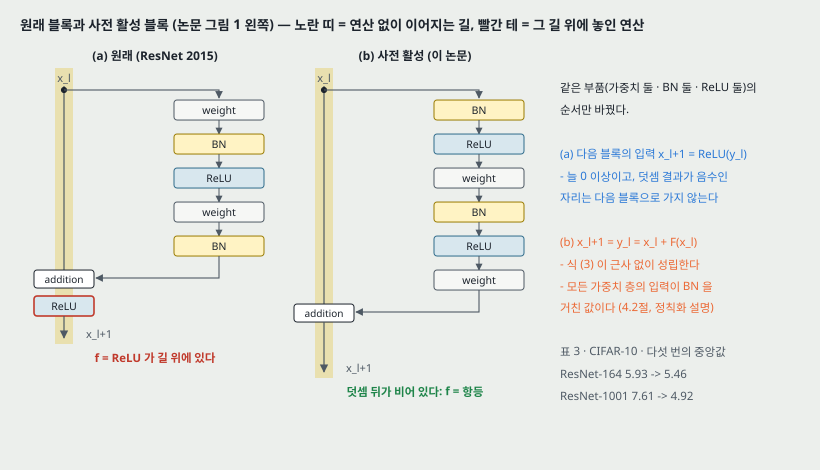

**원래 블록의 식.**

$$y_l = h(x_l) + F(x_l, W_l) \qquad (1)$$

$$x_{l+1} = f(y_l) \qquad (2)$$

원래 ResNet 은 $h(x_l) = x_l$, $f$ = ReLU 다. $W_l = \lbrace W_{l,k} \rbrace_{1 \le k \le K}$ 는 블록의 가중치와 치우침이고 $K$ 는 블록 안 층 수(원래 ResNet 에서 2 또는 3)다.

**물음.** $h$ 와 $f$ 를 **둘 다** 항등으로 두면 무엇이 달라지는가. 그리고 실제로 둘 중 하나를 깨면 학습이 어떻게 되는가.

**각주 1 — 항등이 아닌 블록.** 채널 수가 늘고 특징 지도가 줄어드는 블록에서는 $h$ 가 항등이 아니다. 논문은 그런 블록이 「CIFAR 에 둘, ImageNet 에 셋」뿐이라 3절의 지수적 영향은 없을 것이라고 **예상한다(expect)**. **내가 센 것은 다르다** — 병목 망은 첫 블록에서도 채널이 16 → 64(CIFAR), 64 → 256(ImageNet)으로 바뀌어 사영이 하나 더 있다. 그래서 이 논문의 ResNet-164 · 1001 은 셋, ImageNet ResNet-152 · 200 은 넷이다(torchvision 의 ResNet-50 · 101 · 152 도 `layer1` 첫 블록에 사영이 있다). 각주의 수는 기본 블록 망(ResNet-110, ResNet-18 · 34)의 수와 맞는다.

---

## 4. 전파 식 — 식 (3) · (4) · (5) (2절)

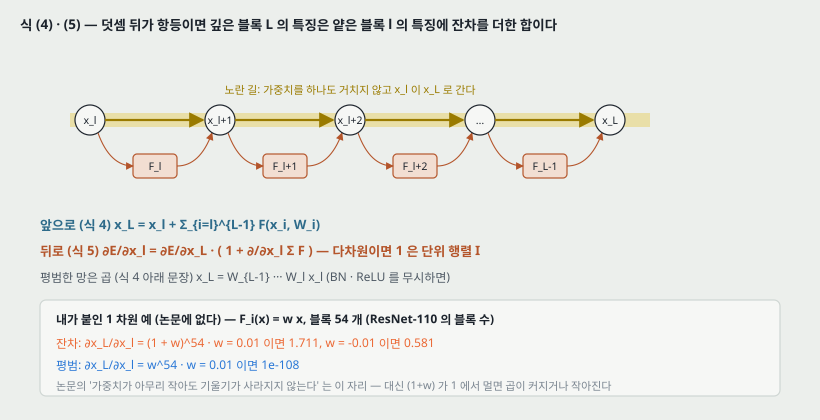

$f$ 도 항등이면($x_{l+1} \equiv y_l$) 식 (2) 를 식 (1) 에 넣어

$$x_{l+1} = x_l + F(x_l, W_l) \qquad (3)$$

이 된다. 한 번 더 펼치면 $x_{l+2} = x_{l+1} + F(x_{l+1}, W_{l+1}) = x_l + F(x_l, W_l) + F(x_{l+1}, W_{l+1})$ 이고, 되풀이하면 어느 $L > l$ 에 대해서도

$$x_L = x_l + \sum_{i=l}^{L-1} F(x_i, W_i) \qquad (4)$$

다. 논문이 꼽는 성질 둘:

1. 깊은 블록의 특징 $x_L$ 은 얕은 블록의 특징 $x_l$ 에 잔차의 합을 더한 것이다 — **어느 두 블록 사이에서도** 잔차 꼴이다.
2. $x_L = x_0 + \sum_{i=0}^{L-1} F(x_i, W_i)$ 는 **앞선 잔차 함수 출력의 합**이다. 평범한 망의 $x_L$ 이 행렬-벡터 곱의 연쇄 $\prod_{i=0}^{L-1} W_i x_0$ (BN · ReLU 를 무시하면)인 것과 대비된다.

**역방향.** 손실을 $E$ 라 두고 연쇄 법칙을 쓰면

$$\frac{\partial E}{\partial x_l} = \frac{\partial E}{\partial x_L} \frac{\partial x_L}{\partial x_l} = \frac{\partial E}{\partial x_L} \left( 1 + \frac{\partial}{\partial x_l} \sum_{i=l}^{L-1} F(x_i, W_i) \right) \qquad (5)$$

다. 첫 항 $\partial E / \partial x_L$ 은 **가중치 층을 하나도 거치지 않고** $x_l$ 까지 온다. 둘째 항은 가중치 층을 거친다. 논문의 논증은 둘이다.

- 미니배치의 모든 예시에서 $\frac{\partial}{\partial x_l} \sum F$ 가 늘 $-1$ 일 수는 없으니 기울기가 **상쇄되기 어렵다**.
- 그래서 **가중치가 아무리 작아도** 한 층의 기울기가 사라지지 않는다.

**내가 덧붙이는 셋 (논문은 적지 않았다).**

- $x$ 가 벡터면 식 (5) 의 「1」 은 단위 행렬 $I$ 이고 괄호 안은 야코비 행렬 $I + J$ 다. 「상쇄」는 $\partial E / \partial x_L$ 이 $(I + J)$ 의 왼쪽 영공간에 들어가는 일이다. 논문의 「$-1$ 일 수 없다」는 1 차원으로 쓴 말이다.
- **1 차원 선형 예.** $F_i(x) = w x$ 로 두고 블록 54 개(ResNet-110 의 블록 수)를 지나면 $\partial x_L / \partial x_l = (1 + w)^{54}$ 다. $w = 0.01$ 이면 1.711, $w = -0.01$ 이면 0.581 이다. 같은 자리의 평범한 망은 $w^{54} = 10^{-108}$ 이다. 「가중치가 작아도 사라지지 않는다」가 이 차이다. 다만 $(1 + w)$ 가 1 에서 멀면 곱이 커지거나 작아진다 — $w = 0.1$ 이면 171.9 다. **식 (5) 는 상쇄가 어렵다고 말할 뿐 크기가 1 에 머문다고 말하지 않는다.**
- **이 논문 안에 블록별 기울기 크기를 잰 그림이나 표는 없다.** 식 (5) 를 받치는 것은 6 · 8 · 10 · 11절의 학습 곡선과 최종 오차다.

**두 조건.** 식 (4) · (5) 는 (i) $h(x_l) = x_l$ 과 (ii) $f$ 가 항등이라는 두 가정 위에 선다. 논문은 이 둘을 3절(지름길)과 4절(덧셈 뒤)에서 따로 잰다.

---

## 5. 지름길을 곱으로 막으면 — 식 (6) · (7) · (8) (3절)

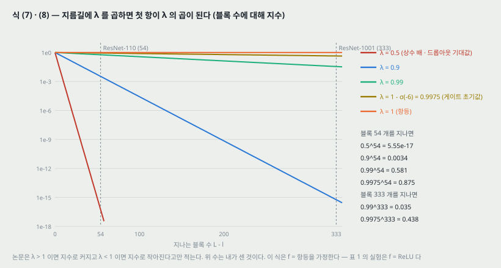

가장 단순한 깨기로 지름길에 스칼라를 곱한다($f$ 는 여전히 항등으로 둔다).

$$x_{l+1} = \lambda_l x_l + F(x_l, W_l) \qquad (6)$$

되풀이하면

$$x_L = \left( \prod_{i=l}^{L-1} \lambda_i \right) x_l + \sum_{i=l}^{L-1} \hat{F}(x_i, W_i) \qquad (7)$$

이다. $\hat{F}$ 는 $F$ 에 그 뒤 $\lambda$ 들의 곱 $\prod_{j=i+1}^{L-1} \lambda_j$ 을 흡수한 것이다. **두 블록으로 맞춰 봤다(내가 한 것)**: $x_{l+2} = \lambda_{l+1}(\lambda_l x_l + F_l) + F_{l+1} = \lambda_l \lambda_{l+1} x_l + \lambda_{l+1} F_l + F_{l+1}$ 로 식 (7) 과 같다. 역방향은

$$\frac{\partial E}{\partial x_l} = \frac{\partial E}{\partial x_L} \left( \prod_{i=l}^{L-1} \lambda_i + \frac{\partial}{\partial x_l} \sum_{i=l}^{L-1} \hat{F}(x_i, W_i) \right) \qquad (8)$$

다. 첫 항이 곱 항으로 바뀌었다. 모든 $\lambda_i > 1$ 이면 지수로 커지고, 모든 $\lambda_i < 1$ 이면 지수로 작아져 **지름길로 오는 신호가 막히고 가중치 층으로만 흐르게 된다**고 적는다. $h$ 가 게이트나 1x1 합성곱이면 첫 항이 $\prod h_i'$ 이 된다.

**곱 항의 크기 (내가 센 것).**

| $\lambda$ | 18 블록 (한 단계) | 54 블록 (ResNet-110) | 333 블록 (ResNet-1001) |
|---|---:|---:|---:|
| 0.5 | $3.8 \times 10^{-6}$ | $5.55 \times 10^{-17}$ | $5.7 \times 10^{-101}$ |
| 0.9 | 0.150 | 0.0034 | $5.8 \times 10^{-16}$ |
| 0.99 | 0.835 | 0.581 | 0.035 |
| 0.99753 ($1 - \sigma(-6)$) | 0.956 | 0.875 | 0.439 |
| 1 | 1 | 1 | 1 |

$\lambda = 0.99$ 처럼 1 과 0.01 차이여도 333 블록을 지나면 0.035 다. **같은 $\lambda$ 라도 망이 깊을수록 곱 항이 작아진다** — 1001 층에서 지름길을 정확히 항등으로 두는 것이 110 층보다 더 중요해지는 이유를 이 표가 보인다. 이 표는 식 (7) 을 계산한 것이고 실험이 아니다.

---

## 6. 지름길 실험 — 표 1 · 그림 2 (3.1절)

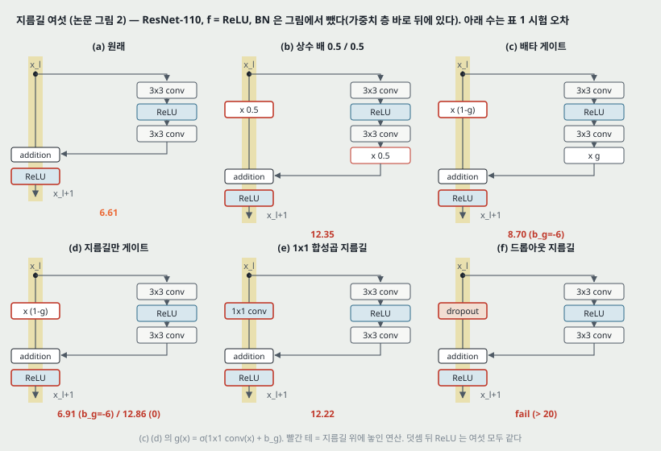

**설정.** CIFAR-10 의 ResNet-110 (3x3 두 층 블록 54 개), 구현은 원 ResNet 논문과 같다. **이 절의 실험은 모두 $f$ = ReLU 다** — 식 (5) · (8) 이 근사가 된다는 것을 논문이 스스로 적는다(4절 머리). CIFAR 값은 모두 **다섯 번의 중앙값**이다. 그림 2 에서 BN 은 생략했고, 가중치 층 바로 뒤에 있다.

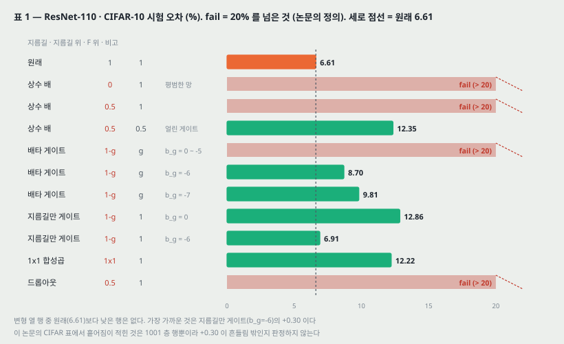

**표 1 (시험 오차 %, ResNet-110, CIFAR-10).**

| 경우 | 그림 | 지름길 위 | F 위 | 오차 | 비고 |
|---|---|---|---|---:|---|
| 원래 | 2(a) | 1 | 1 | 6.61 | |
| 상수 배 | 2(b) | 0 | 1 | fail | 평범한 망 |
| 상수 배 | 2(b) | 0.5 | 1 | fail | |
| 상수 배 | 2(b) | 0.5 | 0.5 | 12.35 | 얼린 게이트 |
| 배타 게이트 | 2(c) | $1 - g(x)$ | $g(x)$ | fail | $b_g$ = 0 ~ −5 |
| 배타 게이트 | 2(c) | $1 - g(x)$ | $g(x)$ | 8.70 | $b_g = -6$ |
| 배타 게이트 | 2(c) | $1 - g(x)$ | $g(x)$ | 9.81 | $b_g = -7$ |
| 지름길만 게이트 | 2(d) | $1 - g(x)$ | 1 | 12.86 | $b_g = 0$ |
| 지름길만 게이트 | 2(d) | $1 - g(x)$ | 1 | 6.91 | $b_g = -6$ |
| 1x1 합성곱 지름길 | 2(e) | 1x1 합성곱 | 1 | 12.22 | |
| 드롭아웃 지름길 | 2(f) | 드롭아웃 0.5 | 1 | fail | |

**변형별로 논문이 적은 것.**

- **상수 배.** 모든 지름길에 $\lambda = 0.5$. $F$ 를 그대로 두면 잘 수렴하지 않고, $F$ 에도 $1 - \lambda = 0.5$ 를 곱하면(Highway 게이트를 얼린 꼴) 수렴은 하지만 12.35% 다. 학습 손실도 원래보다 높아 **지름길 신호를 줄이면 최적화가 어렵다**고 읽는다.
- **배타 게이트.** Highway 처럼 $F$ 쪽에 $g(x)$, 지름길 쪽에 $1 - g(x)$ 를 곱한다. 게이트는 1x1 합성곱 + 시그모이드다. **$b_g$ 처음 값이 결정적**이라 0 에서 −10 까지 −1 간격으로 학습 집합 교차 검증을 해 −6 을 골랐고, 8.70% 로 여전히 원래보다 2.09 높다.
- **지름길만 게이트.** $F$ 는 그대로 두고 지름길에만 $1 - g(x)$. $b_g = 0$(처음 기대값 0.5)이면 12.86%, $b_g = -6$(처음 $1 - g$ = 0.9975)이면 6.91% 로 원래와 0.30 차이다.
- **1x1 합성곱 지름길.** 원 ResNet 논문의 선택지 C 로, 34 층(블록 16 개)에서는 좋았다. 110 층(블록 54 개)에서는 12.22% 로 나쁘다. ImageNet ResNet-101 에서도 비슷한 현상을 봤다고 적는다(수치 없음).
- **드롭아웃 지름길.** 비율 0.5 의 드롭아웃을 지름길 출력에 건다. 좋은 해로 수렴하지 못했다. 논문의 설명은 「드롭아웃이 통계적으로 기대값 0.5 인 $\lambda$ 를 지름길에 거는 것이라 상수 배 0.5 와 같이 신호를 막는다」다.

**3.2절의 논증 — 표현력이 아니라 최적화.** 게이트와 1x1 합성곱은 파라미터가 더 있고, 지름길만 게이트와 1x1 합성곱은 **항등을 해 공간에 포함한다**(항등으로 최적화될 수 있다). 그런데 학습 손실이 항등보다 높으니, 나빠진 원인은 표현력이 아니라 **최적화**라고 읽는다. 그림 3 에서 꺼낸 끝 무렵(64k 반복) 학습 손실로 보면 원래 0.0027 에 대해 지름길만 게이트 0.0202(7.4 배), 1x1 합성곱 0.0602(22 배)다(8절).

---

## 7. 게이트 치우침과 곱 항 (3.1절, 내가 센 것)

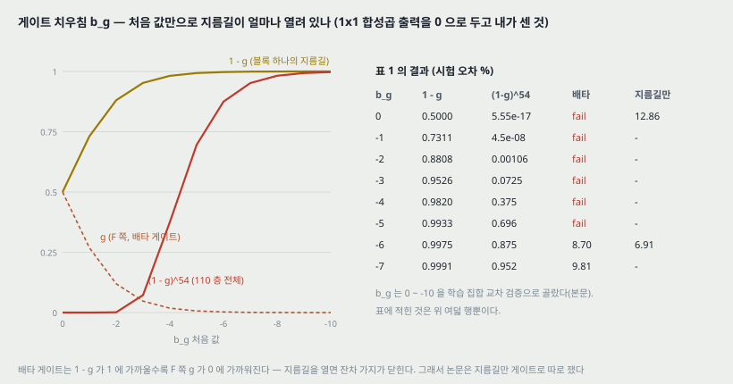

1x1 합성곱의 출력을 0 으로 두면 게이트의 처음 값은 $g = \sigma(b_g)$ 다. 그 값과 54 블록의 곱을 세면 표 1 의 결과와 이렇게 놓인다.

| $b_g$ | $1 - g$ | $(1 - g)^{54}$ | 배타 게이트 | 지름길만 게이트 |
|---:|---:|---:|---|---|
| 0 | 0.5000 | $5.55 \times 10^{-17}$ | fail | 12.86 |
| −2 | 0.8808 | 0.00106 | fail | 표에 없음 |
| −4 | 0.9820 | 0.375 | fail | 표에 없음 |
| −5 | 0.9933 | 0.696 | fail | 표에 없음 |
| −6 | 0.9975 | 0.875 | 8.70 | 6.91 |
| −7 | 0.9991 | 0.952 | 9.81 | 표에 없음 |

- **배타 게이트는 지름길을 열수록 $F$ 쪽이 닫힌다.** $b_g = -6$ 이면 지름길 쪽 곱이 0.875 로 열리지만 $F$ 쪽 $g$ 는 0.00247 이다. 그래서 −7 로 더 열면 $F$ 가 더 눌려 9.81 로 나빠지는 것으로 읽힌다(논문은 −7 이 왜 나쁜지 설명하지 않는다. 이것은 내 읽기다). 논문도 「배타 게이트의 효과는 두 갈래」라고 적고, 그래서 지름길만 게이트를 따로 쟀다.
- **$b_g = -5$ 에서 곱이 이미 0.696 인데 fail 이다.** 곱 항만으로는 −5(fail)와 −6(8.70)의 차이가 설명되지 않는다. 게이트는 학습 중에 움직이므로 처음 값만 본 이 표의 한계다.
- 이 표의 곱은 **처음 값**이다. 학습 뒤 게이트 값이 어떻게 됐는지 논문은 적지 않았다.

---

## 8. 지름길 변형의 학습 곡선 — 그림 3 (벡터 선에서 꺼낸 값)

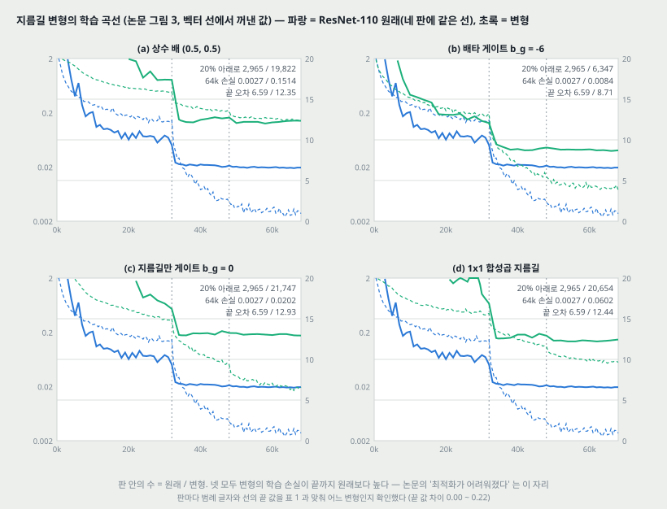

실선은 시험 오차(오른쪽 축 0 ~ 20%), 점선은 학습 손실(왼쪽 로그 축 0.002 ~ 2)이다. **네 판의 원래 ResNet-110 선은 같은 선이다** — 네 판에서 꺼낸 값의 차이가 최대 0.00003 백분율 점이다. 그림 6 왼쪽의 원래 선도 같다(차이 0.0002).

| 변형 (그림 3) | 시험 오차가 20% 아래로 들어오는 반복 | 1 만 반복 학습 손실 | 64k 학습 손실 | 선 끝 오차 | 표 1 |
|---|---:|---:|---:|---:|---:|
| 원래 | 2,965 | 0.275 | 0.0027 | 6.59 | 6.61 |
| (a) 상수 배 (0.5, 0.5) | 19,822 | 0.853 | 0.1514 | 12.35 | 12.35 |
| (b) 배타 게이트 $b_g = -6$ | 6,347 | 0.382 | 0.0084 | 8.71 | 8.70 |
| (c) 지름길만 게이트 $b_g = 0$ | 21,747 | 0.877 | 0.0202 | 12.93 | 12.86 |
| (d) 1x1 합성곱 | 20,654 | 0.778 | 0.0602 | 12.44 | 12.22 |

- **넷 모두 학습 손실이 처음부터 끝까지 원래보다 높다.** 1 만 반복에서 1.4 ~ 3.2 배, 64k 에서 3.1 ~ 56 배다. 논문 본문은 「학습 오차가 높다」고 적지만 그림이 그린 것은 학습 **손실**이다.
- 시험 오차가 그림의 20% 아래로 들어오는 반복이 원래 2,965 대 변형 6,347 ~ 21,747 이다. 「처음에 학습이 느리다」를 숫자로 옮긴 자리다.
- **반복 축의 끝.** 선이 틀 오른쪽 끝(6.8 만 반복)까지 간다. 학습률은 32k · 48k 에서 1/10 로 줄인다고 부록에 적지만 **학습을 언제 끝냈는지는 본문에 없다.** 원 ResNet 논문은 64k 에서 끝냈다.

---

## 9. 활성 위치 다섯 — 그림 4 · 표 2 (4 · 4.1절)

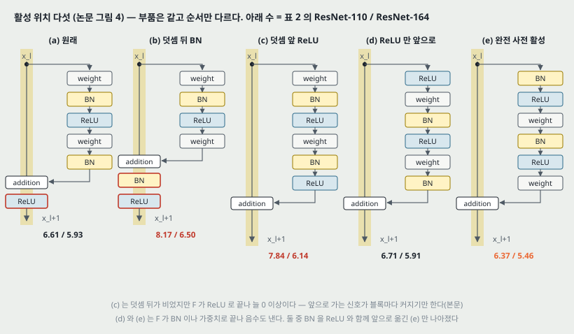

이번에는 $f$ 를 항등으로 만드는 쪽이다. **부품은 같고(가중치 둘 · BN 둘 · ReLU 둘) 순서만 바꾼다.** ResNet-110 과 ResNet-164 (CIFAR 용 병목 망, 1x1 · 3x3 · 1x1)를 쓴다. ResNet-164 의 블록은 ResNet-110 의 두 3x3 블록과 「계산 복잡도가 비슷하게(similar)」 설계된 것이라고 적는다(내 셈으로 곱-덧셈 0.245 G 대 0.253 G, 0.97 배).

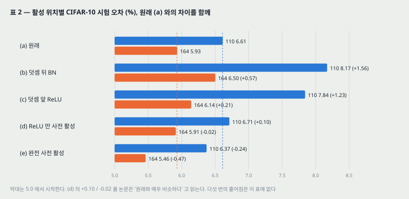

**표 2 (시험 오차 %, CIFAR-10).**

| 경우 | 그림 | ResNet-110 | ResNet-164 |
|---|---|---:|---:|
| 원래 블록 | 4(a) | 6.61 | 5.93 |
| 덧셈 뒤 BN | 4(b) | 8.17 | 6.50 |
| 덧셈 앞 ReLU | 4(c) | 7.84 | 6.14 |
| ReLU 만 사전 활성 | 4(d) | 6.71 | 5.91 |
| 완전 사전 활성 | 4(e) | **6.37** | **5.46** |

- **(b) 덧셈 뒤 BN** — $f$ 를 항등 쪽이 아니라 반대로 BN + ReLU 로 늘려 본 것. BN 이 지름길을 지나는 신호를 바꿔 「처음에 학습 손실을 줄이기 어렵다」(그림 6 왼쪽, 12절). +1.56 / +0.57.
- **(c) 덧셈 앞 ReLU** — $f$ 를 항등으로 만드는 가장 단순한 방법. 그런데 $F$ 가 ReLU 로 끝나 **늘 0 이상**이고, 잔차는 $(-\infty, +\infty)$ 값을 가져야 한다는 직관과 어긋난다. 앞으로 가는 신호가 블록마다 **커지기만 한다**(내가 덧붙이면 $x_{l+1} = x_l + \text{ReLU}(\cdot) \ge x_l$ 이 원소마다 성립한다). +1.23 / +0.21.
- **(d) ReLU 만 사전 활성** — 원래와 「매우 비슷하다」(+0.10 / −0.02). 이 ReLU 는 BN 과 함께 쓰이지 않아 BN 의 이점을 못 누렸을 **수 있다(may)** 고 적는다.
- **(e) 완전 사전 활성** — BN 과 ReLU 를 둘 다 가중치 앞으로. 「놀랍게도(somehow surprisingly) 건강한 차이로(healthy margins)」 나아졌다고 적는다. −0.24 / −0.47.

**「건강한 차이」의 크기.** 표 2 에는 흩어짐이 없다. 원 ResNet 논문이 ResNet-110 다섯 번의 표준편차를 0.16 으로 적었고, −0.24 는 그 1.5 배다. **빌린 수라 판정하지 않는다.**

---

## 10. 사후 활성을 사전 활성으로 — 식 (9) · 그림 5 (4.1절)

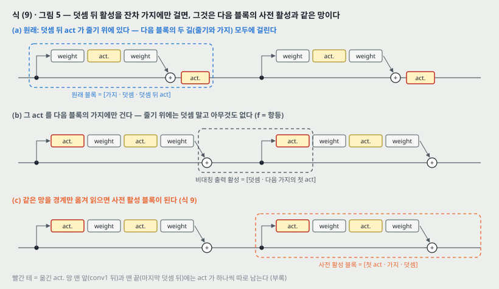

원래 설계에서 덧셈 뒤 활성 $x_{l+1} = f(y_l)$ 은 다음 블록의 **두 길 모두**에 걸린다: $y_{l+1} = f(y_l) + F(f(y_l), W_{l+1})$. 논문은 이것을 **비대칭**으로 바꿔 활성 $\hat{f}$ 가 **$F$ 쪽 길에만** 걸리게 한다: $y_{l+1} = y_l + F(\hat{f}(y_l), W_{l+1})$. 기호를 다시 붙이면

$$x_{l+1} = x_l + F(\hat{f}(x_l), W_l) \qquad (9)$$

이다. 식 (4) 와 같은 꼴이라 식 (5) 같은 역방향 식이 성립하고, **덧셈 뒤 활성이 항등이 된다.** 그리고 덧셈 뒤 활성을 비대칭으로 거는 것은 **그것을 다음 블록의 사전 활성으로 다시 읽는 것과 같다**(그림 5). 망은 그대로이고 블록의 경계만 옮긴 것이다.

**사후 · 사전의 구분은 덧셈이 있어서 생긴다.** 층 $N$ 개의 평범한 망은 활성이 $N - 1$ 개이고, 그것을 앞 층의 사후 활성으로 보든 뒤 층의 사전 활성으로 보든 같다. 가지가 덧셈으로 합쳐지는 망에서만 활성의 자리가 중요해진다.

**망의 맨 앞과 맨 끝 (부록).** 첫 블록(conv1 뒤)은 두 길로 갈라지기 **전에** 활성을 하나 두고, 마지막 블록(평균 풀링과 fc 앞)은 덧셈 **뒤에** 활성을 하나 더 둔다. 그림 5 의 바꾸기를 하면 자연스럽게 생기는 두 자리다. 사영 지름길도 사전 활성을 받는다.

---

## 11. 1001 층과 표 3 (4.1 · 4.2절)

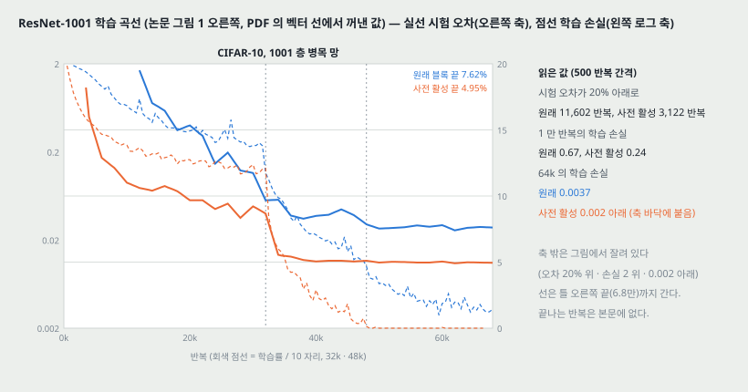

**ResNet-1001.** 병목 블록 333 개(특징 크기마다 111 개). 깊이는 $9 \times 111 + 2 = 1001$ 이다.

**표 3 (시험 오차 %, 다섯 번의 중앙값).**

| 데이터 | 망 | 원래 블록 | 사전 활성 블록 | 차이 |
|---|---|---:|---:|---:|
| CIFAR-10 | ResNet-110 (한 층 지름길) | 9.90 | 8.91 | 0.99 |
| CIFAR-10 | ResNet-110 | 6.61 | 6.37 | 0.24 |
| CIFAR-10 | ResNet-164 | 5.93 | 5.46 | 0.47 |
| CIFAR-10 | ResNet-1001 | 7.61 | 4.92 | 2.69 |
| CIFAR-100 | ResNet-164 | 25.16 | 24.33 | 0.83 |
| CIFAR-100 | ResNet-1001 | 27.82 | 22.71 | 5.11 |

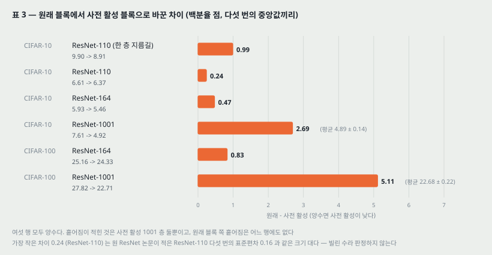

- **여섯 행 모두 사전 활성이 낮다**(논문 「일관되게 낫다」). 차이는 0.24 ~ 5.11.
- **원래 블록은 1001 층이 164 층보다 나쁘다**(CIFAR-10 7.61 대 5.93, CIFAR-100 27.82 대 25.16). 원 ResNet 논문의 「1202 층이 110 층보다 나쁘다」와 같은 모양이 병목 망에서도 나온다. 사전 활성은 1001 층이 164 층보다 낮다(4.92 대 5.46, 22.71 대 24.33).
- **「ResNet-110(한 층 지름길)」** 은 각 블록이 층 하나인 110 층 망이다. 원래 블록 9.90 은 이 표에서 가장 나쁘다. 원 ResNet 논문이 「$F$ 가 층 하나면 이점이 없다」고 적은 자리와 닿는다.

**그림 1 에서 꺼낸 값 (CIFAR-10, ResNet-1001).**

| | 원래 블록 | 사전 활성 |
|---|---:|---:|
| 시험 오차가 20% 아래로 들어오는 반복 | 11,602 | 3,122 |
| 1 만 반복 학습 손실 | 0.670 | 0.239 |
| 32k (학습률 첫 줄임 직전) 시험 오차 | 9.68 | 8.67 |
| 64k 학습 손실 | 0.0037 | 0.002 아래 |
| 선 끝 시험 오차 (표 3) | 7.62 (7.61) | 4.95 (4.92) |

사전 활성의 학습 손실은 48k 뒤 38 점 중 31 점이 축 바닥(0.002)에 붙어 잘려 있다. **0.002 아래라는 것까지만 읽힌다.**

---

## 12. 두 효과 — 최적화와 정칙화 (4.2절, 그림 1 · 6)

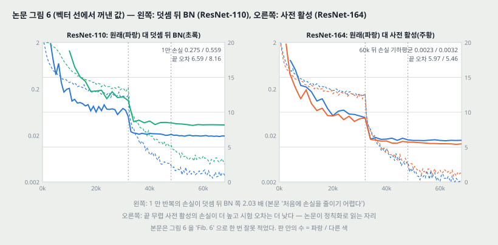

**하나. 최적화가 쉬워진다** — $f$ 가 항등이라서. 1001 층에서 두드러진다. 원래 설계는 학습 처음에 학습 오차가 아주 느리게 준다. $f$ = ReLU 는 음수 신호를 자르고, 블록이 많으면 그 효과가 커져 식 (3) 이 좋은 근사가 아니게 된다고 적는다. 사전 활성 1001 층은 손실을 빨리 줄이고 **본 모델 중 가장 낮은 손실**에 닿는다. 그림에서 꺼낸 값으로는 사전 활성 1001 층만 48k 뒤 대부분(31 / 38 점)이 0.002 아래이고, 원래 ResNet-164 는 3 / 41 점, 나머지는 0 점이다 — 그림이 보이는 범위에서 이 말과 어긋나지 않는다.

**층이 적으면 $f$ = ReLU 의 영향이 작다.** ResNet-164 의 원래 곡선은 처음에 「a little bit」 고생하다 곧 건강해진다고 적는다(그림 6 오른쪽에서 꺼낸 1 만 반복 손실은 원래 0.289, 사전 활성 0.245). **응답을 지켜보니** 학습이 얼마간(after some training) 지나면 $y_l$ 이 0 위에 더 자주 놓여 $f$ 가 자르지 않는다고 적는다($x_l$ 은 앞 ReLU 덕에 늘 0 이상이라 $y_l$ 이 음수가 되려면 $F$ 가 크게 음수여야 한다). 1000 층에서는 자르는 일이 더 잦다. **잘린 비율의 수치는 없다.**

**둘. 정칙화가 좋아진다** — BN 을 사전 활성으로 써서. 사전 활성은 **수렴했을 때 학습 손실이 높고(slightly higher) 시험 오차는 낮다**. ResNet-110 · 110(한 층) · 164, CIFAR-10 · 100 모두에서 봤다고 적는다. 원인은 BN 의 정칙화 효과로 **추정한다(presumably)**: 원래 블록은 BN 으로 정규화한 신호를 곧 지름길과 더해 다음 가중치 층에 **정규화되지 않은 신호**가 들어가고, 사전 활성은 모든 가중치 층의 입력이 정규화돼 있다.

**그림 6 에서 꺼낸 값.**

| | 1 만 반복 학습 손실 | 60k 뒤 학습 손실 (기하평균) | 선 끝 시험 오차 (표) |
|---|---:|---:|---:|
| ResNet-110 원래 | 0.275 | | 6.59 (6.61) |
| ResNet-110 덧셈 뒤 BN | 0.559 | | 8.17 (8.17) |
| ResNet-164 원래 | 0.289 | 0.00230 | 5.97 (5.93) |
| ResNet-164 사전 활성 | 0.245 | 0.00315 | 5.46 (5.46) |

- 덧셈 뒤 BN 은 1 만 반복 손실이 원래의 2.03 배다(본문 「처음에 손실을 줄이기 어렵다」). 시험 오차가 20% 아래로 들어오는 것도 9,625 대 2,965 반복이다.
- ResNet-164 의 사전 활성은 60k 뒤 학습 손실이 원래의 1.37 배이고 시험 오차는 0.47 낮다 — 논문의 「손실은 slightly higher, 오차는 낮다」를 숫자로 옮긴 자리다. **이것이 BN 정칙화 때문이라는 것은 이 논문이 따로 갈라 재지 않았다**(18절 넷).

---

## 13. CIFAR 비교 — 표 4 (5절)

**표 4 (시험 오차 %, 「보통 늘리기」= 뒤집기 · 옮기기, ELU 만 늘리기 없음).** 이 논문 행은 다섯 번의 중앙값이고 괄호는 평균 ± 표준편차다.

| CIFAR-10 | 오차 | CIFAR-100 | 오차 |
|---|---:|---|---:|
| NIN | 8.81 | NIN | 35.68 |
| DSN | 8.22 | DSN | 34.57 |
| FitNet | 8.39 | FitNet | 35.04 |
| Highway | 7.72 | Highway | 32.39 |
| All-CNN | 7.25 | All-CNN | 33.71 |
| ELU | 6.55 | ELU | 24.28 |
| FitResNet, LSUV | 5.84 | FitNet, LSUV | 27.66 |
| ResNet-110 [1] (1.7M) | 6.61 | ResNet-164 [1] (1.7M) | 25.16 |
| ResNet-1202 [1] (19.4M) | 7.93 | ResNet-1001 [1] (10.2M) | 27.82 |
| ResNet-164 [이 논문] (1.7M) | 5.46 | ResNet-164 [이 논문] (1.7M) | 24.33 |
| ResNet-1001 [이 논문] (10.2M) | 4.92 (4.89 ± 0.14) | ResNet-1001 [이 논문] (10.2M) | 22.71 (22.68 ± 0.22) |
| ResNet-1001 [이 논문] (10.2M), 배치 64 | 4.62 (4.69 ± 0.20) | | |

- **흩어짐이 적힌 곳은 이 표의 1001 층 세 칸뿐이다.** 이 논문에서 차이를 흔들림과 견줄 수 있는 자리가 여기밖에 없다.
- **배치 64 와 128.** 모든 ResNet 결과는 미니배치 128 이고 † 하나만 64 다. 중앙값 차이 0.30, 평균 차이 0.20. 두 표준편차가 다섯 번의 표본 표준편차라고 놓으면 평균 차이의 표준오차는 $\sqrt{0.14^2/5 + 0.20^2/5} = 0.109$ 이고 0.20 은 그 1.8 배다(**내가 센 것이고, ± 가 무엇인지 논문은 적지 않았다**). 초록의 4.62% 가 이 배치 64 값이다.
- **넓이나 필터 크기를 따로 맞추지 않았고 드롭아웃 같은 정칙화도 쓰지 않았다**고 적는다. 결과는 「더 깊게」라는 단순한 생각으로 얻었다는 것이 논문의 읽기다.
- **[1] 이 붙은 CIFAR-100 두 행**(ResNet-164 25.16 · ResNet-1001 27.82)은 원 ResNet 논문에 없는 값이다. 표 3 의 「원래 블록」 열과 같은 수라, 여기서 [1] 은 「[1] 의 블록으로 이 논문이 돌린 것」으로 읽힌다(19절 둘).

---

## 14. ImageNet — 표 5 (5절)

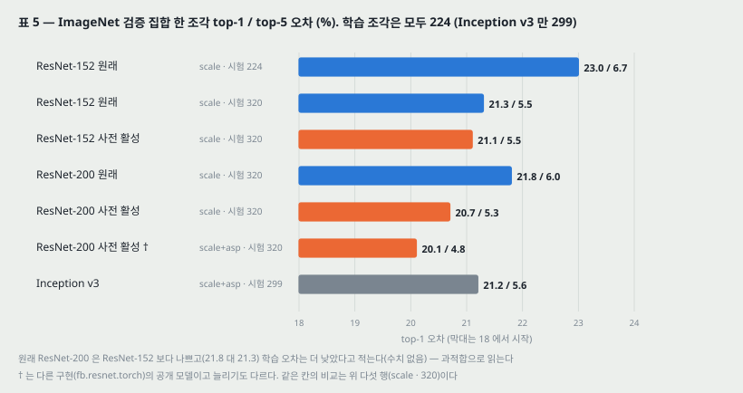

**지름길 변형은 ImageNet 에서 끝까지 돌리지 않았다.** ResNet-101 로 예비 실험을 해 첫 학습률 구간에서 학습 오차가 「분명히」 높은 것을 보고 자원이 모자라 멈췄다고 적는다(수치 없음). **덧셈 뒤 BN 판 ResNet-101 은 끝까지 돌렸다** — 224 한 조각 검증 오차 24.6 / 7.5%, 원래 23.6 / 7.1%.

**표 5 (ILSVRC 2012 검증 집합, 한 조각, top-1 / top-5 오차 %).** 모든 ResNet 은 원 논문과 같은 하이퍼파라미터 · 구현으로 처음부터 배웠다.

| 방법 | 늘리기 | 학습 조각 | 시험 조각 | top-1 | top-5 |
|---|---|---|---|---:|---:|
| ResNet-152 원래 | 크기 | 224 | 224 | 23.0 | 6.7 |
| ResNet-152 원래 | 크기 | 224 | 320 | 21.3 | 5.5 |
| ResNet-152 사전 활성 | 크기 | 224 | 320 | 21.1 | 5.5 |
| ResNet-200 원래 | 크기 | 224 | 320 | 21.8 | 6.0 |
| ResNet-200 사전 활성 | 크기 | 224 | 320 | 20.7 | 5.3 |
| ResNet-200 사전 활성 † | 크기 + 가로세로비 | 224 | 320 | 20.1 | 4.8 |
| Inception v3 | 크기 + 가로세로비 | 299 | 299 | 21.2 | 5.6 |

- **왜 320 조각으로 재는가.** 원 논문은 짧은 변 $s \in [256, 480]$ 로 크기를 흔들며 배웠으므로 $s = 256$ 에서 224 조각을 재면 **불리하게 치우친다**고 보고, $s = 320$ 에서 320 조각 하나를 잰다. 완전 합성곱 망이라 큰 조각으로 잴 수 있고, Inception v3 의 299 와는 21 픽셀 차이다(논문 「close to」). **같은 원래 ResNet-152 가 시험 조각만 바꿔 23.0 → 21.3 으로 1.7 내려간다** — 블록을 바꾼 차이(21.3 → 21.1, 0.2)의 8.5 배다.
- **ResNet-152 에서는 차이가 0.2 다.** 논문은 이 모델이 일반화에 심한 어려움을 보이지 않아서라고 적는다.
- **원래 ResNet-200 은 ResNet-152 보다 나쁘다**(21.8 대 21.3). 학습 오차는 더 낮았다고 적어 **과적합**으로 읽는다(학습 오차 수치는 없다). 사전 활성 ResNet-200 은 20.7 로 원래보다 1.1, ResNet-152 의 두 판보다도 낮다.
- **† 는 다른 구현이다** — fb.resnet.torch 의 공개 모델이고 가로세로비 늘리기를 더 썼다. 20.1 / 4.8 은 Inception v3 (21.2 / 5.6)보다 낮다. 같은 시기의 Inception-ResNet-v2 는 19.9 / 4.9 라고 적는다.
- ResNet-200 은 ResNet-152 보다 병목 블록 16 개를 28x28 단계에 더한 것이다(각주 3). 내 셈으로 원래 블록 기준 파라미터는 ResNet-152 60,192,808, ResNet-200 64,673,832 (1.07 배)다.
- **ImageNet 표에는 흩어짐이 없고 실행 횟수도 적혀 있지 않다.**

**계산 비용.** 계산량은 깊이에 선형이라 「1001 층은 100 층의 10 배쯤 복잡하다」고 적는다. CIFAR 의 ResNet-1001 은 GPU 2 장에서 27 시간, ImageNet ResNet-200 은 GPU 8 장에서 3 주(VGG 와 같은 수준)다. **내 셈으로 곱-덧셈은 ResNet-1001 이 ResNet-110 의 5.88 배, ResNet-164 의 6.09 배다**(15절).

---

## 15. 파라미터와 계산을 직접 세서 맞춰 보기

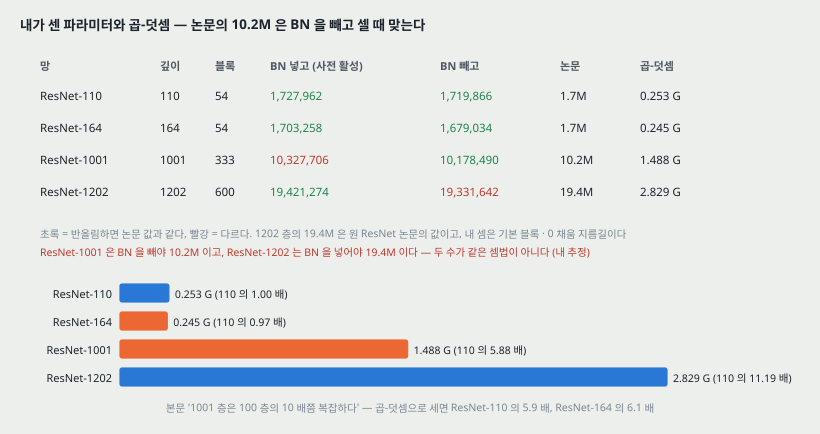

`figures/ECCV16_PreAct/make_figures.py` 가 표준 라이브러리로 센 값이다. 합성곱에는 치우침이 없고, BN 은 채널마다 γ · β 둘, fc 는 치우침이 있다. 기본 블록 망은 채널이 늘 때 0 을 채운 항등 지름길(원 ResNet 의 선택지 A), 병목 망은 채널이 바뀌는 블록에 1x1 사영(부록)으로 셌다.

| 망 | 깊이 | 블록 | BN 넣고 (사전 활성) | BN 빼고 | 논문 | 곱-덧셈 |
|---|---:|---:|---:|---:|---:|---:|
| ResNet-110 | 110 | 54 | 1,727,962 | 1,719,866 | 1.7M | 0.253 G |
| ResNet-164 | 164 | 54 | 1,703,258 | 1,679,034 | 1.7M | 0.245 G |
| ResNet-1001 | 1001 | 333 | 10,327,706 | 10,178,490 | 10.2M | 1.488 G |
| ResNet-1202 | 1202 | 600 | 19,421,274 | 19,331,642 | 19.4M | 2.829 G |

- **ResNet-1001 의 10.2M 은 BN 을 빼고 셀 때 맞는다**(10,178,490 → 10.2). BN 을 넣으면 10,327,706 → 10.3 이다. 원래 블록으로 세도 10,328,602 라 블록 순서는 차이를 내지 않는다.
- **그런데 ResNet-1202 의 19.4M 은 BN 을 넣어야 맞는다**(19,421,274 → 19.4, 빼면 19.3). 19.4M 은 원 ResNet 논문이 낸 수다. **두 수가 같은 셈법으로 나온 것이 아닐 수 있다 — 파라미터를 맞춰 본 내 추정이고, 논문은 셈법을 적지 않았다.**
- ResNet-110 · 164 는 어느 셈법으로도 1.7M 이다.
- **곱-덧셈 배수.** 1001 / 110 = 5.88, 1001 / 164 = 6.09, 164 / 110 = 0.967, 1202 / 110 = 11.19. 깊이 배수 1001 / 110 = 9.10 이다. **본문의 「10 배쯤」은 깊이의 비로 읽히고, 계산량으로는 ResNet-110 의 5.9 배다** — 병목 블록이 기본 블록보다 층당 계산이 적어서다.

---

## 16. 구현 설정 (부록)

| 항목 | CIFAR | ImageNet |
|---|---|---|
| 하이퍼파라미터 · 구현 | 원 ResNet 논문과 같다 | 원 ResNet 논문과 같다 |
| 늘리기 | 옮기기 · 뒤집기만 | 원 논문과 같은 늘리기 (크기 흔들기) |
| 학습률 | 0.1 에서 시작, 32k · 48k 반복에서 1/10 | 0.1 에서 시작(데우기 없음), 30 · 60 에폭에서 1/10 |
| 데우기 | 처음 400 반복은 0.01 — **사전 활성 블록에는 필요 없다고 적는다(수치 없음)** | 없음 |
| 미니배치 | 128, GPU 2 장(장당 64). 표 4 의 † 만 64 | 256, GPU 8 장(장당 32) |
| 가중치 감쇠 · 관성 | 0.0001 · 0.9 | 같다 |
| 초기화 | He 외(2015) | 같다 |
| 병목 블록 | [3x3, 16 ; 3x3, 16] 을 [1x1, 16 ; 3x3, 16 ; 1x1, 64] 로 바꾼다(논문 「파라미터 수가 roughly the same」, 내 셈으로 블록당 4,608 대 4,352) | 원 논문의 병목 |
| 지름길 | 특징 지도를 줄일 때 사영 지름길, 사전 활성일 때 사영도 사전 활성 | 같다 |

**적혀 있지 않은 것.** 학습을 끝낸 반복(CIFAR)과 에폭(ImageNet), 다섯 번의 실행 사이에 무엇을 바꿨는지(seed 만인지), 게이트 · 1x1 지름길에 BN 을 붙였는지, 드롭아웃 구현(남은 값을 키우는지), ImageNet 실행 횟수.

---

## 17. 이 논문이 스스로 적은 한계와 조건

1. **식 (5) · (8) 은 $f$ 가 항등이라는 가정 위의 식이고, 3절의 지름길 실험은 $f$ = ReLU 라 근사다**(4절 머리).
2. **항등이 아닌 지름길을 가진 블록에서는 유도가 엄밀히 성립하지 않는다.** 그런 블록이 적어 지수적 영향은 없을 것이라는 **예상**이다(각주 1).
3. **ReLU 만 사전 활성이 나아지지 않은 이유는 추측이다** — BN 과 함께 쓰이지 않아서일 수 있다(may).
4. **정칙화 효과의 원인은 추정이다** — BN 의 정칙화 효과 때문일 것이다(presumably).
5. **ImageNet 에서 지름길 변형은 끝까지 돌리지 않았다** — 자원이 모자라서다.
6. **ResNet-152 에서는 이득이 작다** — 일반화에 심한 어려움이 없는 모델이라서라고 적는다.

---

## 18. 논문이 적지 않은 것 — 내가 읽으며 짚은 자리

**하나. 식 (5) 를 직접 잰 자리가 없다.** 블록별 기울기 크기, 덧셈 뒤 ReLU 가 자른 비율(「응답을 지켜보니」), 게이트의 학습 뒤 값 중 어느 것도 수치로 나오지 않는다. 식 (5) 와 「맞는 현상」으로 내놓은 것은 학습 곡선과 최종 오차다. 그러니 **이 논문이 보인 것은 「항등에 가까운 설계가 더 잘 배워졌다」이고, 「그 이유가 식 (5) 의 1 + 항이다」는 해석이다.** 원 ResNet 논문은 층 응답의 표준편차라도 그렸다(그 노트 14절).

**둘. 흩어짐이 1001 층 세 칸에만 있다.** 표 1 · 2 · 3 의 작은 차이 — 지름길만 게이트 −6 의 +0.30, ReLU 만 사전 활성의 +0.10 / −0.02, 완전 사전 활성 110 층의 −0.24 — 를 판정할 잣대가 이 논문 안에 없다. 원 ResNet 논문의 ResNet-110 표준편차 0.16 을 빌리면 −0.24 는 1.5 배, +0.10 은 0.6 배다. **빌린 수로 한 셈이지 이 논문에서 잰 것이 아니다.** ImageNet 의 0.2(ResNet-152) 도 실행 횟수가 적혀 있지 않다.

**셋. 기준값 6.61 이 원 ResNet 논문의 「평균」과 같은 수다.** 이 논문은 CIFAR 값을 모두 다섯 번의 **중앙값**이라고 적고 원래 ResNet-110 을 6.61 이라 한다. 원 ResNet 논문은 ResNet-110 을 「최고 6.43, 평균 ± 표준편차 6.61 ± 0.16」 으로 적었다. 다시 돌린 중앙값이 우연히 같은 것인지 원 논문의 평균을 옮긴 것인지 이 파일로는 가리지 못한다. 그림 3 · 6 의 원래 ResNet-110 선 끝은 6.59 다.

**넷. 사전 활성의 두 효과가 갈려 있지 않다.** 「$f$ 가 항등이라 최적화가 쉽다」와 「모든 가중치 층 입력이 BN 을 거쳐 정칙화된다」는 완전 사전 활성 하나에 함께 들어 있다. 표 2 의 (c) 덧셈 앞 ReLU 는 $f$ 가 항등이면서 $F$ 가 0 이상이라는 다른 조건이 섞였고, (d) 는 BN 이 앞에 없다. **$f$ 만 항등이고 BN 위치는 원래와 같은 판**이 없어서, 1001 층의 2.69 중 얼마가 어느 효과인지 이 논문으로는 나눌 수 없다.

**다섯. 드롭아웃 지름길의 「기대값 0.5」는 구현에 따라 다르다.** 흔히 쓰는 드롭아웃 구현(Caffe · Torch)은 학습 중 남은 값을 $1/(1-p)$ 배 키워 기대값이 1 이 되게 한다(내가 아는 구현 관행이다). 그 구현이라면 지름길에 거는 것은 기대값 0.5 의 축소가 아니라 블록마다 0 또는 2 를 곱하는 잡음이고, 식 (8) 의 곱 항은 기대값이 1 이다. **이 논문은 어느 구현인지 적지 않았다.** 결과(fail)는 그대로이고, 설명만 상수 배와 같다고 볼지가 갈린다.

**여섯. 「1x1 합성곱이 항등을 포함한다」에는 BN 이 끼어 있다.** 그림 2 캡션은 「모든 가중치 층 바로 뒤에 BN 이 있다」고 적는다. 1x1 지름길 뒤에도 BN 이 있다면 항등이 되려면 BN 의 γ · β 까지 맞아야 한다. 표현력으로는 여전히 포함하지만, 처음 상태가 항등에서 얼마나 먼지가 달라진다. 1x1 지름길 · 게이트에 BN 을 붙였는지 본문에 없다.

**일곱. 학습을 언제 끝냈는지 없다.** 그림의 선은 6.8 만 반복까지 간다. 원 ResNet 논문은 64k 에서 끝냈다. 끝 시점이 다르면 표의 값과 원 논문의 값을 같은 칸에 놓을 때 조건이 하나 더 다르다.

**여덟. 「1001 층은 100 층의 10 배쯤 복잡하다」는 깊이의 비다.** 곱-덧셈으로는 ResNet-110 의 5.88 배다(15절).

---

## 19. 읽을 때 헷갈리는 지점

**하나. 4.92 와 4.62.** 그림 1 · 표 3 · 표 4 첫 행의 4.92 는 미니배치 128, 초록의 4.62 는 미니배치 64 다. 둘 다 다섯 번의 중앙값이다.

**둘. 「[1]」 이 붙은 행.** 표 4 에서 ResNet-110 [1] 6.61 과 ResNet-1202 [1] 7.93 은 원 논문의 수이고, CIFAR-100 의 ResNet-164 [1] · ResNet-1001 [1] 은 원 논문에 없는 실험이다(원 블록으로 이 논문이 돌린 것). 같은 표기가 두 뜻이다.

**셋. 「학습 오차」 와 「학습 손실」.** 본문은 그림 3 · 6 을 가리키며 「학습 오차가 높다」고 적지만 그림의 점선과 왼쪽 축은 **학습 손실**(training loss)이다.

**넷. $f$ 와 $\hat{f}$.** $f$ 는 덧셈 뒤 연산(식 2), $\hat{f}$ 는 $F$ 쪽 길에만 거는 활성(식 9)이다. 사전 활성 블록에서 $f$ 는 항등, $\hat{f}$ 는 BN + ReLU 다.

**다섯. 「사전 활성」이 둘이다.** 그림 4(d) ReLU 만 사전 활성과 (e) 완전 사전 활성. 이 논문이 제안하는 것과 Wide ResNet 이 쓰는 것은 (e) 다.

**여섯. 표 1 의 「지름길 위 · F 위」 열.** 덧셈 직전에 두 길에 각각 곱하는 것이다. 상수 배의 「0, 1」 은 지름길을 없앤 것이라 평범한 망이 된다.

**일곱. ResNet-110 과 ResNet-164 는 블록 수가 같다**(54 개). 164 는 블록 안 층이 셋이라 깊이가 $9 \times 18 + 2$ 다. 계산량은 0.97 배다.

**여덟. ImageNet 의 320 조각.** 표 5 의 원래 ResNet-152 는 224 조각 23.0, 320 조각 21.3 으로 두 번 나온다. 블록 비교는 320 끼리 한다.

---

## 20. 원문 안의 어긋남 모음

읽다가 맞지 않는 자리를 한곳에 모은다. **틀렸다고 단정하지 않고, 같은 것을 가리키는 두 값이 다르다는 것만 적는다.**

| 자리 | 한쪽 | 다른 쪽 |
|---|---|---|
| 각주 1 | 항등이 아닌 블록이 CIFAR 둘 · ImageNet 셋 | 병목 망(ResNet-164 · 1001, ImageNet 152 · 200)은 첫 블록 사영까지 셋 · 넷 (내 셈) |
| 5절 계산 비용 | 1001 층이 100 층의 10 배쯤 | 곱-덧셈으로 ResNet-110 의 5.88 배 (내 셈) |
| 표 4 파라미터 | ResNet-1001 10.2M (BN 빼면 맞음) | ResNet-1202 19.4M (BN 넣어야 맞음) — 셈법이 다를 수 있다 |
| 3.1절 · 표 1 | 원래 ResNet-110 6.61 을 다섯 번의 중앙값이라 함 | 원 ResNet 논문의 ResNet-110 평균 6.61 ± 0.16 과 같은 수 |
| 표 4 | ResNet-164 [1] · ResNet-1001 [1] (CIFAR-100) | 원 ResNet 논문에 CIFAR-100 실험이 없다 |
| 3.1절 · 4.1절 본문 | 「학습 오차」 | 그림의 점선 · 축은 학습 손실 |
| 4.1절 | 「Fib. 6 left」 | 그림 6 |
| 2절 Discussions | 「expect addition」 | except 의 오기로 읽힌다 |
| 식 (9) | 「, .」 | 쉼표와 마침표가 겹쳐 있다 |

---

## 21. ResNet · Wide ResNet 노트와 맞춰 보기

| | ResNet (CVPR 2016) | 사전 활성 ResNet (이 논문) | Wide ResNet (BMVC 2016) |
|---|---|---|---|
| 블록 순서 | 합성곱-BN-ReLU, 덧셈 뒤 ReLU | BN-ReLU-합성곱, 덧셈 뒤 없음 | 이 논문의 순서 (CIFAR), ImageNet 은 원래 순서 |
| 지름길 | 항등, 채널이 늘 때 0 채움(A) 또는 사영(B · C) | 항등 외의 다섯을 재서 모두 나쁨 | 사영은 단계 첫 블록만 |
| 깊이의 끝 | 1202 층, 7.93 (110 층보다 나쁨) | 1001 층, 4.92 / 4.62 | 16 ~ 40 층에 폭 k |
| 흩어짐 | ResNet-110 6.61 ± 0.16 한 자리 | 1001 층 세 칸 | 없음 |
| 드롭아웃 | 쓰지 않음 | 지름길 쪽은 fail | 가지 안 두 합성곱 사이, 좋아짐 |

**ResNet 노트가 남긴 물음에 대한 답.**

- **「둘째 ReLU 가 덧셈 뒤에 있어 지름길이 엄밀한 항등이 아니다」 — 닫혔다.** 이 논문이 바로 그것을 $f$ 로 이름 붙여 없앴고(사전 활성), 반대로 덧셈 뒤를 늘리면(BN 추가) 나빠지는 것까지 쟀다(+1.56 / +0.57).
- **「1202 층이 110 층보다 나쁘다」 — 일부만 닫혔다.** 1202 층 기본 블록 망 자체는 다시 돌리지 않았다. 대신 같은 모양(원래 블록의 1001 층 7.61 이 164 층 5.93 보다 나쁨)이 병목 망에서 나왔고, 사전 활성으로 4.92 로 내려갔다. 원 논문은 1202 층을 **과적합**으로 읽었는데, 이 논문은 1001 층 원래 블록에서 **처음의 느린 최적화**를 보인다(그림 1, 1 만 반복 손실 0.670 대 0.239). 64k 의 학습 손실은 원래 0.0037, 사전 활성 0.002 아래로 둘 다 낮아 **끝에서는 둘 다 배워졌다** — 「과적합 대 최적화」 중 하나로 정리되지 않는다.

**Wide ResNet 노트가 남긴 물음에 대한 답.**

- **「사전 활성 순서가 왜 낫다고 했는지」 — 닫혔다.** 최적화($f$ 항등)와 정칙화(BN 이 모든 가중치 층 입력을 정규화) 두 갈래로 적는다. 다만 둘의 몫은 갈려 있지 않다(18절 넷).
- **「지름길 쪽 드롭아웃이 왜 나쁜지」 — 닫혔다.** 기대값 0.5 의 $\lambda$ 를 거는 것이라 상수 배 0.5 처럼 신호를 막는다는 설명이다. 이 설명이 드롭아웃 구현에 따라 달라질 수 있다는 것을 18절 다섯에 적었다.
- **「ResNet-1001 의 4.92 / 4.64 가 어떤 조건의 값인지」 — 닫혔고, 고칠 자리가 하나 나왔다.** 4.92 는 미니배치 128 의 다섯 번 중앙값(평균 4.89 ± 0.14), 미니배치 64 는 **4.62** (평균 4.69 ± 0.20)다. **이 판(v3)에는 4.64 가 없다.** Wide ResNet 논문이 4.64 로 옮긴 것이 앞선 판의 값인지는 이 파일로 가리지 못한다.
- **「내 셈 10,327,706 대 10.2M」 — 닫혔다.** BN 을 빼고 세면 10,178,490 이라 10.2M 이 된다(15절). 다만 같은 표의 1202 층 19.4M 은 BN 을 넣어야 맞는다.
- **「ImageNet 망은 100 층 아래에서는 사전 활성이 차이를 내지 않았다」(Wide ResNet 노트 4 · 19절)** — 이것은 Wide ResNet 논문의 말이다. 이 논문의 ImageNet 비교는 152 · 200 층뿐이라 100 층 아래의 표는 없다. 가장 가까운 자리는 ResNet-152 의 0.2 차이와 CIFAR ResNet-110 의 0.24 차이다.

---

## 22. 계보와 PatchCore

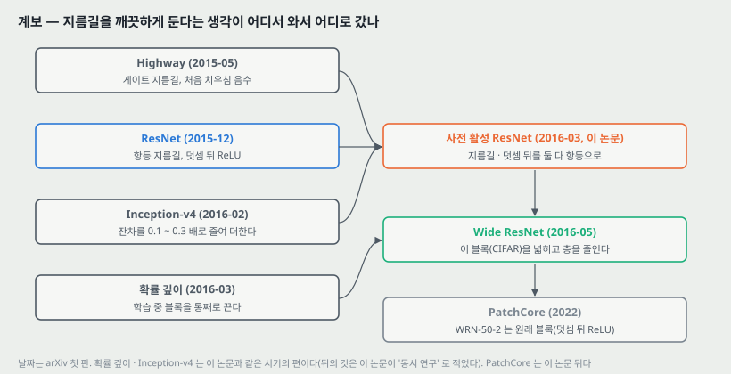

**하나. 이 저장소의 노트들이 다뤄 온 흐름에서의 자리.** 역전파 노트에서 깊이마다 기울기가 10 ~ 12 배씩 줄었고, 사전학습 · ReLU · BN · 잔차 지름길이 차례로 깊이를 가능하게 만들었다. 이 논문은 **잔차 지름길 위에 남아 있던 연산 하나(덧셈 뒤 ReLU)를 마저 치워** 1000 층을 배워지게 한다. 같은 시기에 Inception-v4 는 반대 방향 — 지름길이 아니라 **잔차 쪽을 0.1 ~ 0.3 배로 줄여** 더하는 — 으로 깊은 망을 안정시켰다(이 논문이 동시 연구로 인용한 편이고, 줄이는 쪽은 내가 그 논문에서 아는 내용이다. 이 논문 안에는 그 설명이 없다). 표 1 의 「지름길을 줄이면 나쁘다」와 나란히 놓으면, **줄일 거면 지름길이 아니라 잔차를 줄인다**는 한 방향으로 읽힌다.

**둘. PatchCore 가 쓰는 자리 (논문은 이 쓰임을 적지 않는다. 내가 잇는 것이다).**

- PatchCore 의 특징 추출기 WRN-50-2 는 **이 논문의 블록이 아니라 원래 블록**이다. Wide ResNet 논문은 ImageNet 망에 원래 순서를 썼고, torchvision 의 `wide_resnet50_2` 도 병목 안이 합성곱-BN-ReLU 이고 **덧셈 뒤에 ReLU** 가 있다.
- 그래서 PatchCore 가 꺼내는 `layer2` · `layer3` 의 출력은 **덧셈 뒤 ReLU 를 지난 값이라 모든 원소가 0 이상**이다. 사전 활성 망이었다면 단계 출력이 ReLU 를 거치지 않은 덧셈 결과라 음수도 있다.
- 이 차이가 이상 탐지에 무엇을 내는지는 **이 논문도 Wide ResNet 논문도 재지 않았다.** 24절 D 에 돌려 볼 것으로 적는다.

> 둘째 문단은 내가 읽고 이은 것이고 이 논문이 측정한 것이 아니다.

---

## 23. 다음에 읽을 것

**한계를 적고 그 한계를 푼 것이 다음 논문이다.** 이 논문이 남긴 자리에서 넷을 꼽는다.

| 논문 | 이 노트의 어느 자리에서 나오는가 | 무엇을 확인하고 싶은가 |
|---|---|---|
| **Residual Networks Behave Like Ensembles of Relatively Shallow Networks** (Veit · Wilber · Belongie, NIPS 2016, arXiv:1605.06431) — 후보 | 4절 — 식 (4) 를 끝까지 펼치면 경로의 합이 된다. 18절 하나 — 이 논문은 블록별 기여를 재지 않았다 | 블록 하나를 빼면 오차가 얼마 오르는지, 기울기가 어느 길이의 경로로 흐르는지를 실제로 쟀는지 |
| **Deep Networks with Stochastic Depth** (Huang 외, ECCV 2016, arXiv:1603.09382) | 22절 계보 — 같은 시기에 블록을 통째로 끄는 편. 이미 INDEX 대기 목록에 있다 | 1202 층을 블록 끄기로 배운 결과가 이 논문의 1001 층과 같은 칸에 놓이는지 |
| **Inception-v4, Inception-ResNet and the Impact of Residual Connections on Learning** (Szegedy · Ioffe · Vanhoucke, AAAI 2017, arXiv:1602.07261) — 후보 | 22절 하나 · 14절 — 이 논문이 동시 연구로 적은 편. 잔차를 줄여 더한다 | 잔차 쪽을 줄이는 것과 지름길 쪽을 줄이는 것(표 1)이 같은 망에서 어떻게 다른지 |
| **Fixup Initialization: Residual Learning Without Normalization** (Zhang · Dauphin · Ma, ICLR 2019, arXiv:1901.09321) — 후보 | 18절 넷 — 사전 활성의 두 효과(최적화와 BN 정칙화)가 갈려 있지 않다 | BN 없이 초기화만으로 깊은 잔차 망을 배우면, BN 의 몫이 어디까지인지 |

읽는 순서로는 **첫째가 먼저**다. 식 (4) 를 그대로 받는 편이고, 이 논문이 비워 둔 「블록별 기여」를 잰다. 둘째는 이미 대기 목록에 있다.

---

## 24. 돌려 볼 것

노트를 쓰며 나온 물음 중 **직접 잴 수 있는 것 넷**이다. **아직 실험 폴더를 만들지 않았고 돌리지 않았다.** 돌리게 되면 질문과 가설을 먼저 적는 규칙대로 폴더를 만든다.

| 무엇 | 이 노트의 어느 자리 | 묻는 것 |
|---|---|---|
| A | 9 · 18절 둘 | CIFAR-10 ResNet-110 을 원래 · 완전 사전 활성으로 seed 다섯씩 돌려, **−0.24 가 흩어짐 밖인가.** 원 논문의 표준편차 0.16 을 빌리지 않고 직접 잰다 |
| B | 18절 넷 | ResNet-164 에서 (가) 원래, (나) BN 위치는 그대로 두고 덧셈 뒤 ReLU 만 뺀 판, (다) 완전 사전 활성을 견줘, **2 갈래 효과(f 항등 · BN 입력 정규화)의 몫을 가른다** |
| C | 4 · 18절 하나 | 원래와 사전 활성 ResNet-164 에서 블록별 $\lVert \partial E / \partial x_l \rVert$ 와 덧셈 뒤 ReLU 가 자른 원소 비율을 학습 중에 기록해, **식 (5) 의 「1 +」 항이 실제 기울기에서 보이는가**, 논문의 「응답을 지켜보니」를 숫자로 |
| D | 18절 다섯 · 22절 둘 | (가) 지름길 드롭아웃을 키움 있는 구현과 없는 구현으로 각각 돌려 fail 이 둘 다 나오는가. (나) PatchCore 의 `layer2` · `layer3` 특징을 ReLU 뒤 값과 덧셈 결과(ReLU 앞) 두 가지로 꺼내 MVTec AD 한 부류에서 AUROC 가 달라지는가 |

D (나) 는 ResNet · Wide ResNet 노트가 적어 둔 PatchCore 백본 실험과 합쳐 한 폴더로 만든다.

---

## 25. 물어 두는 것

- **원래 ResNet-110 의 6.61 은 다시 돌린 중앙값인가, 원 논문의 평균을 옮긴 것인가.** 같은 수다(18절 셋).
- **드롭아웃 지름길의 구현.** 남은 값을 $1/(1-p)$ 배 키웠는가.
- **게이트 · 1x1 지름길 뒤에 BN 이 있는가.**
- **파라미터 셈법.** ResNet-1001 의 10.2M 은 BN 을 뺀 값인가. 그렇다면 1202 층의 19.4M 과 셈법이 다르다.
- **학습을 끝낸 반복.** 그림의 선은 6.8 만 반복까지 간다.
- **「응답을 지켜보니」 의 수치.** 덧셈 뒤 ReLU 가 자른 비율을 164 층과 1001 층에서 얼마로 봤는가.
- **원래 ResNet-200 의 학습 오차.** 과적합으로 읽은 근거의 수치.
- **Wide ResNet 논문의 4.64 는 어느 판의 값인가.**

---

## 26. 참고 문헌

이 노트가 부른 편만 적는다. 원리는 원 출처를, 구현은 그 라이브러리의 편을 적는 규칙을 따른다. 그림 코드는 파이썬 표준 라이브러리만 쓰고, 곡선 좌표를 꺼낸 `extract_curves.py` 만 **PyMuPDF** 를 부른다. torchvision 은 ImageNet 병목 망의 사영 수와 WRN-50-2 의 블록 순서를 대조하는 데 썼고 그림 코드에서 부르지 않았다.

- He, K., Zhang, X., Ren, S., and Sun, J. (2016). Identity mappings in deep residual networks. ECCV. arXiv:1603.05027 (v3, 2016-07). — 이 노트의 대상.
- He, K., Zhang, X., Ren, S., and Sun, J. (2016). Deep residual learning for image recognition. CVPR. — 원래 블록, ResNet-110 · 1202, 선택지 A · B · C (참고 문헌 1).
- Srivastava, R. K., Greff, K., and Schmidhuber, J. (2015). Highway networks. ICML Workshop. / Training very deep networks. NIPS. — 배타 게이트, 치우침 처음 값 (참고 문헌 6 · 7).
- Hochreiter, S. and Schmidhuber, J. (1997). Long short-term memory. Neural Computation. — 게이트의 원 출처로 인용 (참고 문헌 5).
- Ioffe, S. and Szegedy, C. (2015). Batch normalization. ICML. — BN 과 그 정칙화 효과 (참고 문헌 8).
- Hinton, G. E. 외 (2012). Improving neural networks by preventing co-adaptation of feature detectors. arXiv:1207.0580. — 드롭아웃 (참고 문헌 11).
- He, K., Zhang, X., Ren, S., and Sun, J. (2015). Delving deep into rectifiers. ICCV. — 초기화 (참고 문헌 23).
- Szegedy, C., Ioffe, S., and Vanhoucke, V. (2016). Inception-v4, Inception-ResNet and the impact of residual connections on learning. arXiv:1602.07261. — 동시 연구, Inception-ResNet-v2 19.9 / 4.9 (참고 문헌 21).
- Szegedy, C. 외 (2016). Rethinking the inception architecture for computer vision. CVPR. — Inception v3 (참고 문헌 19).
- Krizhevsky, A. (2009). Learning multiple layers of features from tiny images. Tech Report. — CIFAR (참고 문헌 10).
- Russakovsky, O. 외 (2015). ImageNet large scale visual recognition challenge. IJCV. — ImageNet (참고 문헌 3).
- Gross, S. and Wilber, M. (2016). Training and investigating residual nets. `https://github.com/facebook/fb.resnet.torch`. — 표 5 † 모델의 구현. **이 논문의 참고 문헌 목록에는 없고 표 5 캡션에 주소만 있다.**
- Zagoruyko, S. and Komodakis, N. (2016). Wide residual networks. BMVC. — 이 블록을 넓힌 편. **이 논문의 참고 문헌에는 없다(뒤에 나온 편이다).**
- Huang, G. 외 (2016). Deep networks with stochastic depth. ECCV. arXiv:1603.09382. — 계보의 같은 시기 편. **이 논문의 참고 문헌에는 없다.**
- Roth, K. 외 (2022). Towards total recall in industrial anomaly detection (PatchCore). CVPR. — 22절 둘의 연결. **이 논문의 참고 문헌에는 없다.**
- Marcel, S. and Rodriguez, Y. (2010). Torchvision the machine-vision package of torch. ACM MM. — 블록 순서 · 사영 수를 대조한 라이브러리. **이 논문의 참고 문헌에는 없다.**
- PyMuPDF (Artifex). `https://pymupdf.readthedocs.io`. — 곡선 좌표를 꺼낸 라이브러리.

---

## 27. 경로

| 무엇 | 어디 |
|---|---|
| 원문 PDF (arXiv v3) | `papers/ECCV16_PreAct_Identity_Mappings_in_Deep_Residual_Networks.pdf` |
| 이 노트 | `notes/ECCV16_PreAct_Identity_Mappings_in_Deep_Residual_Networks.md` |
| 이 노트의 그림 | `figures/ECCV16_PreAct/fig01_units.svg` 부터 `fig16_lineage.svg` 까지 열여섯 |
| 곡선 좌표 꺼내기 | `figures/ECCV16_PreAct/extract_curves.py` — PDF 의 벡터 선에서 그림 1 · 3 · 6 의 곡선 20 개를 500 반복 간격으로 꺼내 `curves_data.py` 로 쓴다. pymupdf 가 필요하다 |
| 그림을 만드는 코드 | `figures/ECCV16_PreAct/make_figures.py` — `curves_data.py` 만 읽고 표준 라이브러리로 돈다. CIFAR 망의 파라미터(BN 넣고 · 빼고) · 곱-덧셈, ImageNet 병목 망 파라미터 · 사영 수, 식 (7) 의 곱 항, 게이트 치우침 표, 곡선에서 읽은 값을 화면에도 찍는다 |
