# RNN 인코더-디코더와 게이트 둘 유닛 — Learning Phrase Representations using RNN Encoder-Decoder for Statistical Machine Translation (EMNLP 2014 학회판, 요약)

> **한 줄.** 길이가 다른 열을 길이가 다른 열로 옮기는 틀로 **순환 신경망(RNN) 둘을 잇는다** — 인코더가 입력 열 전체를 길이가 정해진 벡터 $c$ 하나로 줄이고, 디코더가 $c$ 를 매 걸음 받으며 출력 열을 낸다(2.2절). 같은 편에서 **재설정 게이트와 갱신 게이트, 게이트 둘만 가진 은닉 유닛**을 내놓는다(2.3절). 뒤에 「GRU」 라 불리는 유닛이 이것이다 — **학회판 원문은 이 유닛에 이름을 붙이지 않는다.** 실험은 이 모델로 번역을 만들지 않는다. 영어-프랑스어 **구문 기반 통계 번역(SMT)의 구문표에 짝마다 점수 한 칸을 더하고**, 그 칸을 넣은 SMT 의 BLEU 를 잰다. 시험 BLEU 가 33.30 에서 33.87 로 0.57 오른다(표 1). **유닛 자체를 다른 유닛과 견준 수는 없다** — 「게이트 없는 tanh 유닛으로는 의미 있는 결과를 못 얻었다」 는 예비 실험 한 문장뿐이다.

> **읽기 전에 가를 것 둘.** (가) 이 편이 낸 것은 **틀(인코더-디코더)** 과 **유닛(게이트 둘)** 둘이고, 실험이 받치는 것은 앞의 것의 한 쓰임(구문 짝 점수)뿐이다. (나) 표 1 의 BLEU 는 「RNN 인코더-디코더의 번역 품질」 이 아니라 「기존 SMT 에 특징 하나를 더한 결과」 다. 이 노트는 두 자리를 끝까지 갈라 적는다.

---

## Paper Metadata

| Item | Content |
|---|---|
| Title | Learning Phrase Representations using RNN Encoder–Decoder for Statistical Machine Translation |
| Authors | Kyunghyun Cho, Bart van Merriënboer, Caglar Gulcehre, Dzmitry Bahdanau, Fethi Bougares, Holger Schwenk, Yoshua Bengio. 공동 1저자 · 교신 표시는 원문에 없다 |
| 소속 | Cho · van Merriënboer · Gulcehre · Bengio 는 몬트리올대(Université de Montréal, Bengio 는 CIFAR Senior Fellow 로도 적힘), Bahdanau 는 Jacobs University(독일), Bougares · Schwenk 는 르망대(Université du Maine, 프랑스) |
| Conference / Journal | **EMNLP 2014** (Proceedings of the 2014 Conference on Empirical Methods in Natural Language Processing), 1724–1734 쪽, 2014-10-25 ~ 29, 도하 |
| Year | 2014. 파일 정보의 만든 날 2014-10-19 |
| DOI | ACL Anthology 번호 D14-1179. DOI 는 파일 안에 적혀 있지 않다(ACL Anthology 가 매기는 꼴은 10.3115/v1/D14-1179 로 안다 — 확인하지 않았다). arXiv 판은 1406.1078 로 안다(받지 않았다) |
| 코드 | **본문에 적혀 있지 않다.** 11 쪽 글자 층에서 저장소 주소를 찾지 못했다. 구현 도구로 Theano 가 CSLM 쪽에서만 이름이 나온다(4.1.2절) |
| Stored PDF | `papers/EMNLP14_GRU_Learning_Phrase_Representations_using_RNN_Encoder_Decoder_for_Statistical_Machine_Translation.pdf` |
| 왜 읽었는가 | 순차 데이터 갈래의 셋째 칸(GRU). 앞 칸 LSTM 이 게이트 셋과 기억 셀로 기울기 소실을 받았고, 이 편이 그 유닛을 게이트 둘로 줄인다. 그리고 같은 편이 다음 칸(seq2seq)의 틀인 인코더-디코더를 함께 낸다 |
| 읽은 범위 | **2026-11-04 에 11 쪽을 전부 읽었다.** 곧 요약 · 1 ~ 5절 · 식 (1) ~ (9) · 각주 1 ~ 3 · 그림 1 ~ 5 와 캡션 · 표 1 ~ 3 · 감사의 글 · 참고 문헌 32 건의 목록. 미독: **보충 자료(supplementary material)** — 원문이 구조의 세부와 그림 4 · 5 의 다른 그림을 그쪽으로 미루는데, 이 학회판 파일에는 들어 있지 않다. **보충 자료의 수치는 이 노트에 옮기지 않는다** |

### 저장한 파일의 상태

- **본문 9 쪽(1724 ~ 1732) + 결론 · 감사의 글 · 참고 문헌 2 쪽(1733 ~ 1734)** 이다. 부록과 보충 자료가 없다.
- **글자 층이 살아 있다.** 식의 첨자 $\langle t \rangle$ 와 괄호가 글자 뽑기에서 흩어져 3 쪽(식 5 ~ 8)과 7 쪽(각주 3)을 그림으로 띄워 맞췄다.
- **그림 1 · 2 · 3 은 벡터 그림**이다. 그림 3 의 표시 'x' 는 대각선 둘로 그려져 있어 **PDF 에서 점 5,000 개의 좌표를 그대로 읽었다**(19절). 눈으로 눈금을 읽은 값이 아니다.
- **그림 4 · 5 는 1200x900 픽셀 이미지**(그림 4 는 둘, 그림 5 는 넷)다. 글자 수백 개가 겹친 산점도라 다시 그리지 않고 잘라 넣었다(22절).
- **표 2 의 구문표 쪽 칸에 깨진 글자가 원문 그대로 있다** — 캡션이 「? 는 덜 된 글자, r 은 키릴 문자 ghe」 라고 밝힌다. 표 3 은 `été` · `respecté` 의 `é` 가 빠진 채 찍혀 있다(`n' tait`, `respect l'`). 이 노트는 원문의 글자를 고치지 않고 옮긴다.

---

## 1. 용어

이 노트에서 쓸 이름을 먼저 정한다. 논문의 원래 용어는 괄호로 함께 적는다.

- **RNN 인코더-디코더 (RNN Encoder–Decoder)**: 이 편이 이름 붙인 모델. 인코더 RNN 하나와 디코더 RNN 하나를 함께 학습한다. 작은 예시로, 영어 구문 「for the first time」(4 낱말)을 넣으면 인코더가 1,000 차원 벡터 하나를 내고, 디코더가 그 벡터에서 「pour la première fois」(4 낱말)를 한 낱말씩 낸다.
- **요약 벡터 $c$ (summary $c$, representation)**: 인코더가 끝 기호까지 읽은 뒤의 은닉 상태. 실험에서 1,000 차원(4.4절). **입력 길이와 상관없이 크기가 같다** — 4 낱말 구문도 40 낱말 구문도 1,000 개의 수다.
- **제안 유닛 (the proposed hidden unit)**: 2.3절의 게이트 둘 은닉 유닛. **원문은 「제안한 은닉 유닛」 · 「새 은닉 유닛」 이라고만 부른다.** 뒤에 붙은 이름 GRU(gated recurrent unit)는 이 노트에서 제목과 계보에만 쓴다. 작은 예시로, 은닉 1,000 · 입력 100 인 층 하나의 무게 수가 3,300,000 이다(8절).
- **재설정 게이트 $r$ (reset gate)**: 식 (5). 0 에 가까우면 후보 상태를 만들 때 이전 상태를 보지 않는다. 작은 예시로, 이전 상태 0.8 에서 $r = 0$ 이면 후보가 $\tanh(0.3) = 0.291$, $r = 1$ 이면 $\tanh(0.3 + 1.2 \times 0.8) = 0.851$ 이다(내가 고른 수, 6절).
- **갱신 게이트 $z$ (update gate)**: 식 (6). 1 에 가까우면 이전 상태를 그대로 넘긴다. 작은 예시로, $z$ 를 0.9 로 고정하면 이전 값이 반으로 줄기까지 6.58 걸음이 걸린다(7절).
- **후보 상태 $\tilde{h}$ (원문 기호 그대로, 이름은 없다)**: 식 (8). 갱신 게이트가 이전 상태와 섞는 새 값.
- **새는 적분 유닛 (leaky-integration unit)**: $h_t = a\, h_{t-1} + (1 - a)\, u_t$ 꼴로, 섞는 비 $a$ 가 고정된 유닛. 원문은 제안 유닛을 그것의 「적응형 변형」 이라 부른다(2.3절). 작은 예시로, $a = 0.5$ 면 한 걸음에 이전 값의 절반이 남는다.
- **구문 (phrase)**: 이 편에서는 **연속된 낱말 몇 개**를 말한다(문법의 구가 아니다). 작은 예시로, 「, as well as」 는 쉼표를 한 낱말로 세어 4 낱말 구문이다.
- **구문표 (phrase table)**: 구문 기반 SMT 가 말뭉치에서 뽑은 (원문 구문, 번역 구문) 짝의 목록과 짝마다의 점수들. 실험의 구문표는 348M 단어에서 만들었다(4.1.1절).
- **구문표 점수 · 번역 모형 점수 (translation model, TM)**: 구문표에 이미 있는 번역 확률. 4.3절과 표 2 · 그림 3 이 견주는 것은 **직접 번역 확률 $p(\mathbf{f} \mid \mathbf{e})$** 다(표 2 캡션 「direct translation probability」). 작은 예시로, 원문 구문 하나가 말뭉치에 두 번 나왔고 두 번 다른 번역이 붙었으면 각 짝의 상대 빈도는 1/2 이다 — 구문 번역 확률을 상대 빈도로 셈한다는 것은 내가 아는 것이고 원문은 셈법을 적지 않는다.
- **RNN 점수 (RNN score)**: 학습한 RNN 인코더-디코더가 짝에 매긴 $\log p_\theta(\mathbf{y} \mid \mathbf{x})$. 그림 3 의 가로축. 목표 구문의 낱말마다 로그 확률을 더한 값이라 **낱말이 많을수록 작아진다**(19절).
- **로그 선형 모형 (log-linear model)**: 식 (9). SMT 가 특징 $f_n$ 여럿에 무게 $w_n$ 를 곱해 더한 값으로 번역 후보를 줄 세우는 틀. 작은 예시로, 특징이 15 개면 무게도 15 개이고, RNN 점수를 넣으면 16 개가 된다(특징 수 15 는 내가 고른 수, 원문은 기준 시스템의 특징 수를 적지 않는다).
- **MERT (minimum error rate training)**: 개발 셋 BLEU 가 가장 높아지게 식 (9) 의 무게를 맞추는 절차. 원문은 이름만 적는다(4.1절).
- **BLEU**: 기계 번역 출력과 참조 번역의 n-그램 겹침으로 낸 점수. 0 ~ 100 으로 적는다. 작은 예시로, 표 1 기준 시스템의 시험 BLEU 가 33.30 이다.
- **CSLM (continuous space language model)**: 목표어(프랑스어)의 신경망 언어 모형. 앞 낱말 여섯으로 다음 낱말을 맞힌다(4.1.2절). **RNN 인코더-디코더와 다른 모델이고 SMT 의 다른 자리(디코딩 중)에 들어간다.**
- **단어 벌점 (word penalty, WP)**: 이 편에서는 **신경망 어휘 밖 단어의 수**를 특징 하나로 더한 것(각주 3). 보통 SMT 에서 말하는 「출력 단어 수 벌점」 과 다르다.
- **어휘 밖 단어 · [UNK] (out-of-vocabulary, shortlist)**: 가장 잦은 15,000 단어 바깥의 단어. 신경망에 넣기 전에 기호 [UNK] 하나로 바꾼다. 작은 예시로, 원문 「approximately 93%」 를 덮는다고 하니 단어 100 개 중 7 개가 [UNK] 이 된다.

---

## 2. 한 문단 요약

신경망이 SMT 에 쓰이기 시작했지만, 구문 짝에 점수를 매기는 앞먹임 신경망(Schwenk 2012)은 입력과 출력이 7 낱말로 고정이다(3.2절). 이 편은 **길이가 다른 열을 받아 길이가 다른 열을 내는** RNN 인코더-디코더를 낸다. 인코더는 입력 열을 읽어 마지막 은닉 상태를 요약 $c$ 로 두고, 디코더는 이전 출력 낱말과 $c$ 를 받아 다음 낱말의 분포를 낸다. 두 RNN 을 $\log p(\mathbf{y} \mid \mathbf{x})$ 의 평균으로 함께 학습한다(식 4). 은닉 유닛으로는 LSTM 에서 동기를 얻었지만 계산과 구현이 간단한 **게이트 둘 유닛**을 쓴다 — 재설정 게이트가 이전 상태를 버릴지, 갱신 게이트가 이전 상태를 얼마나 넘길지 정한다(식 5 ~ 8). 실험(4절)은 WMT'14 영어→프랑스어에서 이 모델을 구문표의 **고유 짝**(빈도 무시)으로 학습하고, 짝마다 점수를 구문표에 한 칸 더해 Moses 의 로그 선형 모형에 넣는다. 시험 BLEU 가 33.30 → 33.87, CSLM 까지 넣으면 34.64 다(표 1). 4.3절은 잦은 · 드문 긴 구문 10 개에서 구문표와 RNN 이 고른 번역을 나란히 놓고(표 2), RNN 에서 뽑은 표본을 보이며(표 3), 4.4절은 낱말 · 구문 표현을 t-SNE 로 펼쳐 의미 · 문법 무리를 보인다(그림 4 · 5).

---

## 3. 문제 — 길이가 정해지지 않은 입력과 출력 (1절 · 3.2절)

**앞 연구가 막힌 자리.** 원문 3.2절이 앞 연구를 다섯 갈래로 정리한다.

| 앞 연구 | 무엇을 했나 (원문) | 원문이 짚은 막힘 |
|---|---|---|
| Schwenk 2012 | 앞먹임 신경망으로 구문 짝 점수. 입력 7 낱말 · 출력 7 낱말, 짧은 구문은 0 으로 채움 | 구문이 길어지거나 다른 길이 가변 열에 쓰려면 길이가 정해지지 않은 입력과 출력을 다뤄야 한다 |
| Devlin 외 2014 | 앞먹임 신경망으로 목표 구문을 한 낱말씩 예측 | 「인상적인 개선」 이지만 입력 구문(또는 문맥 낱말)의 최대 길이를 미리 정해야 한다 |
| Zou 외 2013 · Chandar 외 2014 · Gao 외 2013 | 두 언어 임베딩 · 낱말 주머니(bag-of-words) 표현 | **낱말 순서를 버린다.** 같은 낱말 다른 순서를 가르지 못한다 |
| Socher 외 2011 | 재귀 신경망 둘로 인코더-디코더 | 한 언어 안에서 입력을 다시 만드는 데 그친다 |
| Auli 외 2013 | RNN 디코더를 원문 문장이나 문맥 표현에 조건 | 원문은 차이를 적지 않고 「더 최근의 다른 인코더-디코더」 로만 소개한다 |
| Kalchbrenner · Blunsom 2013 (Model 2) | 인코더-디코더. 인코더는 합성곱 n-그램 모형, 디코더는 역 합성곱과 RNN 의 혼합 | 원문이 「가장 가까운 접근」 이라 부른다. 차이는 인코더 · 디코더의 구성, 그리고 그쪽은 n-best 다시 매기기와 정답 번역의 퍼플렉서티로만 평가했다는 것 |

**이 편의 답.** 인코더와 디코더를 **둘 다 RNN** 으로 둔다. RNN 은 길이를 정하지 않고 낱말을 하나씩 읽으므로 앞의 첫 두 막힘(길이 고정)을 피하고, 차례대로 읽으므로 셋째 막힘(순서 버림)을 피한다 — 원문: 「RNN 인코더-디코더는 같은 낱말을 다른 순서로 가진 열을 자연스럽게 가른다」.

> **센 말 하나.** 원문 1절 · 2.2절은 이 구조를 「새로운(novel)」 이라 부르고, 3.2절은 Kalchbrenner · Blunsom 2013 을 「가장 가까운 접근」 으로 들어 차이를 인코더 · 디코더의 구성에서 찾는다. 곧 **「인코더-디코더 틀」 자체가 새것이라는 뜻이 아니라 「RNN 둘로 된 인코더-디코더」 가 새것이라는 뜻**으로 읽는다.

---

## 4. RNN 의 기본 (2.1절)

원문은 RNN 을 은닉 상태 $\mathbf{h}$ 와 출력 $\mathbf{y}$(있어도 되고 없어도 된다)로 두고, 걸음 $t$ 마다

$$\mathbf{h}_{\langle t \rangle} = f\left(\mathbf{h}_{\langle t-1 \rangle}, x_t\right) \qquad (1)$$

로 갱신한다. $f$ 는 「원소별 로지스틱 시그모이드처럼 간단할 수도, LSTM 유닛처럼 복잡할 수도 있다」. 다음 기호를 맞히도록 학습하면 걸음마다의 출력이 $p(x_t \mid x_{t-1}, \dots, x_1)$ 이 되고, 기호 $K$ 개에 대한 소프트맥스

$$p(x_{t,j} = 1 \mid x_{t-1}, \dots, x_1) = \frac{\exp\left(\mathbf{w}_j \mathbf{h}_{\langle t \rangle}\right)}{\sum_{j'=1}^{K} \exp\left(\mathbf{w}_{j'} \mathbf{h}_{\langle t \rangle}\right)} \qquad (2)$$

를 곱해 열 전체의 확률을 낸다.

$$p(\mathbf{x}) = \prod_{t=1}^{T} p(x_t \mid x_{t-1}, \dots, x_1) \qquad (3)$$

**작은 예시(내가 고른 수).** 세 낱말 열의 걸음별 확률이 0.5, 0.2, 0.4 면 $p(\mathbf{x}) = 0.04$, 로그로 $-3.22$ 다. 네 번째 낱말을 확률 0.5 로 붙이면 $-3.91$ 로 내려간다. **식 (3) 의 로그는 낱말이 늘수록 작아진다** — 그림 3 의 가로축을 읽을 때 이 점이 다시 나온다(19절).

---

## 5. RNN 인코더-디코더 (2.2절)

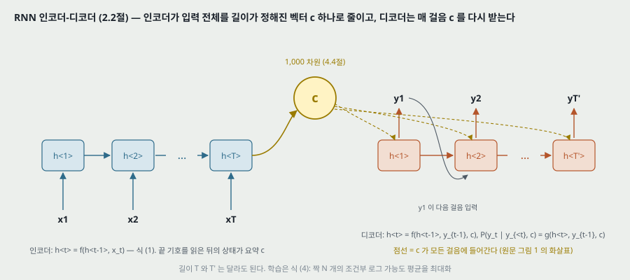

**인코더.** 입력 열 $\mathbf{x}$ 를 한 기호씩 읽으며 식 (1) 로 은닉 상태를 바꾼다. 끝 기호(end-of-sequence)까지 읽은 뒤의 은닉 상태가 열 전체의 **요약 $\mathbf{c}$** 다.

**디코더.** 다른 RNN 이다. 2.1절의 RNN 과 달리 **은닉 상태와 출력이 모두 이전 출력 $y_{t-1}$ 과 요약 $\mathbf{c}$ 에 조건**이 걸린다.

$$\mathbf{h}_{\langle t \rangle} = f\left(\mathbf{h}_{\langle t-1 \rangle}, y_{t-1}, \mathbf{c}\right), \qquad P(y_t \mid y_{t-1}, \dots, y_1, \mathbf{c}) = g\left(\mathbf{h}_{\langle t \rangle}, y_{t-1}, \mathbf{c}\right)$$

$g$ 는 유효한 확률을 내야 한다(예: 소프트맥스). 입력 길이 $T$ 와 출력 길이 $T'$ 는 달라도 된다.

**학습.** 두 부분을 함께, 조건부 로그 가능도의 평균을 최대화한다.

$$\max_{\boldsymbol{\theta}} \frac{1}{N} \sum_{n=1}^{N} \log p_{\boldsymbol{\theta}}(\mathbf{y}_n \mid \mathbf{x}_n) \qquad (4)$$

입력에서 디코더 출력까지 미분되므로 기울기 기반 알고리즘을 쓴다.

**쓰는 법 둘.** (1) 입력 열을 주고 **목표 열을 만든다** (2) 주어진 입력-출력 짝에 **점수를 매긴다** — 점수는 $p_{\boldsymbol{\theta}}(\mathbf{y} \mid \mathbf{x})$. **실험은 (2) 만 쓴다**(10 · 11절). (1) 은 표 3 의 표본 뽑기에만 나온다.

> **그림 1 과 본문의 자리.** 원문 그림 1 은 $\mathbf{c}$ 에서 디코더의 모든 걸음으로 화살표를 긋는다 — 본문 식의 $\mathbf{c}$ 가 $f$ 와 $g$ 둘 다에 들어간다는 것과 맞다. **$\mathbf{c}$ 를 디코더의 첫 상태로 넣는지, 걸음마다의 게이트에 어떻게 넣는지는 학회판 본문에 없다**(보충 자료로 미룬다). 그래서 14절의 파라미터 세기는 이 자리를 가정으로 표시한다.

---

## 6. 제안 유닛 — 게이트 둘 (2.3절)

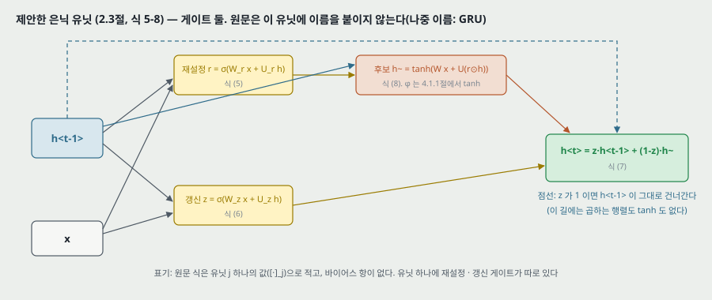

원문은 은닉 유닛 $j$ 하나의 값으로 적는다. $[\cdot]_j$ 는 벡터의 $j$ 번째 원소, $\sigma$ 는 로지스틱 시그모이드다.

$$r_j = \sigma\left(\left[\mathbf{W}_r \mathbf{x}\right]_j + \left[\mathbf{U}_r \mathbf{h}_{\langle t-1 \rangle}\right]_j\right) \qquad (5)$$

$$z_j = \sigma\left(\left[\mathbf{W}_z \mathbf{x}\right]_j + \left[\mathbf{U}_z \mathbf{h}_{\langle t-1 \rangle}\right]_j\right) \qquad (6)$$

$$h_j^{\langle t \rangle} = z_j h_j^{\langle t-1 \rangle} + (1 - z_j) \tilde{h}_j^{\langle t \rangle} \qquad (7)$$

$$\tilde{h}_j^{\langle t \rangle} = \phi\left(\left[\mathbf{W} \mathbf{x}\right]_j + \left[\mathbf{U}\left(\mathbf{r} \odot \mathbf{h}_{\langle t-1 \rangle}\right)\right]_j\right) \qquad (8)$$

$\phi$ 는 실험에서 tanh 다(4.1.1절). **식에 바이어스 항이 없다.**

**원문이 붙인 읽기.**

- 재설정 게이트가 0 에 가까우면 「은닉 상태가 이전 은닉 상태를 무시하고 현재 입력만으로 다시 시작한다」. 그래서 「나중에 쓸모없다고 밝혀진 정보를 **버릴(drop)** 수 있고, 더 압축된 표현이 된다」.
- 갱신 게이트는 이전 은닉 상태에서 얼마를 현재로 넘길지 정한다. 「LSTM 의 기억 셀과 비슷하게 작동해 RNN 이 긴 기간의 정보를 기억하게 돕는다」. 「새는 적분 유닛의 적응형 변형으로 볼 수도 있다」.
- 유닛마다 게이트가 따로라 유닛마다 다른 시간 척도의 의존을 배운다. 「짧은 의존을 잡는 유닛은 재설정 게이트가 자주 켜지고(frequently active), 긴 의존을 잡는 유닛은 갱신 게이트가 대개 켜진다(mostly active)」.
- 예비 실험에서 「이 새 유닛을 게이트와 함께 쓰는 것이 결정적이었다. 게이트 없는 흔한 tanh 유닛으로는 의미 있는 결과를 얻지 못했다」.

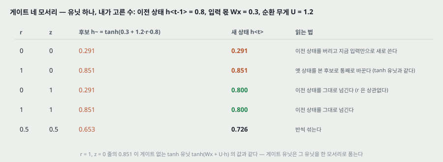

**네 모서리를 수로 따라간 것(내가 고른 수, 유닛 하나).** 이전 상태 0.8, 입력 몫 $Wx = 0.3$, 순환 무게 $U = 1.2$ 로 두면

| $r$ | $z$ | 후보 $\tilde{h}$ | 새 상태 $h$ | 읽는 법 |
|---|---|---|---|---|
| 0 | 0 | 0.291 | 0.291 | 이전 상태를 버리고 지금 입력만으로 새로 쓴다 |
| 1 | 0 | 0.851 | 0.851 | 이전 상태를 본 후보로 통째로 바꾼다 — **게이트 없는 tanh 유닛과 같은 값** |
| 0 | 1 | 0.291 | 0.800 | 이전 상태를 그대로 넘긴다 |
| 1 | 1 | 0.851 | 0.800 | 이전 상태를 그대로 넘긴다 |
| 0.5 | 0.5 | 0.653 | 0.726 | 반씩 섞는다 |

**곧 게이트 없는 tanh 유닛은 $r = 1, z = 0$ 모서리 하나다.** 제안 유닛은 그 유닛을 품고, 게이트가 다른 모서리로 옮겨 갈 수 있게 한다. 원문의 예비 실험 한 문장이 말하는 대조가 이 모서리 하나 대 전체다.

---

## 7. 갱신 게이트가 기억을 늘리는 방식 — 내가 유도한 것

원문은 「긴 기간의 정보를 기억하게 돕는다」 고만 적고 기울기 식을 내지 않는다. 이 절은 **내가 유도한 것**이다.

**게이트 값을 상수로 놓고 보면.** 식 (7) 을 $h^{\langle t-1 \rangle}$ 로 미분하면, 게이트가 $h^{\langle t-1 \rangle}$ 에 따라 바뀌는 항을 빼고

$$\frac{\partial h_j^{\langle t \rangle}}{\partial h_j^{\langle t-1 \rangle}} = z_j + (1 - z_j)\, \frac{\partial \tilde{h}_j^{\langle t \rangle}}{\partial h_j^{\langle t-1 \rangle}}$$

이다. 둘째 항은 tanh 의 기울기(1 이하)와 $U$, $r$ 을 거치므로 작아질 수 있지만, **첫째 항 $z_j$ 는 행렬도 tanh 도 거치지 않는다.** $z_j = 1$ 이면 이 값이 정확히 1 이고, 기울기가 걸음을 건너도 줄지 않는다. 이것이 원문이 「LSTM 의 기억 셀과 비슷하다」 고 한 자리를 식으로 쓴 것이다.

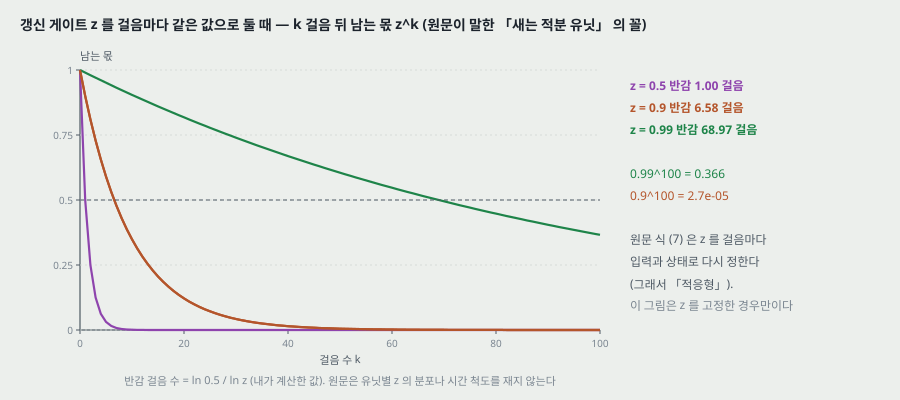

**작은 예시(내가 계산한 값).** $z$ 를 걸음마다 같은 값으로 고정하면 $k$ 걸음 뒤 이전 값이 남는 몫이 $z^k$ 이고, 반으로 줄기까지의 걸음 수가 $\ln 0.5 / \ln z$ 다.

| $z$ | 반감 걸음 수 | 100 걸음 뒤 남는 몫 |
|---|---|---|
| 0.5 | 1.00 | $7.9 \times 10^{-31}$ |
| 0.9 | 6.58 | $2.7 \times 10^{-5}$ |
| 0.99 | 68.97 | 0.366 |

**가를 것.** 이 표는 $z$ 를 고정한 **새는 적분 유닛**의 값이다. 원문의 「적응형」 은 $z$ 를 걸음마다 입력과 상태로 다시 정한다는 뜻이라, 실제 유닛의 기억 길이는 걸음마다 바뀐다. **원문은 학습한 유닛들의 $z$ 값 분포나 시간 척도를 재지 않는다** — 6절 셋째 읽기(유닛마다 다른 시간 척도)는 재지 않은 주장이다(25절).

---

## 8. LSTM 과 견주기, 그리고 이름 (2.3절 · 각주 1)

**원문 각주 1.** 「LSTM 유닛은 … 기억 셀과 **게이트 유닛 넷**을 가지고 정보 흐름을 조절한다. 제안 유닛은 **게이트 유닛 둘**뿐이다.」 LSTM 의 세부는 Graves 2012 를 보라고 한다.

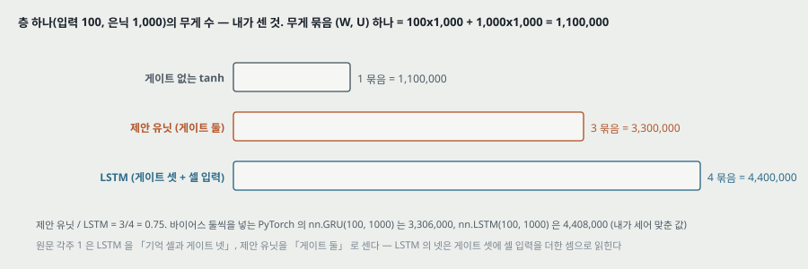

**무게 수 — 내가 센 것.** 입력 100 · 은닉 1,000 인 층 하나에서 (입력 행렬, 순환 행렬) 한 묶음이 $100 \times 1{,}000 + 1{,}000 \times 1{,}000 = 1{,}100{,}000$ 이다.

| 유닛 | 묶음 수 | 무게 수 (바이어스 뺌) | 바이어스 둘씩 넣은 PyTorch 값 |
|---|---|---|---|
| 게이트 없는 tanh | 1 | 1,100,000 | — |
| 제안 유닛 | 3 ($r$, $z$, $\tilde{h}$) | 3,300,000 | `nn.GRU(100, 1000)` = 3,306,000 |
| LSTM (엿보기 연결 없음) | 4 (입력 · 잊기 · 출력 게이트, 셀 입력) | 4,400,000 | `nn.LSTM(100, 1000)` = 4,408,000 |

PyTorch 값은 이 PC 의 PyTorch 2.11 에서 파라미터를 세어 맞췄다. **제안 유닛 / LSTM = 3/4 = 0.75.** 원문이 「계산과 구현이 much simpler(간단하다)」 고 한 말을 무게 수로 옮기면 이 0.75 다 — 원문은 계산 시간을 재지 않는다.

> **각주 1 의 「게이트 넷」.** 흔히 LSTM 을 게이트 셋(입력 · 잊기 · 출력)과 셀로 센다. 원문의 넷은 셀 입력까지 넷째 「게이트 유닛」 으로 센 것으로 읽힌다. 틀린 말은 아니지만, 제안 유닛을 같은 방식으로 세면 후보 $\tilde{h}$ 까지 셋이다 — **「넷 대 둘」 은 세는 방식이 다른 두 수를 견준 것이고, 같은 방식으로 세면 넷 대 셋**이다.

**이름.** 원문에 「GRU」 · 「gated recurrent unit」 이라는 낱말이 없다 — 11 쪽 글자 층을 찾아 둘 다 0 건이고, 게이트 낱말은 gate 10 번 · gates 4 번 · gating 4 번으로만 나온다. **이 유닛이 GRU 라는 이름을 얻은 것은 뒤 편(Chung 외 2014, 게이트 순환 유닛과 LSTM 을 견준 편)에서라고 알고 있다 — 그 편은 읽지 않았다.** 이 노트는 제목과 계보 그림에만 GRU 를 쓰고 본문에서는 「제안 유닛」 으로 적는다.

---

## 9. 원문 식과 라이브러리 식 — 재설정 게이트를 곱하는 자리

**원리는 원 출처, 구현은 라이브러리 편으로 가른다.** 식 (8) 은 재설정 게이트를 **이전 상태에 먼저 곱한 뒤** 순환 행렬 $\mathbf{U}$ 를 곱한다. 이 PC 의 PyTorch 2.11 `nn.GRU` 문서에 적힌 식은

$$n_t = \tanh\left(W_{in} x_t + b_{in} + r_t \odot \left(W_{hn} h_{t-1} + b_{hn}\right)\right), \qquad h_t = (1 - z_t) \odot n_t + z_t \odot h_{t-1}$$

로, **순환 행렬을 먼저 곱한 뒤** 재설정 게이트를 곱한다. 갱신 게이트 쪽(식 7 과 $h_t$ 식)은 $z$ 가 이전 상태 쪽에 붙는 방향까지 같다.

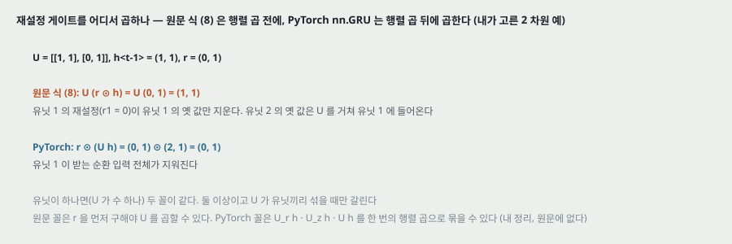

**두 꼴이 갈리는 작은 예(내가 고른 수).** $\mathbf{U} = \begin{pmatrix} 1 & 1 \\ 0 & 1 \end{pmatrix}$, $\mathbf{h}_{\langle t-1 \rangle} = (1, 1)$, $\mathbf{r} = (0, 1)$ 이면

- 원문 식 (8): $\mathbf{U}(\mathbf{r} \odot \mathbf{h}) = \mathbf{U}(0, 1) = (1, 1)$ — 유닛 1 의 재설정이 **유닛 1 자신의 옛 값만** 지운다. 유닛 2 의 옛 값은 $\mathbf{U}$ 를 거쳐 유닛 1 에 들어온다.
- PyTorch: $\mathbf{r} \odot (\mathbf{U}\mathbf{h}) = (0, 1) \odot (2, 1) = (0, 1)$ — 유닛 1 이 받는 **순환 입력 전체**가 지워진다.

유닛이 하나면(곧 $\mathbf{U}$ 가 수 하나) 두 꼴이 같다. 둘 이상이고 $\mathbf{U}$ 가 유닛끼리 섞을 때만 갈린다. **원문 꼴은 $\mathbf{r}$ 을 먼저 구해야 $\mathbf{U}$ 를 곱할 수 있고, PyTorch 꼴은 $\mathbf{U}_r \mathbf{h}$ · $\mathbf{U}_z \mathbf{h}$ · $\mathbf{U}\mathbf{h}$ 를 한 번의 행렬 곱으로 묶을 수 있다** — 이 문장은 식의 차례에서 내가 정리한 것이고, 라이브러리가 그 까닭으로 이 꼴을 골랐는지는 확인하지 않았다. 「GRU 를 썼다」 는 뒤 논문을 읽을 때 **어느 꼴인지가 갈릴 수 있다**는 것을 가져간다.

---

## 10. SMT 의 로그 선형 모형 (3절)

**기본 꼴.** SMT 디코더의 목표는 원문 문장 $\mathbf{e}$ 에 대해 $p(\mathbf{f} \mid \mathbf{e}) \propto p(\mathbf{e} \mid \mathbf{f})\, p(\mathbf{f})$ 를 최대화하는 번역 $\mathbf{f}$ 를 찾는 것이다. 앞 항이 번역 모형, 뒤 항이 언어 모형이다. 실제로는 특징을 더한 로그 선형 모형으로 둔다.

$$\log p(\mathbf{f} \mid \mathbf{e}) = \sum_{n=1}^{N} w_n f_n(\mathbf{f}, \mathbf{e}) + \log Z(\mathbf{e}) \qquad (9)$$

$Z(\mathbf{e})$ 는 무게와 상관없는 정규화 상수이고, 무게는 개발 셋 BLEU 를 최대화하도록 맞춘다. 구문 기반 SMT(Koehn 외 2003, Marcu · Wong 2002)에서는 번역 모형 $\log p(\mathbf{e} \mid \mathbf{f})$ 를 맞물린 구문들의 번역 확률로 쪼개고, **그 확률들이 다시 식 (9) 의 특징**이 된다.

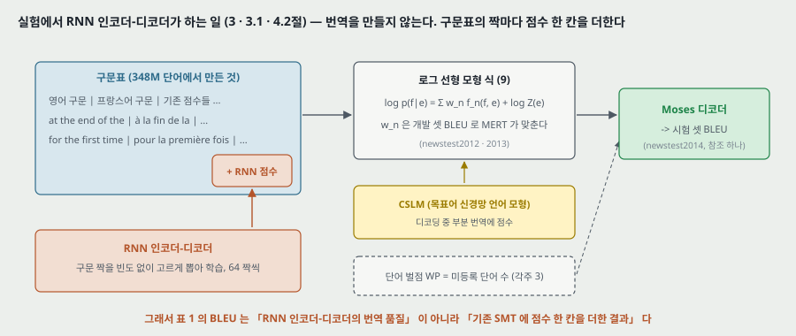

**신경망이 SMT 에 들어간 자리 셋(원문).** n-best 목록 다시 매기기(Schwenk 외 2006), 원문 문장 표현을 함께 받아 번역 문장이나 구문 짝에 점수 매기기(Schwenk 2012 · Son 외 2012 · Zou 외 2013), 그리고 이 편의 방식 — 구문 짝 점수를 식 (9) 의 특징으로.

---

## 11. 구문 짝에 점수 매기기 (3.1절)

**절차.** RNN 인코더-디코더를 구문표의 짝들로 학습하고, 짝마다의 점수를 기존 구문표에 **새 점수 한 칸**으로 더한다. 그러면 「기존의 무게 맞추기 알고리즘에 계산을 최소로 더하며」 들어간다.

**빈도를 버린다.** 학습할 때 말뭉치 안에서의 짝의 (정규화된) 빈도를 무시한다 — 곧 고유 짝을 고르게 뽑는다. 원문의 까닭 둘:

1. 큰 구문표에서 빈도에 비례해 짝을 뽑는 계산을 줄인다.
2. RNN 이 **짝을 나온 횟수대로 줄 세우는 법만 배우지 않게** 한다. 기존 번역 확률이 이미 빈도를 반영하므로, 용량이 정해진 모델을 「언어적 규칙성 — 그럴듯한 번역과 그럴듯하지 않은 번역을 가르는 것, 그럴듯한 번역의 다양체(확률이 몰린 영역)」 에 쓰게 한다.

**구문표를 통째로 바꾸지 않는 까닭.** 원문은 Schwenk 2012 를 들어 구문표를 RNN 으로 대신할 수 있다고 적지만, 그러려면 원문 구문마다 좋은 목표 구문 목록을 RNN 이 만들어야 하고 「비싼 표본 뽑기를 되풀이」 해야 하므로 이 편은 **다시 매기기만** 한다.

> **가를 것.** 빈도를 버리고 학습한 모델의 $p_\theta(\mathbf{y} \mid \mathbf{x})$ 는 **말뭉치에서의 번역 확률이 아니다** — 고유 짝 위에 고르게 놓인 분포에서 배운 조건부 확률이다. 그래서 그림 3 에서 두 점수가 다르게 놓이는 것은 원문 4.3절이 말하듯 「설계대로」 일 수 있고, 그 다름 자체로는 어느 쪽이 맞는지 말하지 않는다(19절).

---

## 12. 데이터와 기준 시스템 (4.1절)

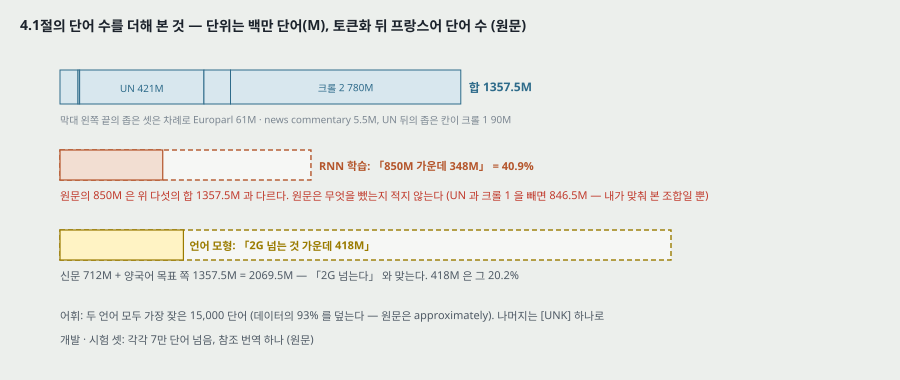

**과제.** WMT'14 영어→프랑스어.

**말뭉치(원문, 토큰화 뒤 프랑스어 단어 수).** Europarl 61M · news commentary 5.5M · UN 421M · 크롤 둘 90M · 780M(「quite noisy(잡음이 많다)」). 프랑스어 언어 모형용으로 크롤한 신문 712M 이 더 있다.

**고른 부분.** Moore · Lewis 2010 의 데이터 고르기와 그 두 언어판(Axelrod 외 2011)으로 **언어 모형용 「2G 넘는 단어 가운데 418M」**, **RNN 인코더-디코더 학습용 「850M 가운데 348M」** 을 골랐다. 원문의 까닭: 다 이어 붙여 학습하면 꼭 최적이 아니고 모델이 다루기 어렵게 커진다.

**내가 더해 본 것.**

| 셈 | 값 | 판정 |
|---|---|---|
| 양국어 다섯의 합 | 61 + 5.5 + 421 + 90 + 780 = **1,357.5M** | 원문의 「850M」 과 다르다. 원문은 무엇을 뺐는지 적지 않는다 |
| UN 과 크롤 1 을 뺀 합 | **846.5M** | 850M 에 맞는 조합 하나. **내가 맞춰 본 것일 뿐 원문의 말이 아니다** |
| 언어 모형 풀 | 712 + 1,357.5 = **2,069.5M** | 「2G 넘는다」 와 맞는다 |
| 418 / 2,069.5 | **20.2%** | 언어 모형용으로 고른 몫 |
| 348 / 850 | **40.9%** | RNN 학습용으로 고른 몫 |

**셋.** 데이터 고르기 · MERT 무게 맞추기에 newstest2012 · 2013, 시험에 newstest2014. 「각 셋이 7만 단어를 넘고 참조 번역이 하나」 다.

**어휘.** 신경망(RNN 인코더-디코더와 CSLM)은 두 언어 모두 가장 잦은 15,000 단어로 줄이고, 원문 「approximately 93%」 를 덮는다. 나머지는 [UNK].

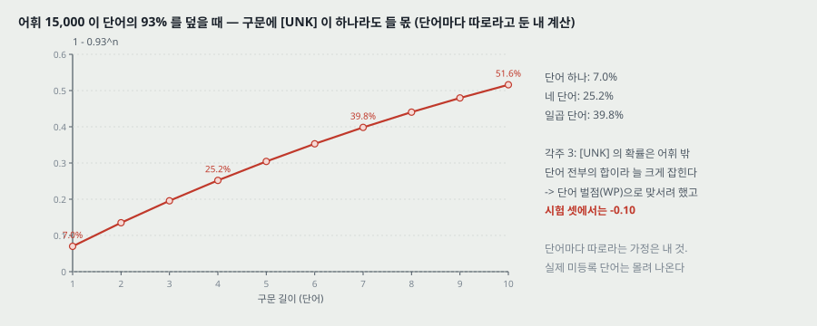

**어휘 밖 단어가 구문에 들 몫 — 내가 계산한 값.** 단어마다 따로 7% 가 [UNK] 라고 두면, $n$ 낱말 구문에 [UNK] 이 하나라도 들 몫은 $1 - 0.93^n$ 이다 — 1 낱말 7.0%, 4 낱말 25.2%, 7 낱말 39.8%. **단어마다 따로라는 가정은 내 것**이고 실제 어휘 밖 단어는 고유 명사처럼 몰려 나오므로 이 값은 셈의 꼴만 보인다. 4.3절이 다루는 「4 낱말 이상」 구문에서 [UNK] 이 드문 일이 아니라는 것, 그리고 각주 3 의 단어 벌점이 왜 나왔는지(15절)를 읽는 데 쓴다.

**기준 시스템.** Moses 를 기본 설정으로. 개발 30.64 · 시험 33.3 BLEU.

---

## 13. 실험 모델 설정 (4.1.1절)

원문이 적은 것 전부:

| 항목 | 값 (원문) |
|---|---|
| 은닉 유닛 | 인코더와 디코더에 각 1,000, 제안 게이트 유닛 |
| 입력 행렬 | 계수 100 행렬 둘로 근사 — 「단어마다 100 차원 임베딩을 배우는 것과 같다」 |
| 출력 행렬 | 같은 방식으로 근사 |
| $\phi$ | tanh |
| 디코더 은닉 → 출력 | 깊은 신경망(Pascanu 외 2014), 중간 층 하나 = maxout 500 단위, 단위마다 입력 2 개를 묶음(Goodfellow 외 2013) |
| 초기화 | 순환 무게 밖은 평균 0 · 표준편차 0.01 가우스. 순환 무게는 가우스에서 뽑은 행렬의 왼쪽 특이 벡터 행렬(Saxe 외 2014) — 곧 직교 행렬 |
| 최적화 | 「Adadelta 와 확률적 기울기 하강」, $\epsilon = 10^{-6}$, $\rho = 0.95$ (Zeiler 2012) |
| 미니배치 | 갱신마다 구문표(348M 단어에서 만든 것)에서 무작위로 고른 짝 64 개 |
| 학습 기간 | 「약 사흘(approximately three days)」. 장비 · 갱신 횟수 · 바퀴 수는 적혀 있지 않다 |
| 세부 | 「보충 자료에 더 자세히」 — 이 파일에 없다 |

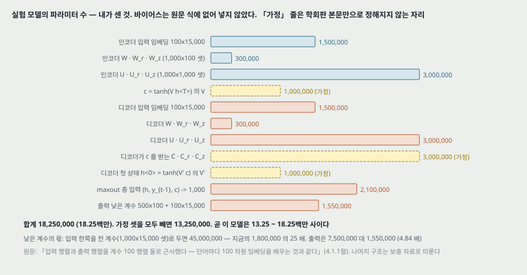

**파라미터 수 — 내가 센 것, 가정 셋을 표시한다.** 학회판 본문만으로는 (가) 요약 $\mathbf{c}$ 를 인코더 끝 상태에서 변환해 만드는지 (나) 디코더의 게이트 셋 모두가 $\mathbf{c}$ 를 받는지 (다) 디코더의 첫 상태를 $\mathbf{c}$ 에서 만드는지가 정해지지 않는다. 셋 다 있다고 두고 세면(바이어스는 원문 식에 없어 넣지 않았다)

| 부분 | 무게 수 | 근거 |
|---|---|---|
| 인코더 입력 임베딩 100x15,000 | 1,500,000 | 본문 (계수 100) |
| 인코더 $\mathbf{W}, \mathbf{W}_r, \mathbf{W}_z$ (1,000x100 셋) | 300,000 | 본문 |
| 인코더 $\mathbf{U}, \mathbf{U}_r, \mathbf{U}_z$ (1,000x1,000 셋) | 3,000,000 | 본문 |
| $\mathbf{c} = \tanh(\mathbf{V}\mathbf{h}_{\langle T \rangle})$ 의 $\mathbf{V}$ | 1,000,000 | **가정** |
| 디코더 입력 임베딩 | 1,500,000 | 본문 |
| 디코더 $\mathbf{W}$ 셋 | 300,000 | 본문 |
| 디코더 $\mathbf{U}$ 셋 | 3,000,000 | 본문 |
| 디코더 게이트 셋이 $\mathbf{c}$ 를 받는 행렬 셋 | 3,000,000 | **가정** |
| 디코더 첫 상태 $\tanh(\mathbf{V}'\mathbf{c})$ 의 $\mathbf{V}'$ | 1,000,000 | **가정** |
| maxout 층: $(\mathbf{h}, y_{t-1}, \mathbf{c})$ → 1,000 (500 단위 x 2) | 2,100,000 | 본문 (입력 셋은 디코더 식의 $g$ 인자) |
| 출력 낮은 계수 500x100 + 100x15,000 | 1,550,000 | 본문 |
| **합** | **18,250,000** | 가정 셋을 모두 빼면 13,250,000 |

곧 이 모델은 **13.25백만 ~ 18.25백만** 사이다. **낮은 계수 근사의 몫**: 입력 한쪽을 전 계수(1,000x15,000 셋)로 두면 45,000,000 으로 지금 1,800,000 의 25 배, 출력은 7,500,000 대 1,550,000 으로 4.84 배다. 곧 **어휘 15,000 에서 낮은 계수 근사가 없었다면 입력과 출력 행렬이 순환 부분(6,000,000)보다 몇 배 컸다.**

> **가를 것.** 이 표는 보충 자료를 읽지 않고 센 것이다. 보충 자료가 다른 구조를 적고 있으면 가정 줄이 바뀐다. 본문 줄의 합 13,250,000 은 원문 4.1.1절의 수로만 낸 값이다.

---

## 14. CSLM — 견주기 위한 다른 신경망 (4.1.2절)

**왜 넣었나(원문).** 「SMT 의 다른 자리에 들어가는 여러 신경망의 몫이 **더해지는지 겹치는지**를 밝히려고」.

**설정(원문).** 목표 말뭉치의 7-그램으로 학습. 입력 낱말마다 512 차원으로 사영해 이어 붙인 3,072 차원 벡터 → ReLU 층 둘(1,536 · 1,024) → 소프트맥스. 무게는 $[-0.01, 0.01]$ 고른 분포로 초기화하고, 검증 퍼플렉서티가 10 바퀴 동안 나아지지 않을 때까지 학습. **퍼플렉서티 45.80**, 검증 셋은 말뭉치의 무작위 0.1%. 디코딩 중 부분 번역에 점수를 매긴다 — 원문은 Vaswani 외 2013 을 들어 이것이 n-best 다시 매기기보다 BLEU 이득이 크다고 적는다. 버퍼에 n-그램을 모았다가 버퍼가 차거나 스택을 잘라 낼 때 한꺼번에 GPU 에서 계산한다(Theano).

**내가 맞춰 본 것.** 7-그램이면 문맥 낱말이 6 개이고 $6 \times 512 = 3{,}072$ — 원문과 같다. 어휘를 15,000 으로 두고 무게를 세면(바이어스 넣음)

| 부분 | 수 |
|---|---|
| 임베딩 15,000 x 512 | 7,680,000 |
| 3,072 → 1,536 | 4,720,128 |
| 1,536 → 1,024 | 1,573,888 |
| 1,024 → 15,000 | 15,375,000 |
| **합** | **29,349,016** |

CSLM 의 어휘가 15,000 이라는 것은 4.1절 「신경망의 어휘를 15,000 으로 제한했다(RNN 인코더-디코더 포함)」 에서 읽은 것이다. **곧 견주기 상대인 CSLM 이 RNN 인코더-디코더(13.25 ~ 18.25백만)보다 무게가 많다** — 둘의 크기를 맞춰 견준 실험이 아니다.

---

## 15. 평가 (읽은 범위)

- **데이터셋**: WMT'14 영어→프랑스어. 개발(무게 맞추기) newstest2012 · 2013, 시험 newstest2014. 각 7만 단어 넘음, 참조 번역 하나.
- **지표**: BLEU (개발 · 시험).
- **비교 상대**: Moses 기준 시스템(같은 데이터, 기본 설정). RNN 점수 칸 · CSLM · 단어 벌점을 하나씩 더한 SMT 넷. **RNN 인코더-디코더 혼자의 번역은 평가하지 않는다.** 다른 논문의 수를 옮겨 온 비교는 없다.
- **장비**: RNN 쪽은 적혀 있지 않다. CSLM 은 GPU · Theano.

| 모델 | 개발 BLEU | 시험 BLEU |
|---|---|---|
| Baseline | 30.64 | 33.30 |
| RNN | 31.20 | 33.87 |
| CSLM + RNN | 31.48 | 34.64 |
| CSLM + RNN + WP | 31.50 | 34.54 |

본문이 인용한 수는 기준 시스템의 30.64 · 33.3 뿐이다. **나머지 여섯 값은 표 안에만 있다** — 본문은 「일관되게 나아진다」 · 「CSLM 과 RNN 을 둘 다 쓸 때 가장 좋았다」 · 「단어 벌점은 개발 셋에서만 나아졌다」 로 말로 적는다.

**단어 벌점(각주 3).** 어휘 15,000 의 집합을 $SL$ 이라 하면, $SL$ 밖의 낱말은 [UNK] 으로 바뀌므로

$$p\left(x_t = [\text{UNK}] \mid x_{<t}\right) = p\left(x_t \notin SL \mid x_{<t}\right) = \sum_{x_t^j \notin SL} p\left(x_t^j \mid x_{<t}\right) \ge p\left(x_t^i \mid x_{<t}\right)$$

곧 어휘 밖 낱말 하나의 확률이 어휘 밖 낱말 전부의 합으로 잡혀 **늘 크게 매겨진다.** Schwenk 2007 처럼 어휘 밖 낱말을 아는 다른 모델로 물러서는 길 대신, 어휘 밖 낱말 수를 특징 하나로 더해 맞선다. 부등식은 확률이 0 이상이라 맞다 — 내가 따라가 확인했다(어휘 밖 낱말이 하나뿐일 때만 등호).

---

## 16. 실험 분석 (논문의 표 · 그림마다)

**직접 돌리지 않는다.** 논문이 낸 실험을 표 · 그림 하나씩 같은 틀로 읽는다. 내가 책상에서 낸 값은 「내가 센 것」 으로 밝힌다.

| 표 · 그림 | 무엇을 바꿨나 (변인) | 무엇을 고정했나 | 결과 | 반복 수 · 흩어짐 | 주장이 결과보다 센가 |
|---|---|---|---|---|---|
| 2.3절 예비 실험 | 은닉 유닛: 제안 유닛 대 게이트 없는 tanh | 적혀 있지 않다 | 「tanh 로는 의미 있는 결과를 못 얻었다」. **수 없음** | 적혀 있지 않다 | **세다.** 「결정적이었다(crucial)」 를 받치는 수 · 설정 · 지표가 없다. LSTM 과의 비교는 예비 실험에도 없다 |
| 표 1 | SMT 에 더한 특징: 없음 · RNN 점수 · CSLM + RNN 점수 · 여기에 단어 벌점 | 데이터 · Moses 설정 · 개발 / 시험 셋 · 어휘 15,000 | 시험 33.30 → 33.87 → 34.64 → 34.54 (차이 +0.57, +0.77, −0.10, 내가 뺀 값) | **줄마다 한 번.** MERT 를 몇 번 돌렸는지 · 유의성 검정 적혀 있지 않다 | 「일관되게 나아진다」 는 비교 셋에서 둘이 올랐고 하나(+WP, 시험)가 내렸다. 「CSLM 과 RNN 의 몫이 너무 상관되지는 않는다」 는 **Baseline + CSLM 줄이 없어 셈할 수 없다**(17절). 결론의 「rather orthogonal(직교한다)」 는 같은 표에서 더 세게 말한 것 |
| 그림 3 | 없음 (점수 두 가지를 나란히) | 학습한 RNN · 구문표 | 점 5,000 개(원문 캡션에 수 없음, 내가 센 것). **스피어먼 순위 상관 −0.355, 피어슨 −0.342** (내가 낸 값) | 해당 없음. 어느 짝을 골랐는지 적혀 있지 않다 | 「많은 짝이 비슷하게, 그만큼 많은 짝이 크게 다르게 매겨졌다」 — 「비슷하다」 의 기준이 없다. 두 축의 범위가 다르고(−56 ~ −1 대 −14 ~ 0), 순위 상관이 음수다(19절) |
| 표 2 | 점수를 매긴 쪽: 구문표 대 RNN | 영어 구문 10 개(잦은 5 · 드문 5), 줄마다 상위 3 (한 줄은 2) | RNN 쪽이 평균 4.10 낱말, 구문표 쪽 5.31 낱말. RNN 이 짧은 줄 9 / 10. 깨진 글자 든 구문 구문표 9 / 29, RNN 0 / 29 (내가 센 것) | 영어 구문은 「무작위로 골랐다」. 10 개 | 「대부분 실제 번역이나 문자 그대로의 번역에 더 가깝다」 — 판정 기준 · 판정한 사람 · 수가 없다. 표 안에 [le] (one of the most) 같은 반례가 있다(20절) |
| 표 3 | 없음 (RNN 에서 표본 뽑기) | 표 2 의 영어 구문 10 개, 구문마다 표본 50 개 | 보인 구문의 횟수 합이 50 가운데 5 ~ 26. parts of the world 의 표본 18 / 50 이 arts 로 옮김 (내가 센 것) | 구문마다 표본 50 개, 뽑기 한 벌 | 「잘 짜인(well-formed) 목표 구문을 낸다」 — 꼴은 짜였어도 뜻이 틀린 표본이 보인 것 안에 있다. 캡션 「상위 다섯 구문」 과 줄마다 보인 구문 수(1 ~ 5)가 맞지 않는다(21절) |
| 그림 4 | 없음 | 학습한 단어 임베딩 행렬, Barnes-Hut-SNE 2 차원 | 확대한 곳에 나라 이름 · 국적 형용사가 모인다 | 해당 없음. t-SNE 설정 · 실행 수 적혀 있지 않다 | 「의미가 비슷한 낱말이 모인 것을 분명히 볼 수 있다」 — 확대 하나를 고른 것이고 무리를 수로 잰 값이 없다 |
| 그림 5 | 없음 | 4 낱말 이상 구문 5,000 개의 $\mathbf{c}$ (1,000 차원), Barnes-Hut-SNE | 확대 셋: 시간 길이 · 나라 · 「the … of the」 꼴 | 같다 | 「의미와 문법 구조를 둘 다 잡는 것이 분명하다」 — 확대 셋을 고른 것. 내가 읽은 확대 안에도 무리에 안 맞는 구문이 있다(22절) |

**비교 상대의 출처.** 표 1 의 넷은 모두 같은 데이터 · 같은 Moses 위에서 이 편이 돌린 값이다. 다른 논문의 수를 옮겨 온 줄은 없다. 대신 **RNN 인코더-디코더를 앞먹임 구문 점수 모델(Schwenk 2012)이나 합성곱 인코더(Kalchbrenner · Blunsom 2013)와 같은 자리에 넣어 견준 줄이 없다** — 3.2절이 길게 견준 앞 연구들과 수로 견주지 않는다.

---

## 17. 표 1 — 몫을 가를 칸이 하나 빠졌다 (4.2절)

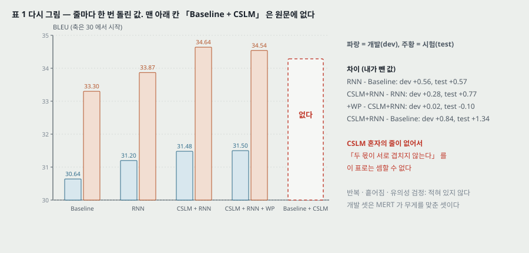

**원문의 해석.** 「예상대로, 신경망이 계산한 특징을 더하면 기준보다 일관되게 나아진다. CSLM 과 RNN 인코더-디코더의 구문 점수를 둘 다 쓸 때 가장 좋았다. 이는 **CSLM 과 RNN 인코더-디코더의 몫이 너무 상관되지는 않으며(not too correlated)**, 각 방법을 따로 개선해 더 나은 결과를 기대할 수 있음을 시사한다.」 결론(5절)은 이것을 「RNN 인코더-디코더의 몫이 기존의 신경망 쓰임과 **직교한다(rather orthogonal)**」 고 적는다.

**내가 뺀 차이.**

| 비교 | 개발 | 시험 |
|---|---|---|
| RNN − Baseline | +0.56 | +0.57 |
| CSLM + RNN − RNN | +0.28 | +0.77 |
| CSLM + RNN + WP − CSLM + RNN | +0.02 | −0.10 |
| CSLM + RNN − Baseline | +0.84 | +1.34 |

**빠진 칸.** 몫이 「더해지는지 겹치는지」 를 셈하려면 **Baseline + CSLM** 이 있어야 한다. 그 값을 $B_C$ 라 두면

- $B_C - 33.30 + 0.57 = 1.34$, 곧 $B_C = 34.07$ 이면 두 몫이 정확히 더해진다.
- $B_C > 34.07$ 이면 겹친다(CSLM 혼자 이미 얻은 것을 RNN 이 일부 다시 얻는다). 극단으로 $B_C = 34.64$ 면 CSLM 위에서 RNN 의 몫이 0 이다.
- $B_C < 34.07$ 이면 서로 돕는다.

원문이 4.1.2절에서 CSLM 을 넣은 까닭으로 바로 이 물음을 적어 놓고, 그 물음에 답할 줄을 표에 두지 않았다. **그래서 「너무 상관되지는 않는다」 는 시사로도, 「rather orthogonal(직교한다)」 는 단정으로도 이 표에서 셈되지 않는다.** 원문이 실제로 보인 것은 「CSLM 을 더한 뒤에도 RNN 점수를 함께 쓴 시스템이 RNN 만 쓴 시스템보다 시험에서 0.77 높다」 까지다.

**흩어짐.** MERT 무게 맞추기는 실행마다 결과가 흔들릴 수 있는데(이 문장은 내가 아는 것이고 원문은 다루지 않는다), 원문은 줄마다 한 번의 값을 적는다. 시험 셋 하나(7만 단어 넘음 · 참조 하나)에서 +0.57 이 실행 사이 흔들림보다 큰지는 표 1 로 판정할 수 없다. **유의성 검정이 없다.**

**단어 벌점.** 개발에서 +0.02, 시험에서 −0.10. 원문: 「시험 셋에서는 더 낫게 만들지 못했고 개발 셋에서만 나아졌다」. **개발 셋은 MERT 가 무게를 맞춘 셋**이라, 특징을 하나 더하면 개발 BLEU 는 오르기 쉽다 — 개발 쪽 +0.02 를 이득으로 읽지 않는다.

**개발과 시험의 간격.** 기준 시스템에서 시험이 개발보다 2.66 높다. 두 셋의 난이도가 다르다는 뜻일 뿐이고, 줄 사이 차이를 읽는 데는 영향이 없다(같은 셋끼리 뺐다).

---

## 18. 정성 분석의 틀 (4.3절)

**원문이 세운 기대 둘.** (가) 구문표 점수는 말뭉치 안의 짝 통계에만 기대므로 잦은 구문에서는 잘, **드문 구문에서는 나쁘게** 매겨질 것이다. (나) 빈도 없이 학습한 RNN 은 나온 횟수보다 **언어적 규칙성**으로 점수를 매길 것이다.

**고른 짝.** 원문 구문이 **길고(4 낱말 이상) 잦은** 것과 **길고 드문** 것. 「잦다」 · 「드물다」 의 문턱은 적혀 있지 않다. 원문 구문마다 구문표 점수 $p(\mathbf{f} \mid \mathbf{e})$ 가 높은 목표 구문과 RNN 점수가 높은 목표 구문을 본다.

---

## 19. 그림 3 — 점 5,000 개로 낸 순위 상관 (4.3절)

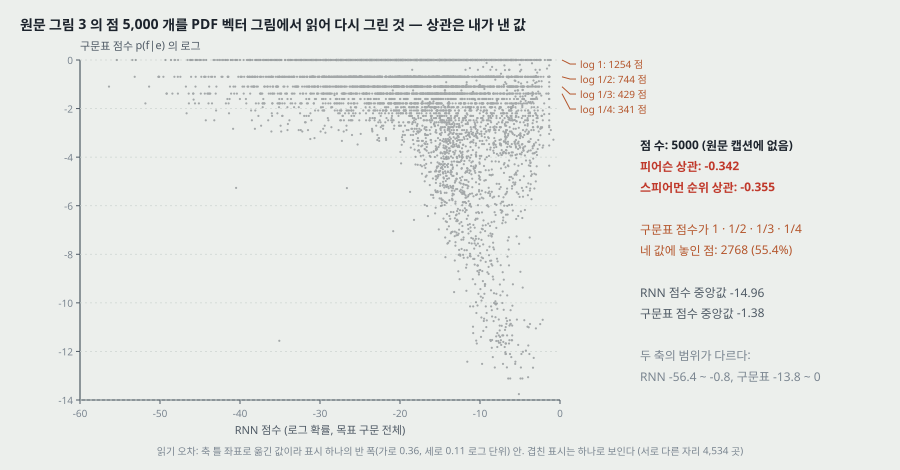

**원문.** 캡션: 「RNN 인코더-디코더와 번역 모형의 점수(로그 확률)에 따라 구문 짝을 펼친 것」. 본문: 「흥미롭게도, 많은 구문 짝이 번역 모형과 RNN 인코더-디코더에서 비슷하게 매겨졌지만, 그만큼 많은 다른 짝은 크게 다르게 매겨졌다. 이는 고유 구문 짝으로 학습해 빈도를 배우지 못하게 한 데서 올 수 있다.」

**내가 읽은 것.** 그림 3 은 벡터 그림이고, 표시 'x' 하나가 너비 0.219pt 의 대각선 둘로 그려져 있다. 그런 짝이 **정확히 5,000 개**다. 각 'x' 의 가운데를 축 틀 좌표로 옮겼다(읽기 오차는 표시 하나의 반 폭 — 가로 0.36, 세로 0.11 로그 단위 — 안). 서로 다른 자리는 4,534 곳이다.

| 낸 값 | 결과 |
|---|---|
| 점 수 | 5,000 (원문 캡션 · 본문에 수 없음) |
| RNN 점수 범위 · 중앙값 | −56.37 ~ −0.82, 중앙값 −14.96 (사분위 −22.26 · −9.91) |
| 구문표 점수 범위 · 중앙값 | −13.76 ~ 0.00, 중앙값 −1.38 (아래 사분위 −2.56, 위 사분위 0.00) |
| **피어슨 상관** | **−0.342** |
| **스피어먼 순위 상관** | **−0.355** |
| 구문표 점수가 정확히 $\log 1$ · $\log \frac{1}{2}$ · $\log \frac{1}{3}$ · $\log \frac{1}{4}$ 인 점 | 1,254 · 744 · 429 · 341, 합 **2,768 (55.4%)** |

**읽는 법 셋.**

1. **「비슷하게 매겨졌다」 의 기준이 없다.** 두 점수는 범위가 다르다 — RNN 은 목표 구문 전체의 로그 확률(4절의 식 3 처럼 낱말마다 더한 값)이고, 구문표는 짝 하나의 상대 빈도 꼴 확률이다. 같은 값이라는 뜻의 「비슷하다」 는 설 수 없고, 순위가 비슷하다는 뜻이라면 **5,000 점의 순위 상관이 음수(−0.355)** 다. 내가 읽은 이 점들에서는 「구문표가 높게 매긴 짝을 RNN 이 낮게 매기는」 쪽이 더 많다.
2. **구문표 점수의 절반 넘게가 1 · 1/2 · 1/3 · 1/4 네 값에 놓인다.** 원문 구문이 말뭉치에 한두 번 · 서너 번 나와 상대 빈도가 작은 정수의 역수가 된 짝으로 읽힌다(상대 빈도라는 셈법은 내가 아는 것이고 원문은 적지 않는다). 곧 이 그림의 짝 다수가 **원문이 「구문표가 나쁘게 매길 것」 이라 기대한 드문 짝**이다.
3. **음의 상관에 길이가 끼어 있을 수 있다 — 내 추측.** RNN 점수는 목표 낱말이 늘수록 작아지고, 드문 짝은 긴 구문이 많을 수 있다(드문 짝은 구문표 점수가 1 에 가깝다). 그러면 길이 하나로 「구문표 높음 · RNN 낮음」 이 생긴다. **원문은 RNN 점수를 길이로 나눴는지 적지 않고, 점마다의 길이도 그림에 없어 이 추측을 확인할 수 없다.**

**가를 것.** 원문의 「빈도를 배우지 못하게 했기 때문일 수 있다」 는 다름의 까닭을 짐작한 문장이고, 어느 점수가 맞는지에 대한 근거는 그림 3 에 없다. 이 그림이 보이는 것은 **두 점수가 같은 짝을 다르게 줄 세운다**는 것까지다 — 그래서 RNN 점수를 특징으로 더하는 것이 구문표에 없는 정보를 더한다는 기대와는 맞는다.

---

## 20. 표 2 — 구문표 대 RNN 이 고른 번역 (4.3절)

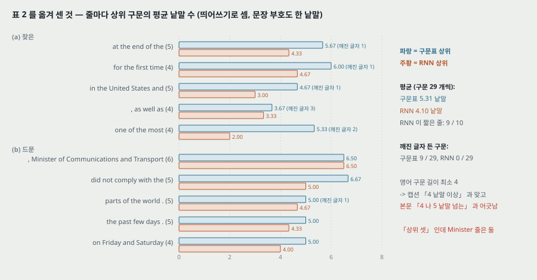

**원문.** 「대부분의 경우 RNN 인코더-디코더가 고른 목표 구문이 실제 번역이나 문자 그대로의 번역에 더 가깝다. RNN 인코더-디코더는 대체로 더 짧은 구문을 좋아한다.」

**내가 옮겨 센 것**(띄어쓰기로 셈, 문장 부호도 한 낱말, 원문 표의 깨진 글자를 그대로 둠).

| 셈 | 구문표 쪽 | RNN 쪽 |
|---|---|---|
| 상위 구문 수 | 29 (줄마다 3, Minister 줄은 2) | 29 (같다) |
| 평균 낱말 수 | 5.31 | 4.10 |
| 평균이 더 짧은 줄 | — | 9 / 10 (나머지 하나 Minister 줄은 두 쪽이 같은 두 구문을 순서만 바꿔 골랐다) |
| 깨진 글자(?, ©, 키릴 r, 원문의 f́) 든 구문 | 9 / 29 | 0 / 29 |
| 영어 구문 길이 | 4 ~ 6 낱말, 최소 4 | 같다 |

**읽는 법.**

- **「더 짧은 구문을 좋아한다」 는 표 2 로 확인된다** — 평균 1.21 낱말 짧고, 10 줄 중 9 줄에서 짧다. 4 · 19절의 길이 쪽 짐작(로그 확률의 합은 낱말이 늘수록 작아진다)과 같은 방향이다. 원문은 이 선호의 까닭을 적지 않는다.
- **「문자 그대로의 번역에 더 가깝다」 에는 판정 기준이 없다.** 표 안의 반례 하나: 「one of the most」 에 RNN 이 고른 둘째 구문이 **[le]** (한 낱말, 「그」)다. 구문표 쪽의 깨진 글자 9 개는 **구문표 쪽 오답이 잡음 섞인 크롤 말뭉치에서 왔다**는 쪽으로 읽히지만(4.1절이 크롤 둘을 「quite noisy(잡음이 많다)」 고 적는다), 원문은 그 까닭을 적지 않는다.
- **10 개라는 크기.** 원문은 영어 구문을 「무작위로 골랐다」 고 적는다. 10 개에서 「대부분의 경우」 는 몇 개인지 세지 않은 말이다.

> **고른 구문의 길이를 적은 자리 셋이 다르다.** 4.3절 넷째 문단 「긴(3 낱말 넘는)」, 표 2 캡션 「4 낱말 이상」, 4.3절 다섯째 문단 「4 나 5 낱말을 넘는 긴 것들 가운데」. 앞 둘은 같은 말(4 낱말 이상)이고 표의 최소 길이 4 와 맞는다. 셋째는 5 또는 6 낱말 이상이라는 뜻이 되어 표의 4 낱말 구문 넷(for the first time · , as well as · one of the most · on Friday and Saturday)과 어긋난다.

---

## 21. 표 3 — RNN 에서 뽑은 표본 (4.3절)

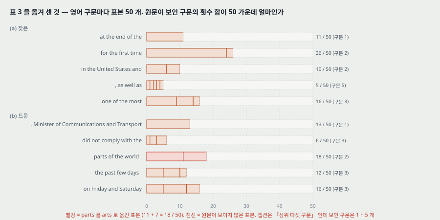

**원문.** 「원문 구문마다 표본 50 개를 뽑아 점수 순으로 상위 다섯 구문을 보인다. RNN 인코더-디코더가 실제 구문표를 보지 않고도 **잘 짜인(well-formed)** 목표 구문을 낸다. 중요하게도, 만든 구문이 구문표의 목표 구문과 완전히 겹치지는 않는다. 이는 구문표의 전부나 일부를 RNN 인코더-디코더로 바꾸는 가능성을 더 살펴보게 한다.」

**내가 옮겨 센 것.**

| 영어 구문 | 보인 구문 수 | 보인 횟수 합 / 50 | 짚을 것 |
|---|---|---|---|
| at the end of the | 1 | 11 | — |
| for the first time | 2 | 26 | — |
| in the United States and | 2 | 10 | — |
| , as well as | 5 | 5 | 다섯째가 [et UNK] |
| one of the most | 3 | 16 | — |
| , Minister of Communications and Transport | 1 | 13 | 표 2 의 RNN 상위(Secrétaire …)와 다른 구문 |
| did not comply with the | 3 | 6 | 원문 인쇄에서 `é` 가 빠졌다 |
| parts of the world . | 2 | 18 | **둘 다 「arts du monde」** — parts 를 arts(예술)로 옮김 |
| the past few days . | 3 | 12 | — |
| on Friday and Saturday | 3 | 16 | — |

**읽는 법.**

- **「잘 짜였다」 와 「맞다」 는 다르다.** parts of the world 의 표본 50 개 가운데 보인 18 개가 모두 arts(예술) 쪽이다. 꼴은 프랑스어 구문으로 짜였지만 뜻이 틀렸다. 같은 영어 구문에 대해 **점수 매기기(표 2)에서는 RNN 이 [parties du monde .] 를 맨 위로 골랐다** — 곧 주어진 후보 가운데 맞는 것을 고르는 일과 스스로 만드는 일의 결과가 갈린다. 원문은 이 갈림을 적지 않는다. 구문표를 RNN 으로 바꾸자는 결론 쪽 제안을 읽을 때 이 줄을 같이 놓는다.
- **캡션과 줄이 맞지 않는다.** 「상위 다섯 구문」 을 서로 다른 구문 다섯으로 읽으면 보인 구문이 1 ~ 3 개인 줄 여덟이 맞지 않는다. 「점수 상위 표본 다섯 칸을 보이고 같은 구문은 하나로 적었다」 로 읽으면 첫 줄(한 구문 ×11)은 맞지만, 둘째 줄은 ×24 인 구문이 점수 1 위인데 다섯 칸에 ×2 인 구문이 끼어 있어 맞지 않는다. **어느 읽기로도 열 줄이 다 맞지 않는다.**
- **보이지 않은 표본.** 보인 횟수 합이 50 가운데 5 ~ 26 이다. 나머지 24 ~ 45 개가 무엇이었는지(틀린 번역인지, 다른 맞는 번역인지)는 알 수 없다.

---

## 22. 그림 4 · 5 — 낱말 · 구문 표현 (4.4절)

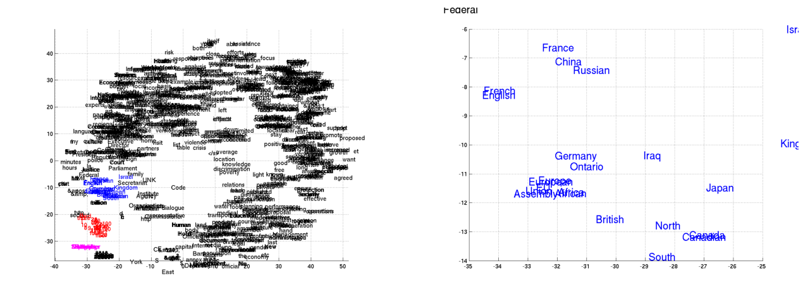

*원문 그림 4 를 PDF 에서 잘라 넣은 것.* 왼쪽은 학습한 낱말 임베딩 행렬 전체를 Barnes-Hut-SNE(van der Maaten 2013)로 2 차원에 펼친 것, 오른쪽은 한 곳(색으로 표시)을 확대한 것.

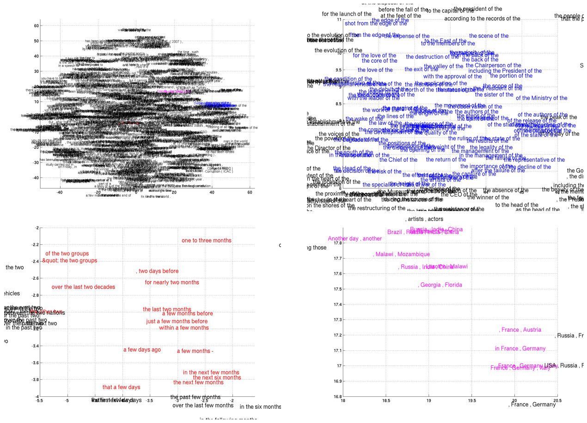

*원문 그림 5 를 PDF 에서 잘라 넣은 것.* 왼쪽 위는 4 낱말 이상 구문 가운데 무작위 5,000 개의 표현 $\mathbf{c}$(1,000 차원)를 펼친 것, 나머지 셋은 확대.

**원문.** 「의미가 비슷한 낱말이 서로 모인 것을 **분명히** 볼 수 있다」(그림 4). 「RNN 인코더-디코더가 구문의 의미와 문법 구조를 **둘 다** 잡는 것이 분명하다. 예컨대 왼쪽 아래 그림에서는 구문 대부분이 시간의 길이에 관한 것이고, 문법이 비슷한 구문이 함께 모인다. 오른쪽 아래는 의미가 비슷한(나라나 지역) 구문의 무리, 오른쪽 위는 문법이 비슷한 구문」(그림 5).

**내가 확대 그림에서 읽은 것**(겹쳐 못 읽는 글자는 뺐다).

- **그림 4 오른쪽.** France · China · Russian · French · English · Germany · Ontario · Iraq · Japan · British · North · Canada · Canadian · South 등. **나라 이름(명사)과 국적 형용사(Russian · British · Canadian), 방위(North · South)가 한 무리에 섞인다** — 문법 범주가 아니라 「지리」 라는 뜻으로 모였다.
- **그림 5 왼쪽 아래(빨강).** 읽히는 구문 16 개 가운데 14 개가 시간 표현(one to three months · a few days ago · the next six months …)이고 둘이 **of the two groups · &quot; the two groups** 다. 둘째 것은 HTML 개체 `&quot;` 가 데이터에 그대로 남은 것이다 — 이 무리를 묶은 것이 「시간」 이 아니라 「two · few 같은 수량어 + 명사」 의 꼴일 수 있다는 단서다(내 해석).
- **그림 5 오른쪽 아래(분홍).** 읽히는 구문 8 개 가운데 7 개가 나라 · 지역 나열(Brazil , Russia , India , China · in France , Germany · , Georgia , Florida …)이고 하나가 **Another day , another** 다. Georgia · Florida 는 미국의 주다.
- **그림 5 오른쪽 위(파랑).** 「the … of the」 · 「of the …」 꼴이 모인다(the core of the · the scene of the · of the Ministry of the …). 원문의 「문법이 비슷한 무리」 와 맞는다.

**가를 것.** 네 확대는 원문이 고른 자리이고, 무리의 순도 · 이웃 일치 같은 수가 없다. t-SNE 의 혼란도 · 반복 수도 적혀 있지 않다. 그래서 「의미와 문법을 **둘 다** 잡는다」 는 **확대 그림 넷에서 각 갈래의 예를 찾았다**는 것까지이고, 전체 표현 공간이 그렇게 짜였다는 근거는 아니다. 그리고 이 표현들은 빈도 없이 고른 구문 짝으로 학습한 모델의 것이다 — 원문 4.4절은 「이 모델이 기계 번역만을 위해 설계된 것이 아니다」 라며 성질을 본다고 적지만, 다른 과제에서 이 표현을 쓴 실험은 없다.

---

## 23. 결론 (5절)

원문: 임의 길이 열을 다른(다른 집합일 수도 있는) 임의 길이 열로 옮기는 새 구조를 냈고, **짝에 점수를 매기거나 목표 열을 만들 수 있다.** 재설정 게이트와 갱신 게이트로 각 유닛이 얼마나 기억하고 잊을지를 적응해 정하는 새 은닉 유닛을 냈다. SMT 구문표의 짝마다 점수를 매겨 BLEU 를 올렸고, **기존 신경망 쓰임과 「rather orthogonal(직교)」 하여 CSLM 과 함께 쓰면 더 오른다.** 낱말과 구문 수준에서 언어적 규칙성을 잡는다. 앞으로: 구문표의 전부나 일부를 RNN 이 낸 목표 구문으로 바꾸기, 글이 아닌 데이터(음성 받아쓰기)에 쓰기.

---

## 24. 이 논문이 스스로 적은 한계와 조건

1. **구문표를 통째로 바꾸지 않고 다시 매기기만 한다** — 바꾸려면 비싼 표본 뽑기를 되풀이해야 해서(3.1절). 결론에서 「살펴보지 않은 길」 로 다시 적는다.
2. **어휘 밖 낱말의 확률이 늘 크게 잡힌다**(각주 3). 물러서기 모델 대신 단어 벌점으로 맞섰고, **시험 셋에서는 나아지지 않았다**(4.2절).
3. **게이트 없는 tanh 유닛으로는 의미 있는 결과를 얻지 못했다**(2.3절). 원문은 이것을 제안 유닛의 근거로 적지만, 거꾸로 읽으면 이 틀이 은닉 유닛 선택에 달려 있다는 조건이다.
4. **구조 세부를 보충 자료로 미뤘다**(4.1.1절). 학회판만으로는 모델을 다시 짤 수 없다.
5. **모든 데이터를 이어 붙여 학습하는 것이 꼭 최적은 아니어서 데이터를 골랐다**(4.1절) — 이 편의 결과는 고른 348M · 418M 위의 것이다.

---

## 25. 논문이 적지 않은 것 — 내가 읽으며 짚은 자리

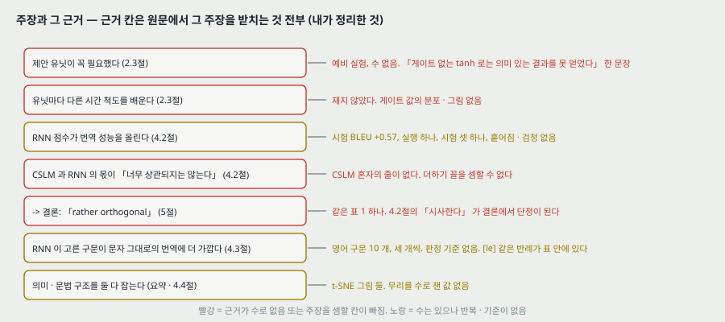

**하나. 뒤에 가장 많이 쓰인 몫(제안 유닛)에 수가 하나도 없다.** LSTM 과도, 게이트 없는 tanh 유닛과도 같은 조건에서 견준 수가 없다. 「결정적이었다」 · 「긴 기간의 정보를 기억하게 돕는다」 · 「유닛마다 다른 시간 척도를 배운다」 셋 다 재지 않았다. 이 편이 보인 것은 **제안 유닛을 쓴 모델 하나로 SMT 에 점수 칸을 더했더니 BLEU 가 올랐다**는 것까지다. 유닛 견주기는 이 편이 넘긴 자리다(30절).

**둘. 표 1 에 몫을 가를 줄(Baseline + CSLM)이 없다**(17절). 원문이 CSLM 을 넣은 까닭이 그 셈인데, 그 셈을 할 줄이 표에 없다. 4.2절의 「시사한다」 가 5절에서 「rather orthogonal(직교한다)」 로 세진다.

**셋. 반복과 흩어짐이 없다.** 표 1 은 줄마다 한 번, MERT 실행 수 · 유의성 검정이 없다. 시험 +0.57 이 실행 사이 흔들림보다 큰지 이 편으로 판정할 수 없다.

**넷. 그림 3 의 「비슷하게 매겨졌다」 와 내가 낸 순위 상관 −0.355 가 맞지 않는다**(19절). 원문은 두 점수의 관계를 수로 적지 않았고, 두 축은 범위도 셈법도 다르다.

**다섯. 정성 분석의 크기가 10 개이고 판정 기준이 없다**(20 · 21절). 표 2 의 「더 가깝다」 는 판정한 사람 · 기준이 없고, 표 3 은 뜻이 틀린 표본(arts)을 「잘 짜였다」 로 묶는다.

**여섯. 견주기 상대의 크기를 맞추지 않았다.** CSLM 무게가 29,349,016 으로 RNN 인코더-디코더(13.25 ~ 18.25백만, 둘 다 내가 센 것)보다 많다. 둘은 SMT 의 다른 자리에 들어가 직접 견주는 사이는 아니지만, 「CSLM 위에 RNN 을 더해 0.77 올랐다」 를 읽을 때 두 모델이 얼마나 다른 규모인지를 원문이 적지 않는다.

**일곱. 학습 비용 항목 여섯 가운데 둘만 적혀 있다.** 적힌 것은 기간(원문 「approximately three days」)과 미니배치 64 이고, 장비 · 갱신 횟수 · 바퀴 수 · 시간당 처리량 넷이 없다.

**여덟. 데이터 크기 하나가 더해지지 않는다**(12절). 양국어 다섯의 합 1,357.5M 과 「850M」 이 다르고, 어느 말뭉치를 뺐는지 적혀 있지 않다.

**아홉. 요약 벡터 $\mathbf{c}$ 하나에 입력 전체를 담는 구조의 한계를 재지 않았다.** 실험은 구문(짧은 열)뿐이라 입력이 길어질 때 $\mathbf{c}$ 하나로 버티는지를 이 편으로는 알 수 없다. 원문은 이 자리를 한계로 적지 않는다 — 3.2절이 오히려 「구문이 길어질수록 길이가 정해지지 않은 처리가 중요하다」 를 RNN 의 장점으로 든다. **긴 열에서 $\mathbf{c}$ 하나가 병목이 되는지가 이 편이 남긴 가장 큰 물음이다**(30절).

---

## 26. 읽을 때 헷갈리는 지점

**$\mathbf{e}$ 와 $\mathbf{f}$ 의 방향.** 3절은 원문 문장을 $\mathbf{e}$, 번역을 $\mathbf{f}$ 로 두고 $p(\mathbf{e} \mid \mathbf{f})$ 를 「번역 모형」 이라 부른다(각주 2 는 구문 짝마다의 $p(\mathbf{e} \mid \mathbf{f})$ 도 번역 모형이라 부르겠다고 적는다). 그런데 4.3절 · 표 2 가 견주는 「번역 모형」 점수는 **$p(\mathbf{f} \mid \mathbf{e})$, 직접 번역 확률**이다. 실험에서 $\mathbf{e}$ 는 영어, $\mathbf{f}$ 는 프랑스어다.

**두 「디코더」.** 3절 첫 문장의 「decoder, specifically」 는 **SMT 디코더**(번역을 찾는 탐색 절차, Moses)이고, 2.2절의 디코더는 **RNN 디코더**다. 4.1.2절의 「디코딩 중 부분 번역에 점수」 도 SMT 디코더 쪽이다.

**RNN 점수의 부호와 크기.** 그림 3 의 가로축은 목표 구문 전체의 로그 확률이라 −56 까지 내려간다. 짝 하나의 확률이 아니라 낱말마다의 확률을 곱한 것이다.

**게이트가 「켜진다」 의 방향.** 6절 셋째 읽기 — 「짧은 의존을 잡는 유닛은 재설정 게이트가 자주 켜지고, 긴 의존을 잡는 유닛은 갱신 게이트가 대개 켜진다」. 긴 의존 쪽은 $z$ 가 1 에 가깝다는 뜻이라 「켜진다 = 1 에 가깝다」 로 읽힌다. 그런데 짧은 의존을 잡으려면 이전 상태를 자주 **버려야** 하므로 $r$ 이 0 에 가까워야 한다. 같은 낱말 「active」 가 $z$ 에서는 1 쪽, $r$ 에서는 「재설정이 일어나는」 0 쪽을 가리켜야 문장이 선다. 원문은 이 방향을 적지 않는다.

**식 (5) 아래의 $\mathbf{h}_{t-1}$.** 식은 $\mathbf{h}_{\langle t-1 \rangle}$ 로, 바로 아래 설명은 $\mathbf{h}_{t-1}$ 로 적는다. 같은 것이다. 식 (5) ~ (8) 의 $\mathbf{x}$ 와 게이트에는 걸음 첨자가 없다.

**「Adadelta 와 확률적 기울기 하강」.** Adadelta 가 확률적 기울기 하강의 한 갈래(걸음 크기를 적응해 정함)라, 둘을 따로 쓴 것인지 「Adadelta 로 미니배치 기울기 하강을 했다」 는 한 뜻인지 글로는 갈리지 않는다. $\epsilon$ · $\rho$ 는 Adadelta 의 값이다.

**「구문」.** 문법의 구가 아니라 이어진 낱말 몇 개다. 「, as well as」 처럼 쉼표로 시작하는 구문도 있다.

---

## 27. 원문 안의 어긋남 모음

| 자리 | 원문 | 바른 것 또는 짚을 것 |
|---|---|---|
| 4.3절 다섯째 문단 대 넷째 문단 · 표 2 캡션 | 「4 나 5 낱말을 넘는」 대 「3 낱말 넘는」 · 「4 낱말 이상」 | 표 2 의 영어 구문 최소 길이 4 와 맞는 것은 뒤 둘. 4 낱말 구문이 넷 있다 |
| 표 2 (b) 첫 줄 | 「상위 셋」(4.3절) | Minister 줄은 두 쪽 다 둘만 있다 |
| 표 3 캡션 | 「50 개 가운데 상위 다섯 구문」 | 줄마다 보인 구문이 1 ~ 5 개. 어느 읽기로도 열 줄이 다 맞지 않는다(21절) |
| 표 3 (b) 둘째 줄 | `n' tait` · `respect l'` · `respect la` | `é` 가 인쇄에서 빠졌다 — `n' était` · `respecté` |
| 4.1절 | RNN 학습용 「850M 가운데 348M」 | 앞 문단의 양국어 다섯을 더하면 1,357.5M. 무엇을 뺐는지 없다 |
| 4.2절 대 5절 | 「너무 상관되지는 않는다는 것을 시사한다」 대 「rather orthogonal(직교한다)」 | 같은 표 1 하나, 셈할 줄(Baseline + CSLM)이 없다 |
| 각주 1 | LSTM 의 「게이트 넷」 대 제안 유닛의 「게이트 둘」 | 세는 방식이 다르다. 같은 방식이면 넷 대 셋(8절) |
| 2.3절 | 식은 $\mathbf{h}_{\langle t-1 \rangle}$, 설명은 $\mathbf{h}_{t-1}$ | 같은 것 |
| 표 1 캡션 | 「we penalizes」 | penalize |
| 1절 첫 줄 | 「objection recognition」 | object recognition |
| 4.2절 | 「as an additional feature the log-linear model」 | feature **to** the log-linear model |
| 4.3절 | 「accordingly to their scores」 | according to |
| 참고 문헌 Schwenk 2012 | 「(COLIN)」 | COLING |
| 참고 문헌 Devlin 외 2014 | 「Richard Schwartz, , and」 | 쉼표 하나 더 |
| 그림 5 데이터 | 「&quot; the two groups」 | HTML 개체가 전처리에서 풀리지 않고 남았다 |

---

## 28. 계보와 내가 가져갈 것

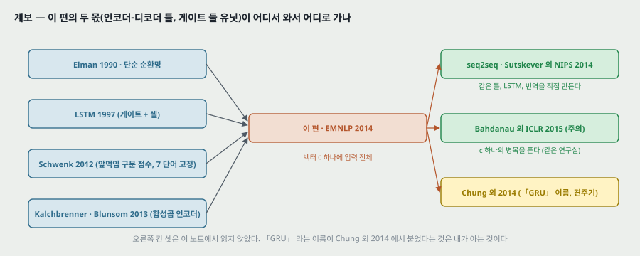

**하나. 앞 칸에서 받은 것 · 다음 칸으로 넘긴 것.** 은닉 유닛 쪽에서는 단순 순환망(Elman 1990)의 「상태를 걸음마다 다시 쓰는」 꼴에 LSTM(1997)의 「곱하는 게이트로 무엇을 넘길지 정하는」 생각을 받아, 게이트를 둘로 줄이고 기억 셀을 은닉 상태 하나로 합쳤다(7 · 8절). 틀 쪽에서는 고정 길이 앞먹임 점수 모델(Schwenk 2012)과 합성곱 인코더(Kalchbrenner · Blunsom 2013)를 RNN 둘로 바꿨다. 넘긴 자리는 둘 — **요약 벡터 하나로 긴 열을 담을 수 있나**(같은 해 seq2seq 가 같은 틀을 LSTM 으로 번역에 직접 쓰고, 이듬해 같은 연구실의 Bahdanau 외가 $\mathbf{c}$ 하나의 병목을 주의로 푼다 — 둘 다 이 노트에서 읽지 않았다)와 **게이트 둘이 셋보다 나은가 못한가**(Chung 외 2014 — 읽지 않았다).

**둘. 옮겨 쓸 수 있는 것.**

- **「기존 시스템에 특징 하나를 더해 올랐다」 를 읽을 때 빠진 줄을 찾는다.** 두 장치의 몫이 더해지는지 겹치는지를 말하려면 「둘 다 없음 · A 만 · B 만 · 둘 다」 넷이 있어야 한다. 이 편은 「A 만(CSLM 만)」 이 없다. 이상 탐지에서 특징 둘(예: 서로 다른 층의 특징)을 함께 쓴 이득을 주장하는 편을 읽을 때도 같은 넷을 센다.
- **로그 확률의 합으로 매긴 점수는 길이에 끌린다.** 그림 3 · 표 2 에서 본 것 — 열 길이가 다른 대상끼리 점수를 견줄 때는 길이로 나눴는지부터 본다. 조각 점수를 더하거나 최댓값을 잡아 이미지 점수를 만드는 방법을 읽을 때도 「조각 수가 다른 대상끼리 견주는가」 를 묻는 데 쓴다(이 문장은 내가 이은 것이다).
- **같은 이름의 유닛이라도 식이 갈린다.** 「GRU 를 썼다」 는 뒤 논문은 재설정 게이트를 곱하는 자리가 원문 식 (8) 인지 라이브러리 꼴인지 갈릴 수 있다(9절).
- **그림에서 수를 꺼낸다.** 벡터 그림이면 점 좌표가 PDF 안에 그대로 있다. 원문이 상관을 적지 않은 산점도에서 상관을 낼 수 있었다(19절).

**셋. 지금 확인된 것은 여기까지다.**

- **논문이 잰 것**: 표 1 의 BLEU 여덟 값(줄마다 한 번), CSLM 퍼플렉서티 45.80, 표 2 · 3 의 구문 목록, 그림 3 의 점 5,000 개, 그림 4 · 5 의 t-SNE.
- **논문이 말만 한 것**: 제안 유닛이 결정적이었다 · 긴 기억을 돕는다 · 유닛마다 다른 시간 척도 · CSLM 과 몫이 직교한다 · 번역이 문자 그대로에 더 가깝다 · 의미와 문법을 둘 다 잡는다.
- **내가 책상에서 센 것**: 게이트 네 모서리(6절), 반감 걸음 수(7절), 층 하나 무게 수와 PyTorch 값 맞추기(8절), 재설정 자리 예(9절), 단어 수 더하기(12절), [UNK] 몫(12절), 모델 파라미터 13.25 ~ 18.25백만(가정 셋 표시, 13절), CSLM 29,349,016(14절), 표 1 차이(17절), 그림 3 순위 상관 −0.355(19절), 표 2 · 3 세기(20 · 21절).

---

## 29. 남는 질문

- **Baseline + CSLM 줄의 값.** 17절의 셈을 끝내려면 이 값이 있어야 한다. 원문 다른 판(arXiv)이나 보충 자료에 있는지 확인하지 않았다.
- **보충 자료의 구조.** $\mathbf{c}$ 가 디코더 게이트에 들어가는 꼴, 바이어스 유무 — 13절 가정 셋이 맞는지.
- **그림 3 의 점 5,000 개는 어느 짝인가.** 4.3절이 다루는 「긴 짝」 인지 구문표 전체에서 뽑은 것인지, RNN 점수를 길이로 나눴는지. 길이가 음의 순위 상관을 만들었는지는 점마다의 길이가 있어야 가린다.
- **표 3 의 「상위 다섯」 을 어떻게 골랐나**(21절).
- **제안 유닛과 LSTM 을 같은 조건에서 견주면 어떤가.** 이 편에는 없다 — 다음에 읽을 것 셋째(Chung 외 2014)가 이 물음을 받는 편으로 안다.
- **요약 벡터 하나가 긴 열에서 버티나.** 이 편은 짧은 구문만 다룬다 — 다음 칸(seq2seq)이 문장 단위에서 같은 틀을 쓴다.

---

## 30. 다음에 읽을 것

**한계를 적고 그 한계를 푼 것이 다음 논문이다.** 로드맵의 다음 칸을 첫째로 둔다.

| 다음 | 이 노트의 어느 자리에서 나오는가 | 무엇을 확인하고 싶은가 |
|---|---|---|
| **Sequence to Sequence Learning with Neural Networks** (Sutskever 외, NIPS 2014) — 로드맵 다음 칸 | 5 · 25절 아홉 — 인코더-디코더를 구문 점수가 아니라 **번역 자체**에 쓰는 자리. 이 편은 다시 매기기만 했다(24절 하나) | 같은 틀(요약 벡터 하나)을 문장 단위에서 LSTM 으로 쓸 때 $\mathbf{c}$ 를 디코더에 어떻게 넣는가(첫 상태만인지 매 걸음인지 — 이 편 그림 1 은 매 걸음). 긴 문장에서 성능이 떨어지는가. SMT 없이 BLEU 를 냈는가 |
| **Neural Machine Translation by Jointly Learning to Align and Translate** (Bahdanau 외, ICLR 2015) — 로드맵 그다음 칸 | 25절 아홉 — 요약 벡터 하나의 병목. 같은 연구실 · 이 편의 넷째 저자가 1저자 | $\mathbf{c}$ 를 걸음마다 다시 만드는 것이 긴 문장에서 무엇을 바꾸는가. 은닉 유닛으로 이 편의 제안 유닛을 쓰는가 |
| **Empirical Evaluation of Gated Recurrent Neural Networks on Sequence Modeling** (Chung 외, 2014) — 후보 | 8 · 25절 하나 — 제안 유닛을 LSTM · tanh 와 견준 수가 이 편에 없다. 「GRU」 라는 이름을 붙인 편으로 안다 | 같은 과제 · 같은 파라미터 수에서 게이트 둘 대 셋. 실행 수와 흩어짐을 적었는가. 재설정 게이트를 어느 자리에서 곱했는가 |

로드맵 순서대로 **seq2seq 가 먼저**다. Chung 외 2014 는 로드맵 밖의 세부라 INDEX 의 「나중에 볼 세부」 쪽 후보다.

---

## 31. 참고 문헌

이 노트가 부른 편만 적는다. 원리는 원 출처를, 구현은 그 라이브러리의 편을 적는 규칙을 따른다. 그림 코드는 파이썬 표준 라이브러리만 쓰고, 원문 그림을 잘라 내고 그림 3 의 점을 읽은 일만 PyMuPDF 를 썼다(PyMuPDF 는 논문이 따로 없어 적지 않는다). PyTorch 의 `nn.GRU` 식과 파라미터 수는 이 PC 의 PyTorch 2.11 에서 확인했다.

- Cho, K., van Merriënboer, B., Gulcehre, C., Bahdanau, D., Bougares, F., Schwenk, H., and Bengio, Y. (2014). Learning phrase representations using RNN encoder–decoder for statistical machine translation. In *EMNLP*, pages 1724–1734. — 이 노트의 대상. 보충 자료와 arXiv 판(1406.1078)은 읽지 않았다.
- Hochreiter, S. and Schmidhuber, J. (1997). Long short-term memory. *Neural Computation*, 9(8):1735–1780. — 게이트 유닛의 동기(원문이 부른 편).
- Elman, J. L. (1990). Finding structure in time. *Cognitive Science*, 14(2):179–211. — 단순 순환망. **원문 참고 문헌에는 없다.** 계보 그림에만 쓴다.
- Graves, A. (2012). *Supervised Sequence Labelling with Recurrent Neural Networks*. Springer. — 원문이 LSTM 세부로 부른 책. **읽지 않았다.**
- Bengio, Y., Boulanger-Lewandowski, N., and Pascanu, R. (2013). Advances in optimizing recurrent networks. In *ICASSP*. — 새는 적분 유닛(원문이 부른 편). **읽지 않았다.**
- Schwenk, H. (2012). Continuous space translation models for phrase-based statistical machine translation. In *COLING*, pages 1071–1080. — 앞먹임 구문 점수, 7 낱말 고정.
- Schwenk, H. (2007). Continuous space language models. *Computer Speech and Language*, 21(3):492–518. — CSLM.
- Kalchbrenner, N. and Blunsom, P. (2013). Two recurrent continuous translation models. In *EMNLP*, pages 1700–1709. — 원문이 가장 가깝다고 한 편.
- Devlin, J. 외 (2014). Fast and robust neural network joint models for statistical machine translation. In *ACL*, pages 1370–1380.
- Koehn, P., Och, F. J., and Marcu, D. (2003). Statistical phrase-based translation. In *NAACL*, pages 48–54. — 구문 기반 SMT.
- Koehn, P. (2005). Europarl: A parallel corpus for statistical machine translation. In *MT Summit X*, pages 79–86.
- Moore, R. C. and Lewis, W. (2010). Intelligent selection of language model training data. In *ACL Short Papers*, pages 220–224. — 데이터 고르기.
- Axelrod, A., He, X., and Gao, J. (2011). Domain adaptation via pseudo in-domain data selection. In *EMNLP*, pages 355–362.
- Pascanu, R., Gulcehre, C., Cho, K., and Bengio, Y. (2014). How to construct deep recurrent neural networks. In *ICLR*. — 디코더 출력 쪽 깊은 망.
- Goodfellow, I. J. 외 (2013). Maxout networks. In *ICML*.
- Saxe, A. M., McClelland, J. L., and Ganguli, S. (2014). Exact solutions to the nonlinear dynamics of learning in deep linear neural networks. In *ICLR*. — 직교 초기화.
- Zeiler, M. D. (2012). ADADELTA: an adaptive learning rate method. arXiv:1212.5701.
- Glorot, X., Bordes, A., and Bengio, Y. (2011). Deep sparse rectifier neural networks. In *AISTATS*. — CSLM 의 ReLU.
- Vaswani, A., Zhao, Y., Fossum, V., and Chiang, D. (2013). Decoding with large-scale neural language models improves translation. In *EMNLP*, pages 1387–1392.
- van der Maaten, L. (2013). Barnes-Hut-SNE. In *ICLR*. — 그림 4 · 5.
- Bergstra, J. 외 (2010). Theano: a CPU and GPU math expression compiler. In *SciPy*. Bastien, F. 외 (2012). Theano: new features and speed improvements. NIPS 2012 Workshop. — CSLM 구현.
- Paszke, A. 외 (2019). PyTorch: An imperative style, high-performance deep learning library. In *NeurIPS*. — 9절에서 견준 `nn.GRU` 식의 라이브러리. **원문 참고 문헌에는 없다.**
- Chung, J., Gulcehre, C., Cho, K., and Bengio, Y. (2014). Empirical evaluation of gated recurrent neural networks on sequence modeling. arXiv:1412.3555. — 다음에 읽을 것 후보. **원문 참고 문헌에는 없다(뒤에 나온 편). 읽지 않았다.**
- Sutskever, I., Vinyals, O., and Le, Q. V. (2014). Sequence to sequence learning with neural networks. In *NIPS*. — 다음에 읽을 것. **원문 참고 문헌에는 없다. 읽지 않았다.**
- Bahdanau, D., Cho, K., and Bengio, Y. (2015). Neural machine translation by jointly learning to align and translate. In *ICLR*. — 다음에 읽을 것. **원문 참고 문헌에는 없다. 읽지 않았다.**

---

## 32. 경로

| 무엇 | 어디 |
|---|---|
| 원문 PDF (EMNLP 2014 학회판, 11 쪽, 보충 자료 없음) | `papers/EMNLP14_GRU_Learning_Phrase_Representations_using_RNN_Encoder_Decoder_for_Statistical_Machine_Translation.pdf` |
| 이 노트 | `notes/EMNLP14_GRU_Learning_Phrase_Representations_using_RNN_Encoder_Decoder_for_Statistical_Machine_Translation.md` |
| 이 노트의 그림 (직접 그린 것) | `figures/EMNLP14_GRU/fig01_encoder_decoder.svg` 부터 `fig16_lineage.svg` 까지 열여섯 |
| 이 노트의 그림 (원문에서 잘라 낸 것) | `figures/EMNLP14_GRU/paper_fig4_word_embedding.png`, `paper_fig5_phrase_embedding.png` |
| 원문 그림 3 에서 읽은 점 5,000 개 | `figures/EMNLP14_GRU/paper_fig3_points.csv` |
| 그림을 만드는 코드 | `figures/EMNLP14_GRU/make_figures.py` — 표준 라이브러리만 쓴다. `python make_figures.py` 로 다시 만들고, 3 · 4 · 5 · 6 · 7 · 9 · 10 · 11 · 12 · 13 · 14 번 그림의 수를 화면에도 찍는다. 11 번 그림만 같은 폴더의 csv 를 읽는다. 표 2 · 3 의 구문은 원문 표를 손으로 옮긴 상수다 |
| 원문 그림을 잘라 내고 그림 3 의 점을 읽는 코드 | `figures/EMNLP14_GRU/crop_paper_figures.py` — PyMuPDF 가 필요하다 |
