# Mask R-CNN (ICCV 2017, 요약)

> **한 줄.** Faster R-CNN 의 부류 · 상자 가지 옆에 RoI 마다 이진 마스크를 내는 작은 FCN 가지를 **나란히** 더한다. 부류는 상자 가지가 정하고 마스크는 부류마다 시그모이드로 따로 내며, RoI 특징을 양자화 없이 뽑는 RoIAlign 을 쓴다. COCO test-dev mask AP 35.7(ResNet-101-FPN) · 37.1(ResNeXt-101-FPN), 박스 AP 38.2 · 39.8, 195 ms + CPU 15 ms.

> **이 노트에서 가장 먼저 볼 자리 다섯.** (1) **「정렬이 유일한 요인」 은 칸 하나가 빈 판단이다.** 표 2c 는 쌍선형 없음 · 있음과 정렬 없음 · 있음의 네 칸 중 **정렬만 있는 칸의 값이 없다.** 쌍선형만 더한 RoIWarp 가 +0.2 이고 둘 다 더한 RoIAlign 이 +3.4 인 것은 맞다(RoIPool 기준, 7절). (2) **「걸음 32 인 C5 가 걸음 16 인 C4 보다 정확하다」 는 머리가 함께 바뀐 비교다.** C5 는 「res5 머리를 쓸 수 없어」 FPN 쪽 머리를 쓴다고 원문이 적는다(7절). (3) **같은 크기의 다중 과제 효과를 다르게 말한다.** 마스크를 더한 +0.9 · +1.1 은 「오로지 다중 과제의 이득(due solely)」 이고, 키포인트를 더한 -1.8 · -1.6 은 「조금(slightly)」 줄었다고 적는다(10절). (4) **표의 AP 와 5 fps 는 다른 학습에서 나온다.** 표는 RPN 을 따로 배운 모델이고, 195 ms 는 4 단계로 특징을 공유한 모델이다. 둘을 잇는 말은 수치 없는 「statistically the same」 하나다(11절). (5) **논문 전체에 흩어짐이 한 줄도 없다.** 표 6 개 어디에도 ± 나 반복 수가 없고, 차이 0.1 ~ 0.9 점을 해석한다(12절).

---

## Paper Metadata

| Item | Content |
|---|---|
| Title | Mask R-CNN |
| Authors | Kaiming He, Georgia Gkioxari, Piotr Dollár, Ross Girshick |
| 소속 | Facebook AI Research (FAIR) |
| Conference / Journal | **ICCV 2017**, 2961-2969쪽. 쪽 번호는 파일 꼬리에서 읽었다 |
| Year | 2017. arXiv v1 2017-03-20, v2 2017-04-05, v3 2018-01-24 |
| DOI | arXiv:1703.06870. 파일에 DOI 는 찍혀 있지 않다 |
| 코드 | 이 파일은 「공개할 것이다」 로만 적는다. arXiv v3 은 `https://github.com/facebookresearch/Detectron` 을 적는다. 이 노트는 코드를 보지 않았다 |
| Stored PDF | `papers/ICCV17_MaskRCNN_Mask_R_CNN.pdf` |
| 왜 읽었는가 | 큰 틀 「분할 · 검출」 의 셋째 칸. U-Net 의 픽셀 분할과 Faster R-CNN 의 상자 검출이 물체 단위 분할로 만나는 자리다 |
| 읽은 범위 | **2026-11-08 에 ICCV 판 9 쪽을 전부 읽었다.** 곧 Abstract · 1 ~ 5절 · 표 1 ~ 6 · 그림 1 ~ 6 과 캡션 · 참고 문헌 35 건의 서지. **arXiv v3 은 부록 A · B 를 13절의 범위로 읽었다.** FPN · FCN · FCIS 등 참고 문헌의 편과 코드는 읽지 않았다 |

### 저장한 파일의 상태

- **CVF Open Access 게재판 9 쪽(본문 8 + 참고 문헌 1)이다.**
- **arXiv v3(12 쪽)은 표 9 · 그림 8 로 늘어난 판이다.** 소수 표기 숫자를 집합으로 비교하니 ICCV 판의 숫자가 v3 에 모두 들어 있다. 다른 문장은 대조하지 않았다.
- 그림 2 · 4 · 5 · 6 은 결과 이미지 위에 라벨이 벡터 글자로 얹혀 있어, 글자 층에 「person1.00」 같은 줄이 수백 개 섞인다. 수치 근거로 쓰지 않았다.

---

## 1. 용어

- **물체별 분할 (instance segmentation)**: 물체마다 픽셀 마스크를 내는 일. 사람 둘이 맞닿아 있으면 마스크가 둘이다. 의미 분할(부류만 가름)이면 「사람」 한 덩어리다.
- **RoI (Region of Interest)**: 제안 상자. 이 노트는 Faster R-CNN 노트의 「제안」 이 두 번째 단계에 들어간 뒤를 RoI 라 부른다.
- **RoIPool**: RoI 경계와 칸 나누기를 특징 격자에 맞춰 양자화하고 칸마다 최대 풀링하는 층. 작은 예시로, 걸음 16 에서 경계 100 은 $100/16 = 6.25$ 가 6 으로 반올림되어 96 픽셀로 옮겨진다.
- **RoIWarp**: 쌍선형 표본을 쓰지만 RoI 는 RoIPool 처럼 양자화하는 층(MNC 논문).
- **RoIAlign**: 양자화 없이 $x/16$ 을 그대로 쓰고, 칸마다 규칙적인 네 점을 쌍선형으로 읽어 모으는 층.
- **바탕 망 표기 network-depth-features**: 예를 들어 ResNet-50-C4 는 ResNet-50 의 4 단계 끝(걸음 16) 특징이다. C5 는 5 단계 끝(걸음 32).
- **FPN (Feature Pyramid Network)**: 위에서 내려오는 경로와 옆 연결로 층마다 특징을 만드는 바탕 망. 이 편은 인용만 한다.
- **머리 (head)**: RoI 마다 따로 도는 뒷부분. 바탕 망은 이미지 전체에 한 번 돈다.
- **독립 마스크 · 다항 마스크 (independent, multinomial)**: 독립은 부류마다 픽셀 시그모이드, 다항은 부류끼리 픽셀 소프트맥스다.
- **AP · $AP_{50}$ · $AP_{75}$ · $AP_S$ · $AP_M$ · $AP_L$**: COCO 지표. AP 는 IoU 문턱에 걸쳐 평균하고 뒤 둘은 그 문턱의 값, S · M · L 은 물체 크기별 값이다. 위 첨자 bb 는 상자, kp 는 키포인트, 아무 표시가 없으면 마스크다.
- **trainval35k · minival · test-dev**: COCO 학습 80k + 검증 35k 로 배우고, 소거는 남은 검증 5k(minival)에서 재고, test-dev 는 라벨이 공개되지 않은 시험 집합이다.

---

## 2. 한 문단 요약

Faster R-CNN 은 후보마다 부류와 상자를 낸다. 여기에 마스크를 더하면 간단할 것 같지만, 원문은 두 군데를 고쳐야 한다고 적는다. 첫째, RoIPool 의 양자화가 픽셀 정렬을 망가뜨리므로 RoIAlign 으로 바꾼다. 둘째, 마스크와 부류를 떼어 놓는다. 부류는 상자 가지가 정하고 마스크 가지는 부류마다 이진 마스크를 내며, 손실은 정답 부류의 마스크에만 건다. 마스크 가지는 공간 구조를 유지하는 작은 FCN 이다. 표 2 가 이 결정들을 하나씩 소거하고, 표 1 · 3 · 4 가 COCO 세 과제에서 앞선 값과 맞댄다.

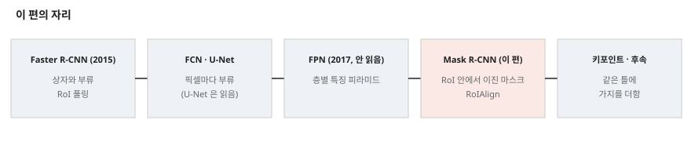

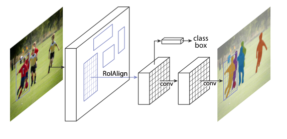

---

## 3. 문제 / 동기

**이 논문이 없앤 전제: 물체별 분할에는 복잡한 체계가 필요하고, 분할이 인식보다 먼저거나 부류와 얽혀 있어야 한다.**

원문이 적은 앞선 길은 다음이다(2절).

- **분할 후보 먼저(DeepMask 등).** 분할이 인식보다 먼저라 느리고 덜 정확하다고 적는다.
- **MNC.** 상자 후보에서 분할 후보를 내고 분류하는 여러 단계 연쇄.
- **FCIS.** 위치별 출력 채널로 부류 · 상자 · 마스크를 함께 내 빠르지만, 겹친 물체에서 체계적인 오류가 나고 가짜 경계가 생긴다고 적는다(그림 5).

원문 쪽 근거는 표 1 값과 그림 5 다.

---

## 4. 핵심 기술

**① 세 가지 나란히.** 손실 $L = L_{cls} + L_{box} + L_{mask}$. 앞 둘은 Fast R-CNN 과 같다. RPN 도 같다.

**② 마스크 손실.** 마스크 가지 출력은 RoI 마다 $K m^2$ 차원으로, $K$ 개 부류의 $m \times m$ 마스크다. 작은 예시로, $K = 80$, $m = 28$ 이면 62,720 차원이다. 픽셀별 시그모이드에 평균 이진 교차 엔트로피를 걸고, 정답 부류 $k$ 의 마스크만 손실에 든다.

**③ RoIAlign.** 위 용어. 네 점의 값을 최대 또는 평균으로 모은다. 각주 2 는 칸 중심 한 점만 읽어도 「nearly as effective」 라 적고 값은 적지 않았다.

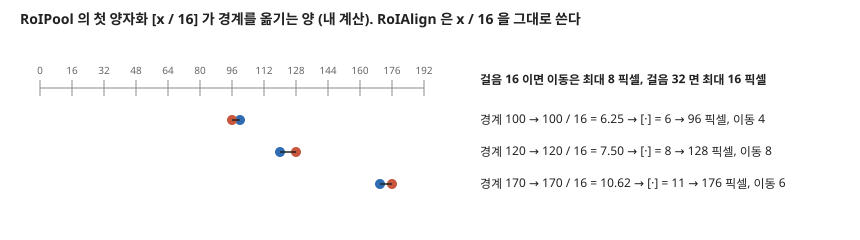

**④ 머리.** C4 쪽은 ResNet 5 단계(res5)를 머리로 쓴다. FPN 쪽은 바탕 망에 res5 가 이미 들어가 있어 필터가 적은 머리를 쓴다.

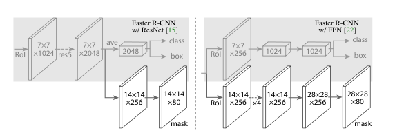

**⑤ 학습 설정(3.1절).** 짧은 변 800. GPU 8 장, GPU 마다 이미지 2 장(묶음 16), 이미지마다 RoI N(C4 64 · FPN 512), 양성 : 음성 1:3. 양성은 정답 상자와 IoU 0.5 이상. 160k 반복, 학습률 0.02 → 0.002(120k), 가중 감쇠 0.0001, 운동량 0.9. RPN 앵커 5 축척 3 비율. **소거를 쉽게 하려고 RPN 을 따로 배우고 특징을 공유하지 않는다.** 마스크 정답은 RoI 와 정답 마스크의 교집합이다.

**⑥ 추론.** 제안 C4 300 · FPN 1000. 상자 가지 뒤 NMS, 상위 100 상자에만 마스크 가지를 돌린다. 예측 부류의 마스크를 RoI 크기로 키우고 0.5 로 이진화한다. 학습의 나란히와 추론의 순서가 다르다는 점은 원문이 밝힌다.

**적혀 있지 않은 설정.** NMS 문턱(키포인트 쪽 0.5 만 적혀 있다. v3 부록 B 는 기본값을 0.3 이라 적는다).

**파라미터(내 셈).** 표 2e 의 FCN 가지와 MLP 가지를 맞대면 다음과 같다.

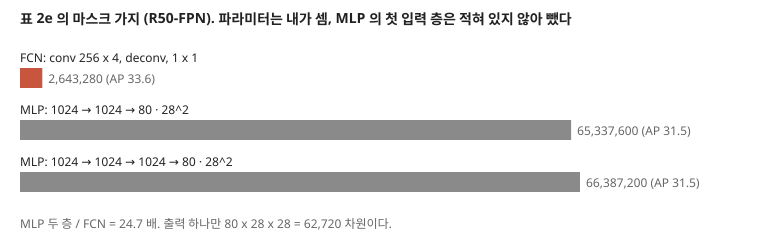

FCN 2,643,280, MLP 두 층 65,337,600 으로 24.7 배다. 첫 입력 층은 원문에 적혀 있지 않아 빼서 MLP 쪽 값이 하한이다. 「더 적은 파라미터」 라는 원문 말은 이 셈으로 받쳐진다. 원문은 이 수를 적지 않았다.

---

## 5. 평가 (읽은 범위)

- **데이터:** COCO. 학습 trainval35k(소거 · 비교 모두), 소거는 minival, 비교는 test-dev. 표 5 · 6 은 minival. 키포인트는 키포인트 라벨이 있는 이미지만.
- **지표:** mask AP 묶음, 박스 AP 묶음, 키포인트 AP 묶음.
- **비교 상대:** MNC · FCIS(2015 · 2016 도전 우승), FCIS+++(다중 축척 학습 · 시험, 뒤집기, OHEM). 박스는 Faster R-CNN+++ · FPN · G-RMI · TDM. 키포인트는 CMU-Pose+++ · G-RMI. **상대 값은 각 편의 값을 옮긴 것이고 같은 코드로 돌린 것이 아니다.**
- **장비:** Nvidia Tesla M40 GPU(추론), 8 GPU 기계(학습).

---

## 6. 물체별 분할 — 표 1

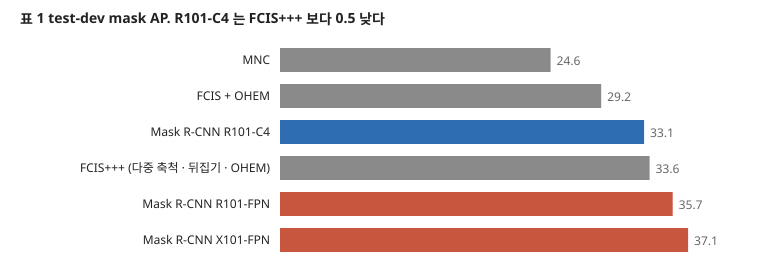

| 줄 | 바탕 망 | AP | $AP_{50}$ | $AP_{75}$ | $AP_S$ | $AP_M$ | $AP_L$ |
|---|---|---:|---:|---:|---:|---:|---:|
| MNC | R101-C4 | 24.6 | 44.3 | 24.8 | 4.7 | 25.9 | 43.6 |
| FCIS + OHEM | R101-C5-dilated | 29.2 | 49.5 | - | 7.1 | 31.3 | 50.0 |
| FCIS+++ + OHEM | R101-C5-dilated | 33.6 | 54.5 | - | - | - | - |
| Mask R-CNN | R101-C4 | 33.1 | 54.9 | 34.8 | 12.1 | 35.6 | 51.1 |
| Mask R-CNN | R101-FPN | **35.7** | 58.0 | 37.8 | 15.5 | 38.1 | 52.4 |
| Mask R-CNN | X101-FPN | **37.1** | 60.0 | 39.4 | 16.9 | 39.9 | 53.5 |

- **「모든 줄이 앞선 기본 변종(baseline variants)을 넘는다」 는 맞지만 단서가 든 말이다.** R101-C4 33.1 은 기본 변종 FCIS + OHEM 29.2 를 넘고, 기교를 넣은 FCIS+++ 33.6 에는 0.5 낮다. 초록의 「기교 없이 모든 항목을 넘는다」 는 FPN 줄에서 맞다.
- **FCIS+++ 는 크기별 값이 표에 없다.** 그래서 크기별 비교는 기교 없는 FCIS 줄과만 된다. $AP_S$ 는 15.5 대 7.1 이다.
- 흩어짐은 적혀 있지 않다.

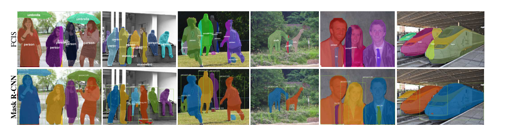

그림 5 는 이미지 두 장 남짓의 정성 비교다. 「체계적인 오류」 를 재는 값(겹침 정도별 AP 등)은 이 편에 없다.

---

## 7. 소거 — 표 2

**(a) 바탕 망.** R50-C4 30.3 · R101-C4 32.7 · R50-FPN 33.6 · R101-FPN 35.4 · X101-FPN 36.7. 깊이의 몫은 C4 +2.4, FPN +1.8 이고, FPN 의 몫은 R50 +3.3, R101 +2.7 이며, ResNeXt 의 몫은 +1.3 이다(내 뺄셈). **그러나 C4 와 FPN 의 줄 사이에는 FPN 말고도 여럿이 함께 바뀌어 있다.**

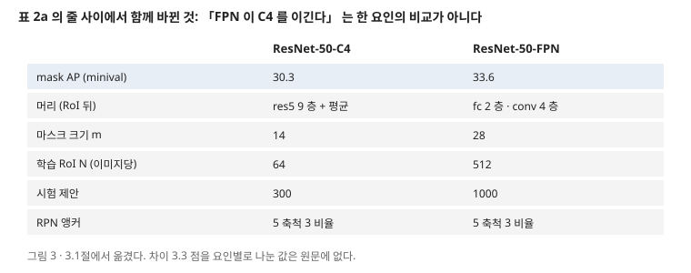

**(b) 다항 대 독립.** 소프트맥스 24.8 · 44.1 · 25.1, 시그모이드 30.3 · 51.2 · 31.5, 차이 +5.5 · +7.1 · +6.4. 값끼리 맞다. 같은 R50-C4 에서 바꾼 줄이라 이 편에서 조건이 깨끗한 비교다. 반복은 적혀 있지 않다.

**본문의 다른 값: 부류 무관 마스크.** 하나의 $m \times m$ 만 내는 경우 29.7 대 30.3 이고 표가 없다. 0.6 점이다. 다항 쪽 -5.5 와 나란히 보면, 잃는 것은 「부류별로 나누는 것」 이 아니라 「픽셀마다 부류끼리 경쟁시키는 것」 이다. 원문의 「역할 분담」 해석과 방향이 맞는다.

**(c) RoIAlign (R50-C4, 걸음 16).**

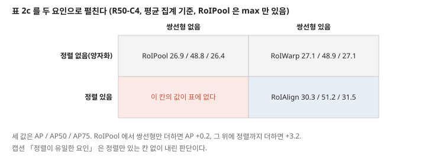

| 층 | 정렬 | 쌍선형 | 모음 | AP | $AP_{50}$ | $AP_{75}$ |
|---|---|---|---|---:|---:|---:|
| RoIPool | | | max | 26.9 | 48.8 | 26.4 |
| RoIWarp | | 있음 | max | 27.2 | 49.2 | 27.1 |
| RoIWarp | | 있음 | ave | 27.1 | 48.9 | 27.1 |
| RoIAlign | 있음 | 있음 | max | 30.2 | 51.0 | 31.8 |
| RoIAlign | 있음 | 있음 | ave | 30.3 | 51.2 | 31.5 |

캡션은 「정렬이 큰 차이의 유일한 요인」 이라 적는다. 쌍선형 단독은 +0.2 ~ +0.3 으로 값이 있고, **정렬 단독 칸이 없다.** 그래서 정렬과 쌍선형의 상호 작용을 뗄 수 없다. 「key」 라는 본문 말은 받쳐지지만 「only」 는 이 표로 내릴 수 없다. RoIPool 의 ave 칸도 없다.

**(d) RoIAlign (R50-C5, 걸음 32).** RoIPool 23.6 → RoIAlign 30.9, +7.3. $AP_{75}$ +10.5. 박스 AP 28.2 → 34.0, +5.8. 값끼리 맞다. 원문의 「stride-32 C5(30.9)가 stride-16 C4(30.3)보다 정확하다」 는 표 2d 와 2c 를 가로지르는 비교이고, **C5 는 FPN 쪽 머리를 쓰고 C4 는 res5 머리를 쓴다.** 차이 0.6 점이 걸음 때문이라 할 수 없다. 뒤따르는 「오래된 난제를 대체로 풀었다(largely resolves)」 는 이 한 줄에 기댄 말이다.

**상대 향상.**

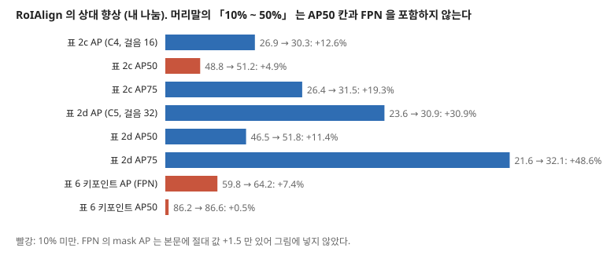

머리말의 「relative 10% to 50%」 는 2c · 2d 의 AP · $AP_{75}$ 범위(12.6 ~ 48.6%)로 맞는다. 범위 밖의 값이 있다. 2c 의 $AP_{50}$ 은 4.9%, FPN 에 쓴 값은 본문이 절대 값 +1.5 만 적어 R50-FPN 33.6 으로 역산하면 4.7%다(내 셈, 바탕 망이 적혀 있지 않아 가정이다).

**(e) 마스크 가지.** MLP 31.5 · 31.5, FCN 33.6, 차이 2.1. MLP 를 한 층 늘려도 AP 는 같다. 원문이 공정을 위해 FPN 머리를 골랐다는 설명(합성곱 층이 사전학습되지 않음)이 조건을 밝힌다.

---

## 8. 박스 검출 — 표 3

| 줄 | 바탕 망 | $AP^{bb}$ | $AP^{bb}_{50}$ | $AP^{bb}_{75}$ | $AP^{bb}_S$ | $AP^{bb}_M$ | $AP^{bb}_L$ |
|---|---|---:|---:|---:|---:|---:|---:|
| Faster R-CNN+++ | R101-C4 | 34.9 | 55.7 | 37.4 | 15.6 | 38.7 | 50.9 |
| Faster R-CNN + FPN | R101-FPN | 36.2 | 59.1 | 39.0 | 18.2 | 39.0 | 48.2 |
| G-RMI | Inception-ResNet-v2 | 34.7 | 55.5 | 36.7 | 13.5 | 38.1 | 52.0 |
| TDM | Inception-ResNet-v2-TDM | 36.8 | 57.7 | 39.2 | 16.2 | 39.8 | 52.1 |
| Faster R-CNN, RoIAlign | R101-FPN | 37.3 | 59.6 | 40.3 | 19.8 | 40.2 | 48.8 |
| Mask R-CNN | R101-FPN | 38.2 | 60.3 | 41.7 | 20.1 | 41.1 | 50.2 |
| Mask R-CNN | X101-FPN | 39.8 | 62.3 | 43.4 | 22.1 | 43.2 | 51.2 |

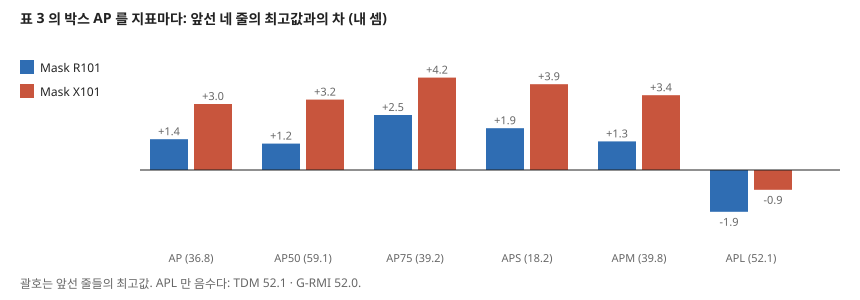

- **AP · $AP_{50}$ · $AP_{75}$ · $AP_S$ · $AP_M$ 은 맞고, $AP_L$ 만 뒤진다.** X101 51.2 는 TDM 52.1 · G-RMI 52.0 아래이고, R101 50.2 는 Faster R-CNN+++ 50.9 아래까지 간다. 원문은 AP 로만 말한다. 「모든 앞선 체계를 넘는다」 는 AP 기준이다.
- **캡션의 분해 +1.1 · +0.9 · +1.6 은 값끼리 맞다.** 다만 RoIAlign 의 +1.1 은 원문 4.2절의 「FPN 에 쓰면 박스 +0.5」 와 값이 다르다. 그쪽은 데이터 · 바탕 망이 명시되지 않았고 여기는 test-dev · R101 이다. 어느 쪽이 맞는지가 아니라 이 효과의 크기가 조건 사이에서 0.6 점 흔들린다는 뜻으로 읽는다.
- **「이 차이는 오로지 다중 과제의 이득이다(due solely)」 는 세다.** 0.9 점 한 쌍, 흩어짐 없음.
- **「마스크와 박스의 간격이 작다」.** 원문은 37.1 대 39.8, 2.7 점으로 적는다. R101 은 2.5 점이다. 그런데 크기별로 나누면 다른 그림이다(내 뺄셈, 표 1 과 표 3 의 같은 줄). X101 $AP_S$ 는 박스가 5.2 높고, $AP_L$ 은 **마스크가 2.3 높다**(53.5 대 51.2). R101 도 $AP_L$ 은 마스크가 2.2 높다. 「간격을 대체로 닫았다(largely closes)」 의 비교 기준이 되는 앞선 간격은 적혀 있지 않다.

---

## 9. 키포인트 — 표 4 · 5 · 6

**표 4.** $AP^{kp}$ CMU-Pose+++ 61.8 · G-RMI 62.4 · 키포인트만 62.7 · 키포인트 + 마스크 63.1. 원문 「0.9 점 높다」 는 우승자 대비로 맞다. G-RMI 와는 0.3 점이고, 캡션이 G-RMI 는 데이터가 달라 직접 비교가 아니라고 밝힌다. **$AP^{kp}_M$ 은 G-RMI 59.1 이 57.8 보다 높고 $AP^{kp}_{75}$ 는 키포인트만 줄이 68.4 로 68.5 아래다.** AP 로는 맞고 칸마다는 아니다.

**표 6.** RoIPool 59.8 → RoIAlign 64.2, +4.4. 값끼리 맞다. $AP^{kp}_{50}$ 은 86.2 → 86.6, +0.4 라 효과가 높은 문턱에 몰린다.

**구현 차이.** 8 층 합성곱 512 차원, 올림으로 출력 56 x 56. 학습 대상은 부류별 이진이 아니라 $m^2$ 방향 소프트맥스다. 마스크 쪽 교훈(소프트맥스 대신 시그모이드)을 그대로 옮긴 것이 아니라 과제에 따라 바꾼 것이고, 원문도 「단일 점 검출을 유도」 라 적는다. 축척을 [640, 800] 에서 뽑아 90k 반복.

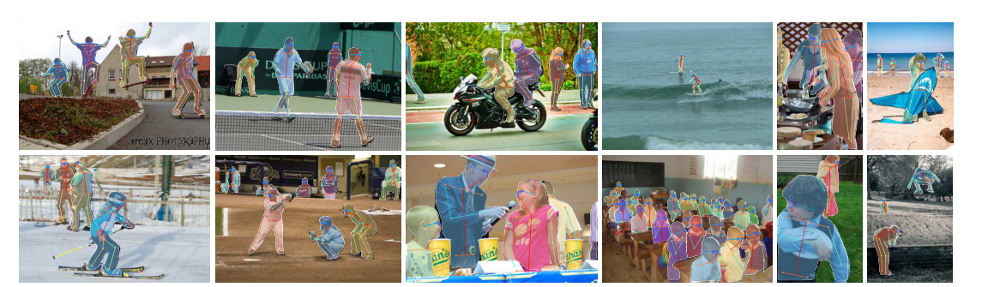

---

## 10. 다중 과제 — 같은 크기, 다른 말

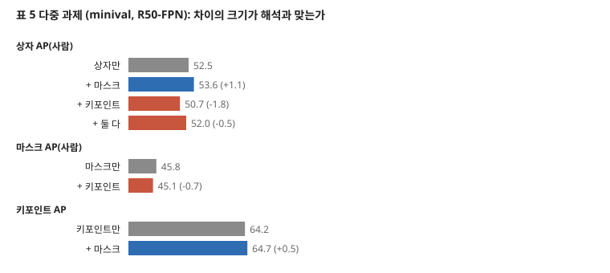

| 무엇을 더했나 | 무엇을 쟀나 | 차이 | 원문의 말 |
|---|---|---:|---|
| 마스크 (표 3, 전 부류, test-dev) | 박스 AP | +0.9 | 「오로지 다중 과제의 이득(due solely)」 |
| 마스크 (표 5, 사람, minival) | 박스 AP | +1.1 | 「일관되게 나아진다(consistently improves)」 |
| 마스크 (표 5, 키포인트만 대비) | 키포인트 AP | +0.5 | 같음 |
| 키포인트 (표 5, 상자만 대비) | 박스 AP | **-1.8** | 「조금 줄어든다(reduces slightly)」 |
| 키포인트 (표 5, 마스크만 대비) | 박스 AP · 마스크 AP | **-1.6** · **-0.7** | 같음 |

**더해서 오른 쪽은 인과로 적고, 내린 쪽은 더 큰데도 「조금」 이라 적는다.** 흩어짐이 없으니 어느 쪽도 이 표만으로 판정할 수 없다. 이 판단은 내 것이고, 원문은 뒤이어 「키포인트는 이득을 보지만 다른 과제를 돕지는 않는다」 고 방향은 정직하게 적는다.

**minival 과 test-dev.**

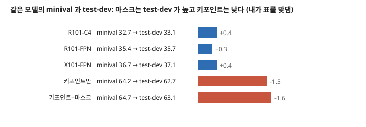

마스크는 test-dev 가 0.3 ~ 0.4 높고 키포인트는 1.5 ~ 1.6 낮다. 그래서 표 2 소거의 0.3 점 차이는 집합을 바꿀 때 움직이는 양과 같은 자릿수다. 원문은 이 간격을 해석하지 않았다.

---

## 11. 시간

- **추론**: R101-FPN 195 ms + CPU 15 ms = 210 ms, 4.76 fps(내 셈). 원문 표기 「5 fps」 · 「약 200 ms」. C4 는 약 400 ms 라 권하지 않는다고 적는다.
- **학습**: R50-FPN 0.72 초 x 160k = 32.0 시간(내 곱, 원문 32 시간과 맞다). R101-FPN 44 시간은 반복당 0.99 초다. 160k x 16 / 115k = 22.3 에폭(내 셈).
- **「Faster R-CNN 대비 약 20% 추가」** 는 3.1절 문장뿐이다. 맞댈 Faster R-CNN 시간이 표에 없다.
- **속도와 정확도의 출처가 다르다.** 표 값은 RPN 을 따로 배운 모델이고, 195 ms 는 4 단계로 공유한 모델이다. 원문은 「통계적으로 같은 mask AP」 라 적는데 값과 검정이 없다. 그림 4 캡션의 「35.7 mask AP · 5 fps」 는 두 모델의 값을 한 줄에 붙인 것으로 읽힌다.

---

## 12. 실험 분석 (논문의 표 · 그림마다)

**직접 돌리지 않는다.** 논문이 낸 실험을 표 · 그림 하나씩 같은 틀로 읽는다. 값 읽기와 재계산은 「내가 센 것」으로 밝힌다. **모든 표에 흩어짐과 반복 수가 적혀 있지 않아, 그 칸은 한 번 적고 줄인다.**

| 표 · 그림 | 무엇을 바꿨나 (변인) | 무엇을 고정했나 | 결과 | 반복 수 · 흩어짐 | 주장이 결과보다 센가 |
|---|---|---|---|---|---|
| **표 1** (5쪽) | 방법 · 바탕 망 | COCO test-dev, 단일 모델 | 6절 표 | 적혀 있지 않다(논문 전체) | 「모든 줄이 기본 변종을 넘는다」 는 맞다. C4 줄은 FCIS+++ 아래다 |
| **표 2a** (6쪽) | 바탕 망 | minival, 독립 마스크, RoIAlign | 30.3 ~ 36.7 | 같음 | **세다.** C4 · FPN 줄 사이에 머리 · $m$ · $N$ · 제안 수가 함께 바뀐다 |
| **표 2b** | 소프트맥스 · 시그모이드 | R50-C4 | +5.5 · +7.1 · +6.4 | 같음 | 차이가 크고 조건이 깨끗해 맞다. 「key」 는 이 한 줄로 받쳐진다 |
| **표 2c** | RoI 층 · 모음 | R50-C4 | 26.9 ~ 30.3 | 같음 | **세다.** 「only factor」 인데 정렬만 있는 칸이 없다 |
| **표 2d** | RoIPool · RoIAlign | R50-C5 + FPN 쪽 머리 | +7.3 · 박스 +5.8 | 같음 | **세다.** C4 대비 비교에 머리가 섞인다. 「largely resolves」 |
| **표 2e** | MLP 2 층 · 3 층 · FCN | R50-FPN | 31.5 · 31.5 · 33.6 | 같음 | 맞다. 공정 조건을 밝혔다 |
| **표 3** (7쪽) | 방법 · 바탕 망 | test-dev, 박스 | 8절 표 | 같음 | **세다.** $AP_L$ 은 지고, 「due solely」 를 0.9 점 한 쌍으로 말한다 |
| **표 4** (8쪽) | 방법 · 과제 묶음 | test-dev, R50-FPN | 62.7 · 63.1 | 같음 | AP 로 맞다. $AP^{kp}_M$ · $AP^{kp}_{75}$ 는 칸마다 다르다 |
| **표 5** (8쪽) | 가지 조합 | 사람 부류, minival, 같은 데이터 | 10절 표 | 같음 | **세다.** 같은 크기를 다른 말로 적는다 |
| **표 6** (8쪽) | RoIPool · RoIAlign | 키포인트, minival | +4.4 | 같음 | 맞다. $AP^{kp}_{50}$ 은 +0.4 |
| **그림 1 · 3** | 없음(구조도) | | 수치 없음 | 해당 없음 | 해당 없음 |
| **그림 2 · 4** (2 · 5쪽) | 없음(결과 예) | R101-FPN | 수치 없음 | 고른 이미지 여부가 적혀 있지 않다 | 「어려운 조건에서도 좋다」 를 예시로 보인다. 잰 값은 없다 |
| **그림 5** (6쪽) | FCIS+++ · Mask R-CNN | 같은 이미지 | 수치 없음 | 이미지 몇 장 | **세다.** 「체계적」 · 「no such artifacts」 를 예시로 말한다 |
| **그림 6** (8쪽) | 없음(결과 예) | R50-FPN | 수치 없음 | 예시 | 주장 없음 |

**문장으로만 적힌 실험적 주장.** 「약 20% 추가」, 「통계적으로 같은 mask AP」, 「한 점만 읽어도 nearly as effective」(각주 2), 「ResNet-101 도 키포인트 값이 비슷하다」, 「하이퍼파라미터에 강건하다」(3.1절). 뒤 셋은 표가 없다. 민감도를 잰 줄을 찾지 못했다.

---

## 13. arXiv v3 과 대조 — 이 파일에 없는 것

| 부록 | 내용(v3 에서 옮김) | 이 노트에 왜 닿나 |
|---|---|---|
| **A. Cityscapes** | R50-FPN 26.2 AP(test), COCO 사전학습 32.0. 훈련 물체가 적은 트럭 · 버스 · 기차에서 val / test 가 28.8 / 22.8, 53.5 / 32.2, 33.0 / 18.6 으로 벌어지고, COCO 사전학습 뒤 38.0 / 30.1, 57.5 / 40.9, 41.2 / 30.9. 사람 · 차는 ± 1 점 안 | **적은 데이터와 집합 간격을 재는 유일한 자리.** 물체 수가 적은 부류에서 집합 간격이 벌어진다는 관찰이고, 원문은 도메인 차이로 해석한다 |
| **B. 향상 결과** | 갱신한 기준선(180k 반복, NMS 0.5) mask 37.0 · 박스 40.5. 끝까지 학습은 mask +0.6 · 박스 +1.2. 모두 합쳐 mask 36.7 → 41.8, 박스 39.6 → 47.3 | 「기교 없이」 의 값이 이후 얼마나 움직였는지. NMS 기본값이 여기에 나온다 |
| **표 9** | 키포인트 향상 64.2 → 70.4 | 같음 |

ICCV 판의 소수 값은 모두 v3 에 있다. 부록 B 의 시작값 박스 39.6 · mask 36.7 은 v3 표 8 캡션대로 minival 값이고, ICCV 표 3 의 39.8 은 test-dev 값이라 집합이 다르다.

---

## 14. 이 논문이 스스로 적은 한계

1. **마스크 가지가 복잡하지 않다.** 더 복잡한 설계가 값을 올릴 수 있으나 이 편의 초점이 아니라고 적는다(3절).
2. **속도에 맞춘 설계가 아니다.** 이미지 크기 · 제안 수를 바꾼 속도-정확도 맞바꿈은 범위 밖이라 적는다(4.4절).
3. **FCIS+++ 의 기교는 여기에 넣지 않았다.** 다중 축척 등이 값을 더 올릴 것이라 예상한다(4.1절).
4. **키포인트에 사람 자세 지식을 쓰지 않았다.** 틀의 일반성을 보이는 실험이고 데이터가 작다고 적는다(5절).

---

## 15. 논문이 적지 않은 것 — 내가 읽으며 짚은 자리

1. **흩어짐이 표에 없다.** 0.1 ~ 0.9 점의 차이를 원인으로 해석한다. **안 한 것이지 못 한 것이 아니다.**
2. **마스크 품질을 경계에서 재지 않았다.** $AP_{75}$ 까지가 가장 높은 문턱 값이고, 원문이 강조하는 「정렬」 의 효과를 경계 지표로 잰 것을 찾지 못했다. 또 $m = 28$ 인 마스크를 RoI 크기로 키워 쓰므로 **큰 물체일수록 출력 해상도가 픽셀 단위보다 거칠다.** 예를 들어 RoI 280 픽셀이면 마스크 칸 하나가 10 픽셀이다(내 셈). 이것을 잰 표가 없다.
3. **작은 물체는 여전히 낮다.** X101-FPN $AP_S$ 16.9 대 $AP_L$ 53.5, 3.2 배 차이다(내 나눔). 원문은 이 간격을 다루지 않는다.
4. **독립 마스크의 대가를 재지 않았다.** 마스크가 상자 안에서 나오므로, 상자나 부류가 틀리면 마스크도 틀린다. 박스와 마스크의 오차 분해를 이 편에서 찾지 못했다.

---

## 16. 앞 노트와 맞춰 보기

**Faster R-CNN 노트의 물음(「작은 물체에서 앵커의 몫」).** FPN 이 그 자리를 받는다. Faster R-CNN+++(C4) $AP^{bb}_S$ 15.6, FPN 18.2 다(표 3). 다만 $AP^{bb}_L$ 은 50.9 에서 48.2 로 내리고, 값은 각각의 논문에서 옮긴 것이다. 앵커 축척이 3 에서 5 로 늘었다.

**Faster R-CNN 노트의 4 단계 학습.** 그대로 쓰되 소거에서는 쓰지 않았다. v3 부록 B 의 끝까지 학습이 mask +0.6 · 박스 +1.2 다. 「후속 과제」 가 2 년 뒤 여기서 값을 받는다.

**U-Net 노트의 물음(「왜 작은 FCN 으로 충분한가」).** 합성곱 4 층 + 올림 1 층, 파라미터 2.64M 이고 U-Net 31.03M 의 8.5% 다(내 나눔). 범위가 RoI 안으로 좁혀지고 부류가 정해져 있어 이진 문제가 된다는 해석은 원문의 「역할 분담」 과 같은 방향이다. 다만 데이터와 지표가 달라 두 망을 값으로 맞대지는 못한다. **맞닿은 같은 부류 물체 가르기를 U-Net 은 경계 가중치로, 이 편은 상자 단위 분리로 푼다.**

**PatchCore · UniAD 노트.** 그쪽은 라벨 없는 결함, 이쪽은 물체 부류 라벨과 마스크 라벨이 모두 필요하다. 지표도 AP 와 AUROC 로 갈린다. 결함 분할 라벨을 쓸 수 있는 공장 자리에서만 이 틀이 닿는다.

---

## 17. 내가 가져갈 것

**하나. 네 칸 표를 그려 빈 칸을 찾는다.** 「X 가 유일한 요인」 을 읽으면 요인을 교차해 칸을 그려 본다. 표 2c 에서 빈 칸 하나가 주장의 세기를 바꾼다.

**둘. 같은 크기에 같은 말을 쓴다.** +0.9 와 -1.8 을 다르게 부른 자리를 찾을 수 있었던 것은 표를 한 줄로 모았기 때문이다. 내 문서에서도 이득과 손실의 크기를 같은 기준으로 적는다.

**셋. 속도와 정확도가 같은 모델의 값인지 본다.** 표 값과 fps 가 다른 학습에서 왔다. 내 연구의 시간 · 정확도 비교에서 이미 지적받은 형태(실행 둘을 가로지름)와 같다.

**넷. 지금 확인된 것은 여기까지다.** 논문이 잰 것은 COCO 위의 AP 묶음과 시간이다. 논문이 말만 한 것은 20% 추가, 통계적 동일, 강건성이다. 내가 책상에서 센 것은 파라미터 · 상대 향상 · 칸 간격이고, 부록 값은 v3 에서 옮겼다.

---

## 18. 남는 질문

- **정렬 단독의 값은 얼마인가?** 칸을 채운 실험을 찾아야 한다.
- **차이 0.1 ~ 0.9 점의 흩어짐은?** 같은 설정을 반복한 값이 필요하다.
- **마스크 해상도를 올리면 큰 물체 경계가 얼마나 나아지나?** 경계 지표로 재야 한다. 이 편에 없다.
- **결함처럼 작고 부류 물체 개념이 약한 대상에 상자 먼저 틀이 맞나?** 이 편의 범위 밖이다.

---

## 19. 다음에 읽을 것

큰 틀의 다음 칸은 **YOLO** 다. Faster R-CNN 노트가 적은 「한 단계」 의 자리를, 제안 단계를 없앤 체계로 다시 본다. 아래는 이 노트 안에만 남겨 두는 후속 편이다.

| 논문 | 이 노트의 어느 자리에서 나오는가 | 무엇을 확인하고 싶은가 | 원문 참고 문헌 |
|---|---|---|---|
| **FPN** (Lin 외, CVPR 2017) | 7 · 16절 | $AP_S$ 의 몫을 FPN 단독으로 | [22] |
| **FCN** (Long 외, CVPR 2015) | 3 · 7절 | 다항 마스크의 원형 | [24] |
| **FCIS** (Li 외, CVPR 2017) | 6절 | 「체계적 오류」 의 값 | [21] |
| **Speed/accuracy trade-offs** (Huang 외, CVPR 2017) | 11절 | 속도-정확도 비교의 조건 | [17] |

---

## 20. 참고 문헌

- [7] Dai, J., He, K., Sun, J. (2016). Instance-aware semantic segmentation via multi-task network cascades. CVPR. — MNC. **읽지 않았다.**
- [9] Girshick, R. (2015). Fast R-CNN. ICCV. — **읽지 않았다.**
- [15] He, K. 외 (2016). Deep residual learning for image recognition. CVPR. — 2026-11-08 전에 읽었다.
- [17] Huang, J. 외 (2017). Speed/accuracy trade-offs for modern convolutional object detectors. CVPR. — G-RMI. **읽지 않았다.**
- [21] Li, Y. 외 (2017). Fully convolutional instance-aware semantic segmentation. CVPR. — FCIS. **읽지 않았다.**
- [22] Lin, T.-Y. 외 (2017). Feature pyramid networks for object detection. CVPR. — **읽지 않았다.**
- [23] Lin, T.-Y. 외 (2014). Microsoft COCO. ECCV. — **읽지 않았다.**
- [24] Long, J. 외 (2015). Fully convolutional networks for semantic segmentation. CVPR. — **읽지 않았다.**
- [29] Ren, S. 외 (2015). Faster R-CNN. NIPS. — 2026-11-08 에 읽었다.
- [31] Shrivastava, A. 외 (2016). Beyond skip connections: top-down modulation for object detection. arXiv:1612.06851. — TDM. **읽지 않았다.**
- [35] Xie, S. 외 (2017). Aggregated residual transformations for deep neural networks. CVPR. — ResNeXt. **읽지 않았다.**
- He, K. 외. arXiv:1703.06870v3 (2018-01-24). — 13절의 부록 대목만 읽었다.

---

## 21. 경로

| 무엇 | 어디 |
|---|---|
| 원문 PDF (CVF 게재판, 9 쪽) | `papers/ICCV17_MaskRCNN_Mask_R_CNN.pdf` |
| 이 노트 | `notes/ICCV17_MaskRCNN_Mask_R_CNN.md` |
| 이 노트의 그림 (직접 그린 것) | `figures/ICCV17_MaskRCNN/fig01_mask_branch_params.svg` 부터 `fig10_lineage.svg` 까지 열 |
| 이 노트의 그림 (원문에서 잘라 낸 것) | `figures/ICCV17_MaskRCNN/paper_fig1_framework.png` · `paper_fig3_heads.png` · `paper_fig5_fcis.png` · `paper_fig6_keypoint.png` |
| 그림을 만드는 코드 | `figures/ICCV17_MaskRCNN/make_figures.py` — 바깥 데이터를 읽지 않으므로 `python make_figures.py` 로 어디서나 다시 만든다(표준 라이브러리만). 파라미터 · 시간을 돌릴 때 찍는다 |
| 원문 그림을 잘라 내는 코드 | `figures/ICCV17_MaskRCNN/crop_paper_figures.py` — PyMuPDF 가 필요하다 |
