# DRAEM — A Discriminatively Trained Reconstruction Embedding for Surface Anomaly Detection (ICCV 2021, 요약)

> **한 줄.** 정상 이미지에 **가짜 결함을 붙여** 학습 쌍을 만든다. 재구성 망은 결함을 지워 정상으로 되살리게 배우고, 판별 망은 원본과 재구성을 **나란히 받아** 픽셀마다 이상인지 가른다. 두 망을 한 손실로 함께 배운다. MVTec AD 이미지 AUROC 98.0 · 픽셀 AUROC 97.3 · 픽셀 AP 68.4, DAGM 이미지 AUROC 99.0.

> **이 노트에서 가장 먼저 볼 자리 다섯.** (1) **픽셀 AP 차 13.4 점 가운데 7.5 점(56%)은 재구성 망을 뺀 줄이 이미 낸다.** 표 3 의 Disc. 는 가짜 이상으로 분할 망만 배운 것인데 AP 62.5 로 표 2 의 가장 센 상대 PaDiM 55.0 보다 높다. 재구성 망의 몫은 검출 · 픽셀 AUROC · AP 로 4.1 · 4.6 · 5.9 점이고, 반복이 없어 흩어짐은 모른다(8절). (2) **「DAGM 에서 지도 방법보다 위치를 잘 찾는다」 를 받치는 수치가 이 편에 없다.** 같은 4.3절이 「위치 정확도는 재지 않았다」 고 적는다. 그런데 초록과 결론은 「substantially outperforming them in localization accuracy」 라고 쓴다. 근거는 그림 11 의 다섯 장과 보충 자료의 그림이다(9절). (3) **표 4 에서 숫자끼리 맞지 않는 줄이 둘이다.** MAD 의 분류 정확도 66.2 는 TPR 78.7 과 TNR 85.7 사이에 있지 않다. DRAEM 줄에서 거꾸로 낸 결함 비율은 0.310 인데 다른 세 줄은 0.123 ~ 0.129 다(내 계산, 9절). (4) **4.1절의 「모든 MVTec 부류에서 최고」 는 표와 어긋난다.** 검출은 6 부류, AP 는 4 부류에서 진다. 「15 중 9」 는 같은 값 넷을 포함한 수다. 픽셀 AUROC 는 97.3 대 PaDiM 97.4 이고 단독 최고는 8 부류다(6 · 7절). (5) **끈 실험의 말이 결과보다 세거나 서로 엇갈린다.** 단색 줄의 「여전히 최고 수준」 은 픽셀 AUROC 92.6 이 표 2 의 세 상대 모두보다 낮다. 직사각형 줄의 AP −3.3 은 「slight」, 변형 없는 줄의 AP −4.1 은 「significant」 라 부른다. 질감 변형의 몫은 β 위에서 0.1 · 0.2 · 0.0 이다(8절).

---

## Paper Metadata

| Item | Content |
|---|---|
| Title | DRÆM – A discriminatively trained reconstruction embedding for surface anomaly detection |
| Authors | Vitjan Zavrtanik, Matej Kristan, Danijel Skočaj |
| 소속 | University of Ljubljana, Faculty of Computer and Information Science. 표 1 · 2 의 상대 RIAD 와 표 3 의 Božič 외 · 표 4 의 Rački 외도 같은 연구실(Skočaj) 편이다 |
| Conference / Journal | **ICCV 2021**, 8330-8339쪽. 쪽 번호는 파일 꼬리에서 읽었다. 검색에서 본 다른 서지 하나는 8310-8319 로 적는데, 파일 쪽 번호를 따른다 |
| Year | 2021. arXiv:2108.07610 (v1 2021-08-17, v2 2021-09-27, 검색 결과에서 본 날짜) |
| DOI | 파일에 찍혀 있지 않다 |
| 코드 | `github.com/VitjanZ/DRAEM` (원문 초록). 이 노트는 코드를 보지 않았다 |
| Stored PDF | 본문 · 보충 자료 두 파일. 경로는 19절 |
| 왜 읽었는가 | 큰 틀 「산업 이상 탐지 2막」(DRAEM → Reverse Distillation → SimpleNet → EfficientAD)의 첫 칸. UniAD 노트가 남긴 물음 둘(부류별 98.0 의 구성, 통합 설정에서도 질감 칸이 버티는 까닭)의 원 출처다 |
| 읽은 범위 | **2026-11-10 에 CVF 게재판 10 쪽과 보충 자료 8 쪽을 전부 읽었다.** 곧 Abstract · 1 ~ 5절 · 식 (1) ~ (5) · 표 1 ~ 4 · 그림 1 ~ 11 과 캡션 · 참고 문헌 32 건의 서지, 보충 자료 1 ~ 3절 · 표 1 · 그림 1 ~ 7. 쪽 이미지로 식 · 표 3 의 체크 표시 · 그림을 맞췄다. 참고 문헌의 편들과 코드는 읽지 않았다 |

### 저장한 파일의 상태

- **CVF Open Access 게재판 10 쪽이다.** 본문 8 쪽 + 참고 문헌 2 쪽. 보충 자료는 따로 8 쪽(글 1 쪽 + 그림 7 쪽)이다.
- **arXiv 판은 받지 않아 숫자를 대조하지 않았다.**
- 그림 9 는 벡터라 PDF 좌표를 눈금선에 맞춰 읽었다(축 한 칸 5 점 = 15.05 pt). 표 3 의 체크 표시는 글자 층에서 칸이 갈리지 않아 220 dpi 쪽 이미지로 읽었다.

---

## 1. 용어

- **표면 이상 탐지 (surface anomaly detection)**: 이미지의 **일부 영역**이 정상과 다른 것을 찾는 일. 원문은 이미지 전체가 학습 집합과 다른 「일반 이상 탐지」 와 가른다. 작은 예시로, MVTec AD 의 긁힌 병 이미지는 결함이 픽셀 일부에만 있다.
- **재구성 망 (reconstructive sub-network)**: 가짜 결함이 붙은 이미지 $I_a$ 를 받아 원래 정상 이미지 $I$ 를 되살리게 배우는 부호기-복호기. 출력은 $I_r$.
- **판별 망 (discriminative sub-network)**: $I$ 와 $I_r$ 을 채널 방향으로 이어 붙인 $I_c$ 를 받아, 입력과 같은 크기의 이상 지도 $M_o$ 를 내는 U-Net 꼴 망. 작은 예시로, 컬러 이미지라면 입력 채널은 3 + 3 = 6 이다(내 셈, 원문은 채널 수를 적지 않았다).
- **가짜 이상 (simulated anomaly)**: 정상 이미지에 다른 이미지의 무늬를 붙여 만든 결함. 원문은 「분포 바로 밖(just-out-of-distribution)」 이라 부른다. 실제 결함을 닮을 필요가 없다는 것이 이 편의 주장이다.
- **질감 출처 (anomaly source)**: 붙일 무늬를 뽑는 이미지 집합. 기본은 DTD(Describable Textures Dataset). 끈 실험에서 ImageNet · 단색으로 바꾼다.
- **펄린 잡음 (Perlin noise)**: 부드럽게 이어지는 무작위 무늬. 문턱으로 0 · 1 로 나눠 가짜 이상의 **모양** $M_a$ 로 쓴다.
- **불투명도 β (opacity)**: 붙인 무늬를 원래 픽셀과 섞는 비율. $[0.1, 1.0]$ 에서 고르게 뽑는다. 작은 예시로, β = 0.1 이면 가짜 이상 칸의 픽셀은 원본 90% + 무늬 10% 다.
- **이미지 점수 η**: 이상 지도를 평균 거르개로 부드럽게 한 뒤의 최댓값.
- **이미지 AUROC · 픽셀 AUROC**: 이미지 하나 또는 픽셀 하나를 표본으로 잰 ROC 곡선 아래 넓이.
- **픽셀 AP (average precision)**: 픽셀을 표본으로 잰 정밀도-재현율 곡선 아래 넓이. 결함 픽셀이 드물면 AUROC 보다 거짓 양성에 민감하다. 작은 예시(내 셈): 100 만 픽셀 중 1 만이 결함이면 거짓 양성률 1% 가 9,900 픽셀이라, 그 문턱에서 결함을 다 맞혀도 정밀도는 10,000 / 19,900 = 50.3% 를 넘지 못한다.
- **TPR · TNR · CA**: 표 4 의 참 양성률 · 참 음성률 · 분류 정확도. 어느 문턱에서 셌는지 적혀 있지 않다.
- **비지도 (unsupervised)**: 이 편에서는 「실제 결함을 학습에 쓰지 않는다」 는 뜻이다. **가짜 결함의 마스크로는 픽셀 단위 지도 학습을 한다.** 표 4 의 「지도」 는 실제 결함 라벨을 쓴다는 뜻이다.
- **백분율 점**: 원문은 「2.5 percentage points」 처럼 적는다. 이 노트는 「2.5 점」 으로 적는다.

---

## 2. 한 문단 요약

재구성 계열 이상 탐지는 정상만 배운 망이 결함을 못 되살린다는 데 기대지만, 정상과 비슷한 결함은 잘 되살려 버리고 원본과 재구성을 비교하는 유사도(SSIM 등)를 손으로 골라야 한다. 판별 계열은 가짜 결함으로 분할 망을 배울 수 있지만 가짜의 겉모양에 과적합한다고 원문은 적는다. 이 편은 둘을 잇는다. 재구성 망이 결함을 지우고, 판별 망이 원본과 재구성의 **차이**를 배우면 가짜의 겉모양이 아니라 「재구성에서 얼마나 벗어났나」 를 배우게 되어 실제 결함으로 옮겨 간다는 가설이다. 실험은 MVTec AD 검출(표 1) · 위치(표 2), 끈 실험(표 3 · 그림 9), DAGM 에서 지도 방법과의 비교(표 4)다.

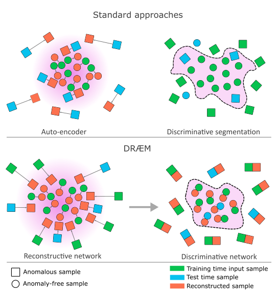

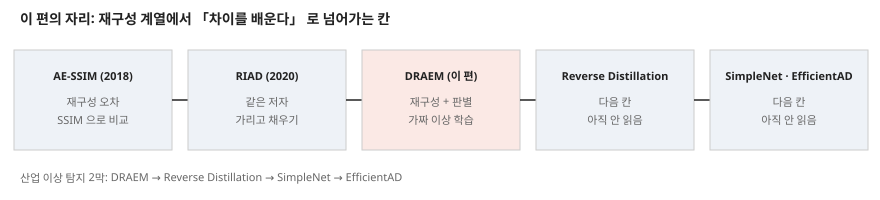

---

## 3. 문제 / 동기

**이 논문이 없앤 전제: 이상 탐지 망은 정상만 보고 배워야 하고, 이상 지도는 재구성 오차를 손으로 고른 유사도로 재서 얻는다.**

원문이 적은 앞선 계열의 문제(1 · 2절)는 셋이다.

1. **재구성 계열은 결함까지 되살린다.** 정상과 「substantially」 다르지 않은 결함은 잘 재구성되어 오차가 작다(그림 2 왼쪽 위).
2. **후처리를 손으로 만든다.** 오차를 이상 지도로 바꾸는 유사도를 고르는 일이 표면 결함에 맞게 만들기 어렵고, 특징 추출을 탐지 성능에 맞춰 최적화하지 못한다.
3. **가짜 결함으로 분할 망을 배우면 가짜에 과적합한다**(그림 2 오른쪽 위). 원문은 이 문장에 [8, 21] 을 인용한다. 두 편은 DeepLab 계열과 U-Net 으로, 서지로 보면 분할 구조 논문이다(12절).

원문은 해법을 **가설**로 적는다(1절, 「We hypothesize」). 원본과 재구성을 함께 본 판별 모델은 가짜의 겉모양이 아니라 「국소 외형에 따른 거리 함수」 를 배워 실제 결함에 일반화한다는 것이다. 이 가설을 직접 잰 실험(가짜에서의 성능과 실제에서의 성능의 틈)은 없고, 표 3 의 줄 비교가 간접 근거다.

---

## 4. 핵심 기술

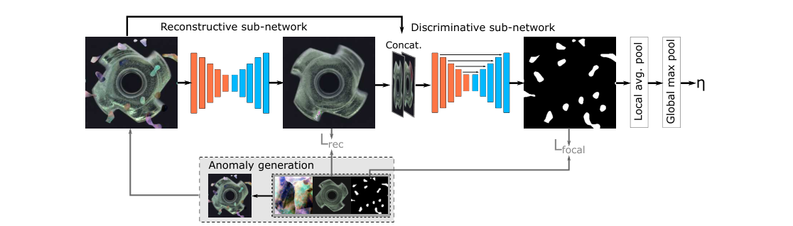

**① 가짜 이상 만들기 (3.3절, 그림 4).** 펄린 잡음 $P$ 를 고르게 뽑은 문턱으로 이진화해 모양 $M_a$ 를 만든다. 질감 출처에서 이미지 $A$ 를 뽑고, 일곱 가지(posterize · sharpness · solarize · equalize · 밝기 · 색 · auto-contrast) 중 셋을 골라 변형한다(RandAugment 에서 착안). 그리고 섞는다.

$$I_a = \overline{M}_a \odot I + (1 - \beta)(M_a \odot I) + \beta (M_a \odot A) \qquad (4)$$

$\overline{M}_a$ 는 $M_a$ 의 반전, $\beta \in [0.1, 1.0]$. 결과는 세 쌍 $(I, I_a, M_a)$ 이고 마스크가 픽셀 단위로 정확하다. **이진화 문턱의 범위는 적혀 있지 않다.** 그림 4 · 10 의 예시에는 가짜 이상이 물체 밖 배경에도 놓인다.

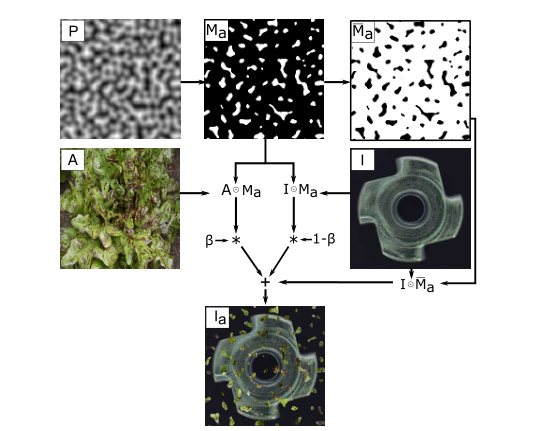

**② 재구성 망 (3.1절).** $I_a$ 를 받아 $I$ 를 되살린다. 손실은 조각 단위 SSIM 과 L2 다.

$$L_{SSIM}(I, I_r) = \frac{1}{N_p} \sum_{i=1}^{H} \sum_{j=1}^{W} \left(1 - \mathrm{SSIM}(I, I_r)_{(i,j)}\right) \qquad (1)$$

$$L_{rec}(I, I_r) = \lambda L_{SSIM}(I, I_r) + l_2(I, I_r) \qquad (2)$$

**λ 의 값은 적혀 있지 않다.** 원문은 판별 망에서 오는 기울기도 이 망의 학습 신호가 된다고 적는다.

**③ 판별 망 (3.2절).** U-Net 꼴. 입력 $I_c$ 는 $I_r$ 과 $I$ 의 채널 이어 붙이기, 출력은 $M_o$. 손실은 초점 손실(Focal Loss)이고 전체 손실은 다음과 같다.

$$L(I, I_r, M_a, M) = L_{rec}(I, I_r) + L_{seg}(M_a, M) \qquad (3)$$

**초점 손실의 γ, 두 항의 무게는 적혀 있지 않다.** 식 (3) 은 출력 마스크를 $M$ 이라 적고 3.2 · 3.4절은 $M_o$ 라 적는다.

**④ 이미지 점수 (3.4절).**

$$\eta = \max\left(M_o * f_{s_f \times s_f}\right) \qquad (5)$$

$f_{s_f \times s_f}$ 는 평균 거르개. **$s_f$ 의 값은 적혀 있지 않다.** 원문은 이미지 분류 망을 따로 배워 보았으나 나아지지 않았다고 적는다(「preliminary study」, 수치 없음).

**⑤ 학습 설정 (4.1절).** 700 에폭, 학습률 $10^{-4}$, 400 · 600 에폭에서 0.1 배. 정상 이미지를 $(-45, 45)$ 도 범위에서 돌리는 증강. 질감 출처는 DTD. DAGM 도 같은 설정(4.3절).

**적혀 있지 않은 설정.** 입력 크기, 묶음 크기, 최적화기, λ, γ, $s_f$, 펄린 문턱 범위, 학습 표본 중 가짜 이상을 붙이는 비율, 두 망의 층 · 채널 수, **부류마다 모델을 따로 두는지.** 마지막은 「MVTec 에서 700 에폭」 이라는 문장만 있다. UniAD 표 1 은 이 편의 98.0 을 부류별 설정 값으로 옮긴다. 망 크기는 UniAD 표 S7 이 학습 파라미터 69.05M · 245.15 GFLOPs 로 적는다. 그 값의 입력 크기 조건은 이 편에서 확인할 수 없다.

---

## 5. 평가 (읽은 범위)

- **데이터:** MVTec AD 15 부류(표 1 · 2 · 3, 그림 9), DAGM 10 부류(표 4).
- **지표:** MVTec 은 이미지 AUROC, 픽셀 AUROC, 픽셀 AP. **PRO 는 없다.** DAGM 은 이미지 AUROC · TPR · TNR · CA.
- **비교 상대:** 표 1 은 GANomaly · DAGAN · US · RIAD · MAD · PaDiM, 표 2 는 US · RIAD · PaDiM. 표 4 는 비지도 넷과 지도 · 약지도 넷. **상대 값을 원 논문에서 옮겼는지 저자가 돌렸는지 표마다 적혀 있지 않다.** 그림 7 캡션만 「our implementation of Uninformed Students and PaDim」 이라 적는다.
- **장비 · 시간:** 적혀 있지 않다.
- **반복:** 어느 표에도 반복 수와 흩어짐이 없다.

---

## 6. MVTec 검출 — 표 1

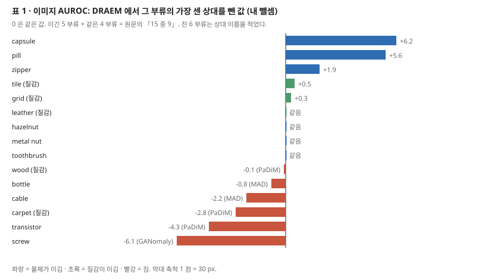

| | GANomaly | DAGAN | US | RIAD | MAD | PaDiM | DRAEM |
|---|---:|---:|---:|---:|---:|---:|---:|
| 인쇄 평균 | 78.2 | 87.3 | 87.7 | 91.7 | 94.4 | 95.5 | **98.0** |
| 부류 15 평균 (내 셈) | 78.19 | 87.31 | 87.72 | 91.65 | 94.38 | **95.42** | 97.98 |
| 질감 5 평균 (내 셈) | 80.24 | 93.08 | 91.52 | 95.10 | 96.68 | 98.76 | 99.12 |
| 물체 10 평균 (내 셈) | 77.17 | 84.43 | 85.82 | 89.93 | 93.23 | 93.75 | 97.41 |

- **평균은 PaDiM 하나 말고 반올림 폭 ±0.05 안이다.** PaDiM 은 95.42 인데 95.5 로 인쇄되었다. UniAD 노트가 같은 0.08 을 짚었는데, UniAD 표 1 의 PaDiM 부류별 값이 이 표에서 옮긴 것이라 어긋남도 함께 옮겨졌다.
- **「2.5 점 앞선다」 는 98.0 − 95.5 로 맞다.** 부류 평균으로 내면 97.98 − 95.42 = 2.56 이다.
- **「15 부류 중 9 부류에서 가장 높다」 는 단독 5 + 같은 값 4 다.** 같은 값은 leather(100, 셋과 같음) · hazelnut(DAGAN 100) · metal nut(PaDiM 98.7) · toothbrush(RIAD 100)다.
- **진 6 부류.** screw −6.1(GANomaly 100) · transistor −4.3(PaDiM) · carpet −2.8(PaDiM) · cable −2.2(MAD) · bottle −0.8(MAD) · wood −0.1(PaDiM). 4.1절 첫 문단의 「모든 MVTec 부류에서 최고 수준」 과 어긋난다(12절). 4.1절 뒤 문단은 「나머지 부류에서 비슷하다(comparable)」 고 적는데, screw 6.1 점 · transistor 4.3 점이 그 범위에 드는지는 판정 규칙이 없다.
- **DRAEM 이 PaDiM 을 앞서는 몫은 물체 쪽이다(내 셈).** 질감 평균 차 +0.36, 물체 평균 차 +3.66.
- **상대 값의 출처.** US 원 논문은 MVTec 에서 PRO 만 내고 이미지 AUROC 는 내지 않았다. PaDiM 원 논문은 이미지 AUROC 를 전체 평균(WRN-50-2 95.3)으로만 내고 부류별 값이 없다. 곧 **US · PaDiM 의 부류별 칸은 원 논문 표에서 옮긴 값일 수 없다.** 그림 7 캡션의 「our implementation」 과 맞는 읽기다. GANomaly 와 DAGAN 은 screw 에서 100 인데 평균은 78.2 · 87.3 이다. 그 값의 출처도 적혀 있지 않다.
- **transistor 의 설명(그림 6)은 예시 하나다.** 다리가 잘린 결함은 「없는 부분」 이라 그 자리가 배경과 같아 보인다는 설명이다. 결함 종류별 값은 없다.

---

## 7. MVTec 위치 — 표 2

| | US | RIAD | PaDiM | DRAEM |
|---|---:|---:|---:|---:|
| 픽셀 AUROC (인쇄) | 93.9 | 94.2 | **97.4** | 97.3 |
| 픽셀 AP (인쇄) | 45.5 | 48.2 | 55.0 | **68.4** |
| AP 질감 5 평균 (내 셈) | 44.36 | 47.54 | 49.72 | 72.90 |
| AP 물체 10 평균 (내 셈) | 46.03 | 48.58 | 57.57 | 66.11 |

평균은 여덟 칸 모두 반올림 폭 안이다.

- **「AP 로 13.4 점 앞선다」 는 68.4 − 55.0 으로 맞다.** 결론은 같은 차를 **13.5** 로 적는다(12절).
- **「AP 가 15 중 11 부류에서 높다」 는 맞다(단독 11).** 진 넷은 transistor −21.3(PaDiM) · pill −13.5(US) · toothbrush −10.0(PaDiM) · carpet −7.9(RIAD)다.
- **픽셀 AUROC 는 PaDiM 이 0.1 높고, DRAEM 단독 최고는 15 중 8 부류다.** 원문은 「comparable」 이라 적는다. 진 일곱 가운데 3 점 넘게 진 것은 transistor −6.7 · capsule −4.3 · carpet −3.5 셋이다.

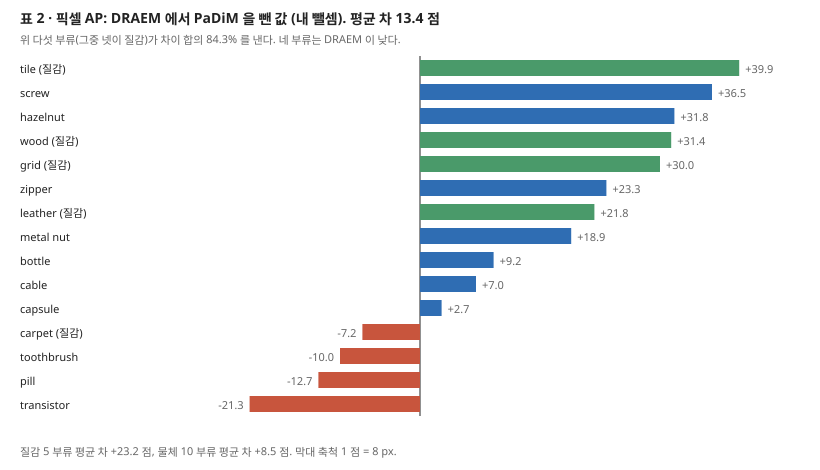

- **AP 차는 몇 부류에 몰려 있다(내 셈).** DRAEM − PaDiM 을 부류마다 빼 더하면 201.3 이고, 위 다섯(tile +39.9 · screw +36.5 · hazelnut +31.8 · wood +31.4 · grid +30.0)이 그 84.3% 를 낸다. 다섯 중 넷이 질감이다. 질감 평균 차 +23.2, 물체 평균 차 +8.5 다. **6절의 검출과 방향이 반대다** — 검출의 몫은 물체 쪽, AP 의 몫은 질감 쪽이다.
- **AP 를 쓴 까닭은 맞는 말이다.** 결함 픽셀이 드물면 거짓 양성률의 분모가 커서 AUROC 가 거짓 경보를 덜 드러낸다(1절 용어의 예시). 다만 **이 편은 PRO 를 내지 않아**, PRO 를 성적표로 쓰는 PaDiM · PatchCore 원 논문 값과 맞대지 못한다.
- **그림 6 의 pill 은 「정답 마스크가 부정확하다」 의 예시 하나다.** 정답이 알약 표면 전체를 덮는데 결함은 노란 점이라는 것이다. 그런 마스크가 몇 장인지, AP 를 얼마나 깎는지는 재지 않았다. pill 은 AP 가 PaDiM 보다 12.7 낮은 부류다.

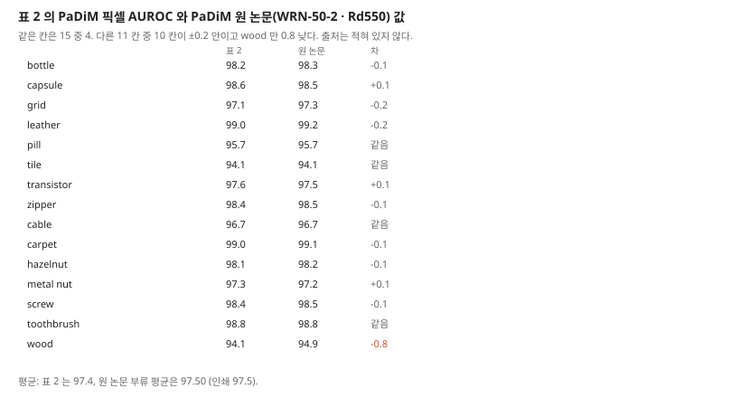

**표 2 의 PaDiM 픽셀 AUROC 는 PaDiM 원 논문 값과 15 칸 중 4 칸만 같다(내 대조).** 10 칸은 ±0.2 안이고 wood 는 94.1 대 94.9 로 0.8 낮다. 평균은 97.4 대 97.5 다. 원 논문은 AP 를 내지 않았으니 AP 열은 저자들이 셌을 것이고, 픽셀 AUROC 도 같은 실행에서 나온 값으로 읽힌다(내 해석, 적혀 있지 않다).

---

## 8. 끈 실험 — 표 3 · 그림 9 · 그림 10

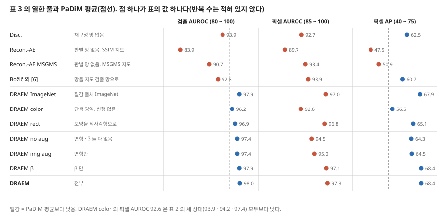

| 줄 | 바꾼 것 | 검출 | 픽셀 AUROC | 픽셀 AP | DRAEM 과의 차 (내 뺄셈) |
|---|---|---:|---:|---:|---|
| Disc. | 재구성 망 없음 | 93.9 | 92.7 | 62.5 | −4.1 · −4.6 · −5.9 |
| Recon.-AE | 판별 망 없음, SSIM 으로 지도 | 83.9 | 89.7 | 47.5 | −14.1 · −7.6 · −20.9 |
| Recon.-AE MSGMS | 판별 망 없음, MSGMS 로 지도 | 90.7 | 93.4 | 50.9 | −7.3 · −3.9 · −17.5 |
| Božič 외 [6] | 망 전체를 지도 결함 검출 망으로 | 92.8 | 93.9 | 60.7 | −5.2 · −3.4 · −7.7 |
| DRAEM ImageNet | 질감 출처 ImageNet | 97.9 | 97.0 | 67.9 | −0.1 · −0.3 · −0.5 |
| DRAEM color | 단색 영역(질감 변형 없음) | 96.2 | 92.6 | 56.5 | −1.8 · −4.7 · −11.9 |
| DRAEM rect | 모양을 직사각형으로 | 96.9 | 96.8 | 65.1 | −1.1 · −0.5 · −3.3 |
| DRAEM no aug | 질감 변형 · β 둘 다 없음 | 97.4 | 94.5 | 64.3 | −0.6 · −2.8 · −4.1 |
| DRAEM img aug | 질감 변형만 | 97.4 | 95.0 | 64.5 | −0.6 · −2.3 · −3.9 |
| DRAEM β | β 만 | 97.9 | 97.1 | 68.4 | −0.1 · −0.2 · 0.0 |
| **DRAEM** | 전부 | **98.0** | **97.3** | **68.4** | |

**짚을 자리 여섯.**

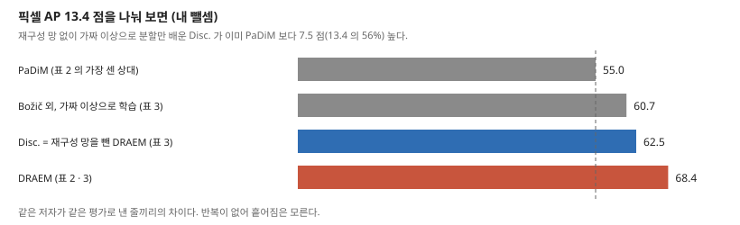

1. **재구성 망을 뺀 줄도 표 2 의 모든 상대보다 AP 가 높다.** Disc. 62.5 와 Božič 외 60.7 이 PaDiM 55.0 보다 높다. 곧 AP 차 13.4 점 중 7.5 점(56%)은 「가짜 이상으로 분할 망을 배운다」 는 데서 이미 나온다(내 뺄셈). 원문 1절과 그림 2 는 이 계열이 「가짜에 과적합해 실제로 일반화하지 못한다」 고 적는데, 이 표의 Disc. 는 이미지 AUROC 93.9 로 US · RIAD 보다 높고 MAD · PaDiM 보다 낮다. **과적합은 원문이 Disc. 의 4.1 · 4.6 · 5.9 점 하락에 붙인 설명이고, 가짜와 실제 사이의 틈을 잰 값은 없다.**
2. **「합쳐 배운다(joint)」 의 몫은 갈리지 않았다.** Disc. 는 재구성 망이 없고 Recon.-AE 는 판별 망이 없다. 따로 배운 재구성 망 위에 판별 망을 얹은 줄(두 단계 학습)이 없어, 이득이 「재구성을 입력에 더한 것」 에서 오는지 「함께 배운 것」 에서 오는지 표가 가르지 못한다.
3. **Recon.-AE 를 AE-SSIM 과 견준 근거가 표에 없다.** 원문은 「Recon.-AE 가 AE-SSIM 을 넘는다(Table 2 참조)」 라 적지만 표 2 의 열은 US · RIAD · PaDiM · DRAEM 이고 AE-SSIM 이 없다. 표 1 에도 없다(12절).
4. **단색 줄의 「여전히 최고 수준」 은 지표 둘에서만 맞다.** 검출 96.2 는 PaDiM 95.5 보다 0.7, AP 56.5 는 55.0 보다 1.5 높다. **픽셀 AUROC 92.6 은 표 2 의 세 상대(93.9 · 94.2 · 97.4) 모두보다 낮다.** 또 이 줄은 질감 출처와 함께 질감 변형도 빠져 있어(체크 표시) 바뀐 것이 둘이다.
5. **같은 크기의 하락에 다른 말을 붙인다.** 직사각형 줄의 AP −3.3 은 「only a slight performance drop」, 변형 없는 줄의 AP −4.1 은 「significant localization performance gap」 이다. 픽셀 AUROC 로는 −0.5 대 −2.8 로 갈리니, 원문의 「significant」 는 픽셀 AUROC 쪽 차이를 가리킨 말로 읽을 수 있다. 판정 규칙은 적혀 있지 않다.
6. **표 3 캡션의 묶음 수가 본문과 다르다.** 캡션은 (i) ~ (v) 다섯, 4.2절 본문은 (i) ~ (iii) 셋, 쪽 이미지의 음영은 넷(첫 넷 · 다음 셋 · 다음 셋 · DRAEM)이다.

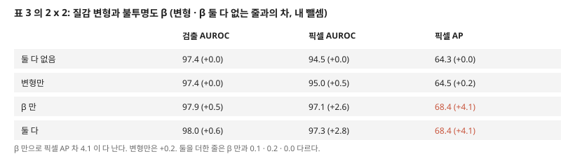

**질감 변형과 β 는 2 x 2 로 갈려 있다.** β 만 넣으면 AP 차 4.1 이 다 나고(+4.1), 변형만 넣으면 +0.2 다. 둘 다 넣은 DRAEM 은 β 만인 줄과 0.1 · 0.2 · 0.0 다르다. 원문 결론 「β 로 틈이 좁혀진다」 와 맞다. 다만 **β 위에서 변형의 몫이 0.2 점 이하이고 반복이 없어, 변형을 넣을지는 이 표로 정할 수 없다.**

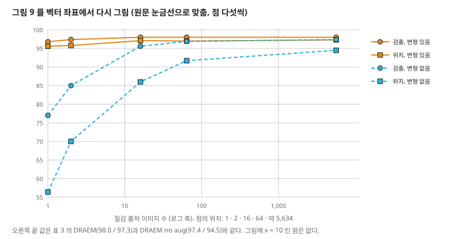

**그림 9 를 벡터 좌표로 읽었다(내 읽기. 축 5 점이 15.05 pt 라 1 pt 가 0.33 점이다).**

| 질감 이미지 수 | 1 | 2 | 16 | 64 | 5,634 |
|---|---:|---:|---:|---:|---:|
| 검출, 변형 있음 | 96.8 | 97.4 | 98.0 | 98.0 | 98.0 |
| 위치(픽셀 AUROC), 변형 있음 | 95.6 | 95.8 | 97.1 | 97.0 | 97.3 |
| 검출, 변형 없음 | 77.0 | 85.0 | 95.6 | 96.9 | 97.4 |
| 위치(픽셀 AUROC), 변형 없음 | 56.4 | 70.0 | 86.0 | 91.7 | 94.5 |

- **오른쪽 끝이 표 3 의 DRAEM(98.0 / 97.3)과 DRAEM no aug(97.4 / 94.5)와 같다.** 곧 그림의 「Augmentation」 은 **질감 변형과 β 를 함께** 켠 것이고, 「No Augmentation」 은 둘 다 끈 것이다. 범례만 보면 질감 변형 하나로 읽힌다. 이 그림으로는 둘의 몫을 가르지 못한다.
- **x 좌표는 1 · 2 · 16 · 64 · 5,634 다.** 마지막 점은 DTD 전체로 읽힌다(DTD 가 5,640 장이라는 것은 내가 아는 값이고 이 편은 장 수를 적지 않았다). **캡션의 「10 장」 에 해당하는 점은 없다.** 본문은 「10 장 미만」 이라 적는데, 10 장 미만의 점은 1 · 2 장이고 그때 위치 값은 95.6 · 95.8 로 전체보다 1.7 · 1.5 낮다.
- **이 그림에는 AP 가 없다.** 표 3 에서 변형 없는 줄의 차이는 픽셀 AUROC −2.8, AP −4.1 이었는데, 적은 질감에서의 AP 는 모른다. 부분 집합을 어떻게 골랐는지, 몇 번 돌렸는지도 적혀 있지 않다.

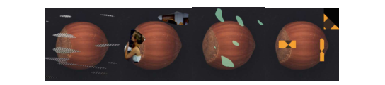

---

## 9. DAGM 과 지도 방법 — 표 4 · 보충 자료 표 1 · 그림 11

| | | AUROC | TPR | TNR | CA |
|---|---|---:|---:|---:|---:|
| 비지도 | RIAD | 78.6 | 79.2 | 69.1 | 70.4 |
| | US | 72.5 | 72.6 | 65.3 | 66.2 |
| | MAD | 82.4 | 78.7 | 85.7 | **66.2** |
| | PaDiM | 95.0 | 83.3 | 97.5 | 95.7 |
| | **DRAEM** | **99.0** | 96.5 | 99.4 | 98.5 |
| 약지도 | CADN | - | - | - | 89.1 |
| 지도 | Rački 외 | 99.6 | 99.9 | 99.5 | - |
| | Lin 외 | 99.0 | 99.4 | 99.9 | - |
| | Božič 외 | 100 | 100 | 100 | 100 |

- **「지도 방법과 대등하다」 는 AUROC 로 0 ~ 1.0 점 아래다.** Lin 외와 같고(99.0), Rački 외보다 0.6, Božič 외보다 1.0 낮다. CA 를 낸 지도 방법은 Božič 외 하나이고 100 대 98.5 다.
- **「위치는 지도 방법을 모두 넘는다」 를 받치는 수치가 없다.** 같은 4.3절이 「결함 라벨이 거칠어 위치 정확도는 재지 않는다」 고 적는다. 근거는 그림 11 의 다섯 장(Božič 외 하나와만 견줌)과 보충 자료 그림 6 · 7(부류마다 예시)이다. 초록과 결론은 이것을 「substantially outperforming」 으로 적는다. 정답이 타원이라 지도 방법이 타원을 따라 그린다는 설명은 그림과 맞지만, 정답이 거친 데이터에서 위치를 재는 방법(예: 정답 안쪽 픽셀만 세기)을 쓰지 않은 것은 **안 한 것이지 못 한 것이 아니다.**

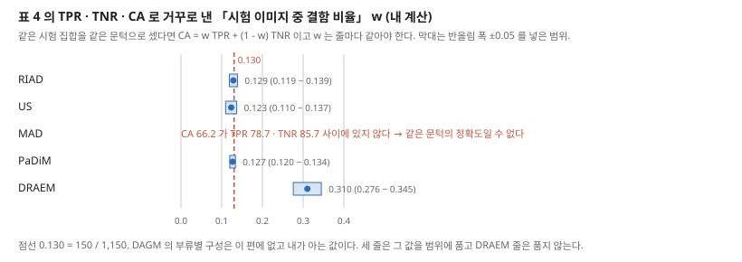

**표 4 의 숫자끼리 맞춰 봤다(내 계산).** 같은 시험 집합을 같은 문턱으로 셌다면 CA = $w \cdot$ TPR + $(1 - w) \cdot$ TNR 이고, $w$ 는 시험 이미지 중 결함 비율이라 줄마다 같아야 한다. 거꾸로 $w$ = (TNR − CA) / (TNR − TPR) 로 낸다.

| 줄 | $w$ | 반올림 폭 ±0.05 를 넣은 범위 |
|---|---:|---|
| RIAD | 0.129 | 0.119 ~ 0.139 |
| US | 0.123 | 0.110 ~ 0.137 |
| PaDiM | 0.127 | 0.120 ~ 0.134 |
| **DRAEM** | **0.310** | **0.276 ~ 0.345** |
| MAD | 낼 수 없음 | CA 66.2 가 TPR 78.7 · TNR 85.7 사이 밖 |

- **세 줄은 0.12 ~ 0.13 에 모이고 DRAEM 줄만 0.31 이다.** DAGM 의 부류별 구성(결함 150 / 전체 1,150, 뒤 네 부류는 300 / 2,300)으로 내면 0.130 이고 세 줄의 범위가 모두 이 값을 품는다. **이 구성은 이 편에 없고 내가 아는 값이다.** 이 편의 숫자만으로도 「세 줄과 DRAEM 줄이 같은 비율로 셌을 수 없다」 는 것은 나온다. DRAEM 줄에 0.1304 를 넣으면 CA 가 99.02 여야 한다.
- **MAD 의 CA 는 같은 문턱의 정확도일 수 없다.** 정확도는 TPR 과 TNR 의 가중 평균이라 둘 사이에 있어야 한다. 바로 위 US 줄의 CA 도 66.2 라, 옮겨 적기 실수로 보인다(내 해석).
- **두 어긋남 모두 이 편 안에서 원인을 가를 길이 없다.** 문턱을 어떻게 골랐는지, 비지도 상대를 누가 돌렸는지 적혀 있지 않다.

**보충 자료 표 1.** 가짜 이상으로 배운 지도 방법 둘을 MVTec 에서 쟀다. Rački 외 90.7 / 84.3, Božič 외 92.8 / 93.9(검출 / 픽셀 AUROC), DRAEM 98.0 / 97.3. Božič 외 값은 표 3 의 줄과 같다. Rački 외 줄은 본문 표 3 에 없다.

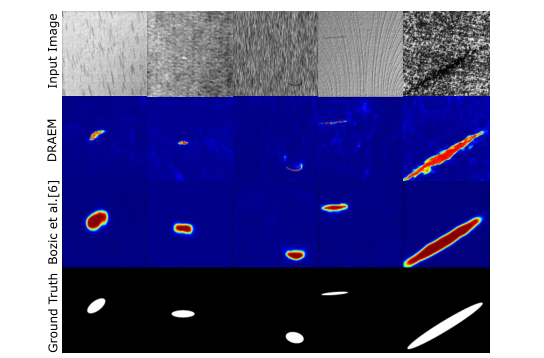

---

## 10. 실험 분석 (논문의 표 · 그림마다)

**직접 돌리지 않는다.** 논문이 낸 실험을 표 · 그림 하나씩 같은 틀로 읽는다. 「내가 센 것」 은 `make_figures.py` 와 PDF 벡터 좌표로 낸 값이다.

| 표 · 그림 | 무엇을 바꿨나 (변인) | 무엇을 고정했나 | 결과 | 반복 수 · 흩어짐 | 주장이 결과보다 센가 |
|---|---|---|---|---|---|
| **표 1** (8334쪽) | 방법 일곱 | MVTec AD 15 부류, 이미지 AUROC. 상대의 설정 · 출처는 적혀 있지 않다 | 98.0 대 PaDiM 95.5 | 적혀 있지 않다 | **세다.** 「모든 부류에서 최고」 는 6 부류에서 진다. 「15 중 9」 는 같은 값 4 를 포함한다 |
| **표 2** (8335쪽) | 방법 넷 | MVTec AD, 픽셀 AUROC · AP | AUROC 97.3 대 97.4, AP 68.4 대 55.0 | 적혀 있지 않다 | AUROC 는 「comparable」 로 맞다. AP 「11 중」 은 맞다. 결론의 13.5 는 13.4 다 |
| **표 3** (8336쪽) | 망 구성 · 질감 출처 · 모양 · 변형 · β | MVTec AD, 나머지 설정 | 8절 표 | 적혀 있지 않다 | **세다.** 단색 줄 「최고 수준」 은 픽셀 AUROC 에서 세 상대 아래다. 「slight」 −3.3 과 「significant」 −4.1 이 AP 로는 0.8 차다. 재구성 망 없이도 AP 가 상대를 넘는 것을 문장이 다루지 않는다 |
| **그림 9** (8337쪽) | 질감 이미지 수 1 ~ 5,634, 변형+β 켬 · 끔 | MVTec AD, AUROC 둘 | 8절 표 | 점마다 하나. 적혀 있지 않다 | 캡션의 「10 장」 에 점이 없다. 변형과 β 가 묶여 있다 |
| **표 4** (8337쪽) | 방법 아홉 | DAGM 10 부류, 이미지 단위 | DRAEM 99.0 대 지도 99.0 ~ 100 | 적혀 있지 않다 | **세다.** 위치의 우위는 잰 값이 없다. MAD · DRAEM 줄이 숫자끼리 맞지 않는다 |
| **보충 표 1** | 지도 방법 둘을 가짜 이상으로 학습 | MVTec AD | 90.7 · 92.8 대 98.0 | 적혀 있지 않다 | 「구조 전체가 필요하다」 는 망을 통째로 바꾼 비교라, 어느 부분이 필요한지는 가르지 않는다 |
| **그림 1 · 6 · 7 · 8 · 10 · 11, 보충 그림 1 ~ 7** | 없음(예시) | | 수치 없음 | 예시 | 그림 6 · 11 이 「정답이 부정확하다」 · 「위치가 더 낫다」 의 유일한 근거다 |
| **그림 2 · 3 · 4 · 5** | 없음(개념 · 구조 · 절차) | | 수치 없음 | 해당 없음 | 그림 2 의 「과적합」 은 그림이지 측정이 아니다 |

**문장으로만 적힌 실험적 주장.** 「이미지 분류 망을 따로 배워도 나아지지 않았다」(3.4절), 「Recon.-AE 가 AE-SSIM 을 넘는다」(4.2절, 견줄 표가 없음), 「Disc. 의 하락은 가짜에 과적합한 탓이다」(4.2절), 「SSIM 이 이상 정보를 뽑기에 최적이 아닐 수 있다」(4.2절).

---

## 11. 이 논문이 스스로 적은 한계

**한계를 이름 단 절이 없다.** 본문에서 스스로 짚은 약점은 셋이다.

1. **물체의 일부가 없는 결함이 어렵다(4.1절, 그림 6).** 없어진 자리에 흔한 배경 특징이 있어 정상과 가르기 어렵다고 적는다. 예시는 transistor 의 잘린 다리다.
2. **정답 마스크가 모호한 결함에서 오차가 생긴다(4.1절, 그림 6).** pill 의 예. 원문은 이것이 평가된 모든 방법의 AP 에 영향을 준다고 적는다.
3. **지도 방법은 MVTec 에서 평가할 수 없다(4.3절).** 그래서 지도 방법과의 비교는 DAGM 으로만 한다.

---

## 12. 원문 안의 어긋남 모음

| 자리 | 원문 | 맞대 보니 | 내 판단 |
|---|---|---|---|
| 4.1절 대 결론 | AP 「13.4 percentage points」 대 「13.5 AP points」 | 표 2 로 68.4 − 55.0 = 13.4 | 결론의 오기 |
| 4.1절 첫 문단 | 「state-of-the-art ... across all MVTec classes」 | 표 1 은 6 부류, 표 2 AP 는 4 부류에서 진다 | 같은 절 뒤 문단의 「9 out of 15」 와도 어긋난다 |
| 4.2절 | Recon.-AE 가 AE-SSIM 을 넘는다 「(see results in Table 2)」 | 표 2 · 표 1 에 AE-SSIM 이 없다 | 견줄 값이 이 편에 없다 |
| 표 3 캡션 · 4.2절 | 캡션 묶음 (i) ~ (v), 본문 (i) ~ (iii) | 음영은 넷 | 캡션 · 본문 · 표가 셋 다 다르다 |
| 표 1 평균 | PaDiM 95.5 | 부류 15 평균 95.42 | 반올림 폭 밖 0.08. UniAD 표 1 로 옮겨졌다 |
| 표 4 | MAD CA 66.2 | TPR 78.7 · TNR 85.7 사이 밖 | 같은 문턱의 정확도일 수 없다. US 줄의 66.2 를 옮겨 적은 것으로 보인다 |
| 표 4 | DRAEM TPR 96.5 · TNR 99.4 · CA 98.5 | 거꾸로 낸 결함 비율 0.31, 다른 세 줄 0.12 ~ 0.13 | 같은 시험 집합 · 같은 계산이 아니거나 한 칸이 틀렸다. 이 편으로는 가를 수 없다 |
| 초록 · 4.3절 · 결론 대 4.3절 | 「substantially outperforming them in localization accuracy」 | 같은 4.3절 「localization accuracy is not measured」 | 수치 없는 주장이 초록에 있다 |
| 그림 9 캡션 · 4.2절 | 「as low as 10」, 「less than 10」 | 점은 1 · 2 · 16 · 64 · 5,634 | 캡션의 10 에 점이 없다. 본문 말은 1 · 2 장의 점과 맞다 |
| 그림 9 범례 | 「Augmentation」 | 끝 값이 표 3 의 변형+β 줄과 같다 | 범례가 β 를 빠뜨렸다 |
| 표 3 문장 | 단색 줄 「still achieves state-of-the-art」 | 픽셀 AUROC 92.6 이 세 상대 아래 | 검출 · AP 로만 맞다 |
| 표 3 문장 | rect 「slight」, no aug 「significant」 | AP −3.3 대 −4.1 | 픽셀 AUROC(−0.5 대 −2.8)로 읽으면 맞다 |
| 식 (3) 대 3.2 · 3.4절 | 출력 마스크 $M$ | 다른 곳은 $M_o$ | 표기 어긋남 |
| 그림 3 대 3.2절 | $L_{focal}$ | 본문 $L_{seg}$ | 같은 항의 두 이름 |
| 1절 | 가짜 이상으로 분할 망을 배우면 과적합한다 [8, 21] | [8] DeepLab 계열 · [21] U-Net, 서지로 보면 분할 구조 논문 | 인용이 주장을 받치는지 서지로는 확인되지 않는다. 이 편 안의 근거는 표 3 Disc. 줄 하나다 |
| 쪽 번호 | 파일 8330-8339 | 검색에서 본 다른 서지 8310-8319 | 파일을 따른다 |

---

## 13. 논문이 적지 않은 것 — 내가 읽으며 짚은 자리

1. **재현에 필요한 설정 아홉이 없다.** 입력 크기, 묶음 크기, 최적화기, λ, 초점 손실 γ, $s_f$, 펄린 문턱 범위, 가짜 이상을 붙이는 비율, 망의 층 · 채널 수. 코드에는 있을 수 있으나 이 노트는 보지 않았다.
2. **부류마다 모델을 두는지 적혀 있지 않다.** 표의 값은 부류별로 읽히고 UniAD 도 그렇게 옮겼지만, 문장으로는 없다.
3. **흩어짐이 없다.** 표 3 의 차이 0.1 ~ 0.5(ImageNet · β 줄)는 순서를 매길 근거가 없다.
4. **PRO 가 없다.** 같은 해 비교 상대들(US · PaDiM)이 PRO 를 성적표로 쓰는데 이 편은 AP 로 바꿨다. 둘 다 내지 않아 다른 논문 값과 이어지지 않는다.
5. **속도 · 메모리가 없다.** 판별 망이 픽셀 지도를 바로 내 후처리가 없다는 것이 장점으로 적히지만, 추론 시간은 없다.
6. **회전 증강 ±45 도를 모든 부류에 쓴 것으로 읽힌다.** 예외가 적혀 있지 않다. MVTec 의 transistor 결함 종류에는 「misplaced」(제자리를 벗어남)가 있다(데이터셋 폴더 이름에서 아는 것이고 이 편에는 없다). 학습에서 돌린 정상을 보면 위치 · 방향이 바뀐 것을 정상으로 배울 수 있다. transistor 는 DRAEM 의 픽셀 AUROC 가 15 부류 중 가장 낮고(90.9) 검출은 cable 91.8 다음으로 낮다(93.1). 그것과 맞는 가설이지만, **회전을 뺀 줄이 없어 재지 않은 내 가설이다.**
7. **DAGM 의 비지도 상대를 누가 어떤 설정으로 돌렸는지, TPR · TNR · CA 의 문턱을 어떻게 골랐는지 없다.** 9절의 두 어긋남이 여기서 나온다.

---

## 14. 앞 노트와 맞춰 보기

**UniAD 노트의 물음 둘.**

- **「부류별 98.0 의 구성」.** 6절 표다. 질감 99.12 · 물체 97.41 이고, 같은 값을 포함해 9 부류에서 가장 높다. UniAD 표 1 의 부류별 칸은 이 표와 부류마다 같다. UniAD 가 US 의 부류별 값을 「DRAEM 논문에서」 가져왔다고 적은 것도 이 표 1 의 US 열(87.7)과 맞는다.
- **「통합 설정에서도 질감 칸이 99.12 로 버티는 까닭」.** **이 편에는 통합 설정 실험이 없어 답하지 못한다.** 그리고 숫자 하나를 바로잡는다. UniAD 의 통합 질감 평균 99.12 와 이 편의 부류별 질감 평균 99.12 는 같지만, **부류 값은 다르고 합만 같다**(통합 carpet 98.0 · grid 99.3 · leather 98.7 · tile 99.8 · wood 99.8, 부류별 97.0 · 99.9 · 100 · 99.6 · 99.1, 둘 다 합 495.6). 「통합에서도 질감 값이 그대로다」 가 아니라 「질감 평균이 같은 수준으로 남았다」 다. 까닭의 후보는 이것이다. 가짜 이상은 DTD 무늬를 물체 밖 배경에도 붙이므로(그림 4 · 10), 판별 망이 배우는 「재구성과 다르면 이상」 은 부류에 덜 묶인다. 이 편의 AP 이득도 질감에 몰려 있다(7절). **잰 것이 아니라 가설이다.**

**AnoDDPM 노트.** 둘 다 펄린 계열 잡음을 쓰지만 자리가 다르다. AnoDDPM 은 simplex 잡음(펄린의 개량)을 확산의 **잡음**으로 넣어 큰 결함이 지워지게 했고, DRAEM 은 펄린 잡음을 **가짜 결함의 모양**으로 쓴다. DRAEM 의 직사각형 줄은 모양을 바꿔도 검출 · 픽셀 AUROC 가 1.1 · 0.5 점 내려간다는 값이다. AP 로는 3.3 점이다.

**U-Net 노트.** 판별 망이 「U-Net 꼴」 이라고만 적혀 있다. U-Net 노트에서 원판을 31,030,658 개로 셌는데, 이 편은 폭을 적지 않아 맞대지 못한다.

**오토인코더 노트.** 표 3 의 Recon.-AE(83.9)는 재구성 계열의 약점을 같은 학습 조건에서 보인 줄이다. 같은 망에서 SSIM 을 MSGMS 로 바꾸면 +6.8 · +3.7 · +3.4, 판별 망을 더한 DRAEM 은 +14.1 · +7.6 · +20.9 다(내 뺄셈).

**PaDiM · MVTec AD 노트(`beyond-mvtec` 저장소).** 7절의 대조로, 이 편의 PaDiM 열은 원 논문 표와 15 칸 중 4 칸만 같다. MVTec 논문이 금속 너트 · 나사 · 헤이즐넛을 무작위 회전으로 찍었다고 적은 것은, 이 편의 ±45 도 회전 증강이 어떤 부류에는 데이터에 이미 있는 변화라는 뜻이다. `beyond-mvtec` 의 질문(설정 순위가 데이터셋을 바꿔도 유지되나)에 이 편이 주는 것은 없다. 끈 실험이 MVTec 하나에서만 돌았다.

---

## 15. 내가 가져갈 것

**하나. 픽셀 AUROC 와 픽셀 AP 를 함께 본다.** 표 2 에서 픽셀 AUROC 는 97.3 대 97.4 로 같은 자리인데 AP 는 68.4 대 55.0 이다. 결함 픽셀이 드문 데이터에서 AUROC 하나로 순위를 매기면 이 차이가 안 보인다. `beyond-mvtec` 에서 픽셀 AUROC · PRO 만 내고 있다면 AP 를 한 열 더 내는 것이 비용 없이 된다.

**둘. 끈 실험에서 「뺀 줄」 을 상대와도 맞대 본다.** 표 3 의 Disc. 는 DRAEM 에게 진 줄로만 읽히지만, 표 2 의 상대와 맞대면 AP 로 모두를 넘는다. 「무엇이 이득을 냈나」 는 뺀 줄을 이 편 안의 비교 상대와도 놓아야 갈린다.

**셋. 표 안의 숫자끼리 맞는지 본다.** TPR · TNR · CA 처럼 한 줄 안의 값이 식으로 묶여 있으면, 거꾸로 낸 값이 줄마다 같아야 한다. 이 편에서는 두 줄이 걸렸다. 평균 다시 내기와 같은 값싼 확인이다.

**넷. 공장 검사로 옮길 때의 조건.** 가짜 결함 만들기가 질감 출처에는 무디고(ImageNet 으로 바꾸면 AP −0.5), 모양에는 AP 로 3.3 점, 불투명도 β 에는 AP 로 4.1 점 반응한다. 모두 MVTec 에서 한 번씩 돌린 값이다. 정답 마스크가 거친 데이터(DAGM 같은)에서 위치를 잴 방법은 이 편이 주지 않는다.

**다섯. 지금 확인된 것은 여기까지다.** 논문이 잰 것은 MVTec 의 이미지 · 픽셀 AUROC · 픽셀 AP, 끈 실험 열한 줄, 질감 수 다섯 점, DAGM 이미지 단위 값이다. 논문이 말만 한 것은 과적합 설명, DAGM 위치 우위, AE-SSIM 과의 비교, 분류 망 시도다. 내가 책상에서 센 것은 평균 · 차이 · 몫 · 결함 비율 · 그림 9 좌표 · PaDiM 대조이고, 원인은 분해하지 않았다.

---

## 16. 남는 질문

- **재구성 망의 몫(4.1 · 4.6 · 5.9 점)이 seed 흩어짐보다 큰가?** 반복이 있는 후속 재현값이 필요하다.
- **함께 배우는 것과 두 단계로 배우는 것의 차이는?** 이 편에 그 줄이 없다.
- **표 4 의 DRAEM 줄과 MAD 줄은 어느 칸이 맞나?** 코드나 DAGM 을 다시 잰 후속 편이 필요하다.
- **DRAEM 의 PRO 는 얼마인가?** 다음 칸 Reverse Distillation 이 DRAEM 을 어떤 값으로, 어디서 옮겨 적는지 본다.
- **회전 증강이 transistor 를 깎았나?** 회전을 뺀 실행이 필요하다. 이 큰 틀 안에서는 답이 나오지 않을 것이다.
- **통합 설정에서 질감이 버티는 까닭은?** 14절의 가설을 재려면 DRAEM 을 통합 설정에서 질감 출처만 바꿔 돌린 값이 필요하다.

> 2026-11-11: Reverse Distillation 을 읽었다(노트 `CVPR22_RD`). 세 가지가 이 절에 닿는다.
> - **「DRAEM 의 PRO」 는 풀리지 않았다.** 그 편은 DRAEM 을 표에도 참고 문헌에도 넣지 않았다. 두 편의 표를 맞대면 이미지 AUROC 는 RD 가 0.48, 픽셀 AUROC 는 0.50 높고(부류 평균), 세 번째 지표는 DRAEM 이 AP, RD 가 PRO 라 이어지지 않는다. SimpleNet · EfficientAD 에서 다시 찾는다.
> - **그 편 표 1 의 PaDiM · US 부류별 열은 이 노트 6절 표 1 의 두 열과 30 칸이 모두 같다.** 이 편이 「our implementation」 이라 적은 값이고, PaDiM 평균의 95.5(부류 평균 95.42)도 함께 있다.
> - **회전 가설(13절 6)과 맞지 않는 값이 하나 나왔다.** RD 는 증강을 적지 않았는데 transistor 가 역시 가장 낮은 부류다(픽셀 AUROC 92.5, 이 편 90.9, 같은 표의 PaDiM 97.5). transistor 의 약점은 회전 증강 없이도 나온다. 회전이 깎았는지는 여전히 재지 않았지만, 회전 하나로 설명하는 것은 이 값과 맞지 않는다. RD 원문은 정답 마스크가 원래 자리까지 덮는 것과 수용장을 원인으로 든다.

---

## 17. 다음에 읽을 것

**이 큰 틀(DRAEM → Reverse Distillation → SimpleNet → EfficientAD)의 다음 칸은 Reverse Distillation(CVPR 2022)이다.** 아래는 이 노트 안에서 나온 후속 편이다.

> 2026-11-11: Reverse Distillation 을 읽었다(노트 `CVPR22_RD`). 이 큰 틀의 다음 칸은 SimpleNet 이다.

| 논문 | 이 노트의 어느 자리에서 나오는가 | 무엇을 확인하고 싶은가 | 원문 참고 문헌 |
|---|---|---|---|
| **AE-SSIM** — Improving unsupervised defect segmentation by applying structural similarity to autoencoders (Bergmann 외, 원문 표기 2018) | 8절 3 · 12절 | Recon.-AE 와 견준다는 값 | [5] |
| **RIAD** — Reconstruction by inpainting for visual anomaly detection (Zavrtanik 외, Pattern Recognition 2020) | 6 · 7 · 8절 | 같은 저자의 앞 편, MSGMS 의 정의 | [31] |
| **Božič 외** — End-to-end training of a two-stage neural network for defect detection (ICPR 2020) | 8 · 9절 | 표 3 에서 망을 바꾼 줄, DAGM 100 의 조건 | [6] |
| **Focal Loss** — Focal loss for dense object detection (Lin 외, ICCV 2017) | 4절 ③ | γ 와 왜 어려운 픽셀에 무게를 주는가 | [14] |
| **DTD** — Describing textures in the wild (Cimpoi 외, CVPR 2014) | 8절 | 질감 출처의 장 수 · 구성 | [9] |
| **An image synthesizer** (Perlin, SIGGRAPH 1985) | 4절 ① · 14절 | 모양 생성기의 원 출처. AnoDDPM 노트의 Perlin 2002 와 나란히 | [18] |
| **DAGM 2007** (Wieler · Hahn) | 9절 | 시험 집합의 결함 비율을 원 출처로 확인 | [28] |
| **MAD** — Modeling the distribution of normal data in pre-trained deep features (Rippel 외, ICPR 2020) | 6 · 9절 | 표 1 · 4 의 상대 | [20] |

---

## 18. 참고 문헌

- [3] Bergmann, P. 외 (2019). MVTec AD. CVPR. — `beyond-mvtec` 저장소에서 2026-11-03 에 읽었다.
- [4] Bergmann, P. 외 (2020). Uninformed students. CVPR. — `beyond-mvtec` 저장소에서 2026-11-03 에 읽었다.
- [5] Bergmann, P. 외 (2018). Improving unsupervised defect segmentation by applying structural similarity to autoencoders. 14th International Joint Conference on Computer Vision, Imaging and Computer Graphics Theory and Applications, 372-380쪽(원문 표기). — **읽지 않았다.**
- [6] Božič, J. 외 (2020). End-to-end training of a two-stage neural network for defect detection. ICPR. — **읽지 않았다.**
- [8] Chen, L.-C. 외 (2017). Rethinking atrous convolution for semantic image segmentation. arXiv:1706.05587. — **읽지 않았다.**
- [9] Cimpoi, M. 외 (2014). Describing textures in the wild. CVPR. — **읽지 않았다.**
- [11] Defard, T. 외 (2020). PaDiM. ICPR Workshops. — `beyond-mvtec` 저장소에서 2026-11-03 에 읽었다.
- [14] Lin, T.-Y. 외 (2017). Focal loss for dense object detection. ICCV. — **읽지 않았다.**
- [18] Perlin, K. (1985). An image synthesizer. SIGGRAPH. — **읽지 않았다.**
- [19] Rački, D. 외 (2018). A compact convolutional neural network for textured surface anomaly detection. WACV. — **읽지 않았다.**
- [20] Rippel, O. 외 (2020). Modeling the distribution of normal data in pre-trained deep features for anomaly detection. ICPR. — **읽지 않았다.**
- [21] Ronneberger, O. 외 (2015). U-Net. MICCAI. — 2026-11-08 에 읽었다.
- [27] Wang, Z. 외 (2004). Image quality assessment: from error visibility to structural similarity. IEEE TIP. — SSIM. **읽지 않았다.**
- [28] Wieler, M., Hahn, T. (2007). Weakly supervised learning for industrial optical inspection. — DAGM. **읽지 않았다.**
- [31] Zavrtanik, V. 외 (2020). Reconstruction by inpainting for visual anomaly detection. Pattern Recognition. — RIAD. **읽지 않았다.**
- [32] Zhang, J. 외 (2021). CADN. Pattern Recognition. — **읽지 않았다.**

---

## 19. 경로

| 무엇 | 어디 |
|---|---|
| 원문 PDF (CVF 게재판, 10 쪽) | `papers/ICCV21_DRAEM_A_Discriminatively_Trained_Reconstruction_Embedding_for_Surface_Anomaly_Detection.pdf` |
| 보충 자료 PDF (8 쪽) | `papers/ICCV21_DRAEM_A_Discriminatively_Trained_Reconstruction_Embedding_for_Surface_Anomaly_Detection_Supplemental.pdf` |
| 이 노트 | `notes/ICCV21_DRAEM_A_Discriminatively_Trained_Reconstruction_Embedding_for_Surface_Anomaly_Detection.md` |
| 이 노트의 그림 (직접 그린 것) | `figures/ICCV21_DRAEM/fig01_tab1_margin.svg` 부터 `fig09_lineage.svg` 까지 아홉 |
| 이 노트의 그림 (원문에서 잘라 낸 것) | `figures/ICCV21_DRAEM/paper_fig2_concept.png` · `paper_fig3_architecture.png` · `paper_fig4_simulation.png` · `paper_fig10_variants.png` · `paper_fig11_dagm.png` |
| 그림과 다시 계산한 값을 만드는 코드 | `figures/ICCV21_DRAEM/make_figures.py` — 바깥 데이터를 읽지 않으므로 `python make_figures.py` 로 어디서나 다시 만든다(표준 라이브러리만). 평균 · 차 · 몫 · 결함 비율 · 그림 9 값을 찍는다 |
| 원문 그림을 잘라 내는 코드 | `figures/ICCV21_DRAEM/crop_paper_figures.py` — PyMuPDF 가 필요하다 |
