# 주의(attention) 디코더 — Neural Machine Translation by Jointly Learning to Align and Translate (ICLR 2015, arXiv v6, 요약)

> **한 줄.** RNN 인코더-디코더는 원문 전체를 길이가 정해진 벡터 하나에 담는다. 이 편은 그 벡터 하나를 버리고, **원문 낱말마다 주석(annotation) $h_j$ 를 남긴 뒤 번역 낱말 $y_i$ 를 낼 때마다 주석들의 무게 합 $c_i$ 를 새로 만든다.** 무게 $\alpha_{ij}$ 는 디코더의 직전 상태 $s_{i-1}$ 과 주석 $h_j$ 를 작은 신경망(정렬 모델)에 넣어 낸 점수의 소프트맥스다. 주석은 양방향 RNN 이 만든다(앞 상태 1,000 + 뒤 상태 1,000). 영어 -> 프랑스어(WMT'14)에서 같은 데이터 · 같은 어휘 30,000 · 같은 학습 시간으로 견주면, 전체 시험셋 BLEU 가 RNNencdec-50 17.82 에서 RNNsearch-50 26.75 로 오르고, 문장이 길어질 때 RNNencdec 이 무너지는 곡선이 RNNsearch-50 에서는 나오지 않는다(그림 2). 원문은 이 무게를 「정렬」 이라 부르고, 정렬을 따로 가르치지 않았는데도 낱말 짝을 맞게 찾는다는 것을 그림 넷으로 보인다(그림 3).

> **이 노트에서 가장 먼저 볼 자리 셋.** (1) 요약 · 1절 · 7절이 「기존 구문 기반 시스템과 견줄 만하다」 고 적는다. 받치는 수는 **UNK 없는 문장만 남긴 열**에서 더 오래 학습한 RNNsearch-50* 의 36.15 대 Moses 35.63 한 줄이다. 전체 시험셋으로는 28.45 대 33.30 으로 4.85 아래다(13 · 20절). (2) 원문 그림 2 를 PDF 안 벡터 좌표로 읽으면, 1절의 「어느 길이에서나 나아짐을 볼 수 있다」 와 달리 가장 짧은 두 자리에서 RNNsearch-50 이 RNNencdec-50 보다 낮다(−3.04 · −1.38). 그리고 「RNNsearch-30 도 길이에 더 강하다」 는 같은 길이로 배운 RNNencdec-30 과 견줄 때만 맞는다(14절). (3) 정렬의 질을 정답 정렬과 견준 수가 없다. 그림 3 의 네 칸(한 칸은 「임의로 고른」 문장)이 전부다. 네 칸의 무게를 화소 값으로 읽어 보면 원문이 말한 자리는 수로도 맞고, 원문이 말하지 않은 자리도 있다(15절).

---

## Paper Metadata

| Item | Content |
|---|---|
| Title | Neural Machine Translation by Jointly Learning to Align and Translate |
| Authors | Dzmitry Bahdanau, KyungHyun Cho, Yoshua Bengio. 공동 1저자 · 교신 표시는 원문에 없다 |
| 소속 | Bahdanau 는 Jacobs University Bremen(독일), Cho · Bengio 는 몬트리올대(Université de Montréal). Bengio 는 CIFAR Senior Fellow 로도 적혀 있다 |
| Conference / Journal | **ICLR 2015** 학회 논문. 쪽마다 머리에 「Published as a conference paper at ICLR 2015」 가 찍혀 있다. ICLR 2015 는 따로 발표집을 내지 않아 학회판이 arXiv 에 올라간 판이다 |
| Year | 이 파일은 **arXiv:1409.0473 여섯째 판(v6)**, 첫 쪽 옆 도장이 **2015-04-24**, 파일 정보의 만든 날이 2015-04-27. 첫 판은 번호 1409 로 보아 2014-09 |
| DOI | 파일 안에 없다. arXiv:1409.0473 |
| 코드 | 각주 4 — 「구현은 https://github.com/lisa-groundhog/GroundHog 에 있다」. 저장소를 열어 보지는 않았다 |
| Stored PDF | `papers/ICLR15_Attention_Neural_Machine_Translation_by_Jointly_Learning_to_Align_and_Translate.pdf` (바탕화면에서 받은 이름은 `neural_machine.pdf`) |
| 왜 읽었는가 | 순차 데이터 갈래의 다섯째 칸(Attention). 앞 칸의 인코더-디코더는 원문 전체를 길이가 정해진 벡터 하나에 담는다. 이 편이 그 자리를 「번역 낱말마다 원문 자리마다의 상태를 다시 고른다」 로 바꾼다. 그리고 이 편의 무게 합이 다음 칸(Transformer)의 뼈대가 된다 |
| 읽은 범위 | **2026-11-04 에 15 쪽을 전부 읽었다.** 곧 요약 · 1 ~ 7절 · 식 (1) ~ (7) · 각주 1 ~ 8 · 그림 1 ~ 3 과 캡션 · 표 1 · 감사의 글 · 참고 문헌 29 건의 목록 · **부록 A(모델 구조) · B(학습 절차) · C(긴 문장 번역) 와 표 2 · 3**. 참고 문헌의 편들은 읽지 않았다 |

### 저장한 파일의 상태

- **본문 9 쪽 + 감사의 글 · 참고 문헌 2 쪽 + 부록 4 쪽(12 ~ 15 쪽)** 이다. 부록 A ~ C 가 다 들어 있다.
- **글자 층이 살아 있다.** 부록의 식은 화살표 · 물결표 · 위첨자가 글자 뽑기에서 흩어져 12 ~ 14 쪽을 그림으로 띄워 맞췄다(B.1 의 분산 「0.001²」 · 「0.01²」 도 그렇게 읽었다).
- **그림 2 는 PDF 안에 벡터(선)로 들어 있다.** 곡선 넷의 꼭짓점 60 개씩을 꺼내 PDF 좌표를 축 눈금으로 바꿨다(14절). 눈금 간격이 5 BLEU 마다 19.65 pt 라 좌표 반올림(0.01 pt)에서 오는 읽기 오차는 0.003 BLEU 이고, 이 노트는 소수 둘째 자리까지만 적는다.
- **그림 3 의 네 칸은 회색조 이미지**이고, **칸 하나가 정확히 16 x 16 화소(a) 또는 14 x 14 화소(b · c · d)** 다. 칸 안 화소 값이 모두 같아(칸마다 가장 큰 값과 가장 작은 값의 차가 0) 칸 값을 그대로 읽었다. 캡션이 「0 = 검정, 1 = 흰색」 이라 적으므로 화소 값 / 255 를 무게로 읽었고, **줄마다 무게의 합이 0.957 ~ 1.032** 로 나와 이 읽기가 맞다는 것과 읽기 오차의 크기를 함께 보인다(15절).
- **원문 그림 1 · 3 은 노트에 잘라 넣었다.** 그림 2 와 그림 3 은 꺼낸 값으로 다시 그렸다.

---

## 1. 용어

이 노트에서 쓸 이름을 먼저 정한다. 논문의 원래 용어는 괄호로 함께 적는다. 앞 칸들에서 쓴 이름(인코더-디코더, 요약 벡터 $c$, 재설정 · 갱신 게이트)은 같은 뜻으로 그대로 쓴다.

- **RNN 인코더-디코더 · RNNencdec (RNN Encoder–Decoder)**: 인코더 RNN 이 원문을 읽어 **요약 벡터 $c$ 하나**를 만들고 디코더 RNN 이 그 $c$ 에서 번역을 내는 틀. 원문 표 1 은 RNNencdec, 그림 2 · 표 2 · 표 3 은 RNNenc 라 적는다(같은 모델이다, 23절). 작은 예시로, 원문 5 낱말 문장이든 50 낱말 문장이든 이 편의 RNNencdec 은 같은 1,000 개의 수로 줄인다.
- **RNNsearch**: 이 편이 낸 모델. 원문 4.2절의 이름이다. 「-30」 · 「-50」 은 학습 문장 길이의 위 한계(30 · 50 낱말). 「-50*」 은 개발셋 성능이 멈출 때까지 더 오래 학습한 RNNsearch-50 이다.
- **주석 $h_j$ (annotation)**: 원문 $j$ 번째 낱말 자리에서 양방향 RNN 의 앞 상태와 뒤 상태를 이은 벡터(식 7). 이 편에서 2,000 개의 수다. 작은 예시로, 원문이 13 낱말이면 주석이 13 개, 수로 26,000 개가 디코더 앞에 놓인다.
- **맥락 벡터 $c_i$ (context vector)**: 번역 $i$ 번째 낱말을 낼 때 쓰는, 주석들의 무게 합(식 5). 걸음마다 다시 만든다. 앞 칸의 요약 벡터 $c$ 와 구별하려고 이 노트는 아래첨자 $i$ 를 늘 붙인다.
- **점수 $e_{ij}$ (energy) · 정렬 모델 $a$ (alignment model)**: $e_{ij} = a(s_{i-1}, h_j)$. 원문 쪽 자리 $j$ 와 번역 쪽 자리 $i$ 가 얼마나 맞는지 매긴 값. $a$ 는 숨은 층 하나짜리 앞먹임 망이다(A.1.2). 작은 예시로, 원문이 3 낱말이면 번역 낱말 하나마다 점수가 3 개 나온다.
- **무게 $\alpha_{ij}$ (weight, 원문은 alignment 라고도 부름)**: 점수 $e_{i1}, \dots, e_{iT_x}$ 의 소프트맥스(식 6). 번역 낱말 하나에 대해 합이 1 이다. 작은 예시로, 점수 1.2 · 2.5 · 0.3 이면 무게 0.197 · 0.723 · 0.080 이다(5절 그림 2).
- **부드러운 정렬 · 딱딱한 정렬 (soft · hard alignment)**: 원문 자리 여럿에 무게를 나눠 주는 것과 한 자리만 고르는 것. 이 편의 무게는 0 보다 큰 값이 모든 자리에 남는 부드러운 정렬이다. 작은 예시로, 위 무게에서 가장 작은 자리 3 도 0.080 을 받는다.
- **주의 (attention)**: 원문 3.1절 — 「직관적으로 이것은 디코더 안의 주의 메커니즘을 구현한다. 디코더가 원문의 어느 부분에 주의를 기울일지 정한다.」 이 노트에서는 **식 5 · 6 의 장치 전체**를 부르는 이름으로 쓰고, 「정렬」 은 그 무게를 원문이 해석한 말로만 쓴다.
- **양방향 RNN (bidirectional RNN, BiRNN)**: 원문을 처음부터 읽는 RNN 과 끝부터 읽는 RNN 둘. 원문 3.2절은 Schuster · Paliwal(1997)을 인용한다. 작은 예시로, 5 낱말 문장의 셋째 자리 주석은 앞 RNN 이 1 ~ 3 째를 읽은 상태와 뒤 RNN 이 5 ~ 3 째를 읽은 상태를 잇는다.
- **게이트 유닛 (gated hidden unit)**: 재설정 게이트 $r$ 과 갱신 게이트 $z$ 둘을 가진 은닉 유닛. Cho 외(EMNLP 2014)가 낸 것이고, 이 편도 「GRU」 라는 이름을 쓰지 않는다(각주 7 은 「은닉 유닛이라 하면 늘 게이트 유닛을 뜻한다」). 작은 예시로, 입력 620 · 은닉 1,000 인 층 하나의 무게가 4,860,000 개다(9절).
- **깊은 출력 · maxout**: 디코더 상태 · 직전 낱말 · 맥락 벡터를 1,000 칸으로 옮긴 뒤 두 칸씩 큰 값을 골라 500 칸으로 만들고, 거기서 소프트맥스로 낱말 확률을 낸다(A.2.2). 작은 예시로, 두 칸 값이 0.3 · −1.1 이면 0.3 이 남는다.
- **어휘 · UNK (shortlist, [UNK])**: 언어마다 가장 잦은 30,000 낱말. 나머지는 모두 기호 [UNK] 로 바꾼다(4.1절). 작은 예시로, 사람 이름이 30,000 안에 없으면 원문에서도 정답에서도 [UNK] 이 된다.
- **전체 열 · UNK 없는 열 (All · No UNK)**: 원문 표 1 의 두 열. 앞은 시험셋 3,003 문장 전부, 뒤는 **원문 문장과 정답 번역 둘 다에 어휘 밖 낱말이 없는 문장만**. 뒤 열에서는 모델이 [UNK] 를 내지 못하게 막았다. 뒤 열의 문장 수는 적혀 있지 않다.
- **Moses**: 이 편의 기준인 구문 기반 통계 번역 시스템. 원문 5.1절은 이것이 학습 데이터 밖의 단일어 말뭉치 418M 낱말을 더 쓴다고 적는다. 이 노트에서는 **기준 Moses** 라 쓴다.
- **BLEU**: 번역과 정답의 1 ~ 4 낱말 묶음이 겹치는 비율의 기하평균에 짧은 번역 벌점을 곱한 값, 0 ~ 100. 작은 예시로, 표 1 에서 기준 Moses 가 전체 열 33.30 이다. **이 편은 BLEU 를 어느 스크립트로 셌는지 적지 않는다.**
- **NLL (negative log-likelihood)**: 문장마다 정답 번역의 로그 확률에 음수를 붙인 값의 평균. 낮을수록 좋다. 원문 표 2 의 학습 · 개발 NLL. 작은 예시로, 정답 문장 확률이 $e^{-38.1}$ 이면 NLL 38.1 이다.

---

## 2. 한 문단 요약

인코더-디코더 꼴의 신경망 번역은 원문을 길이가 정해진 벡터 하나로 줄이고, 원문이 길어지면 성능이 빠르게 떨어진다는 것이 같은 저자들의 앞선 측정(Cho 외 2014b)이다(1절). 이 편은 그 벡터를 **병목**으로 「추측(conjecture)」 하고, 디코더가 번역 낱말 하나를 낼 때마다 원문의 어느 자리가 관련 있는지를 부드럽게 찾게 한다(3.1절). 인코더는 양방향 RNN 으로 원문 자리마다 주석을 만들고(3.2절), 디코더는 직전 상태와 각 주석으로 점수를 매겨 소프트맥스 무게를 내고, 그 무게로 주석을 더한 맥락 벡터를 받아 다음 낱말을 낸다(식 4 ~ 6). 무게를 내는 정렬 모델은 번역 확률을 최대화하는 학습 안에서 함께 배운다 — 정렬을 숨은 변수로 두는 통계 번역과 다르다. WMT'14 영어 -> 프랑스어(348M 낱말로 추린 병렬 말뭉치, 어휘 30,000)에서 RNNencdec 과 RNNsearch 를 30 · 50 낱말 이하 문장으로 둘씩, 각 5 일 남짓 학습했다(4절). 전체 시험셋 BLEU 는 13.93 · 17.82(RNNencdec-30 · -50) 대 21.50 · 26.75(RNNsearch-30 · -50), 더 오래 학습한 RNNsearch-50* 는 28.45 이고 기준 Moses 는 33.30 이다(표 1). UNK 없는 문장만 보면 RNNsearch-50* 36.15 가 Moses 35.63 을 넘는다. 문장 길이별 BLEU(그림 2)에서 RNNencdec 두 모델과 RNNsearch-30 은 길이 20 남짓부터 떨어지고 RNNsearch-50 은 59 까지 26 대를 지킨다. 무게를 그린 정렬 넷(그림 3)과 긴 문장 번역 예(5.2.2절 · 부록 C)가 뒤따른다.

---

## 3. 문제 — 길이가 정해진 벡터 하나 (1절 · 2절)

**배경(2절).** 번역은 원문 $\mathbf{x}$ 가 주어졌을 때 조건부 확률 $p(\mathbf{y} \mid \mathbf{x})$ 를 최대화하는 번역 $\mathbf{y}$ 를 찾는 것이다. 신경망 번역은 병렬 말뭉치로 이 조건부 분포를 직접 배운다. 원문은 Kalchbrenner · Blunsom(2013), Cho 외(2014a), Sutskever 외(2014), Cho 외(2014b), Forcada · Ñeco(1997)를 든다. 신경망 부품을 기존 시스템에 넣는 쓰임(구문표 점수 매기기 · 후보 다시 매기기)이 기존 최고 성능을 넘었다는 것도 적는다.

**막히는 자리(1절).** 인코더-디코더는 원문의 필요한 정보를 **모두 길이가 정해진 벡터 하나로 눌러 담아야** 한다. 원문 — 「이것이 긴 문장, 특히 학습 말뭉치의 문장보다 긴 문장을 다루기 어렵게 만들 수 있다(may).」 근거로 Cho 외(2014b)가 「문장이 길어지면 기본 인코더-디코더의 성능이 빠르게 떨어진다는 것을 보였다」 를 든다. **이 측정은 다른 편의 것이고 이 편 안에서는 그림 2 의 RNNencdec 곡선이 같은 모양을 다시 보인다**(14절).

**원문의 말 세기.** 요약은 「추측한다(we conjecture)」, 7절은 「Cho 외(2014b) · Pouget-Abadie 외(2014)의 실험 연구에 기대어 추측했다」 로 적는다. 곧 병목이라는 진단은 가설로 출발했고, 이 편이 그 가설을 시험하는 방식은 **병목을 없앤 모델이 긴 문장에서 덜 떨어지는가**(그림 2)다.

**각주 2.** 앞선 편들(Cho 외 2014a, Sutskever 외 2014, Kalchbrenner · Blunsom 2013)이 원문을 길이가 정해진 벡터로 담았지만 「그럴 필요가 없고, 길이가 변하는 벡터가 이로울 수 있다는 것을 뒤에서 보인다」.

---

## 4. 인코더-디코더 다시 보기 (2.1절)

인코더가 입력 $\mathbf{x} = (x_1, \dots, x_{T_x})$ 를 읽어 벡터 $c$ 하나를 만든다.

$$h_t = f(x_t, h_{t-1}), \qquad c = q\left(\{h_1, \dots, h_{T_x}\}\right) \qquad (1)$$

$f$ 와 $q$ 는 비선형 함수다. 예로 Sutskever 외는 $f$ 에 LSTM 을, $q(\{h_1, \dots, h_T\}) = h_T$ 를 썼다.

디코더는 $c$ 와 앞서 낸 낱말들로 다음 낱말을 맞히도록 학습되고, 번역 전체의 확률을 차례 조건부 확률로 나눈다.

$$p(\mathbf{y}) = \prod_{t=1}^{T} p\left(y_t \mid \{y_1, \dots, y_{t-1}\}, c\right) \qquad (2)$$

RNN 으로는 각 조건부 확률을

$$p\left(y_t \mid \{y_1, \dots, y_{t-1}\}, c\right) = g(y_{t-1}, s_t, c) \qquad (3)$$

로 둔다. $g$ 는 여러 층일 수 있는 비선형 함수, $s_t$ 는 디코더 RNN 의 은닉 상태다.

> 식 (3) 의 $c$ 는 **번역 낱말 $t$ 와 상관없이 같은 값**이다. 이 편이 바꾸는 것은 이 한 글자다 — 식 (4) 에서 $c$ 가 $c_i$ 가 된다.

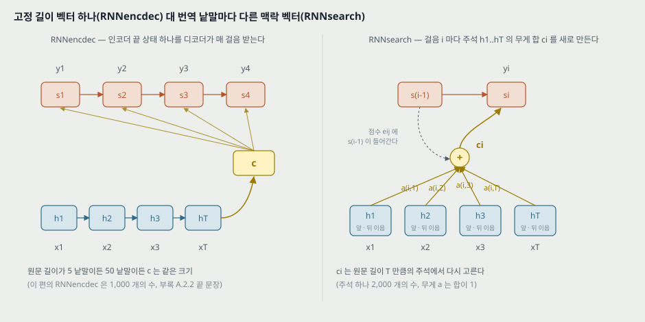

---

## 5. 디코더 — 번역 낱말마다 다른 맥락 벡터 (3.1절)

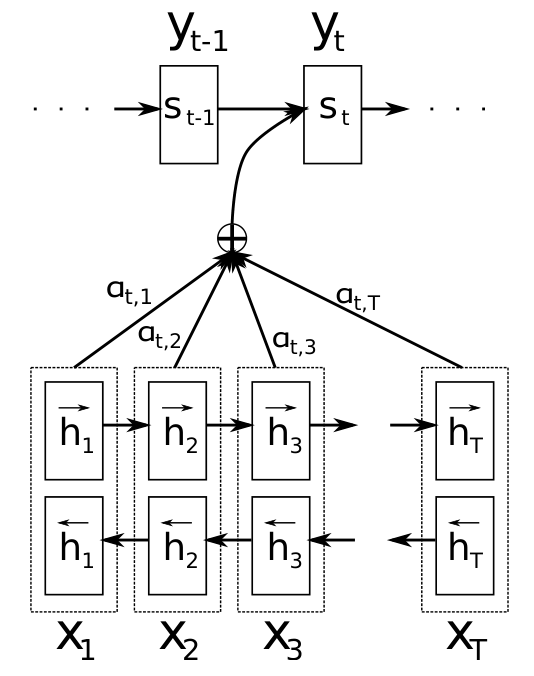

*원문 그림 1 을 잘라 넣은 것(3 쪽). 원문 $(x_1, \dots, x_T)$ 를 받아 번역 $t$ 번째 낱말 $y_t$ 를 내는 장면. 그림은 아래첨자로 $t$ 를 쓰고 본문은 $i$ 를 쓴다(22절).*

**새 조건부 확률.**

$$p(y_i \mid y_1, \dots, y_{i-1}, \mathbf{x}) = g(y_{i-1}, s_i, c_i), \qquad s_i = f(s_{i-1}, y_{i-1}, c_i) \qquad (4)$$

**맥락 벡터는 주석의 무게 합이다.**

$$c_i = \sum_{j=1}^{T_x} \alpha_{ij} h_j \qquad (5)$$

**무게는 점수의 소프트맥스다.**

$$\alpha_{ij} = \frac{\exp(e_{ij})}{\sum_{k=1}^{T_x} \exp(e_{ik})}, \qquad e_{ij} = a(s_{i-1}, h_j) \qquad (6)$$

점수는 번역 낱말 $y_i$ 를 내기 **직전**의 디코더 상태 $s_{i-1}$ 과 원문 $j$ 번째 주석 $h_j$ 로 매긴다.

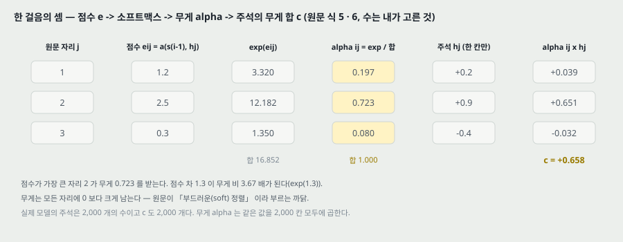

**작은 예(내가 고른 수).** 원문 3 낱말, 점수 $e = (1.2, 2.5, 0.3)$ 이면 $\exp$ 가 3.320 · 12.182 · 1.350, 합 16.852 라 무게가 **0.197 · 0.723 · 0.080** 이다. 주석을 한 칸씩만 보아 $h = (0.2, 0.9, -0.4)$ 라 두면 $c = 0.039 + 0.651 - 0.032 = 0.658$ 이다. 점수 차 1.3 이 무게 비 3.67 배가 되고($e^{1.3}$), 무게는 모든 자리에 0 보다 크게 남는다.

**원문의 두 해석.**

1. **기대 주석(expected annotation).** $\alpha_{ij}$ 를 「번역 낱말 $y_i$ 가 원문 낱말 $x_j$ 와 정렬된(에서 번역된) 확률」 로 읽으면, $c_i$ 는 가능한 정렬 위의 기대 주석이다.
2. **정렬이 숨은 변수가 아니다.** 전통적인 통계 번역은 정렬을 숨은 변수로 두는데, 이 편의 정렬 모델은 부드러운 정렬을 바로 계산하므로 비용 함수의 기울기가 그 안으로 흘러, **정렬 모델과 번역 모델 전체를 함께 배운다.**

**원문이 세운 효과.** 「디코더에 주의 메커니즘을 줌으로써 인코더가 원문의 모든 정보를 길이가 정해진 벡터 하나에 담는 짐을 덜어 준다. 정보가 주석들의 열에 퍼질 수 있고 디코더가 골라서 꺼낸다.」 — 이 문장이 이 편의 가설 전체다. 시험은 그림 2(긴 문장)와 그림 3(무게가 낱말 짝에 모이는가)이다.

> **맥락 벡터의 크기는 원문 길이에 따라 변하지 않는다.** $c_i$ 는 늘 2,000 개의 수다. 바뀐 것은 **걸음마다 다른 $c_i$ 를 만든다**는 것, 그리고 디코더가 원문 길이 $T_x$ 만큼의 주석 전체를 걸음마다 다시 본다는 것이다. 각주 2 의 「길이가 변하는 벡터」 는 $c_i$ 가 아니라 **주석의 열 $(h_1, \dots, h_{T_x})$** 이다.

---

## 6. 정렬 모델 $a$ (A.1.2 · A.2.2)

정렬 모델은 문장 쌍마다 $T_x \times T_y$ 번 계산해야 하므로, 계산을 줄이려 숨은 층 하나짜리 다층 퍼셉트론을 쓴다.

$$a(s_{i-1}, h_j) = v_a^\top \tanh\left(W_a s_{i-1} + U_a h_j\right)$$

$W_a \in \mathbb{R}^{n' \times n}$, $U_a \in \mathbb{R}^{n' \times 2n}$, $v_a \in \mathbb{R}^{n'}$, $n' = 1{,}000$. **$U_a h_j$ 는 $i$ 와 상관없으므로 문장마다 한 번 미리 계산한다**(원문의 말).

- 시작값: $W_a$ · $U_a$ 는 평균 0 · 분산 $0.001^2$ 가우스, $v_a$ 는 0(B.1). 곧 **학습을 시작할 때 모든 점수가 0 이라 무게가 고르게 $1/T_x$** 다(내가 읽은 것 — $v_a = 0$ 이면 $e_{ij} = 0$).
- 원문 A.1.2 는 이 꼴을 쓴 까닭으로 계산만 든다. **다른 꼴(예: 내적)과 견준 실험은 없다.**

---

## 7. 인코더 — 양방향 RNN (3.2절 · A.2.1)

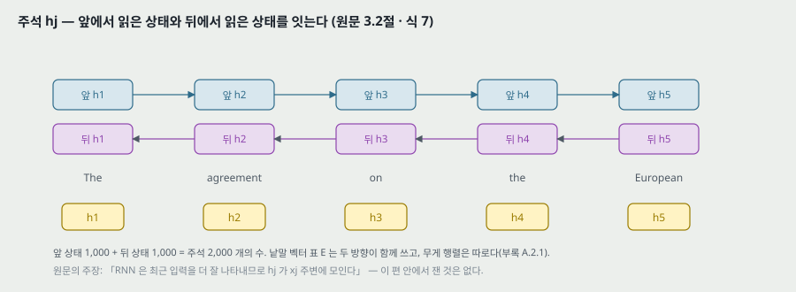

**왜 양방향인가(원문).** 낱말마다의 주석이 앞 낱말들뿐 아니라 뒤 낱말들도 요약하게 하려고. 앞 RNN $\overrightarrow{f}$ 는 $x_1$ 부터 $x_{T_x}$ 까지 읽어 $(\overrightarrow{h}_1, \dots, \overrightarrow{h}_{T_x})$ 를, 뒤 RNN $\overleftarrow{f}$ 는 거꾸로 읽어 $(\overleftarrow{h}_1, \dots, \overleftarrow{h}_{T_x})$ 를 낸다.

$$h_j = \begin{bmatrix} \overrightarrow{h}_j \\ \overleftarrow{h}_j \end{bmatrix} \qquad (7)$$

- 낱말 벡터 표 $E$ 는 두 방향이 함께 쓰고, 무게 행렬은 방향마다 따로다(A.2.1).
- 원문의 주장 — 「RNN 은 최근 입력을 더 잘 나타내는 경향이 있어 주석 $h_j$ 가 $x_j$ 주변 낱말에 모인다.」 **이 편 안에서 이것을 잰 수는 없다.** 그림 3 의 무게가 대각선에 모인다는 것은 이 주장과 맞는 관찰이지만, 주석이 $x_j$ 주변을 담는지와 정렬 모델이 $x_j$ 자리를 고르는지는 다른 물음이다.

**디코더의 첫 상태.** $s_0 = \tanh\left(W_s \overleftarrow{h}_1\right)$ (A.2.2). $\overleftarrow{h}_1$ 은 원문을 끝에서 처음까지 다 읽은 뒤 RNN 의 상태다. 곧 **RNNsearch 의 디코더도 출발할 때는 원문 전체를 길이가 정해진 벡터 하나(1,000 개)로 줄인 것에서 시작한다**(내가 읽은 것). 원문은 이 점을 말하지 않는다.

---

## 8. 게이트 유닛과 깊은 출력 (A.1.1 · A.2.2)

**게이트 유닛(디코더 꼴, A.2.2).** 원문 그대로 옮긴다(치우침은 원문이 생략했다).

$$s_i = (1 - z_i) \circ s_{i-1} + z_i \circ \tilde{s}_i$$

$$\tilde{s}_i = \tanh\left(E y_i + U [r_i \circ s_{i-1}] + C c_i\right)$$

$$z_i = \sigma\left(W_z E y_i + U_z s_{i-1} + C_z c_i\right), \qquad r_i = \sigma\left(W_r E y_i + U_r s_{i-1} + C_r c_i\right)$$

$W, W_z, W_r \in \mathbb{R}^{n \times m}$, $U, U_z, U_r \in \mathbb{R}^{n \times n}$, $C, C_z, C_r \in \mathbb{R}^{n \times 2n}$. 인코더는 같은 꼴에서 $c_i$ 쪽을 뺀 것이다(각주 8).

> **원문 식 둘이 어긋난다.** (가) $\tilde{s}_i$ 줄에 $W$ 가 빠져 있다 — $E y_i$ 는 $m = 620$ 개의 수이고 $U[\cdot]$ 는 $n = 1{,}000$ 개라 그대로 더할 수 없다. $W$ 는 바로 아래 크기 목록에 있고, 같은 절의 $z_i$ · $r_i$ 줄과 인코더의 $\tilde{h}$ 줄은 $W E$ 꼴이다. $W E y_i$ 로 읽는다. (나) 디코더 입력이 식 (4) 와 A.1.1 의 설명 문장에서는 직전 낱말 $y_{i-1}$ 인데, A.1.1 · A.2.2 의 식에는 $y_i$ 로 찍혀 있다. 식 (4) 를 따라 $y_{i-1}$ 로 읽는다(24절).

**원문의 게이트 해석(A.1.1).** 갱신 게이트는 은닉 유닛이 이전 활성을 지키게 하고, 재설정 게이트는 이전 상태의 무엇을 얼마나 버릴지 정한다. 이 유닛은 LSTM 처럼 「펼친 RNN 안에 미분의 곱이 1 에 가까운 계산 경로」 를 둬 기울기 소실을 덜 겪는다고 적고(Hochreiter 1991, Bengio 외 1994, Pascanu 외 2013a 인용), **LSTM 을 대신 써도 된다**고 적는다. 이 편은 LSTM 으로 돌린 결과를 내지 않는다.

**깊은 출력(A.2.2).** 직전 상태 · 직전 낱말 · 맥락 벡터를 $2l = 1{,}000$ 칸으로 옮긴 뒤 두 칸씩 큰 값을 골라 $l = 500$ 칸으로 만든다.

$$\tilde{t}_i = U_o s_{i-1} + V_o E y_{i-1} + C_o c_i, \qquad t_i = \left[\max\{\tilde{t}_{i,2j-1}, \tilde{t}_{i,2j}\}\right]_{j=1,\dots,l}^\top, \qquad p(y_i \mid s_i, y_{i-1}, c_i) \propto \exp\left(y_i^\top W_o t_i\right)$$

$W_o \in \mathbb{R}^{K_y \times l}$, $U_o \in \mathbb{R}^{2l \times n}$, $V_o \in \mathbb{R}^{2l \times m}$, $C_o \in \mathbb{R}^{2l \times 2n}$.

> 여기서도 조건에 $s_i$ 를 적고 셈에는 $s_{i-1}$ 을 쓴다. 식 (4) 는 $g(y_{i-1}, s_i, c_i)$ 다(24절).

**원문 끝 문장(A.2.2).** 「$c_i$ 를 $\overrightarrow{h}_{T_x}$ 로 고정하면 이 모델은 RNN 인코더-디코더가 된다.」 — 실험의 RNNencdec 이 이렇게 만든 것인지, Cho 외(2014a)의 구현인지는 적혀 있지 않다.

---

## 9. 파라미터 수 — 내가 센 것 (A.2.3)

크기(A.2.3): 은닉 $n = 1{,}000$, 낱말 벡터 $m = 620$, maxout 층 $l = 500$, 정렬 모델 $n' = 1{,}000$. 어휘는 언어마다 30,000 으로 셌다([UNK] · 끝 기호를 더하면 낱말 하나마다 원문 쪽 620, 번역 쪽 1,121 이 는다).

| 부분 | 셈 | 무게 수 |
|---|---|---:|
| 원문 낱말 표 $E$ | 620 × 30,000 | 18,600,000 |
| 앞 RNN | 3 × 1,000 × 620 + 3 × 1,000 × 1,000 | 4,860,000 |
| 뒤 RNN | 같음 | 4,860,000 |
| 번역 낱말 표 | 620 × 30,000 | 18,600,000 |
| 디코더 RNN | 3 × 1,000 × 620 + 3 × 1,000² + 3 × 1,000 × 2,000 | 10,860,000 |
| 첫 상태 $W_s$ | 1,000 × 1,000 | 1,000,000 |
| 정렬 모델 $W_a$ · $U_a$ · $v_a$ | 1,000² + 1,000 × 2,000 + 1,000 | 3,001,000 |
| 깊은 출력 $U_o$ · $V_o$ · $C_o$ | 1,000 × 1,000 + 1,000 × 620 + 1,000 × 2,000 | 3,620,000 |
| 소프트맥스 $W_o$ | 30,000 × 500 | 15,000,000 |
| **합 (무게)** | | **80,401,000** |

치우침(B.1 이 「모든 치우침 벡터」 를 0 으로 시작했다고 적으므로 있다)을 RNN 셋 9,000 · 첫 상태 1,000 · 정렬 1,000 · maxout 1,000 · 소프트맥스 30,000 으로 넣으면 80,443,000 이다. 어느 쪽이든 **80.4M** 이다.

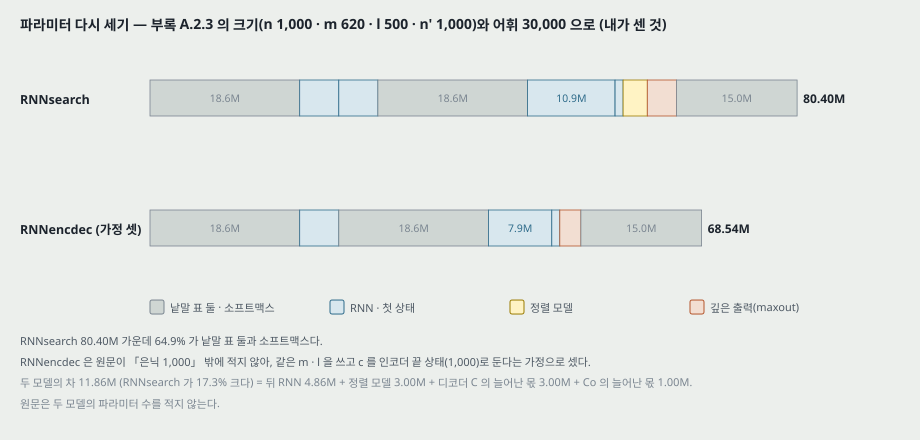

**이 셈이 보여 주는 것.**

- **80.4M 가운데 52.2M (64.9%) 이 낱말 표 둘과 소프트맥스**다. 주의 장치 자체(정렬 모델)는 3.0M (3.7%) 이다.
- **RNNencdec 과 같은 크기가 아니다.** 원문은 RNNencdec 의 크기를 「인코더 · 디코더 은닉 1,000 씩」 으로만 적는다. 같은 $m$ · $l$ · 어휘를 쓰고 $c$ 를 인코더 끝 상태(1,000 개)로 둔다는 **가정 셋**으로 세면 68.54M 이다. 차이 11.86M (RNNsearch 가 17.3% 크다) = 뒤 RNN 4.86M + 정렬 모델 3.00M + 디코더 $C$ 셋이 $n \times 2n$ 이 되며 는 3.00M + $C_o$ 가 는 1.00M. **원문은 두 모델의 파라미터 수를 적지 않고, 크기를 맞춘 비교도 없다.** 그래서 표 1 의 차이 가운데 「주의 장치」 의 몫과 「파라미터가 17% 많은」 몫을 이 편으로는 가를 수 없다.
- 크기 감각: 같은 해의 Sutskever 외 모델은 384M(그 편의 수)이라 이 편의 4.8 배다.

---

## 10. 계산 비용 — $T_x \times T_y$ (A.1.2 · 6.1절)

원문 6.1절 — 「이 방식은 번역 낱말마다 원문 모든 낱말의 무게를 계산해야 한다. 번역 문장이 대개 15 ~ 40 낱말이라 번역에서는 이 단점이 심하지 않지만, 다른 과제로 쓰는 것을 막을 수 있다.」

**곱셈-덧셈으로 센 몫(내가 센 것).** 원문 · 번역 길이를 $T$ 로 같게 두고, 낱말 걸음마다 드는 몫(인코더 두 방향 · $U_a h_j$ 미리 계산 · 디코더 RNN · $W_a s_{i-1}$ · 깊은 출력 · 소프트맥스)이 42.2M, 원문-번역 짝마다 드는 몫($v_a$ 내적 1,000 + 무게 합 2,000)이 3,000 이다.

$$\text{문장 하나} = 42.2\text{M} \times T + 3{,}000 \times T^2$$

| $T$ | 짝마다 드는 몫이 전체에서 차지하는 비 |
|---:|---:|
| 15 | 0.11% |
| 40 | 0.28% |
| 100 | 0.71% |
| 1,000 | 6.64% |
| 14,067 | 50% |

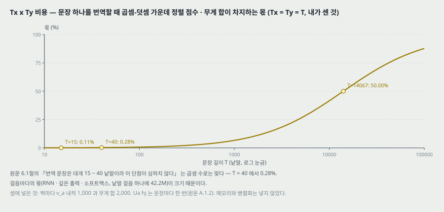

- **원문의 「15 ~ 40 낱말에서 심하지 않다」 는 곱셈 수로는 맞다**(0.11 ~ 0.28%). 걸음마다의 몫이 크기 때문이고, 그 가운데 소프트맥스 15.0M 이 가장 크다.
- 이 셈은 메모리와 병렬화를 넣지 않았다. 원문의 「다른 과제로 쓰기 어렵다」 가 어느 쪽 비용을 뜻하는지 원문은 적지 않는다.
- 같은 셈으로 RNNsearch 대 RNNencdec(9절의 가정)의 곱셈 비는 $T = 30$ 에서 1.39 배다. 원문 표 2 의 같은 GPU 시간당 갱신 수로는 RNNsearch 가 RNNencdec 의 0.47 ~ 0.54 배라 1.86 ~ 2.14 배 느리다(12절). 차이가 구현에서 오는지 원문은 말하지 않는다.

---

## 11. 데이터 · 어휘 · 모델 둘 (4절)

**데이터(4.1절).** WMT'14 영어 -> 프랑스어 병렬 말뭉치 — Europarl 61M · news commentary 5.5M · UN 421M · 크롤 둘 90M · 272.5M, 합 850M 낱말. 원문의 다섯을 더하면 **정확히 850M** 이다(내가 센 것). Cho 외(2014a)의 절차대로 Axelrod 외(2011)의 데이터 고르기로 **348M 낱말**로 줄였다(각주 5 가 Schwenk 의 내려받기 쪽을 가리킨다). 단일어 말뭉치는 쓰지 않았다.

**개발 · 시험.** news-test-2012 와 news-test-2013 을 이어 개발셋, news-test-2014 를 시험셋. 시험셋은 **학습 데이터에 없는 3,003 문장**.

**어휘.** Moses 의 토큰 나누기 스크립트(각주 6)로 나눈 뒤 언어마다 가장 잦은 30,000 낱말. 나머지는 [UNK]. 소문자로 바꾸기 · 어간 자르기는 하지 않았다.

**모델(4.2절).** RNNencdec 과 RNNsearch 를 각각 두 번 — 30 낱말 이하 문장으로(-30), 50 낱말 이하 문장으로(-50) — 학습했다. 「길이」 가 원문 쪽인지 번역 쪽인지 둘 다인지는 적혀 있지 않다.

| | RNNencdec | RNNsearch |
|---|---|---|
| 인코더 | 은닉 1,000 (게이트 유닛) | 앞 · 뒤 RNN 각 1,000 |
| 디코더 | 은닉 1,000 | 은닉 1,000 |
| 출력 | maxout 숨은 층 하나 (Pascanu 외 2014 의 깊은 출력) | 같음 |
| 낱말 벡터 · maxout 크기 | 적혀 있지 않음(A.2.3 의 「이 편의 모든 모델」 문장을 따르면 620 · 500) | 620 · 500 |

**원문 4절 첫 문단.** 「두 모델에 같은 학습 절차와 같은 데이터를 쓴다.」 — 12절에서 이 「같은」 이 무엇인지 표 2 로 확인한다.

---

## 12. 학습 설정과 표 2 (4.2절 · 부록 B)

원문의 설정을 그대로 옮긴다.

| 항목 | 값 |
|---|---|
| 최적화 | 미니배치 SGD + Adadelta($\epsilon = 10^{-6}$, $\rho = 0.95$) |
| 미니배치 | 80 문장 |
| 기울기 | L2 노름이 1 을 넘으면 1 로 줄인다(Pascanu 외 2013b) |
| 시작값 | 되먹임 행렬 아홉($U$ · $U_z$ · $U_r$ 의 디코더 · 앞 · 뒤)은 무작위 직교 행렬. $W_a$ · $U_a$ 는 $\mathcal{N}(0, 0.001^2)$. $v_a$ 와 모든 치우침은 0. 나머지는 $\mathcal{N}(0, 0.01^2)$ |
| 길이 맞춘 배치 | 20 번째 갱신마다 문장 쌍 1,600 개를 꺼내 길이로 줄 세워 미니배치 20 개로 나눈다. 학습 데이터는 학습 전에 한 번 섞고 차례로 훑는다 |
| 학습 시간 | 4.2절 — 「모델마다 5 일 남짓(approximately 5 days)」 |
| 디코딩 | 빔 탐색. **빔 크기는 적혀 있지 않다** |

**원문 표 2(14 쪽).**

| 모델 | 갱신 (×10⁵) | 바퀴 | 시간 | GPU | 학습 NLL | 개발 NLL |
|---|---:|---:|---:|---|---:|---:|
| RNNencdec-30 | 8.46 | 6.4 | 109 | TITAN BLACK | 28.1 | 53.0 |
| RNNencdec-50 | 6.00 | 4.5 | 108 | Quadro K-6000 | 44.0 | 43.6 |
| RNNsearch-30 | 4.71 | 3.6 | 113 | TITAN BLACK | 26.7 | 47.2 |
| RNNsearch-50 | 2.88 | 2.2 | 111 | Quadro K-6000 | 40.7 | 38.1 |
| RNNsearch-50* | 6.67 | 5.0 | 252 | Quadro K-6000 | 36.7 | 35.2 |

캡션 — 「NLL 은 학습셋 또는 개발셋 문장의 평균 조건부 로그 확률이다. 문장 길이가 다르다는 것에 주의.」

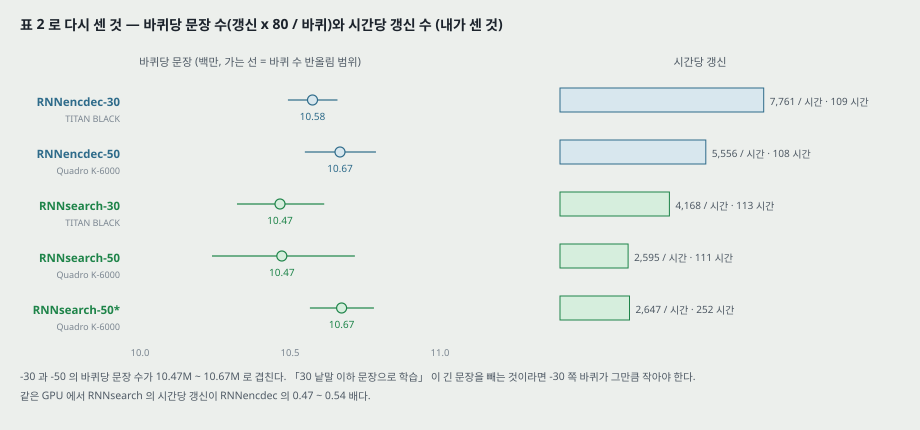

**책상 확인(내가 센 것).**

- **「같은 학습 절차」 는 같은 벽시계 시간이다.** 네 모델이 108 ~ 113 시간(4.5 ~ 4.7 일)을 돌았다. 갱신 수는 다르다 — 같은 Quadro K-6000 에서 RNNsearch-50 은 시간당 2,595 번, RNNencdec-50 은 5,556 번이라 **RNNsearch-50 은 갱신 수 48%(2.88 대 6.00), 바퀴 수 49%(2.2 대 4.5) 만큼만 학습하고 표 1 에서 이겼다.** 같은 TITAN BLACK 의 -30 둘도 4,168 대 7,761 번(0.54 배)이다. 이 쪽은 RNNsearch 에 불리한 조건이라 표 1 의 차이를 약하게 만들지 않는다.
- **-30 과 -50 은 GPU 가 다르다.** -30 은 TITAN BLACK, -50 은 Quadro K-6000. 같은 길이 한계 안의 비교(encdec 대 search)는 같은 GPU 끼리이고, -30 대 -50 비교는 GPU 와 학습 길이가 함께 바뀐다.
- **RNNsearch-50* 는 252 시간(10.5 일)이다.** 4.2절의 「모델마다 5 일 남짓」 과 다르다(24절). 이 모델만 개발셋 성능이 멈출 때까지 학습했고, **같은 대접을 받은 RNNencdec 은 없다.** 그래서 표 1 의 RNNsearch-50* 와 RNNencdec-50 의 차(10.63)에는 학습 시간 2.3 배가 섞여 있다.
- **바퀴당 문장 수**(갱신 × 80 / 바퀴): RNNencdec-30 10.58M · -50 10.67M · RNNsearch-30 10.47M · -50 10.47M · -50* 10.67M. 바퀴 수가 소수 첫째 자리로 반올림돼 있어 범위로 보면 -30 의 바퀴는 -50 의 바퀴보다 **많아야 2.8%(RNNencdec 쌍) · 3.7%(RNNsearch 쌍) 작다**. 「30 낱말 이하 문장으로 학습」 이 31 ~ 50 낱말 쌍을 빼는 것이라면, 뺀 쌍이 그 몫 이하라는 뜻이 된다. 원문은 길이 분포도, -30 의 「바퀴」 를 무엇에 대해 셌는지도 적지 않는다. 같은 348M 수를 적은 Sutskever 외는 문장당 평균 프랑스어 29.0 낱말을 적는다(그 편의 수로 내가 나눈 값). 이 둘이 함께 맞으려면 길이 분포가 30 낱말 아래에 몰려 있어야 하는데, 이 편으로는 확인할 수 없다(28절).
- **개발 NLL 은 다섯 모델이 같은 개발셋에서 잰 값**이라 견줄 수 있다. 순서는 RNNsearch-50* 35.2 < RNNsearch-50 38.1 < RNNencdec-50 43.6 < RNNsearch-30 47.2 < RNNencdec-30 53.0. **표 1 의 전체 열 BLEU 순서와 한 자리가 다르다** — 개발 NLL 은 RNNencdec-50 이 RNNsearch-30 보다 낮고(나음), 시험 BLEU 는 RNNsearch-30 이 3.68 높다. 셋(개발 · 시험)과 지표가 다르다. 원문은 이 자리를 말하지 않는다.
- 학습 NLL 은 -30 과 -50 의 학습 문장 길이가 달라 서로 견주지 않는다(캡션의 말).

---

## 13. 표 1 — BLEU (5.1절)

원문 표 1(7 쪽, 시험셋 news-test-2014).

| 모델 | 전체 | UNK 없는 문장 |
|---|---:|---:|
| RNNencdec-30 | 13.93 | 24.19 |
| RNNsearch-30 | 21.50 | 31.44 |
| RNNencdec-50 | 17.82 | 26.71 |
| RNNsearch-50 | 26.75 | 34.16 |
| RNNsearch-50* | 28.45 | 36.15 |
| Moses | 33.30 | 35.63 |

캡션 — 「둘째 열은 모든 문장, 셋째 열은 문장 자신과 정답 번역에 어휘 밖 낱말이 없는 문장. RNNsearch-50* 는 개발셋 성능이 멈출 때까지 훨씬(much) 오래 학습했다. 마지막 열을 셀 때는 모델이 [UNK] 를 내지 못하게 했다.」

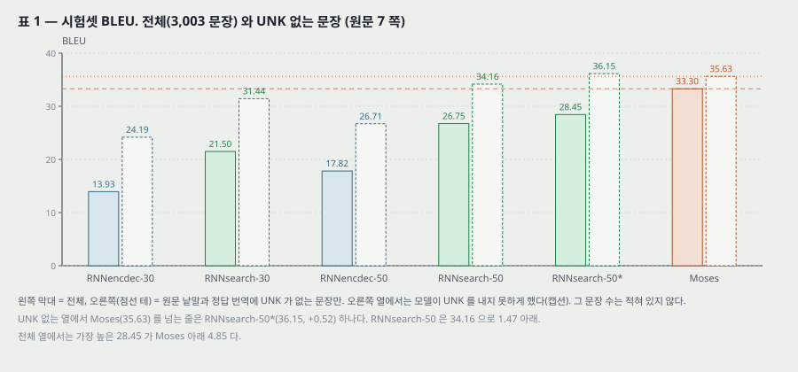

**차를 세기(내가 센 것).**

| 견줌 | 전체 | UNK 없는 문장 |
|---|---:|---:|
| RNNsearch-30 − RNNencdec-30 | +7.57 | +7.25 |
| RNNsearch-50 − RNNencdec-50 | +8.93 | +7.45 |
| RNNsearch-30 − RNNencdec-50 | +3.68 | +4.73 |
| RNNsearch-50* − RNNsearch-50 | +1.70 | +1.99 |
| RNNsearch-50* − Moses | −4.85 | +0.52 |
| RNNsearch-50 − Moses | −6.55 | −1.47 |

**원문 5.1절의 두 말을 수와 나란히 놓는다.**

- 「모든 경우에 RNNsearch 가 RNNencdec 을 앞선다(It is clear from the table that in all the cases)」 — 같은 길이 한계 안의 두 쌍에서 두 열 모두 +7.25 ~ +8.93 이고, RNNsearch-30 이 RNNencdec-50 도 +3.68 앞선다. **줄마다 실행 하나**이고 흩어짐이 없지만, 차이가 7 BLEU 를 넘어 이 표의 다른 어떤 차(예: 더 오래 학습한 몫 1.70)보다 크다.
- 「알려진 낱말로 된 문장만 보면 RNNsearch 의 성능이 Moses 만큼 높다(as high as)」 — **UNK 없는 열에서 Moses 를 넘는 줄은 RNNsearch-50* 하나(+0.52)** 이고 RNNsearch-50 은 1.47 아래다.

**UNK 없는 열이 누구에게 유리한가(내가 센 것).** 전체 열에서 UNK 없는 열로 옮길 때 모델마다 오른 몫 — RNNencdec-30 +10.26, RNNsearch-30 +9.94, RNNencdec-50 +8.89, RNNsearch-50 +7.41, RNNsearch-50* +7.70, **Moses +2.33**. 이 열은 **신경망 모델의 어휘 30,000 으로 문장을 고른 부분집합**이고, 신경망 모델에서 [UNK] 출력을 막았다. Moses 는 어휘 제한이 없는 시스템이다. 그래서 이 열은 「어휘 문제를 뺀 비교」 로 읽히지만, 남은 문장의 수와 성질(길이 분포)이 적혀 있지 않다.

**원문의 덧말.** 「Moses 가 우리 병렬 말뭉치 밖의 단일어 말뭉치(418M 낱말)를 더 쓴다는 것을 생각하면 의미 있는(significant) 성과다.」 — 「significant」 는 유의성 검정의 말이 아니다. 이 편에는 검정이 없다.

---

## 14. 그림 2 — 문장 길이별 BLEU (5.1절 · 5.2.2절)

캡션 — 「시험셋 번역의 BLEU 를 문장 길이별로. 모델이 모르는 낱말이 든 문장까지 포함한 전체 시험셋이다.」

**읽은 방법.** 원문 5 쪽의 그림 2 는 벡터다. 곡선 넷의 꼭짓점과 축 눈금 자리를 PDF 좌표로 꺼냈다. 범례 글자 자리로 선 모양과 모델을 맞췄다(실선 RNNsearch-50 · 점선 RNNsearch-30 · 파선 RNNenc-50 · 일점쇄선 RNNenc-30). 가로 눈금 0 이 136.07 pt, 60 이 364.51 pt, 세로 눈금 0 이 204.91 pt, 30 이 87.01 pt.

**가로축이 무엇인지.** 곡선마다 꼭짓점이 **가로 0, 1, 2, ..., 59 의 정수 자리에 60 개** 있다. 가로 0 에도 점이 있으므로 이 가로축은 「문장의 낱말 수 그대로」 일 수 없다. **원문은 칸을 어떻게 나눴는지(가로 0 이 무슨 문장인지, 칸마다 문장 몇 개인지, 원문 쪽 길이인지)를 적지 않는다.** 가로 59 가 마지막 점이라 60 낱말 넘는 문장이 어디에 들어갔는지도 적혀 있지 않다. 아래에서는 원문의 눈금을 그대로 「가로」 라 부른다.

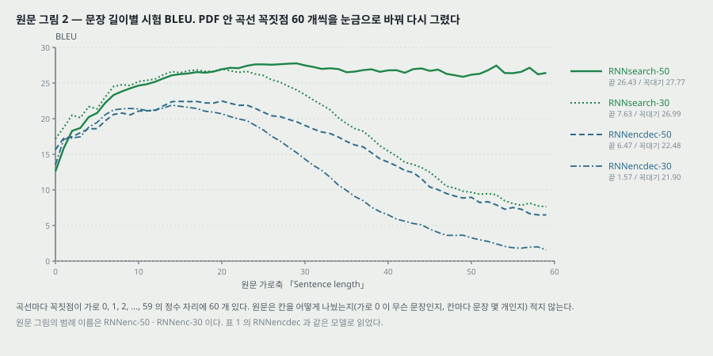

**곡선마다(내가 읽은 것).**

| 모델 | 꼭대기 (가로) | 가로 10 | 가로 20 | 가로 30 | 가로 40 | 가로 50 | 가로 59 | 가로 59 / 꼭대기 |
|---|---|---:|---:|---:|---:|---:|---:|---:|
| RNNsearch-50 | 27.77 (29) | 24.65 | 26.94 | 27.48 | 26.78 | 26.18 | 26.43 | 95.2% |
| RNNsearch-30 | 26.99 (20) | 25.23 | 26.99 | 23.35 | 15.44 | 9.66 | 7.63 | 28.3% |
| RNNencdec-50 | 22.48 (20) | 21.07 | 22.48 | 19.04 | 13.89 | 8.96 | 6.47 | 28.8% |
| RNNencdec-30 | 21.90 (14) | 21.37 | 20.67 | 14.31 | 6.49 | 3.27 | 1.57 | 7.2% |

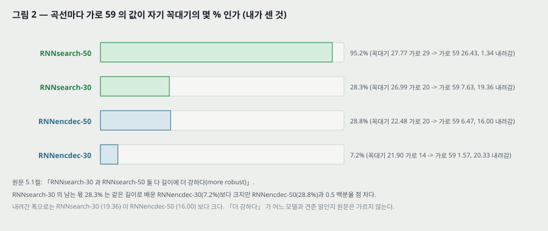

**곡선끼리 뺀 값(내가 센 것).**

| 견줌 | 가장 작은 차 (가로) | 가장 큰 차 (가로) | 0 아래인 가로 |
|---|---|---|---|
| RNNsearch-50 − RNNencdec-50 | −3.04 (0) | +20.50 (57) | 0 · 1 |
| RNNsearch-30 − RNNencdec-30 | +1.65 (1) | +9.75 (37) | 없음 |
| RNNsearch-30 − RNNencdec-50 | +0.56 (55) | +5.16 (25) | 없음 |
| RNNsearch-50 − RNNsearch-30 | −4.57 (0) | +19.02 (57) | 0 ~ 20 의 21 자리 모두 |

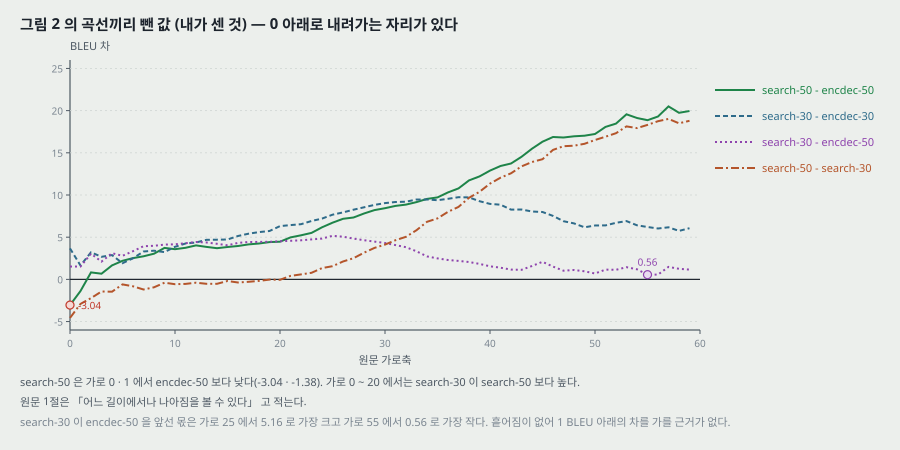

**원문의 말과 나란히 놓는다.**

- 5.1절 「RNNencdec 의 성능은 문장이 길어지면 극적으로(dramatically) 떨어진다」 — RNNencdec-50 이 가로 20 의 22.48 에서 가로 59 의 6.47 로 16.00 내려간다. **맞는다.**
- 5.1절 「RNNsearch-50 은 길이 50 이상에서도 성능이 떨어지지 않는다(no performance deterioration)」 — 가로 50 ~ 59 의 열 점이 26.18 ~ 27.46, 평균 26.59. 꼭대기 27.77(가로 29)에서 1.34 아래, 가로 20(26.94)에서 0.35 아래다. 흩어짐이 없어 이 1.34 를 「떨어졌다」 고도 「안 떨어졌다」 고도 가를 근거가 없다. 원문의 말은 곡선 모양과 맞는다.
- 5.1절 「RNNsearch-30 과 RNNsearch-50 둘 다 길이에 더 강하다(more robust)」 — **RNNsearch-30 은 가로 20 의 26.99 에서 가로 59 의 7.63 으로 19.36 내려간다.** 같은 길이로 배운 RNNencdec-30(남는 몫 7.2%)보다는 많이 남지만(28.3%), RNNencdec-50(28.8%)과는 0.5 백분율 점 차이고 내려간 폭은 더 크다. 「더 강하다」 는 같은 학습 길이끼리의 말로만 맞는다.
- 1절 「나아짐은 긴 문장에서 더 뚜렷하지만 어느 길이의 문장에서나 볼 수 있다(can be observed with sentences of any length)」 · 7절 「문장 길이와 상관없이(regardless of the sentence length) 의미 있게 앞선다」 — **-30 쌍은 60 자리 모두에서 앞서고(가장 작은 차 +1.65), -50 쌍은 가로 0 · 1 두 자리에서 RNNsearch-50 이 낮다(−3.04 · −1.38).** 가로 0 이 무슨 문장인지 원문이 적지 않아 이 두 자리를 「가장 짧은 문장」 이라 단정하지는 않는다.
- 원문이 말하지 않은 자리 — **가로 0 ~ 20 에서는 RNNsearch-30 이 RNNsearch-50 보다 높다**(가장 큰 차 4.57). 짧은 문장에서는 짧은 문장만으로 학습한 모델이 낫다. -30 이 같은 시간에 바퀴를 1.64 배(3.6 대 2.2) 돌았고 GPU 도 다르므로 까닭을 가를 수 없다.

**이 그림이 보이지 않는 것.** 칸마다 문장 수와 신뢰 구간이 없다. 1 BLEU 아래의 차(예: 가로 55 에서 RNNsearch-30 이 RNNencdec-50 을 앞선 0.56)를 갈라 읽을 근거가 없다.

---

## 15. 그림 3 — 정렬 넷 (5.2.1절)

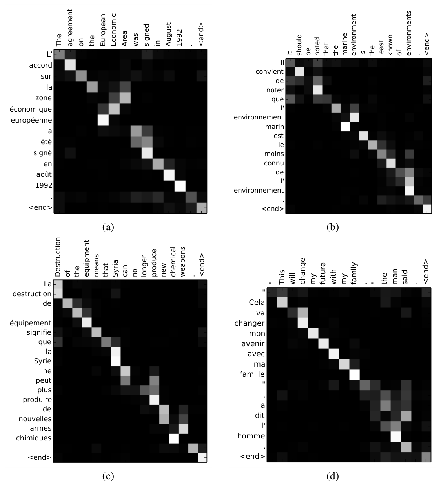

*원문 그림 3 을 잘라 넣은 것(6 쪽).* 캡션 — 「RNNsearch-50 이 찾은 정렬 넷. 가로축은 원문(영어), 세로축은 생성한 번역(프랑스어) 낱말. 칸마다 무게 $\alpha_{ij}$ 를 회색조로(0 검정, 1 흰색). **(a) 임의의 문장(an arbitrary sentence). (b ~ d) 모르는 낱말이 없고 길이가 10 ~ 20 낱말인 시험셋 문장 가운데 무작위로 고른 셋.**」

**읽은 방법.** 네 칸은 회색조 이미지이고 칸 하나가 16 x 16(a) 또는 14 x 14(b · c · d) 화소다. 칸 가운데 화소 값 / 255 를 무게로 읽었다. 낱말 목록은 원문 그림의 눈금 글자 그대로다.

| 칸 | 번역 x 원문 | 줄 합 (읽기 확인) | 줄마다 가장 큰 무게의 평균 | 가장 큰 무게가 0.5 아래인 줄 | 가장 큰 무게 자리의 순서가 뒤집힌 줄 짝 |
|---|---|---|---:|---:|---:|
| (a) | 15 x 14 | 0.957 ~ 1.004 | 0.711 | 2 / 15 | 3 / 105 |
| (b) | 17 x 16 | 1.008 ~ 1.032 | 0.707 | 4 / 17 | 4 / 136 |
| (c) | 19 x 16 | 0.968 ~ 1.000 | 0.778 | 2 / 19 | 1 / 171 |
| (d) | 17 x 16 | 0.965 ~ 1.000 | 0.697 | 4 / 17 | 2 / 136 |

*(내가 센 것.) 「순서가 뒤집힌 줄 짝」 은 번역 낱말 둘 가운데 뒤 낱말의 가장 큰 무게 자리가 앞 낱말의 그것보다 원문 앞쪽에 있는 짝의 수다. 0 이면 완전히 단조다.* 줄 합이 1 에서 0.043 안에 들어 칸마다 읽기 오차를 0.04 까지로 본다.

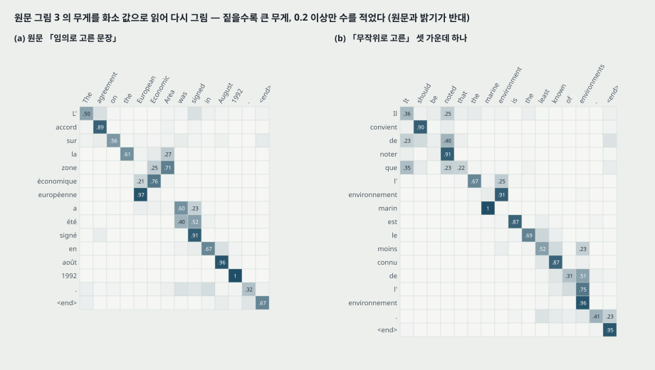

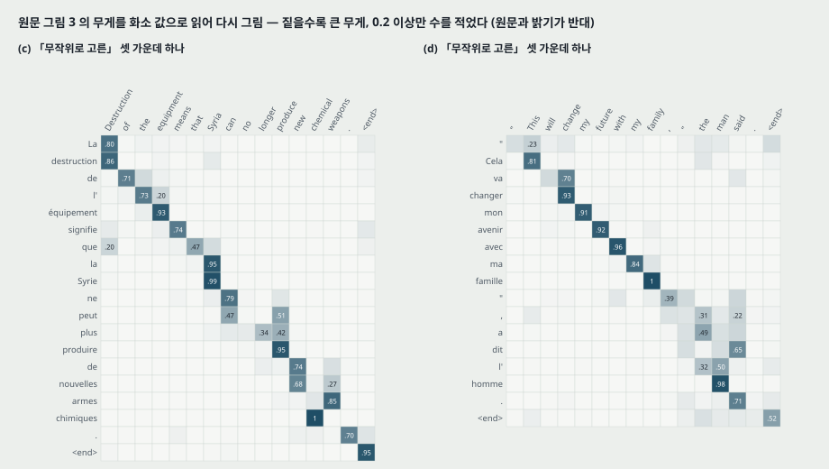

**원문이 말한 자리 — 수로 확인했다(내가 읽은 값).**

- **「영어와 프랑스어의 정렬은 대체로 단조이고 대각선에 무게가 모인다」** — 순서가 뒤집힌 줄 짝이 네 칸 합 10 / 548 (1.8%) 이다.
- **(a) 「[European Economic Area] 를 [zone économique européenne] 로 옮기며 [zone] 을 [Area] 에 맞추고, 두 낱말을 건너뛴 뒤 한 낱말씩 뒤로 돌아온다」** — zone 의 무게가 Area 0.71 · Economic 0.25, économique 가 Economic 0.76 · European 0.21, européenne 가 European 0.97. 가장 큰 무게의 자리가 원문 6 -> 5 -> 4 째로 한 칸씩 뒤로 간다. **맞는다.**
- **(d) 「[the man] -> [l' homme] 에서 [l'] 을 정하려면 뒤 낱말을 봐야 하는데, 부드러운 정렬은 [the] 와 [man] 을 함께 본다」** — l' 의 무게가 man 0.50 · the 0.32. **맞는다.** 가장 큰 무게는 the 가 아니라 man 이다.

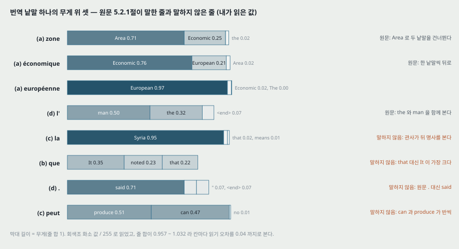

**원문이 말하지 않은 자리.**

- **(c) la(「la Syrie」 의 관사)가 Syria 에 0.95** — 원문에 「the」 가 없는 자리에서 관사가 뒤 명사를 본다. (d) 의 l' 과 같은 성질이 더 또렷한 예이고, 원문이 이 칸을 말하지 않는다.
- **(b) que 의 가장 큰 무게가 It(0.35)에 가고, 같은 뜻의 원문 낱말 that 은 0.22** 다. **(d) 마침표 「.」 의 가장 큰 무게가 said(0.71)에 가고, 원문 「.」 은 0.02**다. 원문 5.2.1절의 「제시한 모든 경우에서 비슷한 행동을 본다(We observe similar behaviors in all the presented cases)」 는 이런 줄을 따로 말하지 않는다.
- **(c) peut(「can」)가 produce 0.51 · can 0.47 로 반씩**, plus 는 produce 0.42 · longer 0.34 다.
- **(b) 의 번역 「le moins connu de l'environnement」 은 원문 「the least known of environments」 의 복수를 단수로 옮겼다**(낱말 대 낱말로 본 것이다). 무게는 de · l' · environnement 셋 모두 environments 에 가장 크다(0.51 · 0.75 · 0.96).

**이 그림이 보이지 않는 것.**

- **정답 정렬과 견준 수가 없다.** 정렬 오류율 같은 지표로 잰 값이 이 편에 없다. 「정렬이 직관과 잘 맞는다(agree well with our intuition)」(요약)와 「각 번역 낱말을 관련 원문 낱말에 맞게 정렬한다고 결론지을 수 있었다(we were able to conclude ... correctly align each target word)」(7절)의 근거는 네 칸을 눈으로 본 것이다.
- **(a) 는 「임의로 고른(arbitrary)」 문장**이고 고른 방법이 없다. 원문이 가장 길게 풀이한 예가 이 칸이다. (b ~ d) 는 「무작위로」 골랐지만 **모르는 낱말이 없고 10 ~ 20 낱말인 문장으로 먼저 걸렀다** — 그림 2 에서 RNNencdec 과 RNNsearch 가 갈리는 긴 문장(가로 30 이후)의 정렬은 없다.
- 무게가 크다는 것이 그 원문 낱말의 정보를 썼다는 뜻인지는 이 그림으로 확인되지 않는다. 주석 $h_j$ 는 양방향 RNN 의 상태라 원문 전체를 담고 있다(7절).

---

## 16. 긴 문장 번역 예 (5.2.2절 · 부록 C 표 3)

원문 5.2.2절은 시험셋 긴 문장 둘에서 RNNencdec-50 과 RNNsearch-50 의 번역을 나란히 놓고, 부록 C 표 3 이 셋째 문장과 정답 번역 · Google 번역(2014-08-27 에 낸 것)을 더한다. 표 3 캡션은 「시험셋에서 고른 30 낱말 이상 문장」 이라 적고, 고른 기준은 적지 않는다. 원문 문장의 낱말 수는 띄어쓰기로 세어 40 · 33 · 33 이다(내가 센 것).

**원문이 밑줄로 짚은 자리.** PDF 안 밑줄 선의 자리를 꺼내 어느 낱말에 그어졌는지 맞췄다.

| 예 | 원문 밑줄 | RNNencdec-50 밑줄 | 원문의 말 |
|---|---|---|---|
| 첫째 (40 낱말) | 「to carry out a diagnosis ... at a hospital.」(원문 21 째부터) | 「d'un diagnostic ou de prendre un diagnostic en fonction de son état de santé.」 | 「[a medical center] 까지는 맞게 옮겼다」 |
| 둘째 (33 낱말) | 「via digital platforms ... he added.」(원문 23 째부터) | 「lecteurs numériques qui deviennent plus complexes.」(번역 26 째부터) | 「30 낱말 남짓 낸 뒤 원문의 뜻에서 벗어나기 시작했다」 |

**정답 번역과 낱말로 맞춰 본 것(내가 본 것).**

- 첫째 예 — RNNencdec-50 번역의 **10 째 낱말 「reconnaître」 자리에 정답과 RNNsearch-50 은 「admettre」** 를 쓴다. 밑줄 앞이다. 원문의 「[a medical center] 까지는 맞게」 는 이 자리를 넣지 않은 말이다. 그리고 원문 문장은 「medical **centre**」 인데 5.2.2절 본문은 「[a medical **center**]」 로 옮겨 적었다.
- 둘째 예 — RNNencdec-50 번역의 **18 째 낱말 「nouvelles」 자리에 정답과 RNNsearch-50 은 「séries」** 를 쓴다(원문 「series」). 이것도 밑줄 앞이다. 밑줄은 번역 26 째부터라 원문의 「30 낱말 남짓」 은 26 이다.
- 셋째 예(표 3 에만 있다) — **RNNencdec-50 번역에 밑줄이 없다.** 33 낱말 문장에서 RNNencdec-50 이 원문이 틀린 자리로 짚지 않은 번역을 냈다. 본문은 이 예를 말하지 않는다.

**원문의 결론(5.2.2절 끝).** 「정량 결과와 함께 이 정성 관찰들이 RNNsearch 구조가 긴 문장을 표준 RNNencdec 보다 훨씬 믿을 만하게(far more reliable) 옮긴다는 우리 가설을 확인한다(confirm).」 — 「확인한다」 의 정량 쪽은 그림 2 이고, 정성 쪽은 고른 기준이 없는 예 둘(본문)과 셋(부록)이다.

---

## 17. 관련 연구 (6절)

- **정렬을 배우기(6.1절).** Graves(2013)가 필기 생성에서 출력 기호를 입력 기호에 맞추는 비슷한 방식을 냈다 — 가우스 커널 섞음으로 주석의 무게를 정하고, 커널의 자리 · 폭 · 섞음 계수를 정렬 모델이 낸다. **그 자리는 한 방향으로만(단조롭게) 움직인다.** 원문 — 번역은 (먼 거리의) 순서 바꿈이 필요해(예: 영어 -> 독일어) 이것이 「심한 한계」 이고, 이 편의 방식은 그 제약이 없다. 대신 번역 낱말마다 원문 모든 낱말의 무게를 계산해야 한다(10절).
- **번역을 위한 신경망(6.2절).** Bengio 외(2003)의 신경 확률 언어 모델 이후 신경망은 기존 통계 번역 시스템에 특징 하나를 주거나 후보 목록을 다시 매기는 데 쓰였다(Schwenk 2012 · Kalchbrenner · Blunsom 2013 · Devlin 외 2014 · Schwenk 외 2006). 이 편은 신경망이 **혼자서 원문에서 번역을 바로 만드는** 시스템을 목표로 하고, 「앞선 일들과의 근본적인 결별(radical departure)」 이라 적는다.

---

## 18. 결론 (7절)

원문의 결론을 줄여 옮긴다.

1. 인코더-디코더는 원문 전체를 길이가 정해진 벡터 하나로 담는다. Cho 외(2014b) · Pouget-Abadie 외(2014)에 기대어 이것이 긴 문장 번역에 문제라고 추측했다.
2. 번역 낱말마다 원문 낱말(또는 그 주석)을 부드럽게 찾는 구조를 냈다. 길이가 정해진 벡터의 짐을 덜고 다음 낱말에 관련된 정보에만 모이게 한다. 이것이 긴 문장에서 좋은 결과를 내는 데 「큰 긍정적 영향(major positive impact)」 을 준다. 정렬 장치를 포함한 모든 부품을 올바른 번역의 로그 확률 쪽으로 함께 학습한다.
3. RNNsearch 가 RNNencdec 을 문장 길이와 상관없이 의미 있게(significantly) 앞섰고, 원문 길이에 훨씬(much) 강하다. 정렬 분석에서 모델이 각 번역 낱말을 관련 원문 낱말에 맞게 정렬한다고 결론지을 수 있었다.
4. 기존 구문 기반 통계 번역과 견줄 만한 성능을 냈다. 신경망 번역이라는 갈래 전체가 올해 나왔다는 것을 생각하면 「놀라운(striking) 결과」 다.
5. **남은 과제: 모르는 낱말 · 드문 낱말을 더 잘 다루는 것.** 더 널리 쓰이고 모든 맥락에서 최고 시스템과 맞서려면 필요하다.

---

## 19. 실험 분석 (논문의 표 · 그림마다)

**직접 돌리지 않는다.** 논문이 낸 실험을 표 · 그림 하나씩 같은 틀로 읽는다. 책상에서 센 값은 「내가 센 것」 으로 밝힌다.

| 표 · 그림 | 무엇을 바꿨나 (변인) | 무엇을 고정했나 | 결과 | 반복 수 · 흩어짐 | 주장이 결과보다 센가 |
|---|---|---|---|---|---|
| **표 1 (encdec 대 search)** | 모델: RNNencdec · RNNsearch. 학습 길이: 30 · 50 | 데이터 348M, 어휘 30,000, 은닉 1,000, 학습 시간 108 ~ 113 시간, 같은 길이 한계 안에서는 같은 GPU | 전체 13.93 -> 21.50, 17.82 -> 26.75. UNK 없는 열도 +7.25 · +7.45 | 줄마다 실행 하나. 흩어짐 없음. 빔 크기 · BLEU 스크립트 없음 | 차이(+7.25 ~ +8.93)가 이 표의 다른 차보다 크다. 다만 **파라미터가 17.3% 많고**(내가 센 것) 크기를 맞춘 비교가 없어 「주의 장치」 의 몫만 따로 세울 수 없다. 「significantly」 는 검정 없이 쓴 말 |
| **표 1 (대 Moses)** | 시스템: 신경망 · 구문 기반 | 시험셋 | 전체 28.45 대 33.30 (−4.85). UNK 없는 열 36.15 대 35.63 (+0.52) | 실행 하나. 부분집합의 문장 수 없음 | **요약 · 1절 · 7절의 「견줄 만하다」 를 받치는 수는 UNK 없는 열의 50* 한 줄**이고, 그 열은 신경망 어휘로 고른 부분집합이며 Moses 는 +2.33 만 오른다. **센 편**(20절) |
| **표 1 (50* 대 50)** | 학습 시간 111 -> 252 시간, 개발셋으로 멈춤 | 모델 · 데이터 | +1.70 · +1.99 | 실행 하나 | RNNencdec 에는 같은 대접이 없다. 표의 비교 줄에 학습 조건이 다른 줄이 섞였다고 캡션이 밝힌다 |
| **표 2** | (실험이 아니라 학습 기록) | — | 갱신 수 · 바퀴 · 시간 · NLL | — | 「같은 학습 절차」 = 같은 벽시계 시간. RNNsearch-50 이 갱신 48% 로 이겼다(내가 센 것). -30 의 바퀴당 문장 수가 -50 과 2.8 · 3.7% 안으로 겹친다(12절) |
| **그림 2** | 문장 길이 칸 (정의 없음) | 표 1 의 네 모델 | 내가 읽은 값: RNNsearch-50 가로 59 26.43 (꼭대기의 95.2%), RNNencdec-50 6.47 (28.8%), RNNsearch-30 7.63 (28.3%) | 칸 정의 · 칸마다 문장 수 · 신뢰 구간 없음 | 「RNNsearch-50 은 50 이상에서도 떨어지지 않는다」 는 곡선과 맞다. **「RNNsearch-30 도 더 강하다」 · 「어느 길이에서나 나아진다」 는 곡선보다 세다**(14절) |
| **그림 3** | 문장 넷 (a 는 임의, b ~ d 는 걸러서 무작위) | RNNsearch-50 | 내가 읽은 값: 뒤집힌 짝 10 / 548. 원문이 말한 두 자리(zone · l')는 수로 맞다 | 문장 넷. 정답 정렬 없음 | 7절의 「각 번역 낱말을 맞게 정렬한다고 결론지을 수 있었다」 는 넷을 눈으로 본 것에서 나온 일반화다. **센 편** |
| **5.2.2절 · 표 3** | (없음 — 예시) | RNNencdec-50 · RNNsearch-50 · Google 번역 | 긴 문장 셋의 번역 | 고른 기준 없음 | 「가설을 확인한다(confirm)」 는 정성 예 둘(본문)을 근거로 든다. 첫째 예의 「[a medical center] 까지는 맞게」 와 둘째 예의 「30 낱말 남짓」 은 정답과 맞춰 보면 앞당겨진다(16절) |

**비교 상대가 같은 조건인가.** RNNencdec 과 RNNsearch 는 데이터 · 어휘 · 학습 시간 · (같은 길이 한계 안에서) GPU 가 같다 — **이 편 안에서 같은 조건으로 돌린 비교는 이 넷과 50* 이다.** 다르게 둔 것은 모델 크기(내가 센 17.3%)와 갱신 수(같은 시간에 RNNencdec 이 2 배 남짓)다. 기준 Moses 는 단일어 418M 낱말을 더 쓰는 다른 시스템이고, 원문은 같은 시험셋 · 같은 BLEU 셈으로 냈다고 적을 뿐 Moses 를 직접 돌렸는지(다른 편의 값을 옮겼는지)는 적지 않는다. 33.30 은 Cho 외(2014a) · Sutskever 외(2014)의 기준 수와 같다.

---

## 20. 「Moses 와 견줄 만하다」 를 두고 한 말의 세기

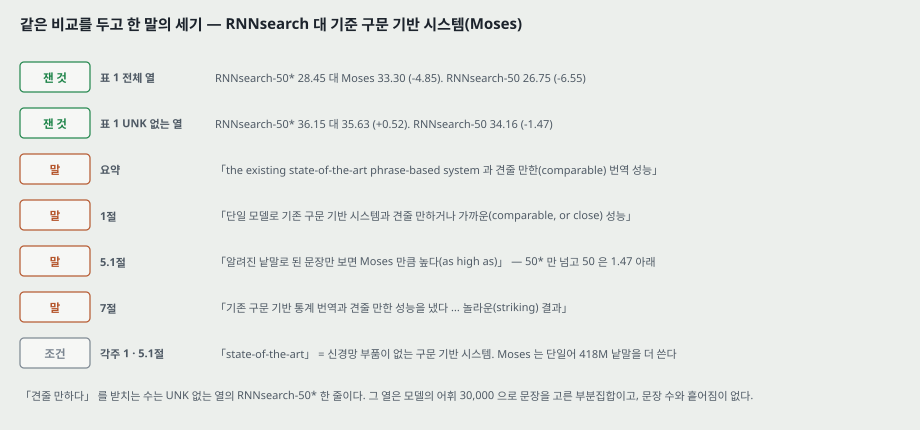

같은 비교를 두고 원문이 적은 문장을 세기별로 모은다.

| 세기 | 자리 | 원문 |
|---|---|---|
| **잰 것** | 표 1 전체 열 | RNNsearch-50* 28.45 · RNNsearch-50 26.75 대 Moses 33.30 |
| **잰 것** | 표 1 UNK 없는 열 | RNNsearch-50* 36.15 · RNNsearch-50 34.16 대 Moses 35.63 |
| **조건** | 각주 1 | 「state-of-the-art 성능이란 신경망 부품을 쓰지 않은 구문 기반 시스템의 성능」 |
| **조건** | 5.1절 | 「Moses 는 단일어 말뭉치 418M 낱말을 더 쓴다」 |
| **말** | 요약 | 「기존 최고 수준의 구문 기반 시스템과 견줄 만한(comparable) 번역 성능」 |
| **말** | 1절 | 「단일 모델로 기존 구문 기반 시스템과 견줄 만하거나 가까운(comparable, or close) 번역 성능」 |
| **말** | 5.1절 | 「알려진 낱말로 된 문장만 보면 RNNsearch 의 성능이 Moses 만큼 높다(as high as)」 |
| **말** | 7절 | 「기존 구문 기반 통계 번역과 견줄 만한 성능 ... 놀라운(striking) 결과」 |

**판정.** 요약과 7절은 조건 없이 「견줄 만하다」 라 적는다. 1절은 「가깝다(close)」 를 함께 적어 한 단계 약하다. 5.1절은 「알려진 낱말로 된 문장만」 이라는 조건을 단다. **조건 없는 전체 시험셋에서는 가장 좋은 모델이 4.85 아래이고, 조건을 단 열에서 넘는 것은 더 오래 학습한 50* 하나(+0.52)다.** 「RNNsearch 의 성능」(5.1절)이라 적은 자리의 RNNsearch-50 은 그 열에서도 1.47 아래다. 원문 7절이 「모르는 낱말 · 드문 낱말」 을 남은 과제로 꼽는 것과 같은 자리를 가리킨다 — 전체 열의 4.85 는 그 과제가 남긴 몫으로 읽힌다(UNK 없는 열로 옮길 때 신경망은 7.41 ~ 10.26, Moses 는 2.33 오른다).

---

## 21. 이 논문이 스스로 적은 한계와 조건

1. **모르는 낱말 · 드문 낱말을 다루지 못한다.** 어휘 30,000 밖은 [UNK] 이다. 최고 시스템과 모든 맥락에서 맞서려면 풀어야 한다(7절).
2. **번역 낱말마다 원문 모든 낱말의 무게를 계산해야 한다.** 번역에서는 심하지 않지만 다른 과제로 쓰는 것을 막을 수 있다(6.1절).
3. **병목은 추측에서 출발했다**(요약 · 1 · 7절의 「conjecture」).
4. **단일어 말뭉치를 쓰지 않았다** — 더 큰 단일어 말뭉치로 인코더를 미리 학습할 수 있을 것이라 적는다(4.1절).
5. **Moses 가 단일어 418M 을 더 쓴다**(5.1절) — 비교 조건이 같지 않다는 것을 원문이 밝힌다.
6. **RNNsearch-50* 는 더 오래 학습했다**(표 1 캡션).
7. **학습 NLL 은 문장 길이가 달라 모델끼리 견줄 수 없다**(표 2 캡션).

---

## 22. 논문이 적지 않은 것 — 내가 읽으며 짚은 자리

**하나. 「견줄 만하다」 는 UNK 없는 열의 한 줄이다**(13 · 20절). 전체 시험셋에서 가장 좋은 모델이 Moses 아래 4.85 다.

**둘. 크기를 맞추지 않았다.** RNNsearch 80.40M 대 RNNencdec 68.54M(가정 셋, 9절). 뒤 RNN 을 쓴 몫(4.86M)과 정렬 모델(3.00M)을 가르는 실험 — 예를 들어 양방향 인코더 + 고정 벡터, 또는 한 방향 인코더 + 주의 — 이 없다. 그래서 「양방향 주석」 과 「주의」 가운데 어느 쪽이 그림 2 의 차를 내는지 이 편으로는 모른다.

**셋. 흩어짐이 없다.** 표 1 · 그림 2 의 모든 값이 실행 하나다. 5 일씩 학습하는 모델 다섯이라 반복이 비싼 것은 맞지만, 이 편의 「significantly」 는 검정 없이 쓰였다.

**넷. 그림 2 의 가로축이 정의되지 않았다**(14절). 가로 0 에 점이 있고 가로 59 에서 끝난다. 칸 나누기 · 칸마다 문장 수 · 원문 쪽 길이인지가 없다.

**다섯. 정렬의 질을 재지 않았다**(15절). 제목의 「정렬을 함께 배운다(jointly learning to align)」 가 이 편의 수 가운데 어디에 있는지 물으면, 그림 3 의 네 칸이다. 정답 정렬과의 견줌, 무게를 다른 정렬 방식(통계 번역의 정렬)과 견준 수가 없다.

**여섯. 빔 크기와 BLEU 스크립트가 없다.** 같은 시험셋 · 같은 기준 수(33.30)를 쓰는 다른 편과 이 편의 BLEU 를 같은 칸에 놓으려면 이 둘이 필요하다.

**일곱. 「같은 학습 절차」 는 같은 시간이다**(12절). 같은 갱신 수가 아니다. 이 조건은 RNNsearch 에 불리하므로 결론을 뒤집지는 않지만, 4절이 「같다」 고만 적어 무엇이 같은지 표 2 를 셈해야 보인다.

**여덟. RNNsearch 의 첫 상태도 고정 길이 벡터다**(7절). $s_0 = \tanh(W_s \overleftarrow{h}_1)$. 디코더는 원문 전체의 요약 하나로 출발하고, 걸음마다 주의로 보탠다. 원문은 「길이가 정해진 벡터 하나에 담지 않는다」 를 이 편의 특징으로 적지만, 그 벡터가 없어진 것이 아니라 **유일한 통로가 아니게 된 것**이다.

**아홉. -30 과 -50 의 학습 데이터가 무엇이 다른지 보이지 않는다**(12절). 바퀴당 문장 수가 2.8 · 3.7% 안에서 겹친다.

**열. 개발 NLL 과 시험 BLEU 의 순서가 한 자리 다르다**(12절). RNNencdec-50 은 개발 NLL 이 RNNsearch-30 보다 낮고 시험 BLEU 는 3.68 낮다.

---

## 23. 읽을 때 헷갈리는 지점

**RNNencdec 과 RNNenc.** 표 1 · 4.2절은 RNNencdec, 그림 2 · 표 2 · 표 3 · 5.2.2절은 RNNenc. 같은 모델이다.

**「alignment」 의 세 뜻.** (가) 정렬 모델 $a$ — 점수를 내는 망. (나) 무게 $\alpha_{ij}$ — 원문이 「(soft-)alignment」 라 부른다. (다) 통계 번역의 낱말 정렬 — 숨은 변수. 원문 3.1절은 (나)를 (다)의 확률 해석으로 읽고, 5.2.1절은 (나)를 그림으로 그린다.

**맥락 벡터 $c_i$ 와 요약 벡터 $c$.** 식 (3) 의 $c$ 는 문장마다 하나, 식 (4) 의 $c_i$ 는 번역 낱말마다 하나. 크기는 $c_i$ 가 2,000, 이 편의 RNNencdec 의 $c$ 가 1,000 이다.

**그림 1 의 $t$ 와 본문의 $i$.** 그림 1 은 번역 자리를 $t$, 무게를 $\alpha_{t,T}$ 로 적고, 본문은 $i$ 와 $\alpha_{ij}$ 를 쓴다. 그림의 $T$ 는 원문 길이 $T_x$ 다.

**$s_{i-1}$ 과 $s_i$.** 점수는 $s_{i-1}$ 로 매긴다(식 6). 출력 확률은 식 (4) 에서 $s_i$ 로 적혀 있는데 부록의 깊은 출력은 $s_{i-1}$ 을 쓴다(8절).

**「-30」 은 학습 문장 길이다.** 모델 크기가 아니다. 시험은 둘 다 전체 시험셋이다.

**UNK 없는 열.** 「모르는 낱말이 없는 문장」 은 **신경망 모델의 어휘 30,000 기준**이다. Moses 에게는 모르는 낱말이 아니다.

**표 2 의 NLL.** 캡션은 「평균 조건부 로그 확률」 이라 적지만 값이 양수(26.7 ~ 53.0)라 음의 로그 확률이다.

**Sutskever 외와의 순서.** 두 편 모두 2014-09 arXiv 에 나왔다. Sutskever 외는 이 편을 표에 28.45 로 넣었고, 이 편은 Sutskever 외를 배경으로 인용한다. 로드맵에서 이 편이 「다음」 인 것은 읽는 순서다.

---

## 24. 원문 안의 어긋남 모음

| 자리 | 원문 | 바른 것 또는 짚을 것 |
|---|---|---|
| A.2.2 $\tilde{s}_i$ | $\tanh(E y_i + U[r_i \circ s_{i-1}] + C c_i)$ | $W$ 가 빠졌다. $E y_i$ 는 620 개, 나머지 항은 1,000 개. $W E y_i$ |
| A.1.1 · A.2.2 | 디코더 식의 입력 $y_i$ · $e(y_i)$ | 식 (4) 와 A.1.1 의 설명 문장은 $y_{i-1}$ |
| A.1.1 | $\tilde{s}_i = \tanh(W e(y_i) + U[r_i \circ s_{i-1}] + C c_i))$ | 닫는 괄호가 하나 더 있다 |
| A.2.2 | $p(y_i \mid s_i, y_{i-1}, c_i)$ 와 $\tilde{t}_i = U_o s_{i-1} + \dots$ | 조건은 $s_i$, 셈은 $s_{i-1}$ |
| A.1.2 대 A.2.2 | $W_a \in \mathbb{R}^{n \times n}$, $v_a \in \mathbb{R}^n$ | A.2.2 는 $n' \times n$, $n'$. $n' = n = 1{,}000$ 이라 값은 같다 |
| B.1 | 「All the elements of $V_a$」 | 다른 자리는 소문자 $v_a$ |
| 표 1 · 4.2절 대 그림 2 · 표 2 · 3 | RNNencdec 대 RNNenc | 같은 모델의 두 이름 |
| 4.2절 대 표 2 | 「모델마다 5 일 남짓 학습」 | RNNsearch-50* 는 252 시간(10.5 일) |
| 표 2 캡션 | 「NLL 은 평균 조건부 로그 확률」 | 값이 양수라 음의 로그 확률 |
| 5.2.1절 | 「[zone économique européen]」 로 옮겼다 · 바로 뒤 「[zone économique européenne]」 | 그림 3 (a) 의 번역은 「européenne」 |
| 5.2.2절 | 「[a medical center] 까지는 맞게」 | 원문 문장은 「medical centre」. 그리고 번역 10 째 「reconnaître」 가 정답 · RNNsearch 의 「admettre」 와 다르다 |
| 5.2.2절 | 「30 낱말 남짓 낸 뒤 벗어나기 시작」 | 밑줄은 번역 26 째부터. 18 째 「nouvelles」 가 정답의 「séries」 와 다르다 |
| 1절 · 7절 | 「어느 길이에서나」 · 「문장 길이와 상관없이」 앞선다 | 그림 2 의 -50 쌍은 가로 0 · 1 에서 −3.04 · −1.38 |
| A.2.1 | 「to to obtain the annotations」 | to obtain |
| A.2.2 | 「The context vector $c_i$ are recomputed」 | is recomputed |
| 참고 문헌 | Pascanu 외(2013a) 와 (2013b) | 같은 편(On the difficulty of training recurrent neural networks, ICML 2013)이 두 번 실려 있다 |

---

## 25. 앞 편 둘(Cho 외 EMNLP 2014 · Sutskever 외 NIPS 2014)의 수와 맞춰 보기

같은 해에 같은 과제(WMT'14 영어 -> 프랑스어)를 다룬 세 편이라 수를 나란히 놓을 수 있는 자리가 있다.

| 항목 | Cho 외 (2014a) | Sutskever 외 (2014) | 이 편 |
|---|---|---|---|
| 신경망을 쓴 방식 | Moses 구문표에 점수 한 칸 | 직접 번역 · 다시 매김 | 직접 번역 |
| 학습 데이터 | 850M 에서 고른 348M | 12M 문장, 프랑스어 348M 낱말 | 850M 에서 고른 348M |
| 어휘 | 15,000 (두 언어) | 입력 160,000 · 출력 80,000 | 30,000 (두 언어) |
| 은닉 · 낱말 벡터 | 1,000 · 100 (계수 100 근사) | 4 층 1,000 · 1,000 | 1,000 · 620 |
| 기준 Moses (시험) | 33.3 | 33.30 | 33.30 |
| 단일 모델 직접 번역 시험 BLEU | — | 26.17 (정방향) · 30.59 (뒤집음) | 26.75 (RNNsearch-50) · 28.45 (50*) |

**맞춰 본 것.**

- **850M 의 내역.** 이 편 4.1절은 다섯을 61 · 5.5 · 421 · 90 · 272.5M 으로 적어 **합이 정확히 850M** 이다. 같은 다섯을 Cho 외(2014a)는 둘째 크롤만 780M 으로 적어 합이 1,357.5M 이 되고 「850M」 과 맞지 않는다(그 편의 수로 내가 더한 값). **두 편의 차이는 둘째 크롤 한 칸(780M 대 272.5M)이다.** 어느 쪽이 맞는지, 272.5M 이 780M 에서 무엇을 거른 값인지는 두 편 모두 적지 않는다.
- **Sutskever 외 표 1 의 「Bahdanau 외 28.45」** 는 이 편 표 1 의 **RNNsearch-50* 전체 열**과 같은 수다. 이 편 쪽 조건 — 어휘 30,000, 단일 모델, 50 낱말 이하로 학습, Quadro K-6000 한 장에서 252 시간, 개발셋으로 멈춤, 빔 크기 · BLEU 스크립트 적혀 있지 않음.
- **시험셋 3,003 문장.** 이 편 4.1절이 적는 수이고, Sutskever 외 그림 3 의 마지막 점 자리(길이순 3,003 번째)와 같다.
- **같은 칸에 놓을 수 있는가.** 시험셋 · 기준 수 · 학습 데이터 크기(348M)는 같다. 어휘(30,000 대 80,000 출력), 모델 크기(80.4M 대 384M, 각각 내가 센 것과 그 편의 수), 학습 장비(GPU 한 장 252 시간 대 8 장 열흘 남짓), 빔 크기, BLEU 스크립트가 다르거나 적혀 있지 않다. **그래서 단일 모델끼리 28.45 와 30.59 의 2.14 차를 「주의 대 입력 뒤집기」 의 차로 읽을 수 없다.**
- **두 편이 고정 길이 벡터를 다룬 방식.** Sutskever 외는 원문을 뒤집어 짝 낱말 사이 최소 거리를 줄였고, 이 편은 디코더가 걸음마다 원문 모든 자리를 다시 본다. 두 방식을 같은 조건에서 견준 편은 이 둘 안에 없다.

---

## 26. 계보와 내가 가져갈 것

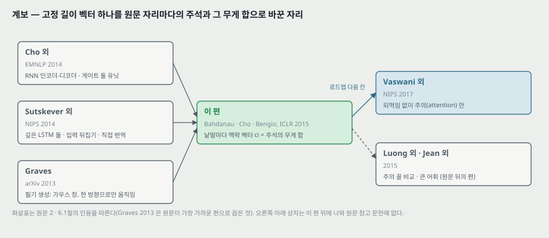

**하나. 다음 칸에 닿는 자리 — 무게 합이 남고 되먹임이 빠진다.** 이 편의 장치는 「질의(디코더 상태 $s_{i-1}$)로 열쇠(주석 $h_j$)마다 점수를 매기고, 소프트맥스 무게로 값(같은 주석 $h_j$)을 더한다」 로 읽을 수 있다. 이 편에서는 주석을 만드는 것이 되먹임 망(양방향 RNN)이고 디코더도 되먹임 망이다. 원문 10절의 셈에서 걸음마다의 몫(RNN · 소프트맥스)이 짝마다의 몫보다 크고, 되먹임 망은 걸음을 차례로 밟아야 한다. 다음 칸(Transformer)은 되먹임을 빼고 이 무게 합만으로 인코더와 디코더를 짠다. 두 편 사이에서 볼 것 — 점수 함수가 더하기 꼴($v_a^\top \tanh(W_a s + U_a h)$)에서 무엇으로 바뀌는가, 낱말 순서 정보는 되먹임 없이 어디서 오는가.

**둘. 옮겨 쓸 수 있는 것.**

- **「같은 학습 절차」 를 표로 셈한다.** 원문이 「같다」 고만 적은 조건은 학습 기록 표(갱신 수 · 바퀴 · 시간)로 무엇이 같고 무엇이 다른지 가른다. 이 편에서는 같은 시간 · 다른 갱신 수였다.
- **헤드라인 비교가 어느 부분집합의 값인지 본다.** 「견줄 만하다」 가 UNK 없는 열의 값이었다. 부분집합으로 옮길 때 비교하는 쪽들이 얼마씩 오르는지(신경망 7.41 ~ 10.26, Moses 2.33)를 함께 센다.
- **그림 안 이미지는 화소로 읽는다.** 정렬 그림처럼 칸이 정수 화소로 그려진 이미지는 칸 값을 그대로 꺼낼 수 있고, 줄 합이 1 이라는 제약으로 읽기가 맞는지 확인할 수 있다.
- **정성 예시의 밑줄을 정답과 맞춘다.** 원문이 「여기서부터 틀렸다」 고 밑줄을 그은 자리 앞에 정답과 다른 낱말이 있는지 본다.

**셋. 지금 확인된 것은 여기까지다.**

- **논문이 잰 것**: 표 1 의 BLEU 열 개 남짓(실행 하나씩), 그림 2 의 길이별 곡선 넷, 표 2 의 학습 기록, 그림 3 의 무게 넷.
- **논문이 말만 한 것**: 고정 길이 벡터가 병목이라는 것(추측으로 적음), 주석이 $x_j$ 주변에 모인다는 것, 게이트 유닛이 기울기 소실을 덜 겪는다는 것, LSTM 을 대신 써도 된다는 것, 정렬이 각 번역 낱말을 맞게 찾는다는 것(넷의 예), 긴 문장에서 「훨씬 믿을 만하다(far more reliable)」 는 것의 정성 쪽.
- **내가 책상에서 센 것**: 파라미터 80,401,000(무게) · 80,443,000(치우침 포함), RNNencdec 68,540,000(가정 셋), 차 17.3% · 낱말 표와 소프트맥스 64.9%, 짝마다 비용의 몫(T = 15 · 40 에서 0.11 · 0.28%), 표 1 의 차와 UNK 없는 열로 옮길 때 오른 몫, 표 2 의 바퀴당 문장 수 · 시간당 갱신 수, 850M 의 합, 그림 2 의 꼭짓점 240 개와 곡선끼리 차, 그림 3 의 무게 1,058 칸과 줄 합 · 순서 뒤집힘, 긴 문장 예의 밑줄 자리와 정답과 다른 낱말 자리.

---

## 27. 다음에 읽을 것

**한계를 적고 그 한계를 푼 것이 다음 논문이다.** 첫째는 로드맵의 다음 칸이다.

| 다음 | 이 노트의 어느 자리에서 나오는가 | 무엇을 확인하고 싶은가 |
|---|---|---|
| **Attention Is All You Need** (Vaswani 외, NIPS 2017) — **로드맵 다음 칸(Transformer)** | 26절 하나 — 무게 합은 남기고 되먹임을 뺀다. 10절 — 걸음마다의 몫이 크고 차례로 밟아야 한다 | 점수 함수가 더하기 꼴에서 무엇으로 바뀌는가. 되먹임 없이 낱말 순서를 어디서 넣는가. 같은 WMT'14 영어 -> 프랑스어에서 BLEU 를 어떤 조건(빔 · 스크립트 · 단일/앙상블)으로 적는가 |
| **Effective Approaches to Attention-based Neural Machine Translation** (Luong · Pham · Manning, EMNLP 2015) — 후보 | 6절 — 정렬 모델의 꼴을 다른 꼴과 견준 실험이 없다. 22절 둘 — 장치별 몫이 갈리지 않았다 | 점수 꼴(더하기 · 내적 · 일반형)과 전역 · 국소 주의를 같은 조건에서 견준 수 |
| **On Using Very Large Target Vocabulary for Neural Machine Translation** (Jean · Cho · Memisevic · Bengio, ACL 2015) — 후보 | 21절 1 — 원문이 꼽은 남은 과제(모르는 낱말). 20절 — 전체 열 4.85 차 | 어휘를 늘리면 전체 열에서 Moses 와의 차가 얼마나 주는가 |
| **On the Properties of Neural Machine Translation: Encoder–Decoder Approaches** (Cho · van Merriënboer · Bahdanau · Bengio, SSST-8 2014) | 3절 — 「길이가 늘면 빠르게 떨어진다」 의 근거로 원문이 든 편 | 길이별 성능 하락을 어떤 칸 나누기로 쟀는가 |
| **Generating Sequences With Recurrent Neural Networks** (Graves, arXiv 2013) | 17절 — 원문이 가장 가까운 앞 편으로 꼽은 단조 가우스 창 | 한 방향으로만 움직이는 창이 무엇을 잃는가 |

읽는 순서로는 **Vaswani 외가 먼저**다. 로드맵의 마지막 칸이고, 이 편의 무게 합을 받는다.

---

## 28. 남는 질문

- **그림 2 의 가로축.** 가로 0 은 무슨 문장인가. 칸마다 문장이 몇 개이고 원문 쪽 길이로 나눴는가. 60 낱말 넘는 문장은 어디에 들어갔는가.
- **-30 학습의 데이터.** 「30 낱말 이하」 가 긴 쌍을 뺀 것인가 자른 것인가. 바퀴당 문장 수가 -50 과 2.8 · 3.7% 안으로 겹치는 까닭.
- **RNNencdec 의 크기와 구현.** 낱말 벡터 · maxout 크기, $c$ 를 어떻게 만들었는지, $s_0$ 를 무엇에서 시작했는지.
- **빔 크기와 BLEU 스크립트.**
- **UNK 없는 열의 문장 수.**
- **주의만 뺀 모델 · 양방향만 뺀 모델.** 그림 2 의 차를 두 장치에 어떻게 나눌지.
- **정렬의 질.** 정답 정렬이 있는 자료에서 이 무게가 얼마나 맞는가. 긴 문장(가로 30 이후)에서 무게가 어떻게 생겼는가.
- **Cho 외(2014a)의 「780M」 과 이 편의 「272.5M」.**
- 이 물음 가운데 첫째 · 둘째 · 넷째는 이 편으로 답이 안 나오고 저자들의 코드(GroundHog)나 뒤 편에서 찾아야 한다. 여섯째 · 일곱째는 27절의 Luong 외 같은 뒤 편이 받는 자리다.

---

## 29. 참고 문헌

이 노트가 부른 편만 적는다. 원리는 원 출처를, 구현은 그 라이브러리의 편을 적는 규칙을 따른다. 그림 코드는 파이썬 표준 라이브러리만 쓰고, 원문 그림을 잘라 낸 일과 그림 2 좌표 · 그림 3 화소를 꺼낸 일만 PyMuPDF 를 썼다(PyMuPDF 는 논문이 따로 없어 적지 않는다).

- Bahdanau, D., Cho, K., and Bengio, Y. (2015). Neural machine translation by jointly learning to align and translate. ICLR 2015. arXiv:1409.0473 (v6, 2015-04-24). — 이 노트의 대상.
- Cho, K., van Merriënboer, B., Gulcehre, C., Bahdanau, D., Bougares, F., Schwenk, H., and Bengio, Y. (2014a). Learning phrase representations using RNN encoder-decoder for statistical machine translation. EMNLP. — RNN 인코더-디코더 · 게이트 유닛 · 데이터 절차(원문의 2014a).
- Sutskever, I., Vinyals, O., and Le, Q. V. (2014). Sequence to sequence learning with neural networks. NIPS. — 깊은 LSTM 인코더-디코더, 25절의 견줌.
- Cho, K., van Merriënboer, B., Bahdanau, D., and Bengio, Y. (2014b). On the properties of neural machine translation: Encoder–Decoder approaches. SSST-8. — 길이에 따른 하락(원문의 2014b). **읽지 않았다.**
- Pouget-Abadie, J., Bahdanau, D., van Merriënboer, B., Cho, K., and Bengio, Y. (2014). Overcoming the curse of sentence length for neural machine translation using automatic segmentation. SSST-8. **읽지 않았다.**
- Kalchbrenner, N. and Blunsom, P. (2013). Recurrent continuous translation models. EMNLP. **읽지 않았다.**
- Schuster, M. and Paliwal, K. K. (1997). Bidirectional recurrent neural networks. IEEE Transactions on Signal Processing, 45(11). — 양방향 RNN 의 원 출처. **읽지 않았다.**
- Hochreiter, S. and Schmidhuber, J. (1997). Long short-term memory. Neural Computation, 9(8). — A.1.1 의 LSTM.
- Bengio, Y., Simard, P., and Frasconi, P. (1994). Learning long-term dependencies with gradient descent is difficult. IEEE TNN, 5(2). — 기울기 소실. **읽지 않았다.**
- Pascanu, R., Mikolov, T., and Bengio, Y. (2013). On the difficulty of training recurrent neural networks. ICML. — 기울기 노름 자르기(원문의 2013a · 2013b). **읽지 않았다.**
- Pascanu, R., Gulcehre, C., Cho, K., and Bengio, Y. (2014). How to construct deep recurrent neural networks. ICLR. — 깊은 출력. **읽지 않았다.**
- Goodfellow, I., Warde-Farley, D., Mirza, M., Courville, A., and Bengio, Y. (2013). Maxout networks. ICML. — maxout. **읽지 않았다.**
- Zeiler, M. D. (2012). ADADELTA: An adaptive learning rate method. arXiv:1212.5701. — 최적화. **읽지 않았다.**
- Axelrod, A., He, X., and Gao, J. (2011). Domain adaptation via pseudo in-domain data selection. EMNLP. — 데이터 고르기. **읽지 않았다.**
- Graves, A. (2013). Generating sequences with recurrent neural networks. arXiv:1308.0850. — 6.1절의 가장 가까운 편. **읽지 않았다.**
- Koehn, P., Och, F. J., and Marcu, D. (2003). Statistical phrase-based translation. NAACL. — 구문 기반 번역. **읽지 않았다.**
- Bergstra, J. 외 (2010) · Bastien, F. 외 (2012). Theano. — 구현에 쓴 라이브러리(감사의 글). **읽지 않았다.**
- Vaswani, A. 외 (2017). Attention is all you need. NIPS. — 다음에 읽을 것. **원문 참고 문헌에는 없다(뒤에 나온 편).** **2026-11-04 에 읽었다 — 노트를 따로 썼다.**
- Luong, M.-T., Pham, H., and Manning, C. D. (2015). Effective approaches to attention-based neural machine translation. EMNLP. — 다음에 읽을 것 후보. **원문 참고 문헌에는 없다.**
- Jean, S., Cho, K., Memisevic, R., and Bengio, Y. (2015). On using very large target vocabulary for neural machine translation. ACL. — 다음에 읽을 것 후보. **원문 참고 문헌에는 없다.**

---

## 30. 경로

| 무엇 | 어디 |
|---|---|
| 원문 PDF (arXiv v6, 15 쪽, 부록 A ~ C 포함) | `papers/ICLR15_Attention_Neural_Machine_Translation_by_Jointly_Learning_to_Align_and_Translate.pdf` |
| 이 노트 | `notes/ICLR15_Attention_Neural_Machine_Translation_by_Jointly_Learning_to_Align_and_Translate.md` |
| 이 노트의 그림 (직접 그린 것) | `figures/ICLR15_Attention/fig01_encdec_vs_search.svg` 부터 `fig15_lineage.svg` 까지 열다섯 |
| 이 노트의 그림 (원문에서 잘라 낸 것) | `figures/ICLR15_Attention/paper_fig1_model.png` · `paper_fig3_alignments.png` |
| 원문 그림에서 꺼낸 수 | `figures/ICLR15_Attention/paper_fig2_curves.csv` (그림 2 곡선 넷의 꼭짓점 240 개, PDF 좌표와 눈금 값) · `paper_fig3_alpha.csv` (그림 3 네 칸의 무게 1,058 칸) |
| 그림을 만드는 코드 | `figures/ICLR15_Attention/make_figures.py` — 표준 라이브러리만 쓰고, 위 CSV 둘을 읽는다. `python make_figures.py` 로 다시 만들며 4 · 5 · 6 · 8 · 9 · 12 · 13 번 그림의 수를 계산해 화면에도 찍는다 |
| 원문 그림을 잘라 내고 수를 꺼내는 코드 | `figures/ICLR15_Attention/crop_paper_figures.py` — PyMuPDF 가 필요하다. 위 png 둘과 CSV 둘을 만든다 |
