# 코어셋 — Active Learning for Convolutional Neural Networks: A Core-Set Approach (ICLR 2018, 요약)

> **한 줄.** 합성곱 망에 라벨을 붙일 이미지를 한 묶음씩 고를 때, 고른 집합이 나머지를 얼마나 덮는지(**덮는 반지름** $\delta_s$)로 손실의 상한을 적고, 그 반지름을 줄이는 문제(k-센터)를 **가장 먼 점을 하나씩 더하는 탐욕법**(2-OPT)과 **이상점을 허용하는 혼합 정수 계획**(MIP)으로 푼다. CIFAR-10 · CIFAR-100 · SVHN 의 가운데 18 칸(라벨 비 세 곳 x 패널 여섯)에서 이 편의 방법이 가장 높은 상대보다 2.31 ~ 6.98 백분율 점 높고, 다섯 번 돌린 표준편차 띠가 18 칸 모두 떨어진다(벡터 좌표로 내가 읽은 값). **다만 실험은 정확도와 시간만 재고, 경계의 어느 항도 재지 않았다.**

> **이 노트에서 가장 먼저 볼 자리 다섯.** (1) **경계를 잰 자리가 없다.** $\delta$ · $\lambda$ · 코어셋 손실 · 학습 오차의 값이 13 쪽 어디에도 없고, 정리의 $\delta$ 는 입력 공간인데 구현의 거리는 마지막 완전연결층이며 그 망은 다음 라운드에 처음부터 다시 배운다(5 · 6절). (2) **2-OPT 문장에 인용이 없고 Gonzalez 는 참고 문헌 51 건에 없다**(5 · 12절). 보장 자체는 내가 유도해 $s^0$ 가 있어도 섬을 확인했다. (3) **보조정리 1 의 상수가 틀렸다.** $f_i = 1/C$ 는 최댓값이 아니다. $C = 100$ 에서 원문 0.0995, 내가 낸 비 0.500 으로 5.03 배이고 $C = 2$ 에서만 같다. 층 단계도 입력 무게 합만으로는 서지 않는다(6절). 알고리즘은 상수를 버리므로 이 오류로 바뀌지 않는다. (4) **「무작위가 낫다」 는 18 칸 중 Oracle 쪽 10 칸, DBAL 쪽 8 칸이다.** 완전 지도 CIFAR-100 · SVHN 의 여섯 칸에서는 두 방법 모두 무작위보다 높다(8.2절). (5) **그림 6 과 알고리즘 2 가 스스로 맞지 않는다.** 그림 6 의 차는 1.31 · 2.10 · 2.10 · 1.57 인데 흩어짐이 없고 처음 풀 자리의 차가 이미 1.31 이다. 알고리즘 2 는 $\Xi > 0$ 이면 이분 탐색 구간이 참값을 놓칠 수 있고 글자 그대로는 끝나지 않는 예가 있다(4 · 8.4절).

---

## Paper Metadata

| Item | Content |
|---|---|
| Title | Active Learning for Convolutional Neural Networks: A Core-Set Approach |
| Authors | Ozan Sener, Silvio Savarese |
| 소속 | Intel Labs (Sener, 각주: 연구는 Stanford 재직 때 했다), Stanford University (Savarese) |
| Conference / Journal | **ICLR 2018.** 쪽마다 머리글 「Published as a conference paper at ICLR 2018」 이 찍혀 있다 |
| Year | arXiv:1708.00489 **v4**, 2018-06-01 (첫 쪽 여백). PDF 생성 2018-06-04. 이력은 v1 2017-08-01, v2 2017-10-27, v3 2018-02-21 |
| DOI | arXiv:1708.00489. 학회 판 DOI 는 파일에 없다 |
| 코드 | 본문에 적혀 있지 않다 |
| Stored PDF | `papers/ICLR18_Coreset_Active_Learning_for_Convolutional_Neural_Networks_A_Core_Set_Approach.pdf` |
| 왜 읽었는가 | 2026-11-06 에 정한 큰 틀 「산업 이상 탐지」 의 둘째 칸. PatchCore 가 뱅크를 줄일 때 쓴 탐욕 코어셋의 인용처다. 탐욕법의 보장이 무엇을 기준으로 한 것인지, PatchCore 의 덮는 반지름 식과 같은지, 사영 뒤에도 남는지를 보려고 읽었다 |
| 읽은 범위 | **2026-11-07 에 13 쪽을 전부 읽었다.** 곧 Abstract · 1 ~ 6절 · 참고 문헌 51 건의 서지 · 부록 A · B · 식 (1) ~ (6) · 알고리즘 1 · 2 · 표 1 · 그림 1 ~ 6 과 캡션. 참고 문헌의 편들은 읽지 않았다. **상대 방법의 수치는 이 편이 그린 곡선의 값만 쓴다** |

### 저장한 파일의 상태

- **arXiv 넷째 판(v4)** 이다. 머리글이 게재판 형식이고 뜻 있는 달라짐이 있는지 **OpenReview 판과 대조하지 못했다.** OpenReview PDF 주소가 2026-11-07 에 로그인 요구 403 을 돌려줘 받지 못했다.
- **13 쪽 = 본문 9 쪽 + 참고 문헌(9 ~ 12쪽) + 부록 A · B(12 ~ 13쪽).**
- **글자 층이 살아 있다.** 식과 알고리즘은 쪽을 130 dpi 로 띄워 맞췄다.
- **그림 3 · 4 · 5 · 6 이 PDF 안에 벡터로 들어 있다.** 그림 3 · 4 는 평균 선과 표준편차 띠의 꼭짓점을, 그림 6 은 꺾은선 꼭짓점을, 그림 5 는 그 쪽의 그리기 명령 100,188 개 중 점 표식 99,982 개를 꺼냈다. 축은 흰 격자선과 눈금 글자를 짝지어 맞췄고 값은 소수 둘째 자리로 끊었다. 읽은 값은 모두 **내가 읽은 값**이다.

---

## 1. 용어

이 노트에서 쓸 이름을 먼저 정한다. 논문의 원래 용어는 괄호로 함께 적는다.

- **능동 학습 (active learning)**: 라벨 없는 점 더미에서 라벨을 붙일 점을 골라 정확도를 올리는 문제다. 예시: 50,000 장 중 10,000 장에 라벨이 있을 때 5,000 장을 더 고른다.
- **처음 풀 $s^0$ (initial pool)**: 무작위로 뽑아 이미 라벨이 있는 점들이다. **예산 $b$ (budget)** 는 한 라운드에 더 물어볼 수다. 표 1 의 설정이 $\lvert s^0 \rvert$ = 10,000 · $b$ = 5,000 이다.
- **코어셋 (core-set)**: 그 위에서 배운 모델이 전체 데이터에서도 쓸 만하도록 고른 부분 집합. 이 편에서는 라벨을 붙일 집합 $s$ 다.
- **코어셋 손실 (core-set loss)**: 전체 $n$ 점의 평균 손실과 $s$ 위 평균 손실의 차다. 예시: 전체 평균 0.30, $s$ 위 평균 0.02 면 0.28 이다.
- **덮는 반지름 $\delta_s$ (covering radius, 원문 「$\delta$ cover」)**: 모든 점이 $s$ 의 어느 점에서 이 거리 안에 들게 하는 가장 작은 값이다. 예시: 직선 위 점 0, 1, 20, 21, 100 에서 $s$ = {0, 100} 이면 21 이 가장 가까운 $s$ 점(0)에서 21 떨어져 $\delta_s$ = 21 이다.
- **k-센터 (k-Center, minimax facility location)**: 덮는 반지름을 가장 작게 하는 중심을 고르는 문제다. 원문이 맞세우는 min-sum 꼴과 달리 **가장 나쁜 점 하나**를 본다.
- **탐욕법 (k-Center-Greedy, 알고리즘 1)**: 지금까지 고른 점에서 가장 먼 점을 하나씩 더한다.
- **2-OPT**: 탐욕법의 반지름이 최적값 OPT 의 2 배 이하라는 뜻이다. 예시: OPT 가 21 이면 탐욕 반지름은 42 이하다. **순회 외판원 문제의 국소 탐색 「2-opt」 과 다른 말이다.**
- **이 편의 방법 (Our Method, Robust k-Center, 알고리즘 2)**: 탐욕법의 반지름을 시작점으로 MIP 의 실행 가능 여부를 물어 이분 탐색한다.
- **이상점 허용 수 $\Xi$ (outlier bound)**: 덮지 않아도 되는 점의 수다. 원문 설정은 $10^{-4} \times$ (라벨 없는 점 수)이고 라벨 없는 점이 40,000 개면 4 개다.
- **약지도 (weakly-supervised)**: 라벨 없는 점도 학습에 쓰는 설정이고 원문은 Ladder network 를 쓴다. 다른 편에서 준지도(semi-supervised)라 부르는 것과 같은 자리다. **완전 지도 (fully-supervised)** 는 라벨 있는 점만 쓴다.
- **띠 (band)**: 그림 3 · 4 의 곡선 둘레에 그린 반투명 영역이다. 캡션이 표준편차라 적는다. **반폭** 은 평균에서 띠 끝까지의 거리다.
- **가운데 18 칸**: 패널 여섯에서 처음 점(공통 풀)과 끝 점(전부 라벨)을 뺀 세 곳씩을 내가 묶은 말이다.

---

## 2. 한 문단 요약

합성곱 망은 한 번 배우는 데 시간이 들고 점 하나로는 정확도가 눈에 띄게 움직이지 않으므로 라벨을 묶음으로 고른다. 그런데 불확실한 점만 고르면 묶음 안의 점이 서로 닮는다는 것이 저자의 진단이다. 그래서 불확실성을 버리고, 고른 점이 나머지를 기하적으로 덮게 한다. 손실을 일반화 오차 · 학습 오차 · 코어셋 손실로 쪼개고(식 3), 앞의 둘은 작다고 두며, 코어셋 손실을 덮는 반지름으로 위에서 막는다(정리 1). 이 상한에서 계수를 버리면 k-센터 문제가 된다(식 5). NP-난해이므로 탐욕법으로 2-OPT 해를 얻고, 그 반지름과 절반 사이를 이분 탐색하며 MIP 로 실행 가능 여부를 묻는다(식 6, 알고리즘 2). 실험은 세 데이터셋의 정확도 곡선(그림 3 · 4)과 t-SNE 그림(그림 5), 시간 표(표 1), 탐욕 대 MIP(그림 6)이다.

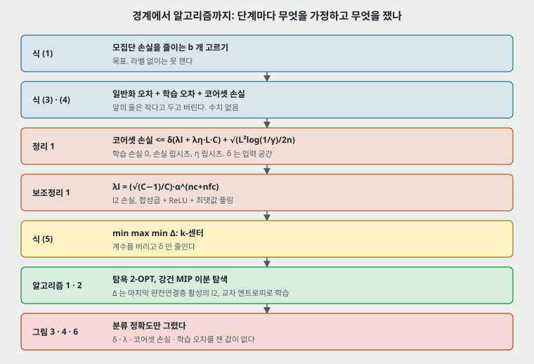

---

## 3. 문제 / 동기

**이 논문이 없앤 전제: 라벨을 고르는 기준은 불확실성이어야 한다.**

논문이 적는 순서는 다음과 같다(1 ~ 2쪽).

1. 라벨을 하나씩 고르는 고전 설정은 합성곱 망에 맞지 않는다. 점 하나는 국소 최적화 탓에 통계적으로 유의한 영향이 없을 가능성이 있고, 고를 때마다 끝까지 다시 배우면 계산이 닿지 않는다.
2. 묶음으로 고르면 고른 점들이 서로 상관된다. 원문은 이것을 불확실성 방법이 듣지 않는 **주된 원인으로 주장한다(「We argue」)**. 상관을 수로 잰 자리는 없고, 근거는 그림 5 의 t-SNE 하나다(8.5절).
3. 불확실성과 다양성을 함께 보는 앞 방법들은 $n^2$ 개 변수를 쓰므로 큰 데이터로 못 간다고 적는다(2쪽). **이 편의 식 (6) 도 $\omega_{i,j}$ · $\xi_{i,j}$ 가 각각 $n^2$ 개다**(8.6절).
4. 코어셋 쪽에는 SVM · k-means · k-median 용 방법이 있고 합성곱 망 용은 저자가 아는 범위에서 없다고 적는다(3쪽).

논문 스스로 가장 가까운 앞 연구로 꼽는 것은 Wei 외(2013, 시설 배치의 min-sum 꼴로 다양한 덮개를 찾음)와 Berlind & Urner(2015, k-NN 전용, 증명 기법을 빌림)다.

---

## 4. 핵심 기술

**① 코어셋 손실로 문제를 바꾼다 (식 1 ~ 4).** 목표는 $b$ 개를 더 골라 모집단 손실을 줄이는 것이다.

$$\min_{s^1 : \lvert s^1 \rvert \le b} E_{x, y \sim p_Z}\left[ l(x, y; A_{s^0 \cup s^1}) \right] \qquad (1)$$

여러 라운드는 라운드마다 식 (1) 을 근시안으로 푸는 것으로 다룬다(식 2). 손실을 셋으로 쪼갠다.

$$E[l(x,y;A_s)] \le \left\lvert E[l(x,y;A_s)] - \frac{1}{n}\sum_{i \in [n]} l(x_i,y_i;A_s) \right\rvert + \frac{1}{\lvert s \rvert}\sum_{j \in s} l(x_j,y_j;A_s) + \left\lvert \frac{1}{n}\sum_{i \in [n]} l(x_i,y_i;A_s) - \frac{1}{\lvert s \rvert}\sum_{j \in s} l(x_j,y_j;A_s) \right\rvert \qquad (3)$$

순서대로 일반화 오차 · 학습 오차 · 코어셋 손실이다. 합성곱 망은 학습 오차가 낮고 일반화가 잘 되는 것이 「널리 관찰된다」 며(수치 없음) 셋째만 남긴다(식 4).

**② 덮는 반지름으로 위에서 막는다 (정리 1 · 보조정리 1).**

정리 1. $n$ 개의 i.i.d. 표본과 집합 $s$ 에 대해, 손실이 모든 $y, w$ 에서 $\lambda^l$-립시츠이고 $L$ 로 유계이며, 회귀 함수 $\eta_c(x) = p(y = c \mid x)$ 가 $\lambda^\eta$-립시츠이고, $s$ 가 $\delta_s$ 덮개이고, $s$ 위 손실이 0 이면, 확률 $1 - \gamma$ 이상으로

$$\left\lvert \frac{1}{n}\sum_{i \in [n]} l(x_i,y_i;A_s) - \frac{1}{\lvert s \rvert}\sum_{j \in s} l(x_j,y_j;A_s) \right\rvert \le \delta(\lambda^l + \lambda^\mu L C) + \sqrt{\frac{L^2 \log(1/\gamma)}{2n}}$$

원문 그대로 옮겼다. $\lambda^\mu$ 는 가정의 $\lambda^\eta$ 와 같은 것으로 읽힌다(11절). 저자는 「이 상한이 라벨 수에 기대지 않는다. 라벨은 덮는 반지름을 줄일 때만 코어셋 손실에 도움이 된다」 고 적는다(5쪽).

보조정리 1. $n_c$ 개 합성곱(최댓값 풀링 · ReLU)과 $n_{fc}$ 개 완전연결 층으로 된 망에서, 소프트맥스 출력과 부류 확률 사이의 2-노름 손실은 입력에 대해 $\frac{\sqrt{C-1}}{C}\alpha^{n_c + n_{fc}}$-립시츠다. $\alpha$ 는 뉴런당 입력 무게 합의 최댓값이다.

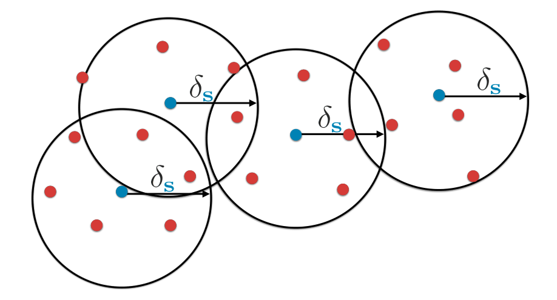

**③ k-센터를 탐욕법으로 푼다 (식 5 · 알고리즘 1).** 계수를 버리고 $\delta$ 만 줄인다.

$$\min_{s^1 : \lvert s^1 \rvert \le b} \ \max_i \ \min_{j \in s^1 \cup s^0} \Delta(x_i, x_j) \qquad (5)$$

```
알고리즘 1 (옮김)
입력: 데이터 x_i, 있는 풀 s0, 예산 b
s = s0
반복:
    u = argmax_{i in [n] - s}  min_{j in s}  Δ(x_i, x_j)
    s = s + {u}
|s| = b + |s0| 이 될 때까지
s - s0 를 돌려준다
```

**④ 강건 k-센터를 MIP 로 푼다 (식 6 · 알고리즘 2).** 탐욕 반지름 $\delta_{2-OPT}$ 와 그 절반 사이를 이분 탐색하며 다음 계획의 실행 가능 여부를 묻는다.

$$\sum_j u_j = \lvert s^0 \rvert + b, \quad \sum_{i,j} \xi_{i,j} \le \Xi, \quad \sum_j \omega_{i,j} = 1 \ \forall i, \quad \omega_{i,j} \le u_j \ \forall i,j, \quad u_i = 1 \ \forall i \in s^0, \quad \omega_{i,j} = \xi_{i,j} \ \forall i,j : \Delta(x_i,x_j) > \delta \qquad (6)$$

$u_i$ 는 점 $i$ 가 중심인가, $\omega_{i,j}$ 는 $i$ 가 $j$ 에 덮이는가, $\xi_{i,j}$ 는 $i$ 가 이상점으로 $\delta$ 제약 없이 $j$ 에 덮이는가이고 모두 0 또는 1 이다. 실제로는 LP 완화와 분기 한정으로 정수 해를 구한다(9쪽).

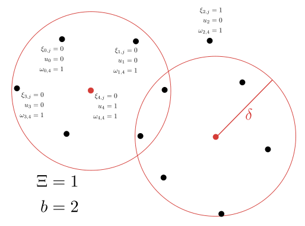

**설정(7쪽).** 거리는 **마지막 완전연결층 활성의 $l_2$.** 약지도는 Ladder network, 모든 실험의 합성곱 망은 VGG-16. 초기화는 He 외(2016) 방식, RMSProp 학습률 $10^{-3}$, TensorFlow. **라운드마다 처음부터 다시 배운다.** MIP 는 Gurobi, $\Xi = 10^{-4} \times$ (라벨 없는 점 수). 장비는 표 1 의 각주에 Intel Core i7-5930K 3.50GHz · 메모리 64GB 만 적혀 있고 GPU 는 적혀 있지 않다. **배치 크기 · 에폭 수 · 데이터 늘리기는 적혀 있지 않다**(글자 층에서 `batch size` · `epoch` · `augment` 를 찾아 나오지 않았다).

---

## 5. 보장 셋을 가른다 — 무엇을 가정하고, 실험에서 쟀는가

원문은 한 줄기로 적지만 보장은 셋이고 성격이 다르다.

| | 탐욕 2-OPT (알고리즘 1) | MIP · 이분 탐색 (알고리즘 2) | 정리 1 경계 |
|---|---|---|---|
| 무엇의 보장인가 | **덮는 반지름** $\le 2 \times$ OPT | 이상점 $\Xi$ 개를 뺀 반지름이 $\delta$ 이하인지의 판정 | **코어셋 손실** $\le \delta(\ldots) + \sqrt{\ldots}$ |
| 기준 | OPT = 같은 $s^0$ · $b$ 에서 식 (5) 의 최솟값 | 그 판정을 묶은 이분 탐색 값 | 입력 공간의 덮개 $\delta$ |
| 가정 | $\Delta$ 가 삼각 부등식을 만족(원문에 안 적음, 아래 내 유도에서 쓴다) | 구간이 참값을 담는다는 원문 문장은 $\Xi = 0$ 일 때의 것이다 | 학습 손실 0 · 손실 $\lambda^l$-립시츠 · $L$ 유계 · $\eta$ $\lambda^\eta$-립시츠 · i.i.d. · 손실은 $l_2$ |
| 증명의 자리 | **원문에 없다.** 「is proven」 이라 적고 인용이 없다(6쪽) | 증명이 없다. 절차만 적었다 | 부록 A · B |
| 실험에서 쟀는가 | 반지름 값 없음. 정확도(그림 6)와 시간(표 1)뿐 | 같다 | **어느 항도 재지 않았다** |

**PatchCore 쪽 물음의 답.** 보장의 기준은 **덮는 반지름의 최적값**이다. 손실이나 정확도가 아니다.

**내 유도: $s^0$ 가 있어도 2-OPT 가 선다.** 원문에 증명이 없고 인용도 없어 직접 따라갔다. 탐욕법이 고른 순서대로 점을 $u_1, \ldots, u_b$, 끝에 남은 가장 먼 점을 $u_{b+1}$, 그 거리를 $r$ 이라 하자(곧 $r$ 이 탐욕 반지름). 뽑히는 거리는 줄기만 하므로 $u_1, \ldots, u_{b+1}$ 은 서로와 $s^0$ 에서 모두 $r$ 이상 떨어진다. 최적해에서는 이 $b + 1$ 점이 저마다 어떤 중심의 OPT 안에 든다. (가) 그중 하나가 $s^0$ 의 중심에 붙으면 $r \le$ OPT. (나) 모두 새 중심 $b$ 개에 붙으면 비둘기집 원리로 둘이 한 중심을 나눠 쓰므로 $r \le 2 \times$ OPT. **이 유도의 쓰는 가정은 삼각 부등식 하나다.** 곧 라벨도, 손실도, 망도 들어오지 않는다.

**내 확인(논문 자료가 아니다).** 평면의 무작위 점 6 ~ 11 개, $\lvert s^0 \rvert$ 1 ~ 2, $b$ 1 ~ 3 으로 4,000 번을 모두 세어 맞췄다. $2 \times$ OPT 를 넘은 횟수 0, OPT 가 탐욕 반지름의 절반 아래로 내려간 횟수 0, 가장 큰 비 1.904 였다.

**$\Xi > 0$ 이면 구간이 깨진다 (내 장난감, 논문 자료가 아니다).** 원문은 「최적해가 탐욕 결과와 그 절반 사이에 있음이 보장된다」 고 적는데(6쪽), 이것은 $\Xi = 0$ 일 때의 말이다. 바로 다음 문장에서 이상점을 허용하면서 구간은 그대로 둔다. 점 0, 1, 20, 21, 100 · $s^0$ = {0} · $b$ = 1 이면 탐욕이 100 을 골라 반지름 21 이다. $\Xi = 0$ 의 OPT 도 21 이다. $\Xi = 1$ 이면 100 을 이상점으로 두고 20 을 골라 반지름 1 이고, 이것은 구간 [10.5, 21] 밖이다. 이 자료로 알고리즘 2 를 글자 그대로 돌리면 ub = 1, lb = 10.5 에 머물러 `until ub = lb` 가 오지 않는다(반복 상한 1,000 번에서 끊었다).

**알고리즘 2 의 $s_g$ (내 읽기).** 알고리즘 1 은 $s \setminus s^0$ 를 돌려주고 알고리즘 2 는 $\delta_{2-OPT} = \max_j \min_{i \in s_g} \Delta(x_i, x_j)$ 로 잰다. 글자 그대로면 $s^0$ 가 빠진 반지름이다. 같은 자료에서 $s_g$ = {100} 이라 시작 ub = 100, lb = 50 이고, $\Xi = 0$ 의 참값 21 이 구간 밖에 놓이며 역시 끝나지 않는다. $s_g \cup s^0$ 로 읽으면 3 번 만에 21 로 끝난다. 원문의 코드를 보지 않았으므로 실제로 어떻게 돌렸는지는 모른다.

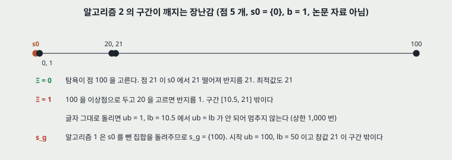

---

## 6. 증명을 따라가 본 것 (내가 확인한 것)

| 단계 | 원문(쪽) | 내 확인 | 판정 |
|---|---|---|---|
| 균등점의 Frobenius 노름 | $f_i = 1/C$ 에서 $\sqrt{C-1}/C$ (12) | 그대로 나온다 | 값은 맞다 |
| 그 점이 최대라는 말 | 「straightforward to show」 (12) | $\lVert J \rVert_F^2 = S_2 - 2S_3 + S_2^2$ ($S_k = \sum f_i^k$). 원소 $k$ 개 균등이면 $\sqrt{k-1}/k$ 라 **$k = 2$ 에서 0.5 로 가장 크다** | **$C \ge 3$ 에서 틀리다** |
| 입력 무게 합 $\le \alpha$ 로 2-노름 단계 | $\lVert x^d - \tilde x^d \rVert_2 \le \alpha \lVert x^{d-1} - \tilde x^{d-1} \rVert_2$ (12) | 출력 $m$ 개가 모두 같은 입력 하나를 무게 1 로 읽으면 입력 무게 합 1 인데 배율 $\sqrt{m}$ | **이 가정만으로는 서지 않는다** |
| ReLU | $\lvert a - b \rvert \le \lvert \max(0,a) - \max(0,a) \rvert$ (13) | 인쇄대로면 오른쪽이 0 이다. $\lvert \max(0,a) - \max(0,b) \rvert \le \lvert a - b \rvert$ 로 읽으면 선다 | 인쇄 오류 |
| 최댓값 풀링 | 「무게 하나만 1 인 합성곱」 (13) | 어느 무게가 1 인지 입력마다 바뀐다. 창이 겹치지 않으면 창마다 $\lvert \max a - \max b \rvert \le \lVert a - b \rVert_2$ 라 제곱해 더해 선다 | 겹치지 않는 창에서 선다 |
| 역삼각 부등식 | 손실로 옮김 (13) | 선다 | 선다 |
| (d) · (e) | $\eta$ 차이를 $\delta \lambda^\eta L C$ 로 막음 (13) | 부류마다 $\lvert \eta_k(x_i) - \eta_k(x_j) \rvert \le \delta \lambda^\eta$ · 손실 $\le L$ 을 $C$ 번 더한다. 선다 | 선다 |
| 남은 항이 0 | $\sum_k \eta_k(x_j)\, l(x_j, k; A_s) = 0$ 이어야 $\le \delta\lambda^l$ (13) | 「학습점 손실 0」 은 **관측된 라벨 $y_j$ 하나**의 말이다. 이 항은 **$\eta_k(x_j) > 0$ 인 모든 부류**의 손실이 0 일 것을 요구한다 | **중심에서 라벨이 결정적일 때만 선다** |
| Hoeffding | 기댓값에서 표본 평균으로 (13) | $A_s$ 는 $s$ 의 라벨에만 기대므로 $x$ 와 $A_s$ 가 주어지면 $i \notin s$ 의 $y_i$ 는 독립이고 $s$ 위 손실은 0 이다(내 판단). 선다 | 선다 |

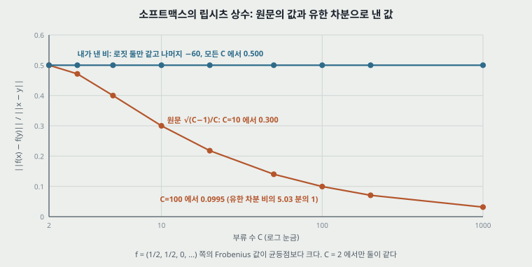

**상수 표(내가 센 것).** 유한 차분 비는 로짓 $(10^{-3}, -10^{-3}, -60, \ldots)$ 와 $(0, 0, -60, \ldots)$ 사이에서 낸 값이다.

| $C$ | 2 | 3 | 5 | 10 | 20 | 50 | 100 | 200 | 1000 |
|---|---:|---:|---:|---:|---:|---:|---:|---:|---:|
| 원문 $\sqrt{C-1}/C$ | 0.5000 | 0.4714 | 0.4000 | 0.3000 | 0.2179 | 0.1400 | 0.0995 | 0.0705 | 0.0316 |
| 유한 차분 비 | 0.5000 | 0.5000 | 0.5000 | 0.5000 | 0.5000 | 0.5000 | 0.5000 | 0.5000 | 0.5000 |
| 비 / 원문 | 1.00 | 1.06 | 1.25 | 1.67 | 2.29 | 3.57 | 5.03 | 7.09 | 15.82 |

$C$ = 3 · 5 · 10 · 100 에서 임의 표본 60,000 개로 찾은 Frobenius 값의 최댓값은 0.50000 이었다. 저자의 「CIFAR-100 이 덜 듣는 것은 상한이 부류 수를 따라 커져서다」(8쪽)에서 $\lambda^\eta L C$ 항은 그대로지만, $\lambda^l$ 이 $C$ 를 따라 준다는 쪽은 이 표로 받쳐지지 않는다.

**층 단계의 크기.** 위 표의 예에서 출력 폭 $m$ = 2 · 512 · 4,096 이면 배율 1.41 · 22.63 · 64.00 이다. 2-노름 상한을 받치려면 출력당 합과 입력당 합을 함께 제약해야 한다. 원문은 뉴런당 입력 쪽 합만 정의한다.

**「$\alpha$ 는 손실의 행동을 바꾸지 않고 임의로 작게 할 수 있다」(6쪽).** 괄호 안의 뜻이 「라벨을 바꾸지 않는다」 이므로 분류 결과는 그대로일 수 있다. 그러나 **정리가 쓰는 손실은 소프트맥스 출력의 $l_2$ 라 값이 움직인다.** $C = 10$ · 편향 없는 16 층 · 로짓 간격 20 에서 층마다 무게를 $s$ 배 하면(내가 센 것):

| $s$ | 1.00 | 0.90 | 0.75 | 0.50 |
|---|---:|---:|---:|---:|
| 로짓 배율 $s^{16}$ | 1 | 0.1853 | 0.01002 | $1.526 \times 10^{-5}$ |
| 손실 | 0.0000 | 0.1909 | 0.9281 | 0.9487 |

0.9487 은 로짓이 0 일 때의 값 $\sqrt{(C-1)/C}$ 이다. **곧 $\alpha$ 를 줄이면 정리의 「학습 손실 0」 가정을 잃는다.** 또 소프트맥스 출력은 유한한 무게에서 원-핫이 되지 않으므로 $l_2$ 손실이 글자 그대로 0 이 되는 지점도 유한한 무게에는 없다.

**상한이 뜻을 갖는 $\delta$ 의 크기 (내가 센 것).** $L = \sqrt{2}$ (확률 벡터와 원-핫 사이의 최대 $l_2$), $C = 10$, $n_c + n_{fc} = 16$ 으로 세고(VGG-16 이라는 이름에서 센 수이고 원문의 CIFAR 판 층 수는 적혀 있지 않다), $\lambda^\eta$ 항을 뺀 채 $\delta \lambda^l < L$ 인 $\delta$ 를 원문 상수로 낸다.

| $\alpha$ | 1.0 | 1.5 | 2.0 |
|---|---:|---:|---:|
| $\alpha^{16}$ | 1 | 656.8 | 65,536 |
| $\lambda^l$ | 0.300 | 197.05 | 19,660.8 |
| $L / \lambda^l$ | 4.714 | $7.177 \times 10^{-3}$ | $7.193 \times 10^{-5}$ |

**원문에 $\alpha$ · $\delta$ 값이 없어 이 상한이 실제 망에서 $L$ 아래인지 판정할 수 없다.** 둘째 항은 $L = \sqrt{2}$ · $\gamma = 0.05$ · $n = 50{,}000$ 에서 0.00774 다.

**가장 큰 틈: 정리의 공간과 구현의 공간이 다르다 (내 읽기, 원문은 다루지 않는다).** 보조정리 1 은 「입력 이미지에 대해」 립시츠라 적는다(5쪽). 구현의 $\Delta$ 는 마지막 완전연결층 활성이다(7쪽). 그 공간으로 옮기면 (가) 앞쪽 층의 $\alpha$ 곱이 사라지는 대신 (나) $\eta$ 가 그 **특징 공간에서** 립시츠여야 하고 (다) 그 특징은 라운드 앞의 망 $A_{s^0}$ 의 것인데, 경계가 필요한 망은 처음부터 다시 배운 $A_{s^0 \cup s^1}$ 이다. 고른 뒤의 망에서 $s$ 가 $\delta$ 덮개라는 보장이 없다. 또 실험은 교차 엔트로피로 배우고 정리는 $l_2$ 손실이다(6쪽, 이것은 원문이 스스로 적는다).

---

## 7. 평가 (읽은 범위)

- **데이터셋**: CIFAR-10 · CIFAR-100(부류 10 · 100) · SVHN(숫자). 크기는 CIFAR 쪽이 「50k 이미지」 라고 9쪽에만 나온다.
- **지표**: 분류 정확도. 라벨 비(그림 3 · 4) 또는 라벨 수(그림 6)에 대한 곡선.
- **비교 상대**: Random · Best Empirical Uncertainty(최대 엔트로피 · BALD · Variation Ratios 중 데이터셋별 최고 하나) · DBAL(MC 드롭아웃, 같은 셋 중 최고 하나) · Best Oracle Uncertainty(**전체 라벨을 안다**, 손실 비례로 뽑음) · k-Median · BMDR · CEAL(약지도에만). **첫 점이 방법끼리 같은 값이라 같은 처음 풀에서 돌린 것으로 읽힌다**(CEAL 만 약지도 CIFAR-100 에서 30.40 대 30.45). 다른 논문의 값을 옮겼다는 말은 없고, 구현 출처도 적혀 있지 않다.
- **장비**: 표 1 의 각주가 CPU · 메모리를 적는다. 학습 장비는 적혀 있지 않다.

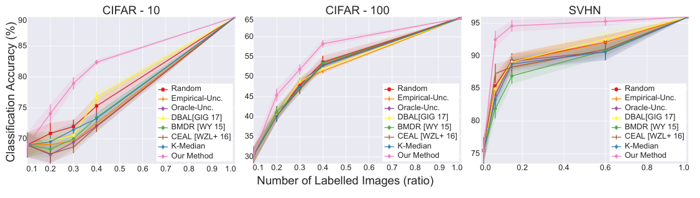

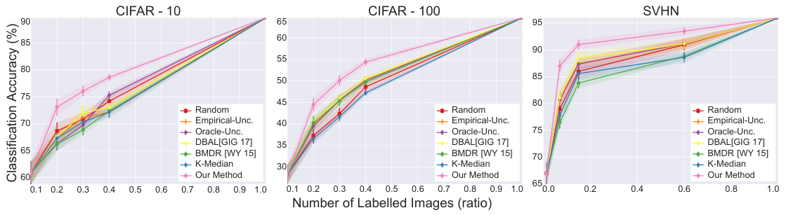

**표 ㄱ. 그림 3 · 4 의 값(내가 벡터 좌표로 읽은 값, 평균 ± 띠 반폭).** 측정 점은 곡선마다 다섯이다.

| 패널 | 라벨 비 | 이 편의 방법 | Random | 가장 높은 상대 | 차 | 두 반폭 합 |
|---|---:|---:|---:|---|---:|---:|
| 약지도 CIFAR-10 | 0.1 | 68.99 ± 2.0 | 68.99 ± 2.0 | (공통) | | |
| | 0.2 | 74.09 ± 1.5 | 70.87 ± 1.7 | Random 70.87 | 3.22 | 3.20 |
| | 0.3 | 78.96 ± 1.0 | 71.98 ± 1.1 | Random 71.98 | 6.98 | 2.10 |
| | 0.4 | 82.39 ± 0.4 | 75.30 ± 1.6 | DBAL 76.63 | 5.76 | 1.40 |
| | 1.0 | 89.70 ± 0.0 | 89.70 ± 0.0 | (공통) | | |
| 약지도 CIFAR-100 | 0.1 | 30.45 ± 2.1 | 30.45 ± 2.1 | (공통) | | |
| | 0.2 | 45.42 ± 1.6 | 40.82 ± 1.7 | BMDR 41.14 | 4.28 | 3.20 |
| | 0.3 | 51.84 ± 1.3 | 47.86 ± 1.3 | DBAL 48.74 | 3.10 | 2.50 |
| | 0.4 | 58.26 ± 0.9 | 53.66 ± 1.6 | Random 53.66 | 4.60 | 2.50 |
| | 1.0 | 64.71 ± 0.0 | 64.71 ± 0.0 | (CEAL 만 65.00) | | |
| 약지도 SVHN | 0.014 | 75.50 ± 2.0 | 75.50 ± 2.0 | (공통) | | |
| | 0.07 | 92.50 ± 1.3 | 85.40 ± 1.7 | CEAL 87.30 | 5.20 | 2.80 |
| | 0.15 | 94.60 ± 0.9 | 89.20 ± 1.2 | Random 89.20 | 5.40 | 2.10 |
| | 0.6 | 95.30 ± 0.7 | 92.10 ± 1.1 | DBAL 92.55 | 2.75 | 2.00 |
| | 1.0 | 96.00 ± 0.0 | 96.00 ± 0.0 | (공통) | | |
| 완전 지도 CIFAR-10 | 0.1 | 60.91 ± 2.1 | 60.91 ± 2.1 | (공통) | | |
| | 0.2 | 73.09 ± 1.6 | 68.66 ± 1.6 | Random 68.66 | 4.43 | 3.20 |
| | 0.3 | 76.08 ± 1.0 | 70.87 ± 1.2 | DBAL 71.98 | 4.10 | 2.40 |
| | 0.4 | 78.63 ± 0.6 | 74.20 ± 1.3 | Oracle 75.30 | 3.33 | 1.30 |
| | 1.0 | 89.70 ± 0.0 | 89.70 ± 0.0 | (공통) | | |
| 완전 지도 CIFAR-100 | 0.1 | 28.22 ± 2.2 | 28.22 ± 2.2 | (공통) | | |
| | 0.2 | 44.50 ± 1.6 | 37.28 ± 1.6 | DBAL 40.43 | 4.07 | 3.00 |
| | 0.3 | 50.14 ± 1.2 | 42.40 ± 1.4 | DBAL 45.94 | 4.20 | 2.50 |
| | 0.4 | 54.41 ± 0.8 | 48.63 ± 1.3 | DBAL 50.54 | 3.87 | 1.60 |
| | 1.0 | 64.71 ± 0.0 | 64.71 ± 0.0 | (공통) | | |
| 완전 지도 SVHN | 0.014 | 67.00 ± 2.0 | 67.00 ± 2.0 | (공통) | | |
| | 0.07 | 87.00 ± 1.1 | 79.00 ± 1.5 | DBAL 81.12 | 5.88 | 2.50 |
| | 0.15 | 91.00 ± 0.9 | 86.00 ± 1.3 | DBAL 88.45 | 2.55 | 2.10 |
| | 0.6 | 93.50 ± 0.8 | 91.00 ± 1.1 | Oracle 91.19 | 2.31 | 1.70 |
| | 1.0 | 96.00 ± 0.0 | 96.00 ± 0.0 | (공통) | | |

**표 1(원문, 초).** $b$ = 5k, $\lvert s^0 \rvert$ = 10k.

| 거리 행렬 | 탐욕(2-OPT) | MIP(반복당) | MIP(합) | Total |
|---:|---:|---:|---:|---:|
| 104.2 | 2 | 7.5 | 244.03 | 360.23 |

**그림 6(내가 벡터 좌표로 읽은 값, 라벨 다섯 곳).** 원문 그림의 숫자 라벨(0.29 ~ 0.65)과 소수 둘째 자리까지 맞는다.

| 라벨 수 | 5k | 10k | 20k | 40k | 50k |
|---|---:|---:|---:|---:|---:|
| 탐욕 | 29.14 | 43.32 | 52.24 | 62.88 | 64.71 |
| 이 편의 방법 | 30.45 | 45.42 | 54.34 | 64.45 | 64.71 |
| 차 | 1.31 | 2.10 | 2.10 | 1.57 | 0.00 |

---

## 8. 실험 분석 (논문의 표 · 그림마다)

**직접 돌리지 않았다.** 논문이 낸 실험을 표 · 그림 하나씩 같은 틀로 읽는다. 값을 벡터 좌표에서 꺼내 다시 계산했고, 그렇게 낸 값은 「내가 읽은 값 · 내가 센 것」 으로 밝힌다.

| 표 · 그림 | 무엇을 바꿨나 (변인) | 무엇을 고정했나 | 결과 | 반복 수 · 흩어짐 | 주장이 결과보다 센가 |
|---|---|---|---|---|---|
| 그림 1 | 실험이 아니다. 정리 1 의 도식 | | 캡션 $O(\delta_s) + O(\sqrt{1/n})$ | | 정리 식과 같다. 다만 $\lambda$ 와 $C$ 가 $O$ 안에 들어가 있다 |
| 그림 2 | 실험이 아니다. 식 (6) 변수의 도식, $\Xi$ = 1 · $b$ = 2 | | 점 13 개 중 중심 2, 이상점 1 (내가 셈) | | 캡션과 도식이 맞는다 |
| 그림 3 | 뽑는 방법 8 종 x 라벨 비 다섯 x 데이터셋 셋 | Ladder + VGG-16, RMSProp $10^{-3}$, 라운드마다 처음부터, 처음 풀은 방법끼리 같다(첫 점이 같은 값, CEAL 만 30.40 대 30.45) | 표 ㄱ. 18 칸 중 약지도 9 칸의 차 2.75 ~ 6.98 | 처음 풀 무작위 5 번. 띠 반폭 0.4 ~ 2.1. **끝 점 반폭 0** | 「모든 실험에서 앞선다」 는 9 칸 모두 띠가 떨어져 **선다**. 「약지도에서 큰 차이로」 는 8.3절 |
| 그림 4 | 뽑는 방법 7 종(CEAL 없음) x 라벨 비 x 데이터셋 셋 | VGG-16, 나머지 같음 | 표 ㄱ. 완전 지도 9 칸의 차 2.31 ~ 5.88 | 같다. 반폭 0.6 ~ 2.2 | 「앞선다」 는 **선다.** 「무작위가 Oracle · DBAL 을 넘는다」 는 **Oracle 쪽 10/18, DBAL 쪽 8/18 칸에서만 맞다**(8.2절) |
| 그림 5 | 뽑는 방법 둘: (a) Oracle (b) 이 편의 방법 | 「CIFAR」(몇 부류인지 안 적음), t-SNE, 같은 라벨 수 | 정성 그림. 표식 수는 캡션과 다르다(8.5절) | 실행 하나 | 「큰 부분을 덮지 못한다 · 가설을 확인한다」 는 **세다**: 정량이 없고, 내가 잰 최댓값 반지름은 (b) 가 더 크다 |
| 그림 6 | 뽑기 풀이 둘: 탐욕 대 MIP x 라벨 다섯 곳 | CIFAR-100. **약지도인지 완전 지도인지 안 적음** | 차 1.31 · 2.10 · 2.10 · 1.57 · 0.00 | **흩어짐 없음.** 실행 수 안 적음 | 「작지만 유의한(significant) 하락」 은 **세다**(8.4절) |
| 표 1 | 변인 없음. 단계별 시간 | $b$ = 5k · $\lvert s^0 \rvert$ = 10k, i7-5930K · 64GB | Total 360.23 초 | 「평균」 이라 적고 횟수와 흩어짐이 없다 | 「쉽게 적용」 · 「어떤 크기로도 간다」 는 **세다**: 잰 것은 5 만 장의 한 설정이다(8.6절) |

### 8.1 곡선을 읽을 때

- **측정 점은 곡선마다 다섯이다.** CIFAR 쪽 0.1 · 0.2 · 0.3 · 0.4 · 1.0, SVHN 쪽 0.014 · 0.07 · 0.15 · 0.6 · 1.0 이다. 그림에는 0.5 ~ 0.9 눈금이 있지만 **0.4 와 1.0 사이는 꼭짓점 없는 직선이다.** 곧 CIFAR 쪽 비교는 라벨 40% 까지의 세 점에 선다.
- **끝 점은 약지도와 완전 지도의 값이 같다.** 89.70 · 64.71 · 96.00 이고 반폭이 0 이다(약지도 CIFAR-100 의 CEAL 만 65.00). 다섯 번 돌린 값의 표준편차가 0 이고 망이 다른 두 그림에서 같으므로, 같은 값을 그린 것으로 읽힌다(내 판단). 어떻게 낸 값인지 적혀 있지 않다.
- **띠 반폭 225 칸 중 219 칸이 소수 한 자리로 떨어진다.** 나머지 6 칸은 CIFAR-10 의 k-Median 이다. 완전 지도 SVHN 의 Random 다섯 점은 67 · 79 · 86 · 91 · 96 으로 정수다. 반올림해 그렸는지는 적혀 있지 않다.
- **첫 점의 반폭이 패널마다 2.0 ~ 2.2 로 그 패널에서 가장 크다.** 뽑기가 들어가기 전, 처음 풀 무작위 뽑기만의 흩어짐이다.

### 8.2 「무작위가 Oracle · 베이즈 쪽을 넘는다」(8쪽)

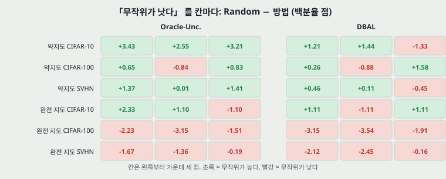

원문은 「둘 다 경험적 불확실성보다 나으니 도움이 되지만, 무작위가 그들을 넘으므로 묶음 설정에서 효과가 없다」 고 적는다. 18 칸을 세면(내가 센 것):

| 비교 | 앞선 칸 / 18 |
|---|---:|
| Random 이 Oracle-Unc. 보다 높다 | 10 |
| Random 이 DBAL 보다 높다 | 8 |
| Oracle-Unc. 이 Empirical-Unc. 보다 높다 | 5 |
| DBAL 이 Empirical-Unc. 보다 높다 | 18 |
| Empirical-Unc. 이 Random 보다 높다 | 8 |
| BMDR 이 Random 보다 높다 | 4 |
| k-Median 이 Random 보다 높다 | 0 |

**두 문장 모두 일부 칸의 말이다.** 완전 지도 CIFAR-100 · SVHN 여섯 칸에서는 Random 이 Oracle 보다 0.19 ~ 3.15, DBAL 보다 0.16 ~ 3.54 낮다. Oracle 이 Empirical 을 넘는 것은 18 칸 중 5 칸이다. 저자의 묶음 상관 설명은 이 칸들을 풀지 못한다. k-Median 0/18 과 BMDR 4/18 은 원문의 말과 맞는다. **상대가 「셋 중 데이터셋별 최고」 인 것은 상대에게 유리한 쪽의 선택이다.**

### 8.3 「약지도에서 큰 차이로」 · 「CIFAR-100 에서 덜 듣는다」(8쪽)

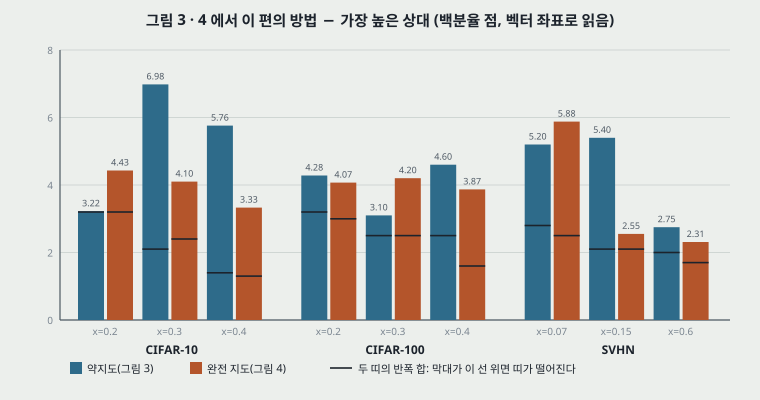

- **18 칸 모두 띠가 떨어진다.** 가장 좁은 칸은 약지도 CIFAR-10 비 0.2 로 차 3.22, 두 반폭 합 3.20 이다. 표본 5 번이라 이 칸은 띠의 경계에 있다.
- **「약지도에서 차이가 크다」**: 차의 평균이 약지도 4.59(2.75 ~ 6.98), 완전 지도 3.86(2.31 ~ 5.88)이다. 다만 **같은 자리끼리 맞대면 9 칸 중 3 칸(CIFAR-10 비 0.2, CIFAR-100 비 0.3, SVHN 비 0.07)은 약지도 쪽이 작다.** 그 까닭으로 든 「약지도가 더 좋은 특징 공간을 준다」 는 저자의 믿음(「We believe」)이고 특징 공간을 잰 자리는 없다.
- **「CIFAR-100 에서 덜 듣는다. 이론으로 쉽게 설명된다」** 는 **약지도 줄에서만 보인다.**

| 세 칸 평균 | CIFAR-10 | CIFAR-100 | SVHN |
|---|---:|---:|---:|
| 약지도, 최고 상대와의 차 | 5.32 | **3.99** | 4.45 |
| 완전 지도, 최고 상대와의 차 | 3.95 | **4.05** | 3.58 |
| 약지도, Random 과의 차 | 5.76 | **4.39** | 5.23 |
| 완전 지도, Random 과의 차 | 4.69 | **6.91** | 5.17 |

완전 지도에서는 CIFAR-100 이 두 줄 모두 가장 크다. 또 CIFAR-10 과 SVHN 은 부류 수가 같은데 약지도 차 평균이 5.32 대 4.45 로 갈리고, 평균 내는 라벨 비가 패널마다 달라 칸끼리 맞대는 일 자체가 정확하지 않다. **상한이 부류 수를 따라 커진다는 설명은 어느 줄에서도 $\delta$ 나 $\lambda$ 를 재서 낸 것이 아니다.**

### 8.4 그림 6: 탐욕 대 MIP

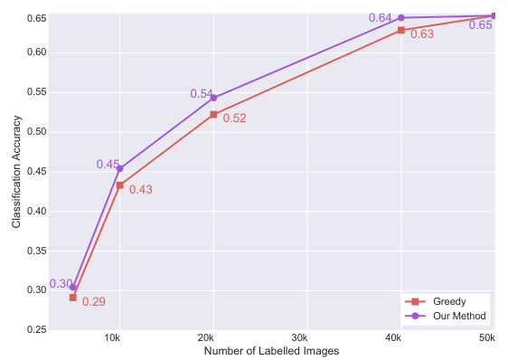

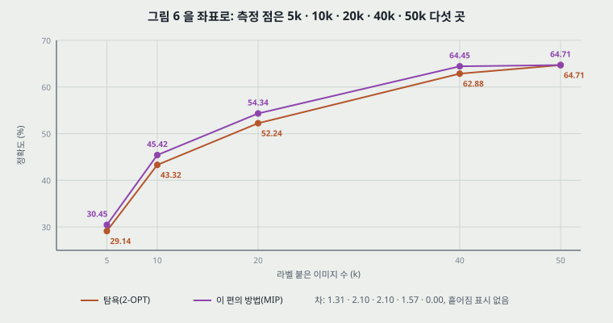

1. **「작지만 유의한」 에 근거가 없다.** 흩어짐이 그려져 있지 않다. 그림 3 · 4 의 같은 라벨 수에서 이 편의 방법의 반폭은 5k 에서 2.1 · 2.2, 10k 에서 1.6, 20k 에서 0.9 · 0.8 이다. 차는 1.31 · 2.10 · 2.10 · 1.57 이다.
2. **처음 풀 자리의 차가 이미 1.31 이다.** 그림 3 · 4 에서 비 0.1(5k)은 모든 방법의 값이 같다. 그림 6 의 5k 가 같은 처음 풀이면 뽑기가 들어가기 전인데 29.14 대 30.45 다. 그림 6 의 설정이 적혀 있지 않아 다른 해석은 닫지 못하지만, 이 차가 뽑기의 몫이 아니라면 다른 칸의 차를 읽는 눈금이 된다.
3. **그림 3 · 4 어느 쪽의 곡선인지 맞지 않는다.** 이 편의 방법 값이 5k · 10k 에서 약지도 값과 같고(30.45 · 45.42), 20k 는 약지도 58.26 대신 완전 지도 54.41 에 가까운 54.34 다. 40k 측정 점은 그림 3 · 4 에 없고 20k 와 50k 를 이은 직선 값(62.56 · 61.28)보다 그림 6 이 높다.
4. **「2-OPT 도 다른 상대를 넘는다」(9쪽) 는 어느 그림과 맞대느냐에 달렸다.** CIFAR-100 에서 탐욕 값은 10k 43.32, 20k 52.24 다. 완전 지도의 최고 상대(40.43 · 50.54)와는 +2.89 · +1.70 이고, 약지도의 최고 상대(41.14 · 53.66)와는 +2.18 · **−1.42** 다. CIFAR-10 · SVHN 의 탐욕 값은 원문에 없다.
5. **$b$ 가 표 1 과 다르다.** 표 1 은 $b$ = 5k 인데 그림 6 은 10k → 20k → 40k 로 간격이 늘어난다. 라운드 구성이 적혀 있지 않다.

### 8.5 그림 5: t-SNE

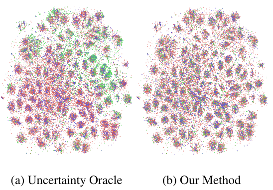

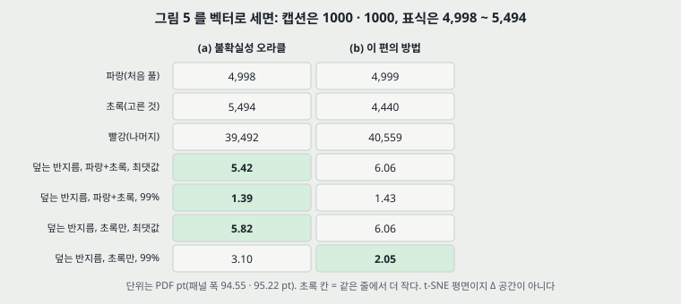

- **캡션과 표식 수가 다르다.** 캡션은 처음 풀 1000 · 고른 것 1000 이라 적는다. PDF 의 점 표식을 색으로 세면 파랑 4,998 · 4,999, 초록 5,494 · 4,440, 빨강 39,492 · 40,559, 합 49,984 · 49,998 이다. 곧 처음 풀 5,000 쪽 그림으로 읽힌다. 두 패널의 초록 수가 서로 다르고 어느 쪽도 5,000 이 아닌 까닭은 적혀 있지 않다.
- **「고르게 덮는다」 를 재면 결과가 갈린다(내가 센 것, 단위 PDF pt, 패널 폭 94.55 · 95.22).** 빨강 점에서 가장 가까운 파랑 + 초록까지의 거리다.

| | (a) Oracle | (b) 이 편의 방법 |
|---|---:|---:|
| 파랑 + 초록, 최댓값 | **5.42** | 6.06 |
| 파랑 + 초록, 99% | **1.39** | 1.43 |
| 파랑 + 초록, 중앙값 | 0.304 | **0.290** |
| 초록만, 최댓값 | **5.82** | 6.06 |
| 초록만, 99% | 3.10 | **2.05** |
| 초록만, 중앙값 | 0.578 | **0.434** |

**초록끼리의 99% · 중앙값은 (b) 가 0.66 · 0.75 배로 작고** 눈으로 보이는 쏠림(그림 (a) 오른쪽 위의 초록 무리)과 맞는다. **그러나 이 편이 줄이려는 양에 해당하는 최댓값은 이 평면에서 (b) 가 더 크다.** t-SNE 평면은 $\Delta$ 공간이 아니고 두 패널이 같은 임베딩인지도 적혀 있지 않으므로, 이 표는 그림 5 로 가설이 「확인」 되지 않는다는 데까지만 쓴다.

### 8.6 표 1 과 규모

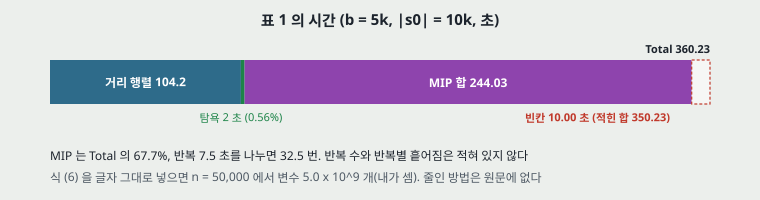

- **칸의 합이 Total 과 다르다.** 104.2 + 2 + 244.03 = 350.23 이고 Total 은 360.23 으로 10.00 초(2.78%) 많다(내가 셈). 빠진 단계인지 오기인지 적혀 있지 않다.
- **MIP 가 Total 의 67.7%, 거리 행렬 28.9%, 탐욕 0.56%** 다. MIP 를 쓰면 탐욕만(거리 + 탐욕 106.2 초) 쓸 때의 3.39 배가 든다. 반복은 244.03 / 7.5 = 32.5 번으로 나온다.
- **식 (6) 의 변수 수(내가 셈).** $n$ = 50,000 에서 $u$ 50,000 + $\omega$ $2.5 \times 10^9$ + $\xi$ $2.5 \times 10^9$ = $5.00005 \times 10^9$ 개다. 64 GB 를 $64 \times 10^9$ 바이트로 세어 변수로 나누면 12.8 바이트다. 이 크기로 어떻게 반복 7.5 초에 풀었는지(제약이 없는 변수를 지웠는지, 어떤 $n$ 을 넣었는지) 원문에 없다. **앞 방법을 「$n^2$ 변수라 큰 데이터로 못 간다」 고 적은 자리(2쪽)와 나란히 볼 곳이다.**
- **「어떤 데이터 크기로도 간다」(9쪽) 는 잰 범위 밖의 말이다.** 잰 것은 5 만 장 한 곳이다. 거리 행렬을 8 바이트로 전부 저장하면 $n$ = 50,000 에서 20 GB, $n = 10^6$ 에서 8 TB 이고, $n^2$ 비례로 늘리면 행렬 시간이 104.2 x 400 초 = 11.6 시간이다(내가 셈). 탐욕법 자체는 $b \times n$ 번 거리 계산으로 행렬 없이도 돌 수 있으나(내 판단) 원문이 그렇게 돌렸다고 적지 않았다. 이상점 허용은 라벨 없는 점 40,000 개에서 $\Xi$ = 4 개로 $b$ = 5,000 의 0.08% 다.

---

## 9. 이 논문이 스스로 적은 한계

1. 학습 오차 0 은 「완전히 현실적인 가정은 아니다」(5쪽).
2. 이론은 교차 엔트로피로 넓혀지지 않는다. 이론은 $l_2$, 실험은 교차 엔트로피다(6쪽).
3. $\alpha$ 는 일반적으로 유계가 아니다(6쪽, 임의로 작게 할 수 있다는 말과 함께).
4. k-센터의 약점은 강건성이고 $\Xi$ 로 다룬다(6쪽).
5. MIP 의 시간은 최악의 경우 다항이 아니다. 규모가 너무 크면 2-OPT 로 내려간다(9쪽).
6. CIFAR-100 에서 CIFAR-10 · SVHN 보다 덜 듣는다(8쪽).
7. 불확실성을 이 방법에 원리 있게 넣는 것은 열린 문제다(8쪽).

---

## 10. 논문이 적지 않은 것 — 내가 읽으며 짚은 자리

1. **「아무 추가 가정 없이」(2쪽) 와 정리의 가정들.** 관련 연구 절은 「no extra assumption」 으로 코어셋 문제를 다룬다고 적는데, 5쪽의 정리는 학습 손실 0 · 두 립시츠 · $l_2$ 손실을 쓴다.
2. **「처음」 이라는 말의 범위.** 「이 부류에서 합성곱 망에 적용한 첫 번째」(2쪽)는 뒤이은 문단의 Wang 외(2016) · Stark 외(2015) · Gal 외(2017)와 나란히 읽어야 한다. 「이 부류」 가 어디까지인지 문장으로 닫혀 있지 않다.
3. **「일반화가 잘 된다」 는 식 (3) 첫 항의 말이 아니다.** 첫 항은 전체 $n$ 점의 표본 평균과 모집단의 차이고, $n$ 이 크면 작다. 흔히 일반화라 부르는 「배운 점과 안 본 점의 차」 는 오히려 셋째 항(코어셋 손실)이다. 원문의 이름만 보면 둘을 헷갈린다.
4. **「이상점」 의 효과를 따로 잰 자리가 없다.** 그림 6 의 차에 정확한 풀이의 몫과 $\Xi$ 의 몫이 섞여 있다. $\Xi = 0$ 인 MIP 곡선이 없다.
5. **라운드 수 · 라운드별 $b$ 가 그림 3 · 4 에 적혀 있지 않다.** 곡선의 점 사이 간격으로 읽을 뿐이다.
6. **뽑기에 쓰는 특징을 학습 중 어느 시점의 망에서 뽑는지** 적혀 있지 않다. 곧 $\Delta$ 의 값을 재현하려면 코드가 필요하다.

---

## 11. 원문 안의 어긋남 모음

| 자리 | 원문 | 맞서는 것 |
|---|---|---|
| 5 · 13쪽 | $\lambda^\mu$ | 가정과 (e) 는 $\lambda^\eta$ 다 |
| 12쪽 | 야코비 $J_{CC} = -f_C(1 - f_C)$ | 다른 대각 원소처럼 $+f_C(1-f_C)$ 라야 한다. 노름 식에는 제곱이라 영향이 없다 |
| 12쪽 | 「$f_i = 1/C$ 가 최적」 | $C \ge 3$ 에서 아니다(6절) |
| 12쪽 | $\sum_i \lvert w_{i,j} \rvert \le \alpha \ \forall i, j, d$ | 합을 취한 $i$ 를 다시 전칭했다 |
| 13쪽 | $\lvert a - b \rvert \le \lvert \max(0,a) - \max(0,a) \rvert$ | 방향과 둘째 인자가 틀렸다(6절) |
| 13쪽 | 「Claim 1 in (d), ... bound of loss in (d)」 | 둘째는 (e) 다. Claim 1 은 $y' \in \{0, 1\}$ 인데 $C$ 부류에 쓴다 |
| 6쪽 | 식 (6) $\sum_j u_j, = \lvert s^0 \rvert + b$ | 쉼표가 끼어 있다. 또 $\min_{s^1 : \lvert s^1 \le b \rvert}$ 괄호 자리가 틀렸다 |
| 6 · 7쪽 | 알고리즘 1 은 $s \setminus s^0$ 를 돌려준다. 알고리즘 2 는 그것으로 $\delta_{2-OPT}$ 를 잰다 | 5절 |
| 6쪽 | 구간이 참값을 담는다 | $\Xi > 0$ 에서 깨진다(5절) |
| 7 · 8쪽 | 상대 이름 k-Median | 8쪽 본문은 k-Medoids. 「cluster sentences」 는 cluster centers 로 읽힌다 |
| 9쪽 캡션 | 처음 풀 1000 · 고른 것 1000 | 벡터 표식 4,998 ~ 5,494 (8.5절) |
| 9쪽 표 1 | Total 360.23 | 칸의 합 350.23 (8.6절) |
| 10쪽 | Dasgupta 2004 · 2005 | 같은 제목의 항목 둘 |

---

## 12. PatchCore 와 맞춰 보기 — 물음의 답

앞서 읽은 PatchCore(CVPR 2022)는 뱅크를 줄일 때 다음을 쓴다. 조각 특징 뱅크 $\mathcal{M}$ 에서 $\mathcal{M}_C^* = \arg\min_{\mathcal{M}_C \subset \mathcal{M}} \max_{m \in \mathcal{M}} \min_{n \in \mathcal{M}_C} \lVert m - n \rVert_2$ (그 논문의 식 5) 를 목적으로 두고, 무작위 사영 $\psi$ 뒤의 거리로 「지금까지 고른 것에서 가장 먼 점 더하기」 를 $l$ 번 한다(그 논문의 알고리즘 1).

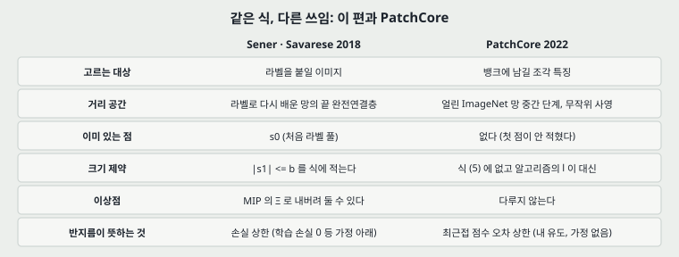

**(가) 같은 식인가.** **목적은 같다**: 이 편의 식 (5) 에서 $s^0 = \emptyset$, $b = l$, $\Delta$ = $l_2$ 로 두면 그 꼴이다. 차이는 둘이다. 이 편에는 $\lvert s^1 \rvert \le b$ 가 있고 PatchCore 식에는 크기 제약이 없다. 이 편은 $s^0$ 가 있어 첫 걸음의 $\min$ 이 정의되고, PatchCore 는 $\mathcal{M}_C$ 가 빈 채 시작해 첫 점이 적혀 있지 않다. **곧 PatchCore 쪽의 두 빈칸은 이 원전에는 없고 옮기면서 생겼다.**

**(나) 보장은 무엇을 기준으로 하나.** 덮는 반지름의 최적값이다(5절). 정확도도 AUROC 도 아니다. 알고리즘 1 의 단계만 옮긴 PatchCore 에 이 2 배 보장이 그대로 오는 것은 **사영이 없을 때**다.

**(다) 사영 뒤에도 남는가.** 이 편은 **사영을 다루지 않는다**(13 쪽 글자 층에서 project · Johnson · Lindenstrauss 를 찾아 나오지 않았다). 내 유도로, 뱅크의 모든 쌍에서 $(1-\varepsilon)\lVert a-b \rVert \le \lVert \psi a - \psi b \rVert \le (1+\varepsilon)\lVert a-b \rVert$ 이면 다음이 선다. 사영 공간 반지름 $\le 2 \times$ 사영 공간 OPT $\le 2(1+\varepsilon)$ OPT 이고, 원래 공간 반지름은 사영 공간 반지름의 $1/(1-\varepsilon)$ 배 이하이므로 **보장 계수가 $2(1+\varepsilon)/(1-\varepsilon)$ 으로 바뀐다.**

| $\varepsilon$ | 0.05 | 0.10 | 0.20 | 0.50 |
|---|---:|---:|---:|---:|
| 계수 | 2.21 | 2.44 | 3.00 | 6.00 |

PatchCore 는 사영 차원 $d^*$ 을 적지 않으므로 $\varepsilon$ 을 몰라 **어느 칸인지 말할 수 없다.** 또 위 조건이 모든 쌍에서 서는지는 $d^*$ 에 달렸다.

**(라) 정리 1 은 PatchCore 로 오지 않는다.** 정리 1 은 라벨 · 학습 손실 0 · 소프트맥스 위 $l_2$ 손실 위에 서는데 PatchCore 에는 라벨도 학습도 소프트맥스도 없다. **대신 반지름의 뜻이 더 곧다 (내 유도, 가정은 삼각 부등식뿐이다).** $\mathcal{M}_C$ 의 덮는 반지름이 $r$ 이면 시험 특징 $z$ 의 최근접 거리에 대해

$$0 \le \min_{n \in \mathcal{M}_C} \lVert z - n \rVert - \min_{m \in \mathcal{M}} \lVert z - m \rVert \le r$$

이다. $\mathcal{M}_C \subset \mathcal{M}$ 이라 왼쪽이 서고, $z$ 의 최근접 $m^*$ 를 $r$ 안에서 덮는 $n$ 을 잡으면 오른쪽이 선다. 작은 예시로 $r = 2$ 이고 온전한 뱅크 점수가 10 이면 줄인 뱅크 점수는 10 이상 12 이하다. 재가중 앞의 이미지 점수(조각 최댓값)도 같은 범위를 받는다. **곧 PatchCore 에서 탐욕법이 지키는 것은 손실이 아니라 점수의 오차다.** 뒤집을 수 있는 것은 점수 차이가 $r$ 이하인 판정이다. PatchCore 도 이 편도 $r$ 값을 적지 않아 크기는 말할 수 없다.

**(마) 강건성.** 이 편은 탐욕법이 이상점을 먼저 고른다는 약점을 $\Xi$ 로 다루고 PatchCore 는 탐욕 단계만 쓰며 이상점을 다루지 않는다. 학습 정상 이미지에 이상한 조각이 섞여 있으면 먼저 뱅크로 들어가고 그 값이 점수의 기준을 낮춘다(내 판단, 어느 쪽도 재지 않았다).

**(바) Gonzalez.** **이 편은 Gonzalez 를 인용하지 않는다.** 참고 문헌 51 건(내가 셈)에 없고, 2-OPT 문장(6쪽)에는 인용이 아예 없으며, k-센터는 Wolf(2011), NP-난해는 Cook 외(1998)를 인용한다. PatchCore 원문에도 Gonzalez 가 없다. **「탐욕 2-근사의 원 출처가 Gonzalez(1985)」 라는 줄은 두 논문 어디에서 온 것이 아니고 바깥 지식이며, 그 원문을 이 저장소에서 읽지 않았다.**

---

## 13. 내가 가져갈 것

**하나. 코어셋이 지키는 것은 점수 오차 상한 $r$ 이다.** 이 편의 경계를 PatchCore 근거로 삼으면 안 되고(가정이 어긋난다), 12절의 삼각 부등식이 근거다. PatchCore 쪽에서 재야 할 양은 비율(1% · 10%)이 아니라 **남은 덮는 반지름과 정상 · 이상 점수 간격의 비**다.

**둘. 옮겨 쓸 수 있는 읽는 법 셋.** (1) 이론의 공간과 구현의 공간이 같은지 본다: 여기서는 입력 대 끝 층, 얼린 망이 아닌 다시 배우는 망이다. (2) 벡터로 들어 있는 그림은 좌표를 꺼낸다: 그림 3 · 4 의 다섯 점, 그림 5 의 표식 수, 그림 6 이 그림 3 · 4 와 맞지 않는 것은 그렇게 나왔다. (3) 「A 가 B 를 넘는다」 는 칸으로 센다: 「무작위가 넘는다」 는 18 칸 중 10 · 8 칸이다.

**셋. 지금 확인된 것은 여기까지다.**

| 구분 | 내용 |
|---|---|
| 논문이 잰 것 | 세 데이터셋의 정확도 곡선(곡선당 5 점, 5 번), 한 설정의 시간 |
| 논문이 말만 한 것 | 묶음 상관이 불확실성 방법을 망친다 · 약지도 특징이 기하를 낫게 한다 · 상한이 부류 수로 설명한다 · 어떤 크기로도 간다 |
| 논문이 재지 않은 것 | $\delta$ · $\lambda$ · $\alpha$ · 코어셋 손실 · 학습 오차 · 반지름과 정확도의 관계 |
| 내가 책상에서 센 것 | 표 ㄱ · 칸 세기 · 그림 5 · 6 의 좌표 · 상수 표 · 변수 수 · 2-OPT 유도와 소형 자료 확인 · 사영 계수 · 삼각 부등식 |

---

## 14. 읽을 때 헷갈리는 지점

- **2-OPT 는 국소 탐색이 아니다.** $2 \times$ OPT 의 근사 보장을 원문이 이렇게 부른다.
- **이 편의 코어셋을 k-means 코어셋과 같은 말로 읽지 않는다.** 원문 3쪽이 따로 드는 k-means · k-median 코어셋(Har-Peled & Kushal, 읽지 않았다)과 달리, 여기는 덮는 반지름을 줄이는 k-센터다.
- **곡선의 「Our Method」 는 탐욕법이 아니다.** 알고리즘 2(MIP)다. 탐욕법은 그림 6 에만 따로 그렸다. **PatchCore 가 가져간 것은 탐욕법 쪽이다.**
- **$n$ 이 두 뜻이다.** 정리 1 에서는 전체 점의 수이고, $\Xi = 10^{-4} \times n$ 에서는 「라벨 없는 점의 수」 라 적는다(7쪽).

---

## 15. 계보


원문 인용을 따른 앞: Wolf(2011, k-센터) · Cook 외(1998, NP-난해) · Berlind & Urner(2015, 증명 기법) · Wei 외(2013, min-sum 시설 배치). 이 편 뒤: PatchCore(2022)가 탐욕 단계를 가져갔다. **이 편을 받는 다른 뒤 편은 이 노트에서 다루지 않는다.**

---

## 16. 남는 질문

- **덮는 반지름과 정확도는 실제로 함께 움직이는가.** 이 편은 재지 않았다. 알고리즘을 바꿔 반지름만 달라지게 하고 정확도를 재는 편이 필요하다.
- **식 (6) 을 어떻게 줄여 풀었는가.** 원문의 코드가 있으면 볼 자리다. 이 노트는 코드를 찾지 않았다.
- **불확실성과 덮기를 함께 쓰면 어떻게 되는가.** 저자가 열린 문제로 남겼다.
- **PatchCore 의 사영 차원에서 $\varepsilon$ 은 얼마인가.** 원문에 $d^*$ 이 없어 구현을 봐야 한다.

**다음에 읽을 것.** 큰 틀의 순서(AnoDDPM → UniAD)를 따르고 아래는 이 노트 안에 남기는 세부다.

| 논문 | 이 노트의 어느 자리에서 나오는가 | 무엇을 확인하고 싶은가 | 원문 참고 문헌에 있는가 |
|---|---|---|---|
| **Clustering to minimize the maximum intercluster distance** (Gonzalez) — Theoretical Computer Science 1985 | 5 · 12절 — 2-OPT 의 원 출처로 알려진 편 | 탐욕 2-근사가 실제로 이 편의 결과인지, $s^0$ 가 있는 꼴을 다루는지 | **없다** |
| **Small-GAN** (Sinha 외) — ICML 2020 | 12절 (다) — PatchCore 가 사영을 가져온 편 | 사영 뒤 보장을 적는지, $d^*$ 를 어떻게 정하는지 | 없다(PatchCore 의 참고 문헌에 있다) |
| **Algorithms for facility location problems with outliers** (Charikar 외) — SODA 2001 — 후보 | 5절 — $\Xi > 0$ 에서 구간이 깨지는 자리 | 이상점 있는 k-센터의 근사 보장. 읽고 이 자리에 맞는 편인지 가린다 | 없다 |
| **Active nearest neighbors in changing environments** (Berlind & Urner) — ICML 2015 | 6절 — 증명 기법의 출처 | 라벨이 결정적이 아닐 때 남는 항을 어떻게 다루는지 | 있다 |
| **Deep Bayesian Active Learning with Image Data** (Gal 외) — arXiv 2017 | 8.2절 — DBAL 의 원 편 | 큰 묶음에서 효과가 사라진다는 말이 원 편의 설정과 맞는지 | 있다 |

---

## 17. 참고 문헌

- Sener, O. and Savarese, S. (2018). Active learning for convolutional neural networks: A core-set approach. ICLR. arXiv:1708.00489v4. — **읽었다, 이 노트의 원문.**
- Wolf, G. W. (2011). Facility location: concepts, models, algorithms and case studies. — 원문의 k-센터 인용. **읽지 않았다.**
- Cook, W. J. 외 (1998). Combinatorial optimization. Springer. — 원문의 NP-난해 인용. **읽지 않았다.**
- Berlind, C. and Urner, R. (2015). Active nearest neighbors in changing environments. ICML. — 원문의 Claim 1 출처. **읽지 않았다.**
- Wei, K. 외 (2013). Using document summarization techniques for speech data subset selection. HLT-NAACL. — 가장 닮았다고 원문이 꼽은 편. **읽지 않았다.**
- Gal, Y., Islam, R. and Ghahramani, Z. (2017). Deep Bayesian active learning with image data. arXiv:1703.02910. — DBAL. **읽지 않았다.**
- Wang, Z. and Ye, J. (2015). Querying discriminative and representative samples for batch mode active learning. TKDD. — BMDR. **읽지 않았다.**
- Wang, K. 외 (2016). Cost-effective active learning for deep image classification. — CEAL. **읽지 않았다.**
- Rasmus, A. 외 (2015). Semi-supervised learning with ladder networks. NIPS. — 약지도 모델. **읽지 않았다.**
- Xu, H. and Mannor, S. (2012). Robustness and generalization. Machine Learning. — 일반화 오차 인용. **읽지 않았다.**
- Gonzalez, T. F. (1985). Clustering to minimize the maximum intercluster distance. Theoretical Computer Science 38: 293-306. — **원문에 인용이 없다. 읽지 않았다.** 서지는 PatchCore 노트에 적어 둔 것을 옮겼다.
- Roth, K. 외 (2022). Towards total recall in industrial anomaly detection. CVPR. — PatchCore. 12절의 식과 알고리즘은 저장소에 든 arXiv v2 에서 온 것이다.

---

## 18. 경로

| 무엇 | 어디 |
|---|---|
| 원문 PDF (arXiv v4, 13 쪽) | `papers/ICLR18_Coreset_Active_Learning_for_Convolutional_Neural_Networks_A_Core_Set_Approach.pdf` |
| 이 노트 | `notes/ICLR18_Coreset_Active_Learning_for_Convolutional_Neural_Networks_A_Core_Set_Approach.md` |
| 이 노트의 그림 (직접 그린 것) | `figures/ICLR18_Coreset/fig01_chain.svg` 부터 `fig10_lineage.svg` 까지 열 |
| 이 노트의 그림 (원문에서 잘라 낸 것) | `figures/ICLR18_Coreset/paper_fig1_cover.png` · `paper_fig2_mip_variables.png` · `paper_fig3_weak.png` · `paper_fig4_full.png` · `paper_fig5_tsne.png` · `paper_fig6_greedy.png` |
| 그림과 책상 계산 코드 | `figures/ICLR18_Coreset/make_figures.py` — 표준 라이브러리만 쓰고 바깥 데이터를 읽지 않는다. 찍히는 값이 노트의 「내가 센 것」 이다 |
| 원문 그림 자르기 · 벡터 좌표 읽기 코드 | `figures/ICLR18_Coreset/crop_paper_figures.py` — PyMuPDF · numpy · scipy 가 필요하다 |
