# DDIM — Denoising Diffusion Implicit Models (ICLR 2021, 요약)

> **한 줄.** DDPM 의 학습 목적 $L_1$ 은 결합 분포 $q(x_{1:T} \mid x_0)$ 가 아니라 주변 분포 $q(x_t \mid x_0)$ 에만 기댄다. 그래서 같은 주변 분포를 갖는 **비마르코프 앞방향 가족**(표준편차 $\sigma$ 로 번호를 매긴다)을 놓고, **이미 학습한 망을 그대로 쓴 채** 뽑는 과정만 바꾼다. $\sigma = 0$ 이면 시작 잡음 $x_T$ 에서 결정적으로 이미지가 나오고 이것이 DDIM 이다. 걸음을 $T = 1000$ 중 $S$ 개로 줄이면 CIFAR10 FID 가 $S = 100$ 에서 4.16 · $S = 20$ 에서 6.84 · $S = 10$ 에서 13.36 이고, 같은 체크포인트의 DDPM($\eta = 1$)은 5.78 · 18.36 · 41.07 이다.

> **이 노트에서 가장 먼저 볼 자리 다섯.** (1) **「10 ~ 50 배」 는 걸음 수가 아니라 배수다.** 1000 걸음을 20 ~ 100 걸음으로 줄인다는 뜻이고(7 쪽), 벡터 좌표로 읽은 시간 비는 CIFAR10 9.5 ~ 48.8 배 · Bedroom 10.0 ~ 39.3 배다(18절). (2) **「1000 걸음과 견줄 만하다」 를 나눠 보면 20 걸음에서 1.40 ~ 3.91 배, 100 걸음에서 1.03 ~ 1.86 배다**(같은 데이터의 1000 걸음 FID 가 분모, 17절). (3) **표 3 의 Church $S = 100$ 은 DDPM 8.27 이 DDIM 10.58 보다 2.31 낮다.** 본문의 「DDIM 이 낫다」 문장에 들어가지 않은 칸이고 부록에만 있다(16절). (4) **정리 1 의 증명 끝 계수 $\gamma_t = 1/(2d\sigma_t^2\alpha_t)$ 는 같은 편의 식 (66) 과 맞지 않는다.** 바로 풀면 $\gamma_t = c_t^2(1-\alpha_t)/(2\sigma_t^2\alpha_t)$ 이고 이것은 식 (66) 과 다섯 자리까지 같다. 정리의 말(양수 $\gamma$ 가 있다)은 그대로 서지만 곡선 모양이 다르다(7절, 내가 유도한 것). (5) **「$L_1$ 을 $J_\sigma$ 대신 쓸 수 있다」 는 $t$ 마다 파라미터를 공유하지 않을 때의 말이다.** 실험의 망은 $t$ 를 입력으로 받는 U-Net 하나다(DDPM 노트 10절). 공유 망에서 $J_\sigma$ 를 잰 행이 이 파일에 없다(8절).

---

## Paper Metadata

| Item | Content |
|---|---|
| Title | Denoising Diffusion Implicit Models |
| Authors | Jiaming Song, Chenlin Meng, Stefano Ermon. 공동 1저자 · 교신 표시는 파일에 없다 |
| 소속 | Stanford University |
| Conference / Journal | **ICLR 2021.** 쪽마다 머리글 「Published as a conference paper at ICLR 2021」 |
| Year | 2021. 파일은 arXiv **v4**, 첫 쪽 여백 `arXiv:2010.02502v4 [cs.LG] 5 Oct 2022`, 파일 정보의 만든 날 2022-10-07. 학회 판과 수치가 다른지 이 노트는 확인하지 않았다 |
| DOI | 파일 안에 적혀 있지 않다. arXiv:2010.02502 |
| 코드 | 본문에 적혀 있지 않다(파일 전체에서 「github」 0 건). 이 노트는 코드를 보지 않았다 |
| Stored PDF | `papers/ICLR21_DDIM_Denoising_Diffusion_Implicit_Models.pdf` |
| 왜 읽었는가 | 2026-11-06 에 사용자가 고른 다음 큰 틀(확산 심화)의 첫 편. DDPM 노트 13절의 첫 한계(한 장에 신경망 통과 1000 번)를 받는다 |
| 읽은 범위 | **2026-11-06 에 22 쪽을 전부 읽었다.** 곧 Abstract · 1 ~ 7절 · 감사의 글 · 참고 문헌 목록 · 부록 A · B · C(C.1, C.2) · D(D.1 ~ D.5) · 식 (1) ~ (67) · 각주 1 ~ 9 · 그림 1 ~ 13 · 표 1 ~ 3. 참고 문헌의 편들은 읽지 않았다. **다만 Score SDE 의 VE · VP 이름 뜻만 그 편 원문의 한 문단으로 확인했다**(13절) |

### 저장한 파일의 상태

- **본문 1 ~ 10 쪽, 참고 문헌 10 ~ 12 쪽, 부록 13 ~ 22 쪽.**
- **글자 층이 살아 있다.** 식 (2) · (12) · (13) · (14) · (29) ~ (35) · (47) ~ (59) 와 표 1 · 3, D.3 의 $\hat\sigma$ 식은 쪽을 110 ~ 170 dpi 로 띄워 위 · 아래 첨자와 굵은 칸을 맞췄다.
- **그림 4 는 벡터다.** 눈금 선과 표식 상자의 좌표에서 값을 읽었다. 가로축 값이 10, 20, 50, 100, 200, 500, 1000 으로 소수 첫째까지 떨어지고, 세로 눈금 다섯의 간격이 로그 눈금과 소수 둘째(pt)까지 같다. 표식 가운데 0.1 pt 의 어긋남은 세로값 1.1% 다. **이 값들은 원문이 숫자로 적은 값이 아니다.**
- **그림 1 · 2 는 벡터와 래스터가 섞였고, 그림 3 · 5 · 6 · 7 ~ 13 은 표본 이미지다.** 그림 3 · 5 · 6 은 잘라 넣었고 나머지 표본 그림은 넣지 않았다.

---

## 1. 용어

이 노트에서 쓸 이름을 먼저 정한다. 논문의 원래 용어는 괄호로 함께 적는다.

- **$\alpha_t$ (이 노트는 원문 기호를 따른다)**: 원문의 $\alpha_t$ 는 **DDPM 의 누적값 $\bar\alpha_t$ 다**(부록 C.2). DDPM 의 한 걸음 값 $1 - \beta_t$ 는 이 노트에서 그렇게 풀어 적는다. 작은 예시로, DDPM 선형 일정($\beta$: $10^{-4}$ 에서 0.02)에서 $\alpha_{500} = 0.0786$, $\alpha_{1000} = 0.00004$ 이고 $\alpha_0 := 1$ 은 원문 정의다.
- **앞방향 (forward process)**: $x_0$ 에서 $x_T$ 쪽의 추론 분포 $q(x_{1:T} \mid x_0)$. 원문 각주 3 이 확산이 아닐 때도 이 이름을 쓴다고 밝힌다.
- **뽑는 과정 (generative process)**: $x_T$ 에서 $x_0$ 쪽의 학습되는 사슬 $p_\theta$. 작은 예시로, $S = 10$ 이면 망을 10 번 통과한다.
- **주변 분포 (marginal)**: 원문이 인용 부호와 함께 쓰는 말로 $q(x_t \mid x_0)$ 를 뜻한다. 각주 2 가 $x_0$ 조건이라 이 말을 「slightly abuse」 한다고 적는다.
- **결합 분포 (joint)**: $q(x_{1:T} \mid x_0)$. 작은 예시로, 주변 분포가 같아도 $x_t$ 들 사이의 상관은 다를 수 있다(그림 2).
- **$\sigma$ 가족 $q_\sigma$**: 식 (6) · (7) 의 추론 분포 모임. $\sigma \in \mathbb{R}^T_{\ge 0}$ 는 걸음마다 한 값이다. 작은 예시로, $\sigma_t$ 가 모두 0 이면 $x_0$ 와 $\epsilon$ 하나로 사슬 전체가 정해진다.
- **$\eta$**: 식 (16) 의 손잡이. $\sigma_{\tau_i}(\eta) = \eta \sqrt{(1-\alpha_{\tau_{i-1}})/(1-\alpha_{\tau_i})}\sqrt{1 - \alpha_{\tau_i}/\alpha_{\tau_{i-1}}}$. 작은 예시로, $\eta = 0$ 은 DDIM, $\eta = 1$ 은 DDPM 의 $\tilde\beta_t$ 판이다.
- **$\hat\sigma$**: $\hat\sigma_{\tau_i} = \sqrt{1 - \alpha_{\tau_i}/\alpha_{\tau_{i-1}}}$. 잡음만 키운 DDPM. $S = T$ 이면 $\hat\sigma_t^2 = \beta_t$ 다(내가 맞춰 본 것). 작은 예시로, $t = 1000$ 에서 $\hat\sigma^2 = 0.0200$.
- **부분열 $\tau$ · 뽑는 길 (sampling trajectory)**: $[1, \dots, T]$ 의 증가 부분열, 길이 $S = \dim(\tau)$. 그 역순이 뽑는 길이다. 작은 예시로, 선형 $S = 10$ 은 $1000, 900, \dots, 100$ 다음 0 으로 간다.
- **$J_\sigma$ · $L_\gamma$ · $L_1$**: $J_\sigma$ 는 식 (11) 의 변분 목적, $L_\gamma$ 는 식 (5) 의 가중 잡음 제곱 합, $L_1$ 은 $\gamma = \mathbf{1}$ 인 $L_\gamma$ 다. **아래 첨자 1 은 벡터 1 이지 노름이 아니다.** DDPM 의 $L_{\text{simple}}$ 과 같다.
- **암묵적 모델 (implicit probabilistic model)**: 잠재 변수에서 정해진 절차로 표본을 내고 밀도를 적지 않는 모델(Mohamed · Lakshminarayanan 2016 을 인용). 작은 예시로, GAN 의 생성기가 그렇다.
- **일관성 (consistency)**: 원문 5.2절의 말. 같은 $x_T$ 에서 걸음 수만 바꿔도 「높은 수준의 특징」 이 비슷하게 남는 성질. **원문에 재는 수가 없다**(19절).
- **슬러프 (slerp, spherical linear interpolation)**: 식 (67) 의 구면 보간. 작은 예시로, 서로 수직인 두 벡터의 가운데는 무게 0.7071 씩이라 노름이 유지되고, 선형 보간의 가운데는 무게 0.5 씩이라 노름이 0.7071 배가 된다(내가 센 것).
- **FID**: 생성 표본과 기준 이미지 사이 Inception 특징 분포의 거리. 낮을수록 좋다. **이 편은 표본 수와 기준 집합을 적지 않는다**(14절).

---

## 2. 한 문단 요약

DDPM 은 뽑는 과정을 앞방향의 역으로 정의해서 앞방향 길이 $T = 1000$ 만큼 망을 통과해야 한다. 이 편은 학습 목적이 주변 분포 $q(x_t \mid x_0)$ 에만 기댄다는 데서 시작한다. 주변 분포를 지키면서 결합 분포만 다른 비마르코프 앞방향 가족 $q_\sigma$ 를 정의하고(식 6, 7), 그 위의 변분 목적 $J_\sigma$ 가 어떤 $\gamma$ 의 $L_\gamma$ 와 상수 차이라는 것(정리 1), $t$ 마다 파라미터를 공유하지 않으면 $L_\gamma$ 의 최적해가 $\gamma$ 와 무관하다는 것을 근거로 **DDPM 체크포인트를 그대로** 쓴다. 뽑는 한 걸음은 예측한 $x_0$ · $x_t$ 쪽 방향 · 새 잡음 셋의 합이다(식 12). $\sigma_t = 0$ 이면 결정적이고 이것이 DDIM 이다. 앞방향을 부분열 $\tau$ 위에서 다시 정의해 걸음 수를 줄이며(4.2절, C.1), DDIM 걸음은 재매개변수화한 ODE 의 오일러 걸음으로 읽힌다(식 13, 14). 표 1 에서 $\eta = 0$ 이 $S \le 100$ 칸마다 가장 낮고, 표 3 의 256 x 256 에서는 7 칸에서 낮고 1 칸(Church $S = 100$)에서 높다. 같은 $x_T$ 는 걸음 수가 달라도 비슷한 이미지를 내고(그림 5), $x_T$ 의 슬러프가 이미지 보간이 되며(그림 6), $S$ 걸음 부호화 + $S$ 걸음 복호화의 재구성 제곱 오차가 $S = 1000$ 에서 0.0001 이다(표 2).

---

## 3. 문제 / 동기 (1 · 2절)

**이 논문이 없앤 전제 하나: 뽑는 과정은 앞방향의 역이어야 하고, 그래서 앞방향만큼 길어야 한다.**

- **원문의 말.** 「DDPM 은 ... 수천 걸음일 수 있는 앞방향의 역을 근사하고, 표본 하나에 모든 걸음을 돌아야 한다」. 예로 Nvidia 2080 Ti 한 장에서 32 x 32 이미지 50k 장에 **「around 20 hours」**, 256 x 256 은 **「nearly 1000 hours」**, GAN 은 1 분 안이라고 적는다(1 쪽). **20 · 1000 시간은 그림 4 에서 18.8 · 828.5 시간으로 읽히고(내가 읽은 값), GAN 의 1 분은 이 파일에 잰 행이 없다.**
- **$T$ 가 왜 큰가.** 변분 관점에서 $T$ 가 크면 역 전이가 가우시안에 가까워져 가우시안 조건부 모델이 맞는다(Sohl-Dickstein 외, 3 쪽).
- **열쇠 문장.** 「$L_\gamma$ 꼴의 DDPM 목적은 주변 분포 $q(x_t \mid x_0)$ 에만 기대고 결합 $q(x_{1:T} \mid x_0)$ 에 바로 기대지 않는다. 같은 주변 분포를 갖는 추론 분포는 여럿이다」(3절).
- **DDPM 노트의 어느 자리인가.** DDPM 노트 3절의 닫힌 식과 알고리즘 1 이 학습에서 사슬을 돌지 않는다는 것이 이미 그 말이다. 학습은 $x_t$ 를 한 번에 만들어 쓰므로 앞 걸음과의 상관을 본 적이 없다. **이 편은 그 관찰을 뽑는 쪽의 자유로 바꾼 것이다**(마지막 문장은 내 해석).

---

## 4. 비마르코프 앞방향 (3.1절, 식 6 ~ 8)

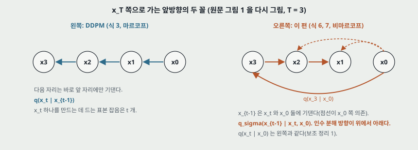

인수 분해 방향을 DDPM 과 반대로 잡는다. 위에서 아래로, 각 걸음이 $x_0$ 를 함께 본다.

$$q_\sigma(x_{1:T} \mid x_0) := q_\sigma(x_T \mid x_0) \prod_{t=2}^{T} q_\sigma(x_{t-1} \mid x_t, x_0) \qquad (6)$$

$$q_\sigma(x_{t-1} \mid x_t, x_0) = \mathcal{N}\!\left(\sqrt{\alpha_{t-1}}\,x_0 + \sqrt{1-\alpha_{t-1}-\sigma_t^2}\cdot\frac{x_t - \sqrt{\alpha_t}\,x_0}{\sqrt{1-\alpha_t}},\ \sigma_t^2 I\right) \qquad (7)$$

평균의 둘째 항에서 $(x_t - \sqrt{\alpha_t}x_0)/\sqrt{1-\alpha_t}$ 는 그 자리의 잡음 $\epsilon$ 이다. 그러면 식 (7) 은 이렇게 읽힌다.

$$x_{t-1} = \sqrt{\alpha_{t-1}}\,x_0 + \sqrt{1-\alpha_{t-1}-\sigma_t^2}\;\epsilon + \sigma_t\,\epsilon' \qquad (\text{내가 풀어 적은 꼴})$$

**잡음 분산의 합이 $(1 - \alpha_{t-1} - \sigma_t^2) + \sigma_t^2 = 1 - \alpha_{t-1}$ 이라 주변 분포가 맞는다.** 이것이 평균 계수를 고른 까닭이고, $\sigma_t$ 는 이 합을 옛 잡음과 새 잡음에 나누는 손잡이다.

- **$\sigma \to 0$ 이면.** 원문: 「$x_0$ 와 어떤 $x_t$ 를 보면 $x_{t-1}$ 이 정해진다」(4 쪽). 내 풀이로, 사슬 전체가 $\epsilon$ 하나를 나눠 쓴다. 그림 2 의 왼쪽이다.
- **앞방향은 쓰지 않는다.** 식 (8) 의 베이즈 식이 $q_\sigma(x_t \mid x_{t-1}, x_0)$ 를 주지만 「이 편 나머지에서 쓰지 않는다」 고 적는다.

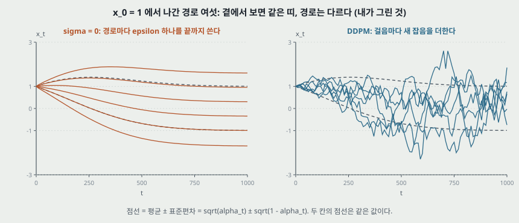

**보조 정리 1 확인(부록 B, 식 22 ~ 28).** $t = T$ 에서 맞으면 $t - 1$ 에서도 맞는다는 귀납이다. Bishop (2.115) 로 가우시안 합성을 하면 평균은 $\sqrt{\alpha_{t-1}}x_0$ 이고 분산은 $\sigma_t^2 + (1-\alpha_{t-1}-\sigma_t^2)/(1-\alpha_t) \cdot (1-\alpha_t) = 1 - \alpha_{t-1}$ 이다. **식 (26) ~ (28) 을 다시 풀어 같았다.**

---

## 5. 뽑는 과정과 변분 목적 (3.2절, 식 9 ~ 11)

$x_t$ 에서 $x_0$ 를 먼저 예측하고, 식 (7) 의 $x_0$ 자리에 넣어 한 걸음 내려간다.

$$f_\theta^{(t)}(x_t) := \frac{x_t - \sqrt{1-\alpha_t}\,\epsilon_\theta^{(t)}(x_t)}{\sqrt{\alpha_t}} \qquad (9)$$

$$p_\theta^{(t)}(x_{t-1} \mid x_t) = \begin{cases} \mathcal{N}(f_\theta^{(1)}(x_1), \sigma_1^2 I) & t = 1 \\ q_\sigma(x_{t-1} \mid x_t, f_\theta^{(t)}(x_t)) & \text{otherwise} \end{cases} \qquad (10)$$

식 (9) 는 DDPM 노트 7절의 $\hat{x}_0$ 식과 같다. 각주 4 는 「예측의 분포를 배우는 것도 되지만 이득이 적었다(little benefits)」 고 적고 수치는 없다.

$$J_\sigma(\epsilon_\theta) := \mathbb{E}_{x_{0:T} \sim q_\sigma}\left[\log q_\sigma(x_{1:T} \mid x_0) - \log p_\theta(x_{0:T})\right] \qquad (11)$$

$\sigma$ 마다 목적이 달라 $\sigma$ 마다 다른 모델을 배워야 할 것 같지만, 정리 1 이 그렇지 않다고 말한다.

> **정리 1.** 모든 $\sigma > 0$ 에 대해 $\gamma \in \mathbb{R}^T_{>0}$ 와 $C \in \mathbb{R}$ 가 있어 $J_\sigma = L_\gamma + C$ 다.

$$L_\gamma(\epsilon_\theta) := \sum_{t=1}^{T} \gamma_t\, \mathbb{E}_{x_0, \epsilon_t}\left[\left\lVert \epsilon_\theta^{(t)}(\sqrt{\alpha_t}x_0 + \sqrt{1-\alpha_t}\epsilon_t) - \epsilon_t \right\rVert_2^2\right] \qquad (5)$$

---

## 6. 정리 1 이 쓰는 뜻

세 걸음이다.

1. $J_\sigma$ 를 $t$ 마다의 KL 합으로 쓴다(식 29).
2. KL 안의 기댓값은 $q(x_0, x_t)$ 로만 재므로 $\sigma$ 를 몰라도 된다. 곧 **기대에 쓰는 분포가 $\sigma$ 가족에서 같다.**
3. 두 가우시안의 분산이 같아 KL 은 평균 차의 제곱이고, 그것이 잡음 제곱 오차의 상수 배다.

여기서 $\sigma$ 가 바꾸는 것은 $t$ 별 **무게 $\gamma_t$ 뿐**이다.

---

## 7. 증명을 다시 풀기 — 끝 계수가 다르다 (부록 B, 식 29 ~ 35, 내가 유도한 것)

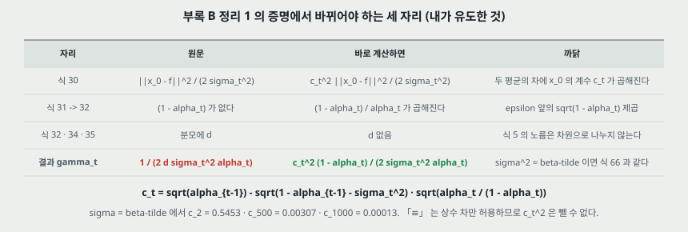

식 (7) 의 평균은 $x_0$ 에 대해 선형이고 그 계수는 이렇다.

$$c_t := \sqrt{\alpha_{t-1}} - \sqrt{1-\alpha_{t-1}-\sigma_t^2}\,\sqrt{\frac{\alpha_t}{1-\alpha_t}}$$

$q_\sigma(\cdot \mid x_t, x_0)$ 와 $q_\sigma(\cdot \mid x_t, f)$ 의 평균 차는 $c_t(x_0 - f)$ 이므로 KL 은 $c_t^2\lVert x_0 - f\rVert^2/(2\sigma_t^2)$ 이다. **원문 식 (30) 은 $c_t^2$ 없이 $\lVert x_0 - f\rVert^2/(2\sigma_t^2)$ 로 적는다.** 원문의 $\equiv$ 는 「$\epsilon_\theta$ 와 무관한 값만큼 차이」 로 정의돼 있어 곱셈 계수는 뺄 수 없다.

식 (31) 에서 (32) 로 갈 때 $\lVert (x_t - \sqrt{1-\alpha_t}\epsilon)/\sqrt{\alpha_t} - (x_t - \sqrt{1-\alpha_t}\epsilon_\theta)/\sqrt{\alpha_t} \rVert^2 = \frac{1-\alpha_t}{\alpha_t}\lVert\epsilon - \epsilon_\theta\rVert^2$ 이다. **원문 식 (32) 에는 $(1-\alpha_t)$ 가 없고 분모에 차원 $d$ 가 있다.** 식 (5) 는 합 노름이라 $d$ 가 들어올 자리가 없다. 그래서 끝 계수가 갈린다.

$$\text{원문 (35):}\ \ \gamma_t = \frac{1}{2d\sigma_t^2\alpha_t} \qquad\qquad \text{바로 풀면:}\ \ \gamma_t = \frac{c_t^2(1-\alpha_t)}{2\sigma_t^2\alpha_t}$$

**확인.** $\sigma_t^2 = \tilde\beta_t$ 이면 $c_t = \sqrt{\alpha_{t-1}}\beta_t/(1-\alpha_t)$ 이고(DDPM 사후 평균의 $x_0$ 계수), 위 식이 $\beta_t^2/(2\sigma_t^2(1-\beta_t)(1-\alpha_t))$ 가 된다. **이것이 같은 편 부록 C.2 의 식 (66) 이고 DDPM 의 식 (12) 다.** 숫자로도 맞춰 봤다(DDPM 선형 일정, $d = 3072$).

| $t$ | $\tilde\beta_t$ | $c_t$ | 식 (66) | 바로 푼 값 | 식 (35) 인쇄 | 인쇄 / 식 (66) |
|---:|---:|---:|---:|---:|---:|---:|
| 2 | 0.0000545 | 0.54529 | 0.59967 | 0.59967 | 2.985 | 5.0 |
| 100 | 0.002035 | 0.01908 | 0.01027 | 0.01027 | 0.0892 | 8.7 |
| 300 | 0.006032 | 0.00634 | 0.00507 | 0.00507 | 0.0681 | 13.4 |
| 500 | 0.01003 | 0.00307 | 0.00551 | 0.00551 | 0.2065 | 37.5 |
| 700 | 0.01402 | 0.00119 | 0.00716 | 0.00716 | 1.666 | 232.6 |
| 1000 | 0.02000 | 0.00013 | 0.01020 | 0.01020 | 201.6 | 19,760 |

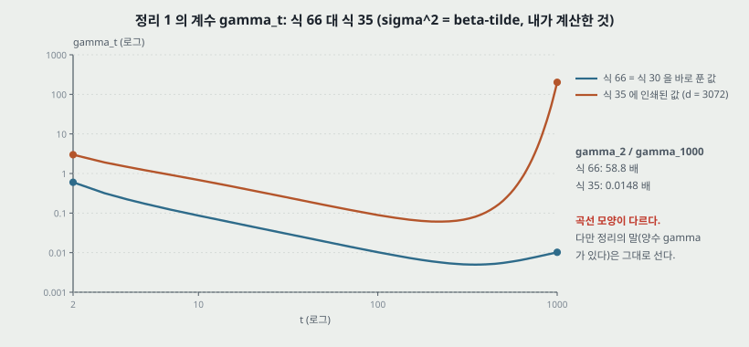

**무엇이 달라지고 무엇이 안 달라지나.**

- **정리의 말은 선다.** $\alpha_{t-1} > \alpha_t$ 이면 $\sqrt{\alpha_{t-1}/(1-\alpha_{t-1})} > \sqrt{\alpha_t/(1-\alpha_t)}$ 이고 $\sqrt{1-\alpha_{t-1}-\sigma_t^2} \le \sqrt{1-\alpha_{t-1}}$ 라서 $c_t > 0$ 이다. 그러니 양수 $\gamma$ 가 있다(내가 맞춰 본 것).
- **곡선은 달라진다.** $\gamma_2 / \gamma_{1000}$ 이 식 (66) 에서 58.8 배, 식 (35) 에서 0.0148 배다. **큰 $t$ 쪽 무게가 어느 쪽이 큰지가 뒤집힌다.** 공유 망에서는 무게가 답을 바꾸므로 이것이 그냥 지나갈 자리는 아니다(8절).
- **$\sigma \to 0$ 이면 $\gamma_t \to \infty$ 다.** 각주 5 가 「$\sigma_t = 0$ 은 정리 1 에 들어가지 않으니 $\sigma_t$ 를 아주 작게 해서 근사한다」 고 적는 자리다. 목적값 $J_\sigma$ 는 그 극한에서 발산한다(내가 맞춰 본 것). 원문은 $J_0$ 을 말하지 않는다.

---

## 8. 학습을 그대로 쓰는 근거 — 공유 조건 (3.2 · 4절)

원문의 논리는 이렇다(4 쪽). 「$t$ 사이에 파라미터를 **공유하지 않으면** $L_\gamma$ 의 최적해가 $\gamma$ 와 무관하다(항마다 따로 최소화). 그래서 $L_1$ 이 $J_\sigma$ 의 대리 목적이 된다.」 이 조건부 문장이 두 번 나온다.

**실험의 망은 공유한다.** 부록 D.1 이 「$\epsilon_\theta^{(t)}(x_t)$ 의 짜임은 Ho 외를 따른다」 고 적고, DDPM 노트 10절에 따르면 그 U-Net 은 $t$ 를 입력으로 받는 가중치 하나다. 곧 이 편의 실험은 **정리 1 의 결론이 닿는 범위 밖의 망**에서 뽑는 과정만 바꿔 쓴 것이다.

- 원문은 이 차이를 문장으로 짚지 않는다. 식 (5) 를 「$t$ 로 번호 매긴 함수 $T$ 개, 각각 파라미터 $\theta^{(t)}$」 로 정의하고 조건부로만 적는다.
- **표 1 · 3 은 이 빈칸과 별개의 근거다.** 같은 체크포인트에서 FID 를 쟀을 뿐이다. 그래서 「DDPM 체크포인트로 $\eta = 0$ 뽑기를 해도 된다」 는 표로 서고, 「그것이 $J_0$ 의 최적해다」 는 어디서도 재지 않았다.
- **$J_\sigma$ 의 값이나 하한 · 로그 가능도를 잰 행이 이 파일에 없다.**

---

## 9. 식 12 와 두 특수한 경우 (4.1절)

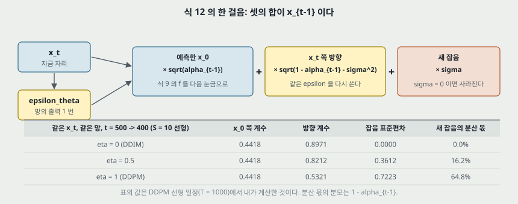

$$x_{t-1} = \sqrt{\alpha_{t-1}}\underbrace{\left(\frac{x_t - \sqrt{1-\alpha_t}\,\epsilon_\theta^{(t)}(x_t)}{\sqrt{\alpha_t}}\right)}_{\text{예측한 } x_0} + \underbrace{\sqrt{1-\alpha_{t-1}-\sigma_t^2}\cdot\epsilon_\theta^{(t)}(x_t)}_{x_t \text{ 쪽 방향}} + \underbrace{\sigma_t\epsilon_t}_{\text{새 잡음}} \qquad (12)$$

**특수한 경우 하나: DDPM.** 원문은 $\sigma_t = \sqrt{(1-\alpha_{t-1})/(1-\alpha_t)}\sqrt{1-\alpha_t/\alpha_{t-1}}$ 이면 「앞방향이 마르코프가 되고 뽑는 과정이 DDPM 이 된다」 고만 적고 풀지 않는다. 내가 풀어 맞췄다.

- 이 $\sigma_t^2$ 은 $\frac{1-\alpha_{t-1}}{1-\alpha_t}\beta_t = \tilde\beta_t$ 다($\beta_t = 1 - \alpha_t/\alpha_{t-1}$).
- $1 - \alpha_{t-1} - \tilde\beta_t = (1-\alpha_{t-1})^2(1-\beta_t)/(1-\alpha_t)$ 이므로 방향 계수는 $(1-\alpha_{t-1})\sqrt{1-\beta_t}/\sqrt{1-\alpha_t}$ 다.
- $\epsilon_\theta$ 앞의 계수를 더하면 $\frac{-(1-\alpha_t) + (1-\beta_t)(1-\alpha_{t-1})}{\sqrt{1-\beta_t}\sqrt{1-\alpha_t}} = \frac{-\beta_t}{\sqrt{1-\beta_t}\sqrt{1-\alpha_t}}$ 다. **DDPM 노트 6절의 $\mu_\theta$ 와 같다.** $t = 2, 100, 500, 1000$ 에서 소수 열째까지 같았다.

**곧 DDPM 은 $\sigma^2 = \tilde\beta_t$ 판이다.** DDPM 의 다른 후보 $\sigma^2 = \beta_t$ 는 이 가족의 안에 들지 않는다. 원문의 $\hat\sigma$ 가 그것이고 $\eta$ 로 닿지 않는다(12절).

**특수한 경우 둘: DDIM($\sigma_t = 0$).** 새 잡음이 사라지고 $x_T$ 에서 $x_0$ 까지 정해진다. 「앞방향이 더는 확산이 아닌데도 DDPM 목적으로 배운 암묵적 모델」 이라 이 이름을 붙였다.

**$t = 1$ 의 처리.** 식 (12) 는 $\alpha_0 := 1$ 을 쓴다. 그러면 $t = 1$ 의 방향 계수가 $\sqrt{-\sigma_1^2}$ 이라 $\sigma_1 > 0$ 이면 실수가 아니다. 식 (10) 이 $t = 1$ 을 따로 두는 까닭이다. 그런데 **식 (16) 은 모든 $\eta$ 에서 $\sigma_{\tau_1} = 0$ 을 준다**($1 - \alpha_0 = 0$). 식 (10) 의 문장 「지지 집합이 전체가 되도록 $\sigma_1^2$ 잡음을 더한다」 와 어긋나고, 정리 1 의 $\sigma > 0$ 조건에서 $t = 1$ 항이 빠진다(28절).

**$t = 500 \to 400$ 의 숫자(그림 3 의 표, 내가 계산한 것).** $x_0$ 쪽 계수는 $\eta$ 와 무관하게 0.4418 이고, 방향 계수가 0.8971($\eta = 0$) · 0.8212($\eta = 0.5$) · 0.5321($\eta = 1$)로, 잡음 표준편차가 0 · 0.3612 · 0.7223 으로 바뀐다.

---

## 10. 걸음을 줄이는 법 (4.2절 · 부록 C.1 · D.2)

앞방향을 $x_{1:T}$ 전부가 아니라 부분집합 $\{x_{\tau_1}, \dots, x_{\tau_S}\}$ 위의 사슬로 정의한다. 주변 분포가 같으니 $L_1$ 을 그대로 쓴다. 부록의 식 (52) 는 사슬(부분열)과 별 모양(나머지 $t$ 가 $x_0$ 에 바로 매달린다)의 곱이다.

- **뽑을 때 쓰는 항은 사슬뿐이고** 별 항은 변분 목적을 맞추려고만 있다(식 55 의 밑줄 설명).
- **식 (12) 를 $\tau$ 에 그대로 옮긴다**(D.3). 작은 예시로, $t = 1000$ 에서 곧장 900 으로 간다.
- **원리상 $T$ 를 더 키우거나 연속 $t$ 로 학습할 수 있다** 고 적고, 「실험은 뒷일로 남긴다」 고 적는다(5 쪽).

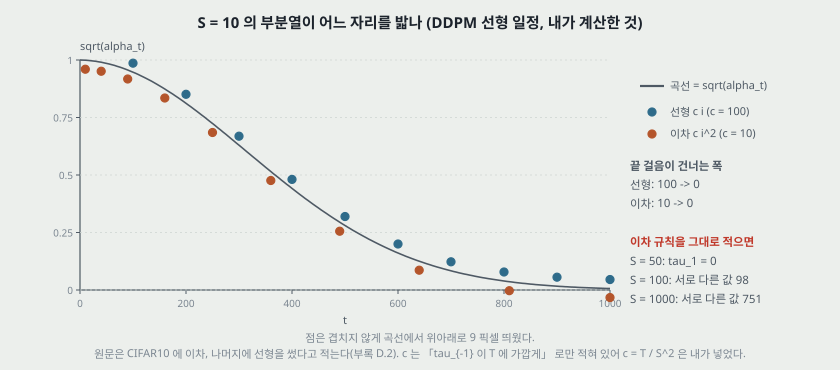

**$\tau$ 를 고르는 규칙(부록 D.2).** 선형 $\tau_i = \lfloor ci \rfloor$, 이차 $\tau_i = \lfloor ci^2 \rfloor$. $c$ 는 「$\tau_{-1}$ 이 $T$ 에 가깝게」. **CIFAR10 은 이차, 나머지는 선형이고 각 데이터에서 다른 쪽보다 「slightly better FID」 라고 적는다.** 비교 수치는 없다.

- **FID 로 고른 뒤 같은 FID 를 보고한다.** 검증 집합을 따로 둔 말이 없다.
- **이차 규칙을 글자 그대로 돌리면 큰 $S$ 에서 안 맞는다**(내가 센 것, $c = T/S^2$). $S = 50$ 은 $\tau_1 = 0$ 이라 $[1, \dots, T]$ 밖이고, $S = 100$ 은 값이 98 개뿐이고 ($0, 0, 0, 1, 2, \dots$), $S = 1000$ 은 751 개뿐이다. 표 1 의 CIFAR10 $S = 100$ · $S = 1000$ 칸이 무엇을 밟았는지 이 파일로는 정해지지 않는다.

| $S$ | 이차 규칙의 앞 자리 | 서로 다른 값 | 0 의 수 |
|---:|---|---:|---:|
| 10 | 10, 40, 90, 160, ... | 10 | 0 |
| 20 | 2, 10, 22, 40, ... | 20 | 0 |
| 50 | 0, 1, 3, 6, 10, ... | 50 | 1 |
| 100 | 0, 0, 0, 1, 2, 3, ... | 98 | 3 |
| 1000 | 0 이 31 번, 그다음 1, ... | 751 | 31 |

---

## 11. 걸음이 줄면 $\eta = 1$ 은 왜 나빠지나 — 새 잡음의 몫 (내가 계산한 것)

**원문은 이 물음에 문장 하나만 낸다.** $\hat\sigma$ 는 「더 확률적이라 짧은 길에서 나쁘다」(D.3), DDPM · NCSN 은 랑주뱅 동역학의 이산화라 걸음이 많이 필요하고 「DDIM 은 변분 관점이라 그 제약이 없어 부분 설명이 될 수 있다(could partially explain)」(6절). **어느 쪽도 잰 값이 아니다.** 그래서 식 (16) 의 숫자만 꺼내 본다.

다음 자리의 잡음 분산 $1 - \alpha_{t-1}$ 중 새로 뽑는 몫은 $\sigma_t^2/(1-\alpha_{t-1})$ 이다.

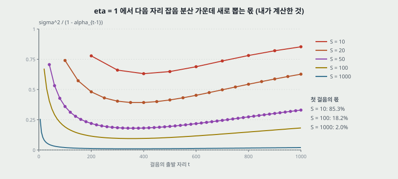

| $S$ (선형) | 첫 걸음 몫 | $t = 500$ 에서 나가는 걸음의 몫 |
|---:|---:|---:|
| 10 | 85.3% | 64.8% |
| 20 | 62.7% | 41.4% |
| 50 | 33.0% | 19.5% |
| 100 | 18.2% | 10.3% |
| 1000 | 2.0% | 1.1% |

**내 해석.** 식 (7) 은 $x_0$ 가 참값일 때 주변 분포를 맞춘다. 망이 내는 것은 참값이 아니라 $x_t$ 를 본 평균에 가까운 $f_\theta$ 다. 걸음이 크면 이 평균 위에 새 잡음을 분산의 절반 넘게 얹고 다음 걸음이 그 잡음을 다시 평균 내므로 세부가 사라진다. $\eta = 0$ 은 같은 평균을 쓰지만 $\epsilon_\theta$ 를 재사용해 다시 뽑지 않는다. 22절의 1 차원 계산이 이 방향과 맞고, 표 1 의 흐린 $S = 10$ 표본(그림 3)과도 어긋나지 않지만, **이 설명을 원문이 말하거나 잰 것은 아니다.**

---

## 12. $\hat\sigma$ — DDPM 의 또 다른 판 (5절 · D.3)

$\hat\sigma_t^2 = \beta_t$ 이고 $\eta = 1$ 의 $\tilde\beta_t$ 보다 크다. 평균 쪽 계수는 $\eta = 1$ 의 것을 그대로 쓰므로(D.3) 잡음 분산의 합이 맞지 않고 $\hat\sigma^2 - \sigma(1)^2$ 만큼 남는다(내가 맞춰 본 것). **원문: 「Ho 외의 구현이 CIFAR10 표본에만 썼고 다른 데이터에는 쓰지 않았다」**(6 쪽).

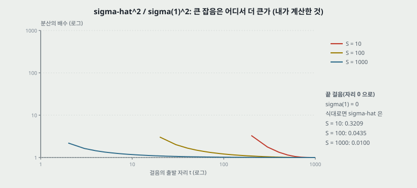

- **큰 $t$ 쪽에서는 두 분산의 비가 1 에 붙어 있고 작은 $t$ 에서 벌어진다.** $S = 10$ 의 첫 걸음에서 1.0002 배, $200 \to 100$ 걸음에서 3.31 배다.
- **끝 걸음이 특이하다.** $\sigma_{\tau_1}(1) = 0$ 인데 식대로면 $\hat\sigma_{\tau_1} = \sqrt{1 - \alpha_{\tau_1}}$ 이다. $S = 10$ 선형에서 0.3209, $S = 100$ 에서 0.0435, $S = 1000$ 에서 0.0100 이다. 픽셀 눈금 $[-1, 1]$ 이라면 0 ~ 255 눈금의 40.9 · 5.5 · 1.3 이다.
- **그래서 FID 367.43 · 299.71 은 끝 걸음 잡음일 수 있다.** 단 **원문은 끝 걸음을 어떻게 다뤘는지 적지 않고**, DDPM 의 알고리즘 2 는 $t = 1$ 에서 잡음을 뺀다. 코드를 안 봤으니 이것은 내 추정이고 22절에서 양쪽을 계산해 둔다.
- 원문의 설명은 「FID 가 이런 교란에 민감하다」(Jolicoeur-Martineau 외를 인용)이고, 그림 3 의 $\hat\sigma$ 줄에 색 알갱이가 보인다(내가 본 것).

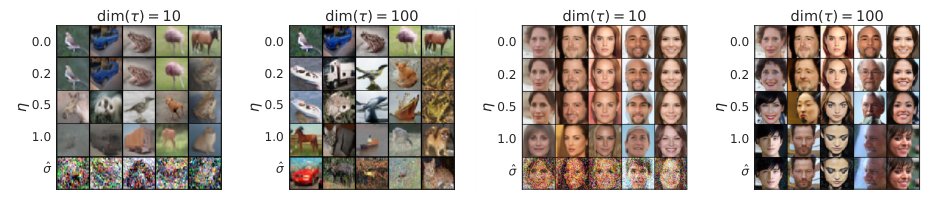

---

## 13. ODE 로 읽기 (4.3절 · 부록 B 명제 1)

$\sigma = 0$ 인 식 (12) 를 $\sqrt{\alpha_{t-\Delta t}}$ 로 나누면 다음 꼴이다(맞춰 봤다).

$$\frac{x_{t-\Delta t}}{\sqrt{\alpha_{t-\Delta t}}} = \frac{x_t}{\sqrt{\alpha_t}} + \left(\sqrt{\frac{1-\alpha_{t-\Delta t}}{\alpha_{t-\Delta t}}} - \sqrt{\frac{1-\alpha_t}{\alpha_t}}\right)\epsilon_\theta^{(t)}(x_t) \qquad (13)$$

$\bar{x} = x/\sqrt{\alpha}$, $\sigma = \sqrt{(1-\alpha)/\alpha}$ 로 바꾸면(이 $\sigma$ 는 식 7 의 $\sigma_t$ 와 **다른 것이다**, 원문이 같은 글자를 쓴다) 식 (13) 은 다음 ODE 의 오일러 걸음이다.

$$\mathrm{d}\bar{x}(t) = \epsilon_\theta^{(t)}\!\left(\frac{\bar{x}(t)}{\sqrt{\sigma^2+1}}\right)\mathrm{d}\sigma(t) \qquad (14)$$

- **$\alpha = 1/(1+\sigma^2)$ 이라 $x = \bar{x}/\sqrt{\sigma^2+1}$ 이다**(식 39, 40). 작은 예시로, DDPM 선형 일정에서 $\sigma(1) = 0.0100$, $\sigma(500) = 3.42$, $\sigma(1000) = 157.4$ 다(내가 계산한 것).
- **뒤로 풀면 부호화가 된다.** $t = 0$ 에서 $T$ 로 가면 $x_0$ 를 $x_T$ 로 옮긴다. DDPM 은 뽑기가 확률적이라 이렇게 쓸 수 없다고 적는다.

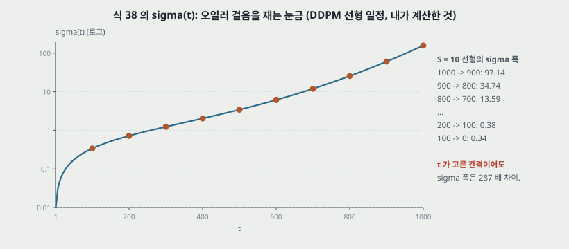

**$t$ 가 고른 간격이어도 $\sigma$ 폭은 고르지 않다.** $S = 10$ 선형에서 첫 걸음의 $\sigma$ 폭 97.14, 끝 걸음 0.34 로 287 배다(분모 끝 걸음, 내가 계산한 것).

**명제 1.** 식 (14) 는 최적 모델에서 Song 외의 「Variance-Exploding」 SDE 의 확률 흐름 ODE 와 같다. **증명의 식 (44) ~ (51) 을 다시 풀어 같았다** — 식 (47) 의 $-\frac{1}{2}g^2\nabla\log p_t$ 에 식 (49) 의 점수 $-\epsilon/\sigma$ 와 $g^2 = \mathrm{d}\sigma^2/\mathrm{d}t$ 를 넣으면 $\frac{\mathrm{d}\sigma}{\mathrm{d}t}\epsilon$ 이 된다.

**같은 ODE, 다른 걸음.** 확률 흐름 쪽 오일러 걸음은 $\mathrm{d}t$ 기준이라 식 (15) 다.

$$\frac{x_{t-\Delta t}}{\sqrt{\alpha_{t-\Delta t}}} = \frac{x_t}{\sqrt{\alpha_t}} + \frac{1}{2}\left(\frac{1-\alpha_{t-\Delta t}}{\alpha_{t-\Delta t}} - \frac{1-\alpha_t}{\alpha_t}\right)\sqrt{\frac{\alpha_t}{1-\alpha_t}}\,\epsilon_\theta^{(t)}(x_t) \qquad (15)$$

원문: $\alpha_t$ 와 $\alpha_{t-\Delta t}$ 가 「close enough」 이면 같고, 걸음이 적으면 차이가 난다. **얼마나 다른지 숫자가 없어 내가 냈다.** 식 (15) 의 계수를 식 (13) 의 계수로 나누면 $(1 + \sigma'/\sigma)/2$ 다($\sigma' = \sigma(t - \Delta t)$).

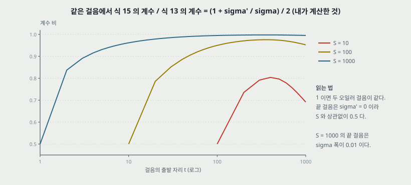

| $S$ (선형) | 첫 걸음 | 끝에서 둘째 | 끝 걸음 |
|---:|---:|---:|---:|
| 10 | 0.6915 | 0.7355 | 0.5000 |
| 100 | 0.9522 | 0.7860 | 0.5000 |
| 1000 | 0.9950 | 0.8372 | 0.5000 |

**끝 걸음은 $S$ 와 상관없이 절반이다**($\sigma' = 0$). 다만 $S = 1000$ 의 끝 걸음은 $\sigma$ 폭이 0.01 이라 그 몫이 작다. **원문은 이 두 걸음을 같은 망 · 같은 $S$ 에서 FID 로 견주지 않는다.** 그래서 「$\mathrm{d}\sigma$ 기준이 낫다」 는 이 편으로 답이 안 나온다.

---

## 14. 실험 설정 (5절 · 부록 D.1)

| 항목 | 값 | 적힌 곳 |
|---|---|---|
| 데이터 | CIFAR10 32 x 32(무조건부) · CelebA 64 x 64 · LSUN Bedroom · Church 256 x 256 | D.1 |
| 체크포인트 | CIFAR10 · Bedroom · Church 는 **DDPM 공개본**, CelebA 는 저자들이 $L_1$ 로 학습. 특징 지도 해상도 다섯(64 x 64 ~ 4 x 4), 원본 CelebA(CelebA-HQ 아님), StyleGAN 전처리 | D.1 |
| 학습 | $T = 1000$, $\gamma = \mathbf{1}$. **학습 쪽 변경 없음** | 5절 |
| $\alpha$ 일정 | 「Ho 외의 휴리스틱」. 값은 이 파일에 없고 이 노트의 계산은 DDPM 노트의 선형 일정을 쓴다 | D.1 |
| 망 | Wide ResNet 기반 U-Net(Ho 외를 따른다) | D.1 |
| 변인 | $\tau$(걸음 수)와 $\eta$ · $\hat\sigma$ | 5절 |
| 시간 잰 장비 | Nvidia 2080 Ti 한 장, 50k 장 | 그림 4 캡션 |

**이 파일에 적혀 있지 않은 것.**

- **표 1 · 3 의 FID 표본 수와 기준 집합.** 「50k」 는 머리말과 그림 4 에만 나온다. DDPM 원문은 3.17 을 **학습 집합 기준**이라 적고 시험 집합 기준은 5.24 라고 적는다.
- **반복 수 · 시작값 · ± .** 표 1 ~ 3 전부 한 값이다.
- **CelebA 학습 설정**(걸음, 학습률, 파라미터 수).
- **3.17 · 6.36 · 7.89 를 다시 쟀는지.** 7 쪽이 3.17 을 「Ho 외가 보고한」 으로 적고, 표 3 캡션의 값은 DDPM 표 3 과 같다. 곧 **표 안의 1000 걸음 DDPM 값은 옮긴 값일 수 있다.**

**잘 통제된 자리.** 한 데이터 안에서는 체크포인트 · 일정 · $\tau$ 규칙이 같고 뽑기만 바뀐다. **변인이 하나인 비교다.** 반대로 데이터끼리는 $\tau$ 규칙 · 학습한 사람 · 해상도가 함께 바뀌어 같은 칸에 놓지 않는다.

---

## 15. 표 1 — 걸음 수와 $\eta$ (5.1절)

| CIFAR10 | $S$ = 10 | 20 | 50 | 100 | 1000 |
|---|---:|---:|---:|---:|---:|
| $\eta$ = 0.0 (DDIM) | **13.36** | **6.84** | **4.67** | **4.16** | 4.04 |
| 0.2 | 14.04 | 7.11 | 4.77 | 4.25 | 4.09 |
| 0.5 | 16.66 | 8.35 | 5.25 | 4.46 | 4.29 |
| 1.0 (DDPM) | 41.07 | 18.36 | 8.01 | 5.78 | 4.73 |
| $\hat\sigma$ (DDPM) | 367.43 | 133.37 | 32.72 | 9.99 | **3.17** |

| CelebA | $S$ = 10 | 20 | 50 | 100 | 1000 |
|---|---:|---:|---:|---:|---:|
| $\eta$ = 0.0 (DDIM) | **17.33** | **13.73** | **9.17** | **6.53** | 3.51 |
| 0.2 | 17.66 | 14.11 | 9.51 | 6.79 | 3.64 |
| 0.5 | 19.86 | 16.06 | 11.01 | 8.09 | 4.28 |
| 1.0 (DDPM) | 33.12 | 26.03 | 18.48 | 13.93 | 5.98 |
| $\hat\sigma$ (DDPM) | 299.71 | 183.83 | 71.71 | 45.20 | **3.26** |

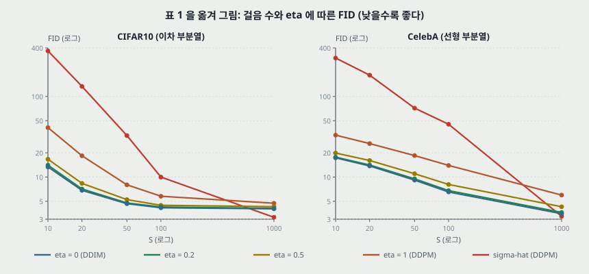

**읽기(내가 센 것).**

- **$\eta$ 를 키울수록 나빠지는 순서가 빠짐없이 나온다.** 두 데이터 · 다섯 $S$ · 이웃한 $\eta$ 쌍 셋, 곧 비교 30 개가 모두 같은 방향이다. 다만 $\eta = 0$ 대 0.2 의 차는 0.05 ~ 0.68 이고 **흩어짐이 없어 작은 차는 순서를 매기지 않는다.**
- **$\eta = 1$ 대 $\eta = 0$ 의 비(분모 $\eta = 0$).** CIFAR10 3.07 · 2.68 · 1.72 · 1.39 · 1.17, CelebA 1.91 · 1.90 · 2.02 · 2.13 · 1.70. **CIFAR10 은 $S$ 가 줄수록 벌어지는데 CelebA 는 $S \le 100$ 에서 1.90 ~ 2.13 에 머문다.**
- **$\hat\sigma$ 가 이기는 칸은 $S = 1000$ 둘뿐이다.** CIFAR10 3.17 대 4.04 는 0.87 차(분모 3.17 로 27.4%), CelebA 3.26 대 3.51 은 0.25 차(7.7%). 원문이 「marginally worse」 라 부른 차이다. CIFAR10 $S = 100$ 에서 $\eta = 1$ 과의 차가 1.62 이니 **원문이 내세우는 이득의 54% 크기다**(0.87 / 1.62).
- **같은 1000 걸음, 같은 체크포인트에서 분산만 바꾼 값이 4.73 대 3.17(CIFAR10) · 5.98 대 3.26(CelebA)이다.** 차 1.56 · 2.72. DDPM 원문은 두 분산을 「had similar results」 라고 적었다. **29절에서 DDPM 노트와 맞춘다.**

---

## 16. 표 3 — 부록에만 있는 256 x 256 (D.1)

| | Bedroom $S$ = 10 | 20 | 50 | 100 | Church $S$ = 10 | 20 | 50 | 100 |
|---|---:|---:|---:|---:|---:|---:|---:|---:|
| DDIM ($\eta = 0$) | **16.95** | **8.89** | **6.75** | **6.62** | **19.45** | **12.47** | **10.84** | 10.58 |
| DDPM ($\eta = 1$) | 42.78 | 22.77 | 10.81 | 6.81 | 51.56 | 23.37 | 11.16 | **8.27** |

캡션: 1000 걸음 DDPM 은 Bedroom 6.36 · Church 7.89.

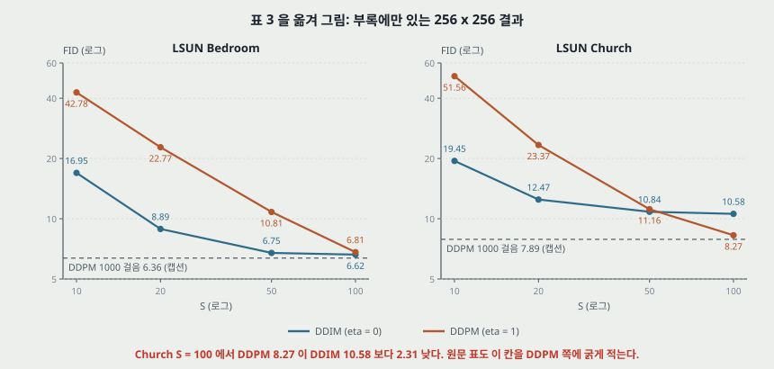

**읽기(내가 센 것).**

- **Church $S = 100$ 은 DDPM 이 2.31 낮다.** 원문 표도 그 칸을 DDPM 쪽에 굵게 적는다. **본문 어디에서도 이 칸을 말하지 않고**, 본문 5절의 첫 문장은 「DDIM 이 적은 걸음에서 이미지 생성에서 DDPM 을 앞선다」 이고 1 쪽은 「10 배 ~ 100 배 가속에서 낫다」 라 적는다. $S = 100$ 은 정확히 10 배다.
- **Church DDIM 곡선이 $S = 50$ 이후 평평하다.** 10.84 → 10.58 로 0.26 내려가는 동안 DDPM 은 11.16 → 8.27 로 2.89 내려간다. **DDIM 은 $S = 100$ 에서 1000 걸음 DDPM 보다 2.69 높다**(분모 7.89 로 34%).
- **Bedroom 은 $S = 100$ 에서 차가 0.19 다.** 흩어짐이 없어 이 칸의 순서는 매기지 않는다. Church $S = 50$ 의 0.32 도 그렇다. **판정 근거가 될 흩어짐이 원문에 없으니 「0.19 와 0.32 는 작다」 도 내 말이다.**
- **표 3 에는 1000 걸음 DDIM 칸이 없다.** 그래서 표 1 처럼 같은 $\eta$ 의 1000 걸음과 나눌 수 없고, DDPM 1000 걸음과 나눈다(17절).
- **왜 Church 만 이런가는 이 파일에 없다.** 체크포인트는 DDPM 공개본이고 $\tau$ 는 선형이다.

---

## 17. 「1000 걸음과 견줄 만하다」 를 나눠 보기 (5.1절)

원문(7 쪽): 「DDIM 은 **20 ~ 100 걸음 안에** 1000 걸음 모델과 **견줄 만한(comparable)** 품질의 표본을 낸다. 원 DDPM 대비 **10 배 ~ 50 배** 빠르다.」 2 쪽은 「소폭의 품질 비용(a minor cost)」 이라 적는다.

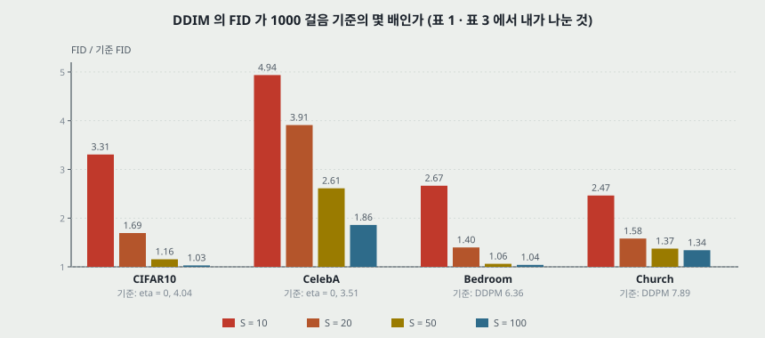

| DDIM FID / 기준 FID | $S$ = 10 | 20 | 50 | 100 | 기준 |
|---|---:|---:|---:|---:|---|
| CIFAR10 | 3.31 | **1.69** | 1.16 | **1.03** | 같은 줄 $\eta = 0$, 1000 걸음 4.04 |
| CIFAR10 | 4.21 | **2.16** | 1.47 | **1.31** | 표의 최저 $\hat\sigma$ 3.17 |
| CelebA | 4.94 | **3.91** | 2.61 | **1.86** | 같은 줄 $\eta = 0$, 1000 걸음 3.51 |
| CelebA | 5.32 | **4.21** | 2.81 | **2.00** | 표의 최저 $\hat\sigma$ 3.26 |
| Bedroom | 2.67 | **1.40** | 1.06 | **1.04** | 캡션의 DDPM 6.36 |
| Church | 2.47 | **1.58** | 1.37 | **1.34** | 캡션의 DDPM 7.89 |

**세기 판정.** 「견줄 만하다」 는 Bedroom $S = 100$ 과 CIFAR10 $S = 100$ 에서 4% 안이고(1.04 · 1.03, 분모 기준값), **20 걸음 쪽 끝에서는 1.40 ~ 4.21 배다.** 「10 ~ 50 배」 의 50 배 끝이 이 칸이다. 「같은 품질로 50 배」 로 옮겨 적으면 표보다 세다. 저자들이 표에서 든 비교는 CelebA 의 100 걸음 DDPM 13.93 대 20 걸음 DDIM 13.73 이고 이 값은 표와 맞는다.

**같은 말이 쪽마다 배수가 다르다.** Abstract 「10 배 ~ 50 배」, 2 쪽 · 6 쪽 「10 배 ~ 100 배」, 7 쪽 「10 배 ~ 50 배」. 100 배는 $S = 10$ 이고 위 표에서 2.47 ~ 5.32 배인 칸이다.

---

## 18. 그림 4 — 시간 (5.1절)

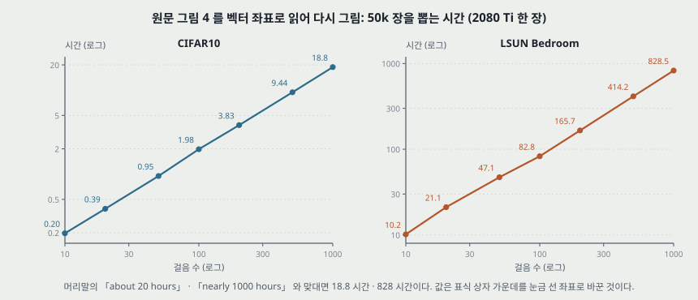

**벡터 좌표로 읽은 값(50k 장, 2080 Ti 한 장).**

| 걸음 수 | 10 | 20 | 50 | 100 | 200 | 500 | 1000 |
|---|---:|---:|---:|---:|---:|---:|---:|
| CIFAR10, 시간 | 0.197 | 0.386 | 0.949 | 1.978 | 3.833 | 9.437 | 18.825 |
| Bedroom, 시간 | 10.16 | 21.08 | 47.12 | 82.85 | 165.69 | 414.24 | 828.47 |
| CIFAR10, 1000 걸음 / 이 칸 | 95.6 | 48.8 | 19.8 | 9.5 | 4.9 | 2.0 | 1 |
| Bedroom, 1000 걸음 / 이 칸 | 81.6 | 39.3 | 17.6 | 10.0 | 5.0 | 2.0 | 1 |

- **걸음 수 비와 시간 비가 같은가.** CIFAR10 은 $S = 20$ 에서 48.8 배, $S = 100$ 에서 9.5 배이고, Bedroom 은 39.3 배 · 10.0 배다. **Abstract 의 「wall-clock 10 배 ~ 50 배」 는 걸음 수 비(1000/100 · 1000/20)이고, 시간 비로 재면 20 걸음 끝이 Bedroom 에서 39.3 배다.** 로그-로그 기울기는 CIFAR10 0.992 · Bedroom 0.944 다(일곱 점 최소제곱, 내가 맞춘 것).
- **DDIM · DDPM 을 가르지 않는다.** 그림의 선은 데이터마다 하나이고 어느 뽑기인지 적지 않는다. 걸음마다 망 통과가 한 번이니 **이 그림은 「DDIM 이 빠르다」 가 아니라 「시간은 걸음 수에 비례한다」 를 보인다.**

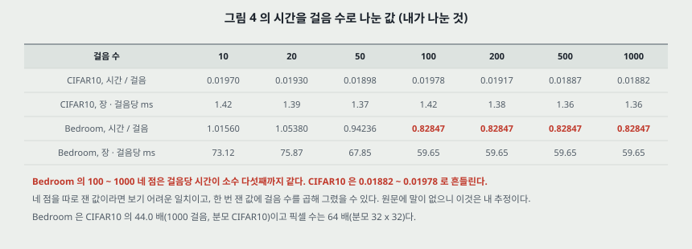

**Bedroom 의 100 ~ 1000 네 점은 걸음당 시간이 소수 다섯째까지 같다(0.82847).** 앞 세 점은 1.016 · 1.054 · 0.942 로 다르고, CIFAR10 은 일곱 점이 0.01882 ~ 0.01978 로 흔들린다. **네 점을 따로 쟀다면 보기 어려운 일치이고, 한 번 잰 값에 걸음 수를 곱해 그렸을 수 있다.** 원문에 말이 없으니 이것은 내 추정이다. Bedroom 1000 걸음의 828 시간이 실제로 잰 값인지 여기서 갈린다. 머리말의 「nearly 1000 hours」 와도 17% 떨어진다(분모 1000).

**다른 장비와의 비교(내가 나눈 것).** DDPM 노트 7절은 TPU v3-8 에서 CIFAR10 256 장 17 초 · 256 x 256 128 장 300 초다. 한 장으로 나누면 0.066 초 · 2.34 초이고, 그림 4 의 1000 걸음은 1.36 초 · 59.7 초다. **배치 크기가 어디에도 적혀 있지 않아 장비 차이로 단정하지 않는다.**

---

## 19. 일관성과 보간 (5.2 · 5.3절 · D.4 · D.5)

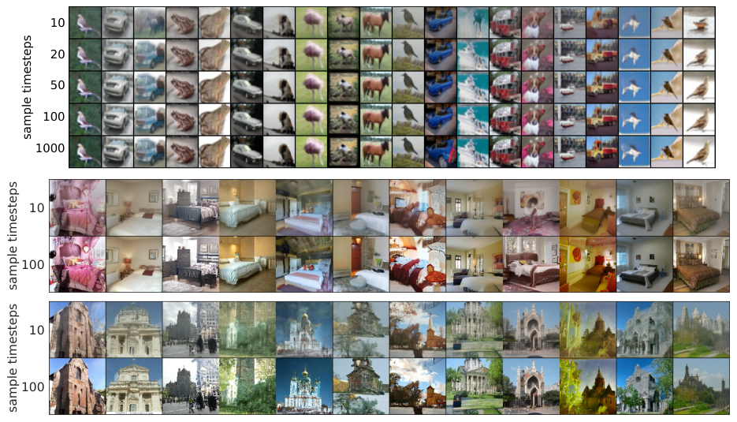

**일관성.** 같은 $x_T$ 에서 $S$ 를 바꿔도 「대부분의 높은 수준 특징이 비슷하다」. 「20 걸음 표본이 이미 1000 걸음 표본과 매우 비슷한 경우가 많다」. 여기서 원문은 「$x_T$ 만으로 정보가 담긴 잠재 부호일 것 같고 표본 품질에 닿는 세부는 파라미터에 담긴다」 로 간다. **「비슷하다」 를 재는 수(LPIPS, 픽셀 거리, 분류 일치율 등)가 이 파일에 없다.** 그림 5(CIFAR10 다섯 $S$, Bedroom · Church 두 $S$), 그림 9(CelebA 네 $S$)의 표본이 근거다. DDPM 과의 대조 그림은 없고 「DDPM 에는 성립하지 않는다」 는 문장뿐이다.

**보간.** $x_T$ 둘을 뽑아 슬러프로 잇고 DDIM 으로 푼다(식 67).

$$x_T^{(\alpha)} = \frac{\sin((1-\alpha)\theta)}{\sin\theta}x_T^{(0)} + \frac{\sin(\alpha\theta)}{\sin\theta}x_T^{(1)}, \qquad \theta = \arccos\frac{(x_T^{(0)})^\top x_T^{(1)}}{\lVert x_T^{(0)}\rVert\lVert x_T^{(1)}\rVert} \qquad (67)$$

왜 슬러프인가는 원문에 없다. 내 계산으로, 차원이 $d = 3072$ 이면 표준 가우시안 두 표본의 코사인은 평균 0 · 표준편차 $1/\sqrt{3072} = 0.018$ 이고, 코사인을 0 으로 두면 선형 보간의 가운데는 노름이 0.7071 배가 되어 사전 분포의 껍질에서 벗어난다.

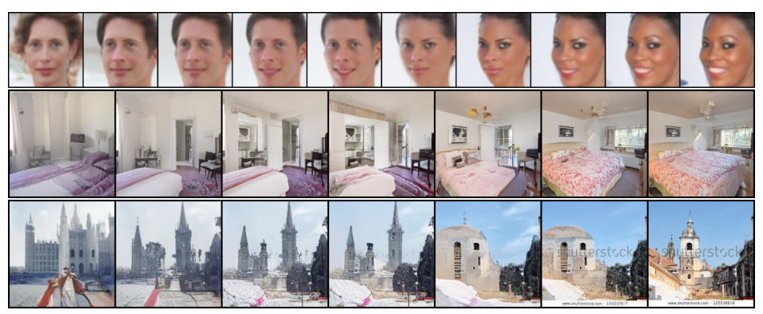

- **근거는 표본 그림이다**(그림 6 · 11 · 12 · 13, 모두 $\dim(\tau) = 50$). 보간의 부드러움을 재는 수(PPL 등)가 없다.
- **DDPM 은 왜 안 되는가.** 「같은 $x_T$ 가 매우 다른 $x_0$ 로 간다」(5.3절). 각주 6 은 「$T$ 개 잡음을 모두 보간하면 될 수도 있다」 고 덧붙인다. DDPM 원문의 보간은 이미지를 $t$ 까지 보낸 뒤 잇는 것이라 절차가 다르다(DDPM 노트 12절).
- **내가 본 것.** 그림 6 의 Church 줄 가운데 표본에 스톡 사진 워터마크 글자(「shutterstock」)가 찍혀 있다. LSUN 학습 이미지에 있던 것을 생성한 것으로 보인다. 원문은 이 점을 말하지 않는다.

---

## 20. 재구성 (5.4절, 표 2)

$x_0$ 를 식 (14) 의 역으로 $x_T$ 까지 $S$ 걸음 보내고 다시 $S$ 걸음으로 푼다. CIFAR-10 시험 집합, CIFAR-10 모델. 값은 **차원당 제곱 오차, $[0, 1]$ 눈금.**

| $S$ | 10 | 20 | 50 | 100 | 200 | 500 | 1000 |
|---|---:|---:|---:|---:|---:|---:|---:|
| 원문 오차 | 0.014 | 0.0065 | 0.0023 | 0.0009 | 0.0004 | 0.0001 | 0.0001 |
| 0 ~ 255 눈금 RMSE (내가 셈) | 30.17 | 20.56 | 12.23 | 7.65 | 5.10 | 2.55 | 2.55 |
| 망 통과 수 $2S$ | 20 | 40 | 100 | 200 | 400 | 1000 | 2000 |

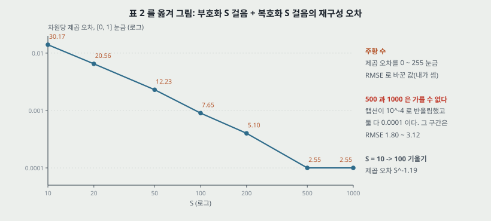

- **500 과 1000 은 가를 수 없다.** 캡션이 $10^{-4}$ 로 반올림했으니 0.0001 은 0.00005 ~ 0.00015, RMSE 1.80 ~ 3.12 구간이다(내가 센 것).
- **Abstract 의 「매우 낮은 오차(very low error)」 는 어느 칸인가.** $S = 1000$ 은 RMSE 2.55 로 0 ~ 255 범위의 1.0% 이고, $S = 10$ 은 30.17 로 11.8% 다(분모 255).
- **기울기.** $S = 10 \to 100$ 에서 제곱 오차가 $S^{-1.19}$ 로 준다(내가 맞춘 것). RMSE 로는 $S^{-0.60}$ 이다. 오일러 방법의 전역 오차가 걸음 폭의 1 차라는 교과서 값이면 RMSE 가 $S^{-1}$ 이어야 하는데 이 범위에서는 거기 못 미친다. 13절의 $\sigma$ 폭 차이(287 배)와 망의 오차가 들어 있을 수 있고, **이 편으로는 가르지 못한다.**
- **비교 행이 없다.** 「Neural ODE · 흐름 모델과 비슷한 성질」 · 「DDPM 은 그럴 수 없다」 라 적지만 DDPM · 흐름 · VAE 값을 같은 표에 놓지 않았다. 표본 수와 흩어짐도 없다. 각주 7: $x_T$ 와 $x_0$ 차원이 같으니 압축 품질은 당장의 관심이 아니라고 적는다.
- **DDPM 노트 12절의 RMSE 0.95 와 같은 칸에 놓지 않는다.** 그쪽은 비트를 보내 받은 $x_1$ 에서 예측한 왜곡이다. 일이 다르다.

---

## 21. 부록 A — 이산 데이터의 비마르코프 앞방향

연구 범위를 가우시안 밖으로 넓히는 스케치다. 「가우시안 가속이 초점이라 실험은 뒷일로 남긴다」.

$$q(x_{t-1} \mid x_t, x_0) = \mathrm{Cat}\left(\sigma_t x_t + (\alpha_{t-1} - \sigma_t\alpha_t)x_0 + ((1-\alpha_{t-1}) - (1-\alpha_t)\sigma_t)\mathbf{1}_K\right) \qquad (19)$$

**맞춰 봤다.** 세 무게의 합이 1 이고, $x_t$ 를 $\mathrm{Cat}(\alpha_t x_0 + (1-\alpha_t)\mathbf{1}_K)$ 로 평균 내면 $\alpha_{t-1}x_0 + (1-\alpha_{t-1})\mathbf{1}_K$ 가 된다. KL 상계는 볼록성에서 $(\alpha_{t-1} - \sigma_t\alpha_t)D_{\mathrm{KL}}(\mathrm{Cat}(x_0)\Vert\mathrm{Cat}(f_\theta^{(t)}(x_t)))$ 로 나오고, 다중 분류 손실의 상수 배라 $\sigma_t$ 가 다시 재가중으로만 들어간다. **이 파일에 실험은 없다.**

---

## 22. 1 차원 가우시안에서 닫아 보기 (내가 계산한 것, 신경망 · 표본 없음)

원문의 설명이 말뿐인 자리(11 · 12절)를 데이터가 $\mathcal{N}(0, s^2)$ 인 경우로 닫아 봤다. 이 경우 최적 $\epsilon^*(x_t) = \sqrt{1-\alpha_t}\,x_t/(\alpha_t s^2 + 1 - \alpha_t)$ 가 $x_t$ 에 선형이라, 식 (12) 를 따라가면 끝 분산이 표본 없이 나온다. **실제 이미지와 학습된 망이 아니고 둘째 모멘트 하나다.** $s$ 는 내가 고른 값이다.

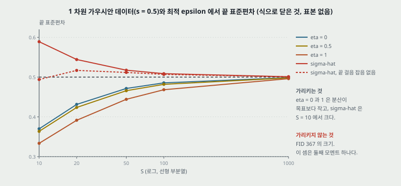

| 목표 $s$ | 뽑기 | $S$ = 10 | 20 | 50 | 100 | 1000 |
|---:|---|---:|---:|---:|---:|---:|
| 0.5 | $\eta = 0$ | 0.3700 | 0.4314 | 0.4714 | 0.4854 | 0.4985 |
| 0.5 | $\eta = 1$ | 0.3335 | 0.3915 | 0.4441 | 0.4682 | 0.4961 |
| 0.5 | $\hat\sigma$ | 0.5890 | 0.5441 | 0.5173 | 0.5086 | 0.5009 |
| 0.5 | $\hat\sigma$, 끝 걸음 잡음 없음 | 0.4939 | 0.5168 | 0.5117 | 0.5067 | 0.5008 |
| 0.05 | $\eta = 0$ | 0.0073 | 0.0137 | 0.0264 | 0.0356 | 0.0480 |
| 0.05 | $\eta = 1$ | 0.0073 | 0.0136 | 0.0253 | 0.0332 | 0.0463 |
| 0.05 | $\hat\sigma$ | 0.3211 | 0.1719 | 0.0866 | 0.0656 | 0.0514 |
| 0.05 | $\hat\sigma$, 끝 걸음 잡음 없음 | 0.0124 | 0.0237 | 0.0416 | 0.0490 | 0.0504 |

**가리키는 것.**

- **$\eta = 0$ 도 $S$ 가 작으면 분산이 모자란다.** $s = 0.5$, $S = 10$ 에서 26% 모자라고 $\eta = 1$ 은 33% 모자란다(분모 0.5). 표 1 의 순서와 방향이 같다.
- **$S = 1000$ 의 오차 크기 순서는 $\hat\sigma$ · $\eta = 0$ · $\eta = 1$(0.0009 · 0.0015 · 0.0039)로 표 1 의 FID 순서와 같다.**
- **작은 $s$ 에서 $\hat\sigma$ 의 끝 걸음 잡음이 그대로 남는다.** $s = 0.05$, $S = 10$ 에서 0.3211 로 목표의 6.4 배다. 이미지의 고주파 성분처럼 분산이 작은 축을 이 경우로 보면 그림 3 의 알갱이와 방향이 맞는다(이 연결은 내 해석).

**가리키지 않는 것.** FID 367 이라는 크기, 그리고 $\eta = 0$ 이 FID 로 이기는 까닭 전부. $s = 0.5$ 에서는 $\hat\sigma$ 의 분산 오차가 $\eta = 0$ 보다 작다($S = 10$ 에서 0.089 대 0.130)는데도 표 1 에서는 27.5 배 나쁘다(분모 $\eta = 0$). 곧 **이 셈으로는 FID 를 설명하지 못하고 방향만 비교할 수 있다.**

---

## 23. 관련 연구 · 결론 (6 · 7절)

- **6절.** DDPM 은 변분 하한, NCSN 은 점수 맞추기로 최적화하지만 둘 다 여러 잡음 크기의 잡음 제거 목적을 쓰고 랑주뱅 비슷한 절차로 뽑는다. 랑주뱅이 경사 흐름의 이산화라 걸음이 많이 필요하고 「적은 반복에서 고품질 표본에 어려움을 겪는다」. DDIM 은 변분으로 유도해 그 제약이 없어 「이것이 부분 설명이 될 수 있다(could partially explain)」.
- **7절.** 비마르코프 앞방향은 가우시안 아닌 연속 앞방향을 시사한다(「가우시안은 분산 유한 안정 분포의 유일한 경우라 원래 확산 틀에서는 안 된다」). 다단계 풀이법(Adams-Bashforth)으로 이산화 오차를 줄일 수 있는지, 다른 암묵 모델의 성질이 있는지를 뒷일로 든다.
- **결론의 세기.** 「much more efficiently than existing DDPMs and NCSNs」 는 16 · 17절의 나눈 값에서 다시 보면 걸음 수에 따라 다르다. **NCSN 을 같은 표에서 잰 행은 없다.**

---

## 24. 실험 분석 (논문의 표 · 그림마다)

**직접 돌리지 않았다.** 논문이 낸 실험을 표 · 그림 하나씩 같은 틀로 읽는다.

| 표 · 그림 | 무엇을 바꿨나 (변인) | 무엇을 고정했나 | 결과 | 반복 수 · 흩어짐 | 주장이 결과보다 센가 |
|---|---|---|---|---|---|
| 표 1 (CIFAR10) | $S$ 다섯, $\eta$ 넷과 $\hat\sigma$ | 체크포인트 1 개(DDPM 공개본), $T = 1000$, $\tau$ 이차 | $\eta = 0$ 이 $S \le 100$ 에서 최저(13.36 · 6.84 · 4.67 · 4.16), $S = 1000$ 은 $\hat\sigma$ 3.17 | 한 값, 적혀 있지 않다 | 「$\eta = 0$ 이 $S$ 작을 때 최저」 는 맞다. 「marginally worse」(0.87)는 $S = 100$ 이득(1.62)의 54% 라 표 안의 다른 차와 견주면 작지 않다 |
| 표 1 (CelebA) | 같음 | 체크포인트 1 개(저자 학습), $\tau$ 선형 | $\eta = 0$ 이 $S \le 100$ 최저(17.33 · 13.73 · 9.17 · 6.53), $S = 1000$ 은 $\hat\sigma$ 3.26 | 한 값 | 「20 ~ 100 걸음에서 견줄 만하다」 는 여기서 3.91 · 1.86 배(분모 3.51)라 가장 약하다 |
| 표 3 | $S$ 넷, DDIM 대 DDPM($\eta = 1$) | DDPM 공개 체크포인트, $\tau$ 선형 | 8 칸 중 7 칸 DDIM 이 낮고 Church $S = 100$ 은 DDPM 8.27 대 10.58 | 한 값, 1000 걸음 값은 캡션(DDPM 표에서 옮긴 값일 수 있다) | **「10 ~ 100 배 가속에서 DDIM 이 낫다」 가 Church 10 배에서 어긋난다.** 본문에 언급 없다 |
| 그림 3 | $\eta$ · $\hat\sigma$, $S$ 둘 | 같은 체크포인트. 같은 $x_T$ 인지는 적혀 있지 않다 | 표본 그림 | 수 없음 | 「$\hat\sigma$ 의 알갱이가 FID 가 나쁜 까닭을 설명한다」 는 민감도 인용 하나가 근거 |
| 그림 4 | 걸음 수 일곱, 데이터 둘 | 2080 Ti 한 장, 50k 장. 배치 크기 · 뽑기 종류 적혀 있지 않다 | 벡터 값 18.8 · 828 시간(1000 걸음), 기울기 0.992 · 0.944 | 적혀 있지 않다. Bedroom 네 점이 정확히 같은 비 | 「시간이 걸음에 비례」 는 맞고, **망 통과 수의 산수를 넘는 새 측정인지는 의문이 남는다** |
| 그림 5 · 9 | $S$ | 같은 $x_T$, $\eta = 0$ | 표본 그림 | 수 없음 | 「대부분의 높은 수준 특징이 비슷」 에 잰 값이 없다. 「$x_T$ 가 정보 있는 잠재 부호」 는 「would appear」 로 적어 세기는 맞췄다 |
| 그림 6 · 11 · 12 · 13 | 슬러프 무게 | $S = 50$, $\eta = 0$ | 표본 그림 | 수 없음 | 「의미 있는 보간」 에 재는 값이 없고 DDPM 대조 그림이 없다 |
| 표 2 | $S$ 일곱 | CIFAR-10 시험 집합 · 같은 모델 · $\eta = 0$ | 0.014 → 0.0001 | 한 값, 반올림 $10^{-4}$ | 「very low error」 는 $S \ge 500$ 쪽 말이고 비교 상대가 표에 없다 |
| 그림 7 · 8 · 10 | $S$, DDPM 대 DDIM | 데이터별 체크포인트 | 표본 그림 | 수 없음 | 부록 표본, 주장 없음 |

**같은 체크포인트라 표 1 · 3 의 행 비교는 조건이 같다.** 다른 논문에서 옮긴 비교 상대는 3.17 · 6.36 · 7.89 뿐이다(옮긴 값일 가능성이 있는 것).

---

## 25. 이 논문이 스스로 적은 한계와 조건

1. **$\sigma_t = 0$ 은 정리 1 이 다루지 않는다.** 아주 작은 $\sigma_t$ 로 근사한다(각주 5).
2. **$L_1$ 이 $J_\sigma$ 의 대리 목적이라는 말은 $t$ 사이 파라미터를 공유하지 않을 때다**(3.2절).
3. **$S = 1000$ 에서 DDIM 은 $\hat\sigma$ 보다 나쁘다**(「marginally」, 7 쪽).
4. **$\hat\sigma$ 는 짧은 길에 맞지 않는다**(7 쪽).
5. **연속 $t$ · 더 많은 앞방향 걸음은 실험하지 않았다**(5 쪽).
6. **이산 앞방향은 실험하지 않았다**(부록 A).
7. **$x_T$ 와 $x_0$ 차원이 같아 압축 품질은 다루지 않는다**(각주 7).
8. **식 (15) 와 식 (14) 의 오일러 걸음은 걸음이 적으면 다르다**(6 쪽).

---

## 26. 논문이 적지 않은 것 — 내가 읽으며 짚은 자리

1. **공유 망에서 왜 $L_1$ 이 $\eta = 0$ 에도 맞는가.** 8절. 표는 된다고 하고 이론은 조건 밖이다.
2. **Church $S = 100$ 역전의 까닭.** 16절.
3. **FID 의 표본 수 · 기준 집합 · 흩어짐.** 14절.
4. **이차 규칙의 실제 자리.** 10절. $S \ge 50$ 에서 글자 그대로는 돌지 않는다.
5. **$\hat\sigma$ 끝 걸음에 잡음을 더했나.** 12절. FID 367 의 설명이 여기서 갈릴 수 있다.
6. **일관성 · 보간의 수.** 19절.
7. **식 (13) 대 식 (15) 를 같은 조건에서 FID 로 견준 행.** 13절.
8. **$J_\sigma$ · 가능도의 값.** 결정적 뽑기는 밀도를 주지 않으니 표본 품질만 재고, 이 편의 결론은 로그 가능도와 닿지 않는다.
9. **$\tau$ 를 고르면 FID 가 얼마나 움직이나.** 「slightly better」 만 있고 값이 없다. 이 편에서 $\eta$ 와 $S$ 말고 움직인 변인인데 수가 없다.

---

## 27. 읽을 때 헷갈리는 지점

- **$\alpha_t$ 가 DDPM 의 $\bar\alpha_t$ 다.** 원문은 $\alpha$ 를 줄 수 있는 유일한 일정으로 쓰고 부록 C.2 에서 까닭 셋을 적는다. DDPM 식과 맞대려면 이 줄을 먼저 본다.
- **$\sigma$ 가 두 뜻이다.** 식 (7) 의 $\sigma_t$ 는 뽑기 잡음, 식 (14) 의 $\sigma(t)$ 는 $\sqrt{(1-\alpha)/\alpha}$ 다. **13절에서만 뒤쪽이다.**
- **$L_1$ 은 노름이 아니다.** $\gamma = \mathbf{1}$ 이다.
- **「DDPM」 이 표에서 두 줄이다.** $\eta = 1$ 은 $\sigma^2 = \tilde\beta_t$, $\hat\sigma$ 는 $\sigma^2 = \beta_t$ 다. 3.17 은 뒤쪽이다.
- **$S < T$ 의 「DDPM」 은 그 길이로 학습한 DDPM 이 아니다.** 표 1 캡션이 「$S$ 걸음으로 학습한 DDPM 을 흉내 내는 것으로 볼 수 있다(can be seen as simulating)」 고 적는다. 같은 1000 걸음 체크포인트다.
- **DDIM 의 앞방향도 학습에는 안 쓰인다.** 학습은 DDPM 그대로이고, 앞방향 이야기는 뽑기를 정당화하는 쪽에 있다.
- **「결정적」 은 뽑기가 $x_T$ 를 고정했을 때다.** $x_T$ 는 여전히 무작위다.
- **원문 그림 2 의 $\tau = [1, 3]$ 은 $T = 3$ 예시다.** 곧 $\tau_S = T$ 다.

---

## 28. 원문 안의 어긋남 모음

**A. 식.**

| 자리 | 인쇄 | 맞게 읽으면 | 비고 |
|---|---|---|---|
| 식 (2) | $\max_\theta \mathbb{E}[\log p_\theta(x_0)] \le \max_\theta \mathbb{E}[\log p_\theta(x_{0:T}) - \log q(x_{1:T} \mid x_0)]$ | $\ge$ | 변분 **하한**이라고 같은 문장이 적는다 |
| 식 (30) | $c_t^2$ 없음 | 7절 | 원문의 $\equiv$ 정의로는 뺄 수 없다 |
| 식 (32) · (34) · (35) | $1/(2d\sigma_t^2\alpha_t)$ | $c_t^2(1-\alpha_t)/(2\sigma_t^2\alpha_t)$ | 식 (66) 과 다르다. 7절 |
| 식 (33) | $f_\theta^{(t)}(x_1)$ | $f_\theta^{(1)}(x_1)$ | 위 첨자 |
| 식 (34) 아래 첨자 | $x_1 = \sqrt{\alpha_1}x_0 + \sqrt{1-\alpha_t}\epsilon$ | $\sqrt{1-\alpha_1}$ | 아래 첨자 |
| 식 (14) 뒤 | $x(T) \sim \mathcal{N}(0, \sigma(T))$ | $\bar{x}(T) \sim \mathcal{N}(0, \sigma^2(T)I)$ | 16 쪽 끝이 바르게 적는다 |
| 식 (46) 뒤 | $x(t) = \sqrt{\alpha(t)}x(t) + \dots$ | $x(0)$ | 좌변 · 우변 같은 글자 |
| 식 (48) 뒤 | $\bar{x}(t) = \bar{x}(t) + \sigma(t)\epsilon$ | $\bar{x}(0)$ | 같은 꼴 |
| 식 (56) | $f_\theta^{(\tau_i)}(x_{\tau_{i-1}})$ | $f_\theta^{(\tau_i)}(x_{\tau_i})$ | 아직 뽑지 않은 자리를 넣게 적혔다 |
| 식 (58) · (59) | 합의 위 끝 $L$, $x_{\tau_{L+1}}$ | $S$ | 같은 절에서 길이를 $S$ 로 적었다 |
| 식 (59) 첫 합 | $D_{\mathrm{KL}}(q(x_t \mid x_0) \Vert p(x_0 \mid x_t))$ | 변수가 다른 두 분포의 KL 이라 KL 이 아니다 | $\mathbb{E}[\log q(x_t \mid x_0) - \log p(x_0 \mid x_t)]$ 로 읽는다 |
| 식 (62) | $\mathcal{N}(\mu_\theta, \sigma_t I)$ | $\sigma_t^2 I$ | 식 (64) 는 $\sigma_t^2$ 을 쓴다 |
| 식 (63) | $q(x_T \mid x_0)$ | $\log q(x_T \mid x_0)$ | log 빠짐 |
| 부록 C.2 첫 줄 | $\bar\alpha_t = \prod_{t=1}^T \alpha_t$ | $\prod_{s=1}^t$ | 위 끝 |

**B. 문장과 수.**

1. **「10 배 ~ 50 배」 · 「10 배 ~ 100 배」.** 17절. 같은 주장이 쪽마다 다르다.
2. **「DDIM 이 앞선다」 대 표 3 Church $S = 100$.** 16절.
3. **「around 20 hours」 · 「nearly 1000 hours」 대 그림 4 의 18.8 · 828.5 시간.** 18절. 앞은 6% · 뒤는 17% 떨어진다(분모 20 · 1000).
4. **7 쪽 「100× steps」.** 「DDPM 도 100× 걸음이면 그럴듯하다」 인데 같은 문장 뒤가 100 걸음을 말한다. 「100 steps」 의 오타로 읽힌다.
5. **식 (16) 이 $\sigma_{\tau_1} = 0$ 을 주는데 식 (10) 의 문장은 $t = 1$ 에 잡음을 더한다고 한다.** 9절. $\alpha_0 := 1$ 과 $\sigma_1 > 0$ 이 같은 식 (12) 안에서 맞지 않는다.
6. **이차 규칙.** 10절. $\tau$ 를 증가 부분열로 적어 놓고 규칙은 $S \ge 50$ 에서 어긋난다. 또 부록 C.1 은 $\tau_S = T$, D.2 는 「$\tau_{-1}$ 이 $T$ 에 가깝게」 다.
7. **「연속 시간 DDPM 에 대응하는 특수한 경우」 대 「VE SDE」.** 6 쪽 본문은 괄호로 DDPM 을, 명제 1 은 VE 를 말한다. Score SDE 원문의 이름으로 DDPM 은 VP SDE 쪽이다(그 편 3.4 절). **모순이 아니라 좌표 차이다** — 식 (41), (42) 대로 $\bar{x} = x/\sqrt{\alpha}$ 로 옮기면 DDPM 의 꼴이 $\bar{x}(0) + \sigma\epsilon$ 이 된다. 원문은 이 점을 문장으로 풀지 않는다(이 풀이는 내 것).
8. **D.3 의 「$\hat\sigma$ 는 더 확률적이라 ... 나쁜 것을 설명한다(explains)」.** 22절 $s = 0.5$ 에서 보듯 분산 오차로 재면 $\hat\sigma$ 가 오히려 작다. 설명이라기보다 가설이다.

---

## 29. 앞 칸들과 맞춰 보기

| 앞 노트 | 이 편에서 확인한 것 | 달라진 자리 |
|---|---|---|
| **DDPM** 4절 결정 1 | 두 분산은 DDPM 원문 말로 「had similar results」 | **DDPM 노트의 「판정 한계 안이었다」 는 원문보다 세고**, 표 1 에서 같은 체크포인트 1000 걸음의 분산 비교가 4.73 대 3.17 · 5.98 대 3.26 이다 |
| **DDPM** 14절 · INDEX | 「10 ~ 50 스텝」 으로 적혀 있다 | **원문은 10 배 ~ 50 배, 곧 20 ~ 100 걸음이다** |
| **DDPM** 6절 결정 3 | 「버린 계수는 $t$ 가 작을수록 크다」 | $\sigma^2 = \tilde\beta_t$ 에서 식 (66) 값은 $t = 2$ 0.5997, $t = 350$ 최저 0.00498, $t = 1000$ 0.0102 로 **단조가 아니다**(큰 $t$ 쪽에서 2.05 배로 올라간다, 분모 최저값, 내가 계산한 것). $t$ 가 작은 쪽이 가장 크다는 것은 맞다 |
| **DDPM** 7절 알고리즘 2 | $t = 1$ 에 잡음 없음 | 식 (16) 의 $\sigma_{\tau_1} = 0$ 과 맞는다 |
| **DDPM** 7절 $\hat{x}_0$ · 15절 | $\epsilon$ 과 $x_0$ 예측은 바꿔 쓸 수 있다 | 식 (9) 가 같은 식이다. 그대로 맞다 |
| **DDPM** 10절 | 하나의 U-Net 이 $t$ 를 받는다 | 정리 1 의 조건 밖이다(8절) |
| **DDPM** 13절 | 샘플링 비용 | 이 편이 받는다. 다만 **재가중 · 분산 · 조건부는 그대로 남는다** |
| **DDPM** 표 3 | Bedroom 6.36 · 4.90(큰 모델) · Church 7.89 | 이 편의 Bedroom 은 6.36 쪽(캡션)이다. 큰 모델과 견주지 않았다 |
| **VAE** | 추론 분포를 학습 | 이 편은 추론 분포를 **고정한 채 고른다**. 2 쪽이 그 차이를 짚는다 |
| **GAN** · WGAN | 밀도 없이 표본, 잠재 공간 보간 | 「암묵적 모델」 이 같은 범주이고 슬러프 보간을 GAN 에 빗댄다. 여기는 판별기가 없고 망 통과가 $S$ 번이다 |
| **Wide ResNet** | U-Net 의 기반 블록 | D.1 이 인용한다. 이 편은 짜임을 바꾸지 않는다 |

---

## 30. 계보와 내가 가져갈 것

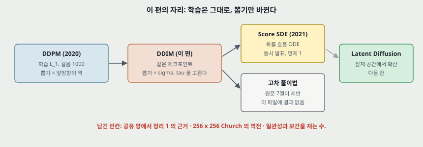

**하나. 닿는 자리 — 재구성 기반 이상 탐지.** DDPM 노트 14절의 AnoDDPM 쪽 절차는 검사 이미지를 $t_0$ 까지 보내고 복원하는 것이고 그 비용이 걸음 수만큼이다. 이 편의 부호화 · 복호화는 결정적이라 **같은 이미지가 같은 재구성을 낸다는 점**이 이상 점수에 맞을 수 있다. 다만 표 2 는 정상 이미지(CIFAR-10 시험 집합)만 재고 결함 이미지를 재지 않았고, 재구성이 잘 될수록 결함까지 복원된다는 재구성 방법의 문제가 그대로다. **이 연결은 내 해석이고 원문에 이상 탐지 이야기는 없다.**

**둘. 옮겨 쓸 수 있는 것.**

- **「10 배 빠르다」 를 분모와 함께 적는다.** 배수 · 걸음 수 · 시간을 나란히 놓으니 INDEX 의 「10 ~ 50 스텝」 오류가 나왔다.
- **본문 문장을 부록 표에 맞대 본다.** Church 칸이 그렇게 나왔다.
- **증명의 끝 계수를 같은 편의 특수한 경우에 넣어 본다.** 식 (35) 대 식 (66) 이 $\tilde\beta_t$ 를 넣는 한 줄에서 갈렸다. 원문의 $\equiv$ 정의를 읽는 것이 먼저다.
- **벡터 그림은 비를 내 본다.** 걸음당 시간의 소수 다섯째까지 같은 네 점은 그림으로는 안 보인다.
- **닫힌 장난감은 무엇을 가리키지 않는지까지 적는다.** 22절.

**셋. 지금 확인된 것은 여기까지다.**

- **논문이 잰 것**: 표 1 · 3(FID, 한 값), 표 2(재구성, 한 값), 그림 4(시간).
- **논문이 말만 한 것**: 공유 망에서의 대리 목적, 일관성, 의미 있는 보간, $x_T$ 가 정보 있는 잠재 부호다, $\hat\sigma$ 가 나쁜 까닭, 랑주뱅 제약이 없어 낫다, 「DDPM 은 재구성할 수 없다」(수 없음).
- **내가 책상에서 센 것**: 식 (12) = DDPM 의 유도, 보조 정리 1 · 명제 1 다시 풀기, 정리 1 계수 다시 풀기, 부록 A 의 합, $S$ 별 새 잡음 몫, $\hat\sigma$ 끝 걸음 값, 이차 규칙의 값 수, 식 (15) / 식 (13), $\sigma(t)$, 표 값의 비와 차, RMSE, 슬러프 노름, 1 차원 가우시안 끝 분산.
- **벡터 좌표로 읽은 것**: 그림 4 의 일곱 점씩. 원문이 숫자로 적지 않은 값이다.
- **내 해석**: 새 잡음 몫이 $\eta = 1$ 이 나빠지는 까닭이다, $\hat\sigma$ 의 FID 가 끝 걸음 잡음에서 올 수 있다, Bedroom 네 점이 배수로 그렸을 수 있다, 이상 탐지 연결.

---

## 31. 다음에 읽을 것

**한계를 적고 그 한계를 푼 것이 다음 논문이다.** 큰 틀을 먼저 적고 자잘한 후속 편은 뒤에 둔다.

**큰 틀.** 다음 칸은 **Score SDE(Song 외, ICLR 2021)** 이고 이미 정해져 있다. 명제 1 이 그 편의 확률 흐름 ODE 와 이 편의 ODE 를 잇고, 식 (15) 가 그 편 쪽 오일러 걸음이다. 그다음이 **Latent Diffusion(Rombach 외, CVPR 2022)** 이다.

**자잘한 후속 편 — 이 편의 어느 자리에서 나왔나.** 모두 **읽지 않았고**, 이 파일의 참고 문헌에 없는 편은 표시했다. 읽고 이 자리에 맞는 편인지 가린다.

| 다음 | 이 노트의 어느 자리에서 나오는가 | 무엇을 확인하고 싶은가 |
|---|---|---|
| **NCSN** — Generative Modeling by Estimating Gradients of the Data Distribution (Song · Ermon, NeurIPS 2019, 원문 인용) | 23절 — 랑주뱅 쪽이 걸음에서 막힌다는 주장 | 같은 체크포인트에서 걸음을 줄인 값이 있는가 |
| **Adversarial score matching and improved sampling** (Jolicoeur-Martineau 외, 2020, 원문 인용) | 12절 — FID 가 잡음 교란에 민감하다는 인용 | 민감도를 잰 값. $\hat\sigma$ 의 367 을 설명하는 크기인가 |
| **Improved DDPM** (Nichol · Dhariwal, ICML 2021) — 후보, 이 파일의 참고 문헌에 없다 | 15 · 29절 — $\beta_t$ 와 $\tilde\beta_t$ 사이 분산, $\tau$ 고르기 | 분산을 배우면 표 1 의 $\eta$ 축이 어떻게 되는가 |
| **DPM-Solver** (Lu 외, NeurIPS 2022) — 후보, 이 파일의 참고 문헌에 없다 | 13 · 20 · 23절 — 다단계 풀이법 제안, 재구성 기울기 | 7절의 뒷일이 얼마나 실현됐는가. $S = 10$ 의 13.36 을 얼마나 줄이나 |
| **Learning in implicit generative models** (Mohamed · Lakshminarayanan, 2016, 원문 인용) | 1절 — 암묵적 모델의 정의 | 이 이름의 원래 범위 |
| **AnoDDPM** (Wyatt 외, CVPR Workshops 2022) — INDEX 에 이미 있다 | 30절 하나 — 결정적 재구성과 이상 탐지 | 걸음을 줄이면 이상 탐지 성능이 어떻게 되나 |

---

## 32. 남는 질문

- **공유 망에서 $\eta$ 별 최적 해가 얼마나 다른가.** 정리 1 의 조건 밖을 재는 실험이 있는가. 8절의 빈칸이다.
- **Church $S = 100$ 이 왜 뒤집히나.** 표본 수 · 시작값의 흩어짐으로 설명되는 크기(2.31)인가.
- **표 1 CIFAR10 $S = 100$ 은 어떤 $\tau$ 인가.** 코드의 $c$ 를 보면 답이 난다.
- **$\hat\sigma$ 의 끝 걸음에 잡음을 넣었나.** 코드를 보면 답이 난다. 넣지 않았는데도 367 이면 12 · 22절의 추정이 틀린 것이다.
- **그림 4 Bedroom 네 점은 잰 값인가.** 원 데이터가 없으면 답이 안 난다.
- **3.17 · 6.36 · 7.89 를 다시 쟀는가, 그리고 FID 기준 집합이 표 안에서 같은가.** 시험 집합 기준이면 DDPM 값이 5.24 라 15절의 비교가 바뀐다.
- **식 (13) 대 식 (15) 는 $S = 10$ 에서 FID 가 얼마나 다른가.** Score SDE 노트에서 그쪽 값을 찾는다.
- **「비슷하다」 를 수로 재면 $S = 20$ 이 $S = 1000$ 과 얼마나 다른가.** LPIPS 같은 지표로 재지 않으면 답이 안 나온다.
- **재구성 기울기 $S^{-1.19}$ 는 $S$ 가 더 크면 $S^{-2}$ 에 닿는가.** 500 · 1000 칸의 반올림 때문에 이 표로는 알 수 없다.
- 셋째와 넷째는 코드를 보면 답이 난다. 나머지는 이 편으로는 답이 안 나오고 새 실험이나 다음 편이 있어야 한다.

---

## 33. 참고 문헌

이 노트가 부른 편만 적는다. 원리는 원 출처를, 구현은 그 라이브러리의 편을 적는 규칙을 따른다. 그림 코드는 파이썬 표준 라이브러리만 쓰고, 원문 그림을 잘라 내고 벡터 좌표를 읽은 일에 PyMuPDF 를 썼다.

- Song, J., Meng, C., and Ermon, S. (2021). Denoising diffusion implicit models. ICLR. arXiv:2010.02502v4. — 이 노트의 대상.
- Ho, J., Jain, A., and Abbeel, P. (2020). Denoising diffusion probabilistic models. NeurIPS. — 체크포인트, 목적, 일정. 3.17 · 5.24 · 「similar results」 는 저장한 판 원문으로 확인했다.
- Song, Y., Sohl-Dickstein, J., Kingma, D. P., Kumar, A., Ermon, S., and Poole, B. (2021). Score-based generative modeling through stochastic differential equations. ICLR. — VE · VP 이름만 확인, 나머지는 **이 노트 시점에 읽지 않았다.**
- Sohl-Dickstein, J. 외 (2015). Deep unsupervised learning using nonequilibrium thermodynamics. ICML. — 확산 모델의 원 출처. **읽지 않았다.**
- Song, Y. and Ermon, S. (2019). Generative modeling by estimating gradients of the data distribution. NeurIPS. · Song, Y. and Ermon, S. (2020). Improved techniques for training score-based generative models. — NCSN. **읽지 않았다.**
- Mohamed, S. and Lakshminarayanan, B. (2016). Learning in implicit generative models. arXiv:1610.03483. — 암묵적 모델. **읽지 않았다.**
- Jolicoeur-Martineau, A. 외 (2020). Adversarial score matching and improved sampling for image generation. — FID 민감도. **읽지 않았다.**
- Heusel, M. 외 (2017). GANs trained by a two time-scale update rule converge to a local Nash equilibrium. NeurIPS. — FID. **읽지 않았다.**
- Bishop, C. M. (2006). Pattern recognition and machine learning. Springer. — 식 (2.115), 원문이 보조 정리 1 에 인용. **책을 펴 보지는 않았고 식은 다시 풀었다.**
- Shoemake, K. (1985). Animating rotation with quaternion curves. SIGGRAPH. — 슬러프. **읽지 않았다.**
- Vincent, P. (2011). A connection between score matching and denoising autoencoders. Neural Computation. — 식 (48). **읽지 않았다.**
- Ronneberger, O. 외 (2015). U-Net. MICCAI. · Zagoruyko, S. and Komodakis, N. (2016). Wide residual networks. BMVC. — 짜임, 뒤 편은 앞 칸.
- Nichol, A. and Dhariwal, P. (2021). Improved denoising diffusion probabilistic models. ICML. · Lu, C. 외 (2022). DPM-Solver. NeurIPS. — 다음에 읽을 것 후보. **원문 참고 문헌에 없다.**

---

## 34. 경로

| 무엇 | 어디 |
|---|---|
| 원문 PDF (arXiv v4, 22 쪽) | `papers/ICLR21_DDIM_Denoising_Diffusion_Implicit_Models.pdf` |
| 이 노트 | `notes/ICLR21_DDIM_Denoising_Diffusion_Implicit_Models.md` |
| 이 노트의 그림 (직접 그린 것) | `figures/ICLR21_DDIM/fig01_two_forward.svg` 부터 `fig18_lineage.svg` 까지 열여덟 |
| 이 노트의 그림 (원문에서 잘라 낸 것) | `figures/ICLR21_DDIM/paper_fig3_samples.png` · `paper_fig5_consistency.png` · `paper_fig6_interpolation.png` |
| 그림을 만드는 코드 | `figures/ICLR21_DDIM/make_figures.py` — 바깥 데이터를 읽지 않으므로 `python make_figures.py` 로 어디서나 다시 만든다(표준 라이브러리만). 계수 · 이차 규칙 · 표 비 · 1 차원 가우시안 값을 화면에 찍는다 |
| 원문 그림을 잘라 내는 코드 | `figures/ICLR21_DDIM/crop_paper_figures.py` — PyMuPDF 가 필요하다 |
