# Score SDE — Score-Based Generative Modeling through Stochastic Differential Equations (ICLR 2021, 요약)

> **한 줄.** 잡음 크기를 유한 개로 두던 두 방법(SMLD · DDPM)을 **시간이 연속인 확률 미분 방정식(SDE) 하나**로 놓는다. 앞으로 가는 SDE 는 학습할 것이 없고, 거꾸로 가는 SDE(식 6)와 같은 주변 분포를 내는 확률 흐름 ODE(식 13)는 **시간마다의 점수 $\nabla_\mathbf{x} \log p_t(\mathbf{x})$ 하나만** 요구한다. SMLD 는 VE SDE, DDPM 은 VP SDE 의 이산화이고, 새 꼴 sub-VP 를 더한다. 이 틀에서 예측기-수정기(PC) 표본기, ODE 로 재는 우도, 재학습 없는 조건부 생성이 나온다. CIFAR-10 에서 NCSN++ cont. (deep, VE) 가 FID **2.20** · IS **9.89**(StyleGAN2-ADA 무조건부 2.92 · 9.83), DDPM++ cont. (deep, sub-VP) 가 **2.99 bits/dim** 이다.

> **이 노트에서 가장 먼저 볼 자리 다섯.** (1) 「평가를 90% 넘게 줄여도 시각 품질에 영향이 없다」(4.3절)에 **분모가 없다.** 그림 3 의 짝은 548 -> 86 이 84.3%, 548 -> 14 가 97.4% 인데 14 칸은 눈에 보이는 얼룩이 있다. 두 조건이 함께 서는 짝은 그림에 없는 1000 -> 86(91.4%)뿐이다(14절, 내가 센 것). (2) 「PC 가 P2000 과 같거나 낫다」(부록 G)는 **표 4 의 VP 칸에서 뒤집힌다.** 반올림 보간 P2000 이 3.11 · 3.10, PC1000 이 3.21 · 3.18 이고 표 4 가 스스로 앞쪽을 굵게 표시한다. 조상 표집 줄에서 보간 방법의 몫(0.13)이 수정기의 몫(0.03)의 4.3 배다(12절). (3) 기록 FID 2.20 은 **학습 중 FID 가 가장 낮은 체크포인트 값이고 학습 반복이 하나다.** 그림 10 의 VE · CIFAR-10 에서 체크포인트를 평균하면 가장 낮은 칸이 2.60 이라, 체크포인트 고르기의 몫 0.15 가 「연속 목적 함수로 바꾼 칸」의 차이 0.07 보다 크다(16 · 17절). (4) 「같은 DDPM 모델에서 하한보다 좋은 bits/dim 을 얻는다, 우도가 정확하므로」(4.3절)의 3.75 와 3.28 은 **다른 밀도의 값이다.** 3.75 는 이산 복호기까지 있는 역방향 사슬의 하한이고 3.28 은 식 (13) 이 정의하는 밀도다(13절, 내 판단). (5) 부록 H.2 는 DDPM++ cont. 의 우도를 3.21 · 3.05 라 적는데 표 2 에서 그 값은 **DDPM cont.** 줄이고 DDPM++ cont. 은 3.16 · 3.02 다. 식 (19) 는 야코비안이 빠진 꼴로 인쇄돼 있다(25절).

---

## Paper Metadata

| Item | Content |
|---|---|
| Title | Score-Based Generative Modeling through Stochastic Differential Equations |
| Authors | Yang Song, Jascha Sohl-Dickstein, Diederik P. Kingma, Abhishek Kumar, Stefano Ermon, Ben Poole. Song 각주: Google Brain 인턴 중 일부 수행. Kingma 는 VAE 논문, Sohl-Dickstein 은 확산 모델 원 논문의 저자다 |
| 소속 | Stanford University(Song · Ermon), Google Brain(Sohl-Dickstein · Kingma · Kumar · Poole) |
| Conference / Journal | **ICLR 2021.** 첫 쪽 머리글 「Published as a conference paper at ICLR 2021」 |
| Year | arXiv:2011.13456v2, 2021-02-10. 파일 정보의 만든 날 2021-02-11 |
| DOI | arXiv:2011.13456 |
| 코드 | 부록 H: `https://github.com/yang-song/score_sde` (코드와 체크포인트 공개). 이 노트는 코드를 보지 않았다 |
| Stored PDF | `papers/ICLR21_ScoreSDE_Score_Based_Generative_Modeling_through_Stochastic_Differential_Equations.pdf` |
| 왜 읽었는가 | 2026-11-06 에 정한 큰 틀 「확산 심화」 의 둘째 칸. DDPM 노트 8절이 남긴 대응(잡음 예측 = 점수 맞추기)을 받는 편이고, DDPM 의 샘플링 비용 · 우도 · 조건부 생성 없음이라는 한계에 어떤 답을 내는지 본다 |
| 읽은 범위 | **2026-11-06 에 36 쪽을 전부 읽었다.** 곧 Abstract · 1 ~ 6절 · 감사의 글 · 참고 문헌 목록 · 부록 A ~ I · 식 (1) ~ (50) · 그림 1 ~ 17 · 표 1 ~ 5 · 알고리즘 1 ~ 5. 참고 문헌의 편들은 읽지 않았다. **StyleGAN2-ADA · BigGAN · 흐름 모델의 수치는 이 편이 옮겨 적은 값만 쓴다** |

### 저장한 파일의 상태

- **본문 9 쪽 + 감사 · 참고 문헌 3 쪽 + 부록 24 쪽(13 ~ 36 쪽)** 이다. arXiv v2 이고 첫 쪽 머리글은 학회판 표시다. 학회판과 무엇이 다른지 이 노트는 확인하지 않았다.
- **글자 층이 살아 있다.** 다만 수식 글꼴이 기호를 다른 글자로 뽑으므로(`∇x log ptpxq`) 식 (1) ~ (50) 은 3 · 5 · 13 ~ 19 · 22 · 29 · 31 · 32 쪽을 88 ~ 130 dpi 로 띄워 맞췄고, 표 1 · 2 · 3 · 4 · 5 는 6 · 7 · 24 쪽을 120 ~ 130 dpi 로 띄워 칸을 맞췄다(표 1 · 4 는 C2000 칸이 세 줄에 걸쳐 합쳐져 있다). **표본만 있는 20 · 27 · 28 · 33 ~ 36 쪽은 띄우지 않고 캡션만 읽었다.**
- **그림 3 왼쪽 · 5 · 7 · 8 · 10 · 13 의 곡선은 벡터로 들어 있다.** 눈금 선 · 눈금 글자의 PDF 좌표로 축을 맞춰 값을 읽었다. 대조로, 그림 8 오른쪽 막대를 다 더하면 3,072.4 라 이미지 차원 3,072 와 맞고, 삽입 그림의 점 16 개로 낸 상관이 0.9605 라 원문의 「r=0.96」 과 맞는다. 세로 읽기 오차는 그림 3 에서 0.001, 그림 7 에서 눈금 글자 가운데를 기준으로 삼아 1 단위 안쪽이다. **이 그림들에서 내가 읽은 값은 원문이 숫자로 적은 값이 아니다.**
- **그림 1 · 2 · 3 가운데 · 4 · 6 · 9 · 11 ~ 17 의 표본은 래스터다.** 그림 2 · 3 · 4 · 9 만 잘라 넣었다.

---

## 1. 용어

이 노트에서 쓸 이름을 먼저 정한다. 논문의 원래 용어는 괄호로 함께 적는다. DDPM 노트의 「스코어」 는 이 노트의 「점수」 다.

- **점수 (score)**: 로그 밀도의 $\mathbf{x}$ 기울기 $\nabla_\mathbf{x} \log p(\mathbf{x})$. 밀도가 올라가는 방향을 가리키고 밀도의 정규화 상수를 몰라도 된다. 작은 예시로, $\mathcal{N}(0, \sigma^2)$ 의 점수는 $-x/\sigma^2$ 이라 $\sigma = 2$, $x = 4$ 에서 $-1$ 이다.
- **SDE (stochastic differential equation)**: 잡음 항이 있는 미분 방정식 $d\mathbf{x} = \mathbf{f}(\mathbf{x}, t)dt + g(t)d\mathbf{w}$. $\mathbf{f}$ 는 흐름 계수(drift), $g$ 는 확산 계수(diffusion), $\mathbf{w}$ 는 위너 과정이다. 작은 예시로, $f = 0$, $g = 1$ 이면 시간 $t$ 뒤 분산이 $t$ 만큼 는다.
- **주변 분포 $p_t$ (marginal)**: 시간 $t$ 의 $\mathbf{x}(t)$ 분포. 데이터에서 출발한 모든 경로를 시간 $t$ 에서 자른 모양이다. $p_0$ 이 데이터, $p_T$ 가 사전분포다.
- **섭동 핵 $p_{0t}$ (perturbation kernel, transition kernel)**: 시작점 $\mathbf{x}(0)$ 을 고정했을 때 $\mathbf{x}(t)$ 의 분포. 세 SDE 에서 가우시안이라 닫힌 꼴이다. 작은 예시로, VP 에서 $t = 1$ 이면 평균 계수 0.0066 · 분산 0.99996 이다(내가 센 것).
- **SMLD (score matching with Langevin dynamics)**: 잡음 크기 $\sigma_i$ 마다 점수를 배우고 랑주뱅으로 뽑는 방법(Song · Ermon). 그 망이 **NCSN** 이다.
- **DDPM**: DDPM 노트의 그 방법. **이 편의 $\alpha_i$ 는 누적곱 $\prod_{j \le i}(1 - \beta_j)$ 라 DDPM 노트의 $\bar\alpha_t$ 다.** 작은 예시로, 이 편의 $\alpha_{300}$ 이 DDPM 노트의 $\bar\alpha_{300} = 0.3964$ 다.
- **VE · VP · sub-VP SDE**: 식 (9) · (11) · (12). 각각 분산이 터지는 꼴, 데이터 분산이 1 이면 분산이 1 로 유지되는 꼴, VP 와 평균이 같고 분산이 그 아래인 꼴이다.
- **점수 모델 $\mathbf{s}_\theta(\mathbf{x}, t)$ (score-based model)**: 점수를 내는 시간 조건부 신경망. 이미지 입력이면 출력도 같은 크기다. 작은 예시로, CIFAR-10 은 3,072 개의 수를 받아 3,072 개를 낸다.
- **거꾸로 가는 SDE (reverse-time SDE)**: 식 (6). 시간이 $T$ 에서 0 으로 흐르며 걸음마다 잡음이 더해진다.
- **확률 흐름 ODE (probability flow ODE)**: 식 (13). 잡음 없이 SDE 와 같은 $\{p_t\}$ 를 낸다. 작은 예시로, 같은 $\mathbf{x}(T)$ 에서 출발하면 언제나 같은 $\mathbf{x}(0)$ 이 나온다.
- **예측기 · 수정기 (predictor · corrector)**: 예측기는 식을 한 걸음 푸는 것, 수정기는 그 시간의 주변 분포 쪽으로 점수 기반 MCMC 를 돌리는 것. **P1000** 은 예측기 1,000 걸음, **C2000** 은 수정기 2,000 걸음, **PC1000** 은 예측기 1,000 + 수정기 1,000 걸음이다.
- **조상 표집 (ancestral sampling)**: DDPM 의 식 (4). **거꾸로 확산 표본기 (reverse diffusion sampler)**: 앞으로 가는 이산화와 같은 꼴로 거꾸로 푸는 식 (46).
- **신호 대 잡음비 $r$ (signal-to-noise ratio)**: 수정기 한 걸음에서 점수 항 노름과 잡음 항 노름의 비. 걸음 폭 $\epsilon$ 을 이 값으로 정한다. 작은 예시로, $r = 0.16$ 은 $\epsilon \lVert \mathbf{g} \rVert / (\sqrt{2\epsilon} \lVert \mathbf{z} \rVert) = 0.16$ 이다(11절, 내가 유도).
- **NFE (number of score function evaluations)**: 표본 하나에 점수 모델을 부르는 횟수. 작은 예시로, PC1000 은 2,000 회다.
- **FID · IS**: DDPM 노트의 그것. FID 는 낮을수록, IS 는 높을수록 좋다. **이 편의 FID 는 표본 5 만 장, `tensorflow_gan` 으로 잰다**(부록 H.1).
- **bits/dim · NLL**: 차원당 음의 로그 가능도를 비트로 적은 값. 작은 예시로, CIFAR-10 은 3,072 차원이라 2.99 bits/dim 은 이미지 하나에 9,185 비트다(내가 센 것).
- **균일 역양자화 (uniform dequantization)**: 픽셀 정수에 균일 잡음을 더해 연속값으로 만든 데이터에서 밀도를 재는 것. 이 편 표 2 의 평가 조건이다.
- **잡음 제거 점수 맞추기 (denoising score matching)**: 데이터 점수 대신 섭동 핵의 점수를 회귀 목표로 쓰는 것(Vincent 2011). 식 (7) 이 그 꼴이다.
- **$\epsilon$ 이 네 가지다.** 이 편의 $\epsilon_i$ 는 랑주뱅 걸음 폭, 부록 C · D 의 $\epsilon$ 은 시간 적분의 아래 끝($10^{-3}$ · $10^{-5}$), 식 (40) 의 $\boldsymbol\epsilon$ 은 Skilling-Hutchinson 탐사 벡터이고, DDPM 노트의 $\boldsymbol\epsilon$ 은 더한 잡음이다. 이 노트는 앞 셋을 **걸음 폭 $\epsilon_i$ · 시간 하한 $t_\epsilon$ · 탐사 벡터 $\mathbf{v}$** 로 부른다.

---

## 2. 한 문단 요약

두 가지 성공한 생성 모델 — SMLD 와 DDPM — 은 모두 데이터를 잡음 크기를 늘려 가며 망가뜨린 뒤 되돌린다. 이 편은 잡음 크기를 무한히 늘려 시간이 연속인 SDE 를 쓴다. Anderson(1982)의 결과로 그 SDE 의 역과정은 점수만 알면 적을 수 있고(식 6), 점수는 시간을 입력으로 받는 신경망을 잡음 제거 점수 맞추기로 배운다(식 7). SMLD · DDPM 의 잡음 사슬은 VE · VP SDE 의 이산화이고, 그 위에서 새 표본기가 나온다. 예측기에 수정기를 번갈아 붙이는 PC 표본기는 SMLD(항등 + 랑주뱅)와 DDPM(조상 표집 + 항등)을 양끝에 포함한다. SDE 와 같은 주변 분포를 내는 확률 흐름 ODE 는 신경 ODE 이므로 정확한 우도 계산 · 적응 걸음 표본 · 잠재 부호 조작을 준다. 조건부 생성은 조건 없는 점수에 $\nabla_\mathbf{x} \log p_t(\mathbf{y} \mid \mathbf{x})$ 만 더하면 되므로(식 14) 부류 조건 · 채우기 · 색칠을 같은 모델로 한다. 짜임을 고치고 연속 목적 함수와 깊이를 더해 CIFAR-10 FID 2.20 · IS 9.89 · 2.99 bits/dim 을 내고, 점수 모델로 CelebA-HQ 1024 x 1024 표본을 처음 낸다고 적는다.

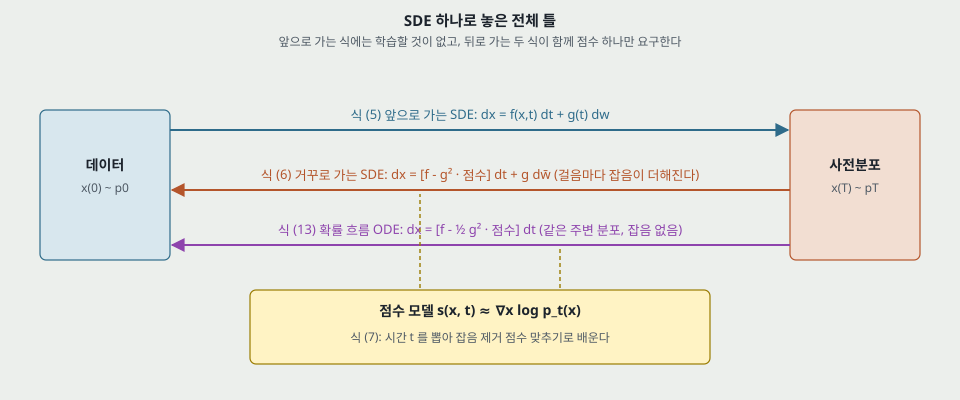

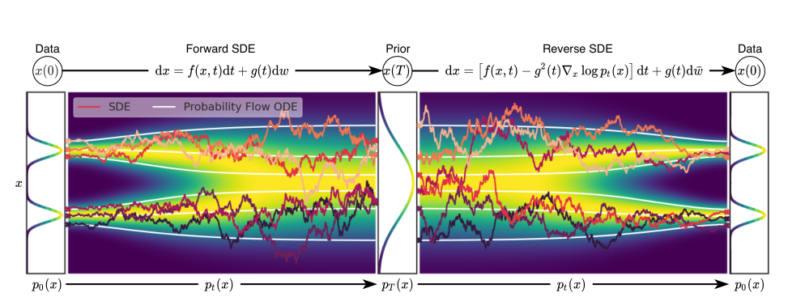

위는 내가 다시 그린 틀, 아래는 원문 그림 2 다. 원문 그림의 흰 선이 확률 흐름 ODE, 색 선이 SDE 경로다.

---

## 3. 문제 / 동기 (1절)

**이 논문이 없앤 전제 하나: 잡음 크기는 유한 개이고, 그래서 표본기와 학습이 그 눈금에 묶여 있다.**

- **원문의 말.** 「유한 개의 잡음 분포로 섭동하는 대신, 확산 과정을 따라 시간에 걸쳐 변하는 분포의 연속체를 생각한다」(2 쪽).
- **기여로 꼽는 셋.** 유연한 표본 · 우도 계산, 조건부 생성(재학습 없이), 통합된 틀.
- **DDPM 쪽에서 받는 자리.** DDPM 노트 13절이 꼽은 한계 가운데 **샘플링 1,000 회 · 우도 3.75 · 조건부 없음** 이 이 편의 4.3 · 4.2 · 5절과 닿는다. 다만 표본 비용에 대해 원문 결론은 「여전히 GAN 보다 느리다」 이다(6절).
- **원문이 든 작은 뒤집기.** 「DDPM 이 최근 SMLD 보다 표본 품질이 높다고 보고됐지만, 더 나은 짜임과 새 표본기로 후자가 따라잡는다」(2 쪽). 이 편의 최고 FID 는 SMLD 쪽 VE 에서 나온다.

---

## 4. 앞 두 방법 (2절, 식 1 ~ 4)

**SMLD.** 잡음 크기 $\sigma_\text{min} = \sigma_1 < \dots < \sigma_N = \sigma_\text{max}$ 마다 가중 합으로 배운다.

$$\theta^* = \arg\min_\theta \sum_{i=1}^{N} \sigma_i^2 \, \mathbb{E}_{p_\text{data}(\mathbf{x})} \mathbb{E}_{p_{\sigma_i}(\tilde{\mathbf{x}} \mid \mathbf{x})} \left[ \lVert \mathbf{s}_\theta(\tilde{\mathbf{x}}, \sigma_i) - \nabla_{\tilde{\mathbf{x}}} \log p_{\sigma_i}(\tilde{\mathbf{x}} \mid \mathbf{x}) \rVert_2^2 \right] \qquad (1)$$

뽑을 때는 $i = N, \dots, 1$ 차례로 $M$ 걸음씩 랑주뱅을 돌린다.

$$\mathbf{x}_i^m = \mathbf{x}_i^{m-1} + \epsilon_i \mathbf{s}_{\theta^*}(\mathbf{x}_i^{m-1}, \sigma_i) + \sqrt{2\epsilon_i} \mathbf{z}_i^m \qquad (2)$$

**DDPM.** 같은 꼴로 적는다. 이 편의 $\alpha_i$ 는 누적곱이다.

$$\theta^* = \arg\min_\theta \sum_{i=1}^{N} (1 - \alpha_i) \mathbb{E}_{p_\text{data}(\mathbf{x})} \mathbb{E}_{p_{\alpha_i}(\tilde{\mathbf{x}} \mid \mathbf{x})} \left[ \lVert \mathbf{s}_\theta(\tilde{\mathbf{x}}, i) - \nabla_{\tilde{\mathbf{x}}} \log p_{\alpha_i}(\tilde{\mathbf{x}} \mid \mathbf{x}) \rVert_2^2 \right] \qquad (3)$$

$$\mathbf{x}_{i-1} = \frac{1}{\sqrt{1 - \beta_i}} (\mathbf{x}_i + \beta_i \mathbf{s}_{\theta^*}(\mathbf{x}_i, i)) + \sqrt{\beta_i} \mathbf{z}_i \qquad (4)$$

**맞춰 본 것 셋 (내가 유도).**

1. **식 (3) 이 $L_\text{simple}$ 이다.** DDPM 노트 8절의 대응 $\mathbf{s} = -\boldsymbol\epsilon_\theta / \sqrt{1 - \bar\alpha}$ 을 넣으면 $\lVert \mathbf{s}_\theta - \nabla \log p \rVert^2 = \lVert \boldsymbol\epsilon_\theta - \boldsymbol\epsilon \rVert^2 / (1 - \bar\alpha)$ 이고, 가중치 $(1 - \alpha_i)$ 가 분모를 지운다.
2. **식 (4) 가 DDPM 알고리즘 2 다.** $\frac{1}{\sqrt{\alpha_t}}(\mathbf{x}_t - \frac{\beta_t}{\sqrt{1 - \bar\alpha_t}} \boldsymbol\epsilon_\theta)$ 에 같은 대응을 넣으면 나온다.
3. **가중치가 같은 꼴이다.** 원문은 $\sigma_i^2 \propto 1 / \mathbb{E}\lVert \nabla \log p_{\sigma_i} \rVert^2$ 라 적는다. $\tilde{\mathbf{x}} - \mathbf{x} = \sigma \mathbf{z}$ 이면 그 기댓값은 $d / \sigma^2$ 이라 맞다. 작은 예시로, CIFAR-10 ($d = 3{,}072$) · $\sigma = 0.01$ 이면 목표 노름 제곱의 기댓값이 3,072 만, $\sigma = 50$ 이면 1.23 이다. 가중치가 없으면 작은 잡음 쪽이 손실을 차지한다.

---

## 5. SDE 로 놓기 (3.1 ~ 3.3절, 식 5 ~ 7)

$$d\mathbf{x} = \mathbf{f}(\mathbf{x}, t) dt + g(t) d\mathbf{w} \qquad (5)$$

$$d\mathbf{x} = \left[ \mathbf{f}(\mathbf{x}, t) - g(t)^2 \nabla_\mathbf{x} \log p_t(\mathbf{x}) \right] dt + g(t) d\bar{\mathbf{w}} \qquad (6)$$

식 (6) 에서 $dt$ 는 음의 작은 시간이고 $\bar{\mathbf{w}}$ 는 거꾸로 흐르는 위너 과정이다. **식 (6) 은 Anderson(1982)의 결과를 옮긴 것이고 이 편이 유도하지 않는다.** 학습은 시간을 뽑아 잡음 제거 점수 맞추기를 한다.

$$\theta^* = \arg\min_\theta \mathbb{E}_t \left\{ \lambda(t) \mathbb{E}_{\mathbf{x}(0)} \mathbb{E}_{\mathbf{x}(t) \mid \mathbf{x}(0)} \left[ \lVert \mathbf{s}_\theta(\mathbf{x}(t), t) - \nabla_{\mathbf{x}(t)} \log p_{0t}(\mathbf{x}(t) \mid \mathbf{x}(0)) \rVert_2^2 \right] \right\} \qquad (7)$$

$\lambda(t) \propto 1 / \mathbb{E}\lVert \nabla \log p_{0t} \rVert^2$ 를 「typically」 쓴다. 섭동 핵이 필요한데 $\mathbf{f}$ 가 아핀이면 가우시안이고, 아니면 Kolmogorov 식을 풀거나 SDE 를 흉내 내 뽑은 뒤 sliced score matching 으로 바꾼다(부록 A).

**식 (6) 을 1 차원에서 확인한다 (내가 유도).** $f = 0$, $g = 1$, $\mathbf{x}(0) \sim \mathcal{N}(0, s^2)$ 이면 $p_t = \mathcal{N}(0, s^2 + t)$ 이고 점수는 $-x / (s^2 + t)$ 다. 시간을 $h$ 만큼 되돌리는 한 걸음은 $x_{t-h} = x_t - h \, x_t / (s^2 + t) + \sqrt{h} z$ 이다. 분산은 $(s^2 + t)(1 - 2h / (s^2 + t)) + h + O(h^2) = s^2 + t - h$ 로, $p_{t-h}$ 와 맞다. **곧 점수 항이 분산을 $2h$ 줄이고 잡음 항이 $h$ 를 되돌려 놓는다.** 식 (13) 에서 계수가 절반인 까닭이 여기 있다(8절).

---

## 6. VE · VP · sub-VP (3.4절 · 부록 B, 식 8 ~ 12, 20 ~ 29)

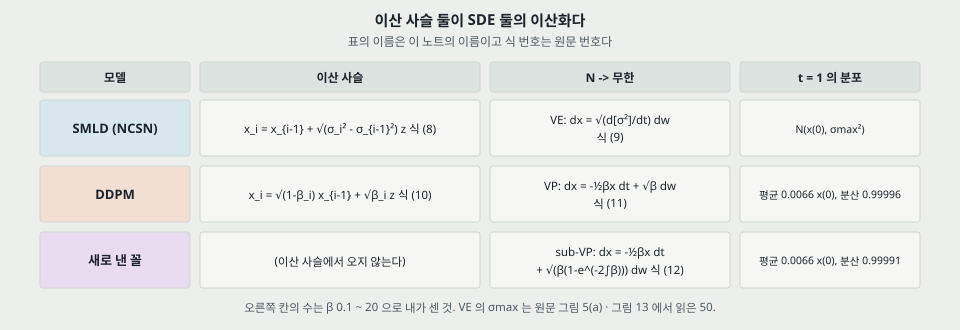

$$\text{VE:}\quad d\mathbf{x} = \sqrt{\frac{d[\sigma^2(t)]}{dt}} d\mathbf{w} \qquad (9)$$

$$\text{VP:}\quad d\mathbf{x} = -\frac{1}{2} \beta(t) \mathbf{x} dt + \sqrt{\beta(t)} d\mathbf{w} \qquad (11)$$

$$\text{sub-VP:}\quad d\mathbf{x} = -\frac{1}{2} \beta(t) \mathbf{x} dt + \sqrt{\beta(t) (1 - e^{-2 \int_0^t \beta(s) ds})} d\mathbf{w} \qquad (12)$$

**유도의 뼈대(부록 B).** DDPM 사슬에서 $\bar\beta_i = N \beta_i$ 로 놓으면 $\sqrt{1 - \bar\beta_i / N} \approx 1 - \bar\beta_i / (2N)$ 이고 $\Delta t = 1/N$ 이라 식 (24) 를 거쳐 식 (25) = 식 (11) 이 된다. 곧 $\beta_i$ 를 시간당 잡음 세기로 다시 읽는 것이 핵심이다. 작은 예시로, $\beta_1 = 10^{-4}$ 과 $\beta_{1000} = 0.02$ 는 $\bar\beta = 0.1$ · $20$ 이다.

**식을 다시 풀어 맞춘 것 (내가 유도).**

- **식 (26)** $\Sigma_\text{VP}(t) = \mathbf{I} + e^{-\int \beta} (\Sigma_\text{VP}(0) - \mathbf{I})$ 는 $d\Sigma/dt = \beta(\mathbf{I} - \Sigma)$ 의 해가 맞다.
- **식 (28)** $\Sigma_\text{sub}(t) = \mathbf{I} + e^{-2\int\beta} \mathbf{I} + e^{-\int\beta}(\Sigma_\text{sub}(0) - 2\mathbf{I})$ 를 미분하면 $-\beta\Sigma + \beta(1 - e^{-2\int\beta})$ 와 같다. 맞다.
- **「sub-VP 는 VP 아래」** 는 둘을 빼면 $e^{-\int\beta} - e^{-2\int\beta} \ge 0$ 이라 맞다. **그 차이는 $\Sigma(0)$ 에 의존하지 않고 최대 0.25 다**, $\int\beta = \ln 2$ 인 자리이고 이 $\beta$ 에서 $t = 0.259$ 다.
- **식 (29)** 시작점을 고정하면($\Sigma(0) = 0$) VP 분산은 $1 - e^{-\int\beta}$, sub-VP 분산은 그 제곱이다. **곧 sub-VP 분산 = (VP 분산)² 이다.** 원문은 제곱이라는 말을 쓰지 않지만 식 (29) 가 그 꼴이다.

**분산 보존에는 조건이 있다.** 원문 문장이 「초기 분포의 분산이 1 일 때」 고정이라 적는다. 일반에는 식 (26) 처럼 $\Sigma(0) - \mathbf{I}$ 가 $e^{-\int\beta}$ 로 줄어든다. 작은 예시로, $t = 1$ 에서 그 계수는 $4.3 \times 10^{-5}$ 이다(내가 센 것). 그리고 VE 의 「터진다」 는 $t \to \infty$ 의 말인데 실제 쓰는 시간은 $[0, 1]$ 이고 그 끝 분산은 $\sigma_\text{max}^2$ 로 유한하다.

---

## 7. 실제로 쓴 값 (부록 C, 식 30 ~ 34) · 그림 5

**VE.** $\sigma(t) = \sigma_\text{min} (\sigma_\text{max} / \sigma_\text{min})^t$, $\sigma_\text{min} = 0.01$. $\sigma_\text{max}$ 는 Song · Ermon(2020)의 Technique 1 로 정한다고만 적고 **값이 본문에 없다.** 그림 5(a) 의 끝이 2,500 이고 그림 13 의 가로축 끝이 50.03 이라 CIFAR-10 에서 50 으로 읽힌다(내가 읽은 값). $t = 0$ 은 $\sigma(0) = 0 \ne \sigma(0^+) = 0.01$ 이라 식이 정의되지 않아 $t \in [10^{-5}, 1]$ 만 푼다.

**VP.** $\beta(t) = \bar\beta_\text{min} + t(\bar\beta_\text{max} - \bar\beta_\text{min})$, $0.1$ 과 $20$. 핵은 다음과 같다.

$$p_{0t}(\mathbf{x}(t) \mid \mathbf{x}(0)) = \mathcal{N}\left(\mathbf{x}(t); e^{-\frac{1}{4} t^2 (\bar\beta_\text{max} - \bar\beta_\text{min}) - \frac{1}{2} t \bar\beta_\text{min}} \mathbf{x}(0), \mathbf{I} - \mathbf{I} e^{-\frac{1}{2} t^2 (\bar\beta_\text{max} - \bar\beta_\text{min}) - t \bar\beta_\text{min}} \right) \qquad (33)$$

$\int_0^t \beta = t\bar\beta_\text{min} + t^2 (\bar\beta_\text{max} - \bar\beta_\text{min}) / 2$ 이라 맞다. 표본은 $t_\epsilon = 10^{-3}$, 학습 · 우도는 $10^{-5}$ 까지다. 원문은 「$t_\epsilon = 10^{-3}$ 이면 $\mathbf{x}(t_\epsilon)$ 의 분산이 DDPM $\mathbf{x}_1$ 의 분산과 맞는다」 고 적는다. **식 (33) 으로 세면 $1.0994 \times 10^{-4}$ 대 $\beta_1 = 10^{-4}$, 9.9% 위다(내가 센 것).** 같아지는 자리는 $t = 9.17 \times 10^{-4}$ 이다.

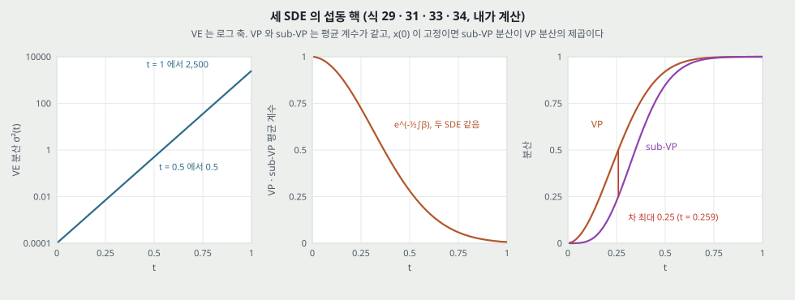

**VE 곡선의 모양.** $\sigma^2(t)$ 는 $t = 0.5$ 에서 0.5, $t = 1$ 에서 2,500 이다. 그림 5(a) 가 $t = 0.8$ 까지 바닥에 붙어 보이는 것은 선형 축 때문이고, $t = 0.8$ 의 값이 82.9 로 끝 값의 3.3% 다(내가 센 것). **눈금 수는 시간에 등간격이어도 분산의 크기 범위로는 등비다.**

**그림 5 의 캡션은 「match each other almost exactly」 라 적는다. 수로 하면 다음과 같다 (내가 계산, N = 1000).**

| 비교 | 최대 절대 차 | 자리 | 상대 차 |
|---|---|---|---|
| VP 평균 계수 $\sqrt{\bar\alpha_i}$ 대 식 (33) | 0.00099 | $i = 602$ | $i = 1000$ 에서 0.0064 대 0.0066 |
| VP 분산 | 0.00081 | $i = 141$ | $i = 1$ 에서 9.94%, $i = 300$ 에서 0.014% |
| VE 분산 | 0.92 | $i = 941$, 축 2,500 의 0.037% | $i = 1$ 에서 1.72%, $i = 1000$ 에서 0 |

그림의 벡터 좌표로 보면 빨강과 파랑은 점 40 · 52 · 54 개로 그려져 있고, 가로 · 세로 최대 어긋남이 1.35 pt 안쪽이다. **축 전체로는 맞는 말이고, 잡음이 가장 작은 자리의 상대 차는 축에서 보이지 않는다.** $t_\epsilon$ 이 FID 에 중요하다는 원문 문장(부록 C 끝)이 그 자리를 말한다.

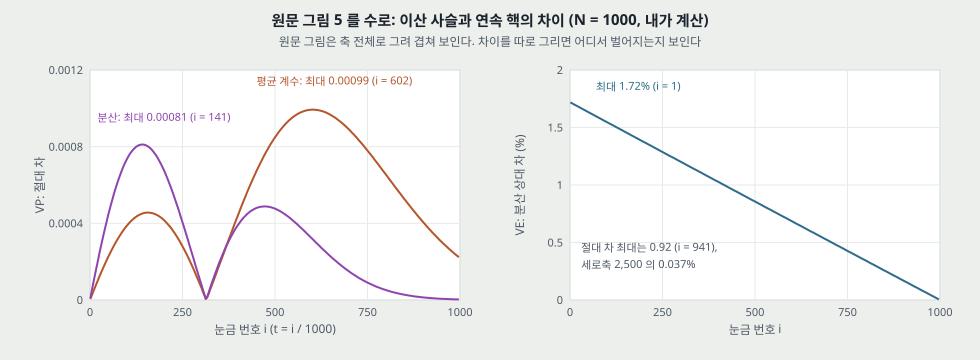

---

## 8. 확률 흐름 ODE (4.3절 · 부록 D.1, 식 13 · 17 · 35 ~ 37)

$$d\mathbf{x} = \left[ \mathbf{f}(\mathbf{x}, t) - \frac{1}{2} g(t)^2 \nabla_\mathbf{x} \log p_t(\mathbf{x}) \right] dt \qquad (13)$$

**유도의 뼈대(스칼라 $g$ 로 줄임).** Fokker-Planck 식 (35) 는 $\partial_t p_t = -\nabla \cdot (\mathbf{f} p_t) + \frac{1}{2} g^2 \Delta p_t$ 다. $\Delta p_t = \nabla \cdot (p_t \nabla \log p_t)$ 이므로 $\partial_t p_t = -\nabla \cdot [(\mathbf{f} - \frac{1}{2} g^2 \nabla \log p_t) p_t]$ 이고, 이것은 잡음 없는 식의 Liouville 방정식이다. **곧 같은 $\partial_t p_t$ 를 잡음 항 없이 내는 흐름이 식 (13) 이다.** 착상은 Maoutsa 외(2020)에서 왔다고 원문이 적는다. 식 (37) 의 일반형과 맞다.

**1 차원 확인 (내가 유도).** 5절의 예에서 $dx/dt = \frac{1}{2} x / (s^2 + t)$ 의 해는 $x(t) = x(0) \sqrt{(s^2 + t) / s^2}$ 이고 분산이 $s^2 + t$ 로 $p_t$ 와 맞다. **점수 항이 분산을 $h$ 만 줄이고 잡음이 없다** — 그래서 계수가 식 (6) 의 절반이다.

**참 점수를 넣어 두 식을 함께 풀어 본다 (내가 계산).** 1 차원 두 봉우리 혼합, 참 점수, 오일러 걸음, 신경망 없음. 아래 수는 이미지 모델의 값이 아니고, 식이 같은 주변 분포를 내는지 보는 것이 목적이다.

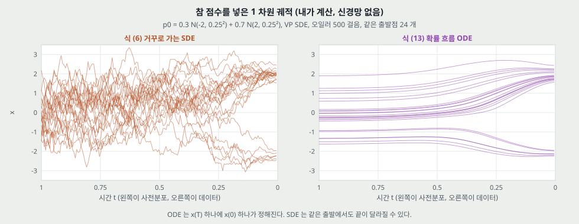

| 걸음 수 $N$ | SDE: 평균 · 표준편차 · 오른쪽 비율 | ODE: 평균 · 표준편차 · 오른쪽 비율 | W1 SDE | W1 ODE |
|---:|---|---|---:|---:|
| 5 | 0.621 · 2.411 · 0.629 | 0.759 · 1.971 · 0.673 | 0.797 | 0.232 |
| 20 | 0.778 · 1.899 · 0.691 | 0.782 · 1.880 · 0.692 | 0.068 | 0.050 |
| 100 | 0.797 · 1.859 · 0.698 | 0.790 · 1.859 · 0.697 | 0.012 | 0.014 |
| 1000 | 0.805 · 1.847 · 0.701 | 0.792 · 1.854 · 0.698 | 0.0064 | 0.0075 |
| 참 표본 | 0.798 · 1.850 · 0.700 | | 표본 잡음 바닥 0.0040 | |

**읽는 법.** 걸음이 늘면 둘 다 참 분포로 간다. $N = 5$ · 20 에서는 이 장난감에서 ODE 가 앞서는데, 표 1 의 신경망 · CIFAR-10 · 1,000 걸음에서는 VP 에서 3.59 대 3.21 로 ODE 가 뒤진다. **1 차원 · 참 점수 · 수정기 없음이라 같은 칸에 놓지 않는다.** 원문이 왜 ODE 쪽 FID 가 나쁜지 설명하지 않는다는 것만 짚어 둔다(23절).

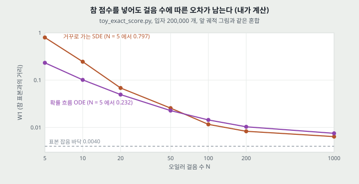

---

## 9. 우도 계산 (4.3절 · 부록 D.2, 식 38 ~ 40)

점수를 모델로 바꾼 흐름을 $\tilde{\mathbf{f}}_\theta$ 라 하면 순간 변수 변환으로 다음을 얻는다.

$$\log p_0(\mathbf{x}(0)) = \log p_T(\mathbf{x}(T)) + \int_0^T \nabla \cdot \tilde{\mathbf{f}}_\theta(\mathbf{x}(t), t) dt \qquad (39)$$

**부호를 1 차원에서 맞췄다 (내가 유도).** 8절의 예에서 $\int_0^T \frac{1}{2(s^2 + t)} dt = \frac{1}{2} \ln \frac{s^2 + T}{s^2}$ 이고 $x(T)^2 / (s^2 + T) = x(0)^2 / s^2$ 라, 식 (39) 의 오른쪽이 정확히 $\log \mathcal{N}(x(0); 0, s^2)$ 이 된다.

**발산은 Skilling-Hutchinson 으로 추정한다.** $\nabla \cdot \tilde{\mathbf{f}}_\theta = \mathbb{E}[\mathbf{v}^\mathsf{T} \nabla \tilde{\mathbf{f}}_\theta \mathbf{v}]$. 식 (40). 설정은 RK45(`scipy.integrate.solve_ivp`), `atol` = `rtol` = $10^{-5}$, 시험 집합 평균을 다섯 번 돌려 평균, $t_\epsilon = 10^{-5}$.

**「정확한(exact)」 이 뜻하는 범위.** 원문은 「임의의 정확도로 우도를 계산한다」 고 적는다(D.2). 이 말이 서는 것은 **식 (13) 이 $\mathbf{s}_\theta$ 로 정의하는 밀도** 에 대해서다. 곧 남는 조건이 넷이다.

1. 그 밀도는 **SDE · PC 표본기의 분포와 다르다.** $\mathbf{s}_\theta$ 가 참 점수일 때만 주변 분포가 같다(4.3절). 표 3 의 FID 와 표 2 의 NLL 은 다른 분포의 값이다.
2. 적분 아래 끝이 0 이 아니라 $t_\epsilon = 10^{-5}$ 이다. 원문: 「더 작은 $t_\epsilon$ 이 대체로 더 좋은 우도를 준다」(부록 C). **곧 표 2 의 값은 이 설정값에 움직인다.** $t_\epsilon$ 을 바꾼 수는 없다.
3. RK45 허용 오차와 추정 잡음이 있다. 표 2 에 다섯 번의 표준편차가 없다.
4. 데이터가 균일 역양자화다. 이 조건 밖의 모델은 표에서 뺐다(13절).

---

## 10. 일반 풀이와 거꾸로 확산 표본기 (4.1절 · 부록 D.3 · E · F)

앞으로 가는 이산화가 $\mathbf{x}_{i+1} = \mathbf{x}_i + \mathbf{f}_i(\mathbf{x}_i) + \mathbf{G}_i \mathbf{z}_i$ (식 45)라면 거꾸로 확산은 같은 꼴로 적는다.

$$\mathbf{x}_i = \mathbf{x}_{i+1} - \mathbf{f}_{i+1}(\mathbf{x}_{i+1}) + \mathbf{G}_{i+1} \mathbf{G}_{i+1}^\mathsf{T} \mathbf{s}_{\theta^*}(\mathbf{x}_{i+1}, i + 1) + \mathbf{G}_{i+1} \mathbf{z}_{i+1} \qquad (46)$$

확률 흐름 쪽(부록 D.3)은 잡음을 빼고 $\mathbf{G}\mathbf{G}^\mathsf{T}$ 에 $\frac{1}{2}$ 을 곱한다. 식 (43) · (44).

| 표본기 | VE | VP |
|---|---|---|
| 거꾸로 확산 | $\mathbf{x}_{i+1} + (\sigma_{i+1}^2 - \sigma_i^2) \mathbf{s} + \sqrt{\sigma_{i+1}^2 - \sigma_i^2} \mathbf{z}$ | $(2 - \sqrt{1 - \beta_{i+1}}) \mathbf{x}_{i+1} + \beta_{i+1} \mathbf{s} + \sqrt{\beta_{i+1}} \mathbf{z}$ |
| 확률 흐름 | $\mathbf{x}_{i+1} + \frac{1}{2} (\sigma_{i+1}^2 - \sigma_i^2) \mathbf{s}$ | $(2 - \sqrt{1 - \beta_{i+1}}) \mathbf{x}_{i+1} + \frac{1}{2} \beta_{i+1} \mathbf{s}$ |
| 조상 표집 | 식 (47), 부록 F 에서 유도 | 식 (4) |

**조상 표집과의 관계.** 원문 부록 E 는 $\beta$ 가 작을 때 식 (4) 가 거꾸로 확산과 일치한다고 전개한다($1 / \sqrt{1 - \beta} = 1 + \frac{1}{2}\beta + o(\beta)$). 맞다. 차이는 $\beta^2 \mathbf{s}/2$ 항 등이다. $\beta_{1000} = 0.02$ 에서 $\mathbf{s}$ 계수가 $1 / \sqrt{0.98} \times 0.02 = 0.020203$ 대 $0.02$ 로 1.0% 차이이고, $\mathbf{x}$ 계수가 1.010153 대 1.010050 이다(내가 센 것). **곧 DDPM 의 표본기는 VP SDE 의 한 이산화라는 것이 이 편의 주장이고, 같은 모델이라면 표 1 의 VP 칸 차이 0.03 ~ 0.05 는 이 계수 차이와 표집 잡음에서 나온 값이다(내 판단).**

**알고리즘의 값이 맞는지(내가 대조).** 식 (46) 에 $\mathbf{f}_i = (\sqrt{1 - \beta_{i}} - 1)\mathbf{x}$ · $\mathbf{G}_i = \sqrt{\beta_i} \mathbf{I}$ 를 넣으면 알고리즘 3 의 예측기가 되고, $\mathbf{f} = 0$ · $\mathbf{G}_{i+1} = \sqrt{\sigma_{i+1}^2 - \sigma_i^2}$ 를 넣으면 알고리즘 2 의 예측기가 된다. 맞다.

---

## 11. 예측기-수정기 표본기 (4.2절 · 부록 G)

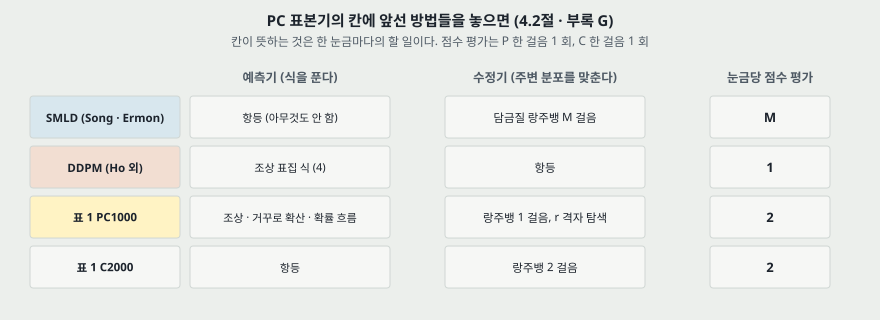

알고리즘 1 은 간단하다. 시간을 한 칸 내리며(`Predictor`) 그 시간에서 $M$ 번 `Corrector` 를 돌린다. **SMLD 는 예측기가 항등, DDPM 은 수정기가 항등이라 둘 다 이 틀의 특수한 경우다.**

수정기의 걸음 폭은 잡음 · 점수의 노름으로 정한다(알고리즘 4 · 5).

$$\epsilon = 2 \left( r \frac{\lVert \mathbf{z} \rVert_2}{\lVert \mathbf{g} \rVert_2} \right)^2 \quad (\text{VE}), \qquad \epsilon = 2 \alpha_i \left( r \frac{\lVert \mathbf{z} \rVert_2}{\lVert \mathbf{g} \rVert_2} \right)^2 \quad (\text{VP})$$

**$r$ 의 뜻을 유도했다 (내가 유도).** 랑주뱅 한 걸음의 점수 항 노름은 $\epsilon \lVert \mathbf{g} \rVert$, 잡음 항 노름은 $\sqrt{2\epsilon} \lVert \mathbf{z} \rVert$ 다. 둘의 비를 $r$ 로 두면 위의 VE 식이 정확히 나온다. VP 는 $\alpha_i$ 가 더 곱해진다.

- **표본 배치가 크면** 노름을 배치 평균으로 바꾸고, 작으면 $\lVert \mathbf{z} \rVert$ 를 $\sqrt{d}$ 로 바꾸라고 적는다.
- **끝의 잡음 제거 한 걸음.** Tweedie 공식으로 마지막에 한 번 잡음을 뺀다. 원문: 「이 민감성이 NCSN 이 DDPM 보다 FID 가 나빴던 까닭의 일부다, 전자는 끝에 잡음을 빼지 않았다」(23 쪽). **이 편의 모든 실험에 이 걸음이 있다.** 곧 표 3 의 NCSN 25.32 와 NCSN++ 2.45 의 차이에는 짜임 말고 이 걸음의 몫이 들어 있을 수 있다. 몫을 가른 수는 없다.

---

## 12. 표 1 · 표 4 · 표 5 (4.2절 · 부록 G)

**설정.** CIFAR-10. 모델은 DDPM 짜임(Ho 외), VE 는 식 (1), VP 는 식 (3), 잡음 눈금 1,000 개로 학습. **표집 다섯 번의 평균과 표준편차이고 학습 반복은 없다.** P2000 은 학습한 적 없는 눈금 2,000 개가 필요해 시험 때 보간한다. 표 1 은 선형($\mathbf{s}'(\mathbf{x}, i) = \mathbf{s}(\mathbf{x}, i/2)$), 표 4 는 반올림($\lfloor i/2 \rfloor$)이다. VE 는 $\sigma_\text{min}, \sigma_\text{max}$ 고정, VP 는 $\beta_\text{min}, \beta_\text{max}$ 를 절반으로 한다. 수정기 표본기의 $r$ 은 격자(0.01 단위)에서 **FID 로 고른다.**

| FID | VE P1000 | VE P2000 | VE C2000 | VE PC1000 | VP P1000 | VP P2000 | VP C2000 | VP PC1000 |
|---|---:|---:|---:|---:|---:|---:|---:|---:|
| 조상 표집 | 4.98 ± .06 | 4.88 ± .06 | | **3.62 ± .03** | 3.24 ± .02 | 3.24 ± .02 | | **3.21 ± .02** |
| 거꾸로 확산 | 4.79 ± .07 | 4.74 ± .08 | 20.43 ± .07 | **3.60 ± .02** | 3.21 ± .02 | 3.19 ± .02 | 19.06 ± .06 | **3.18 ± .01** |
| 확률 흐름 | 15.41 ± .15 | 10.54 ± .08 | | **3.51 ± .04** | 3.59 ± .04 | 3.23 ± .03 | | **3.06 ± .03** |
| (표 4 P2000) 조상 | | 4.92 ± .02 | | | | **3.11 ± .03** | | |
| (표 4 P2000) 거꾸로 확산 | | 4.72 ± .07 | | | | **3.10 ± .03** | | |
| (표 4 P2000) 확률 흐름 | | 12.87 ± .09 | | | | 3.25 ± .04 | | |

굵은 글씨는 원문 표시 그대로다. 표 4 의 PC1000 은 표 1 과 값이 같고, 표 4 의 VP 굵은 글씨는 P2000 두 칸과 확률 흐름 PC1000 이다.

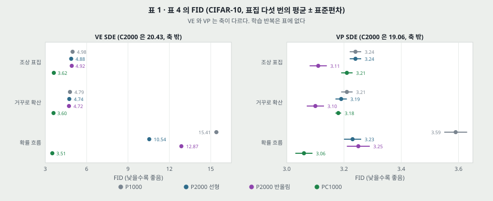

**원문 문장과 수를 나란히 놓는다.** 판정 규칙은 내가 정했다: **차이가 두 표준편차의 합을 넘는가.** 이 표준편차는 표집 잡음만 담는다.

| 원문 문장 | 칸마다의 차이 / 표준편차 합 | 판정 |
|---|---|---|
| 「거꾸로 확산이 조상 표집을 **언제나** 넘는다」 | VE .19/.13, .14/.14, .02/.05 · VP .03/.04, .05/.04, .03/.03 | 부호는 여섯 칸 다 맞다. 합을 넘는 칸은 2 / 6. 4.1절의 「slightly」 가 더 맞는 말이다 |
| 「C2000 이 같은 계산의 P2000 · PC1000 보다 나쁘다」 | 20.43 · 19.06 대 3.06 ~ 10.54 | 맞다 |
| 「수정기를 붙이면(PC1000) 계산이 두 배이고 P1000 보다 **언제나** 낫다」 | VE 1.36, 1.19, 11.90 · VP .03/.04, .03/.03, .53/.07 | VE 는 맞다. VP 앞 두 줄은 합을 넘지 않고 평가는 두 배다 |
| 「PC 가 P2000 보다 대개 낫다」 (표 1) | VP .03/.04, .01/.03, .17/.06 | VP 앞 두 줄은 합을 넘지 않는다 |
| 「보간이 달라도 PC 가 같거나 낫다는 흐름은 유지된다」 (부록 G, 표 4) | VP 조상 3.11 대 3.21, 거꾸로 확산 3.10 대 3.18 | **어긋난다.** P2000 이 0.10 · 0.08 낮고 합(.05 · .04)을 넘는다. 표 4 스스로 앞쪽을 굵게 쓴다 |

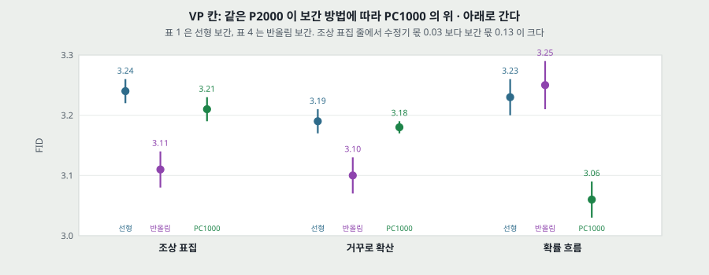

**보간 방법의 몫 (내가 센 것, 표 1 -> 표 4 의 P2000).** VE +0.04, −0.02, **+2.33** · VP **−0.13, −0.09**, +0.02. 이 표본기 설정은 학습에 없던 값을 시험 때 만들어 낸 것이고 원문도 「ad hoc」 이라 적는다. **VP 에서 수정기 몫 0.03 을 말하려면 그 네 배가 넘는 움직임을 주는 설정을 먼저 고정해야 한다.**

**VP 에서 수정기 걸음 폭이 작게 골렸다는 표시가 표 5 에 있다.**

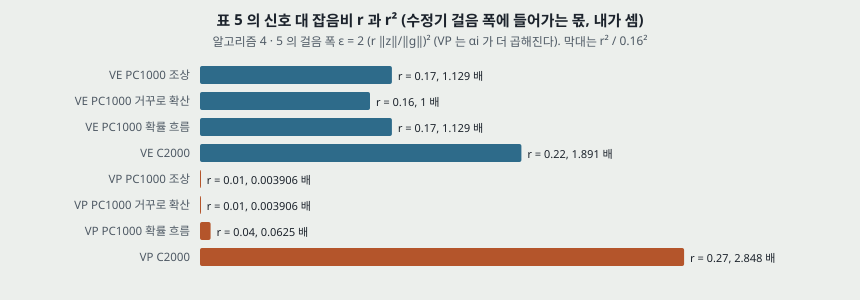

고른 $r$ 은 VE PC 가 0.16 ~ 0.17, VP PC 의 앞 두 줄이 **0.01 — 격자의 맨 아래 칸일 수 있다** (격자가 「increments at 0.01」 이라고만 적었고 시작점은 적혀 있지 않다). 걸음 폭은 $r^2$ 에 비례하므로 VE 0.16 대비 $1/256$ 이다($\alpha_i$ · 노름 비는 빼고 낸 값, 내가 셈). 원문 부록 H.1 이 VP 탐색에서 수정기를 빼고 「correctors there only give slightly better results」 라 적는 것과 같은 방향이다. **곧 「PC 가 일반적으로 낫다」 의 VP 앞 두 줄은, 걸음 폭이 VE 의 1/256 인 설정을 FID 로 골라 낸 0.03 이다.**

**그림 9 (LSUN, VE, 연속 목적 함수).** 총 평가 1,000 · 2,000 · 3,000 과 눈금당 랑주뱅 0 ~ 3 을 표본 한 장씩으로 보인다. $r = 0.075$ 고정. 4.2절 「clearly surpass」 와 캡션 「split 할 때 가장 좋다」 의 근거가 이것인데 **칸마다 표본 한 장이고 FID 는 없다.** 내 눈으로는 1,000 줄은 네 칸 다 어그러졌고 3,000 줄은 네 칸 다 형체가 선다. 차이가 보이는 것은 2,000 줄이다.

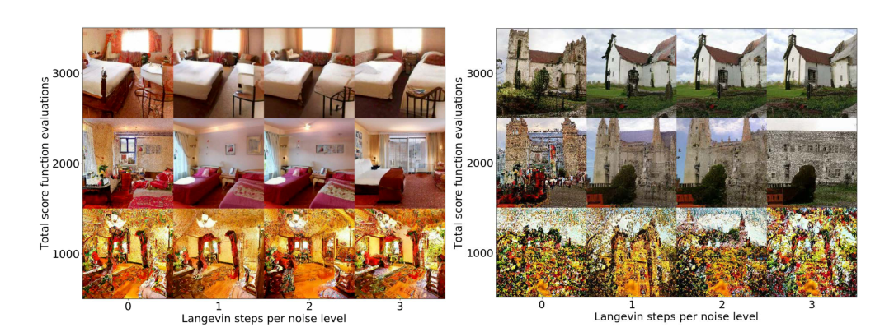

---

## 13. 표 2 — NLL 과 ODE 의 FID (4.3 · 4.4절)

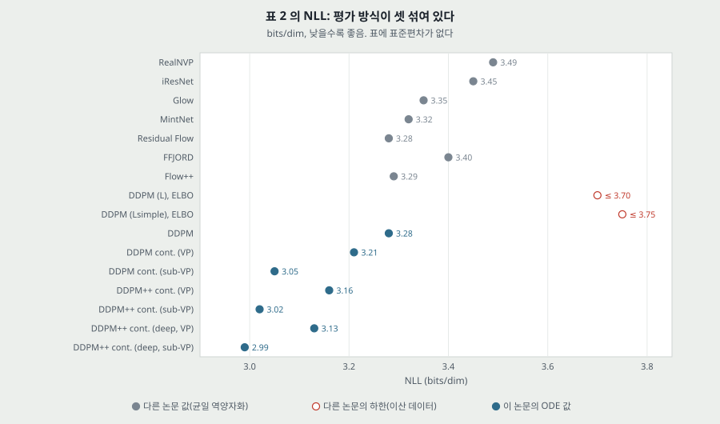

| 모델 | NLL 시험 | FID (ODE) |
|---|---:|---:|
| RealNVP · iResNet · Glow · MintNet | 3.49 · 3.45 · 3.35 · 3.32 | - |
| Residual Flow | 3.28 | 46.37 |
| FFJORD · Flow++ | 3.40 · 3.29 | - |
| DDPM ($L$) | ≤ 3.70* | 13.51 |
| DDPM ($L_\text{simple}$) | ≤ 3.75* | 3.17 |
| DDPM | 3.28 | 3.37 |
| DDPM cont. (VP) · (sub-VP) | 3.21 · 3.05 | 3.69 · 3.56 |
| DDPM++ cont. (VP) · (sub-VP) | 3.16 · 3.02 | 3.93 · 3.16 |
| DDPM++ cont. (deep, VP) · (deep, sub-VP) | 3.13 · **2.99** | 3.08 · **2.92** |

\* 는 이산 데이터에서 잰 하한. 나머지는 균일 역양자화 데이터다. 「DDPM」 줄부터 아래 일곱 값의 FID 는 RK45 ODE 표본, 마지막 체크포인트다. **DDPM ($L$) · ($L_\text{simple}$) 줄의 FID 13.51 · 3.17 은 DDPM 노트의 표와 같은 값이라 원 논문 표본기의 값으로 읽힌다.** 표 제목은 「FIDs (ODE)」 다.

**원문의 네 주장을 따진다.**

1. **「같은 DDPM 모델에서 하한보다 좋은 bits/dim, 우리 우도는 정확하므로」(3.75 -> 3.28).** 차이 0.47 bits/dim 은 이미지당 1,444 비트다(내가 센 것). **이 차이를 하한의 틈으로만 읽을 수 없다.** 3.75 는 이산 복호기까지 있는 역방향 사슬의 하한이고, 3.28 은 식 (13) 의 밀도를 역양자화 데이터에서 잰 값이다 — 같은 $\mathbf{s}_\theta$ 에서 나온 **다른 생성 모델** 이다(내 판단). 이산 쪽과 역양자화 쪽의 평가 차이는 원문 스스로 표시한다. 곧 이 편은 틈을 재지 않고 다른 모델로 값을 다시 냈다.
2. **「연속 목적 함수로 다시 배우면 더 좋아진다」(3.28 -> 3.21).** 차이 0.07, 표준편차 없음, 모델 하나씩.
3. **「sub-VP 가 언제나 VP 보다 우도가 높다」.** 세 쌍 다 맞다 — 0.16 · 0.14 · 0.14 낮다. **왜 그런지는 원문에 없다.** 내가 볼 수 있는 값만 적으면, 섭동 핵 표준편차가 $t_\epsilon = 10^{-5}$ 에서 VP $1.0 \times 10^{-3}$ 대 sub-VP $1.0 \times 10^{-6}$ 로 1,000 배 차이다(식 29 · 34 로 내가 셈). 이 차이가 우도 차이의 원인인지는 이 편이 재지 않았다.
4. **「새 기록 2.99」.** 조건이 붙는다. **균일 역양자화 CIFAR-10 에서** 이고, 변분 역양자화 · 이산 데이터로 잰 모델을 표에서 뺐다고 원문이 적는다. DDPM 노트의 표에 있는 Sparse Transformer 2.80 은 이 표 밖이다. Abstract 는 같은 값을 「competitive」 라 부르고 1절은 「new record」 라 부른다.

**VE 의 우도가 표에 없다.** 4.4절은 「VE 의 우도가 VP · sub-VP 보다 나쁘다는 것을 경험으로 본다」 고 적는데 **값이 없다.** 그래서 FID 1 등 모델과 우도 1 등 모델은 다른 모델이고, Abstract 의 「FID 2.20 · 2.99 bits/dim」 은 한 모델의 성적이 아니다. 우도 1 등의 표 3 값은 FID 2.41 · IS 9.57 이다.

---

## 14. 그림 3 · 적응 걸음 (4.3절 · 부록 D.4)

**설정.** DDPM 짜임 · 256 x 256 CelebA-HQ, RK45. 그림 왼쪽은 정밀도 $10^{-1}, 10^{-3}, 10^{-5}$ 에서 평가한 시간, 가운데는 같은 잠재의 표본 두 줄.

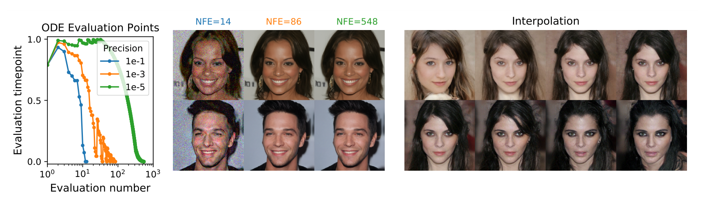

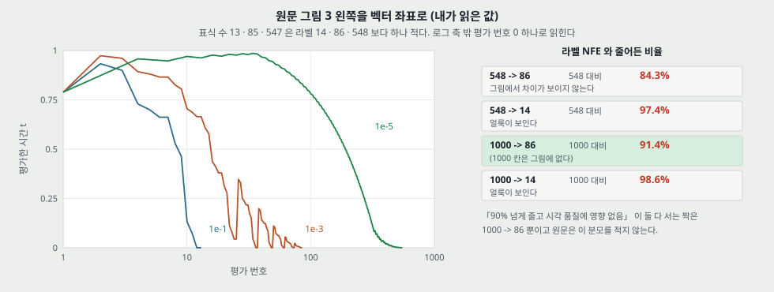

**벡터 좌표로 세어 본 것 (내가 센 것).**

- 표식이 13 · 85 · 547 개다. 라벨 NFE 14 · 86 · 548 보다 하나씩 적고, 평가 번호 0 하나가 로그 축 밖이라 빠진 것으로 읽힌다(내 추정).
- 평가가 시간에 고르지 않다. $t < 0.1$ 에 쓴 평가의 비율이 23.1% · 55.3% · 41.7%, $t < 0.5$ 는 38.5% · 82.4% · 65.4% 다. **곧 정밀도를 올리면 표본의 마지막 구간에 평가가 몰린다.**

**「평가를 90% 넘게 줄여도 시각 품질에 영향이 없다」 를 맞춘다.**

| 짝 | 줄어든 비율 | 그림 표본 |
|---|---:|---|
| 548 -> 86 | 84.3% | 차이가 보이지 않는다 |
| 548 -> 14 | 97.4% | 두 줄 모두 얼룩이 뚜렷하다 |
| 1000 -> 86 | 91.4% | 그림에 1000 칸이 없다 |
| 1000 -> 14 | 98.6% | 위와 같이 얼룩 |

**두 조건이 함께 서는 것은 1000 -> 86 뿐이고 원문은 분모를 적지 않는다.** 캡션의 「without harming quality」 는 NFE=86 칸을 말하는 것으로만 맞다. FID 는 없고 표본 두 줄이다. 그리고 원문 부록 D.4 는 「ODE 표본기가 수정기 없으면 SDE 보다 FID 가 대체로 나쁘다」 고 적어, 본문의 인상과 다른 말을 함께 둔다. 표 1 에서 VE 15.41 대 4.79, VP 3.59 대 3.21 이다.

---

## 15. 잠재 조작과 유일한 부호화 (4.3절 · 부록 D.4 · D.5, 그림 6 · 7 · 8)

**그림 3 오른쪽 · 그림 6** 은 구면 보간과 온도 조절(부호 노름 줄이기)을 표본으로 보인다. 수치는 없다.

**유일하게 식별되는 부호화.** 원문: 「앞으로 가는 SDE 에 학습할 것이 없으므로, 점수가 완벽하면 부호가 데이터 분포로 정해진다」. 곧 조건이 충분한 데이터 · 용량 · 최적화다. 확인 실험(부록 D.5): VE SDE · CIFAR-10, NCSN++ 해상도당 4 층 대 8 층, 모델 하나씩, 이미지 16 장. **「서로 다른 짜임」 은 같은 계열의 깊이 차이다.**

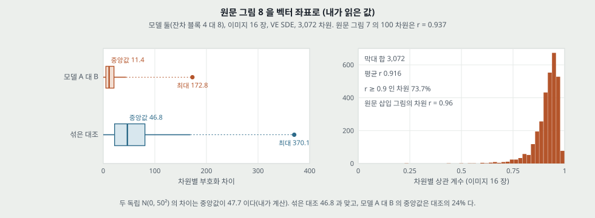

| 값 (내가 읽은 값) | 모델 A 대 B | 섞은 대조 |
|---|---:|---:|
| 차원별 차이 Q1 · 중앙값 · Q3 | 5.2 · 11.4 · 20.9 | 22.0 · 46.8 · 80.8 |
| 윗수염 끝 · 최댓값 | 44.4 · 172.8 | 168.9 · 370.1 |
| 수염 밖 점 수 | 2,097 | 1,149 |

- **분모.** 16 x 3,072 = 49,152 값이 전부라면(내 추정) 수염 밖은 4.27% · 2.34% 다.
- **대조가 맞는지.** 두 독립 $\mathcal{N}(0, 50^2)$ 의 차이 절댓값 중앙값은 $0.6745 \times \sqrt{2} \times 50 = 47.7$ 이라 섞은 대조 46.8 과 맞다(내 계산). 곧 모델 A 대 B 의 중앙값은 **독립일 때의 24%** 다.
- **그림 7 의 100 차원.** 평균 절대 차 12.6 · 중앙값 10.1 · 최대 50.1(차원 99) · 상관 0.937, 부호 제곱평균제곱근 46.5 · 43.9.
- **상관 히스토그램.** 합 3,072, 평균 0.916, $r \ge 0.9$ 인 차원 73.7%, 값이 있는 가장 낮은 막대의 가운데 0.235. 원문 삽입 그림의 차원은 $r = 0.96$ 으로 평균보다 위다. 각 $r$ 은 점 16 개로 낸다.

**주장 세기.** 「모든 차원에서 가깝다(close in every dimension)」 는 중앙값 쪽으로 맞고, 차원별 최대 차이 172.8 은 부호 값 범위(그림 7 에서 ±127)보다 크다. **모델 한 쌍 · 이미지 16 장 · VE 하나** 에서 잰 것이고 훈련을 다시 돌린 쌍은 없다.

---

## 16. 짜임 탐색 (4.4절 · 부록 H.1 · H.2, 그림 10)

**다섯 가지를 켜고 끈다.** FIR 상 · 하표본, 지름길 $1/\sqrt{2}$, BigGAN 잔차 블록, 해상도당 블록 2 -> 4, 진행형 입력 · 출력 아홉 조합. **곱하면 $2 \times 2 \times 2 \times 2 \times 9 = 144$ 라 원문의 「all 144 possible configurations」 와 맞다(내가 셈).**

**설정.** 1.3M 반복, 5 만 반복마다 체크포인트(내가 세면 26 개). VE 는 CIFAR-10 · CelebA 64 x 64 에서 0.5M 뒤 체크포인트의 평균 FID(16 개)로, VP 는 CIFAR-10 만, 0.25M ~ 0.5M 평균(6 개)으로 견준다. VP 는 「0.5M 뒤 FID 가 오른다」 고 적는다. 표본은 PC, 거꾸로 확산 예측기, 1,000 눈금. **VE 는 수정기 1 걸음($r = 0.16$), VP 는 수정기 뺌.** 지수 이동 평균은 VE 0.999 · VP 0.9999 로 다르다.

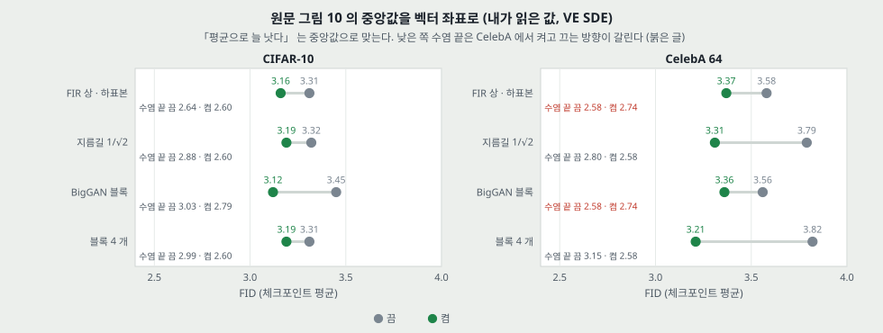

| 내가 읽은 중앙값 (끔 -> 켬) | CIFAR-10 | CelebA 64 |
|---|---:|---:|
| FIR | 3.31 -> 3.16 | 3.58 -> 3.37 |
| 지름길 $1/\sqrt{2}$ | 3.32 -> 3.19 | 3.79 -> 3.31 |
| BigGAN 블록 | 3.45 -> 3.12 | 3.56 -> 3.36 |
| 블록 4 개 | 3.31 -> 3.19 | 3.82 -> 3.21 |

- **「평균으로 언제나 낫다」** 는 중앙값 8 칸 모두 맞다. 차이는 0.12 ~ 0.61.
- **다만 가장 좋은 구성은 그 말로 정해지지 않는다.** 낮은 쪽 수염 끝이 CelebA 에서 FIR 끔 2.58 · 켬 2.74, BigGAN 끔 2.58 · 켬 2.74 다. 곧 CelebA 의 가장 낮은 칸들은 FIR 과 BigGAN 블록을 끈 쪽에 있다. 원문이 고른 NCSN++ 는 넷을 다 켠다.
- **고른 것은 무엇을 기준으로 했나.** NCSN++ = FIR + 지름길 + BigGAN + 블록 4 + 입력 residual. 표 없이 문장으로 적혀 있다. VP 는 NCSN++ 가 144 중 4 등이고, 1 등은 FIR 을 빼고 진행형을 뺀 DDPM++ 다. **그 등수의 FID 는 적혀 있지 않다.**

---

## 17. 표 3 — 표본 품질 (4.4절 · 부록 H.2)

| 모델 | FID | IS |
|---|---:|---:|
| (조건부) BigGAN · StyleGAN2-ADA | 14.73 · **2.42** | 9.22 · **10.14** |
| (무조건부) StyleGAN2-ADA | 2.92 | 9.83 |
| NCSN · NCSNv2 | 25.32 · 10.87 | 8.87 ± .12 · 8.40 ± .07 |
| DDPM | 3.17 | 9.46 ± .11 |
| DDPM++ | 2.78 | 9.64 |
| DDPM++ cont. (VP) · (sub-VP) | 2.55 · 2.61 | 9.58 · 9.56 |
| DDPM++ cont. (deep, VP) · (deep, sub-VP) | 2.41 · 2.41 | 9.68 · 9.57 |
| NCSN++ | 2.45 | 9.73 |
| NCSN++ cont. (VE) | 2.38 | 9.83 |
| NCSN++ cont. (deep, VE) | **2.20** | **9.89** |

**이 표의 값은 「학습 중 FID 가 가장 낮은 체크포인트」 다**(4.4절). 부록 H.2 는 다른 논문의 관례에 맞췄다고 적는다. 이 편 줄에는 표준편차가 없다.

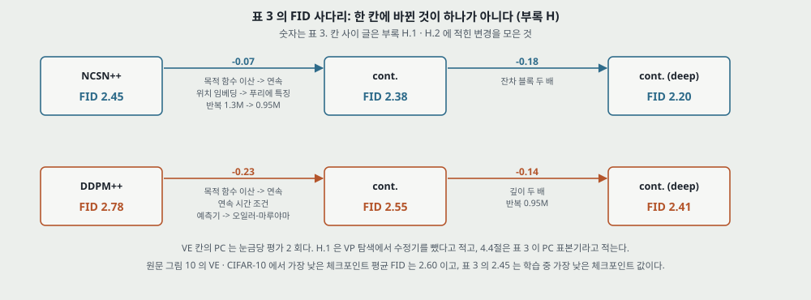

**한 칸에 바뀌는 것 (부록 H 에서 모음).**

| 칸 | 차이 | 함께 바뀐 것 |
|---|---:|---|
| NCSN++ -> cont. | −0.07 | 이산 -> 연속 목적 함수, 위치 임베딩 -> 푸리에 특징(규모 16), 반복 1.3M -> 0.95M |
| cont. -> deep | −0.18 | 블록 수 두 배(4 -> 8) |
| DDPM++ -> cont. (VP) | −0.23 | 연속 목적 함수 · 연속 시간 조건, **예측기가 조상 · 거꾸로 확산에서 오일러-마루야마로** |
| cont. -> deep (VP) | −0.14 | 깊이 두 배, 0.95M |

4.4절의 「연속 목적 함수로 바꾸면 더 좋아진다」 는 이 묶음의 값이다. 한 가지씩 끈 행은 없다.

**체크포인트 고르기의 몫 (내가 센 것).** 같은 설정(이산 목적 함수, VE, CIFAR-10, 1.3M)의 그림 10 에서 **가장 낮은 체크포인트 평균 FID 는 2.60** 이다(수염 끝 · 이상점 포함, 벡터 좌표). 표 3 의 NCSN++ 2.45 는 그 탐색에서 고른 구성의 가장 낮은 체크포인트 값이다. **0.15 의 차이가 연속 목적 함수 칸의 0.07 보다 크다.** 체크포인트 19 ~ 26 개 중 최솟값이고, 고른 체크포인트를 새 표본으로 다시 잰 값은 없다. 구성 고르기와 체크포인트 고르기가 겹친 값이라 0.15 를 한쪽 몫으로 가를 수는 없다.

**같은 모델의 FID 두 벌.**

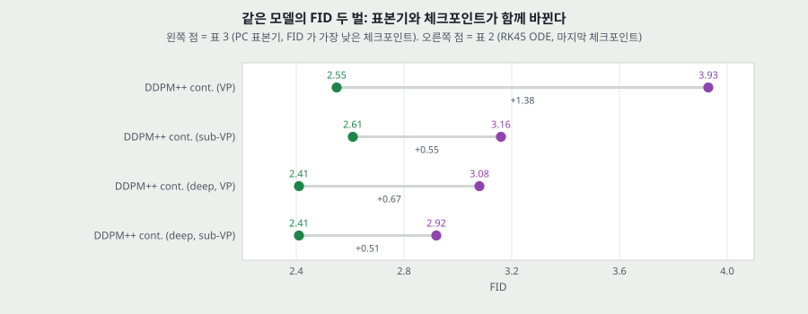

표 3 (PC, 가장 낮은 체크포인트) 과 표 2 (RK45, 마지막 체크포인트) 의 차이는 +0.51 ~ +1.38 이다. **표본기와 체크포인트가 함께 바뀌어 몫이 안 갈린다.** PC · 마지막 체크포인트나 ODE · 가장 낮은 체크포인트 칸은 없다. 부록 H.1 의 「VP 는 0.5M 뒤 FID 가 오른다」 를 함께 읽으면 마지막 체크포인트 몫이 작지 않을 수 있다.

**「VE 가 대체로 표본 품질이 낫다」 (4.4절).** 세 짝에서 VE 가 0.33 · 0.17 · 0.21 낮다. 다만 NFE 가 같지 않다. VE PC 는 눈금당 2 회이고, 부록 H.1 은 VP 탐색에서 수정기를 뺐다고 적는다. 지수 이동 평균 · 짜임 · 예측기도 다르다. **4.4절은 표 3 이 PC 표본기라고 적어 H.1 과 말이 갈린다(25절).** 곧 SDE 하나의 효과로 읽을 수 있는 짝이 표에 없다.

**「조건부 최고 모델보다 FID 가 낫다」(2.20 대 2.42).** IS 는 9.89 대 10.14 로 아래다. 상대 값은 다른 논문에서 옮겼고, FID 구현 · 기준 표본이 같은지 이 편은 적지 않는다. 부록 B 의 「sub-VP 가 표본 품질과 우도 모두 대개 낫다」 는 표 3 에서 2.61 > 2.55 · 2.41 = 2.41 · IS 9.56 < 9.58 · 9.57 < 9.68 로 맞지 않고, ODE FID(표 2)에서만 맞다.

---

## 18. 고해상도 (부록 H.3, 그림 11 · 12)

CelebA-HQ 1024 x 1024. 배치 8, 지수 이동 평균 0.9999, 연속 목적 함수, 2.4M 반복(원문 「around」), PC 2,000 눈금, 거꾸로 확산 + 랑주뱅 1 걸음, $r = 0.15$, 진행형 입력 skip · 출력 skip. 곧 표본 하나에 평가 4,000 회다(내가 셈). **FID 가 없다.** 원문이 「완벽하지 않다(얼굴 대칭의 결함)」 고 적으면서 「high-fidelity」 라 부른다. 「점수 모델로 처음」 은 비교 대상 범위가 점수 모델로 좁혀진 말이다.

---

## 19. 조건부 생성 (5절 · 부록 I, 식 14 · 48 ~ 50)

$$d\mathbf{x} = \left\{ \mathbf{f}(\mathbf{x}, t) - g(t)^2 \left[ \nabla_\mathbf{x} \log p_t(\mathbf{x}) + \nabla_\mathbf{x} \log p_t(\mathbf{y} \mid \mathbf{x}) \right] \right\} dt + g(t) d\bar{\mathbf{w}} \qquad (14)$$

베이즈 규칙의 기울기에서 $p(\mathbf{y})$ 항이 지워진다는 것이 전부다(식 49). **쓰는 것은 조건 없는 점수 모델 하나 + 조건 항 하나다.**

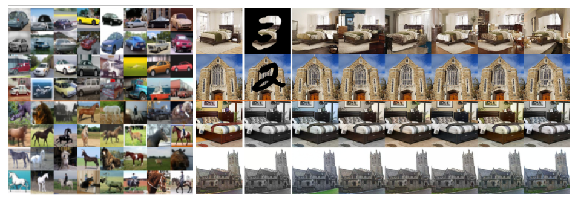

| 과제 | 조건 항을 얻는 법 | 근사 | 잰 수 |
|---|---|---|---|
| 부류 조건 (I.1) | **시간 조건 분류기를 따로 학습**(WRN-28-10, $\log\sigma_i$ 를 푸리에 특징으로, 잡음 크기마다 교차 엔트로피의 합). 점수 모델은 NCSN++ 4 블록, PC 2,000 눈금 | 없음(분류기 근사만) | 분류기 정확도 곡선 하나 |
| 채우기 (I.2) | 아는 차원을 $\hat\Omega(\mathbf{x}(t))$ 로 뽑아 모르는 차원 SDE 에 넣는다 | 「≈」 두 번 | 없음 |
| 색칠 (I.3) | 직교 변환으로 회색 채널을 갈라 채우기로 푼다 | 위와 같음 | 없음 |
| 일반 역문제 (I.4) | $\mathbf{y}(t)$ 를 뽑아 $\log p_t(\hat{\mathbf{y}}(t) \mid \mathbf{x}(t))$ 사용, 식 (50) | 조건 둘, 「≈」 세 번 | 실험 없음 |

- **「재학습 없이」 의 범위.** 1절의 「한 개의 무조건 모델로 재학습 없이」 는 점수 모델 쪽 말이다. 부류 조건은 **분류기를 새로 배운다.**
- **직교 행렬을 대조했다.** 셋째 행까지의 열 내적이 0, 노름이 0.999 ~ 1.000 이다(내가 셈). 첫 열 $(0.577, 0.577, 0.577)$ 이 회색 축이다.
- **I.4 의 근사 근거.** 「$t$ 가 크면 근사 오차가 표본 초기에 쓰이므로 덜 중요하다」 — 이 문장을 잰 수는 없다.
- **조건부 생성에 FID · IS 가 없다.** 표 3 의 조건부 칸은 BigGAN · StyleGAN2-ADA 뿐이다. 글자 층에서 부류 조건 표본의 수치를 찾지 못했다.

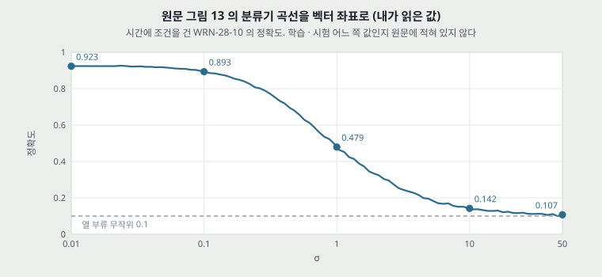

**그림 13 읽기 (내가 읽은 값).** $\sigma$ 0.01 · 0.1 · 1 · 10 · 50 에서 0.923 · 0.893 · 0.479 · 0.142 · 0.107. 시작값과 무작위(0.1)의 중간 0.51 이 $\sigma$ 0.88 ~ 0.96 사이에 있다. 곧 **$\sigma$ 가 1 을 넘는 구간에서 분류기 정확도가 0.48 아래다.** 가로축 끝 50.03 이 $\sigma_\text{max}$ 를 알려 준다. 학습 · 시험 어느 쪽 값인지 적혀 있지 않다.

---

## 20. 결론 (6절)

틀의 이득을 다시 적고, 표본기가 **「같은 데이터에서 여전히 GAN 보다 느리다」** 고 적는다. 안정된 학습과 암묵적 모델의 빠른 표본을 합치는 것, 표본기 하이퍼파라미터를 자동으로 고르는 것, 표본기들의 장단점을 더 넓게 조사하는 것을 과제로 꼽는다.

---

## 21. 실험 분석 (논문의 표 · 그림마다)

**직접 돌리지 않았다.** 값 확인 · 유도 · 좌표 읽기는 했고 「내가 ...」 로 표시했다.

| 표 · 그림 | 무엇을 바꿨나 (변인) | 무엇을 고정했나 | 결과 | 반복 수 · 흩어짐 | 주장이 결과보다 센가 |
|---|---|---|---|---|---|
| 표 1 | 예측기 3 x (P1000 · P2000 · C2000 · PC1000) x SDE 2 | CIFAR-10, DDPM 짜임, 이산 목적 함수, 선형 보간 | VE PC 3.51 ~ 3.62, VP PC 3.06 ~ 3.21, C2000 19 ~ 20 | **표집** 다섯 번, 표준편차 .01 ~ .15. 학습 반복 없음 | 「언제나」 는 부호만. 표준편차 합을 넘는 비교는 거꾸로 확산 대 조상 2/6. $r$ 을 FID 로 골랐다 |
| 표 4 | 표 1 의 P2000 을 반올림 보간으로 | 나머지 표 1 과 같음 | VP 3.10 · 3.11 · 3.25, VE 4.72 · 4.92 · 12.87 | 표집 다섯 번 | **센다.** 「PC 가 같거나 낫다」 와 VP 앞 두 줄이 어긋난다 |
| 표 5 | 표본기마다 $r$ 격자 탐색 | CIFAR-10 | VE PC .16 ~ .17, VP PC .01 · .01 · .04, C2000 .22 · .27 | 격자 시작 · 끝 적혀 있지 않다 | VP 앞 두 칸은 걸음 폭이 VE 의 1/256 |
| 표 2 | 모델 · SDE · 목적 함수 · 깊이 | RK45, atol · rtol $10^{-5}$, 마지막 체크포인트, $t_\epsilon$ | 3.28 -> 2.99 | NLL 은 다섯 번 평균, 표준편차 적지 않음. 학습 하나씩 | 「우도가 정확하므로」 는 다른 밀도의 비교(13절). 기록은 역양자화 조건 안 |
| 표 3 | 짜임 · 목적 함수 · SDE · 깊이 | CIFAR-10, 5 만 장 FID | 2.78 -> 2.20 | 이 편 줄 표준편차 없음, **가장 낮은 체크포인트** | 칸마다 변인이 여럿. 「기록」 은 고른 값. NFE 가 줄마다 다르다 |
| 그림 3 | RK45 정밀도 | DDPM · CelebA-HQ 256, 같은 잠재 | NFE 14 · 86 · 548 | 표본 두 줄, FID 없음 | **센다.** 분모가 없고 97.4% 쪽은 얼룩 |
| 그림 5 | 이산 대 연속 | N = 1000, 원 설정 | 최대 차 VP .00099 · .00081, VE .92 | 계산이라 흩어짐 없음 | 축 전체로는 맞다. 상대 차는 $i = 1$ 에서 9.9% · 1.7% |
| 그림 7 · 8 | 잔차 블록 4 대 8 | VE, CIFAR-10, 연속 목적 함수 | 중앙값 11.4 대 대조 46.8, 평균 $r$ .916 | 모델 한 쌍, 이미지 16 장 | 「모든 차원에서 가깝다」 는 최대 172.8 과 맞서고, 학습 반복 쌍이 없다 |
| 그림 9 | 총 평가 · 수정기 몫 | LSUN 256, VE, $r = 0.075$ | 표본 격자 | 칸마다 한 장, 수치 없음 | 「clearly」 근거가 그림 눈 비교뿐 |
| 그림 10 | 구성 요소 다섯 | VE, 1.3M, $r = .16$, 체크포인트 평균 | 중앙값 차이 .12 ~ .61 | 상자 안 흩어짐이 구성 간 흩어짐 | 평균은 맞다. 최고 구성과 방향이 갈리는 칸이 CelebA 에 있다 |
| 그림 13 | 잡음 크기 | WRN-28-10, CIFAR-10 | .923 -> .107 | 적혀 있지 않다 | 주장이 없고 곡선만 있다 |
| 그림 4 · 14 ~ 17 | 과제 · 조건 | 비지도 점수 모델 | 표본 | 수치 없음 | 「재학습 없이」 는 점수 모델 쪽만 |

**같은 조건 대 다른 논문 값.** 표 3 의 BigGAN · StyleGAN2-ADA · NCSN · NCSNv2 · DDPM 과 표 2 의 흐름 모델은 **다른 논문에서 옮긴 값** 이고, 표 1 · 4 의 칸은 같은 실행 계열이다. 이 편 설정에서 다시 돌린 DDPM 은 표 1 P1000 조상 3.24 ± .02 로 원 논문 3.17 과 0.07 차이다. ± 는 표집 잡음만 담으므로 이 0.07 을 무엇의 몫으로 읽을지 표로 정해지지 않는다.

---

## 22. 이 논문이 스스로 적은 한계

1. **표본이 GAN 보다 느리다**(6절). 숫자 비교는 없다.
2. **표본기의 하이퍼파라미터가 늘어난다.** 자동 선택이 과제다(6절).
3. **SDE 에 따라 표본 품질과 우도의 순서가 다르다.** 「영역 · 짜임마다 SDE 를 실험해야 할 것」(4.4절).
4. **ODE 표본기는 수정기 없으면 FID 가 SDE 보다 대체로 나쁘고, VE 에서 특히 나쁘다**(부록 D.4).
5. **C2000 은 같은 계산에서 다른 표본기를 못 따라간다**(4.2절).
6. **$t = 0$ 쪽 수치 문제.** VE 는 식이 정의되지 않고 VP 는 분산이 사라진다. $t_\epsilon$ 으로 자른다(부록 C). 표본 품질이 $t_\epsilon$ 에 민감하다고 적는다.
7. **생성된 표본에 사람이 못 보는 작은 잡음이 남아 FID 를 해친다**(부록 G).
8. **1024 표본은 완벽하지 않다**(부록 H.3). 얼굴 대칭의 결함.
9. **VP 탐색은 계산 자원 때문에 CelebA 를 건너뛰었다**(부록 H.2).
10. **비아핀 SDE 는 핵을 닫힌 꼴로 못 쓴다**(부록 A). sliced score matching 으로 돌아간다.

---

## 23. 논문이 적지 않은 것 — 내가 읽으며 짚은 자리

1. **학습 반복이 어느 표에도 없다.** ± 는 표집 다섯 번이다. 2.20 · 2.41 · 2.45 사이 차이가 학습 시드 흩어짐 안인지 밖인지 모른다.
2. **FID 기준 집합이 적혀 있지 않다.** 표본 5 만 장 · `tensorflow_gan` 까지만 있다. 학습 집합인지 시험 집합인지 글자 층에서 찾지 못했다.
3. **NFE 가 표 3 에 없다.** 표 1 은 같은 계산을 음영으로 묶는데 표 3 은 묶지 않는다. 기록 모델은 눈금 몇 개의 PC 인지 H.1 의 탐색 설정(1,000)으로 짐작할 뿐이다.
4. **왜 ODE 가 수정기 없이 SDE 보다 FID 가 나쁜가.** 경험으로만 적는다.
5. **왜 sub-VP 가 우도가 좋은가.** 분산이 작은 것 말고 원인이 없다.
6. **$\lambda(t)$ 의 효과.** 「typically」 하나를 썼고 다른 가중치의 표가 없다. 우도를 최대화하는 가중치 문제는 다루지 않는다(「without maximum likelihood training」).
7. **점수 오차가 표본 분포에 주는 영향.** 모든 정리가 「충분한 데이터 · 용량」 또는 완벽한 점수 위에 있다. 오차 크기와 FID · NLL 의 관계를 잰 자리가 없다.
8. **조건부 표본의 품질 수치.**
9. **표본 평균 시간.** 초 단위 비용이 없고 NFE 만 있다. DDPM 노트의 17 초 · 300 초와 맞댈 수 없다.
10. **DDIM.** 본문과 참고 문헌 목록에 나오지 않는다(글자 층 검색). 확률 흐름 ODE 와 DDIM 의 관계는 이 편에서 답할 수 없고 다음 칸 쪽에서 본다.

---

## 24. 읽을 때 헷갈리는 지점

- **SDE 는 학습 대상이 아니다.** 앞으로 가는 식은 정해 두고 배우는 것은 $\mathbf{s}_\theta$ 하나다. 곧 「SDE 를 푼다」 는 표본을 뽑을 때의 일이다.
- **「연속 시간」 과 「연속 목적 함수」 는 다르다.** 표 1 의 모델은 눈금 1,000 개로 이산 학습하고 그 위에 SDE 표본기를 쓴다. 표 3 의 cont. 만 식 (7) 로 배운다.
- **DDPM 칸에 「VP SDE」 가 적혀 있어도** 표 1 의 VP 는 이산 DDPM 목적 함수로 배운 모델이다.
- **표 2 와 표 3 의 줄 이름이 같아도 FID 는 다른 값이다.** 표본기와 체크포인트가 다르다.
- **표 2 의 「DDPM」 줄과 「DDPM ($L_\text{simple}$)」 줄의 NLL 은 같은 모델의 다른 값이 아니라 같은 점수의 다른 밀도다**(13절).
- **$\alpha_i$** 는 DDPM 논문 표기에서 $\bar\alpha_i$ 다. DDPM 노트와 맞대면 첨자 하나가 틀어진다.
- **확률 흐름 ODE 에는 잡음이 없어도 표본은 확률적이다.** 출발점 $\mathbf{x}(T)$ 를 뽑기 때문이다.
- **수정기는 식을 푸는 것이 아니다.** 그 시간의 $p_t$ 를 목표로 MCMC 를 돈다. 그래서 $\mathbf{f}$ 와 $g$ 가 수정기 식에 없다.
- **「거꾸로 가는 SDE 는 식 (5) 의 경로를 되짚는다」 가 아니다.** 같은 주변 분포를 내는 다른 표본 경로다. 8절의 참 점수 궤적을 보면 같은 출발에서 끝이 갈린다.

---

## 25. 원문 안의 어긋남 모음

1. **부록 H.2 와 표 2.** 「DDPM++ cont. ... 우도가 VP · sub-VP 에서 3.21 · 3.05」(26 쪽). 표 2 에서 3.21 · 3.05 는 **DDPM cont.** 줄이고 DDPM++ cont. 은 3.16 · 3.02 다. 어느 쪽이 맞는지 파일 안에서 가를 수 없다.
2. **식 (19) 의 $\mathbf{v}^\mathsf{T} \mathbf{s}_\theta(\mathbf{x}(t), t) \mathbf{v}$.** 13 쪽 이미지로도 그렇게 인쇄돼 있다. $\mathbf{s}_\theta$ 가 벡터이므로 이 곱은 벡터로 끝나 목적 함수의 나머지와 맞지 않는다. sliced score matching 꼴로 **$\mathbf{v}^\mathsf{T} \nabla_\mathbf{x} \mathbf{s}_\theta \mathbf{v}$ 의 $\nabla_\mathbf{x}$ 가 빠진 것** 으로 읽힌다(내 판단. Song 외 2019a 는 읽지 않았다).
3. **4.3절 「90% 넘게 · 영향 없음」 대 그림 3** (14절).
4. **4.2절 · 부록 G 의 「PC 가 같거나 낫다」 대 표 4** (12절).
5. **4.4절 「표 3 은 PC 표본기」 대 부록 H.1 「VP 는 수정기를 뺐다」 대 부록 H.2 「연속 모델은 오일러-마루야마 예측기」.** 표 3 의 DDPM++ 줄에 수정기가 있는지 정해지지 않는다. 항등 수정기까지 PC 라 부르면 말은 맞지만 그러면 「PC 표본기」 가 아무 뜻도 더하지 않는다.
6. **부록 B 머리 「sub-VP 가 표본 품질과 우도 모두 대개 낫다」 대 표 3** (17절). ODE FID 쪽에서만 맞는다.
7. **표기: 알고리즘 인덱스가 둘.** 알고리즘 2 · 3 은 $i = N - 1, \dots, 0$ 에 수정기 $\mathbf{s}(\mathbf{x}_i, \sigma_i)$ 를 쓰는데, 식 (8) 의 관례로 $\sigma_0 = 0$ 이고 조건 $\sigma_0$ 은 학습에 없다. 알고리즘 4 · 5 는 $i = N, \dots, 1$ 이다. 부록 G 의 보간은 $\{\mathbf{s}(\mathbf{x}, i)\}_{i=0}^{N-1}$, 알고리즘 3 은 $\mathbf{s}(\mathbf{x}_{i+1}, i + 1)$ 로 $N$ 까지 부른다.
8. **Abstract 「competitive likelihood」 대 1절 「new record」** 같은 2.99 다.
9. **그림 3 라벨 대 표식 수**: 14 · 86 · 548 대 13 · 85 · 547. 로그 축에 평가 번호 0 이 안 찍히는 것으로 읽히므로 오류로 치지 않고 기록만 한다.
10. **부록 C 「$t_\epsilon = 10^{-3}$ 이면 분산이 맞는다」** : 9.9% 위(7절). 근사를 말한 문장이니 기록만 한다.
11. **오탈자.** 26 쪽 「trainin with」, 8 쪽 「conjuction」.

---

## 26. 앞 칸들과 맞춰 보기

| 앞 노트 | 그 노트가 적은 것 | 이 편에서 |
|---|---|---|
| **DDPM** 8절 | 잡음 예측 = 점수 맞추기, 표본 한 걸음 = 랑주뱅 모양 | **식 (3) · (4) 로 맞다.** 다만 이 편은 DDPM 표본기를 랑주뱅이 아니라 **VP SDE 의 이산화** 로 놓는다. 랑주뱅은 수정기 쪽이다 |
| **DDPM** 3절 | $\bar\alpha_{100} = 0.8970$, $\bar\alpha_{300} = 0.3964$ | 식 (33) 으로 0.8963 · 0.3963 (7절) |
| **DDPM** 13절 | 「조건부 확산은 Dhariwal · Nichol(2021)의 분류기 안내에서 시작한다」 | **이 편 5절 · I.1 이 시간 조건 분류기로 CIFAR-10 부류 조건을 이미 낸다.** 수치는 없다. Dhariwal · Nichol 은 읽지 않아 무엇을 더했는지는 확인하지 않았다 |
| **DDPM** 13절 | 우도 3.75 가 자기회귀 2.80 에 못 미친다 | 같은 점수로 ODE 밀도가 3.28 이고 짜임 · SDE 를 바꿔 2.99. **평가 조건이 달라 2.80 과는 여전히 같은 칸에 안 놓인다** |
| **DDPM** 13절 | 표본 1,000 회 | CelebA-HQ 256 에서 RK45 86 회의 표본이 548 회와 눈으로 구별되지 않는다(FID 없음). CIFAR-10 FID 는 원 표본기 3.17, 같은 점수의 ODE(허용 오차 $10^{-5}$) 3.37 이다 |
| **VAE** | 하한과 $\log p(x)$ 틈을 재지 않았다 | 이 편도 틈을 재는 것이 아니라 **다른 밀도를 정확히 잰다**. 비교 형식이 비슷해 보여 조심할 자리 |
| **GAN** · **WGAN** | 평형 · 모드 붕괴 · 수치 없는 표본 | 이 편은 적대 없이 FID 2.20 이 StyleGAN2-ADA 2.92 아래이고, 대신 표본 하나의 평가가 부록 H.1 설정이면 2,000 회다(GAN 은 DDPM 노트 말로 한 번) |
| **AE** · **DBN** | 사전학습 · 쌓기 | 식 (7) 의 잡음 제거 점수 맞추기는 잡음 제거 오토인코더와 닿는다(원문 인용 Vincent 2011). 그 편은 읽지 않았다 |
| **Wide ResNet** | WRN-28-10 CIFAR-10 오차 4.00% | 이 편 분류기가 같은 짜임이고 $\sigma = 0.01$ 에서 정확도 0.923 이다. 학습 조건 · 표본 집합이 달라 맞대지 않는다 |
| **ResNet** · **BN** | 지름길 · 정규화 | 지름길에 $1/\sqrt{2}$ 를 곱하면 CIFAR-10 중앙값이 0.13 낮다(그림 10). 고른 근거로 든 GAN 들은 읽지 않았다 |
| **Transformer** | 사인 자리 부호화 | 이산 시간 조건은 사인 임베딩, 연속 시간은 푸리에 특징(규모 16) |
| **DDIM (다음 칸)** | 이 편은 언급 없음 | 결정적 표본기라는 자리가 겹친다. **이 편 원문으로 관계를 말하지 않는다** |

---

## 27. 계보와 내가 가져갈 것

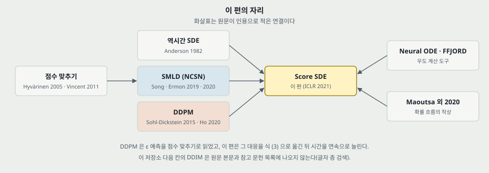

**하나. 생성 모델 표본기를 수치 해법으로 읽는 틀.** 이산 사슬은 식의 이산화 중 하나이고, 걸음 수 · 예측기 · 수정기 · 허용 오차를 해법의 설정으로 나눠 놓는다. 다음 칸(DDIM · 잠재 확산)을 읽을 때 **어느 칸을 바꾼 편인지** 를 먼저 묻는다.

**둘. 점수 하나를 배우면 표본 · 우도 · 조건이 다 나온다는 분리.** 이상 탐지 쪽에서 보면 정상 데이터로 배운 점수 또는 ODE 밀도가 그대로 이상 점수 후보가 된다(이 편은 이상 탐지를 다루지 않는다). 그리고 부류 조건처럼 **조건 항을 나중에 더하는** 구조다. DDPM 노트의 이상 탐지 항($t_0$ 까지 보내고 복원)과 달리 재구성이 없다.

**셋. 표를 읽을 때 옮겨 쓸 것.** (가) 「± 가 무엇의 흩어짐인가」 — 표집 다섯 번과 학습 다섯 번은 다르다. (나) 「체크포인트를 어떻게 골랐나」 — 표 2 와 표 3 이 다르게 적었고, 체크포인트 고르기 몫이 칸 차이보다 크다. (다) 「같은 계산의 칸인가」 — 표 1 은 음영으로 묶고 표 3 은 안 묶는다. (라) 「감소 비율의 분모」. (마) 「설정을 그 지표로 고른 뒤 그 지표로 보고했나」 — $r$ · 체크포인트.

**넷. 지금 확인된 것은 여기까지다.** **논문이 잰 것**: 표 1 ~ 5 의 값(표집 다섯 번), 그림 8 · 10 · 13. **논문이 말만 한 것**: 식 (6) 은 인용, $\mathbf{s}_\theta$ 가 참 점수면 성립하는 정리들, 조건부의 품질, 1024 의 품질, 「90%」. **내가 책상에서 센 것**: 식 (26) · (28) · (29) · (33) 대조, 식 (3) · (4) 대조, 1 차원 확인 셋, 그림 5 의 차이, 144, 체크포인트 수, 표준편차 합 판정, 그림 3 · 7 · 8 · 10 · 13 좌표 읽기, 참 점수 장난감.

---

## 28. 다음에 읽을 것

로드맵 큰 틀의 다음 칸은 **Latent Diffusion** 이고 이 표의 편들은 노트 안에 남겨 둔다. 「후보」 는 원문 참고 문헌에 없는 편이고 내가 골랐다. 읽고 이 자리에 맞는 편인지 가린다.

| 편 | 받는 물음 |
|---|---|
| Song · Ermon, Generative Modeling by Estimating Gradients of the Data Distribution (NeurIPS 2019) | 식 (1) · (2) 의 출처. NCSN 25.32 의 설정 |
| Song · Ermon, Improved Techniques for Training Score-Based Generative Models (NeurIPS 2020) | $\sigma_\text{max}$ 를 정하는 Technique 1 |
| Anderson, Reverse-time diffusion equation models (1982) | 식 (6). 이 편이 유도하지 않은 자리 |
| Vincent, A connection between score matching and denoising autoencoders (2011) | 식 (7) 의 근거, 잡음 제거 오토인코더와의 연결 |
| Hyvärinen, Estimation of non-normalized statistical models by score matching (JMLR 2005) | 점수 맞추기의 원 출처 |
| Chen 외, Neural Ordinary Differential Equations (NeurIPS 2018) · FFJORD (ICLR 2019) | 식 (39) · (40) |
| Maoutsa 외, Interacting particle solutions of Fokker-Planck equations (arXiv 2020) | 확률 흐름 ODE 의 착상 |
| Jolicoeur-Martineau 외, Adversarial score matching and improved sampling (arXiv 2020) | 끝의 잡음 제거와 FID |
| Dhariwal · Nichol, Diffusion Models Beat GANs on Image Synthesis (후보) | 분류기 안내에 무엇을 더했나. 수치 있는 조건부 |
| Song 외, Maximum Likelihood Training of Score-Based Diffusion Models (후보) | $\lambda(t)$ 와 우도, 23절 6 |
| Karras 외, Elucidating the Design Space of Diffusion-Based Generative Models (후보) | 표본기 설정을 갈라서 잰 편인지, 23절 3 |

---

## 29. 남는 질문

- 학습을 다시 돌리면 2.20 · 2.38 · 2.41 의 순서가 유지되는가. 답은 학습 반복이 있는 후속 편에서 찾는다.
- 수정기가 VP 조상 · 거꾸로 확산 줄에서 FID 를 0.03 내리고 VE 에서 1.19 ~ 1.36 내리는 까닭이 무엇인가. 점수 오차의 시간별 모양을 재야 하는데 이 편에 없다.
- ODE 표본기의 FID 가 SDE 보다 나쁜 것은 점수 오차 때문인가, 이산화 때문인가. 내 장난감(참 점수)에서는 걸음이 적을 때 ODE 가 앞섰다. 신경망 점수에서 같은지는 다음 칸(DDIM)의 표를 본다.
- 표 2 에서 $t_\epsilon$ 을 바꾸면 2.99 가 얼마나 움직이는가.
- sub-VP 의 작은 핵 분산이 우도를 올리는 원인인가.
- 식 (13) 의 밀도가 표 3 의 PC 표본 분포에서 얼마나 떨어져 있는가. 두 표의 숫자를 한 모델의 성적으로 읽어도 되는가.
- 그림 13 은 학습 · 시험 어느 쪽 곡선인가.

---

## 30. 참고 문헌

이 노트가 직접 기대는 것만 적는다. 원문 참고 문헌의 편들은 읽지 않았고 이 편이 적은 범위에서만 옮겼다.

1. Song, Y., Sohl-Dickstein, J., Kingma, D. P., Kumar, A., Ermon, S., Poole, B. Score-Based Generative Modeling through Stochastic Differential Equations. ICLR 2021. arXiv:2011.13456v2.
2. Ho, J., Jain, A., Abbeel, P. Denoising Diffusion Probabilistic Models. NeurIPS 2020.
3. Song, Y., Ermon, S. Generative Modeling by Estimating Gradients of the Data Distribution. NeurIPS 2019.
4. Song, Y., Ermon, S. Improved Techniques for Training Score-Based Generative Models. NeurIPS 2020.
5. Anderson, B. D. O. Reverse-time diffusion equation models. Stochastic Process. Appl., 12(3):313-326, 1982.
6. Vincent, P. A connection between score matching and denoising autoencoders. Neural Computation, 23(7):1661-1674, 2011.
7. Maoutsa, D., Reich, S., Opper, M. Interacting particle solutions of Fokker-Planck equations through gradient-log-density estimation. arXiv:2006.00702, 2020.
8. Chen, R. T. Q., Rubanova, Y., Bettencourt, J., Duvenaud, D. Neural Ordinary Differential Equations. NeurIPS 2018.
9. Grathwohl, W. 외. FFJORD. ICLR 2018 로 원문에 적혀 있다.
10. Karras, T. 외. Training Generative Adversarial Networks with Limited Data. NeurIPS 2020 (StyleGAN2-ADA, 표 3 의 값).
11. Zagoruyko, S., Komodakis, N. Wide Residual Networks. arXiv:1605.07146, 2016 (분류기 짜임).

---

## 31. 경로

- 원문: `papers/ICLR21_ScoreSDE_Score_Based_Generative_Modeling_through_Stochastic_Differential_Equations.pdf`
- 그림 만드는 스크립트: `figures/ICLR21_ScoreSDE/make_figures.py`
- 벡터 좌표 읽기: `figures/ICLR21_ScoreSDE/read_vector_values.py`, 결과 `figures/ICLR21_ScoreSDE/paper_vector_values.json`
- 원문 그림 자르기: `figures/ICLR21_ScoreSDE/crop_paper_figures.py`
- 1 차원 참 점수 확인: `figures/ICLR21_ScoreSDE/toy_exact_score.py`
