# ViT — An Image is Worth 16x16 Words: Transformers for Image Recognition at Scale (ICLR 2021, 요약)

> **한 줄.** 이미지를 16 x 16 픽셀 조각으로 잘라 조각 하나를 낱말 하나처럼 다루고, 선형 투영 · 분류 토큰 · 학습하는 자리 임베딩만 붙여 **번역용 Transformer 의 인코더를 그대로** 분류에 쓴다. 224 입력이면 조각 196 개다. ImageNet(130 만 장)만으로 배우면 ResNet(BiT) 띠 안이거나 그 아래인데, ImageNet-21k(1,400 만 장) · JFT-300M(3 억 장)으로 사전학습한 뒤 미세조정하면 ViT-H/14 가 ImageNet top-1 **88.55 ± 0.04**(BiT-L 87.54 ± 0.02, Noisy Student 88.4/88.5), VTAB 19 과제 **77.63 ± 0.23**(BiT-L 76.29 ± 1.70) 이다. 사전학습 비용은 표 2 에서 H/14 2.5k · BiT-L 9.9k TPUv3-코어-일이다.

> **이 노트에서 가장 먼저 볼 자리 다섯.** (1) 표 1 의 Params 86M · 307M · 632M 은 **규칙 하나로 함께 맞지 않는다.** 패치 16 · 224 입력으로 세면 Large 는 303.3M(머리 없음) · 304.3M(머리 1,000)이고 307M 은 패치 32 에서만 나온다(9절, 내가 센 것). (2) 원문이 걱정한 $n^2$ 항은 ViT-B/16 · 224 에서 **블록 곱셈-덧셈의 4.1%** 다. 몫은 $n/(n+6D)$ 이고 B 에서 절반이 되는 조각 수가 4,608 이다(10절, 내가 센 것). 나머지 95.9% 가 MLP 와 투영이다. (3) 「ViT-L/16 이 BiT-L 을 **모든 과제에서** 넘는다」 는 표 2 의 7 행 중 5 행에서 값이 높고 그중 ± 밖은 4 행이다. ImageNet ReaL 은 90.54 로 같고 VTAB 은 76.28 대 76.29 로 0.01 아래다(12절). (4) 「큰 규모의 학습이 귀납 편향을 이긴다」 를 받치는 두 실험에서 **귀납 편향을 변인으로 둔 행은 없다.** 그림 3 은 데이터 크기와 함께 갱신 걸음(95,215 대 1,035,645) · 부류 수 · 정칙화가 바뀌고, 그림 4 에는 하이브리드가 없다(15 · 16 · 17절). (5) 벡터 좌표로 읽으니 **ViT-H/14 의 ImageNet 값이 네 벌**이다 — 표 2 88.55, 표 5 88.04, 표 6 88.08, 그림 3 88.28. 표 5 는 「그림 3 에 대응한다」 고 적는다(27절).

---

## Paper Metadata

| Item | Content |
|---|---|
| Title | An Image is Worth 16x16 Words: Transformers for Image Recognition at Scale |
| Authors | Alexey Dosovitskiy, Lucas Beyer, Alexander Kolesnikov, Dirk Weissenborn, Xiaohua Zhai, Thomas Unterthiner, Mostafa Dehghani, Matthias Minderer, Georg Heigold, Sylvain Gelly, Jakob Uszkoreit, Neil Houlsby. **각주: Dosovitskiy · Beyer · Kolesnikov · Weissenborn · Zhai · Houlsby 는 같은 기술 기여(equal technical contribution), Dosovitskiy · Houlsby 는 같은 지도(equal advising)**. Uszkoreit 는 Transformer 논문의 저자이기도 하다 |
| 소속 | Google Research, Brain Team. 감사의 글: 베를린 · 취리히 · 암스테르담에서 수행 |
| Conference / Journal | **ICLR 2021.** 첫 쪽 머리글 「Published as a conference paper at ICLR 2021」. 받은 파일 이름은 `1909_an_image_is_worth_16x16_words_.pdf` 다. arXiv 판(2010.11929)은 받지 않았고 이 파일과 무엇이 다른지 이 노트는 확인하지 않았다 |
| Year | 2021. 파일 정보의 만든 날 2021-03-17 |
| DOI | 파일 안에 적혀 있지 않다 |
| 코드 | 1 쪽 각주 1 — 미세조정 코드와 사전학습 모델이 `https://github.com/google-research/vision_transformer` 에 있다고 적는다. 이 노트는 코드를 보지 않았다 |
| Stored PDF | `papers/ICLR21_ViT_An_Image_is_Worth_16x16_Words_Transformers_for_Image_Recognition_at_Scale.pdf` |
| 왜 읽었는가 | 로드맵 두 갈래가 끝난 뒤 사용자가 고른 다음 큰 틀(ViT, BERT 는 함께 읽는다). Transformer 노트가 남긴 물음 셋 — 이미지를 자리 열로 어떻게 자르나, 합성곱 망과 같은 조건에서 견줬나, 자리 부호화를 무엇으로 썼나 — 을 받는다. 앞 갈래(합성곱 망)와 뒷 갈래(순차 데이터)가 만나는 자리다 |
| 읽은 범위 | **2026-11-05 에 21 쪽을 전부 읽었다.** 곧 Abstract · 1 ~ 5절 · 감사의 글 · 참고 문헌 목록 · 부록 A · B(B.1, B.1.1, B.1.2) · C · D(D.1 ~ D.8) · 식 (1) ~ (8) · 각주 1 ~ 3 · 그림 1 ~ 13 · 표 1 ~ 9. 참고 문헌의 편들은 읽지 않았다. **BiT · Noisy Student 의 수치는 이 편이 옮겨 적은 값만 쓴다** |

### 저장한 파일의 상태

- **본문 9 쪽 + 참고 문헌 3 쪽 + 부록 9 쪽(13 ~ 21 쪽)** 이다.
- **글자 층이 살아 있다.** 식 (1) ~ (4) 는 4 쪽, 식 (5) ~ (8) 은 13 쪽을 그림으로 띄워 위 · 아래 첨자를 맞췄다. 표 2 · 3 · 5 · 6 · 7 · 8 · 9 는 6 · 13 · 15 · 16 · 17 · 20 쪽을 130 dpi 로 띄워 칸을 맞췄다.
- **그림 2 · 3 · 4 · 5 · 8 · 10 · 11 · 12 는 벡터로 들어 있다.** 표식 상자의 좌표와 눈금 선 좌표로 값을 읽었다. 그림 3 의 점 12 개가 표 5 와, 그림 5 의 ViT 점이 표 6 과 소수 둘째 자리까지 맞아 읽기 오차는 0.01 안이다(그림 3 의 H/14 한 점만 어긋난다, 27절). **그림 4 · 8 · 10 · 12 에는 대조할 표가 없어 그 값은 이 방법으로 읽은 값이고 원문이 숫자로 적은 값이 아니다.**
- **그림 1 · 6 · 7 · 9 · 13 은 래스터가 섞여 있다.** 그림 1 · 6 · 7 · 9 는 잘라 넣었고, 그림 13(주의 지도 128 장)은 넣지 않았다.

---

## 1. 용어

이 노트에서 쓸 이름을 먼저 정한다. 논문의 원래 용어는 괄호로 함께 적는다.

- **조각 (patch)**: 이미지를 겹치지 않게 자른 $P \times P$ 정사각형. 작은 예시로, 224 x 224 입력을 $P = 16$ 으로 자르면 14 x 14 = 196 조각이고 조각 하나는 16 x 16 x 3 = 768 개의 수다.
- **조각 수 $N$ · 자리 수 $n$**: $N = HW/P^2$ 는 조각 개수, $n = N + 1$ 은 분류 토큰까지 넣은 열 길이. 작은 예시로, ViT-B/16 · 224 는 $N = 196$, $n = 197$.
- **조각 임베딩 (patch embedding)**: 편 조각에 학습되는 행렬 $\mathbf{E}$ 를 곱해 $D$ 차원으로 옮긴 것. 작은 예시로, ViT-B/16 은 768 -> 768 이라 차원은 같지만 행렬은 학습된다.
- **분류 토큰 (class token, $\mathbf{x}_\text{class}$)**: 조각 열 맨 앞에 붙이는 학습되는 벡터 하나. 끝 층의 이 자리 출력만 이미지 표현으로 쓴다. BERT 의 `[class]` 에서 왔다고 원문이 적는다. 작은 예시로, ViT-B/16 에서 768 개의 수다.
- **자리 임베딩 (position embedding, $\mathbf{E}_{pos}$)**: 자리마다 하나씩 더하는 학습되는 벡터. 이 편의 기본은 **1 차원 학습형**이다(자리 번호 0 ~ 196 에 벡터 하나씩). 작은 예시로, ViT-B/16 · 224 는 197 x 768 = 151,296 개의 수다. 시작값에 2 차원 위치 정보가 없다고 원문이 적는다.
- **모델 이름 ViT-L/16**: Large 짜임 + 입력 조각 16 x 16. 작은 예시로, ViT-H/14 는 Huge 짜임 + 조각 14 x 14.
- **블록 (block)**: 정규화 → 다중 머리 자기 주의 → 지름길, 정규화 → MLP → 지름길의 한 묶음(식 2, 3). 원문은 「layer」 로도 부른다. 작은 예시로, ViT-B 는 12 블록.
- **층 정규화 (Layernorm, LN)**: 자리마다 $D$ 차원 벡터의 평균 · 분산으로 정규화하고 학습되는 스케일 · 이동을 곱하는 것. 작은 예시로, $D = 768$ 이면 LN 하나의 학습되는 수는 1,536 개.
- **MLP**: 자리마다 같은 무게로 적용하는 2 층 망과 GELU. Transformer 노트의 자리별 앞먹임에 해당한다. 작은 예시로, ViT-B 는 768 -> 3,072 -> 768.
- **귀납 편향 (inductive bias)**: 데이터를 보기 전에 모델 짜임에 박아 둔 가정. 원문이 든 합성곱의 셋은 국소성 · 2 차원 이웃 구조 · 이동 등변성이다. 작은 예시로, 3 x 3 합성곱은 한 칸 옆 픽셀끼리만 처음에 섞고 같은 필터를 모든 자리에 쓴다.
- **ResNet (BiT)**: 비교 상대 ResNet 의 배치 정규화를 **그룹 정규화**로 바꾸고 **표준화된 합성곱(weight standardization)** 을 쓴 것(4.1절). R152x4 는 152 층 · 폭 4 배.
- **하이브리드 (hybrid)**: ResNet 의 중간 특징 지도를 조각 1 x 1 로 펴 ViT 에 넣은 것. **이름의 끝 수는 조각 크기가 아니라 ResNet 의 총 줄임 배수다**(4.4절). 작은 예시로, R50+ViT-L/16 은 넷째 단계를 빼고 셋째 단계를 늘려 줄임 16 배에서 뽑는다.
- **사전학습 · 미세조정 (pre-training · fine-tuning)**: 큰 데이터로 머리까지 배운 뒤(224 입력), 머리를 버리고 0 으로 시작하는 선형 층을 붙여 목표 데이터로 다시 배우는 것(기본 384 입력).
- **few-shot 선형 정확도 (linear few-shot accuracy)**: 얼린 표현 위에서 정규화된 최소제곱 회귀를 닫힌 해로 풀어 재는 정확도(4.1절). 작은 예시로, 5-shot 은 부류마다 학습 이미지 5 장만 쓴다. 미세조정보다 싸서 그림 4 · 8 · 12 · 표 8 이 이 지표다.
- **VTAB (Visual Task Adaptation Benchmark)**: 과제마다 학습 예 1,000 개인 19 과제. Natural 7 · Specialized 4(의료 · 위성) · Structured 8(기하).
- **ImageNet ReaL**: ImageNet 검증 집합에 라벨을 다시 매긴 것(Beyer 외). 같은 이미지에 정답이 둘 이상일 수 있다.
- **TPUv3-코어-일 (TPUv3-core-days)**: 코어 수(칩당 2) x 학습 일수(4.2절). 작은 예시로, 8 코어 x 30 일 = 240 코어-일이고 표 2 의 L/16 I21k 는 0.23k 다.
- **exaFLOPs**: 표 6 · 그림 5 의 「사전학습 계산」. 원문 캡션이 「추정(estimated)」 이라고 적는다. **셈법은 원문에 없다**(18절).
- **주의 거리 (attention distance)**: 질의 픽셀과 다른 픽셀 사이 거리를 주의 무게로 평균한 값(그림 10 캡션). 원문은 합성곱의 수용장에 빗댄다. 작은 예시로, 14 x 14 조각에 무게를 똑같이 주면 116.49 픽셀이다(내가 센 것).
- **곱셈-덧셈 (MAC)**: 곱 하나와 덧셈 하나의 묶음. 이 노트의 **내 셈**은 이 단위이고 원문의 exaFLOPs 와 다른 단위다.

---

## 2. 한 문단 요약

이미지 쪽의 자기 주의는 합성곱과 함께 쓰이거나 픽셀 이웃으로 범위를 좁힌 특수한 꼴이었고, 그 꼴들은 원문 말로 「have not yet been scaled effectively」 였다. 이 편은 합성곱을 쓰지 않고 **표준 Transformer 인코더를 조각 열에 그대로** 적용한다. 조각을 펴 선형 투영하고, 분류 토큰을 앞에 붙이고, 학습하는 1 차원 자리 임베딩을 더해 $L$ 개 블록을 지난 뒤, 자리 0 의 출력에 머리를 붙인다. 이미지 전용 가정은 조각 자르기와 미세조정 때의 자리 임베딩 보간 둘뿐이라고 적는다. ImageNet 에서 배우면 BiT 띠에 못 미치고, 사전학습 데이터가 커지면 순서가 바뀐다는 것이 핵심 결과다. JFT-300M 으로 사전학습한 ViT-H/14 가 ImageNet 88.55 · ReaL 90.72 · CIFAR-100 94.55 · VTAB 77.63 이고, 표 6 의 통제된 비교에서 Average-5 기준 2 ~ 4 배 적은 계산으로 ResNet 과 같은 성능이라고 적는다. 조각 투영 필터 · 자리 임베딩 유사도 · 주의 거리를 들여다보고, 조각을 가려 맞히는 자기 지도 사전학습을 예비로 시험해 ImageNet 79.9% 를 낸다.

---

## 3. 문제 / 동기 (1 · 2절)

**이 논문이 없앤 전제 하나: 이미지 인식의 큰 규모에서는 합성곱이 있어야 한다.**

- **원문의 말.** NLP 에서는 큰 말뭉치로 사전학습한 뒤 미세조정하는 Transformer 가 표준이 됐고 파라미터가 1,000 억을 넘었다. 시각에서는 합성곱 구조가 주류다. 합성곱을 완전히 대체한 자기 주의 모델들은 「특수한 주의 꼴을 써서 현대 하드웨어 가속기에서 효과적으로 키워지지 않았다」.
- **픽셀 그대로면 왜 안 되나.** 「픽셀마다 다른 모든 픽셀을 보면 비용이 픽셀 수의 제곱이라 현실의 입력 크기로 키워지지 않는다」(2절). 작은 예시로, 224 x 224 = 50,176 자리면 $n^2$ 은 약 25 억 칸이고, 16 조각으로 묶으면 $n$ 은 1/256, $n^2$ 은 1/65,536 이 된다(내가 센 것).
- **앞 시도들.** 국소 이웃에만 자기 주의(Parmar 외), 희소 근사(Child 외), 축마다 주의(Ho 외, Wang 외). 「promising 하지만 가속기에서 효율적으로 구현하려면 complex engineering 이 필요하다」.
- **가장 가까운 앞 편.** Cordonnier 외(2020)는 2 x 2 조각 + 전체 자기 주의다. 원문이 스스로 「very similar to ViT」 라고 적는다. 차이로 둘을 꼽는다 — 큰 규모 사전학습으로 최신 합성곱 망과 겨룬 것, 조각이 커서 중간 해상도 이미지까지 다루는 것. **곧 아이디어 자체가 새것이 아니라 규모의 시험이 새것이다.**
- **iGPT(Chen 외)**: 해상도 · 색 공간을 줄인 픽셀에 Transformer 를 쓴 생성 모델. ImageNet 최대 72%.

---

## 4. 모델 — 조각에서 표현까지 (3.1절, 식 1 ~ 4)

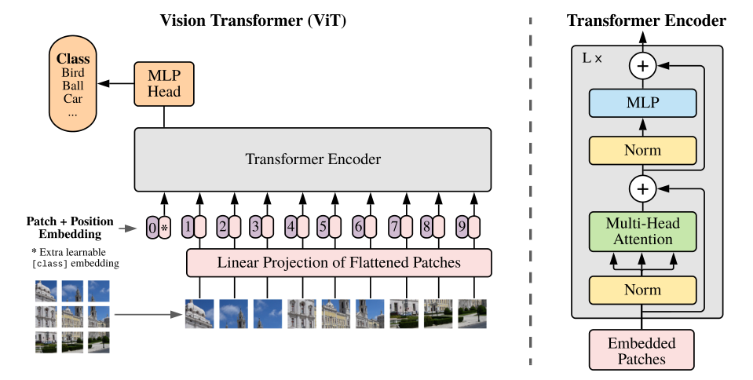

**원문 그림 1.** 왼쪽이 전체, 오른쪽이 블록이다. `0*` 이 분류 토큰이다.

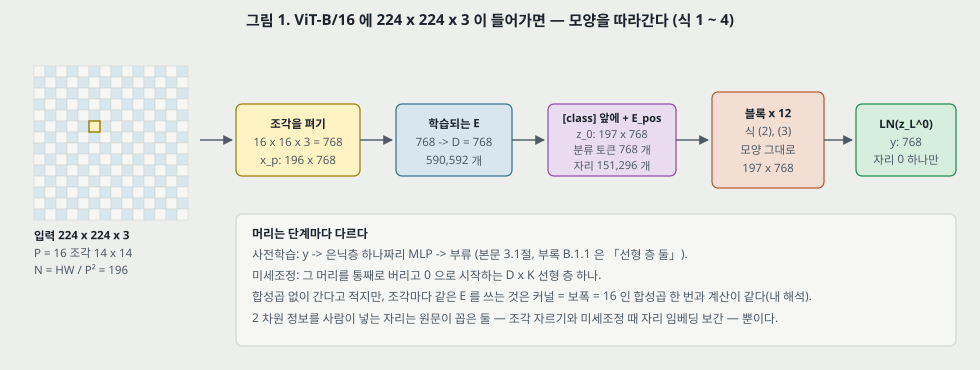

**그림 1.** ViT-B/16 · 224 의 모양을 옮겨 그렸다. 칸 안의 개수는 내가 센 것이다.

식은 넷이다.

$$\mathbf{z}_0 = [\mathbf{x}_\text{class};\ \mathbf{x}_p^1\mathbf{E};\ \mathbf{x}_p^2\mathbf{E};\ \cdots;\ \mathbf{x}_p^N\mathbf{E}] + \mathbf{E}_{pos}, \quad \mathbf{E} \in \mathbb{R}^{(P^2 \cdot C) \times D},\ \mathbf{E}_{pos} \in \mathbb{R}^{(N+1) \times D} \qquad (1)$$

$$\mathbf{z}'_\ell = \mathrm{MSA}(\mathrm{LN}(\mathbf{z}_{\ell-1})) + \mathbf{z}_{\ell-1}, \quad \ell = 1 \dots L \qquad (2)$$

$$\mathbf{z}_\ell = \mathrm{MLP}(\mathrm{LN}(\mathbf{z}'_\ell)) + \mathbf{z}'_\ell, \quad \ell = 1 \dots L \qquad (3)$$

$$\mathbf{y} = \mathrm{LN}(\mathbf{z}_L^0) \qquad (4)$$

**머리.** 사전학습 때는 $\mathbf{z}_L^0$ 뒤에 은닉층 하나짜리 MLP, 미세조정 때는 선형 층 하나(3.1절). 부록 B.1.1 은 사전학습 머리를 「선형 층 둘」 로 적는다. 같은 말이다.

**1 차원 자리 임베딩을 고른 까닭.** 「2 차원을 아는 임베딩에서 significant performance gains 를 관찰하지 못했다」(3.1절, 부록 D.3). 표 8 은 19절에서 본다.

**원 Transformer 와 다른 자리.** 원문은 「원 Transformer 를 가능한 한 따른다」 고 적지만 각 자리에서 바뀐 것이 있다. 모아 보면 다음과 같다(모은 것은 내가 했다).

| 자리 | Transformer (2017) | ViT |
|---|---|---|
| 디코더 | 있음 | 없음 |
| 입력 토큰 | 낱말 표 | 조각의 선형 투영 |
| 자리 정보 | 사인 · 코사인 | **학습하는 1 차원** |
| 정규화 자리 | 덧셈 뒤 | **블록 앞**(5절) |
| 활성 | ReLU | GELU |
| 머리 수 · 머리당 폭 | 8 · 64 | B 12 · 64, L 16 · 64, H 16 · 80 |
| MLP 폭 / $D$ | 4 배 | 4 배(같음) |
| 출력 | 자리마다 | 자리 0 하나 |

---

## 5. 블록과 다중 머리 주의 (3.1절 · 부록 A, 식 2, 3, 5 ~ 8)

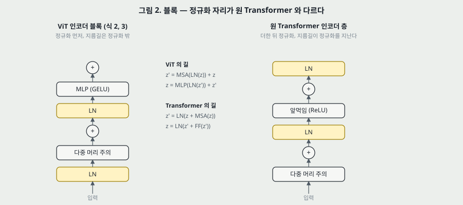

**그림 2.** 왼쪽이 식 (2) · (3), 오른쪽이 Transformer 노트의 층이다.

**정규화 자리.** 「LN 은 모든 블록 앞에, 지름길은 모든 블록 뒤에」(3.1절). 원문이 Wang 외(2019) · Baevski · Auli(2019)를 인용한다. **왜 이 자리를 골랐는지의 비교 실험은 이 편에 없다.** 사전 활성 ResNet 노트의 꼴 — 지름길 위에 아무것도 없고, 그래서 끝에 정규화(식 4)가 하나 더 필요한 꼴 — 과 모양이 같다. 이 대응은 내 해석이고 원문은 He 외(2016)의 사전 활성을 여기서 인용하지 않는다.

**부록 A 의 식.**

$$[\mathbf{q}, \mathbf{k}, \mathbf{v}] = \mathbf{z}\mathbf{U}_{qkv}, \quad \mathbf{U}_{qkv} \in \mathbb{R}^{D \times 3D_h} \qquad (5)$$

$$A = \mathrm{softmax}\left(\mathbf{q}\mathbf{k}^\top / \sqrt{D_h}\right), \quad A \in \mathbb{R}^{N \times N} \qquad (6)$$

$$\mathrm{SA}(\mathbf{z}) = A\mathbf{v} \qquad (7)$$

$$\mathrm{MSA}(\mathbf{z}) = [\mathrm{SA}_1(\mathbf{z});\ \mathrm{SA}_2(\mathbf{z});\ \cdots;\ \mathrm{SA}_k(\mathbf{z})]\ \mathbf{U}_{msa}, \quad \mathbf{U}_{msa} \in \mathbb{R}^{k \cdot D_h \times D} \qquad (8)$$

$D_h$ 는 보통 $D/k$. 작은 예시로, ViT-B 는 768/12 = 64 라 내적을 $\sqrt{64} = 8$ 로 나눈다. Transformer base 의 $d_k$ 와 같은 값이다.

**드롭아웃(B.1).** 쓸 때는 $qkv$ 투영을 뺀 모든 밀집 층 뒤와, 자리 임베딩을 더한 직후. JFT 사전학습에서는 표 3 대로 0.0 이다.

---

## 6. 귀납 편향 문단 (3.1절)

**원문의 말.** CNN 은 국소성 · 2 차원 이웃 · 이동 등변성이 「모델 전체의 층마다 구워져 있다」. ViT 는 「MLP 층만 국소적이고 이동 등변이며 자기 주의 층은 전역이다」. 2 차원 이웃 구조는 「very sparingly」 쓰인다 — 맨 앞에서 조각을 자를 때와, 미세조정에서 해상도가 다를 때 자리 임베딩을 조절할 때. 자리 임베딩은 시작값에 2 차원 정보가 없어서 「조각 사이의 공간 관계를 모두 처음부터 배워야 한다」. 3.2절 끝에서 「이 해상도 조절과 조각 뽑기가 **유일한** 자리」 라고 다시 적는다.

**내 해석(원문의 말이 아니다).** 조각마다 같은 $\mathbf{E}$ 를 곱하는 것은 커널 = 보폭 = $P$ 인 합성곱 한 번과 계산이 같다. 그래서 첫 단계에는 16 픽셀 격자 위의 이동 등변성이 들어 있다. 그 격자에 맞지 않는 이동(예를 들어 5 픽셀)에는 등변이 아니다. 「합성곱에 기대지 않는다」 는 초록의 말은 **쌓인 합성곱이 없다**는 뜻으로 읽는다. MLP 가 자리마다 같은 무게인 것도 같은 종류의 가중치 공유다. LeNet 노트의 세 장치(국소 수용장 · 가중치 공유 · 부분 표본 뽑기)로 옮기면 ViT 는 공유를 유지하고, 국소성은 조각 안으로 좁히고, 부분 표본 뽑기는 맨 앞 한 번(보폭 16)으로 몰았다.

---

## 7. 하이브리드 (3.1 · 4.1 · 4.4절)

입력 열을 원 조각 대신 CNN 특징 지도에서 만든다. 조각 1 x 1 이면 공간 차원을 펴서 투영하는 것이 된다. 실험에서는 ResNet50 의 (i) 넷째 단계 출력, 또는 (ii) 넷째 단계를 없애고 같은 층 수를 셋째 단계에 넣어 늘린 뒤의 출력을 쓴다. (ii) 는 「열이 4 배 길고 더 비싸다」. 표 6 에 다섯 줄이 있다(18절).

**R50 쪽이 합성곱을 다 들여오는데도** 큰 모델에서 하이브리드와 순수 ViT 가 같아진다는 것을 원문이 「somewhat surprising」 고 적는다(4.4절). 이 실험은 전체 JFT 에서만 있다. **데이터 크기를 줄여 하이브리드를 돌린 행이 없다**(17절).

---

## 8. 미세조정과 해상도 올리기 (3.2절)

사전학습 머리를 지우고 0 으로 시작하는 $D \times K$ 층을 붙인다. 「더 높은 해상도에서 미세조정하는 것이 흔히 이롭다」(Touvron 외, Kolesnikov 외 인용). **조각 크기는 그대로이므로 열이 길어진다.** 작은 예시로, ViT-L/16 은 224 -> 384 에서 조각이 196 -> 576 으로 2.94 배가 된다. 망 자체는 임의 길이를 받지만 자리 임베딩은 의미를 잃을 수 있어서 「원 이미지에서의 위치에 따라 사전학습 자리 임베딩을 2 차원 보간」 한다.

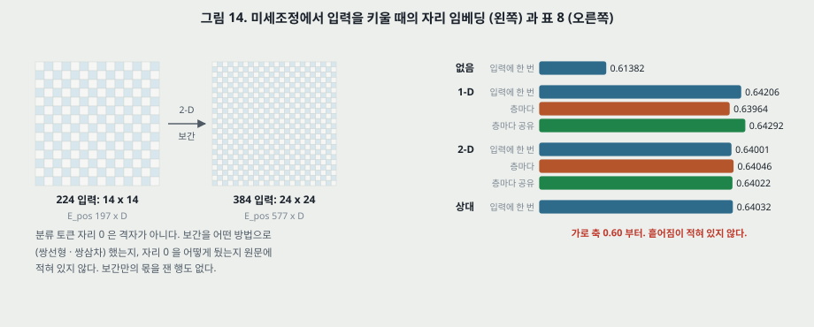

**그림 14.** 왼쪽은 보간의 모양, 오른쪽은 표 8 의 값이다.

- **머리를 통째로 버리는 까닭(B.1.1).** 「마지막 층만 다시 시작하는 것보다 a little more robust 했다」. 수는 없다.
- **적혀 있지 않은 것.** 보간 방법(쌍선형 · 쌍삼차), 분류 토큰 자리 0 의 처리, 보간만의 몫. 해상도를 올린 몫도 분리되지 않았다 — 각주 2 의 「해상도 증가가 성능을 올린다」 뿐이고, 같은 사전학습 모델을 224 와 384 로 미세조정해 나란히 놓은 행이 없다. 표 5(384) 와 표 2(512 또는 518 + Polyak)의 차 — H/14 +0.51, L/16 JFT +0.64, L/16 I21k +0.15 — 는 **해상도와 평균 내기 둘이 섞인 값**이다(내가 뺀 값. 다만 표 5 는 단일 값, 표 2 는 세 번 평균이다).

---

## 9. 파라미터 다시 세기 — 표 1 (내가 센 것)

원문 표 1:

| 모델 | 층 | $D$ | MLP | 머리 | Params |
|---|---|---|---|---|---|
| ViT-Base | 12 | 768 | 3,072 | 12 | 86M |
| ViT-Large | 24 | 1,024 | 4,096 | 16 | 307M |
| ViT-Huge | 32 | 1,280 | 5,120 | 16 | 632M |

**표는 패치 크기 · 입력 크기 · 머리를 적지 않는다.** 그런데 $\mathbf{E}$ 는 $P^2 C D$ 라 패치 크기로 바뀌고, $\mathbf{E}_{pos}$ 는 $(N+1)D$ 라 입력 크기로 바뀐다. 식에서 세면 다음이다(바이어스 포함).

$$\underbrace{(3P^2 D + D)}_{\mathbf{E}} + \underbrace{D}_{\text{class}} + \underbrace{(N+1)D}_{\mathbf{E}_{pos}} + L\big[\underbrace{4D^2 + 4D}_{\text{MSA}} + \underbrace{2DM + M + D}_{\text{MLP}} + \underbrace{4D}_{\text{LN 둘}}\big] + \underbrace{2D}_{\text{끝 LN}} \qquad (\text{내 셈})$$

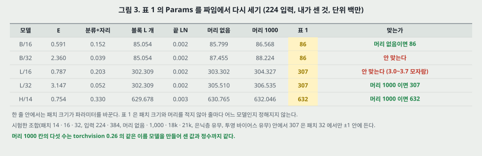

**그림 3.** 224 입력. 머리 1,000 칸은 끝에 $1000D + 1000$ 을 더한 값이다.

- **머리 1,000 칸 다섯 수를 torchvision 0.26 의 `vit_b_16` · `vit_b_32` · `vit_l_16` · `vit_l_32` · `vit_h_14` 를 만들어 센 값과 맞췄다.** 86,567,656 · 88,224,232 · 304,326,632 · 306,535,400 · 632,045,800 으로 정수까지 같다. 셈 자체는 맞다.
- **표 1 과의 대조.** Base 86M 은 B/16 머리 없음(85.80M)과 맞는다. Huge 632M 은 H/14 머리 1,000(632.05M)과 맞는다. **Large 307M 은 L/16 으로 나오지 않는다**(303.30M · 304.33M, 3.0 ~ 3.7M 모자람, 307M 의 1.0 ~ 1.2%). L/32 머리 1,000 이 306.54M 이라 반올림해서 307M 이다.
- **시험한 범위.** 패치 14 · 16 · 32, 입력 224 · 384, 머리 없음 · 1,000 · 18k · 21k, 은닉층 유무, 투영 바이어스 유무의 조합 안에서 Large 가 307 ± 1 에 드는 것은 패치 32 뿐이고, Base 가 86 ± 1 에 드는 것은 패치 14 · 16 뿐이다. **세 줄이 같은 규칙에서 나왔다고 맞추지 못했다.** 다른 조합이 있을 수 있고 코드는 보지 않았다.
- **몫.** ViT-B/16 에서 블록 12 개가 85.054M 으로 머리 없는 전체의 99.1% 다. $\mathbf{E}$ 는 0.69%, 자리는 0.18%. MSA 와 MLP 의 비는 $D$ 에 $M = 4D$ 를 넣으면 $4D^2 : 8D^2$ 곧 1 : 2 다. MSA + MLP 합을 분모로 주의 쪽이 33.3%, MLP 가 66.7% 다.
- **그림 8 의 기준 모델로 본 「파라미터 없이」.** D.2 는 패치를 줄이면 「파라미터를 들이지 않고」 오른다고 적는다. 내가 세면 패치 32 -> 16 에서 70,400,000 -> 68,191,232 로 **3.1% 준다**($\mathbf{E}$ 가 줄고 자리가 늘어난 합).

---

## 10. 조각 수 $n$ 과 $n^2$ 비용 (내가 센 것)

원문 4.1절: 「열 길이는 패치 크기 제곱에 반비례하므로 패치가 작은 모델이 계산이 더 비싸다.」 부록 D.4: 「이론상 이미지 크기에 bi-quadratic 으로 느는 것이 가장 큰 모델의 가장 큰 해상도에서야 only barely starts happening.」 Transformer 노트 22절의 물음이 이것이다 — 이미지는 자리 수가 많아 $n^2$ 이 문제일 텐데 어떻게 되나.

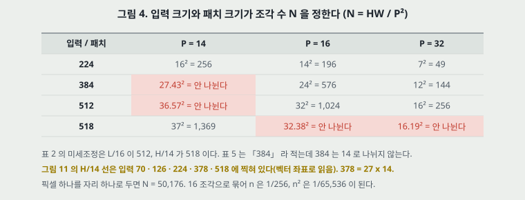

**그림 4.** 빨간 칸은 입력 변이 패치로 나뉘지 않는다.

Transformer 노트 11절과 같은 셈을 쓴다. 블록 하나의 곱셈-덧셈은

$$\underbrace{2n^2 D}_{\text{주의: } \mathbf{q}\mathbf{k}^\top,\ A\mathbf{v}} + \underbrace{4nD^2}_{\text{투영: } q,k,v,\text{ 출력}} + \underbrace{2nDM}_{\text{MLP}} \qquad (\text{내 셈})$$

이고, $M = 4D$ 면 $n^2$ 항의 몫은

$$\frac{2n^2 D}{2n^2 D + 4nD^2 + 8nD^2} = \frac{n}{n + 6D} \qquad (\text{내 셈})$$

이다. **$n$ 이 $6D$ 에 닿아야 절반이다.**

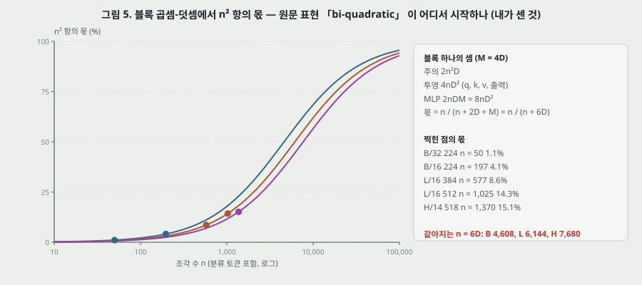

**그림 5.** 파랑 B · 주황 L · 보라 H.

| 모델 · 입력 | $n$ | 주의 (M) | 투영 (M) | MLP (M) | $n^2$ 몫 | 모델 전체 (G) |
|---|---|---|---|---|---|---|
| B/32 · 224 | 50 | 3.8 | 118.0 | 235.9 | 1.1% | 4.4 |
| B/16 · 224 | 197 | 59.6 | 464.8 | 929.6 | 4.1% | 17.6 |
| B/16 · 384 | 577 | 511.4 | 1,361.3 | 2,722.6 | 11.1% | 55.5 |
| L/16 · 224 | 197 | 79.5 | 826.3 | 1,652.6 | 3.1% | 61.6 |
| L/16 · 384 | 577 | 681.8 | 2,420.1 | 4,840.2 | 8.6% | 191.1 |
| L/16 · 512 | 1,025 | 2,151.7 | 4,299.2 | 8,598.3 | 14.3% | 362.0 |
| H/14 · 224 | 257 | 169.1 | 1,684.3 | 3,368.6 | 3.2% | 167.3 |
| H/14 · 518 | 1,370 | 4,804.9 | 8,978.4 | 17,956.9 | 15.1% | 1,016.7 |

- **답.** 이 편이 쓰는 범위에서 $n^2$ 항은 1.1 ~ 15.1% 다. Transformer 노트가 n = 50, d = 512 에서 낸 「주의 부분층 5,500 만 중 투영이 95.3%」 와 같은 모양이다. 원문의 「only barely」 는 셈으로도 맞다.
- **곱셈-덧셈만으로 안 되는 자리.** 그림 11 의 실측 기울기(21절)에서 B/16 · L/16 은 384 -> 512 에서 3.27 · 3.14 인데 내 셈은 2.2 ~ 2.3 이다. D.4 도 「이론 FLOPs 로 늘 잘 예측되지 않는다(레인 폭 · 캐시)」 고 적는다.
- **입력 변이 나뉘지 않는 문제.** 384 / 14 = 27.43 이다. 표 5 는 「384 에서 미세조정」, 표 2 는 「518」, 그림 11 의 H/14 선은 70 · 126 · 224 · 378 · 518 에 찍혀 있다(벡터 좌표). 표 5 의 H/14 가 실제로 378 인지 원문에 적혀 있지 않다. 378 입력이면 $n = 730$ 이다.

---

## 11. 실험 설정 (4.1절 · 부록 B)

**데이터.** ImageNet 1k 부류 130 만 장, ImageNet-21k 21k 부류 1,400 만 장, JFT 18k 부류 3 억 300 만 장. 사전학습 집합에서 목표 시험 집합과 겹치는 것을 지운다(Kolesnikov 외를 따라). 목표는 ImageNet · ReaL · CIFAR-10/100 · Oxford-IIIT Pets · Oxford Flowers-102, 그리고 VTAB 19 과제.

**학습(ResNet 포함).** Adam($\beta_1 = 0.9$, $\beta_2 = 0.999$), 배치 4,096, 입력 224, 예열 1 만 걸음. 4.1절은 「가중치 감쇠 0.1 을 높게 준다」 고 적고 표 3 은 데이터마다 0.1 · 0.03 · 0.3 이다.

원문 표 3 (옮김):

| 모델 | 데이터 | 에폭 | 기본 학습률 | 감쇠 | 가중치 감쇠 | 드롭아웃 |
|---|---|---|---:|---|---:|---:|
| ViT-B/{16,32} | JFT-300M | 7 | $8 \cdot 10^{-4}$ | 선형 | 0.1 | 0.0 |
| ViT-L/32 | JFT-300M | 7 | $6 \cdot 10^{-4}$ | 선형 | 0.1 | 0.0 |
| ViT-L/16 | JFT-300M | 7/14 | $4 \cdot 10^{-4}$ | 선형 | 0.1 | 0.0 |
| ViT-H/14 | JFT-300M | 14 | $3 \cdot 10^{-4}$ | 선형 | 0.1 | 0.0 |
| R50x{1,2} | JFT-300M | 7 | $10^{-3}$ | 선형 | 0.1 | 0.0 |
| R101x1 | JFT-300M | 7 | $8 \cdot 10^{-4}$ | 선형 | 0.1 | 0.0 |
| R152x{1,2} | JFT-300M | 7 | $6 \cdot 10^{-4}$ | 선형 | 0.1 | 0.0 |
| R50+ViT-B/{16,32} | JFT-300M | 7 | $8 \cdot 10^{-4}$ | 선형 | 0.1 | 0.0 |
| R50+ViT-L/32 | JFT-300M | 7 | $2 \cdot 10^{-4}$ | 선형 | 0.1 | 0.0 |
| R50+ViT-L/16 | JFT-300M | 7/14 | $4 \cdot 10^{-4}$ | 선형 | 0.1 | 0.0 |
| ViT-B/{16,32} | ImageNet-21k | 90 | $10^{-3}$ | 선형 | 0.03 | 0.1 |
| ViT-L/{16,32} | ImageNet-21k | 30/90 | $10^{-3}$ | 선형 | 0.03 | 0.1 |
| ViT-* | ImageNet | 300 | $3 \cdot 10^{-3}$ | 코사인 | 0.3 | 0.1 |

ImageNet 은 기울기를 전역 노름 1 로 자른다.

**미세조정.** SGD, 모멘텀 0.9, 배치 512, 코사인, 가중치 감쇠 없음, 기울기 자르기 1, 기본 384 입력. 학습률은 학습 집합의 일부(Pets · Flowers 10%, CIFAR 2%, ImageNet 1%)를 개발 집합으로 떼어 표 4 에서 고른다.

원문 표 4 (옮김):

| 데이터 | 걸음 | 기본 학습률 |
|---|---:|---|
| ImageNet | 20,000 | {0.003, 0.01, 0.03, 0.06} |
| CIFAR-100 · CIFAR-10 | 10,000 | {0.001, 0.003, 0.01, 0.03} |
| Pets · Flowers-102 | 500 | {0.001, 0.003, 0.01, 0.03} |
| VTAB (19) | 2,500 | 0.01 |

- **ResNet 에는 기회가 하나 더 있다.** 「ResNet 은 Kolesnikov 외의 설정도 돌려 이 실행과 우리 탐색에서 가장 좋은 결과를 고른다」(B.1.1). ViT 에는 없다. 비교를 ResNet 쪽으로 유리하게 하는 선택이다(내 해석).
- **BN → GN + WS.** 원문이 「전이를 좋게 한다」 고 적고 비교 상대를 그렇게 바꾼 것을 밝힌다.

---

## 12. 표 2 — 최신 결과와의 비교 (4.2절)

원문 표 2 (옮김, 칸 맞춤은 6 쪽 그림으로 확인):

| | Ours-JFT (ViT-H/14) | Ours-JFT (ViT-L/16) | Ours-I21k (ViT-L/16) | BiT-L (ResNet152x4) | Noisy Student (EfficientNet-L2) |
|---|---|---|---|---|---|
| ImageNet | **88.55 ± 0.04** | 87.76 ± 0.03 | 85.30 ± 0.02 | 87.54 ± 0.02 | 88.4 / 88.5* |
| ImageNet ReaL | **90.72 ± 0.05** | 90.54 ± 0.03 | 88.62 ± 0.05 | 90.54 | 90.55 |
| CIFAR-10 | **99.50 ± 0.06** | 99.42 ± 0.03 | 99.15 ± 0.03 | 99.37 ± 0.06 | - |
| CIFAR-100 | **94.55 ± 0.04** | 93.90 ± 0.05 | 93.25 ± 0.05 | 93.51 ± 0.08 | - |
| Oxford-IIIT Pets | **97.56 ± 0.03** | 97.32 ± 0.11 | 94.67 ± 0.15 | 96.62 ± 0.23 | - |
| Oxford Flowers-102 | 99.68 ± 0.02 | **99.74 ± 0.00** | 99.61 ± 0.02 | 99.63 ± 0.03 | - |
| VTAB (19 tasks) | **77.63 ± 0.23** | 76.28 ± 0.46 | 72.72 ± 0.21 | 76.29 ± 1.70 | - |
| TPUv3-코어-일 | 2.5k | 0.68k | 0.23k | 9.9k | 12.3k |

*: Touvron 외(2020)가 낸 88.5.

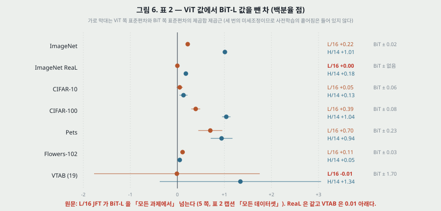

**그림 6.** 값은 표 2 를 뺀 것이다. 가로 막대는 제곱합의 제곱근이고 이 합성은 내가 했다.

- **± 는 무엇의 반복인가.** 캡션: 「평균과 표준편차, 세 번의 미세조정 실행」. **사전학습은 줄마다 한 번이다.** ViT-L/16 의 Flowers 가 ± 0.00 인 것도 미세조정 세 번의 흩어짐이다. 사전학습을 다시 했을 때의 폭은 이 표로 모른다.
- **「모든 과제에서 넘는다」.** 원문: L/16 JFT 가 「BiT-L 을 모든 과제에서 넘는다(on all tasks)」, 캡션: 「모든 데이터셋에서」. 차는 ImageNet +0.22, **ReaL 0.00**, CIFAR-10 +0.05(± 0.03 · 0.06 안), CIFAR-100 +0.39, Pets +0.70, Flowers +0.11, **VTAB −0.01**(± 0.46 · 1.70 안). **값이 높은 5 행 중 ± 밖은 4 행이다**(CIFAR-10 은 ± 안).
- **H/14 쪽은.** 모든 행에서 값은 BiT-L 보다 높다. ImageNet +1.01, CIFAR-100 +1.04, Pets +0.94, VTAB +1.34(BiT 의 ± 1.70 안), CIFAR-10 +0.13(제곱합 제곱근 0.08) · Flowers +0.05(같은 값 0.04).
- **Noisy Student 와는.** H/14 가 ImageNet +0.15 또는 +0.05. H/14 의 ± 0.04 와 같은 크기이고 Noisy Student 쪽은 ± 가 없다. ReaL +0.17. **「최고를 넘었다」 의 폭이 이 값이다.** 사전학습 비용은 12.3k 대 2.5k 다.
- **공개 데이터 쪽.** L/16 I21k 85.30 은 BiT-L 87.54 보다 2.24 아래다. 다만 BiT-L 은 JFT 로 사전학습한 값이라 같은 데이터의 비교가 아니다. 공개 데이터로 같은 조건에서 견준 행은 표 2 에 없다.
- **비교 상대의 출처.** 4.2절: 「문헌의 최신 CNN 과 견준다」. BiT-L · Noisy Student 값은 그쪽 논문 값으로 읽힌다. 다만 「모든 모델이 TPUv3 에서 학습됐다」 고 적는다. 미세조정 입력 크기 · 평균 내기가 같은지는 적혀 있지 않다. ViT 는 표 2 에서 512 · 518 + Polyak 0.9999 다.
- **Noisy Student 는 준지도다.** ImageNet + 라벨 뗀 JFT. H/14 는 JFT 의 라벨을 쓴다. 쓰는 정보가 다르다.

---

## 13. 비용 — TPUv3-코어-일 (4.2절)

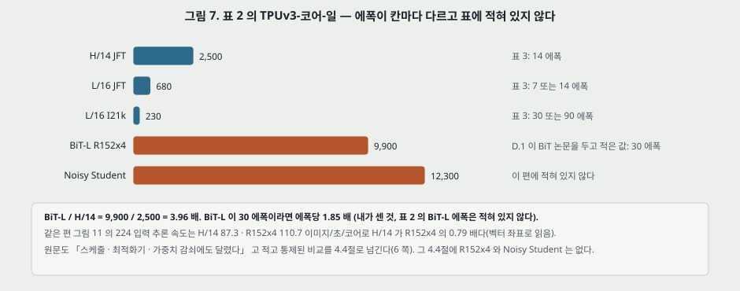

**그림 7.** 표 2 의 마지막 행과 에폭.

- **원문이 스스로 단서를 단다.** 「사전학습 효율은 짜임뿐 아니라 스케줄 · 최적화기 · 가중치 감쇠 같은 다른 값에도 달렸을 수 있다. 통제된 비교는 4.4절에.」 이 단서 없이 Abstract 는 「substantially fewer computational resources」 라고 적는다.
- **에폭.** ViT 쪽은 표 3 에서 H/14 14, L/16 7 또는 14, I21k 30 또는 90. **표 2 의 BiT-L 에폭은 적혀 있지 않다.** D.1 이 BiT 논문을 두고 「7 이 아니라 30」 이라고 적을 뿐이다. 30 이라면 에폭당 330 대 179 코어-일로 1.85 배다(내가 센 것).
- **같은 편의 다른 수와 맞대기(내가 맞댄 것).** 그림 11 왼쪽의 224 추론 속도는 H/14 87.3, R152x4 110.7 이미지/초/코어다. D.4 는 추론과 역전파 속도의 차가 「모델과 무관한 상수」 라고 적는다. 그러면 같은 에폭의 학습 코어-일은 R152x4 가 H/14 의 0.79 배여야 한다. 표 2 는 3.96 배다. BiT-L 이 30 에폭이라면 에폭 차이 2.14 배로 설명되지 않는 몫이 남는다(3.96 / (2.14 x 0.79) = 2.34 배). 배치 · 메모리 · 입력 크기 차이일 수 있으나 원문에 적혀 있지 않다.
- **L/16 JFT 0.68k 는 몇 에폭인가.** 적혀 있지 않다. 그림 11 로 H/14 대비 속도비 3.21 배, 코어-일 비 3.68 배라 14 에폭 쪽과 가깝다(7 에폭이면 6.41 배가 돼야 한다, 내 셈). 표 5 의 L/16 값도 표 6 의 14 에폭 줄과 같다.
- **I21k 숫자 확인.** 본문 「8 코어 TPUv3 로 approximately 30 일」 = 240 코어-일. 표 2 의 0.23k 와 맞는다(내가 곱한 것).

---

## 14. 그림 2 · 표 9 — VTAB (4.2절, D.8)

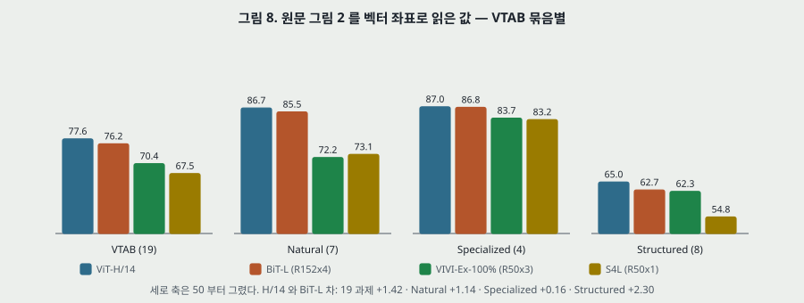

**그림 8.** 원문 그림 2 의 막대 높이를 벡터 좌표로 읽었다. ViT-H/14 막대는 표 9 묶음 평균(86.69 · 87.00 · 65.03 · 77.63, 내가 평균 냄)과 0.02 안에서 맞는다.

- **원문.** 「H/14 가 Natural · Structured 에서 BiT-R152x4 등을 넘는다. Specialized 에서는 위 두 모델이 비슷하다.」 읽은 값: Natural +1.14, **Specialized +0.16**, **Structured +2.30.**
- **짚을 것 하나.** BiT 막대의 19 평균을 묶음 개수로 다시 내면 76.20 이고 표 2 는 76.29 다. 0.09 차이는 표 2 의 ± 1.70 안이다. 그림 8 제목줄의 +1.42 는 막대 값끼리, 12절의 +1.34 는 표 2 값끼리 뺀 것이다.
- **짚을 것 둘.** 귀납 편향이 적다는 모델이 기하를 요구하는 Structured 에서 차가 가장 크다(+2.30). 원문은 이것을 해석하지 않는다. ± 는 그룹별로 없어서 이 차가 흩어짐 밖인지 모른다.
- **표 9 에 BiT 가 없다.** 과제별 대비는 ViT 끼리만 된다. L/16 JFT 와 L/16 I21k 를 보면 Natural 85.56 대 83.27, Specialized 86.72 대 84.65, Structured 62.96 대 57.50(내가 평균 냄)이고, Clevr-Count 는 86.4 대 70.3 이다.
- **VTAB 설정.** 모든 과제에 학습률 0.01 · 2,500 걸음 · 384 입력(둘 × 둘 탐색을 200 예 검증으로). BiT 의 과제별 입력 크기를 따르지 않는다.

---

## 15. 그림 3 · 표 5 — 사전학습 데이터 크기 (4.3절 첫째)

원문 표 5 의 ImageNet 행 (옮김, 나머지 다섯 목표는 원문 15 쪽):

| 사전학습 | B/16 | B/32 | L/16 | L/32 | H/14 |
|---|---:|---:|---:|---:|---:|
| ImageNet | 77.91 | 73.38 | 76.53 | 71.16 | - |
| ImageNet-21k | 83.97 | 81.28 | 85.15 | 80.99 | 85.13 |
| JFT-300M | 84.15 | 80.73 | 87.12 | 84.37 | 88.04 |

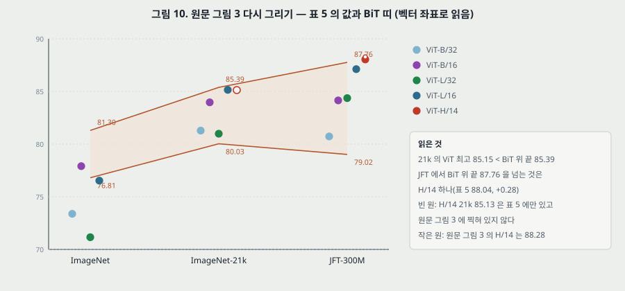

**그림 10.** 원문 그림 3 의 값. 띠의 끝 값은 벡터 좌표로 읽었다.

**원문의 말과 값.**

- 「ImageNet 에서 Large 가 Base 보다 낮다.」 L/16 − B/16 = −1.38, L/32 − B/32 = −2.22. 맞다.
- 「21k 에서 비슷하다(similar).」 +1.18, −0.29. 부호가 갈린다.
- 「JFT 에서야 큰 모델의 이득이 다 보인다.」 +2.97, +3.64. 맞다.
- 캡션 「ImageNet 에서 큰 ViT 는 BiT 띠보다 낮다」. 띠는 76.81 ~ 81.30 이다. L/16 76.53 은 아래, **B/16 77.91 은 띠 안**, 둘의 /32 는 아래다.
- 「더 큰 데이터에서 ViT 가 앞지른다(overtakes).」 **21k 에서 ViT 최고 85.15 는 띠 위 끝 85.39 아래다.** JFT 에서 띠 위 끝 87.76 을 넘는 것은 H/14 하나다(88.04, +0.28, 표 5 값). L/16 87.12 는 0.64 아래다. 곧 앞지름의 근거는 **H/14 한 점**이다.

**이 실험에서 함께 바뀌는 것.**

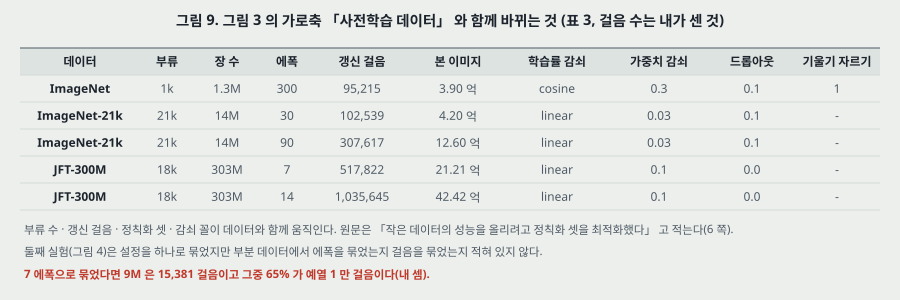

**그림 9.** 걸음 수는 장 수 x 에폭 / 4,096 으로 내가 셌다.

- 갱신 걸음은 ImageNet 95,215 · 21k 307,617 · JFT 1,035,645 다(L/16 기준 90 · 14 에폭으로 보면). 부류 수는 1k · 21k · 18k 다. 원문은 「작은 데이터의 성능을 올리려고 가중치 감쇠 · 드롭아웃 · 라벨 다듬기 셋을 최적화했다」 고 밝힌다. 곧 **가로축의 데이터 크기는 단독 변인이 아니다.**
- **ImageNet 사전학습도 ImageNet 으로 미세조정한다**(각주 2, 「해상도 증가가 성능을 올리므로」). 목표 데이터와 사전학습 데이터가 같은 칸이 왼쪽 열이고, 오른쪽 두 열은 다르다.
- **BiT 띠의 정체가 적혀 있지 않다.** 어떤 크기들인지, 몇 에폭인지. 아래 끝 JFT 79.02 는 표 6 의 R50x1 77.54 와 다르고, 위 끝 87.76 은 표 2 BiT-L 87.54 · 표 6 R200x3 87.22 와 다르다.
- **H/14 는 ImageNet 에 없다.** 「-」 다. 표 3 은 21k 에 B · L 줄만 있어서 표 5 의 H/14 21k(85.13)의 설정도 적혀 있지 않다. 이 점은 원문 그림 3 에 찍혀 있지 않다(그림 10 의 빈 원).
- **흩어짐이 없다.** 표 5 는 ± 없는 값이다. 표 2 의 ± 0.02 ~ 0.05(ImageNet, 미세조정 세 번)를 잣대로 쓰면 큰 차는 그 밖이다. 다만 사전학습의 흩어짐은 그 잣대에 들어 있지 않다.

---

## 16. 그림 4 — JFT 부분집합 (4.3절 둘째)

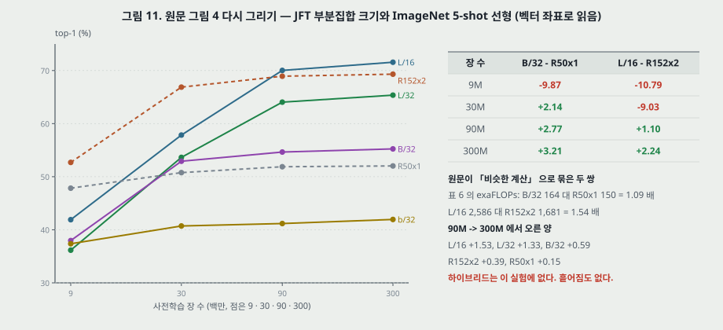

**그림 11.** 표식 좌표로 읽었다. 눈금 글자는 10 · 30 · 100 · 300M 이고 점은 9 · 30 · 90 · 300M 자리에 찍혀 있다(본문의 9M · 30M · 90M · 전체와 맞는다).

**이 실험이 첫째보다 나은 점.** 「추가 정칙화를 하지 않고 모든 설정에 같은 초매개변수를 쓴다. 정칙화의 효과가 아니라 모델 고유의 성질을 잰다.」 부류 수도 같다.

**적혀 있지 않은 것.**

- **에폭을 묶었나 걸음을 묶었나.** 「같은 초매개변수」 라고만 적는다. 7 에폭으로 묶었다면 9M 은 15,381 걸음이고 예열 1 만 걸음이 그 65% 다. 30M 은 20%, 전체는 2% 다(내 셈). 그렇다면 9M 은 학습률 정점을 지난 뒤의 걸음이 5,381 뿐이다. 왼쪽 점이 낮은 까닭에 **걸음 수가 섞였을 수 있다.** 걸음을 묶었다면 이 걱정은 없고, 대신 작은 집합이 과적합 쪽으로 간다.
- **조기 종료(early-stopping).** 「학습 중 가장 좋은 검증 정확도」 를 보고한다.
- **흩어짐.** 없다.

**원문의 말과 값.**

- 「ViT-B/32 는 ResNet50 보다 slightly faster, 9M 에서 much worse, 90M 이상에서 better.」 −9.87, 30M 부터 이미 +2.14, 90M +2.77, 300M +3.21.
- 「R152x2 와 L/16 도 같다.」 −10.79, −9.03, +1.10, +2.24. 맞다.
- 캡션 「ResNet 이 일찍 포화한다」. 90M -> 300M 에서 R50x1 +0.15 · R152x2 +0.39 · B/32 +0.59 · L/32 +1.33 · L/16 +1.53 이다. 맞다. 다만 B/32 의 +0.59 와 R152x2 의 +0.39 는 차가 0.20 이고 흩어짐을 모른다.
- **「비슷한 계산(comparable computational cost)」.** 표 6 의 exaFLOPs 로 B/32 164 대 R50x1 150 = 1.09 배, **L/16 2,586 대 R152x2 1,681 = 1.54 배**다(7 에폭 줄). 그림 11 에 R152x2 는 없어서 속도로는 대조하지 못한다. L/16 쌍이 B/32 쌍보다 ViT 쪽에 더 많은 계산을 쓴 비교다.
- **지표가 5-shot 선형이다.** 원문이 「계산을 아끼려고」 라고 적는다. 미세조정 결과가 아니므로 그림 3 과 수를 맞대지 않는다.

---

## 17. 「큰 규모의 학습이 귀납 편향을 이긴다」 는 무엇으로 쟀나

원문 1절: 「We find that large scale training trumps inductive bias.」 4.3절 끝: 「합성곱 귀납 편향이 작은 데이터에 쓸모 있고 큰 데이터에서는 데이터에서 직접 배우는 것으로 충분하고 이롭기까지 하다는 **직관을 강화한다**(reinforces the intuition).」

**이 문장을 재려면** 같은 모델에서 편향 하나만 넣고 빼야 한다. 이 편의 실험은 다음이다.

| 실험 | 바뀌는 것 | 편향을 따로 켜고 끄나 |
|---|---|---|
| 그림 3 | 데이터 + 걸음 + 부류 + 정칙화, 짜임이 ViT 대 ResNet | 아니다. 짜임 전체가 바뀐다 |
| 그림 4 | 데이터(설정 고정), 짜임이 ViT 대 ResNet | 아니다. 같은 이유 |
| 표 6 | 짜임 셋, 전체 JFT 하나 | 데이터 크기가 안 바뀐다 |
| 표 8 | 자리 정보 | 2 차원 이웃 편향 하나를 켜고 끄지만, 전체 JFT · 5-shot 한 조건이다 |

**빠진 칸(내가 짚은 것).**

- **하이브리드를 데이터 크기로 돌린 행이 없다.** R50 앞단은 합성곱의 편향을 그대로 들여온다. 작은 데이터에서 하이브리드가 ViT 보다 얼마나 높은지가 이 문장을 가장 직접 재는 칸인데 비어 있다. 전체 JFT 에서는 B/32 쪽 Average-5 가 94.27 대 92.50 이고 계산은 315 대 164 다.
- **표 8 을 작은 데이터에서 돌린 행이 없다.** 자리 임베딩의 2 차원 편향은 작은 데이터에서 값이 더 나올 수 있다는 것이 문장의 예측인데 시험되지 않았다.
- **차이의 원인이 편향인지 파라미터 크기인지 갈리지 않았다.** 그림 4 의 L/16 은 3 억 파라미터, R152x2 는 원문에 적혀 있지 않다. 작은 데이터에서 파라미터가 많은 쪽이 과적합한다는 설명과 겹친다.

**판정.** 그림 3 · 4 의 값은 「작은 데이터에서 ResNet 이 높고 큰 데이터에서 ViT 가 높다」 까지를 받친다. 「이긴다(trumps)」 와 원인 진술은 그보다 세다. 4.3절이 「직관을 강화한다」 고 적은 세기가 값과 맞고, 1절의 「We find」 는 그보다 세다.

---

## 18. 그림 5 · 표 6 — 규모 연구 (4.4절, 부록 C)

원문 표 6 (옮김, 칸 맞춤은 15 쪽 그림으로 확인):

| 모델 | 에폭 | ImageNet | ReaL | CIFAR-10 | CIFAR-100 | Pets | Flowers | exaFLOPs |
|---|---:|---:|---:|---:|---:|---:|---:|---:|
| ViT-B/32 | 7 | 80.73 | 86.27 | 98.61 | 90.49 | 93.40 | 99.27 | 164 |
| ViT-B/16 | 7 | 84.15 | 88.85 | 99.00 | 91.87 | 95.80 | 99.56 | 743 |
| ViT-L/32 | 7 | 84.37 | 88.28 | 99.19 | 92.52 | 95.83 | 99.45 | 574 |
| ViT-L/16 | 7 | 86.30 | 89.43 | 99.38 | 93.46 | 96.81 | 99.66 | 2,586 |
| ViT-L/16 | 14 | 87.12 | 89.99 | 99.38 | 94.04 | 97.11 | 99.56 | 5,172 |
| ViT-H/14 | 14 | 88.08 | 90.36 | 99.50 | 94.71 | 97.11 | 99.71 | 12,826 |
| ResNet50x1 | 7 | 77.54 | 84.56 | 97.67 | 86.07 | 91.11 | 94.26 | 150 |
| ResNet50x2 | 7 | 82.12 | 87.94 | 98.29 | 89.20 | 93.43 | 97.02 | 592 |
| ResNet101x1 | 7 | 80.67 | 87.07 | 98.48 | 89.17 | 94.08 | 95.95 | 285 |
| ResNet152x1 | 7 | 81.88 | 87.96 | 98.82 | 90.22 | 94.17 | 96.94 | 427 |
| ResNet152x2 | 7 | 84.97 | 89.69 | 99.06 | 92.05 | 95.37 | 98.62 | 1,681 |
| ResNet152x2 | 14 | 85.56 | 89.89 | 99.24 | 91.92 | 95.75 | 98.75 | 3,362 |
| ResNet200x3 | 14 | 87.22 | 90.15 | 99.34 | 93.53 | 96.32 | 99.04 | 10,212 |
| R50x1+ViT-B/32 | 7 | 84.90 | 89.15 | 99.01 | 92.24 | 95.75 | 99.46 | 315 |
| R50x1+ViT-B/16 | 7 | 85.58 | 89.65 | 99.14 | 92.63 | 96.65 | 99.40 | 855 |
| R50x1+ViT-L/32 | 7 | 85.68 | 89.04 | 99.24 | 92.93 | 96.97 | 99.43 | 725 |
| R50x1+ViT-L/16 | 7 | 86.60 | 89.72 | 99.18 | 93.64 | 97.03 | 99.40 | 2,704 |
| R50x1+ViT-L/16 | 14 | 87.12 | 89.76 | 99.31 | 93.89 | 97.36 | 99.11 | 5,165 |

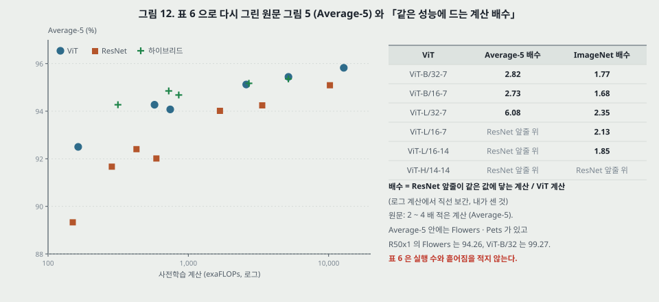

**그림 12.** 왼쪽은 표 6 으로 다시 그린 원문 그림 5 의 왼쪽 판이다. ViT 점의 값은 원문 그림의 벡터 좌표와 소수 둘째 자리까지 맞는다. **Average-5 는 ImageNet · CIFAR-10 · CIFAR-100 · Pets · Flowers 평균이다**(ReaL 을 뺀 다섯으로 내면 원문 점과 맞는다, 내가 맞춰 본 것).

- **이것이 이 편에서 가장 통제된 비교다.** 같은 데이터(전체 JFT) · 같은 최적화기 · 같은 미세조정 절차 · 같은 하드웨어. 다만 학습률은 표 3 대로 모델마다 다르고 ResNet 은 BiT 설정 실행까지 골라 쓴다(11절).
- **「2 ~ 4 배 적은 계산」(Average-5).** 표 6 의 ResNet 값으로 앞줄을 만들고 로그 계산에서 직선 보간하면 B/32 2.82 · B/16 2.73 · **L/32 6.08** 이고, L/16 · H/14 는 ResNet 앞줄의 최고값(95.09)을 넘어 잴 수 없다(내가 센 것). **ImageNet 하나만 보면 B/32 1.77 · B/16 1.68 · L/32 2.35 · L/16-7 2.13 · L/16-14 1.85** 로 범위가 내려간다.
- **Average-5 의 무게.** 다섯을 같은 무게로 평균하므로 ResNet 쪽 값이 낮은 칸의 차가 평균을 움직인다. 예로 R50x1 대 ViT-B/32 는 Flowers 차 5.01 · ImageNet 차 3.19 · CIFAR-10 차 0.94 다.
- **「하이브리드가 작은 예산에서 slightly outperform 하고 큰 모델에서 차가 사라진다.」** B/32 쪽 Average-5 94.27 대 92.50(+1.77, 계산 1.92 배). 끝 쌍 L/16-14 95.36 대 95.44(−0.08). 근거는 끝 두 쌍이다. 표 6 에 흩어짐이 없으므로 「사라진다」 의 판정 한계도 없다.
- **「포화하지 않는 듯(appear not to saturate)」.** 끝 점 H/14 는 L/16-14 보다 계산 2.48 배 · Average-5 +0.38 · ImageNet +0.96 이다. 원문의 세기 「appear」 와 맞다.
- **표 6 의 잡음을 짐작할 자리.** 에폭을 두 배로 한 세 쌍의 18 칸 가운데 3 칸이 내려간다(ViT-L/16 Flowers −0.10, R152x2 CIFAR-100 −0.13, 하이브리드 Flowers −0.29). 1 칸은 같다. 내려간 폭 0.10 ~ 0.29 보다 작은 차는 이 표로 순서를 매기지 않는다(내가 세운 잣대).

**exaFLOPs 의 정체.** 4.4절이 「자세한 것은 부록 D.4」 라고 적는데 **D.4 는 추론 시간 측정만 다루고 exaFLOPs 셈법이 없다.** 표 6 캡션은 「추정」 이라고만 적는다. 이미지당으로 되돌리면(303M 장 x 에폭, 내가 나눈 것) ViT-B/32 77.3G · B/16 350.3G · L/32 270.6G · L/16 1,219.2G · H/14 3,023.6G 이고, 내 앞먹임 곱셈-덧셈과의 배수는 17.5 · 19.9 · 17.6 · 19.8 · 18.1 이다. 한 상수로 맞지 않는다. L/16 의 14 에폭은 7 에폭의 정확히 2 배(5,172 = 2 x 2,586)라 측정이 아니라 셈이다.

---

## 19. 들여다보기 — 그림 6 · 7 · 9 · 10 · 13, 표 8 (4.5절, D.3, D.6, D.7)

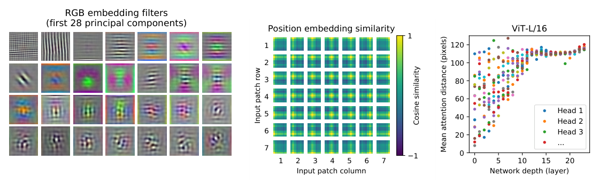

**원문 그림 7.** 왼쪽 · 가운데는 ViT-L/32, 오른쪽은 ViT-L/16 이다.

**투영 필터(왼쪽).** 앞 28 주성분. 「조각 안의 미세 구조를 낮은 차원으로 나타내는 그럴듯한 기저 함수를 닮았다.」 정성 진술이고 수는 없다.

**자리 임베딩(가운데).** 코사인 유사도. 「가까운 조각의 임베딩이 더 비슷하고」 「같은 행 · 열이 비슷한 구조가 나타난다」. 원문은 이어서 「자리 임베딩이 2 차원 토폴로지를 배우는 것이 손으로 만든 2 차원 변형이 이득을 못 내는 **까닭을 설명한다**(explains why)」 고 적는다. 그런데 D.3 은 같은 결과의 까닭을 다르게 적는다 — 「조각 수준 입력은 14 x 14 로 공간 차원이 작아 어느 부호화든 똑같이 쉽게 배운다고 **추측한다**(We speculate)」. **까닭이 둘이고 세기도 둘이다. 어느 쪽도 실험으로 가르지 않았다.**

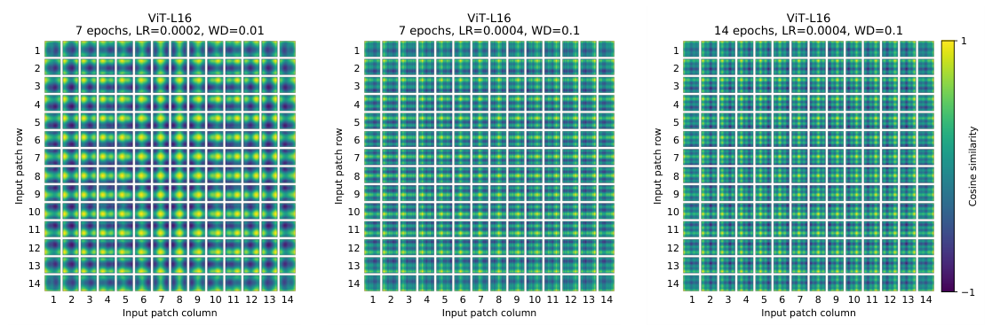

**원문 그림 9.** ViT-L/16 세 설정. 왼쪽(학습률 0.0002, 가중치 감쇠 0.01)이 뚜렷한 격자 무늬이고 가운데 · 오른쪽이 다르다. 「배운 유사도의 구체적 무늬는 학습 초매개변수에 달렸다」(D.3). 왼쪽 설정은 표 3 에 없다.

**표 8 (원문 옮김, ViT-B/16, ImageNet 5-shot 선형):**

| 자리 정보 | 입력에 한 번 | 층마다 | 층마다 공유 |
|---|---:|---:|---:|
| 없음 | 0.61382 | N/A | N/A |
| 1-D | 0.64206 | 0.63964 | 0.64292 |
| 2-D | 0.64001 | 0.64046 | 0.64022 |
| 상대 | 0.64032 | N/A | N/A |

- 없음과 1-D 의 차 0.02824, 자리를 넣은 일곱 칸의 폭 0.00328(내가 뺀 것). 「large gap」 과 「little to no difference」 는 이 두 수다.
- **± 가 없다.** 같은 이름의 ViT-B/16 5-shot 이 그림 12 왼쪽에서 0.6346 이다(벡터 좌표). 설정이 같은지 적혀 있지 않지만 표 8 값과 차 0.0075 이고 **일곱 칸의 폭의 2.3 배**다. 0.00328 안의 순서는 매기지 않는다.
- **사인 · 코사인 줄이 없다.** Transformer 의 부호화는 이 표에서 시험되지 않았다.
- **없어도 0.61382 다.** 자리 정보를 뺀 값이 1-D 의 95.6% 다. 조각 가방만으로 5-shot 이 이 자리까지 간다.

**주의 거리 (그림 10).**

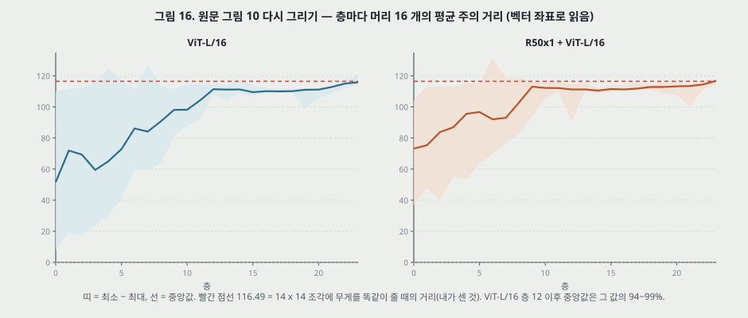

**그림 16.** 층마다 16 머리의 값을 벡터 좌표로 읽어 최소 · 중앙 · 최대로 묶었다. 이미지 128 장 평균이다.

- **원문.** 「일부 머리는 가장 낮은 층에서 이미 이미지 대부분을 본다」 「다른 머리는 낮은 층에서 일관되게 작다」 「이 강한 국소 주의는 하이브리드에서 덜하다」 「깊이에 따라 거리가 는다」.
- **값.** ViT-L/16 층 0 은 8.0 ~ 110.0 · 중앙 51.6, 하이브리드 층 0 은 36.5 ~ 104.1 · 중앙 73.2. 앞 네 층에서 40 픽셀 아래인 점이 64 개 중 18 개, 하이브리드는 1 개다. 「낮은 층의 국소 주의가 앞 합성곱 층과 비슷한 일을 할 수 있다(may)」 는 원문의 세기에 맞다.
- **내가 더한 잣대.** 14 x 14 조각에 무게를 똑같이 주면 거리가 **116.49 픽셀**이다. 층 12 이후 층별 중앙값은 ViT-L/16 에서 109.5 ~ 115.8 로 이 값의 94 ~ 99% 다. 곧 뒤쪽 층의 숫자는 「멀리 있는 특정 자리를 본다」 와 「고르게 본다」 를 가르지 못한다. D.6 의 「넓게 본다(attend widely)」 가 어느 쪽인지는 이 지표로 모른다. 층 7 의 127.2 처럼 116.49 를 넘는 점은 질의에서 먼 쪽에 무게가 더 간 머리다.
- **「수용장에 빗댄다(analogous)」 의 한계.** 합성곱의 수용장은 **닿을 수 있는 범위**이고 주의 거리는 **무게의 평균**이다. 층 0 의 머리도 수용장으로는 이미지 전체를 본다.
- **「모든 머리에서 거리가 는다(for all heads)」.** 그림은 층마다 머리 번호를 색으로만 구분하고 색이 되풀이되어 같은 머리를 따라갈 수 없다. 층별 최댓값은 110.0(층 0)에서 120.3(층 23)이지만 층 7 에 127.2 가 있다.

**주의 지도 (그림 6 · 13, D.7).**

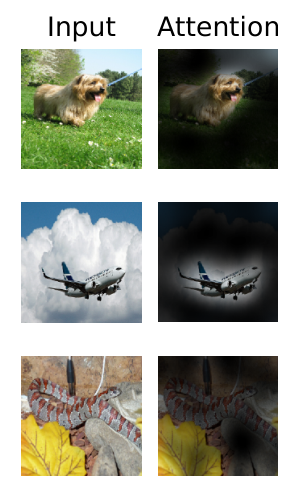

**원문 그림 6.** Attention Rollout(Abnar · Zuidema): 머리를 평균한 무게 행렬을 층마다 곱한다. 「의미적으로 관련 있는 영역을 본다」 는 그림 6 은 「대표 예(representative)」, 그림 13 은 「무작위로 고른」 128 장이고 **수치 지표는 없다.** 분할 정답과 겹침을 잰 행이 없다.

---

## 20. 자기 지도 사전학습 (4.6절, B.1.2)

**방법.** 조각 임베딩의 50% 를 망가뜨린다 — 그중 80% 는 학습되는 `[mask]` 로, 10% 는 무작위 다른 조각으로, 10% 는 그대로. 망가뜨린 조각마다 표현에서 **평균 색 3 비트(512 부류)** 를 맞힌다. JFT 에서 100 만 걸음(원문 「ca. 14 에폭」, 내 셈 13.5), 배치 4,096, Adam $2 \cdot 10^{-4}$, 코사인.

**결과.** ViT-B/16 ImageNet **79.9%**. 「처음부터 학습보다 significant 2% 오르고 지도 사전학습보다 4% 아래.」  표 5 와 맞대면 77.91 대비 +1.99, 21k 83.97 대비 −4.07, JFT 84.15 대비 −4.25 로 맞다(내가 뺀 것). **「significant」 를 받칠 ± 는 없다.**

- **목표 셋을 시험했다.** 평균 색 하나, 4 x 4 로 줄인 16 예측, 전체 조각 L2 회귀. 「all worked quite well, though L2 was slightly worse.」 표가 없고 수가 없다.
- **망가뜨리는 비율 15%(BERT 의 값)** 는 few-shot 에서 「slightly worse」. 수가 없다.
- **데이터 크기.** 「10 만 걸음 뒤 하류 성능의 diminishing returns, ImageNet 으로 사전학습해도 similar gains」 라고 적는다. 표가 없다.
- **대조 학습(contrastive)** 은 뒤 일로 넘긴다.

---

## 21. 부록 D 의 나머지 — 표 7, 그림 8 · 11 · 12

**표 7 (D.1, 원문 옮김): ResNet 사전학습 Adam 대 SGD**

| 데이터 | R50 Adam | R50 SGD | R152x2 Adam | R152x2 SGD |
|---|---:|---:|---:|---:|
| ImageNet | 77.54 | 78.24 | 84.97 | 84.37 |
| CIFAR-10 | 97.67 | 97.46 | 99.06 | 99.07 |
| CIFAR-100 | 86.07 | 85.17 | 92.05 | 91.06 |
| Pets | 91.11 | 91.00 | 95.37 | 94.79 |
| Flowers-102 | 94.26 | 92.06 | 98.62 | 99.32 |
| 평균 | 89.33 | 88.79 | 94.01 | 93.72 |

10 칸 중 7 칸에서 Adam 이 높다(내가 센 것). 평균 네 수는 다시 내어 맞다. **이 표는 7 에폭에서 잰 것이고 SGD 설정은 BiT 가 권한 값이다.** 7 에폭용으로 SGD 를 맞춰 잡은 행이 아니다. 「정당화한다(justifies)」 의 범위가 여기까지다. 또한 ImageNet 은 R50 에서 SGD 가 0.70 높다. 그림 3 · 5 의 핵심 지표 칸이다.

**그림 8 (D.2): 어느 차원을 키울까**

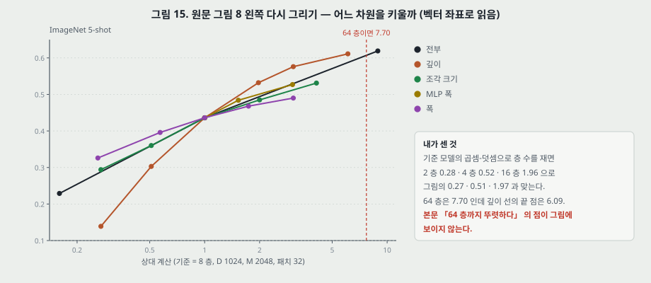

**그림 15.** 왼쪽 판(ImageNet 5-shot)을 벡터 좌표로 읽었다. 기준은 8 층 · $D$ 1,024 · $M$ 2,048 · 패치 32 다.

- **「깊이가 가장 크게 오른다」.** 깊이(상대 1.97) 0.532, 조각(2.0) 0.485, 폭(1.74) 0.468. 맞다. 다만 줄이는 쪽에서는 깊이가 가장 나쁘다(0.27 에서 0.139, 조각 0.294).
- **「16 층 뒤로 줄어드는 몫」.** 상대 1 -> 1.97 에서 +0.096, 1.97 -> 3.06 에서 +0.044, 3.06 -> 6.09 에서 +0.035.
- **「64 층까지 뚜렷하다」.** 내 곱셈-덧셈으로 층 수를 재면 2 층 0.28 · 4 층 0.52 · 16 층 1.96 이 그림의 0.27 · 0.51 · 1.97 과 맞고, 64 층은 7.70 이다. **깊이 선의 끝 점은 6.09 로 48 층(5.78)과 64 층 사이다.** 그 값(0.611)이 64 층이라면 상대 계산 축과 맞지 않는다. 실제 층 수가 적혀 있지 않아 더 가리지 못한다.
- **흩어짐이 없다.**

**그림 11 (D.4): 속도와 배치**

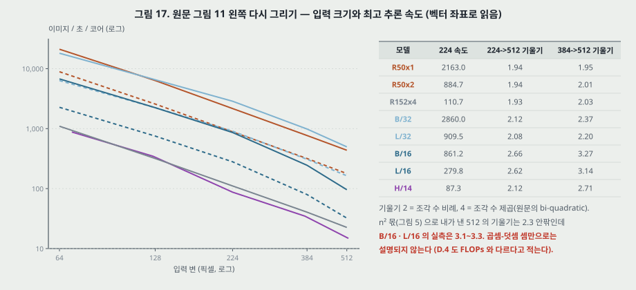

**그림 17.** 왼쪽 판을 벡터 좌표로 읽었다. H/14 의 「384 -> 512」 칸은 실제로 378 -> 518 로 냈다.

- **「비슷한 ResNet 과 속도가 비슷하다」.** 224 에서 B/32 2,860 대 R50x1 2,163(1.32 배). L/32 909.5 대 R50x2 884.7(1.03 배). 파라미터가 비슷한지와 맞아서 고른 쌍인지는 적혀 있지 않다.
- **「B/32 가 slightly faster」(4.3절)** 는 이 1.32 배다. 표 6 의 exaFLOPs 는 B/32 164 · R50x1 150 으로 B/32 가 1.09 배 많다. **단위에 따라 순서가 바뀐다.**
- **「가장 큰 모델의 가장 큰 해상도에서야」.** 384 -> 512 의 기울기는 **B/16 3.27 · L/16 3.14 · H/14 2.71 · B/32 2.37** 로 가장 큰 모델이 가장 가파른 것은 아니다.
- **오른쪽 판(가장 큰 배치).** 벡터 좌표로 읽으면 값이 **2 의 거듭제곱이고 위가 1,024 로 잘렸다.** 224 에서 B/16 · L/16 · H/14 는 1,024(잘림), R50x2 512, R152x4 128. 512 에서 L/16 128 · R50x1 128 · H/14 64 · R50x2 64 · R152x4 32. 「clearly more memory-efficient」 는 R152x4 와는 2 ~ 8 배로 맞다. 다만 측정 눈이 2 배 단위다.

**그림 12 (D.5): 축 주의.** 벡터 좌표로 읽은 값이다.

| 모델 | 계산 (exaFLOPs) | 속도 (이미지/초/코어) | 5-shot |
|---|---:|---:|---:|
| ResNet50 | 51.0 | 2,164 | 0.4950 |
| AxialResNet50 | 55.6 | 69.3 | 0.5526 |
| ViT-B/32 | 56.0 | 2,861 | 0.5637 |
| AxialViT-B/32 | 107.6 | 880 | 0.5816 |
| ViT-B/16 | 224.1 | 861.5 | 0.6346 |
| AxialViT-B/16 | 426.8 | 235.6 | 0.6579 |

- **축 주의의 교환.** B/16 쪽 +0.0233 에 계산 1.90 배 · 속도 0.27 배. B/32 쪽 +0.0179 에 1.92 배 · 0.31 배. AxialResNet50 은 ResNet50 대비 +0.0576 에 계산 1.09 배인데 속도가 31 분의 1 이다. 원문의 「naive 구현이 TPU 에서 극히 느리다」 다.
- **이 그림의 계산은 표 6 과 다르다.** R50 51.0 대 150, B/32 56.0 대 164, B/16 224.1 대 743 으로 2.93 ~ 3.32 배 차다. 에폭이 적혀 있지 않다. **5-shot 값도 다르다.** R50 0.4950 은 그림 4 의 R50x1 300M 52.03 과, B/32 0.5637 은 그림 4 의 55.24 와 어긋난다.
- **오른쪽 판의 가로축은 뒤집혀 있다.** 눈금 글자 좌표가 10³ 왼쪽, 10² 오른쪽이다. 그림 11 의 224 값과 0.1% 안에서 맞는 것으로 확인했다. 축을 놓치면 오른쪽 끝의 AxialResNet 이 가장 빠른 것으로 읽힌다.

---

## 22. 결론 (5절)

**원문.** 합성곱 없는 Transformer 를 이미지에 직접 쓰는 일이 「큰 데이터 사전학습과 묶으면 surprisingly well」. 「많은 분류 데이터셋에서 최신과 같거나 넘고 relatively cheap to pre-train」. 남은 도전 셋 — 다른 과제(검출 · 분할), 자기 지도 사전학습, 더 키우기.

**세기 판정.** 「같거나 넘는다(matches or exceeds)」 는 표 2 의 H/14 와 맞다. 12절의 「모든 과제」 보다 낮은 세기로 다시 적은 것이다. 「relatively cheap」 은 표 2 는 에폭이 섞이고, 표 6 은 2 ~ 4 배(내 셈으로 Average-5 2.73 ~ 6.08, ImageNet 1.68 ~ 2.35)다.

---

## 23. 실험 분석 (논문의 표 · 그림마다)

**직접 돌리지 않는다.** 논문이 낸 실험을 표 · 그림 하나씩 같은 틀로 읽는다. 책상에서 센 값은 「내가 센 것」 으로 밝힌다. 「±」 는 표 2 의 세 번 실행 표준편차다.

| 표 · 그림 | 무엇을 바꿨나 (변인) | 무엇을 고정했나 | 결과 | 반복 수 · 흩어짐 | 주장이 결과보다 센가 |
|---|---|---|---|---|---|
| **표 1** | 짜임(층 · $D$ · $M$ · 머리) | 패치 · 입력 · 머리는 적혀 있지 않다 | 86M · 307M · 632M | 실험이 아니다 | 줄마다 규칙이 달라야 맞는다. L/16 은 303.3 ~ 304.3M(내가 센 것). 4.1절 뒤로 L/16 을 쓰는데 307M 은 L/32 값이다. **어긋남** |
| **표 2 성능** | 사전학습 데이터 · 짜임 | 목표 시험 집합 | H/14 88.55, L/16 87.76, I21k 85.30, BiT-L 87.54, Noisy 88.4/88.5 | **미세조정 세 번.** 사전학습 한 번. 상대는 문헌 값 | 「L/16 이 모든 과제에서 넘는다」 는 4 행이 ± 밖, CIFAR-10 은 ± 안, ReaL 0.00, VTAB −0.01. **센 편** |
| **표 2 비용** | 모델 | TPUv3 | 2.5k · 0.68k · 0.23k · 9.9k · 12.3k | 한 값 | 원문이 스스로 단서를 단다. 에폭이 칸마다 다르고 BiT-L 의 에폭은 적혀 있지 않다. Abstract 는 단서 없이 「substantially fewer」. **Abstract 쪽이 센 편** |
| **그림 2 · 표 9** | 방법 넷 · 과제 묶음 셋 | VTAB-1k | H/14 대 BiT-L: Natural +1.14, Specialized +0.16, Structured +2.30(읽은 값) | 표 2 VTAB 의 ± 만, 묶음별 없음 | 「Specialized 비슷하다」 는 맞다. 묶음별 판정 한계가 없다 |
| **그림 3 · 표 5** | 사전학습 데이터 셋 · ViT 다섯 | 목표 ImageNet, 384 | L/16 76.53 → 85.15 → 87.12, BiT 띠 76.81 ~ 81.30 → 80.03 ~ 85.39 → 79.02 ~ 87.76 | 없음 | **걸음 · 부류 · 정칙화가 함께 움직인다.** 「앞지른다」 는 JFT 의 H/14 한 점(+0.28). **센 편** |
| **그림 4** | JFT 부분 9 · 30 · 90 · 300M | 설정 하나, 정칙화 추가 없음, 조기 종료 | B/32 − R50x1: −9.87 ~ +3.21, L/16 − R152x2: −10.79 ~ +2.24 | 없음 | 교차는 맞다. 에폭 · 걸음 어느 쪽을 묶었는지 없음. 「비슷한 계산」 은 1.54 배 쌍을 포함. 「귀납 편향」 원인 진술은 **센 편** |
| **그림 5 · 표 6** | 모델 18 줄 | JFT, Adam, 미세조정 절차, ResNet 은 BiT 설정 실행 추가 | 「2 ~ 4 배」 | **없음** | 내 셈 Average-5 2.73 · 2.82 · 6.08, ImageNet 1.68 ~ 2.35. 범위는 지표에 달렸다. 값이 없는 칸이 셋(ResNet 앞줄 위). **평균 쪽을 고른 값** |
| **그림 6 · 13** | 이미지 | ViT-L/16 | 주의 지도 | 128 장, 지표 없음 | 「의미적으로 관련 있는 영역」 은 눈으로 본 것이다 |
| **그림 7 왼쪽** | - | ViT-L/32 | 주성분 28 개 | 없음 | 「그럴듯한(plausible)」, 세기가 맞다 |
| **그림 7 가운데 · 9** | 학습 설정 셋(그림 9) | L/32 · L/16 | 유사도 격자 | 없음 | 「까닭을 설명한다」 는 D.3 의 「추측」 과 세기가 다르다. **센 편** |
| **표 8** | 자리 정보 넷 · 넣는 자리 셋 | ViT-B/16, 5-shot | 0.61382 · 0.63964 ~ 0.64292 | **없음** | 「little to no difference」 는 폭 0.00328 인데 같은 이름 값이 그림 12 에서 0.0075 다르다. 세기는 맞다, 판정 한계만 없다 |
| **그림 7 오른쪽 · 10** | 층 · 머리 · 하이브리드 유무 | 이미지 128 장 | 층 0: 8.0 ~ 110.0, 하이브리드 36.5 ~ 104.1. 층 12 이후 중앙 109.5 ~ 115.8 | 128 장 평균, 모델 하나 | 뒤쪽 값이 균일 주의(116.49)의 94 ~ 99% 라 「넓게」 와 「고르게」 를 못 가른다. 「수용장에 빗댄다」 는 다른 양. **센 편** |
| **4.6절 · B.1.2** | 사전학습 꼴 | ViT-B/16, 목표 ImageNet | 79.9 | 없음 | 「significant 2%」 에 ± 없음. 목표 셋 · 비율 15% 는 표가 없다. **센 편** |
| **표 7** | Adam · SGD | R50 · R152x2, JFT 7 에폭 | 평균 +0.54, +0.29 | 없음 | 7 칸 / 10 칸. SGD 는 BiT 권장값. 「정당화」 의 범위가 좁다 |
| **그림 8** | 깊이 · 패치 · $M$ · $D$ · 전부 | 기준 모델 | 0.139 ~ 0.619 | 없음 | 「깊이」 는 맞다. 「64 층까지」 는 점이 맞지 않는다(내 셈) |
| **그림 11 왼쪽** | 입력 크기 · 모델 여덟 | TPUv3 한 코어, 배치마다 최고값 | 기울기 384 -> 512 는 1.95 ~ 3.27, 224 -> 512 는 1.93 ~ 2.66 | 없음 | 「가장 큰 모델의」 는 값과 어긋난다(B/16 이 가장 가파르다) |
| **그림 11 오른쪽** | 같음 | 같음 | 2 의 거듭제곱, 위 1,024 잘림 | 측정 눈 2 배 | 「clearly」 는 R152x4 와는 맞다. L/16 512 는 R50x1 과 같다 |
| **그림 12** | 축 주의 유무 | JFT, 5-shot | 표 참조(21절) | 없음 | 교환은 맞다. 계산 값이 표 6 의 0.30 ~ 0.34 배이고 까닭이 없다 |

**비교 상대가 같은 조건인가.** 표 2 의 BiT-L · Noisy Student 와 그림 2 의 VIVI · S4L 은 문헌 쪽이다. 같은 조건의 비교는 **표 6 · 그림 5, 그림 4, 표 7** 이다. 그중 표 6 은 ResNet 에 BiT 설정 실행을 더 얹어 고른다.

**반복과 흩어짐.** ± 가 있는 표는 **표 2 하나**이고 그것도 미세조정 세 번이다. 시작값을 바꿔 사전학습을 다시 한 행은 이 파일에서 찾지 못했다. 표 2 안에서 VTAB 의 BiT-L ± 1.70 이 가장 크다.

---

## 24. 이 논문이 스스로 적은 한계와 조건

1. **ImageNet 에서는 낮다.** 「강한 정칙화 없이 ImageNet 에서 학습하면 비슷한 크기의 ResNet 보다 몇 백분율 점 낮다」(1절). 강한 정칙화를 넣은 값은 표 5 인데, 넣지 않은 값의 표는 없다.
2. **큰 데이터가 필요하다.** 「충분한 양이 아니면 잘 일반화하지 않는다」(1절). JFT 는 사내 데이터다(「in-house」).
3. **비용 비교의 단서.** 스케줄 · 최적화기 · 가중치 감쇠에도 달렸다(4.2절).
4. **분류 말고는 아직이다.** 검출 · 분할이 남은 도전(5절).
5. **자기 지도는 지도 사전학습과 「large gap」 이 있다**(원문 4%, 내가 뺀 값 4.07 ~ 4.25, 4.6 · 5절).
6. **자리 임베딩이 의미를 잃을 수 있다.** 해상도를 바꾸면 보간이 필요하다(3.2절).
7. **AxialResNet 구현이 TPU 에서 느려** 큰 규모 실험에 못 썼다(각주 3).

---

## 25. 논문이 적지 않은 것 — 내가 읽으며 짚은 자리

1. **표 1 의 패치 크기와 머리.** 9절.
2. **자리 임베딩 보간의 방법과 몫.** 8절.
3. **표 2 의 BiT-L 에폭 · 미세조정 입력 · 평균 내기.** 12 · 13절.
4. **exaFLOPs 셈법.** 4.4절이 가리킨 D.4 에 없다. 18절.
5. **그림 3 의 BiT 띠에 어떤 모델이 들었나.** 15절.
6. **그림 4 의 에폭 · 걸음.** 16절.
7. **하이브리드의 데이터 크기 실험, 작은 데이터의 자리 정보 실험.** 17절.
8. **표 6 · 표 5 · 표 8 의 실행 수.** 23절.
9. **정규화 자리와 GELU 의 몫.** Transformer 에서 바꾼 자리들을 켜고 끈 행이 없다. 4 · 5절.
10. **분류 토큰 대 전역 평균 풀링.** 이 파일에서 두 꼴을 나란히 잰 행을 찾지 못했다. 조각 토큰 출력을 어떻게 쓰는지는 이 편의 범위 밖이다.
11. **ResNet 쪽 파라미터 수.** 표 1 은 ViT 만 적는다. 그림 4 의 「비슷한」 을 파라미터로 대조하지 못한다.
12. **오류 분석 · 과제별 BiT 값.** 표 9 는 ViT 만.

---

## 26. 읽을 때 헷갈리는 지점

- **R50+ViT-L/16 의 16 은 패치가 아니다.** 하이브리드에서 끝 수는 ResNet 줄임 배수이고 ViT 입력 조각은 1 x 1 이다.
- **「layer」 와 「블록」.** D.6 · 그림 10 의 「층」 은 블록이다. L/16 은 24 층이라 가로축 끝이 23 이다.
- **「MLP」 가 둘이다.** 블록 안의 2 층 MLP(GELU)와 사전학습 머리의 은닉층 하나짜리 MLP.
- **「fine-tuning 은 ImageNet 인데 사전학습도 ImageNet」.** 각주 2. 해상도를 올리려고 같은 데이터로 다시 돈다.
- **ViT-b 와 ViT-B.** 소문자 b 는 모든 은닉 차원을 절반으로 줄인 것(그림 4 캡션).
- **표 2 와 표 5 의 ImageNet 은 다른 조건이다.** 표 2 는 512 · 518 + Polyak, 표 5 는 384 + 없음(표 5 캡션).
- **Average-5 에 ReaL 이 없다.** 표 6 의 일곱 값 열 중 다섯이다.
- **5-shot 과 미세조정을 섞지 않는다.** 그림 4 의 71.56 과 표 6 의 87.12 는 같은 L/16 이지만 지표가 다르다.
- **그림 12 오른쪽의 가로축은 뒤집혀 있다.** 21절.
- **「자리 임베딩은 2 차원 정보가 없다」 는 시작값 이야기다.** 배운 뒤에는 그림 7 가운데처럼 격자 무늬가 나온다.

---

## 27. 원문 안의 어긋남 모음

**하나. ViT-H/14 (JFT) 값이 표마다 다르다.**

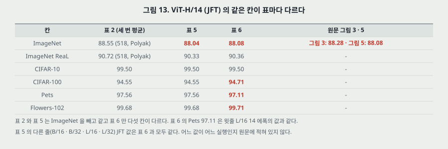

**그림 13.** 표 5 의 JFT B/16 · B/32 · L/16 · L/32 는 표 6 과 모두 같고 H/14 만 다섯 칸이 다르다. 표 6 의 Pets 97.11 은 윗줄 L/16 14 에폭과 같은 값이다(옮기다 생긴 실수인지 실제 값인지는 모른다). 그림 5 의 Average-5 점 95.82 는 표 6 값으로 내면 나온다. 표 5 는 「그림 3 에 대응한다」 고 적는데 그림 3 의 점은 88.28 이다.

**둘.** 그림 3 은 표 5 의 H/14 21k(85.13)를 찍지 않았다.

**셋.** 표 1 의 L 파라미터(9절).

**넷. B.1 「하이브리드는 ViT 짝과 정확히 같은 설정」** 과 표 3: ViT-L/32 $6 \cdot 10^{-4}$, R50+ViT-L/32 $2 \cdot 10^{-4}$.

**다섯. 표 3 에 없는 줄.** 표 6 의 R152x2 14 에폭 · R200x3 14 에폭, 표 5 의 H/14 21k.

**여섯.** 4.1절 「가중치 감쇠 0.1」 과 표 3 의 0.03 · 0.3. (4.1절이 모델 전체를 두고 적은 말이다.)

**일곱.** B.1.1 은 「ResNet · 하이브리드만 ImageNet 탐색에 0.06 을 더한다」 고 적는데 표 4 의 ImageNet 줄에는 0.06 이 이미 있다. 표 4 가 어느 모델 기준인지 적혀 있지 않다.

**여덟. 그림 12 캡션** 「number of FLOPs (left) and inference time (left)」. 둘째는 오른쪽이다. 또 본문은 오른쪽 축을 「인퍼런스 시간」, 축 글자는 「peak inference speed」 라 적는다.

**아홉. 4.5절 「까닭을 설명한다」 와 D.3 「추측한다」.** 까닭의 내용도 다르다(19절).

**열. 「모든 과제」.** 12절.

**열하나. 4.4절 → D.4.** exaFLOPs 를 가리키는데 D.4 에 없다(18절).

**열둘. 그림 8 의 64 층.** 21절(내 셈이 전제다).

---

## 28. 앞 칸들과 맞춰 보기

> **Transformer 노트 28절의 ViT 줄이 남긴 물음 셋에 답한다.** (1) **자르는 법과 n.** 겹치지 않는 $P \times P$. 224 / 16 이면 $N = 196$, 분류 토큰까지 $n = 197$. (2) **같은 조건의 합성곱 망과 견줬나.** 표 2 는 아니고(문헌 값), **표 6 · 그림 4 는 그렇다**(같은 JFT · 같은 Adam, 다만 학습률은 모델마다, ResNet 은 BiT 설정 실행까지 고른다, 흩어짐 없음). (3) **자리 부호화.** 학습하는 1 차원. 표 8 에서 2 차원 · 상대와의 폭 0.00328, 없음과의 차 0.02824. 사인 · 코사인은 시험하지 않았다.

- **Transformer 노트 11절의 셈.** 같은 식 $2n^2D + 4nD^2$ 를 쓴다. 번역(n = 50)에서 투영이 주의 부분층의 95.3% 였던 자리가 ViT-B/16 에서는 88.6%(464.8 / 524.4)다. $n$ 이 3.94 배가 되어도 이 값이다.
- **Transformer 노트 14 · 23절의 정규화 자리.** 그 편은 덧셈 뒤, 이 편은 블록 앞이다. 이 편도 왜인지의 비교는 없다. 후보 편(Xiong 외)에서 수가 나올 자리다.
- **Transformer 노트 18절의 자리 표현 비교.** 사인과 학습 자리 표현이 25.8 대 25.7 이었다. 이 편의 학습 1-D 대 2-D 도 0.00205 차이고, 두 편 모두 줄마다 실행 하나다.
- **사전 활성 ResNet 노트의 식 (4) · (5).** 식 (2) · (3) 은 지름길 위에 아무것도 없는 꼴이다. 그 노트가 「완전 사전 활성」 이라 부른 것과 같은 순서이고 식 (4) 의 끝 LN 도 그 꼴이 요구하는 자리다(내 해석).
- **BN 노트의 「미니배치에 기대지 않는 정규화」 대기 줄.** 이 편은 양쪽을 다 쓴다 — ViT 는 LN, 상대 ResNet 은 GN + WS. BN 을 안 쓴 까닭을 원문은 「전이를 좋게 한다」 로 Kolesnikov 외에 넘긴다.
- **사전학습 노트와의 대비.** AISTATS 2010 의 사전학습은 비지도 + 출발점 고르기였다. 이 편의 사전학습은 **큰 지도 데이터로 배운 뒤 머리를 바꾸는 것**이고 비지도 쪽 시험(4.6절)이 지도 쪽보다 4.07 ~ 4.25 점 낮다. 같은 낱말이 다른 일을 한다.
- **LeNet 노트의 픽셀 섞기 실험.** 고정 순열로 픽셀을 섞자 합성곱은 89.90%(학습 실패)였고 완전연결은 변동 폭 안이었다. ViT 는 조각 안 구조에 $\mathbf{E}$ 를, 조각 사이 구조에 자리 임베딩을 쓰므로 그 실험의 어느 쪽에 가까운지가 궁금한 자리인데 **이 편에 조각 순서를 섞은 행은 없다.** 표 8 의 「자리 없음」 이 조각 가방이고 0.61382 다.

---

## 29. 계보와 내가 가져갈 것

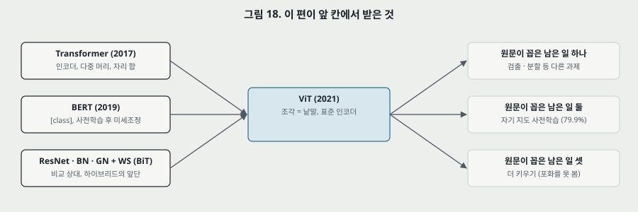

**하나. 닿는 자리 — 이미지 이상 탐지(PatchCore).** PatchCore 노트의 특징은 WRN-50-2 layer2(28 x 28) · layer3(14 x 14) 이고 조각 수가 784 다. ViT-B/16 · 224 의 출력도 14 x 14 격자에 조각마다 768 차원이므로, 같은 뱅크 방식에 넣을 수 있는 모양이다(내 해석, 이 편에 이상 탐지 실험은 없다). **다른 점 셋.** 첫째, ViT 는 뒤쪽 층의 주의 거리 중앙값이 균일 주의의 94 ~ 99% 라, PatchCore 가 중간 단계를 고르며 지킨 국소성이 어느 층까지 남는지 이 편만으로는 모른다. 층을 바꿔 잰 이상 탐지 실험이 있어야 답이 나온다. 둘째, 이 편의 좋은 값은 큰 사전학습 데이터에 달렸고 공개 21k 와 JFT 의 차가 ImageNet 2.46 이다(L/16, 표 2). 얼린 특징을 쓰는 쪽에서는 어느 체크포인트를 쓰는지가 변인이 된다. 셋째, 해상도를 올리면 자리 임베딩 보간이 끼어든다. 합성곱 백본에는 없는 단계다.

**둘. 옮겨 쓸 수 있는 것.**

- **그림의 벡터 좌표를 읽고 표와 맞대기.** 그림 3 의 88.28 · 그림 11 의 378 · 그림 12 의 뒤집힌 축은 눈으로 안 보인다. 표식 상자와 눈금 선을 맞대면 0.01 안에서 읽힌다.
- **「모든 ○○ 에서」 문장은 행마다 빼 본다.** 표 2 의 7 행에서 4 행이 뚜렷했다.
- **± 가 무엇의 반복인지 캡션에서 먼저 본다.** 미세조정 세 번은 사전학습의 흩어짐을 담지 않는다.
- **가로축이 하나로 보이는 그림에서 함께 움직이는 것을 표로 적는다.** 그림 9 처럼.
- **차수를 몫으로 바꾼다.** $O(n^2)$ 를 $n/(n+6D)$ 로 적으면 언제 문제인지 $n = 6D$ 로 답이 나온다.
- **지표의 없는 값(baseline)을 내 본다.** 주의 거리에 균일 주의의 116.49 를 그으니 뒤쪽 층의 해석이 바뀌었다.

**셋. 지금 확인된 것은 여기까지다.**

- **논문이 잰 것**: 표 2(미세조정 세 번), 표 5 · 6 · 7 · 8 · 9(한 값), 그림 4 · 8 · 10 · 11 · 12 의 값, 자기 지도 79.9.
- **논문이 말만 한 것**: 큰 규모가 귀납 편향을 이긴다(1절), 자리 임베딩 토폴로지가 까닭이다(4.5절), 패치 수준이라 부호화 차이가 없다(D.3, 추측), 낮은 층의 국소 주의가 합성곱 비슷한 일을 할 수 있다(4.5절), 의미적으로 관련 있는 영역을 본다(4.5절), 더 키우면 더 좋을 것(5절), 머리 전체 교체가 a little more robust(B.1.1).
- **내가 책상에서 센 것**: 파라미터 다섯 줄(torchvision 과 정수까지 같다), 표 1 과의 어긋남, 조각 수와 $n^2$ 몫 $n/(n+6D)$, 곱셈-덧셈 표, 표 2 의 차, 에폭당 비용 1.85 배, 8 코어 x 30 일 = 240, 갱신 걸음, 표 6 으로 낸 계산 배수, Average-5 의 구성, exaFLOPs 이미지당 값과 배수, 균일 주의 116.49, 그림 11 의 기울기, 그림 8 의 층 수 환산, 표 9 묶음 평균, 표 7 평균 확인, 1M 걸음 = 13.5 에폭.
- **벡터 좌표로 읽은 것**: 그림 2 · 3 · 4 · 5 · 8 · 10 · 11 · 12 의 값. 원문이 숫자로 적지 않은 값이다.
- **내 해석**: $\mathbf{E}$ = 커널 $P$ 합성곱, 식 (2) · (3) = 사전 활성 꼴, ViT 격자를 뱅크에 넣는 그림.

---

## 30. 다음에 읽을 것

**한계를 적고 그 한계를 푼 것이 다음 논문이다.** 큰 틀을 먼저 적고 자잘한 후속 편은 뒤에 둔다.

**큰 틀.** 이 편 뒤의 큰 틀 다음 칸은 **사용자가 아직 정하지 않았다.** BERT(Devlin 외, NAACL 2019)는 함께 읽는 중이고 원문이 짜임(표 1) · 분류 토큰 · 가림 과제를 거기서 가져왔다.

**자잘한 후속 편 — 이 편의 어느 자리에서 나왔나.** 모두 **읽지 않았고**, 이 파일의 참고 문헌에 없는 편(뒤에 나온 편)은 표시했다. 읽고 이 자리에 맞는 편인지 가린다.

| 다음 | 이 노트의 어느 자리에서 나오는가 | 무엇을 확인하고 싶은가 |
|---|---|---|
| **Big Transfer (BiT)** (Kolesnikov 외, ECCV 2020, 원문 인용) | 12 · 13 · 15절 — 표 2 의 상대, 전처리 · 미세조정 설정의 출처 | BiT-L 의 에폭 · 입력 크기 · 비용. 그림 3 의 띠가 어느 모델인가 |
| **DeiT** — Training data-efficient image transformers (Touvron 외, ICML 2021) — 후보, 이 파일의 참고 문헌에 없다 | 15 · 17 · 24절 — ImageNet 만으로 ViT 가 어디까지 가는가 | 작은 데이터 차이가 짜임 때문인지 정칙화 · 증강 때문인지 |
| **Masked Autoencoders** (He 외, CVPR 2022) — 후보, 이 파일의 참고 문헌에 없다 | 20절 — 자기 지도 79.9 와 지도의 4 점 차 | 가리는 비율 · 목표를 바꾸면 그 차가 얼마나 주나 |
| **Swin Transformer** (Liu 외, ICCV 2021) — 후보, 이 파일의 참고 문헌에 없다 | 24절 넷 — 검출 · 분할이 남았다, 10절 — $n^2$ 이 커지는 자리 | 국소 창으로 $n^2$ 을 어떻게 줄이고 편향을 얼마나 들여오나 |
| **Abnar · Zuidema, Quantifying attention flow** (ACL 2020, 원문 인용) | 19절 — Attention Rollout | 지도가 무엇을 재는가. 정답과 겹침을 잰 값이 있는가 |
| **Cordonnier 외, On the relationship between self-attention and convolutional layers** (ICLR 2020, 원문 인용) | 3 · 6절 — 가장 가까운 앞 편 | 자기 주의가 합성곱을 표현할 수 있다는 증명과 이 편의 「편향이 없다」 의 관계 |

---

## 31. 남는 질문

- **표 1 의 307M 은 어느 모델인가.** 코드의 설정을 보면 답이 난다.
- **H/14 의 표 5 · 표 6 · 그림 3 은 어느 실행인가.** 표 2 와 표 5 의 차이가 입력 · 평균 내기 때문이라면 표 6 은 왜 다른가.
- **사전학습을 시작값만 바꿔 다시 하면 표 2 의 ImageNet 이 얼마나 흔들리나.** ± 0.04 는 미세조정 쪽이다.
- **그림 4 를 걸음 수를 묶어 다시 그리면 왼쪽 점이 어떻게 되나.**
- **하이브리드를 9M · 30M 에서 돌리면 ViT 와 ResNet 사이 어디에 오나.** 17절의 빈 칸이다.
- **표 8 을 작은 데이터에서 돌리면 2 차원 임베딩이 이기는가.**
- **자리 임베딩 보간을 빼고 해상도만 올린 값은 얼마인가.** 그리고 보간 방법을 바꾸면.
- **뒤쪽 층 주의가 고른가, 먼 곳에 몰리는가.** 주의 거리 말고 엔트로피로 재면 갈린다.
- **표 2 의 코어-일 3.96 배를 그림 11 의 속도와 에폭으로 설명하면 남는 2.34 배는 무엇인가.**
- **ViT 조각 토큰을 얼려 이상 탐지 뱅크에 넣으면 어느 층이 좋은가.**
- 앞 두 물음과 보간 방법은 코드를 보면 답이 난다. 나머지는 이 편으로는 답이 안 나오고 새 실험이 있어야 한다.

---

## 32. 참고 문헌

이 노트가 부른 편만 적는다. 원리는 원 출처를, 구현은 그 라이브러리의 편을 적는 규칙을 따른다. 그림 코드는 파이썬 표준 라이브러리만 쓰고, 원문 그림을 잘라 내고 벡터 좌표를 읽은 일에 PyMuPDF 를, 파라미터 대조에 torchvision 0.26 을 썼다(PyMuPDF · torchvision 은 이 노트의 수치 근거가 아니라 도구다. 파라미터 값은 식으로 먼저 세고 대조만 했다).

- Dosovitskiy, A. 외 (2021). An image is worth 16x16 words: Transformers for image recognition at scale. ICLR. — 이 노트의 대상.
- Vaswani, A. 외 (2017). Attention is all you need. NIPS. — 인코더, 다중 머리 주의.
- Devlin, J. 외 (2019). BERT: pre-training of deep bidirectional transformers for language understanding. NAACL. — `[class]`, 짜임, 가림 과제. 원문이 부르는 말로 옮겼다.
- Kolesnikov, A. 외 (2020). Big transfer (BiT): general visual representation learning. ECCV. — 비교 상대, 전처리 · 미세조정의 출처. **읽지 않았다.**
- Xie, Q. 외 (2020). Self-training with noisy student improves ImageNet classification. CVPR. — 비교 상대. **읽지 않았다.**
- Touvron, H. 외 (2019). Fixing the train-test resolution discrepancy. NeurIPS. · Touvron, H. 외 (2020). FixEfficientNet. arXiv:2003.08237. — 해상도 올리기, 88.5. **읽지 않았다.**
- Cordonnier, J.-B. 외 (2020). On the relationship between self-attention and convolutional layers. ICLR. — 2 x 2 조각. **읽지 않았다.**
- Chen, M. 외 (2020). Generative pretraining from pixels. ICML. — iGPT. **읽지 않았다.**
- Sun, C. 외 (2017). Revisiting unreasonable effectiveness of data in deep learning era. ICCV. — JFT. **읽지 않았다.**
- Zhai, X. 외 (2019). A large-scale study of representation learning with the visual task adaptation benchmark. arXiv:1910.04867. — VTAB. **읽지 않았다.**
- Beyer, L. 외 (2020). Are we done with ImageNet? arXiv. — ReaL. **읽지 않았다.**
- Wu, Y. and He, K. (2018). Group normalization. ECCV. · Qiao, S. 외 (2019). Weight standardization. arXiv:1903.10520. — ResNet (BiT). **읽지 않았다.**
- He, K. 외 (2016). Deep residual learning for image recognition. CVPR. · Ioffe, S. and Szegedy, C. (2015). Batch normalization. — 앞 칸.
- Wang, Q. 외 (2019). Learning deep transformer models for machine translation. ACL. · Baevski, A. and Auli, M. (2019). Adaptive input representations for neural language modeling. ICLR. — 블록 앞 정규화의 인용. **읽지 않았다.**
- Abnar, S. and Zuidema, W. (2020). Quantifying attention flow in transformers. ACL. — Attention Rollout. **읽지 않았다.**
- Wang, H. 외 (2020). Axial-DeepLab. ECCV. · Ho, J. 외 (2019). Axial attention in multidimensional transformers. arXiv. · Huang, Z. 외 (2020). CCNet. ICCV. — 축 주의. **읽지 않았다.**
- Polyak, B. T. and Juditsky, A. B. (1992). Acceleration of stochastic approximation by averaging. SIAM J. Control Optim. 30(4):838–855. — 평균 내기. **읽지 않았다.**
- Touvron, H. 외 (2021). Training data-efficient image transformers. ICML. · He, K. 외 (2022). Masked autoencoders are scalable vision learners. CVPR. · Liu, Z. 외 (2021). Swin Transformer. ICCV. — 다음에 읽을 것 후보. **원문 참고 문헌에는 없다(뒤에 나온 편). 읽지 않았다.**
- 코드: `https://github.com/google-research/vision_transformer`(원문 각주 1). 이 노트는 코드를 보지 않았다.

---

## 33. 경로

| 무엇 | 어디 |
|---|---|
| 원문 PDF (ICLR 2021 판, 21 쪽) | `papers/ICLR21_ViT_An_Image_is_Worth_16x16_Words_Transformers_for_Image_Recognition_at_Scale.pdf` |
| 이 노트 | `notes/ICLR21_ViT_An_Image_is_Worth_16x16_Words_Transformers_for_Image_Recognition_at_Scale.md` |
| 이 노트의 그림 (직접 그린 것) | `figures/ICLR21_ViT/fig01_patch_pipeline.svg` 부터 `fig18_lineage.svg` 까지 열여덟 |
| 이 노트의 그림 (원문에서 잘라 낸 것) | `figures/ICLR21_ViT/paper_fig1_model.png` · `paper_fig6_attention.png` · `paper_fig7_inspect.png` · `paper_fig9_pos_hparam.png` |
| 그림을 만드는 코드 | `figures/ICLR21_ViT/make_figures.py` — 바깥 데이터를 읽지 않으므로 `python make_figures.py` 로 어디서나 다시 만든다(표준 라이브러리만). 파라미터 · $n^2$ 몫 · 갱신 걸음 · 계산 배수 · 균일 주의 거리 · 기울기를 돌릴 때 화면에 찍는다. 벡터 좌표에서 읽은 값은 상수로 들어 있다 |
| 원문 그림을 잘라 내는 코드 | `figures/ICLR21_ViT/crop_paper_figures.py` — PyMuPDF 가 필요하다 |
