# AnomalyCLIP — Object-Agnostic Prompt Learning for Zero-Shot Anomaly Detection (ICLR 2024, 요약)

> **한 줄.** 얼린 CLIP(ViT-L/14@336px)에 **배우는 글 프롬프트 둘**을 붙인다. 정상 쪽은 「[V1] ... [V12] object」, 결함 쪽은 「[W1] ... [W12] damaged object」 이고, 물체 이름 자리에 늘 같은 낱말 object 를 넣는다(3.2절). 프롬프트는 **다른 데이터셋 하나의 시험 집합(이미지와 결함 마스크)** 으로 배운다. 이미지 단위 교차 엔트로피와, 시각 부호기 중간 층 넷(6 · 12 · 18 · 24)의 조각 토큰에 거는 Focal · Dice 손실을 함께 쓴다(3.3절). 조각 토큰이 지역 정보를 잃지 않게 6 층부터 주의를 Q-K 대신 V-V 로 바꾼 길(DPAM)을 따로 둔다. MVTec AD 로 배워 산업 6 개 · 의료 10 개 데이터셋에서, VisA 로 배워 MVTec AD 에서 잰다. MVTec AD 분류 AUROC 91.5 · 분할 pAUROC 91.1, VisA 82.1 · 95.5 다(표 1).

> **이 노트에서 가장 먼저 볼 자리 다섯.** (1) **제목의 장치(물체 이름 대신 object)가 낸 몫은 끈 실험 오름의 1.1 \~ 3.3% 다.** 표 4 에서 「object-agnostic 프롬프트(T2)」 를 더하면 MVTec AD 분류 AUROC 가 24.5 점 오른다. 그런데 그림 5 에서 object 판과 물체 이름 판의 차는 0.8 점이다. T2 칸은 「보조 데이터로 프롬프트를 배우기」 와 「물체 이름을 빼기」 를 한꺼번에 넣은 칸이고, 오름의 대부분은 앞쪽으로 읽힌다(9절). (2) **하이퍼파라미터 훑기(그림 7) 16 줄 모두에서 고른 기본값이 그 줄의 최댓값이다.** 그 값은 MVTec AD · VisA 시험 집합에서 잰 것이다. 본문은 「M 이 9 일 때 떨어진다」 고 적는데, 그림에서 9 는 꼭짓점이고 떨어지는 곳은 11 이다(11절). (3) **비교 상대 CLIP · CLIP-AC · CoOp 의 화소 AUROC 가 산업 데이터 18 칸에서 50 아래다.** MVTec AD 부류별로는 CLIP 의 Grid 8.7 · Leather 9.9 · Carpet 11.5 다. WinCLIP 노트에서 본 「거꾸로 정렬」(Patch-token 22.4)이 이 편의 비교 상대에서도 나온다. 원문은 이 값들을 다루지 않는다(7절). (4) **MVTec AD 분류는 WinCLIP 이 0.3 점 앞서고, 부류로 세면 15 부류 중 8 부류에서 WinCLIP 이 높다.** 반면 PRO 는 15 부류 중 14 부류에서 AnomalyCLIP 이 높고 평균 차가 +16.8 이다. 이 편이 올린 것은 이미지 판정보다 위치 찾기다(6절). (5) **추론 지도 식이 $S_a$ 하나로 준다.** 두 부류 소프트맥스면 $S_n + S_a = 1$ 이라 $\tfrac{1}{2}(I - S_n) + \tfrac{1}{2} S_a = S_a$ 다(4절 ⑥, 내 유도).

---

## Paper Metadata

| Item | Content |
|---|---|
| Title | AnomalyCLIP: Object-Agnostic Prompt Learning for Zero-Shot Anomaly Detection |
| Authors | Qihang Zhou\*, Guansong Pang\*, Yu Tian, Shibo He†, Jiming Chen† (\* 공동 기여, † 교신) |
| 소속 | Zhejiang University (Zhou · He · Chen), Singapore Management University (Pang), Harvard University (Tian) |
| Conference / Journal | **ICLR 2024** (쪽마다 「Published as a conference paper at ICLR 2024」) |
| Year | 2024. 읽은 파일은 arXiv v8, 2024-03-16 |
| DOI | 파일에 찍혀 있지 않다 |
| 원 출처 | [arXiv 2310.18961v8](https://arxiv.org/abs/2310.18961v8). 2026-11-18 에 주소가 열리는 것을 확인했다. OpenReview 게재판은 2026-11-17 에 로그인 요구로 받히지 않았다 |
| 코드 | [zqhang/AnomalyCLIP](https://github.com/zqhang/AnomalyCLIP) (초록에 적힌 주소). 2026-11-18 에 저장소가 열리고 설명이 「Official implementation for AnomalyCLIP (ICLR 2024)」 인 것을 확인했다. **코드는 읽지 않았다** |
| Stored PDF | arXiv v8 31 쪽 한 파일. 경로는 22절 |
| 왜 읽었는가 | 큰 틀 「CLIP 계열 제로샷 이상 탐지(CLIP → WinCLIP → AnomalyCLIP)」 의 셋째이자 마지막 칸. WinCLIP 노트가 남긴 물음 둘(조각 토큰이 왜 우연 아래로 거꾸로 정렬되나, 손으로 쓴 프롬프트 242 문장 대신 프롬프트를 배우면 얼마나 오르나)을 이 편이 다룬다 |
| 읽은 범위 | **2026-11-18 에 읽었다.** 본문 1 \~ 10 쪽 전부(1 \~ 6절, 표 1 \~ 5, 그림 1 \~ 6 과 캡션), 재현성 문단(11 쪽), 참고 문헌 목록(11 \~ 15 쪽)은 인용을 맞출 때만 봤다. 부록 A(설정 · 비교 상대), B(데이터, 표 6), C(DPAM 분석), D(표 7 \~ 9, 그림 7 · 8), E 의 글, F(부류별 표 10 \~ 21 — 값은 스크립트로 읽었다, 5절). **미독: 그림 9 \~ 12 의 히스토그램 막대(축 글자만 읽었다), 그림 13 \~ 36 의 개별 사례 이미지(캡션만 읽었다).** 읽지 않은 것의 내용은 이 노트에 옮기지 않는다 |

### 저장한 파일의 상태

- **arXiv v8(31 쪽, 2024-03-16)이다.** 첫 쪽 왼쪽 여백에 「arXiv:2310.18961v8 [cs.CV] 16 Mar 2024」 가 찍혀 있다. 쪽마다 ICLR 2024 머리글이 있는 마지막 판이라 이 판을 골랐다. 2026-11-17 에 v12(2026-01-01)는 머리글이 빠지고 본문 숫자가 바뀐 것을 봤고, **v12 와 숫자 대조는 하지 않았다.**
- 표 1 \~ 5 · 7 \~ 21 은 PDF 글자 층에서, 그림 6 · 7 의 값은 PDF 벡터 경로에서 읽어 `tables_anomalyclip.json` 에 두었다. 그림 5 · 8 은 막대 위 글자를 `data_anomalyclip.py` 에 옮겼다.

---

## 1. 용어

- **제로샷 이상 탐지 (ZSAD, zero-shot anomaly detection)**: 원문 정의는 「대상 데이터셋의 학습 표본 없이 이상을 찾는 것」 이다. **다른 데이터셋으로 배우는 것은 막지 않는다.** 이 편은 MVTec AD 시험 집합으로 프롬프트를 배우고 VisA 에서 잰다. WinCLIP 의 0 장(그 부류의 이미지를 한 장도 쓰지 않고 배우는 값도 없음)보다 넓은 뜻이다.
- **보조 데이터 (auxiliary data)**: 프롬프트를 배우는 데 쓰는 다른 데이터셋. 이미지 단위 정답과 화소 마스크가 모두 있어야 한다. 작은 예시: VisA 에서 잴 때 보조 데이터는 MVTec AD 시험 집합 1,725 장(정상 467 · 이상 1,258)이다.
- **물체 이름 판 · object 판 (object-aware · object-agnostic)**: 프롬프트 끝에 데이터셋이 주는 물체 이름([cls], 예: bottle)을 넣는 판과, 모든 부류에 같은 낱말 object 를 넣는 판. 이 편의 제목이 뒤쪽이다.
- **배우는 낱말 (learnable word embedding)**: 프롬프트 앞에 붙는 낱말 자리 E 개(정상 [V1] \~ [VE], 결함 [W1] \~ [WE])의 임베딩. 사람이 고른 낱말이 아니라 기울기로 정한 벡터다. E = 12.
- **글 층 토큰 (learnable token embedding, text prompt tuning)**: 글 부호기의 층마다 입력에 덧붙이는 배우는 토큰. 층 출력에서 그 자리는 버리고 다음 층에 새 토큰을 붙인다. 1 \~ 9 층에 층마다 4 개다.
- **전역 · 지역 손실 (global · local context optimization)**: 이미지 임베딩(클래스 토큰)과 두 프롬프트로 내는 교차 엔트로피가 전역, 조각 토큰과 두 프롬프트로 낸 지도에 마스크를 대는 Focal + Dice 가 지역이다. 원문은 둘을 합쳐 「glocal」 이라 부른다.
- **DPAM (diagonally prominent attention map)**: 시각 부호기의 자기 주의에서 Q-K 점수 대신 Q-Q · K-K · V-V 점수를 쓰는 길. 자기 자신에게 무게가 몰려 주의 지도의 대각선이 진해진다. 기본은 V-V 다.
- **화소 AUROC · AUPRO · AP**: 화소 단위 ROC 곡선 넓이, 결함 영역별 겹침 곡선 넓이(원문 표에서는 PRO), 이미지 단위 평균 정밀도. AP 는 무작위 순위에서 이상 비율과 같다. 작은 예시(내 셈): COVID-19 는 이상 219 / 1,560 장이라 무작위 AP 가 14.0 이다.
- **점**: 지표의 차를 「0.8 점」 처럼 적는다. 원문 그림 5 는 「performance gain」 이라 적는다.
- **거꾸로 정렬**: AUROC 가 50 아래인 것. 정렬이 없으면 50 언저리가 나오고, 50 보다 낮으면 결함 쪽이 정상 쪽보다 체계적으로 낮은 점수를 받는다는 뜻이다. 부호를 뒤집으면 100 − 값이 된다. 작은 예시: CLIP 의 Grid 화소 AUROC 8.7 은 뒤집으면 91.3 이다.

---

## 2. 한 문단 요약

원문의 물음은 이것이다(1절). CLIP 은 물체의 클래스 의미에 맞춰 배웠기 때문에 정상 · 이상을 가르는 데 약하다. 손으로 쓴 프롬프트(WinCLIP)나 일반 과제용 배우는 프롬프트(CoOp)는 전역 특징에 맞춰져, 미세한 지역 이상을 놓친다. 이 편은 **물체와 상관없이 「정상」 · 「이상」 그 자체를 담는 프롬프트 둘**을 보조 데이터로 배우면, 물체 의미가 전혀 다른 데이터셋(제품 결함에서 의료 영상까지)으로 옮겨 간다고 본다. 근거로 그림 1 의 짝을 든다: 금속 너트와 금속 판의 긁힘, 트랜지스터와 PCB 의 자리 어긋남, 여러 장기의 종양이다. 실험은 산업 7 개(표 1) · 의료 10 개(표 2) 데이터셋의 제로샷 비교, 의료 데이터로 배운 판(표 3), 장치 끈 실험(표 4 · 5, 그림 5 · 6), 전체 학습 방법과의 비교(표 7), 하이퍼파라미터와 프롬프트 낱말(그림 7 · 8, 표 8 · 9), 부류별 표(표 10 \~ 21)다.

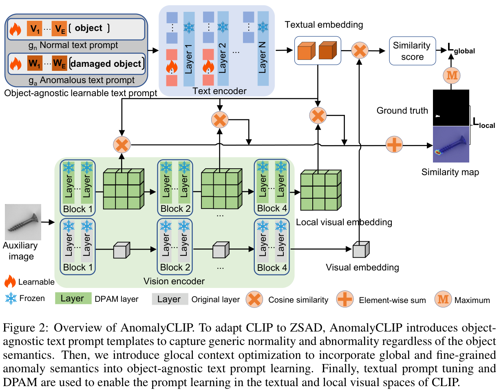

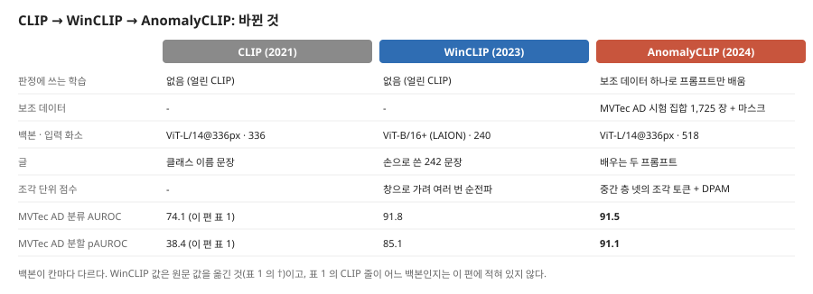

---

## 3. 문제 / 동기

**이 논문이 없앤 전제: 정상 · 결함을 적는 글은 사람이 쓰고, 물체 이름을 넣어야 한다.**

원문이 적은 문제는 셋이다.

1. **대상 도메인의 학습 데이터를 쓸 수 없는 경우가 있다**(1절). 환자 정보 보호 때문에 쓸 수 없거나, 새 제품 라인이라 데이터가 없는 경우다. 그래서 제로샷을 본다.
2. **CLIP 의 글-이미지 정렬은 물체 의미 쪽이다**(1 · 3.2절). 「A photo of a [cls]」 류는 이상 의미를 담지 못하고, 「damaged [cls]」 처럼 일반적인 이상 낱말을 넣어도 CLIP 공간이 그것을 가르도록 배운 적이 없다. 결함 종류를 다 적는 것은 종류를 미리 알 수 없어 실제로 어렵다고 적는다.
3. **기존 프롬프트는 전역 특징에 맞춰져 지역 이상을 못 잡는다**(1절, 그림 1 (d) · (e)). 그리고 클래스 토큰을 위해 배운 자기 주의가 몇몇 토큰에 몰려 조각 토큰의 지역 의미를 흐린다(3.3절, 부록 C).

원문은 기여 첫째로 「물체를 가리지 않는 정상 · 이상 프롬프트를 배우는 것이 단순하고 효과적인 길임을 처음 밝혔다」 고 적는다(1절).

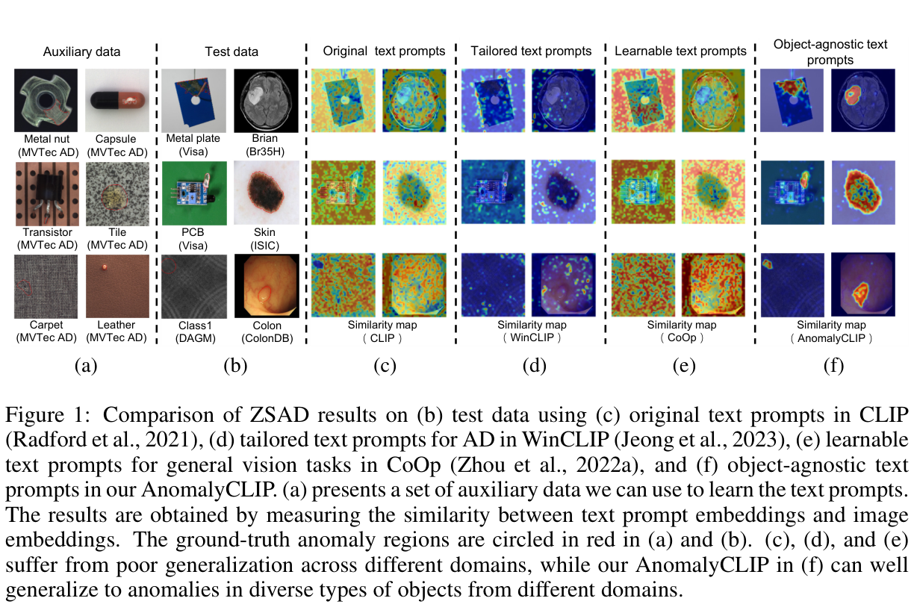

그림 1 의 (a) 는 보조 데이터(MVTec AD 여섯 부류), (b) 는 시험 데이터(VisA · DAGM · 의료 셋), (c) \~ (f) 는 네 프롬프트 설계의 유사도 지도다. **보조 · 시험 짝은 원문이 고른 여섯 장**이고, 고른 방법은 적혀 있지 않다. 캡션은 CoOp 을 Zhou 외 2022a 로 인용하는데, 참고 문헌에서 2022a 는 CoCoOp(Conditional prompt learning)이고 CoOp 은 2022b 다(15절).

---

## 4. 핵심 기술

**① 두 부류 판정 (2절).** CLIP 의 0 장 분류 식을 정상 · 이상 두 부류로 쓴다.

$$p(y = c \mid x_i) = P(g_c, f_i) = \frac{\exp\big(\langle g_c, f_i \rangle / \tau\big)}{\sum_{c \in \mathcal{C}} \exp\big(\langle g_c, f_i \rangle / \tau\big)} \qquad (1)$$

$\langle \cdot, \cdot \rangle$ 은 코사인 유사도, $f_i$ 는 클래스 토큰(전역 시각 임베딩), $g_c$ 는 글 임베딩이다. 이상 점수는 $P(g_a, f_i)$ 다. 같은 계산을 조각 토큰마다 해서 지도 $S_n, S_a \in \mathbb{R}^{H \times W}$ 를 얻는다. 원문 식 1 의 분모는 괄호가 맞지 않게 찍혀 있다(15절). $\tau$ 의 값은 적혀 있지 않다.

**② object 판 프롬프트 (3.2절).**

$$g_n = [V_1][V_2] \ldots [V_E][\text{object}], \qquad g_a = [W_1][W_2] \ldots [W_E][\text{damaged}][\text{object}]$$

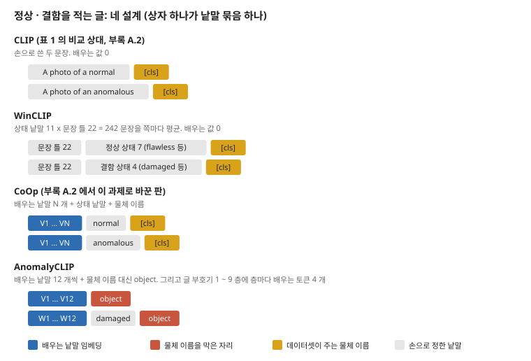

- 원문은 먼저 물체 이름 판 $[V_1] \ldots [V_E][\text{cls}]$ 를 적고, 대상 데이터셋의 물체 의미가 다르니 「물체 의미를 넣는 것은 대개 필요 없고, 배울 때 못 본 부류의 탐지를 오히려 막을 수 있다」 는 **가설**로 object 를 넣는다. 이 편의 핵심 주장이고, 그 몫은 그림 5 가 잰다(9절).
- 결함 쪽에만 「damaged」 를 넣는다. 정상 쪽에 짝이 되는 상태 낱말이 없다. 그 낱말을 다른 넷으로 바꾼 표는 표 8 · 9 다(11절).
- **CoOp 비교 상대는 정상 쪽에 「normal」, 결함 쪽에 「anomalous」 를 넣고 물체 이름을 붙인다**(부록 A.2). 그러니 CoOp 과 이 편의 차는 object 하나가 아니라 손실 · DPAM · 글 층 토큰 · 상태 낱말이 함께 다르다.

**③ 전역 · 지역 손실 (3.3절).**

$$L_{\text{total}} = L_{\text{global}} + \lambda \sum_{M_k \in \mathcal{M}} L^{M_k}_{\text{local}} \qquad (2)$$

$$L_{\text{local}} = \mathrm{Focal}\big(\mathrm{Up}([S_{n,M_k}, S_{a,M_k}]), S\big) + \mathrm{Dice}\big(\mathrm{Up}(S_{n,M_k}), I - S\big) + \mathrm{Dice}\big(\mathrm{Up}(S_{a,M_k}), S\big)$$

$L_{\text{global}}$ 은 정상 · 이상 이미지의 전역 임베딩과 두 글 임베딩의 코사인에 거는 교차 엔트로피다. $\mathcal{M}$ 은 쓰는 중간 층의 집합이고 층마다 지도를 올려 키운(Up) 뒤 마스크 $S$ 와 맞춘다. Focal 은 결함 화소가 적은 불균형 때문에, Dice 는 결정 경계를 맞추려고 넣었다고 적는다. $\lambda = 1$ 이다(부록 A.1).

- **그림 2 에는 유사도 지도에서 「Maximum(M)」 을 거쳐 $L_{\text{global}}$ 쪽으로 가는 화살표가 있다.** 식 2 의 $L_{\text{global}}$ 정의와 추론 문단의 이미지 점수($P(g_a, f_i)$ 하나)에는 지도의 최댓값이 없다. 그림과 글 중 어느 쪽이 실제 계산인지 원문만으로는 가를 수 없다(15절).

**④ 글 공간 다듬기 (3.3절, 부록 D 식 3).** 얼린 글 부호기의 $m$ 번째 층 $T_m$ 입력에 배우는 토큰 $t'_m$ 을 이어 붙이고, 출력에서 그 자리 $r'_{m+1}$ 은 버린 뒤 다음 층에 새 토큰 $t'_{m+1}$ 을 붙인다.

$$[r'_{m+1}, t_{m+1}] = T_m([t'_m, t_m]), \quad \ldots, \quad t_{M'+1} = T_{M'}(t_{M'}) \qquad (3)$$

버려도 자기 주의를 거쳐 기울기가 $t'_m$ 까지 흐른다고 적는다. VPT · MaPLe 를 따랐다고 적는다. **두 프롬프트가 이 토큰을 나눠 쓰는지는 적혀 있지 않다.**

**⑤ DPAM (3.3절, 부록 C).** 원문 분석은 이렇다. Q-K 주의에서 모든 질의 $q_i$ 가 같은 키 $k_m$ 과 큰 점수를 내면, 출력 $i$ 가 $v_m$ 에 지배되어 조각 $i$ 의 지역 의미가 흐려진다(그림 3 (b) 의 세로 줄). 그래서 점수를

$$a^{qq}_{ij} = e^{q_i q_j^\top / \sqrt{D}}, \qquad a^{kk}_{ij} = e^{k_i k_j^\top / \sqrt{D}}, \qquad a^{vv}_{ij} = e^{v_i v_j^\top / \sqrt{D}}$$

로 바꾸면 자기 자신의 무게가 커져 대각선이 진해진다. Q · K 는 원래 주의 지도를 만든 값이라 다른 토큰과도 큰 점수를 낼 수 있고, V 는 그 계산에 참여하지 않아 방해가 가장 적다는 것이 V-V 를 고른 까닭이다. **「이것이 V-V 가 가장 좋은 까닭이다」 는 설명이고, 원문은 대각선 정도를 수치로 재지 않는다.** 시각 부호기는 얼려 둔다.

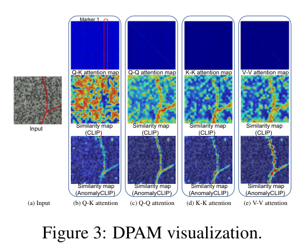

- **본문은 「원래 Q-K 주의를 바꾼다(replace)」 고 적는데, 그림 2 는 DPAM 층 줄과 원래 층 줄을 나란히 그린다.** 표 4 에서 DPAM(T1)을 더해도 이미지 단위 값이 MVTec AD (66.3, 83.3) · VisA (54.4, 61.7)로 소수까지 그대로다. 클래스 토큰은 원래 길에서, 조각 토큰은 DPAM 길에서 나온다고 읽어야 맞는다(내 해석, 9절).
- **V-V 주의는 참고 문헌 목록의 CLIP Surgery(Li 외 2023b)와 닿는다.** 글자 층에서 「2023b」 를 찾으면 참고 문헌 목록에만 나오고 본문 인용은 나오지 않는다. CLIP Surgery 가 V-V 주의를 먼저 썼다는 것은 바깥 지식이고 이 노트에서 그 원문을 확인하지 않았다(15 · 16절).

**⑥ 추론 (3.3절).** 이미지 점수는 $P(g_a, f_i)$, 지도는

$$\mathrm{Map} = G_\sigma\Big(\sum_{M_k \in \mathcal{M}} \big(\tfrac{1}{2}(I - \mathrm{Up}(S_{n,M_k})) + \tfrac{1}{2}\mathrm{Up}(S_{a,M_k})\big)\Big)$$

다. $G_\sigma$ 는 $\sigma = 4$ 인 가우시안 필터다(부록 A.1).

- **식 안쪽이 $\mathrm{Up}(S_{a,M_k})$ 하나로 준다(내 유도).** 식 1 의 부류가 둘이면 화소마다 $S_n + S_a = 1$ 이다. 그러면 $\tfrac{1}{2}(1 - S_n) + \tfrac{1}{2} S_a = \tfrac{1}{2} S_a + \tfrac{1}{2} S_a = S_a$ 다. 올려 키우기가 쌍선형 보간이면 가중 평균이라 합이 1 인 성질이 그대로 남는다. 작은 예시(셈 1): $S_a = 0.70$, $S_n = 0.30$ 이면 $0.5 \times 0.70 + 0.5 \times 0.70 = 0.70$ 이다. 원문은 이 식을 두 지도를 「합친다(merge)」 로 설명한다.
- 지도는 층 넷의 합이라 값의 범위가 [0, 4] 다(내 셈). AUROC · PRO 는 순위만 보니 결과는 같다.

**⑦ 설정 (4.1절, 부록 A · B).** OpenCLIP 저장소를 각주로 단 「공개 CLIP 모형(ViT-L/14@336px)」 을 얼려 쓴다. 입력은 518 x 518 이고 OpenCLIP 기본 표준화를 쓴다. 배우는 낱말 E = 12, 글 층 토큰은 1 \~ 9 층에 층마다 4 개, 중간 층은 시각 부호기 24 층 가운데 6 · 12 · 18 · 24, DPAM 은 6 층부터, 묶음 8, Adam 학습률 0.001, 15 에폭, RTX 3090 24GB 한 장, PyTorch 2.0.0 이다. SDD 는 500 x 1,250 이미지를 세로로 둘로 잘라 쓴다.

내 셈(셈 2, 가정을 함께 적는다):

- **배우는 값은 46,080 개다.** CLIP 원문 보충 자료 표 20 에서 ViT-L/14-336px 의 글 부호기 폭이 768 이다. 프롬프트 2 x 12 x 768 = 18,432, 글 층 토큰 9 x 4 x 768 = 27,648 이다. 글 층 토큰을 두 프롬프트가 나눠 쓴다고 가정했다. 나눠 쓰지 않으면 73,728 이다.
- **조각은 1,369 개다.** 518 / 14 = 37 이라 37 x 37 이다. 사전학습 입력 336 에서는 24 x 24 = 576 이라 자리 임베딩을 늘렸을 것인데, 그 방법은 적혀 있지 않다.
- **배우는 걸음은 3,240(MVTec AD 로 배울 때) · 4,065(VisA 로 배울 때)다.** 1,725 / 8 → 216 걸음 x 15, 2,162 / 8 → 271 걸음 x 15.

**적혀 있지 않은 설정 (읽은 범위).** $\tau$ 의 값, 중간 층 조각 토큰(폭 1,024, CLIP 표 20)을 글 공간(768)으로 옮기는 방법(마지막 투영을 그대로 쓰는지), 자리 임베딩을 518 에 맞추는 방법, 글 층 토큰을 두 프롬프트가 나눠 쓰는지, Focal 의 $\gamma$, 배우는 낱말의 초기값, seed 와 반복 수, 비교 상대 CLIP · CLIP-AC · CoOp 의 백본과 입력, CoOp 을 무슨 손실로 배웠는지, 표 4 의 「Base」 와 표 5 의 「손실 둘 다 끈」 줄이 무엇인지, 그림 7 의 N = 0 이 무엇인지.

---

## 5. 평가 (읽은 범위) · 값을 읽은 방법

- **데이터:** 산업 7 개(MVTec AD · VisA · MPDD · BTAD · SDD · DAGM · DTD-Synthetic), 의료 10 개(분류 넷: HeadCT · BrainMRI · Br35H · COVID-19, 분할 여섯: ISIC · CVC-ColonDB · CVC-ClinicDB · Kvasir · Endo · TN3K). 모두 **시험 집합만** 쓴다(부록 B, 표 6). 의료 분할 여섯은 이상 이미지만 있어(정상 0 장) 화소 지표만 잰다.
- **배우는 데이터:** MVTec AD 를 뺀 16 개는 MVTec AD 시험 집합으로 배운 하나의 모형으로, MVTec AD 는 VisA 시험 집합으로 배운 모형으로 잰다. 표 3 은 ColonDB 이상 380 장 + Endo 분류 데이터 시험 분할의 정상 163 장 = 543 장으로 배운다.
- **지표:** 이미지는 (AUROC, AP), 화소는 (AUROC, PRO). 데이터셋 값은 하위 부류의 평균이다.
- **비교 상대:** CLIP(「A photo of a normal [cls]」 대 「A photo of an anomalous [cls]」) · CLIP-AC(ImageNet 프롬프트 묶음 평균) · WinCLIP · VAND(Chen 외 2023, CVPR 2023 VAND 워크숍 대회 방법) · CoOp. VAND · CoOp 은 배우는 방법이라 같은 MVTec AD 로 배웠다고 적는다(4.2절). **WinCLIP · VAND 의 MVTec AD · VisA 값은 원 논문에서 옮겼고(표의 †), 나머지는 다시 돌렸다.** 다시 돌린 것도 「원 논문과 같은 파라미터」 라고만 적는다.
- **반복:** **모든 표와 그림에 표준편차 · seed 가 없다.** 배우는 방법인데 실행 수가 적혀 있지 않다.
- **시간 · 메모리:** 5절은 WinCLIP 이 창마다 여러 번 순전파한다는 비효율을 들고 이 편은 「순전파 한 번」 이라 적는다. **잰 시간은 없다.**

**값을 읽은 방법.** 표는 PDF 글자 층의 줄을 차례로 읽었다(`read_tables.py`). 부류별 표 12 개는 행 수가 모두 맞았다(MVTec AD 15 + Mean, VisA 12 + Mean, MPDD 6 + Mean). **그림 6(레이더 넷)은 색 선 다각형의 꼭짓점 반지름을 바깥 틀 반지름으로 나눠 값으로 바꿨다.** 가운데가 75(AUPRO 는 50), 틀이 100 이다. 기본값인 V-V 의 28 값이 표 1 의 AnomalyCLIP 28 값과 모두 같아(소수 첫째 자리까지) 이 읽기를 확인했다. **그림 7(선 그래프 여덟)은 표식 사각형의 중심을 축 눈금 글자 위치로 값으로 바꿨다.** 기본값 자리 16 값이 표 1 과 0.01 안에서 같다. 그림 5 · 8 은 막대 위에 찍힌 글자를 옮겼고, 그림 5 는 글자의 가로 자리로 어느 지표 막대인지 붙였다.

---

## 6. 산업 데이터 — 표 1, 부류별 표 10 \~ 13

| (이미지 AUROC, AP) / (화소 AUROC, PRO) | CLIP | CLIP-AC | WinCLIP | VAND | CoOp | AnomalyCLIP |
|---|---|---|---|---|---|---|
| MVTec AD 이미지 | 74.1, 87.6 | 71.5, 86.4 | **91.8, 96.5**† | 86.1, 93.5† | 88.8, 94.8 | 91.5, 96.2 |
| MVTec AD 화소 | 38.4, 11.3 | 38.2, 11.6 | 85.1, 64.6† | 87.6, 44.0† | 33.3, 6.7 | **91.1, 81.4** |
| VisA 이미지 | 66.4, 71.5 | 65.0, 70.1 | 78.1, 81.2† | 78.0, 81.4† | 62.8, 68.1 | **82.1, 85.4** |
| VisA 화소 | 46.6, 14.8 | 47.8, 17.3 | 79.6, 56.8† | 94.2, 86.8† | 24.2, 3.8 | **95.5, 87.0** |

나머지 다섯(MPDD · BTAD · SDD · DAGM · DTD-Synthetic)은 `tables_anomalyclip.json` 에 있다.

본문 문장을 표에 맞대면(셈 3):

- **「대부분의 데이터셋에서 크게(substantially) 앞선다」 의 「대부분」 은 28 칸 중 26 칸 1 위로 맞다.** 「크게」 는 칸마다 다르다. 진 두 칸이 MVTec AD 이미지 AUROC · AP 이고 둘 다 WinCLIP 에 0.3 점 뒤진다. 1 위 칸 가운데 2 위와의 차가 작은 셋은 VisA PRO +0.2(VAND 86.8) · DTD-Synthetic 이미지 AUROC +0.3 · SDD 이미지 AUROC +0.4(둘 다 WinCLIP)다. 반복이 없어 이 셋의 순서는 매기지 않는다.
- **WinCLIP 의 MVTec AD · VisA 값은 백본이 다르다.** WinCLIP 원문 값은 ViT-B/16+(LAION-400M) · 입력 240 이고, 이 편은 ViT-L/14@336px · 입력 518 이다. WinCLIP 원문 보충 표 9 에서 WinCLIP 을 ViT-L/14(입력 224)로 돌리면 MVTec AD 분류 86.1 · 분할 64.4 였다(WinCLIP 노트). 이 표는 방법과 백본이 함께 다른 비교다.
- **비교 상대의 이름이 WinCLIP 원문과 엇갈린다.** WinCLIP 원문의 「CLIP-AC」 는 「normal [o]」 대 「anomalous [o]」 두 문장이고 MVTec AD 74.0 · 89.1 이었다. 이 편은 같은 꼴의 두 문장을 「CLIP」(74.1 · 87.6)이라 부르고, ImageNet 묶음을 「CLIP-AC」(71.5 · 86.4)라 부른다. 백본이 적혀 있지 않아 두 값이 왜 다른지는 가릴 수 없다.
- **CoOp 의 DTD-Synthetic 칸이 「(-, -)」 이고 까닭이 적혀 있지 않다.**

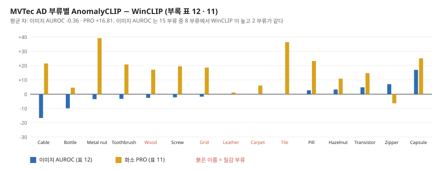

**부류로 나누면(셈 12, 그림 9).**

| AnomalyCLIP 이 다섯 비교 상대를 모두 넘은 부류 수 | 이미지 AUROC | AP | 화소 AUROC | PRO |
|---|---|---|---|---|
| MVTec AD | 4 / 15 (같음 2) | 3 / 15 (같음 2) | 10 / 15 | **14 / 15** |
| VisA | 5 / 12 | 5 / 12 | 7 / 12 | 6 / 12 |
| MPDD | 2 / 6 | 3 / 6 (같음 1) | 4 / 6 | 4 / 6 |

- **MVTec AD 이미지 AUROC 는 15 부류 중 8 부류에서 WinCLIP 이 높고 2 부류가 같다.** 부류 차의 평균은 −0.36 이다. 차가 가장 큰 자리는 Cable −16.7 · Bottle −9.9 와 Capsule +17.0 · Zipper +7.0 이다. **PRO 는 Zipper(65.3 대 71.7) 하나만 WinCLIP 이 높고 평균 차가 +16.81 이다.** 이 편의 오름은 위치 찾기 쪽에 몰려 있다.
- **이 편 부록의 WinCLIP 열은 WinCLIP 원문 보충 자료의 0 장 열과 116 값(부류와 Mean 행) 중 115 값이 같다**(셈 12b). 다른 하나는 MVTec AD Toothbrush 이미지 AUROC 88.0(이 편) 대 87.5(WinCLIP 원문)다. 그러니 MVTec AD · VisA 는 부류별 값까지 원 논문에서 옮긴 것으로 읽힌다.
- **Mean 행은 부류 평균과 ±0.07 안에서 맞는다**(72 칸 중 71 칸). 하나만 벗어난다: 표 17(VisA AP)의 WinCLIP 열은 부류 평균 81.0 · Mean 81.2 다. WinCLIP 노트에서 WinCLIP 원문 AUPR 표의 Mean 이 부류 평균보다 0.12 \~ 0.36 높던 것과 같은 자리이고, 값을 옮기며 그 어긋남도 함께 옮겨 왔다.

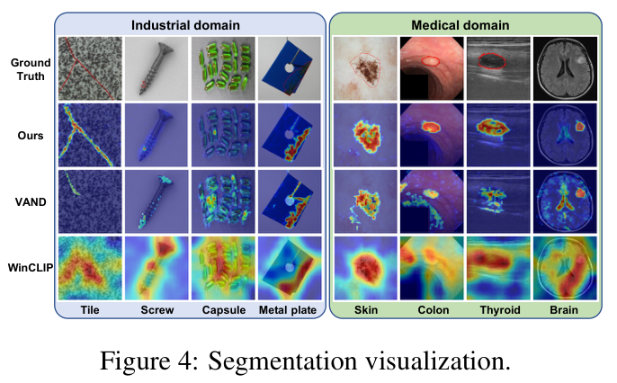

그림 4 는 산업 넷 · 의료 넷의 정성 비교다. 사례를 고른 방법은 적혀 있지 않다. 이 노트는 개별 사례를 읽지 않았다.

---

## 7. 우연 아래 — 표 1 · 2 의 비교 상대, 표 10 · 14 · 18

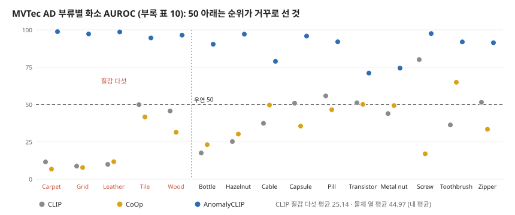

**화소 AUROC 가 50 아래인 칸(셈 4).**

| | 산업 7 개 (표 1) | 의료 분할 6 개 (표 2) | MVTec AD 15 부류 (표 10) | VisA 12 부류 (표 14) | MPDD 6 부류 (표 18) |
|---|---|---|---|---|---|
| CLIP | 6 / 7 | 6 / 6 | 10 / 15 | 6 / 12 | 1 / 6 |
| CLIP-AC | 6 / 7 | 6 / 6 | 12 / 15 | 6 / 12 | 1 / 6 |
| CoOp | 6 / 6 (DTD 빈칸) | 5 / 6 | 13 / 15 | **12 / 12** | **6 / 6** |

- **MVTec AD 의 CLIP 은 질감 다섯 평균 25.14, 물체 열 평균 44.97 이다**(내 평균). 가장 낮은 셋이 Grid 8.7 · Leather 9.9 · Carpet 11.5 이고, 뒤집으면 91.3 · 90.1 · 88.5 다. 거꾸로 정렬이 질감에서 가장 세다.
- **CoOp 은 VisA 12 부류 모두 50 아래이고 가장 낮은 것이 Chewinggum 3.4 다.** CoOp 은 배우는 프롬프트인데, 무슨 손실로 배웠는지 적혀 있지 않다(부록 A.2 는 「확률과 분할은 AnomalyCLIP 과 같은 방법으로 얻는다」 고만 적는다). 지역 손실 없이 전역으로만 배웠다면 조각 쪽 순위는 배운 적이 없는 값이다(내 해석).
- **이미지 단위에도 셋이 있다.** CLIP BTAD 34.5, VAND COVID-19 15.5, CoOp COVID-19 25.3 이다. VAND · CoOp 의 COVID-19 AP(8.5 · 9.2)는 이상 비율 14.0 보다 낮다(셈 14).
- **원문은 이 값들을 다루지 않는다.** 4.2절은 CLIP 계열이 낮은 까닭을 「물체 의미에 맞춰 배웠다」 로, CoOp 의 분할이 낮은 까닭을 「전역 특징에 맞춰 지역 의미를 무시한다」 로 적는다. 둘 다 「정렬이 없다」 의 설명이고, 50 보다 한참 낮은 「거꾸로 정렬」 의 설명은 아니다. 부록 C 의 분석(모든 출력이 같은 토큰 $v_m$ 에 지배된다)도 조각들이 서로 비슷해진다는 설명이라, 결함 조각이 정상 쪽 글에 **더 가까워지는** 방향까지는 말하지 않는다.

WinCLIP 노트에서 Patch-token 22.4(ViT-B/16+, 마지막 층)를 처음 봤다. 이 편의 비교 상대 셋은 백본이 적혀 있지 않지만, 데이터 · 입력이 다른 18 칸(산업)에서 같은 방향이 다시 나온다. **이 편이 이 현상을 고친 방법은 둘이 함께 들어간다:** DPAM(표 4 에서 MVTec AD 화소 AUROC 46.8 → 68.4)과 지역 손실로 조각 쪽 순위를 직접 배우는 것(표 5)이다. 왜 거꾸로 서는지는 남는다(19절).

---

## 8. 의료 — 표 2 · 3

**표 2 (MVTec AD 로 배운 모형).** AnomalyCLIP 이 20 칸 모두 1 위다(셈 3). 2 위와의 차가 가장 작은 칸은 ISIC 화소 AUROC +0.3(VAND 89.4)이다. 원문은 「물체 의미가 아주 다른 의료 영상에서도 가장 낫다」 고 적고, 산업보다 낮은 까닭을 「부분적으로 보조 데이터의 영향」 이라 적는다.

- **(CoOp HeadCT) 와 (CLIP Br35H) 가 (78.4, 78.8)로 통째로 같다**(셈 13). 표 1 · 2 의 짝 142 개(빈칸 둘 빼고) 가운데 통째로 같은 짝은 이것 하나다. 우연일 수도 있고 옮겨 적은 자리일 수도 있다. 원문만으로는 가를 수 없다.
- **CoOp BrainMRI 는 AUROC 61.3 · AP 44.9 다.** AP 가 이상 비율(155 / 253 = 61.3%)보다 16.4 낮은데 AUROC 는 50 위다. 순위 위쪽에 정상 이미지가 몰린 꼴이면 가능한 값이다. AUROC 값이 이상 비율과 소수 첫째 자리까지 같은 것은 우연으로 읽힌다.

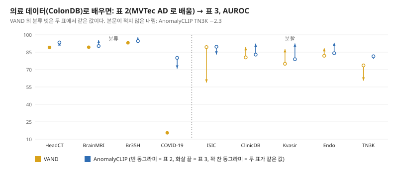

**표 3 (ColonDB 로 배운 모형) − 표 2 (셈 9).**

| | VAND (AUROC, 둘째 지표) | AnomalyCLIP |
|---|---|---|
| HeadCT · BrainMRI · Br35H | (0.0, 0.0) 셋 모두 | (+0.1, +3.5) · (+5.2, +5.0) · (+3.3, +3.3) |
| COVID-19 | (0.0, 0.0) | **(−9.2, −25.0)** |
| ISIC | **(−30.6, −46.0)** | (−6.7, −14.6) |
| CVC-ClinicDB · Kvasir · Endo | (+8.9, +21.6) · (+12.6, +3.1) · (+6.6, +27.0) | (+9.5, +15.1) · (+13.6, +15.9) · (+9.1, +21.2) |
| TN3K | **(−13.1, −21.0)** | **(−2.3, −3.4)** |

- **본문 「AnomalyCLIP 과 VAND 가 탐지와 분할 모두 크게 오른다」 는 VAND 의 탐지에서 맞지 않는다.** VAND 의 분류 넷은 두 표에서 8 값이 모두 같다. VAND 의 이미지 점수가 배우는 부분을 거치지 않는다면 같은 값이 맞다(바깥 지식이고, VAND 원문은 읽지 않았다). 그렇다면 「VAND 도 탐지가 오른다」 는 문장이 표와 어긋나고, 그렇지 않다면 표 3 의 VAND 분류 값이 표 2 에서 옮겨 온 것이다.
- **본문이 꼽은 내림은 ISIC · COVID-19 둘인데, AnomalyCLIP 의 TN3K 도 내린다**(81.5 → 79.2, PRO 50.4 → 47.0). VAND 의 TN3K 는 −13.1 이다. 본문은 「대장 용종과 피부 · 흉부의 증상이 달라서」 를 내림의 까닭으로 들고, 갑상선은 다루지 않는다.
- **「HeadCT · BrainMRI · Br35H 에서도 오른다」 의 HeadCT 는 AUROC +0.1 이다.** 반복이 없어 이 차의 순서는 매기지 않는다. 원문은 「대장 용종과 뇌종양의 시각적 닮음」 을 까닭으로 적는다. 닮음을 잰 값은 없다.
- **「배운 ColonDB 와 다른 도메인」 이라는 괄호 문장은 Endo 에서 약하다.** 배우는 데이터의 정상 163 장이 Endo 분류 데이터(EndoTect 2020)의 시험 분할이고, 표 3 의 Endo 분할 데이터도 같은 대회(Hicks 외 2021)를 인용한다. 같은 이미지가 겹치는지는 적혀 있지 않다.

---

## 9. 장치 끈 실험 — 표 4 · 5, 그림 5 · 8

**표 4 (모듈을 하나씩 쌓음, AUROC 만 옮긴다).**

| | MVTec AD 화소 | MVTec AD 이미지 | VisA 화소 | VisA 이미지 |
|---|---:|---:|---:|---:|
| Base | 46.8 | 66.3 | 47.9 | 54.4 |
| + T1 (DPAM) | 68.4 (+21.6) | 66.3 (0.0) | 54.8 (+6.9) | 54.4 (0.0) |
| + T2 (object 판 프롬프트) | 89.5 (+21.1) | 90.8 (**+24.5**) | 95.0 (**+40.2**) | 81.7 (+27.3) |
| + T3 (글 층 토큰) | 90.0 (+0.5) | 91.0 (+0.2) | 95.2 (+0.2) | 81.9 (+0.2) |
| + T4 (중간 층 여럿) | 91.1 (+1.1) | 91.5 (+0.5) | 95.5 (+0.3) | 82.1 (+0.2) |

- **Base 가 무엇인지 적혀 있지 않다.** Base 의 MVTec AD 값(46.8 · 66.3)은 표 1 의 CLIP(38.4 · 74.1) · CLIP-AC(38.2 · 71.5) 어느 쪽과도 다르다.
- **T1 이 이미지 값을 바꾸지 않는다**(4절 ⑤). DPAM 이 클래스 토큰 길을 건드리지 않는다고 읽힌다.
- **T2 한 칸이 Base → +T4 오름의 97.2%(MVTec AD 이미지) · 98.6%(VisA 이미지) · 84.5%(VisA 화소) · 47.6%(MVTec AD 화소)다**(내 셈). MVTec AD 화소에서는 T1(DPAM)이 21.6 점으로 T2 만큼 올린다. 그런데 T2 는 「배우는 프롬프트를 지역 · 전역 손실로 보조 데이터에서 배운다」 를 처음 넣는 칸이기도 하다. 원문은 「object 판 프롬프트를 넣어 크게 오른다」 로 읽는다.
- 끝 줄이 표 1 과 같다. 쌓는 순서는 하나뿐이라 각 몫은 「앞 단계 위에 더한 값」 이다.

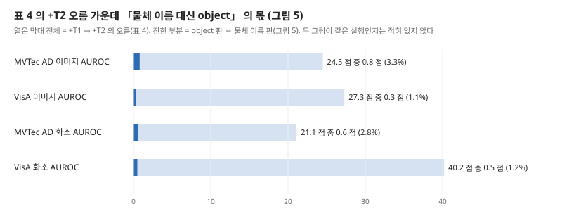

**그림 5 (object 판 − 물체 이름 판, 셈 5).**

| | 이미지 AUROC | AP | 화소 AUROC | AUPRO |
|---|---:|---:|---:|---:|
| MVTec AD | 0.8 | 0.0 | 0.6 | 1.0 |
| VisA | 0.3 | 0.5 | 0.5 | 0.2 |
| MPDD | **4.4** | **3.3** | 0.8 | 0.9 |
| BTAD | 0.3 | 0.3 | 0.1 | 1.8 |
| SDD | 0.8 | 0.0 | 0.4 | 0.9 |
| DAGM | 0.5 | 0.3 | 0.7 | 0.3 |
| DTD-Synthetic | 0.1 | 0.0 | 0.0 | 0.6 |

- **28 값이 0.0 \~ 4.4 이고 평균 0.73 이다.** 0.5 아래가 13 개, 1.0 을 넘는 것은 MPDD 둘과 BTAD AUPRO 하나다. 음수는 없다. 원문 「훨씬 낫거나 비슷하다(much better than, or on par with)」 의 「훨씬」 은 MPDD 이미지 두 칸에만 맞는다.
- **표 4 의 T2 오름과 맞대면 object 의 몫은 1.1 \~ 3.3% 다**(MVTec AD 이미지 0.8 / 24.5, VisA 이미지 0.3 / 27.3, MVTec AD 화소 0.6 / 21.1, VisA 화소 0.5 / 40.2). 두 그림이 같은 실행에서 나왔는지는 적혀 있지 않다. 그래도 두 값의 자릿수가 다르다. **이 편의 오름은 「물체 이름을 뺐다」 보다 「보조 데이터로 프롬프트와 조각 지도를 배웠다」 에서 나온다고 읽는다**(내 판단). 제목 · 초록 · 기여 첫째가 앞쪽을 핵심으로 적는다.
- 물체 이름 판이 MVTec AD 이미지 AUROC 90.7(91.5 − 0.8, 내 뺄셈)이니, 같은 손실 · DPAM 을 쓴 물체 이름 판도 표 1 의 WinCLIP(91.8)과 CoOp(88.8) 사이에 선다.

**그림 8 (object 판으로 배우고 시험 때만 물체 이름을 넣은 판, AnomalyCLIP_re).** MVTec AD 이미지 AUROC 91.5 → 89.1(−2.4), AP 96.2 → 94.5, 화소 AUROC 91.1 → 90.5, AUPRO 81.4 → 80.6. VisA 는 −0.1 \~ −0.5 다. 원문은 「물체 의미를 넣어도 잘 되니, 배운 것은 물체와 상관없는 이상 무늬다」 와 「줄어든 것은 군더더기 물체 의미 때문이다」 를 함께 적는다. **물체 이름 판으로 배운 판(MVTec AD 90.7, 그림 5 에서 뺀 값)이 시험 때만 이름을 넣은 판(89.1)보다 높다.** 배울 때와 시험 때의 글이 다른 것이 내린 몫이 섞여 있다(내 해석). 그림 8 의 막대는 0 에서 시작하지 않아 눈으로 보는 차가 값의 차보다 크다.

**표 5 (지역 · 전역 손실, 셈 6).**

| 지역 | 전역 | MVTec AD 화소 (AUROC, PRO) | MVTec AD 이미지 (AUROC, AP) | VisA 화소 | VisA 이미지 |
|---|---|---|---|---|---|
| 끔 | 끔 | 71.7, 57.7 | 68.8, 85.8 | 74.7, 62.1 | 61.1, 69.1 |
| 끔 | 켬 | 80.3, 77.8 | 89.9, 95.4 | 86.6, 78.1 | **82.2**, 84.9 |
| 켬 | 끔 | 91.0, 80.4 | 89.9, 96.0 | 95.2, 86.5 | 79.5, 83.2 |
| 켬 | 켬 | 91.1, 81.4 | 91.5, 96.2 | 95.5, 87.0 | 82.1, 85.4 |

- **전역만 배우면 화소가 내린다**(MVTec AD −10.8 · −3.6, VisA −8.9 · −8.9). 지역만 배우면 이미지가 내린다(MVTec AD AUROC −1.6, VisA −2.6). 원문 문장과 맞는다.
- **「전역 손실이 이미지 단위 탐지를 더 정확하게 한다」 는 MVTec AD 에서 갈리지 않는다.** 전역만 · 지역만 모두 이미지 AUROC 89.9 다. VisA 에서는 전역만(82.2)이 둘 다(82.1)보다 0.1 높다. 원문은 「generally」 로 적었다.
- **「둘 다 끈」 줄이 무엇인지 적혀 있지 않다.** 손실이 없으면 배우지 않은 것인데, 그 값(MVTec AD 화소 71.7 · 57.7)이 표 4 의 Base(46.8 · 15.4)보다 높다. DPAM · 중간 층을 넣고 배우지 않은 프롬프트로 읽힌다(내 추측).

---

## 10. DPAM 셋 — 그림 6

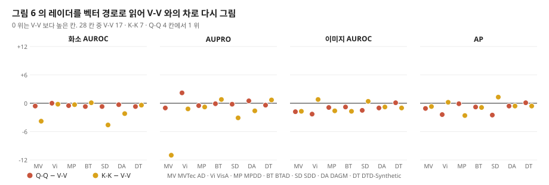

**원문 그림 6 은 숫자 없는 레이더 넷이다.** 벡터 경로로 읽은 값(5절)으로 다시 셌다(셈 7).

- **28 칸 중 V-V 17 · K-K 7 · Q-Q 4 칸에서 1 위다.** K-K 는 VisA 이미지 AUROC 82.9(V-V 82.1) · SDD 이미지 85.1(84.7) · BTAD 화소 94.3(94.2)에서, Q-Q 는 VisA PRO 89.2(87.0) · DAGM PRO 91.5(91.0)에서 앞선다.
- **원문의 두 문장은 평균으로 맞다.** 「Q-Q 는 분할은 비슷하고 이미지 단위가 내린다」 는 Q-Q − V-V 평균이 화소 AUROC −0.50 · PRO +0.07 · 이미지 AUROC −1.17 · AP −1.06 이다. 「K-K 는 분류는 잘 되고 분할이 덜하다」 는 K-K − V-V 평균이 이미지 AUROC −0.80 · PRO −2.31 이고, MVTec AD PRO 가 −11.0 으로 28 칸 가운데 가장 많이 내린다.
- **V-V 가 MVTec AD 네 지표에서 모두 1 위다.** 그런데 MVTec AD 의 값은 VisA 로 배운 모형의 시험 값이다. 기본값을 무엇으로 골랐는지는 적혀 있지 않다.
- 레이더의 가운데가 75 라 75 아래 값은 그릴 수 없다. 이미지 AUROC 의 MPDD(75.4 \~ 77.0)가 가운데에서 0.4 \~ 2.0 떨어진 자리다.

---

## 11. 하이퍼파라미터 · 프롬프트 낱말 — 그림 7, 표 8 · 9

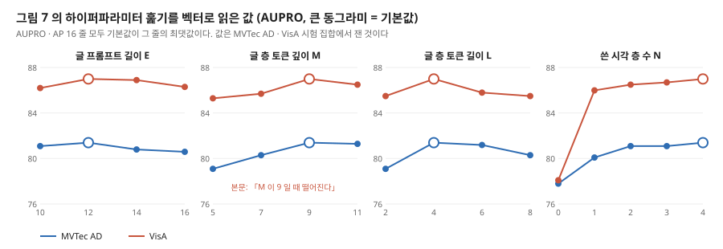

**그림 7 (셈 8, 벡터로 읽은 값, AUPRO).**

| 훑은 것 | 값 | MVTec AD | VisA |
|---|---|---|---|
| 프롬프트 길이 E | 10 · **12** · 14 · 16 | 81.1 · **81.4** · 80.8 · 80.6 | 86.2 · **87.0** · 86.9 · 86.3 |
| 글 층 토큰 깊이 M | 5 · 7 · **9** · 11 | 79.1 · 80.3 · **81.4** · 81.3 | 85.3 · 85.7 · **87.0** · 86.5 |
| 글 층 토큰 길이 L | 2 · **4** · 6 · 8 | 79.1 · **81.4** · 81.2 · 80.3 | 85.5 · **87.0** · 85.8 · 85.5 |
| 시각 층 수 N | 0 · 1 · 2 · 3 · **4** | 77.8 · 80.1 · 81.1 · 81.1 · **81.4** | 78.1 · 86.0 · 86.5 · 86.7 · **87.0** |

- **AUPRO · AP 16 줄 모두에서 기본값(굵게)이 그 줄의 최댓값이다.** 두 데이터셋은 이 편이 결과를 보고하는 시험 집합이다. 「제로샷」 결과의 MVTec AD · VisA 두 칸은 그 값을 보며 고른 설정의 값으로 읽힌다. 나머지 15 개 데이터셋에서 훑은 값은 없다.
- **본문 「깊이가 지나치면 일반화를 해치고, M 이 9 일 때 그렇다」 는 그림과 어긋난다.** 그림에서 M = 9 가 두 데이터셋 모두 꼭짓점이고 떨어지는 곳은 11(MVTec AD −0.1, VisA −0.5)이다. 기본값도 9 다.
- **같은 문단의 그림 번호 · 기호가 섞여 있다.** E 를 다루며 「Fig. 7b」 라 적고(그림은 7a), L 을 「length of learnable token embeddings M」 이라 적는다. 기호 M 은 이 편에서 넷을 가리킨다: 중간 층 집합의 크기($M = \lvert \mathcal{M} \rvert$, 3.3절), 글 층 토큰 깊이(그림 7b), 부록 A.1 의 프롬프트 길이(「learnable text prompts M is set to 12」, 본문은 E), 식 3 의 $M'$ 이다. 그리고 그림 7 의 N 이 3.3절의 $M$ 이다.
- **N = 0 이 무엇인지 적혀 있지 않다.** 중간 층을 하나도 안 쓰면 조각 지도가 없어야 하는데 AUPRO 77.8 · 78.1 이 있다.
- 폭: E 를 바꾸면 AUPRO 가 0.8 점, M · L 을 바꾸면 1.5 \~ 2.3 점, N 을 바꾸면 VisA 에서 8.9 점 움직인다. 반복이 없어 E 쪽 0.8 점 안의 순서는 매기지 않는다.

**표 8 · 9 (「damaged」 를 다른 넷으로, 셈 11).** 원문은 「결과가 안정적이라 이상 낱말에 민감하지 않다」 고 적는다.

- **표 8 의 28 칸에서 기본 낱말 damaged 가 최댓값(같은 값 포함)인 칸이 15 칸이다.** VisA 이미지 AUROC 는 damaged 82.1, 나머지 넷 80.7 \~ 80.9 이고 BTAD 는 88.3 대 84.8 \~ 85.9, SDD 는 84.7 대 82.3 \~ 82.8 이다. 표 1 의 값은 이 다섯 가운데 높은 쪽에 서 있다.
- **BTAD 의 blemished AP 67.1 은 같은 행의 나머지 넷(86.2 \~ 87.4)보다 19.1 \~ 20.3 낮고, 같은 칸의 AUROC 는 85.9 로 나머지와 같은 자리다.** 옮겨 적다 생긴 값인지 실제 값인지 원문만으로는 가를 수 없다. 이 칸을 빼면 표 8 의 칸별 폭은 0.0 \~ 3.7 이다.
- **표 9(의료)에서 damaged 가 최댓값인 칸은 20 칸 중 6 칸이다.** COVID-19 는 blemished 가 82.1 · 61.4 로 damaged(80.1 · 58.7)보다 높다. BrainMRI 는 반대로 damaged 가 2.6 높다. 의료 쪽 칸별 폭은 2.9 안이다.

---

## 12. 전체 학습 방법과 — 표 7

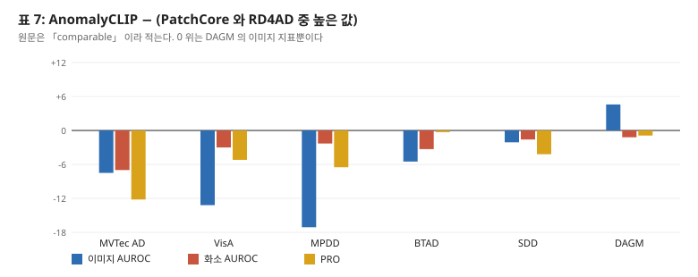

PatchCore · RD4AD 는 대상 데이터셋의 정상 학습 이미지를 모두 쓴다. 정상 학습 이미지가 없는 데이터셋을 빼 여섯에서 쟀다(DTD-Synthetic 이 빠진다).

| | 이미지 AUROC 차 | 화소 PRO 차 |
|---|---:|---:|
| MVTec AD | −7.5 | −12.2 |
| VisA | −13.2 | −5.2 |
| MPDD | **−17.1** | −6.5 |
| BTAD | −5.5 | −0.3 |
| SDD | −2.1 | −4.2 |
| DAGM | **+4.6** | −0.9 |

AnomalyCLIP − (PatchCore 와 RD4AD 중 높은 값), 내 뺄셈(셈 10).

- **원문은 「비슷한(comparable) 성능이고 몇 데이터셋에서는 넘는다」 고 적는다.** 두 방법을 모두 넘는 칸은 24 칸 중 DAGM 이미지 두 칸(AUROC +4.6, AP +11.0)이다. PatchCore 하나만 보면 24 칸 중 8 칸에서 넘는데, 그 가운데 넷이 PatchCore 가 SDD 에서 64.9 · 48.3 · 87.9 · 46.3 인 자리다.
- **「학습 데이터가 정하는 성능 경계를 넘을 수 있다」 는 문장이 표보다 세다.** 이미지 AUROC 는 여섯 중 다섯에서 2.1 \~ 17.1 점 뒤진다.
- PatchCore · RD4AD 의 설정(백본 · 입력 · 코어셋 비율)과 값의 출처(다시 돌렸나, 옮겼나)가 적혀 있지 않다. MVTec AD 99.0 은 PatchCore 노트의 PatchCore-25%(WRN-50-2) 99.1 과 0.1 다르다.

---

## 13. 실험 분석 — 표 · 그림마다

| 표 · 그림 | 무엇을 바꿨나 | 무엇을 고정했나 | 결과 | 반복 · 흩어짐 | 주장이 결과보다 센가 |
|---|---|---|---|---|---|
| 표 1 | 방법 여섯 | 데이터 7 개. 백본은 방법마다 다르고 적혀 있지 않은 칸이 있다 | 26 / 28 칸 1 위, MVTec AD 이미지는 WinCLIP 이 0.3 앞섬 | 없음 | 「대부분」 은 맞다. 부류로 세면 MVTec AD 이미지 AUROC 4 / 15 부류 |
| 표 2 | 방법 여섯 | 의료 10 개, MVTec AD 로 배움 | 20 / 20 칸 1 위 | 없음 | 맞다. (78.4, 78.8) 짝이 두 칸에 |
| 표 3 | 배우는 데이터(MVTec AD → ColonDB) | 방법 둘 | 대장 셋 +6.6 \~ +13.6, ISIC · COVID-19 · TN3K 내림 | 없음 | VAND 분류는 그대로인데 「둘 다 탐지가 오른다」, TN3K 내림을 적지 않음 |
| 표 4 | 모듈을 하나씩 쌓음 | MVTec AD · VisA | T2 가 +21.1 \~ +40.2 | 없음 | 쌓는 순서 하나. T2 가 「배우기」 와 「object」 를 함께 넣는다 |
| 표 5 | 손실 둘의 유무 | MVTec AD · VisA | 전역만이면 화소 −8.9 \~ −10.8 | 없음 | 「전역이 이미지를 정확하게」 는 MVTec AD 에서 갈리지 않음 |
| 그림 5 | object 대 물체 이름 | 데이터 7 개 | 0.0 \~ 4.4, 평균 0.73 | 없음 | 「훨씬 낫다」 는 MPDD 두 칸. T2 오름의 1.1 \~ 3.3% |
| 그림 6 | 주의 셋 | 데이터 7 개 | V-V 17 / 28 칸 1 위 | 없음 | 평균으로 맞다. 숫자 없는 레이더라 벡터로 읽음 |
| 그림 7 | 하이퍼파라미터 넷 | MVTec AD · VisA (시험 값) | 16 줄 모두 기본값이 최댓값 | 없음 | 「M = 9 에서 떨어진다」 는 그림과 어긋남 |
| 그림 8 | 시험 때 물체 이름 | MVTec AD · VisA | −0.1 \~ −2.4 | 없음 | 「배운 것은 이상 무늬다」 는 이 차로 가려지지 않음 |
| 표 7 | 제로샷 대 전체 학습 | 데이터 6 개 | 24 칸 중 2 칸에서 둘 다 넘음 | 없음 | 「comparable」 · 「경계를 넘는다」 가 표보다 세다 |
| 표 8 · 9 | 이상 낱말 다섯 | 데이터 17 개 | damaged 가 최댓값 15 / 28 · 6 / 20 칸 | 없음 | 「안정적」 은 칸별 폭 3.7 안(BTAD AP 67.1 하나 빼고)에서 맞다 |
| 표 10 \~ 21 | 부류 | 표 1 과 같음 | PRO 는 MVTec AD 14 / 15 부류 1 위 | 없음 | WinCLIP 열은 원 논문 값을 옮겼다(116 중 115 같음) |

---

## 14. 이 논문이 스스로 적은 한계

**한계 절이 없다.** 결론(6절)에도 한계 문장이 없다. 본문에서 한계로 읽히는 문장은 넷이다.

1. **의료 영상에서는 산업보다 낮다**(4.2절). 「부분적으로 보조 데이터의 영향」 이라 적고, 의료 데이터로 배운 표 3 으로 답한다. 그 표에서 피부 · 흉부는 내렸다.
2. **이미지 단위 정답과 화소 마스크를 함께 가진 공개 2D 의료 데이터셋을 찾지 못했다**(4.2절, 부록 B). 그래서 두 데이터셋을 합쳐 543 장을 만들었다.
3. **글 공간을 지나치게 다듬으면 일반화를 해친다**(부록 D). 깊이 · 길이에 「일반화와 다듬기의 맞바꿈」 이 있다고 적는다.
4. **Q-Q · K-K 는 원래 주의 지도의 성분이라, 클래스 인식에 중요한 다른 토큰과도 큰 점수를 내 방해가 남는다**(부록 C). V-V 를 고른 까닭으로 적는다.

---

## 15. 원문 안의 어긋남 모음

| 자리 | 원문 | 맞대 보니 | 내 판단 |
|---|---|---|---|
| 부록 D 문단 | 「the performance drops ... as seen in the case when M equals 9」 | 그림 7b 에서 9 가 꼭짓점, 11 에서 내림. 기본값도 9 | 11 의 오기로 읽힌다 |
| 부록 D 문단 | 「As shown in Fig. 7b, ... the value of E」 | E 는 그림 7a | 그림 번호 오기 |
| 부록 D 문단 · A.1 | 「length of learnable token embeddings M」, 「learnable text prompts M is set to 12」 | 그림 7c 는 L, 4.1절은 E = 12 | 기호 M 이 네 뜻으로 쓰인다(11절) |
| 4.2절 · 표 3 | 「AnomalyCLIP and VAND largely improve their detection and segmentation」 | VAND 분류 8 값이 표 2 와 같다 | VAND 탐지에서 맞지 않는다 |
| 4.2절 · 표 3 | 내림은 「ISIC and COVID-19」 | AnomalyCLIP TN3K 81.5 → 79.2 | 셋째 내림을 적지 않았다 |
| 3.3절 · 그림 2 | 「replace the original Q-K attention」 | 그림 2 는 DPAM 줄과 원래 줄이 나란하고, 표 4 의 T1 이 이미지 값을 바꾸지 않는다 | 바꾸는 것이 아니라 조각 쪽 길을 따로 두는 것으로 읽힌다 |
| 그림 2 · 식 2 | 그림에 지도의 Maximum(M) → $L_{\text{global}}$ 화살표 | 식 2 와 추론 문단에는 지도 최댓값이 없다 | 그림과 글 중 어느 쪽이 실제 계산인지 가를 수 없다 |
| 부록 E | AnomalyCLIP 은 CLIP 과 견주어 「there is a significant overlap between the scores」 | 같은 문단의 결론은 「significant improvement」 | 「겹침이 적다」 의 오기로 읽힌다 |
| 식 1 | 분모 「exp(<gc, fi>)/τ)」 | 여는 괄호 하나에 닫는 괄호 둘 | 괄호 오기 |
| 그림 1 캡션 · 1절 | CoOp 을 「Zhou et al., 2022a」 로 인용 | 참고 문헌의 2022a 는 CoCoOp, CoOp 은 2022b(4.1절은 2022b) | 인용 오기 |
| 참고 문헌 | Li 외 2023b (CLIP Surgery) | 본문 인용 표지가 글자 층에서 나오지 않았다 | 목록에만 있다 |
| 표 8 | BTAD blemished 「(85.9, 67.1)」, MPDD blemished 「(78.6. 84.1)」 | AP 67.1 이 같은 행 나머지보다 19.1 \~ 20.3 낮음, 쉼표 자리에 마침표 | 앞은 판단을 미룬다, 뒤는 글자 오기 |
| 표 2 | CoOp HeadCT · CLIP Br35H 가 모두 (78.4, 78.8) | 표 1 · 2 에서 통째로 같은 유일한 짝 | 판단을 미룬다 |
| 3.3절 | 「unsampling」 | upsampling | 낱말 오기 |
| 여러 자리 | 「AomalyCLIP」 · 「Anomlay-CLIP」 · 「AnomlayCLIP」 · 「Hyparameter」 · 「visial」 · 「Peformance」 · 「Brian」 · 「Utralsound」 · 「capusle」 · 「pip fryum」 | — | 글 오기 |
| 그림 24 · 33 캡션 | 「Similarity scores for the data subset ...」 | 같은 꼴의 다른 캡션은 「Anomaly score maps」 | 캡션 오기로 읽힌다 |

---

## 16. 논문이 적지 않은 것 — 내가 읽으며 짚은 자리

1. **「제로샷」 결과의 설정을 대상 데이터셋의 시험 값으로 골랐다.** 그림 7 의 16 줄이 모두 MVTec AD · VisA 시험 값의 최댓값에 서 있고, 표 8 의 낱말도 15 / 28 칸에서 최댓값이다. 보조 데이터가 대상과 달라도, 설정을 고른 데이터는 대상 둘이다. CLIP 노트 15절 · WinCLIP 노트 16절의 같은 물음(프롬프트 · 설계를 고른 데이터)이 이어진다.
2. **배우는 방법인데 반복이 없다.** 46,080 개(내 셈)를 1,725 장으로 15 에폭 배우는 값이고 초기값이 무작위다. 표 1 에서 2 위와의 차가 0.2 \~ 0.4 인 칸이 셋이다.
3. **제목의 장치가 낸 몫이 작다는 것을 원문이 같은 자리에 놓지 않는다.** 표 4 와 그림 5 를 맞대면 1.1 \~ 3.3% 다(9절). 「배우는 프롬프트 + 지역 손실 + DPAM」 이 오름의 대부분이라면, 물체 이름 판으로 같은 손실을 쓴 판(MVTec AD 90.7)이 이 편의 실질적 비교 기준이다.
4. **보조 데이터와 대상 데이터의 겹침을 재지 않는다.** MVTec AD 의 Capsule · Screw · Metal nut 과 VisA 의 Capsules, MPDD 의 Metal plate 처럼 물체 종류가 닮은 짝이 있다. 그림 1 은 이 닮음을 근거로 쓰는데, 닮은 짝과 안 닮은 짝의 성능을 갈라 본 줄이 없다.
5. **비교 상대의 설정이 반쯤 비어 있다.** CLIP · CLIP-AC · CoOp 의 백본 · 입력, CoOp 의 손실, 다시 돌린 WinCLIP 의 백본이 적혀 있지 않다. WinCLIP · VAND 의 MVTec AD · VisA 는 원 논문 값이라 WinCLIP 은 백본 · 입력이 이 편과 다르다(ViT-B/16+ · 240).
6. **효율 주장에 잰 값이 없다.** 「순전파 한 번」 은 WinCLIP(이미지당 389.4 ms, WinCLIP 노트)의 창 순전파보다 횟수가 적다. 그러나 입력이 518 · 백본이 ViT-L/14 라 조각 1,369 개를 24 층에 넣는다(WinCLIP 은 225 개, 12 층). 잰 시간이 없어 순서는 매기지 않는다.
7. **비교 상대의 「거꾸로 정렬」 을 다루지 않는다**(7절).
8. **사전학습 데이터와 시험 데이터의 겹침을 재지 않는다.** 백본이 OpenAI 의 ViT-L/14@336px 라면(OpenCLIP 의 이 모형은 OpenAI 무게뿐이라는 것은 바깥 지식이다) CLIP 원문의 겹침 검사는 산업 · 의료 데이터셋을 다루지 않았다(CLIP 노트 20절).

---

## 17. 앞 노트와 맞춰 보기

**CLIP 노트.** 식 1 은 CLIP 의 0 장 분류 식이고, 백본은 CLIP 원문이 「CLIP」 이라 부르는 ViT-L/14@336px 다. CLIP 노트 19절의 경고 둘 가운데 (가) 질감 · 의료가 약하다는 것은 이 편의 비교 상대 CLIP 에서 그대로 나온다: MVTec AD 질감 다섯의 화소 AUROC 평균 25.14, 의료 분할 여섯 모두 50 아래(7절). 배운 뒤에는 질감 부류 화소 AUROC 가 Carpet 98.8 · Grid 97.3 · Leather 98.6 · Tile 94.6 · Wood 96.5 다(표 10). CLIP 노트의 「제로샷의 범위를 확인한다」 는 여기서 「대상 데이터셋 이미지로 배우지 않는다」 이고, 다른 데이터셋의 마스크로는 배운다(1절).

**WinCLIP 노트.** 비교 상대로 들어온다. 이 편은 WinCLIP 의 손 프롬프트 242 문장 대신 배우는 두 프롬프트를, 창으로 가린 순전파 대신 중간 층 조각 토큰 + DPAM 을 쓴다. 결과는 MVTec AD 에서 이미지 AUROC 가 0.3 낮고 PRO 가 16.8 높다(6절). WinCLIP 노트가 짚은 「Patch-token 22.4 의 거꾸로 정렬」 은 이 편 비교 상대 18 칸(산업)에서 다시 나오고(7절), WinCLIP 원문 AUPR 표의 Mean 어긋남은 이 편 표 17 로 옮겨 왔다(6절).

**PatchCore · RD 노트.** 표 7 의 비교 상대다. PatchCore 노트의 PatchCore-25%(WRN-50-2) 99.1 과 이 편의 99.0 이 0.1 다르고, 이 편은 설정을 적지 않는다.

**ViT 노트.** 입력 518 에서 조각 1,369 개로 도는 것은 ViT 가 조각 수가 바뀌어도 돌기 때문이고, 자리 임베딩을 늘리는 방법이 필요하다(ViT 노트 8절, 원문은 미세조정 때 자리 임베딩을 2 차원 보간한다). 이 편은 그 방법을 적지 않는다.

**손실의 인용.** 지역 손실의 Dice 는 분할에서 겹침을 직접 맞추는 손실이다. 이 편은 Dice 를 Li 외 2019(자연어 처리의 불균형 데이터)로, Focal 을 Lin 외 2017(검출)로 인용한다. RULES 5(원리는 원 출처)의 눈으로 보면 Dice 의 인용이 분할 쪽 출처가 아니다. 분할 쪽 원 출처가 무엇인지는 이 노트에서 확인하지 않았다.

**EfficientAD · SimpleNet 노트.** 그 편들에서 짚은 「시험 값으로 설정 고르기」 가 여기서도 16절 1 로 나온다. 이 큰 틀 세 편(CLIP · WinCLIP · AnomalyCLIP) 모두에서 같은 물음이 나왔다.

---

## 18. 내가 가져갈 것

**하나. 제목의 장치와 오름의 출처를 따로 센다.** 이 편의 제목은 object 이고 오름의 1.1 \~ 3.3% 를 낸다. 끈 실험 표에서 한 칸이 장치 둘 이상을 함께 넣으면, 그 칸의 오름을 제목 장치의 몫으로 읽지 않는다. 다른 그림(여기서는 그림 5)에서 그 장치만 뺀 값을 찾아 맞댄다.

**둘. 숫자 없는 그림은 벡터 경로로 읽는다.** 그림 6 의 레이더는 눈으로는 순서도 가리기 어렵다. 다각형 꼭짓점 반지름을 틀 반지름으로 나눴더니 V-V 28 값이 표 1 과 모두 같았고, K-K 가 7 칸에서 앞선다는 것이 나왔다. 그림 7 도 같은 방법으로 「M = 9」 문장의 어긋남을 찾았다. 300 dpi 눈금 읽기보다 오차가 작고(0.01), 같은 값이 표에 있으면 읽기를 확인할 수 있다.

**셋. 설정 훑기 그림은 「기본값이 최댓값인가」 부터 센다.** 16 줄 모두 그랬다. 훑은 데이터가 결과를 보고하는 시험 집합이면, 그 결과는 시험 값으로 고른 설정의 값이다.

**넷. 우연 아래 값은 큰 틀을 가로질러 모은다.** WinCLIP 의 22.4 · 34.2, 이 편 비교 상대의 산업 18 칸 · 의료 17 칸이 모두 같은 방향이다. 한 편에서는 「정렬 없음」 으로 넘어가는 값이 세 편을 모으면 CLIP 조각 공간의 성질로 보인다.

**다섯. 지금 확인된 것은 여기까지다.** 논문이 잰 것은 산업 7 개 · 의료 10 개의 제로샷 값(한 번 값), 의료 데이터로 배운 판, 모듈 · 손실 · 주의 · 하이퍼파라미터 · 낱말 · object 의 끈 실험(MVTec AD · VisA 중심, 한 번 값), 전체 학습 방법과의 비교, 부류별 표다. 논문이 말만 한 것은 DPAM 이 대각선을 진하게 해 지역 의미를 지킨다는 설명, V-V 가 가장 좋은 까닭, 대장 용종과 뇌종양의 시각적 닮음, 배운 프롬프트가 「물체와 상관없는 이상 무늬」 를 담는다는 것이다. 내가 책상에서 센 것은 추론 식의 축약, 배우는 값 · 조각 · 걸음 수, 표 1 · 2 승수와 차, 우연 아래 칸, 표 4 · 그림 5 맞댐, 그림 6 · 7 벡터 읽기, 표 3 · 7 · 8 · 9 의 뺄셈, 부류별 승수 · Mean 대조, WinCLIP 원문과의 열 대조, 이상 비율이다.

---

## 19. 남는 질문

- **CLIP 조각 공간에서 결함 조각이 왜 「정상」 쪽 글에 더 가깝게 놓이나?** 세 편 모두 이 물음에 답하지 않는다. 질감에서 가장 세다(CLIP 25.14 대 물체 44.97). 조각 토큰과 글 임베딩의 코사인 분포를 정상 · 결함 화소로 갈라 본 편이 있어야 답이 나온다. CLIP Surgery(Li 외 2023b)가 이 쪽을 다루는지 본다.
- **object 판과 물체 이름 판을 같은 손실로 배웠을 때의 차는 실행 사이 흩어짐보다 큰가?** 그림 5 의 0.0 \~ 4.4 가 seed 를 바꿨을 때의 흩어짐보다 큰지 원문으로는 알 수 없다.
- **VAND 의 이미지 점수는 배우는 부분을 거치나?** 표 3 의 VAND 분류 값이 그대로인 까닭이 여기에 달려 있다. VAND 원문을 읽어야 답이 나온다.
- **보조 데이터를 바꾸면 결과가 얼마나 움직이나?** 이 편은 MVTec AD · VisA · ColonDB 세 가지로만 배웠다. 대상과 닮은 정도에 따라 성능이 어떻게 갈리는지 잰 줄이 없다.
- **그림 2 의 지도 최댓값 화살표는 실제 계산인가?** 코드에 있을 것이다. 코드는 읽지 않았다.

---

## 20. 다음에 읽을 것

**이 큰 틀(CLIP → WinCLIP → AnomalyCLIP)은 이 편으로 끝났다.** 다음 큰 틀은 아직 정하지 않았다. 아래는 이 노트 안에서 나온 후속 편이다.

| 논문 | 이 노트의 어느 자리에서 나오는가 | 무엇을 확인하고 싶은가 | 원문 참고 문헌 |
|---|---|---|---|
| **VAND** — A zero-/few-shot anomaly classification and segmentation method for CVPR 2023 VAND workshop challenge (Chen 외, arXiv 2023) | 6 · 8 · 19절 | 표 1 · 2 의 둘째 자리. 이미지 점수가 배우는 선형 투영을 거치는지, MVTec AD PRO 44.0 의 까닭 | Chen et al., 2023 |
| **CoOp** — Learning to prompt for vision-language models (Zhou 외, IJCV 2022) | 4 · 7절 | 배우는 프롬프트의 원 출처. 원 손실이 전역 교차 엔트로피뿐인지 | Zhou et al., 2022b |
| **CLIP Surgery** — CLIP surgery for better explainability with enhancement in open-vocabulary tasks (Li 외, arXiv 2023) | 4절 ⑤, 15 · 19절 | V-V 주의를 먼저 썼는가, CLIP 조각 지도가 왜 거꾸로 서는가를 다루는가 | Li et al., 2023b |
| **VPT** — Visual prompt tuning (Jia 외, ECCV 2022) · **MaPLe** — Multi-modal prompt learning (Khattak 외, CVPR 2023) | 4절 ④ | 층마다 토큰을 붙이고 버리는 방식의 원 출처 | Jia et al., 2022 · Khattak et al., 2023 |
| **DenseCLIP** — Language-guided dense prediction with context-aware prompting (Rao 외, CVPR 2022) | 5절 관련 연구 | 해독기를 붙여 조각 의미를 되살리는 다른 길 | Rao et al., 2022 |
| **ACR** — Zero-shot anomaly detection via batch normalization (Li 외, NeurIPS 2023) | 5절 관련 연구 | 대상과 가까운 보조 데이터로 배우는 다른 제로샷 정의 | Li et al., 2023a |
| **Focal loss** — Focal loss for dense object detection (Lin 외, ICCV 2017) | 4절 ③ | 지역 손실의 Focal 원 출처, $\gamma$ 의 뜻 | Lin et al., 2017 |

---

## 21. 참고 문헌

- Radford, A. 외 (2021). CLIP. ICML. — 2026-11-17 에 PMLR 게재판으로 읽었다.
- Jeong, J. 외 (2023). WinCLIP. CVPR. — 2026-11-17 에 CVF 공개판(본문 + 보충 자료)으로 읽었다.
- Roth, K. 외 (2022). PatchCore. CVPR. — 2026-11-03 에 arXiv v2 로 읽었다.
- Deng, H. & Li, X. (2022). Reverse Distillation (RD4AD). CVPR. — 2026-11-11 에 읽었다.
- Dosovitskiy, A. 외 (2020). ViT. — 2026-11-05 에 ICLR 2021 게재판으로 읽었다.
- Bergmann, P. 외 (2019). MVTec AD. CVPR. · Zou, Y. 외 (2022). VisA. ECCV. — beyond-mvtec 저장소에 노트가 있다.
- Chen, X. 외 (2023). VAND. arXiv. — **읽지 않았다.**
- Zhou, K. 외 (2022b). CoOp. IJCV. · Zhou, K. 외 (2022a). CoCoOp. CVPR. — **읽지 않았다.**
- Li, Y. 외 (2023b). CLIP Surgery. arXiv. — **읽지 않았다.**
- Jia, M. 외 (2022). VPT. ECCV. · Khattak, M. U. 외 (2023). MaPLe. CVPR. — **읽지 않았다.**
- Rao, Y. 외 (2022). DenseCLIP. CVPR. — **읽지 않았다.**
- Li, A. 외 (2023a). ACR. NeurIPS. — **읽지 않았다.**
- Lin, T.-Y. 외 (2017). Focal loss. ICCV. · Li, X. 외 (2019). Dice loss for data-imbalanced NLP tasks. — **읽지 않았다.**
- Jezek, S. 외 (2021). MPDD. · Mishra, P. 외 (2021). BTAD (VT-ADL). · Tabernik, D. 외 (2020). SDD. · Wieler & Hahn (2007). DAGM. · Aota, T. 외 (2023). DTD-Synthetic. — **읽지 않았다.** 데이터셋 출처.

---

## 22. 경로

| 무엇 | 어디 |
|---|---|
| 원문 PDF (arXiv v8, 31 쪽) | `papers/ICLR24_AnomalyCLIP_Object_Agnostic_Prompt_Learning_for_Zero_Shot_Anomaly_Detection.pdf` |
| 이 노트 | `notes/ICLR24_AnomalyCLIP_Object_Agnostic_Prompt_Learning_for_Zero_Shot_Anomaly_Detection.md` |
| 이 노트의 그림 (직접 그린 것) | `figures/ICLR24_AnomalyCLIP/fig01_prompt_designs.svg` 부터 `fig09_classwise_vs_winclip.svg` 까지 아홉 |
| 이 노트의 그림 (원문에서 잘라 낸 것) | `figures/ICLR24_AnomalyCLIP/paper_fig1_comparison.png` · `paper_fig2_overview.png` · `paper_fig3_dpam.png` · `paper_fig4_segmentation.png` |
| 표 값 · 그림 6 · 7 값 | `figures/ICLR24_AnomalyCLIP/tables_anomalyclip.json` — 표 1 \~ 5 · 7 \~ 21, 그림 6 · 7 |
| 표 값을 PDF 에서 읽는 코드 | `figures/ICLR24_AnomalyCLIP/read_tables.py` — PyMuPDF 가 필요하다. 글자 층과 벡터 경로를 읽고, 그림 6 V-V 와 표 1 의 대조를 찍는다 |
| 손으로 옮긴 값 | `figures/ICLR24_AnomalyCLIP/data_anomalyclip.py` — 그림 5 · 8 막대 글자, 표 6, 설정, CLIP 원문 보충 표 20 의 ViT-L/14-336px 줄 |
| 그림과 다시 계산한 값을 만드는 코드 | `figures/ICLR24_AnomalyCLIP/make_figures.py` — 표준 라이브러리만 쓴다. `python make_figures.py` 로 셈 1 \~ 14 를 찍고 그림 아홉을 쓴다. WinCLIP 열 대조에 `figures/CVPR23_WinCLIP/appendix_classwise.json` 을 읽는다 |
| 원문 그림을 잘라 내는 코드 | `figures/ICLR24_AnomalyCLIP/crop_paper_figures.py` — PyMuPDF 가 필요하다 |
