# WGAN — Wasserstein GAN (arXiv 판, 요약)

> **한 줄.** 생성 분포와 데이터 분포 사이를 젠슨-섀넌 발산(JS) 대신 **EM 거리(바서슈타인-1, $W$)** 로 잰다. 저차원 다양체 위의 분포처럼 받침이 겹치지 않으면 JS · KL · TV 는 생성기 파라미터 $\theta$ 에 대해 불연속이고 기울기가 0 인데, $W$ 는 연속이고 측도 0 집합 밖에서 미분된다(정리 1). $W$ 를 직접 계산할 수 없으니 칸토로비치-루빈시테인 쌍대로 바꿔 **1-립시츠 함수 하나(critic)를 배우는 문제**로 만들고, 립시츠 조건은 **critic 의 무게를 $[-0.01, 0.01]$ 상자에 자르는 것**으로 흉내 낸다(알고리즘 1). 실험은 LSUN 침실 64x64 하나이고, 학습 중 critic 이 내는 EM 추정이 표본이 나아지는 것과 함께 내려간다는 곡선 셋(그림 3)과, BN 을 뺀 생성기 · MLP 생성기에서도 표본이 나온다는 그림(그림 6 · 7)이 근거다. **표본 질을 수로 잰 값과 실행 횟수는 없다.**

> **이 노트와 앞 노트의 관계.** GAN 노트 둘(CACM 2020 개관판, NIPS 2014 원판)이 같은 자리를 이 편으로 넘겼다 — 「모델이 데이터에서 멀면 JS 가 위 끝 $\log 2$ 에 붙어 평평하다($m = 5$ 에서 97.5%). 다른 거리를 쓰면 멀리 있는 모델에 어떤 신호가 가는가.」 결과만 먼저 적으면 — **이론으로는 닫혔고**(예 1 · 정리 1 · 정리 3), **실제 학습에서는 일부만 닫혔다**(곧은 critic 을 보인 것이 1 차원 그림 하나). 그리고 원문 그림 4 에서 보통 GAN 의 JS 추정이 39.5만 번에 $\log 2$ 의 97.4 ~ 97.7% 에 있는데도 DCGAN 표본은 나아졌다 — **평평함이 학습을 막는다는 증거가 아니라 손실이 진척을 알려 주지 않는다는 증거**다(28절).

---

## Paper Metadata

| Item | Content |
|---|---|
| Title | Wasserstein GAN (arXiv 판의 제목). ICML 학회판의 제목은 **Wasserstein Generative Adversarial Networks** |
| Authors | Martin Arjovsky, Soumith Chintala, Léon Bottou |
| 소속 | Arjovsky · Bottou 는 Courant Institute of Mathematical Sciences (뉴욕대), Chintala · Bottou 는 Facebook AI Research. Bottou 는 둘 다에 적혀 있다 |
| Conference / Journal | **ICML 2017** (Proceedings of Machine Learning Research 70) 에 실렸다. **이 노트가 읽은 파일은 학회판이 아니라 arXiv:1701.07875 셋째 판(v3)** 이다. 학회판은 받지 않았고, 학회판의 쪽 번호와 수치는 이 노트에 옮기지 않는다 |
| Year | arXiv 첫 판 2017-01 (번호 1701 로 보아). 이 파일은 v3, 첫 쪽 옆 도장이 **2017-12-06**, 파일 정보의 만든 날이 2017-12-08 |
| 코드 | **본문에 적혀 있지 않다.** 32 쪽 글자 층에서 저장소 주소를 찾지 못했다 |
| Stored PDF | `papers/ICML17_WGAN_Wasserstein_GAN.pdf` (바탕화면에서 받은 이름은 `1701.07875v3.pdf`, 복사해 넣었고 바탕화면 원본은 남겼다) |
| 왜 읽었는가 | CACM 개관판 노트 9절 · 22절과 NIPS 원판 노트 8 · 11.1 · 24절이 같은 자리 — 판별기가 최적이면 생성기가 받는 기준이 $-\log 4 + 2 \cdot \text{JS}$ 이고, 모델이 멀면 JS 가 위 끝에 붙어 평평하다 — 를 다음 읽을 것 첫째로 이 편에 넘겼다 |
| 읽은 범위 | **2026-11-03 에 32 쪽을 전부 읽었다.** 곧 1 ~ 6절 · 그림 1 ~ 14 와 캡션 · 알고리즘 1 · 정리 1 ~ 4 · 따름정리 1 · 가정 1 · 부록 A ~ F (증명 포함) · 참고 문헌 25 건의 목록 |

### 저장한 파일의 상태

- **본문 16 쪽 + 참고 문헌 2 쪽(16 ~ 18) + 부록 14 쪽(19 ~ 32)** 이다. 부록 A 는 「왜 $W$ 가 약한가」, B 는 가정 1, C 는 정리 1 · 2 · 3 과 따름정리 1 의 증명, D 는 EBGAN 이 TV 를 최적화한다는 정리 4, E 는 그림 8, F 는 표본 판(그림 9 ~ 14) 이다.
- **표가 하나도 없다.** 원문의 수치는 알고리즘 1 의 기본값 넷과 그림의 눈금뿐이다.
- **글자 층이 살아 있다.** 식 · 알고리즘 · 증명의 첨자와 괄호가 글자 뽑기에서 흩어져 4 · 8 · 21 쪽을 그림으로 띄워 맞췄다.
- **그림 1 · 2 · 3 · 4 · 8 은 PDF 안에 래스터 이미지로 들어 있다**(그림 1 · 2 는 800x600, 그림 3 · 4 · 8 은 547 ~ 561 x 349 ~ 373 픽셀). 곡선 값이 본문에 없어 **이 이미지에서 축 눈금 자리를 찾고 파란 픽셀의 중앙값으로 읽었다.** 읽기 오차를 그 자리마다 적는다. 원문 곡선은 「보기 좋게 하려고 중앙값 거르개를 거친 것」 이라고 캡션이 적는다 — 거르개 창 크기는 없다.
- **그림 3 ~ 7 · 9 ~ 14 의 표본 사진**은 다시 그릴 수 없어 노트에는 원문에서 잘라 넣었다(16 · 17 · 19절).

---

## 1. 용어

이 노트에서 쓸 이름을 먼저 정한다. 논문의 원래 용어는 괄호로 함께 적는다. 앞 GAN 노트 둘과 같은 이름을 쓴다.

- **$P_r$ · $P_\theta$**: 데이터 분포(real) · 생성 분포. 원문은 생성 분포를 2절에서 $P_g$, 3절부터 $P_\theta$ 로 적는다 — **같은 것이다.** 앞 노트의 $p_\text{data}$ · $p_g$ 에 해당한다.
- **critic**: $W$ 를 재려고 배우는 함수 $f_w$. 원문의 이름을 그대로 쓴다. **판별기와 달리 출력이 확률이 아니다** — 시그모이드도 로그도 없이 실수 하나를 낸다. 작은 예시로, 그림 2 를 읽으면 critic 값이 $x = -5$ 에서 −0.276, $x = 5$ 에서 0.199 다(13절).
- **받침 (support)**: 분포가 0 이 아닌 값을 두는 자리. 작은 예시로, 예 1 의 $P_0$ 의 받침은 평면 위 세로 선분 $\{0\} \times [0, 1]$ 이다.
- **결합 (joint distribution, coupling)** $\gamma(x, y)$: 주변 분포가 각각 $P_r$ · $P_\theta$ 인 결합 분포. $\Pi(P_r, P_\theta)$ 는 그런 것 전부. 원문은 「$x$ 에서 $y$ 로 옮겨야 하는 **질량**」 으로 읽게 한다 — 그래서 **수송 계획**이라고도 부른다.
- **EM 거리 (Earth-Mover distance, Wasserstein-1)** $W$: 식 (1). 수송 계획 가운데 옮기는 거리의 기댓값이 가장 작은 것의 값. 작은 예시로, 점 0 에 질량 1 을 점 3 으로 옮기면 $W = 3$ 이다.
- **TV 거리 (total variation)** $\delta$: $\sup_A \lvert P_r(A) - P_\theta(A) \rvert$. 0 에서 1 사이. 작은 예시로, $P_r = (0.7, 0.3, 0)$, $P_\theta = (0.2, 0.3, 0.5)$ 면 $\delta = 0.5$ 다. **이 정의에서 $\sum \lvert p_r - p_\theta \rvert$ 는 $2\delta$ 다** — 원문 부록이 둘을 섞는다(21절).
- **KL · JS**: 앞 노트와 같다. **JS 는 1/2 무게가 붙은 꼴**, $\text{JS} = \frac{1}{2}\text{KL}(P_r \Vert P_m) + \frac{1}{2}\text{KL}(P_\theta \Vert P_m)$ 로 쓴다(위 끝 $\log 2 = 0.693$). 원문 2절의 정의에는 1/2 이 없다 — 5절에서 가른다.
- **립시츠 (Lipschitz)** · **$K$-립시츠**: 모든 $x, y$ 에서 $\lvert f(x) - f(y) \rvert \le K \lVert x - y \rVert$. $\lVert f \rVert_L \le K$ 로 적는다. 작은 예시로, $f(x) = -0.04x$ 는 0.04-립시츠다.
- **칸토로비치-루빈시테인 쌍대 (Kantorovich-Rubinstein duality)**: 식 (1) 의 최소화를 1-립시츠 함수에 대한 최대화(식 2)로 바꿔 적는 정리. 원문은 Villani 의 책 [22] 을 인용한다.
- **무게 자르기 (weight clipping)** $c$: critic 의 무게를 갱신마다 $[-c, c]$ 로 자른다. 기본값 $c = 0.01$.
- **$n_\text{critic}$**: 생성기 한 번에 critic 을 배우는 횟수. 기본값 5.
- **센 위상 · 약한 위상 (stronger · weaker topology)**: 거리 $\rho$ 로 수렴하는 분포 열이 $\rho'$ 로 수렴하는 열보다 많으면 $\rho$ 가 더 약하다(원문 각주 1). **약할수록 수렴하기 쉽고, 그래서 $\theta \mapsto P_\theta$ 가 연속이기 쉽다.**
- **측도 0 집합 밖에서 미분 (differentiable almost everywhere)**: 미분되지 않는 점들의 집합이 측도 0 이다. 작은 예시로, $\lvert \theta \rvert$ 는 $\theta = 0$ 한 점만 빼고 미분된다.
- **IPM (integral probability metric)**: 함수 모임 $\mathcal{F}$ 를 정하고 $\sup_{f \in \mathcal{F}} \mathbb{E}_{P_r}[f] - \mathbb{E}_{P_\theta}[f]$ 로 재는 거리. 식 (4).
- **M-GAN · NS-GAN**: 앞 노트에서 정한 이름. 생성기가 $\log(1 - D(G(z)))$ 를 내리는 원래 꼴 · $\log D(G(z))$ 를 올리는(= $-\log D$ 를 내리는) 대안. **원문은 앞의 것을 「minimax GAN」, 뒤의 것을 「$-\log D$ trick」 이라 부른다.**
- **모드 붕괴 (mode collapse, mode dropping)**: 생성기가 데이터의 일부 모양만 되풀이해 내는 실패. 원문은 1절에서 「mode dropping」, 3 · 4절에서 「mode collapse」 를 쓴다. **이 노트는 둘 다 모드 붕괴로 적는다** — 원문이 둘을 가르지 않는다.

---

## 2. 한 문단 요약

분포를 배운다는 것은 보통 밀도를 정하고 가능도를 최대화하는 것이고, 이는 $\text{KL}(P_r \Vert P_\theta)$ 를 줄이는 것과 같다. 그런데 이미지 같은 데이터가 저차원 다양체 위에 있으면 모델 다양체와 겹치는 부분이 측도 0 이라 KL 이 무한이 되므로, 모델에 넓은 잡음을 더해 덮어야 했다(1절). GAN · VAE 처럼 잡음을 함수에 통과시켜 표본을 바로 만드는 길은 이 문제를 피하지만, 그때 **어떤 거리로 두 분포를 재느냐**가 학습을 정한다. 2절은 네 거리(TV · KL · JS · EM)를 견주어, 평행선 둘(예 1)처럼 받침이 따로인 경우 EM 만 $\theta$ 에 대해 연속이라는 것을 보이고(정리 1), 수렴의 세기 순서를 KL > JS = TV > EM 으로 정리한다(정리 2). 3절은 EM 의 하한 식을 쌍대로 바꿔 립시츠 함수 $f$ 의 최대화로 만들고, 그 해의 기울기가 $W$ 의 기울기라는 것을 증명한다(정리 3). 립시츠 조건은 무게 자르기로 흉내 내며 원문 스스로 「분명히 끔찍한 방법」 이라 적는다. critic 을 최적까지 배워도 포화하지 않으므로(그림 2) 판별기와 생성기를 맞춰 갈 필요가 없고, 모드 붕괴가 「불가능해진다」 고 논증한다. 4절은 LSUN 침실에서 EM 추정이 표본 질과 함께 움직이고(그림 3), 보통 GAN 의 JS 추정은 그렇지 않으며(그림 4), BN 없는 생성기 · MLP 생성기에서도 WGAN 은 표본을 낸다(그림 6 · 7)는 것을 보인다. 5절은 IPM 이라는 틀로 EBGAN(= TV) · MMD · GMMN 과 자리를 가른다.

---

## 3. 문제 — 밀도가 없는 분포를 어떻게 배우나 (1절)

**고전적인 답.** 파라미터 가족 $(P_\theta)$ 를 정하고 데이터의 평균 로그 가능도를 최대화한다. $P_r$ 에 밀도가 있으면 이것은 점근적으로 $\text{KL}(P_r \Vert P_\theta)$ 를 줄이는 것과 같다.

**막히는 자리.** 그러려면 $P_\theta$ 에 밀도가 있어야 한다. 그런데 **저차원 다양체 위에 놓인 분포**를 다룰 때 — 원문은 「꽤 흔한 상황(rather common situation)」 이라고 적는다 — 모델 다양체와 참 분포의 받침이 측도 0 이 아닌 교집합을 가질 가능성이 낮고([1] 인용), 그러면 KL 이 정의되지 않거나 무한이다.

**흔한 처방과 그 대가.** 모델 분포에 잡음 항을 더한다. 원문의 예 — Wu 외 [23] 에서 가능도를 최대화할 때의 최적 잡음 표준편차가 **픽셀당 0.1**(원문 「around 0.1」)이다(픽셀 값이 $[0, 1]$ 일 때). 원문은 이것을 「아주 큰 잡음」 이라 부르고, 그래서 논문들이 표본을 보일 때는 가능도를 잰 그 잡음을 더하지 않는다고 적는다. 곧 **잡음은 문제에 맞지 않지만 최대가능도를 돌리려면 필요하다.**

**다른 길 — 표본을 바로 만든다.** 고정된 분포의 $Z$ 를 함수 $g_\theta$ 에 통과시켜 $P_\theta$ 를 만든다. 원문이 드는 이점 둘: (1) **저차원 다양체에 갇힌 분포도 나타낼 수 있다** (2) 표본을 쉽게 뽑는 것이 밀도 값을 아는 것보다 쓸모 있는 때가 많다(초해상, 의미 분할). VAE 와 GAN 이 이 길인데, VAE 는 가능도의 근사에 매여 잡음 항을 다뤄야 하고, GAN 은 목적 함수를 고를 폭이 넓지만 학습이 「섬세하고 불안정하다」([1] 이 이론으로 다뤘다).

**이 논문이 묻는 것.** 모델 분포와 참 분포가 얼마나 가까운지를 재는 **거리 $\rho(P_\theta, P_r)$ 를 무엇으로 정하느냐.** 기준은 하나다 — 파라미터 열 $\theta_t \to \theta$ 이면 $P_{\theta_t} \to P_\theta$ 이어야(곧 $\theta \mapsto P_\theta$ 가 연속이어야) 손실 $\theta \mapsto \rho(P_\theta, P_r)$ 이 연속이 되고, **거리가 약할수록 이것이 쉽다.**

---

## 4. 네 거리 (2절)

원문은 $\mathcal{X}$ 를 콤팩트한 거리 공간(예: 이미지 공간 $[0, 1]^d$)으로 두고 넷을 정의한다.

| 이름 | 정의 (원문) | 원문이 붙인 말 |
|---|---|---|
| TV 거리 $\delta$ | $\sup_{A} \lvert P_r(A) - P_g(A) \rvert$ | — |
| KL 발산 | $\int \log \frac{P_r(x)}{P_g(x)} P_r(x)\, d\mu(x)$ | 두 분포에 같은 측도 $\mu$ 에 대한 밀도가 있어야 한다. 비대칭이고, $P_g(x) = 0$, $P_r(x) > 0$ 인 점이 있으면 무한 |
| JS 발산 | $\text{KL}(P_r \Vert P_m) + \text{KL}(P_g \Vert P_m)$, $P_m = (P_r + P_g)/2$ | 대칭이고 늘 정의된다 — $\mu = P_m$ 으로 고를 수 있으므로. **1/2 무게가 없다** (5절에서 가른다) |
| EM 거리 $W$ | 식 (1) | 최적 수송 계획의 「비용」 |

$$W(P_r, P_g) = \inf_{\gamma \in \Pi(P_r, P_g)} \mathbb{E}_{(x, y) \sim \gamma}\left[\lVert x - y \rVert\right] \qquad (1)$$

**작은 예시(내가 고른 수).** 직선 위 점 셋 $\{0, 1, 2\}$ 에 $P_r = (0.5, 0.3, 0.2)$, $P_g = (0.2, 0.3, 0.5)$ 를 두면, 점 0 의 질량 0.3 을 점 2 로 옮기는 계획이 비용 $0.3 \times 2 = 0.6$ 이고 이것이 최소다(9절 그림에서 결합을 0.05 간격 격자로 모두 훑어 확인했다).

---

## 5. 예 1 — 평행선 둘 (2절)

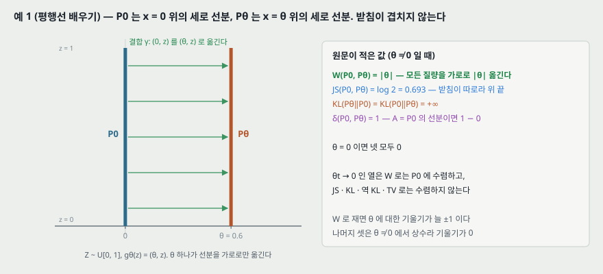

**원문 예 1.** $Z \sim U[0, 1]$. $P_0$ 은 $(0, Z) \in \mathbb{R}^2$ 의 분포 — 원점을 지나는 세로 선분 위의 균등분포. $g_\theta(z) = (\theta, z)$ 로 두면 $P_\theta$ 는 $x = \theta$ 위의 세로 선분이다. $\theta \ne 0$ 이면 두 받침이 겹치지 않는다. 원문이 적은 값:

| 거리 | $\theta \ne 0$ | $\theta = 0$ |
|---|---|---|
| $W(P_0, P_\theta)$ | $\lvert \theta \rvert$ | 0 |
| $\text{JS}(P_0, P_\theta)$ | $\log 2$ | 0 |
| $\text{KL}(P_\theta \Vert P_0) = \text{KL}(P_0 \Vert P_\theta)$ | $+\infty$ | 0 |
| $\delta(P_0, P_\theta)$ | 1 | 0 |

**그래서.** $\theta_t \to 0$ 인 열은 $W$ 로는 $P_0$ 에 수렴하지만 JS · KL · 역 KL · TV 로는 **수렴하지 않는다.** 원문: 「이 예는 EM 거리에 기울기 하강을 해서 저차원 다양체 위의 분포를 배울 수 있는 경우다. 다른 거리로는 손실 함수가 **연속조차 아니어서** 그럴 수 없다.」 받침이 따로인 예지만, 받침의 교집합이 측도 0 이면 같은 결론이 선다고 적는다 — 두 저차원 다양체가 일반적인 위치에서 만날 때가 그렇다([1]).

**내가 따라간 것 — 값 넷.** $W$: 결합 $(0, z) \mapsto (\theta, z)$ 가 모든 질량을 가로로 $\lvert \theta \rvert$ 옮기고, 어떤 결합도 가로 거리 $\lvert \theta \rvert$ 보다 덜 옮길 수 없으니 $\lvert \theta \rvert$ 다. JS: 받침이 따로라 $P_m$ 아래에서 각 분포의 밀도 비가 2 이므로 $\text{KL}(P_0 \Vert P_m) = \log 2$, 1/2 무게를 붙인 JS 는 $\log 2$. TV: $A$ 를 $P_0$ 의 선분으로 잡으면 $1 - 0 = 1$. 넷 다 원문과 같다.

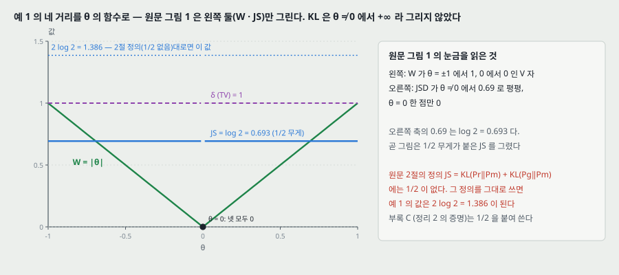

**원문 그림 1 을 읽은 것.** 왼쪽은 $W$ 가 $\theta \in [-1, 1]$ 에서 V 자(끝 1, 가운데 0), 오른쪽은 JSD 가 $\theta \ne 0$ 에서 0.69 로 평평하고 $\theta = 0$ 한 점만 0 이다. 캡션: 「EM 그림은 연속이고 어디서나 쓸 만한 기울기를 준다. JS 그림은 연속이 아니고 쓸 만한 기울기를 주지 않는다.」

> **어긋나는 자리.** 그림 1 의 0.69 는 $\log 2 = 0.693$ 이다 — 곧 **그림과 예 1 은 1/2 무게가 붙은 JS** 를 쓴다. 그런데 2절의 정의 $\text{JS} = \text{KL}(P_r \Vert P_m) + \text{KL}(P_g \Vert P_m)$ 에는 1/2 이 없다. 그 정의를 그대로 쓰면 예 1 의 값은 $2 \log 2 = 1.386$ 이 된다. 부록 C (정리 2 의 증명)와 4.2절의 「$2\,\text{JS} - 2 \log 2$ 의 하한」 은 1/2 을 붙인 꼴로 맞다. **어긋나는 것은 2절의 정의 한 줄**이다.

---

## 6. 정리 1 · 따름정리 1 — $W$ 는 $\theta$ 에 대해 연속이다 (2절, 부록 C)

**정리 1.** $P_r$ 은 $\mathcal{X}$ 위의 고정된 분포, $Z$ 는 다른 공간의 확률 변수(예: 가우스), $g: \mathcal{Z} \times \mathbb{R}^d \to \mathcal{X}$ 를 $g_\theta(z)$ 로 적고 $P_\theta$ 를 $g_\theta(Z)$ 의 분포로 두면

1. $g$ 가 $\theta$ 에 대해 연속이면 $W(P_r, P_\theta)$ 도 연속이다.
2. $g$ 가 국소 립시츠이고 **가정 1** 을 만족하면 $W(P_r, P_\theta)$ 는 어디서나 연속이고 측도 0 집합 밖에서 미분된다.
3. 1 · 2 는 JS 와 모든 KL 에 대해서는 **거짓이다.**

**가정 1 (부록 B).** $g$ 가 유한 차원 벡터 공간 사이의 국소 립시츠 함수이고, 국소 립시츠 상수 $L(\theta, z)$ 가 $\mathbb{E}_{z \sim p}[L(\theta, z)] < +\infty$ 를 만족한다.

**따름정리 1.** $g_\theta$ 가 아무 순방향 신경망이고 $\mathbb{E}_{z \sim p(z)}[\lVert z \rVert] < \infty$ (가우스 · 균등 등)이면 가정 1 이 성립하고, 그래서 $W(P_r, P_\theta)$ 는 어디서나 연속이고 측도 0 집합 밖에서 미분된다. 각주 4 가 「순방향 신경망」 을 **아핀 변환과 매끄러운 립시츠 비선형(시그모이드 · tanh · elu · softplus 등)의 합성**으로 정의하고, **ReLU 에서도 참이지만 증명이 더 기술적이라 뺐다**고 적는다.

**내가 따라간 것 — 정리 1 의 증명(부록 C).** 세 걸음이다.

1. **결합 하나로 위에서 누른다.** $(g_\theta(Z), g_{\theta'}(Z))$ 의 결합 분포는 $\Pi(P_\theta, P_{\theta'})$ 에 들어가므로 식 (1) 의 하한 정의에서 $W(P_\theta, P_{\theta'}) \le \mathbb{E}_z[\lVert g_\theta(z) - g_{\theta'}(z) \rVert]$.
2. **삼각 부등식.** $W$ 가 거리이므로 $\lvert W(P_r, P_\theta) - W(P_r, P_{\theta'}) \rvert \le W(P_\theta, P_{\theta'})$.
3. **연속 · 립시츠.** $g$ 가 연속이면 1 의 우변이 유계 수렴 정리($\mathcal{X}$ 가 콤팩트라 거리가 균등하게 유계)로 0 으로 간다. $g$ 가 국소 립시츠이면 1 의 우변이 $\lVert \theta - \theta' \rVert \cdot \mathbb{E}_z[L(\theta, z)]$ 이하이고, 가정 1 로 이 기댓값이 유한하니 $W$ 가 $\theta$ 에 대해 국소 립시츠다. 그러면 라데마허 정리로 측도 0 집합 밖에서 미분된다.

세 걸음 모두 원문 그대로 성립한다. 항목 3 의 반례는 예 1 이다. **예 1 에서 1 의 상한은 $\lvert \theta - \theta' \rvert$ 로 등호다** — $g_\theta(z) - g_{\theta'}(z) = (\theta - \theta', 0)$.

**따름정리 1 의 증명** 은 층마다 무게 행렬의 노름 곱으로 $\mathbb{E}_z[\lVert \nabla_{\theta, z} g_\theta(z) \rVert]$ 를 $C_1(\theta) + C_2(\theta)\, \mathbb{E}_z[\lVert z \rVert]$ 로 누른다. 흐름은 맞고, 첨자에 오기가 셋 있다(27절).

> **이 정리가 말하지 않는 것.** 연속 · 미분 가능은 **$W$ 의 성질**이다. 학습은 $W$ 가 아니라 critic 으로 근사한 값을 쓰고(10 · 11절), 그 근사가 같은 성질을 갖는지는 정리가 다루지 않는다. 원 GAN 노트 11.1절에서 짚은 **$\theta$ 공간의 볼록성**도 이 정리는 말하지 않는다 — 연속과 볼록은 다른 성질이다.

---

## 7. 정리 2 — 수렴의 세기 순서 (2절, 부록 C)

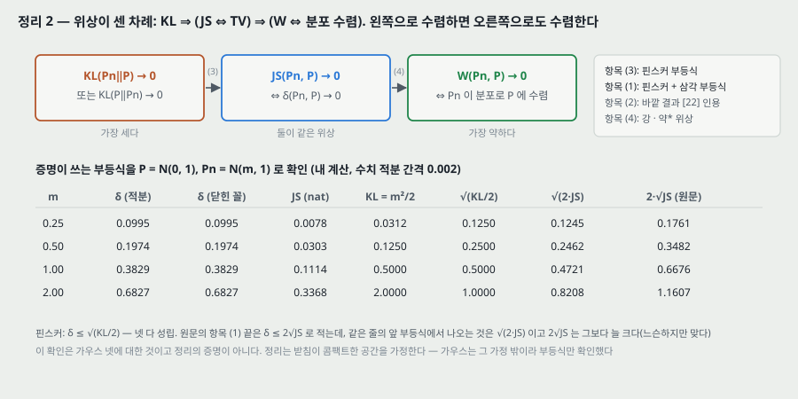

**정리 2.** 콤팩트 공간 위의 분포 $P$ 와 열 $(P_n)$ 에 대해

1. $\delta(P_n, P) \to 0$ 과 $\text{JS}(P_n, P) \to 0$ 은 **같다.**
2. $W(P_n, P) \to 0$ 과 **분포 수렴**($P_n \xrightarrow{D} P$)은 같다.
3. $\text{KL}(P_n \Vert P) \to 0$ 이나 $\text{KL}(P \Vert P_n) \to 0$ 이면 (1) 이 성립한다.
4. (1) 이면 (2) 가 성립한다.

곧 **KL 이 가장 세고, JS 와 TV 가 같은 세기, EM 이 가장 약하다.** 원문의 결론: KL · JS · TV 는 저차원 다양체 위의 분포를 배울 때 손실로 맞지 않고, EM 은 맞다.

**증명이 쓰는 것(부록 C).** (1) 의 $\Rightarrow$ 방향은 섞인 분포 $P_m$ 에 대한 라돈-니코딤 도함수가 3 으로 유계라는 것과 $\epsilon$ 논증. $\Leftarrow$ 방향은 삼각 부등식과 핀스커 부등식 $\delta \le \sqrt{\text{KL}/2}$. (2) 는 「$W$ 가 약* 위상을 거리화한다는 오래 알려진 사실」 로 Villani [22] 를 인용한다. (3) 은 핀스커 그대로. (4) 는 $\delta$ 와 $W$ 가 각각 쌍대 공간의 강 위상 · 약* 위상을 준다는 것.

**내가 따라간 것 — 부등식을 가우스 넷으로.** 위 그림 아래 표는 $P = \mathcal{N}(0, 1)$, $P_n = \mathcal{N}(m, 1)$ 에서 증명이 쓰는 부등식을 수치 적분(간격 0.002)으로 확인한 것이다.

| $m$ | $\delta$ | JS (nat) | $\sqrt{\text{KL}/2}$ | $\sqrt{2 \cdot \text{JS}}$ | $2\sqrt{\text{JS}}$ (원문) |
|---:|---:|---:|---:|---:|---:|
| 0.25 | 0.0995 | 0.0078 | 0.1250 | 0.1245 | 0.1761 |
| 0.5 | 0.1974 | 0.0303 | 0.2500 | 0.2462 | 0.3482 |
| 1 | 0.3829 | 0.1114 | 0.5000 | 0.4721 | 0.6676 |
| 2 | 0.6827 | 0.3368 | 1.0000 | 0.8208 | 1.1607 |

$\delta$ 는 닫힌 꼴 $2\Phi(m/2) - 1$ 과 넷째 자리까지 같았다. **핀스커는 넷 다 성립한다.** 원문 항목 (1) 의 끝줄은 $\delta \le 2\sqrt{\text{JS}}$ 로 적는데, 같은 줄 앞의 부등식 $\sqrt{\frac{1}{2}\text{KL}(P_n \Vert P_m)} + \sqrt{\frac{1}{2}\text{KL}(P \Vert P_m)}$ 에서 오목성으로 나오는 것은 $\sqrt{2 \cdot \text{JS}}$ 이고, $2\sqrt{\text{JS}}$ 는 그보다 늘 크다. **느슨하지만 맞다.**

> 가우스는 받침이 콤팩트하지 않아 정리의 가정 밖이다. 이 표는 부등식만 확인한 것이고 정리의 증명이 아니다.

---

## 8. 가우스로 옮겨 보기 — 앞 노트 둘이 넘긴 자리

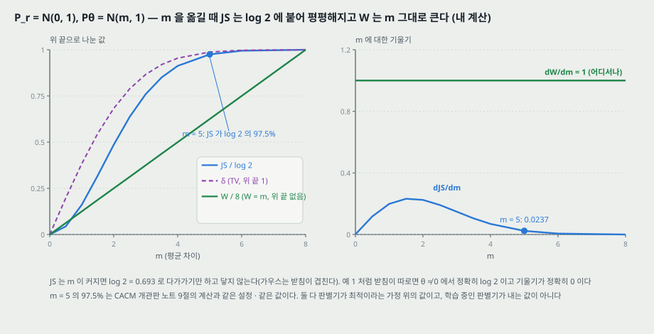

예 1 은 받침이 따로인 극단이다. 앞 노트 둘은 받침이 겹치는 가우스($P_r = \mathcal{N}(0, 1)$, $P_\theta = \mathcal{N}(m, 1)$)로 같은 자리를 쟀다. **이 그림은 그 설정에 $W$ 를 나란히 놓은 것이고 원문에 없다(내 계산).**

| $m$ | JS (nat) | JS / $\log 2$ | $d\,\text{JS}/dm$ | $W = m$ | $dW/dm$ |
|---:|---:|---:|---:|---:|---:|
| 1 | 0.1114 | 16.1% | 0.1990 | 1 | 1 |
| 2 | 0.3368 | 48.6% | 0.2248 | 2 | 1 |
| 3 | 0.5268 | 76.0% | 0.1479 | 3 | 1 |
| 4 | 0.6327 | 91.3% | 0.0686 | 4 | 1 |
| **5** | **0.6759** | **97.5%** | **0.0237** | 5 | 1 |
| 6 | 0.6893 | 99.4% | 0.0062 | 6 | 1 |
| 8 | 0.6931 | 100.0% | 0.0002 | 8 | 1 |

**읽는 법.**

- **$m = 5$ 의 97.5% 는 CACM 노트 9절의 값과 같다**(같은 설정이다). 그 자리의 JS 기울기 0.0237 은 격자에서 가장 큰 값($m = 1.5$, 0.2322)의 10.2% 이고, $m = 8$ 에서는 0.0002 다.
- **$W$ 는 $m$ 에 대해 기울기가 늘 1** 이다. 평균만 옮긴 두 분포의 $W_1$ 은 옮긴 거리 그 자체이기 때문이다. 곧 **멀리 있을수록 신호가 약해지는 일이 없다.** 원 GAN 노트 24절의 물음 — 「다른 거리를 쓰면 멀리 있는 모델에 어떤 신호가 가는가」 — 의 이론 쪽 답이 이것이다.
- **가우스에서 JS 는 $\log 2$ 에 닿지 않는다**(받침이 겹친다). 예 1 처럼 받침이 따로면 $\theta \ne 0$ 에서 정확히 $\log 2$ 이고 기울기가 정확히 0 이다. 원문이 저차원 다양체를 강조하는 까닭이 여기 있다 — **가우스에서는 「작아진다」 이고 다양체에서는 「0 이다」.**
- 이 표의 JS 는 **판별기가 최적**이라는 가정 위의 값이다. 학습 중인 판별기가 내는 값은 17절에서 원문 그림 4 로 본다.

---

## 9. 칸토로비치-루빈시테인 쌍대 — 식 (2) (3절)

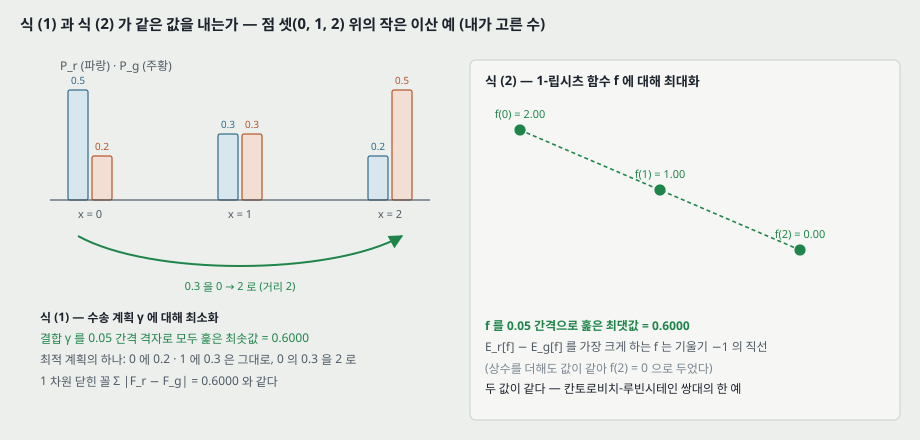

식 (1) 의 하한은 「몹시 다루기 어렵다(highly intractable)」. 쌍대로 바꾸면

$$W(P_r, P_\theta) = \sup_{\lVert f \rVert_L \le 1} \mathbb{E}_{x \sim P_r}[f(x)] - \mathbb{E}_{x \sim P_\theta}[f(x)] \qquad (2)$$

여기서 상한은 1-립시츠 함수 $f: \mathcal{X} \to \mathbb{R}$ 전부에 대해 잡는다. 원문의 덧붙임: **$\lVert f \rVert_L \le K$ 로 바꾸면 값이 $K \cdot W$ 가 된다.** 그래서 무게가 모두 $K$-립시츠인 함수 가족 $\{f_w\}$ 로 식 (2) 를 풀면 $W$ 를 **곱하는 상수만큼 틀린 채로** 얻는다.

**내가 따라간 것 — 이산 예에서 두 값이 같은가.** 위 그림은 4절의 점 셋 예다. 식 (1) 쪽은 결합 $\gamma$ (3x3, 주변 분포 고정이라 자유 변수 넷)를 0.05 간격 격자로 모두 훑었고, 식 (2) 쪽은 $f(0), f(1)$ 을 0.05 간격으로 훑고 $f(2) = 0$ 으로 두었다(상수를 더해도 값이 같다).

| 쪽 | 훑은 최적값 | 최적 해 |
|---|---:|---|
| 식 (1), 수송 계획 최소 | 0.6000 | 점 0 의 0.3 을 점 2 로, 나머지는 제자리 |
| 식 (2), 1-립시츠 $f$ 최대 | 0.6000 | $f = (2, 1, 0)$ — 기울기 −1 의 직선 |
| 1 차원 닫힌 꼴 $\sum \lvert F_r - F_g \rvert$ | 0.6000 | — |

셋이 같다. **최적 $f$ 는 질량이 남는 쪽($P_r$ 이 큰 점 0)에서 높고 모자라는 쪽에서 낮은 직선**이다. 이 모양이 13절 그림 2 의 「critic 은 곧다」 와 같은 자리다.

---

## 10. 식 (3) · 정리 3 — critic 으로 기울기를 얻는다 (3절, 부록 C)

립시츠 상수가 $K$ 이하인 함수 가족 $\{f_w\}_{w \in \mathcal{W}}$ 로

$$\max_{w \in \mathcal{W}} \mathbb{E}_{x \sim P_r}[f_w(x)] - \mathbb{E}_{z \sim p(z)}[f_w(g_\theta(z))] \qquad (3)$$

를 푼다. 원문의 조건: **식 (2) 의 상한이 어떤 $w \in \mathcal{W}$ 에서 닿는다면** — 원문 스스로 「추정량의 일치성을 증명할 때 가정하는 것과 비슷한 **꽤 센 가정**(a pretty strong assumption)」 이라 적는다 — 이 과정이 $W$ 를 곱하는 상수까지 계산한다. 그리고 $\mathbb{E}_z[\nabla_\theta f_w(g_\theta(z))]$ 로 역전파하면 $W$ 를 (상수까지) 미분하는 셈이다.

**정리 3.** $P_r$ 은 아무 분포, $P_\theta$ 는 밀도 $p$ 를 갖는 $Z$ 에 대해 $g_\theta(Z)$ 의 분포이고 $g_\theta$ 가 가정 1 을 만족하면, $\max_{\lVert f \rVert_L \le 1} \mathbb{E}_{P_r}[f] - \mathbb{E}_{P_\theta}[f]$ 의 해 $f$ 가 있고

$$\nabla_\theta W(P_r, P_\theta) = -\mathbb{E}_{z \sim p(z)}\left[\nabla_\theta f(g_\theta(z))\right] \qquad (\text{정리 3})$$

이다(두 항이 잘 정의될 때).

**내가 따라간 것 — 증명의 순서(부록 C).** (가) $\mathcal{X}$ 가 콤팩트라 쌍대의 상한이 어떤 $f$ 에서 닿는다(Villani 인용). (나) **포락 정리**(Milgrom · Segal [12] 정리 1)로 $\nabla_\theta W = \nabla_\theta V(f, \theta)$, 여기서 $V(f, \theta) = \mathbb{E}_{P_r}[f] - \mathbb{E}_z[f(g_\theta(z))]$. 첫 항은 $\theta$ 와 무관하니 $-\nabla_\theta \mathbb{E}_z[f(g_\theta(z))]$. (다) 나머지는 미분과 기댓값을 바꾸는 것 — $f \circ g$ 가 국소 립시츠라 라데마허 · 푸비니로 측도 0 밖에서 미분되고, 차분 몫이 $2L(\theta_0, z)$ 로 눌리니 가정 1 과 지배 수렴으로 바꿀 수 있다. **단계의 순서와 쓰인 정리는 따라갔고, (다) 의 측도론 세부는 하나하나 검산하지 않았다.**

> **정리 3 과 실제 학습 사이의 간격 셋.** (1) 정리는 **최적 $f$** 에 대한 것이다. 학습은 $n_\text{critic} = 5$ 걸음 뒤의 $f_w$ 를 쓴다. (2) 정리의 $f$ 는 **1-립시츠 함수 전부** 가운데서 고른다. 학습의 $f_w$ 는 무게를 자른 신경망 가족 안에서 고르고, 그 가족의 상한이 $K \cdot W$ 와 같다는 것이 위의 「센 가정」 이다. (3) 그래서 학습이 쓰는 기울기가 $\nabla_\theta W$ 와 얼마나 가까운지는 **원문 어디에서도 재지 않는다.**

---

## 11. 무게 자르기 (3절)

critic 의 무게 $w$ 가 콤팩트 공간 $\mathcal{W}$ 에 있으면 모든 $f_w$ 가 **$\mathcal{W}$ 에만 달린** 어떤 $K$ 에 대해 $K$-립시츠다. 그러면 식 (2) 를 「상관없는 배율」 과 critic 의 용량만큼 틀린 채로 근사한다. 가장 단순한 길로 **갱신마다 무게를 $\mathcal{W} = [-0.01, 0.01]^l$ 상자에 자른다.**

원문이 바로 이어 적는 문단을 옮긴다 — **이 논문이 스스로 적은 가장 큰 한계**다.

> 「무게 자르기는 **분명히 끔찍한(clearly terrible)** 방법이다. 자르는 값이 크면 무게가 한계에 닿는 데 오래 걸려 critic 을 최적까지 배우기 어려워진다. 작으면 층이 많거나 배치 정규화를 쓰지 않을 때(RNN 처럼) 기울기가 사라지기 쉽다. 단순한 변형(무게를 구 위로 사영하기 등)도 해 봤는데 차이가 적었고, 단순하고 이미 성능이 좋아 자르기를 유지했다. 신경망에서 립시츠 제약을 거는 문제는 더 연구할 거리로 남기고, 관심 있는 연구자들이 이 방법을 개선하기를 **적극 권한다**.」

**짚을 것.** 「차이가 적었다(little difference)」 에 잰 값이 없다. $c$ 를 바꾼 실험도 본문에 없다 — 모든 실험이 $c = 0.01$ 이다(12절). 그래서 「크면 느리고 작으면 사라진다」 는 **원문이 관찰로 적었지만 수로 보이지 않은 문장**이다.

---

## 12. 알고리즘 1 (3절)

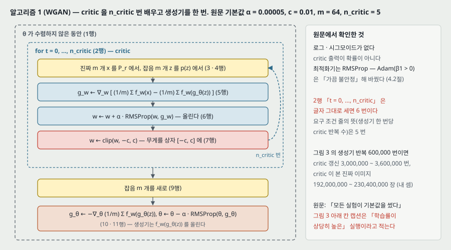

원문 알고리즘 1 을 옮긴다. 캡션: 「**논문의 모든 실험은 기본값 $\alpha = 0.00005$, $c = 0.01$, $m = 64$, $n_\text{critic} = 5$ 를 썼다.**」

> 1. $\theta$ 가 수렴하지 않은 동안
> 2. $t = 0, \dots, n_\text{critic}$ 동안
> 3. 진짜 데이터에서 $m$ 개를 뽑는다.
> 4. 사전분포 $p(z)$ 에서 $m$ 개를 뽑는다.
> 5. $g_w \leftarrow \nabla_w \left[\frac{1}{m}\sum f_w(x^{(i)}) - \frac{1}{m}\sum f_w(g_\theta(z^{(i)}))\right]$
> 6. $w \leftarrow w + \alpha \cdot \text{RMSProp}(w, g_w)$
> 7. $w \leftarrow \text{clip}(w, -c, c)$
> 9. 사전분포에서 $m$ 개를 새로 뽑는다.
> 10. $g_\theta \leftarrow -\nabla_\theta \frac{1}{m}\sum f_w(g_\theta(z^{(i)}))$
> 11. $\theta \leftarrow \theta - \alpha \cdot \text{RMSProp}(\theta, g_\theta)$

**원 GAN 의 알고리즘 1 과 다른 자리 넷.**

| | 원 GAN (NIPS 2014) | WGAN |
|---|---|---|
| 판별 쪽 출력 | 확률 $D(x)$, 로그를 씌움 | 실수 $f_w(x)$, 로그 · 시그모이드 없음 |
| 판별 쪽 걸음 수 | $k$, 실험은 1 | $n_\text{critic}$, 실험은 5 |
| 판별 쪽 제약 | 없음 | 갱신마다 무게 자르기 |
| 최적화기 | 모멘텀 | RMSProp (4.2절에서 Adam 을 쓰지 않은 까닭을 적는다) |

**critic 을 최적까지 배워야 한다는 논증(원문).** EM 거리가 연속이고 측도 0 밖에서 미분되므로 critic 을 **최적까지 배울 수 있고 배워야 한다** — critic 을 많이 배울수록 $W$ 의 기울기가 믿을 만해지기 때문이다. JS 는 판별기가 좋아질수록 기울기가 믿을 만해지지만 **참 기울기가 0** 이다(그림 1 과 [1] 의 정리 2.4).

**작은 셈(내 셈).** 2행을 글자 그대로 세면 $t = 0, 1, \dots, 5$ 로 **6 번**이고, 요구 조건 줄의 뜻(「생성기 한 번당 critic 반복 수」)으로 읽으면 5 번이다. 그림 3 의 가로축이 생성기 반복 600,000 번이므로 critic 갱신은 **3,000,000 ~ 3,600,000 번**, critic 이 본 진짜 이미지는 배치 64 로 **192,000,000 ~ 230,400,000 장**이다. **학습 시간은 원문에 없다.**

> **「모든 실험이 기본값」 과 어긋나는 자리.** 그림 3 아래 칸 캡션은 「생성기와 판별기 둘 다 MLP 이고 **학습률이 상당히 높아서(substantially high learning rates)** 학습이 실패했다」 고 적는다. 기본값 $\alpha = 0.00005$ 를 쓴 실행이 아니다. 그 학습률 값은 적혀 있지 않다.

---

## 13. 그림 2 — 판별기는 포화하고 critic 은 곧다 (3절)

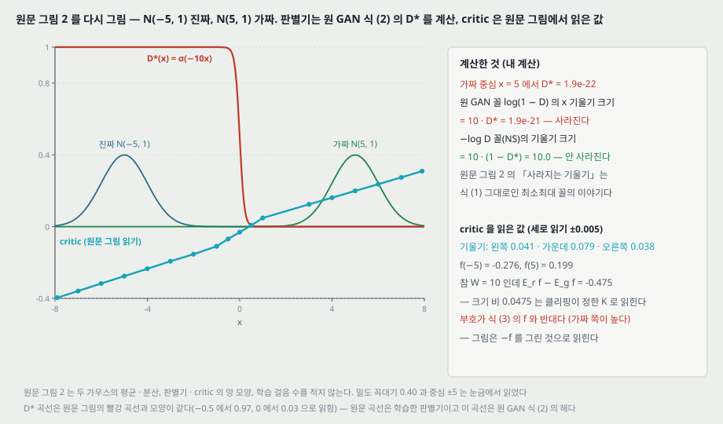

**원문.** 「그림 2 에서 이것의 개념 증명을 보인다 — GAN 판별기와 WGAN critic 을 최적까지 배웠다. 판별기는 가짜와 진짜를 **아주 빨리** 가르게 되고, 예상대로 믿을 만한 기울기 정보를 주지 않는다. critic 은 포화할 수 없고 **선형 함수로 수렴해 어디서나 깨끗한 기울기를 준다.** 무게를 제약하므로 함수가 공간의 여러 부분에서 기껏해야 선형으로 자라고, 최적 critic 이 이렇게 행동하도록 강제된다.」 캡션: 「두 가우스를 가르도록 배울 때의 최적 판별기와 critic. 최소최대 GAN 의 판별기는 포화해 기울기가 사라진다.」

**원문 그림 2 를 읽은 것.** 원문은 설정을 적지 않는다. 눈금에서 두 밀도의 꼭대기가 0.40, 중심이 −5 (진짜, 파랑)와 5 (가짜, 초록)로 읽혀 **$\mathcal{N}(-5, 1)$ 과 $\mathcal{N}(5, 1)$** 로 두었다(꼭대기 $1/\sqrt{2\pi} = 0.399$ 와 맞는다). critic 을 800x600 이미지에서 픽셀로 읽었다(세로 1 픽셀 = 0.0029, 선 굵기 2 픽셀이라 읽기 ±0.005).

| 읽은 것 | 값 |
|---|---|
| critic 기울기, $x \in [-7.9, -1]$ | 0.041 |
| critic 기울기, $x \in [-1, 1]$ | 0.079 |
| critic 기울기, $x \in [1, 7.9]$ | 0.038 |
| $f(-5)$ · $f(5)$ | −0.276 · 0.199 |
| 판별기, $x = -0.5$ · $0$ · $0.5$ 이상 | 0.971 · 0.027 · 픽셀 하나(0.003) 아래 |

**내가 계산한 것.** 분산이 같은 두 가우스에서 원 GAN 식 (2) 의 최적 판별기는 $D^*(x) = \sigma(-10x)$ 다(로짓 $= \log p_r/p_g = -10x$). 가짜 중심 $x = 5$ 에서

| 생성기 비용 | $x$ 에 대한 기울기 크기 | 값 |
|---|---|---:|
| M-GAN, $\log(1 - D^*)$ | $10 \cdot D^*$ | $1.9 \times 10^{-21}$ |
| NS-GAN, $-\log D^*$ | $10 \cdot (1 - D^*)$ | 10.0 |
| 1-립시츠 최적 critic, $f(x) = -x$ | 1 | 1 |

**짚을 셋.**

- **그림 2 의 「사라지는 기울기」 는 M-GAN 의 이야기다.** 캡션도 「minimax GAN」 이라 적는다. 그런데 4.1절의 비교 상대 DCGAN 은 **$-\log D$ 꼴(NS-GAN)** 로 배웠다. 같은 그림 설정에서 NS-GAN 의 기울기는 사라지지 않는다(10.0). 원문은 NS-GAN 의 문제를 [1] 의 「불안정」 으로 돌리고 이 편에서 그 기울기를 재지 않는다. **곧 그림 2 의 대비는 실험의 비교 상대와 같은 꼴의 대비가 아니다.**
- **critic 의 크기.** 참 $W = 10$ 인데 읽은 critic 으로 $\mathbb{E}_r f - \mathbb{E}_g f = -0.475$ 다. 크기 비 0.0475 는 무게 자르기가 정한 $K$ 로 읽힌다 — 원문의 「상관없는 배율」. 기울기가 가운데(0.079)와 양쪽(0.041 · 0.038)이 달라 **한 직선이 아니라 꺾인 직선 셋**이다. 원문의 「여러 부분에서 기껏해야 선형」 과 맞는다.
- **부호가 식 (3) 과 반대다.** 식 (3) 의 $f$ 는 진짜 쪽에서 높아야 값이 크다. 그림의 critic 은 **가짜 쪽(오른쪽)이 높다.** 알고리즘 1 의 10 · 11행은 생성기가 $f_w(g_\theta(z))$ 를 올리게 하므로, 그림 그대로의 함수를 그 규칙에 넣으면 가짜가 더 오른쪽으로 간다. **그림은 $-f$ 를 그린 것으로 읽힌다** — 원문은 부호를 적지 않는다. 기울기 크기에 대한 그림의 요점은 부호와 상관없다.

---

## 14. 모드 붕괴를 두고 한 말 (3절 끝 · 4.3 · 6절)

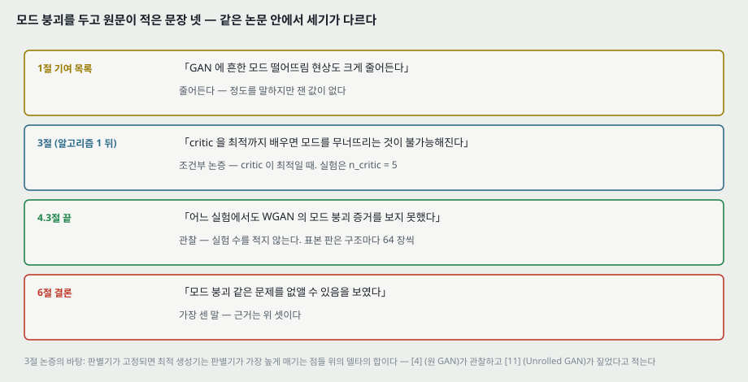

원문이 모드 붕괴를 두고 적은 문장은 넷이고 **세기가 다르다.**

| 자리 | 원문 | 무엇에 서 있나 |
|---|---|---|
| 1절 기여 목록 | 「GAN 에 흔한 모드 떨어뜨림 현상도 **크게 줄어든다**」 | 정도를 말하지만 잰 값이 없다 |
| 3절 끝 | 「critic 을 최적까지 배우면 모드를 무너뜨리는 것이 **불가능해진다**」 | 논증. 고정된 판별기에 대한 최적 생성기는 판별기가 가장 높게 매기는 점들 위의 델타의 합이라는 관찰([4] 가 관찰, [11] 이 짚음). critic 이 최적일 때의 조건부 문장 |
| 4.3절 끝 | 「**어느 실험에서도** WGAN 의 모드 붕괴 증거를 보지 못했다」 | 관찰. 실험 수를 적지 않는다 |
| 6절 결론 | 「모드 붕괴 같은 문제를 **없앨 수 있음을 보였다**」 | 위 셋 |

**읽는 법.** 3절의 논증은 「critic 을 최적까지 배우면」 이 조건이다. 학습은 $n_\text{critic} = 5$ 이고, critic 이 최적에 얼마나 가까운지 원문이 재지 않는다(10절). 4.3절의 관찰은 **구조 셋에 대해 64 장짜리 표본 판 하나씩**(부록 F)과 그림 5 ~ 7 의 16 장씩이 근거다. 모드를 센 지표(예: 섞인 가우스에서 덮은 모드 수)는 없다. **이 노트는 「관찰한 실험에서 보지 못했다고 적는다」 까지만 옮긴다.**

---

## 15. 실험 설정 (4.1절)

| 항목 | 원문 |
|---|---|
| 데이터 | **LSUN 침실** [24] 하나 — 실내 침실 자연 이미지. 학습 이미지 수는 본문에 없다 |
| 출력 | 3 채널 64x64 |
| 비교 상대 | **DCGAN** [18] — 합성곱 구조, 표준 GAN 절차에 **$-\log D$ 꼴**로 배움 |
| 초매개변수 | 모든 실험에 알고리즘 1 의 기본값(그림 3 아래 칸은 예외, 12절) |
| 생성기 구조 셋 (4.3) | (1) DCGAN 생성기 (2) BN 을 빼고 층마다 필터 수를 같게 둔 DCGAN 생성기 (3) ReLU 4 층 · 512 유닛 MLP |
| critic / 판별기 | 모두 DCGAN 구조. critic 은 시그모이드를 뺐다(그림 3 캡션). 그림 3 · 4 아래 칸만 MLP |

**본문에 없는 것.** 학습 시간, GPU, 실행 횟수(seed), 표본 질의 정량 지표(Inception 점수 같은 것), 중앙값 거르개의 창 크기, 그림 6 · 7 생성기의 파라미터 수(「한 자릿수 조금 넘게 줄었다」 · 「DCGAN 과 비슷하다」 만 있다).

---

## 16. 의미 있는 손실 — 그림 3 (4.2절)

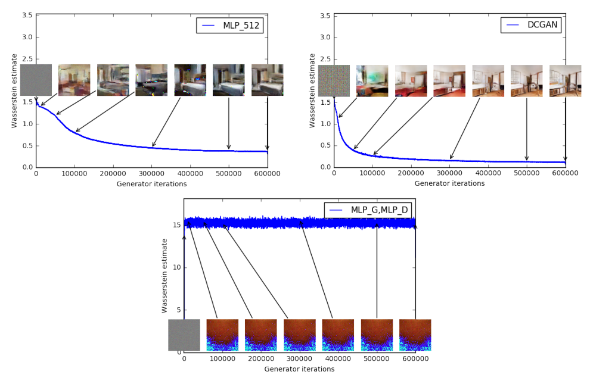

**원문 그림 3 을 PDF 에서 잘라 넣은 것이다**(200 dpi). 가로축 생성기 반복, 세로축 「Wasserstein estimate」, 곡선 위에 학습 단계별 표본 일곱 장. 위 왼쪽 MLP 생성기, 위 오른쪽 DCGAN 생성기(둘 다 critic 은 시그모이드 뺀 DCGAN), 아래 생성기 · critic 둘 다 MLP.

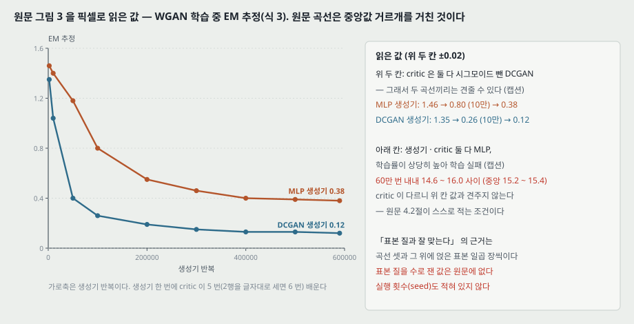

**픽셀로 읽은 값.** 위 두 칸은 세로 1 픽셀 = 0.0114, 선 굵기 2 ~ 3 픽셀이라 **읽기 ±0.02**. 아래 칸은 1 픽셀 = 0.059.

| 생성기 반복 | 2,000 | 10,000 | 50,000 | 100,000 | 200,000 | 300,000 | 400,000 | 590,000 |
|---|---:|---:|---:|---:|---:|---:|---:|---:|
| MLP 생성기 | 1.46 | 1.40 | 1.18 | 0.80 | 0.55 | 0.46 | 0.40 | 0.38 |
| DCGAN 생성기 | 1.35 | 1.04 | 0.40 | 0.26 | 0.19 | 0.15 | 0.13 | 0.12 |

아래 칸(MLP · MLP)은 2만 · 10만 · 30만 · 59만 번에서 읽은 중앙값이 15.2 ~ 15.4 이고, 600,000 번 내내 픽셀 범위가 14.6 ~ 16.0 이다.

**원문의 주장.** 「곡선이 생성 표본의 눈으로 본 질과 잘 맞는다는 것을 분명히 보인다. 우리가 아는 한 GAN 문헌에서 이런 성질이 보인 것은 처음이다.」 이어서 **스스로 단서를 단다** — 「아직 생성 모델을 정량 평가하는 새 방법이라고 주장하지 않는다. critic 구조에 달린 상수 배율 때문에 critic 이 다른 모델끼리 견주기 어렵고, critic 의 용량이 유한해 추정이 EM 거리에 얼마나 가까운지 알기 어렵다.」 그리고 「이 손실 지표로 실험을 **되풀이해 실패 없이** 검증했다」 고 적는다.

**읽는 법.**

- **위 두 칸끼리는 견줄 수 있다** — critic 이 같다(캡션). 끝 값이 MLP 0.38, DCGAN 0.12 이고 표본도 DCGAN 쪽이 또렷하다.
- **아래 칸과 위 칸은 견주지 않는다.** critic 이 MLP 로 다르고(배율이 다르다), 학습률이 기본값이 아니다.
- **「잘 맞는다」 의 근거는 곡선 셋과 그 위에 얹은 표본 일곱 장씩이다.** 표본 질을 수로 잰 값이 없어 상관을 숫자로 적을 수 없다. 「되풀이해 실패 없이」 에도 횟수가 없다.

---

## 17. GAN 쪽 곡선 — 그림 4 · 8 (4.2절, 부록 E)

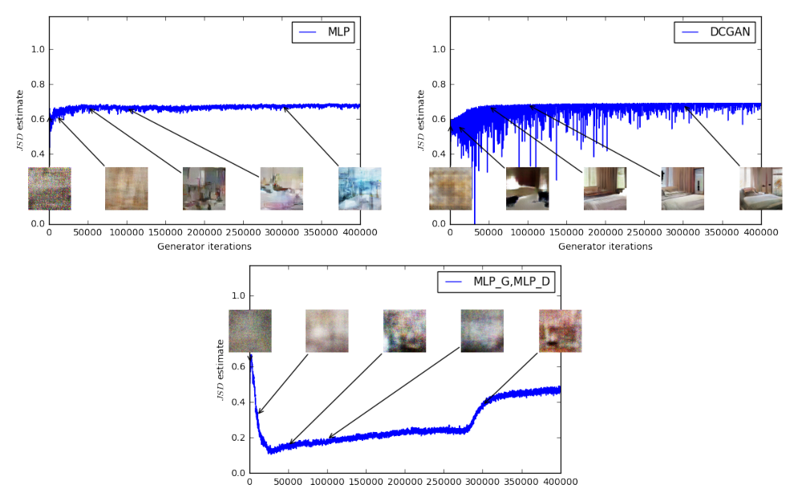

**원문 그림 4 를 잘라 넣은 것이다.** 표준 GAN 절차로 배울 때의 JS 추정. 판별기는 $L(D, g_\theta) = \mathbb{E}_{P_r}[\log D] + \mathbb{E}_{P_\theta}[\log(1 - D)]$ 를 올리고, 원문은 **$L$ 이 $2\,\text{JS} - 2\log 2$ 의 하한**이라 적고 $\frac{1}{2}L + \log 2$ 를 그린다 — 이것은 JS 의 하한이다. 이 식은 원 GAN 노트 10절의 $C(G) = -\log 4 + 2 \cdot \text{JSD}$ 와 같은 식이다(판별기가 최적이면 등호).

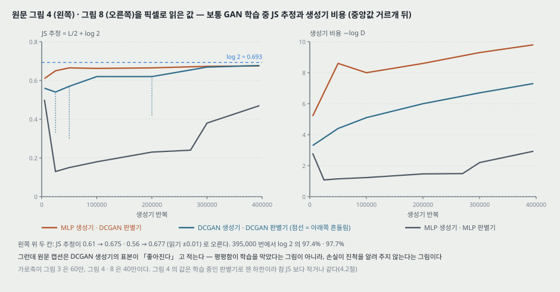

**픽셀로 읽은 값(그림 4, 세로 1 픽셀 = 0.0038, 읽기 ±0.01).**

| 생성기 반복 | 5,000 | 25,000 | 50,000 | 100,000 | 200,000 | 300,000 | 395,000 |
|---|---:|---:|---:|---:|---:|---:|---:|
| MLP 생성기 · DCGAN 판별기 | 0.61 | 0.65 | 0.665 | 0.662 | 0.665 | 0.673 | **0.675** |
| DCGAN 생성기 · DCGAN 판별기 | 0.56 | 0.54 | 0.57 | 0.62 | 0.62 | 0.669 | **0.677** |
| MLP · MLP | 0.50 | 0.13 | 0.15 | 0.18 | 0.23 | 0.38 | 0.47 |

DCGAN 생성기 칸은 곡선이 아래로 크게 흔들려 같은 자리 픽셀이 0.30 (5만), 0.42 (20만)까지 내려간다. 395,000 번의 0.675 · 0.677 은 **$\log 2$ 의 97.4% · 97.7%** 다.

**원문의 말.** 「이 양은 표본 질과 잘 맞지 않는다. JS 추정은 내려가지 않고 대개 그대로이거나 오른다. 사실 $\log 2 \approx 0.69$ 에 매우 가깝게 머무는 일이 잦다. 다시 말해 JS 가 포화하고, 판별기의 손실이 0 이고, 생성 표본은 어떤 때는 의미가 있고(DCGAN 생성기, 위 오른쪽) 어떤 때는 하나의 무의미한 이미지로 무너진다.」 캡션: 「DCGAN 은 표본이 좋아지지만 JS 추정은 오르거나 그대로다.」 아래 칸 MLP · MLP 는 「표본 질과 상관없이 곡선이 오르내린다」.

**그림 8 (부록 E)** 은 같은 실행의 **생성기 비용**($-\log D$ 꼴이라 판별기 손실과 다르다)을 그린 것이고 「결론을 바꾸지 않는다」 고 적는다. 읽은 값: MLP 생성기 5.2 → 9.8, DCGAN 생성기 3.3 → 7.3, MLP · MLP 1.08 (2.5만) → 2.93 (39.5만). 위 두 칸은 흔들림이 커서 같은 자리 픽셀 범위가 MLP 4.9 ~ 14.0, DCGAN 3.0 ~ 8.1 이다.

**읽는 법 — 앞 노트의 단서에 대한 답.** CACM 노트 18절 다섯은 「JS 가 평평하다는 계산은 최적 판별기 가정 위에 있어, 실제 학습을 막는지는 말하지 않는다」 고 남겼다. 그림 4 가 답하는 것은 둘이다.

- **학습 중인 판별기로 잰 하한도 위 끝 쪽으로 간다** — MLP 생성기 칸은 5만 번 뒤 중앙값 0.662 ~ 0.675 ($\log 2$ 의 95.5 ~ 97.4%), DCGAN 생성기 칸은 20만 번까지 0.54 ~ 0.62 ($\log 2$ 의 78 ~ 89%)이다가 30만 번 뒤 0.669 ~ 0.677 (96.5 ~ 97.7%). 395,000 번의 두 값이 계산 속 97.5% 와 같은 자리다.
- **그래도 DCGAN 표본은 나아졌다**(캡션). 곧 이 그림은 「평평함이 학습을 막는다」 의 증거가 아니라 **「평평한 손실은 진척을 알려 주지 않는다」 의 증거**다. 학습을 실제로 막은 예는 그림 6 · 7 의 구조 변경 쪽이다(19절).

가로축이 그림 3 은 60만, 그림 4 · 8 은 40만이다. 원문은 두 쪽을 같은 걸음 수나 같은 시간으로 맞춰 견주지 않는다.

---

## 18. Adam 대 RMSProp (4.2절 끝)

원문은 **부정적 결과**로 적는다 — critic 에 Adam 같은 모멘텀 기반 최적화기($\beta_1 > 0$)를 쓰거나 학습률이 높으면 WGAN 학습이 **가끔(at times)** 불안정해진다. critic 의 손실이 정상적(stationary)이지 않아 모멘텀 방법이 더 나빠 보였다고 적는다. 모멘텀을 원인으로 본 근거: 손실이 터지고 표본이 나빠질 때 **Adam 걸음과 기울기의 코사인이 대개 음수**가 되었고, 코사인이 음수인 자리는 그런 불안정 상황뿐이었다. 그래서 정상적이지 않은 문제에서도 잘 된다고 알려진 RMSProp [21] 로 바꿨다.

**짚을 것.** 「가끔」 · 「대개」 에 비율이 없다. 코사인 값과 그것을 잰 실행 수도 없다.

---

## 19. 안정성 — 그림 5 · 6 · 7 (4.3절, 부록 F)

원문의 주장: critic 을 끝까지 배우면 그것이 생성기에 손실을 주고 생성기는 다른 신경망처럼 배우면 된다. 그래서 **생성기와 판별기의 용량을 맞춰 갈 필요가 없다.** critic 이 좋을수록 생성기가 받는 기울기의 질이 높다. 그리고 생성기 구조를 바꿀 때 WGAN 이 GAN 보다 「훨씬 강건하다(much more robust)」 고 관찰한다. 표본은 「골라내지 않았다(not cherry-picked)」.

**원문 그림 5 (잘라 넣음).** DCGAN 생성기. 왼쪽 WGAN, 오른쪽 표준 GAN. 캡션: 「**두 알고리즘 모두** 질 높은 표본을 낸다.」

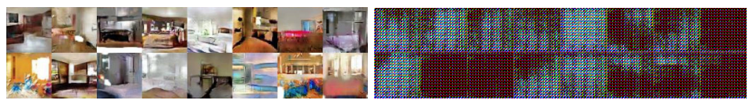

**원문 그림 6 (잘라 넣음).** BN 을 빼고 층마다 필터 수를 같게 둔 생성기(원래 DCGAN 은 층마다 두 배). 캡션: BN 을 빼는 것 말고도 파라미터 수가 「**한 자릿수 조금 넘게**(a bit more than an order of magnitude)」 줄었다 — 실제 수는 적혀 있지 않다. 표준 GAN 은 학습에 실패했고 WGAN 은 표본을 냈다.

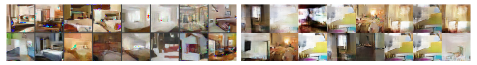

**원문 그림 7 (잘라 넣음).** ReLU 4 층 · 512 유닛 MLP 생성기. 파라미터 수는 DCGAN 과 비슷하지만 이미지 생성에 맞는 강한 귀납 편향이 없다. 캡션: WGAN 은 DCGAN 보다 질이 낮지만 표준 GAN 의 MLP 보다 질이 높은 표본을 냈다. 「GAN MLP 의 **상당한 정도의 모드 붕괴**에 주목하라.」

**부록 F** 는 같은 여섯 조합의 표본을 한 판에 64 장씩(8x8) 보인다(그림 9 ~ 14). **내 눈으로 본 것 — 인상이다.** 그림 14 (GAN, MLP 생성기)에는 노란 이불 장면과 비슷한 장면이 여러 칸에 되풀이되고, 그림 13 (WGAN, MLP 생성기)은 장면이 칸마다 다르지만 색 점 같은 깨짐이 섞여 있다. 되풀이를 센 값이 아니다.

**읽는 법.** 표준 구조(그림 5)에서는 **두 쪽의 차이를 보이지 않는다.** 차이는 GAN 에게 알려진 약한 구조(그림 6 · 7)에서 나온다. 각 조합이 실행 하나인지 여럿 중 하나인지는 적혀 있지 않다.

---

## 20. 관련 연구 — IPM 으로 묶기 (5절)

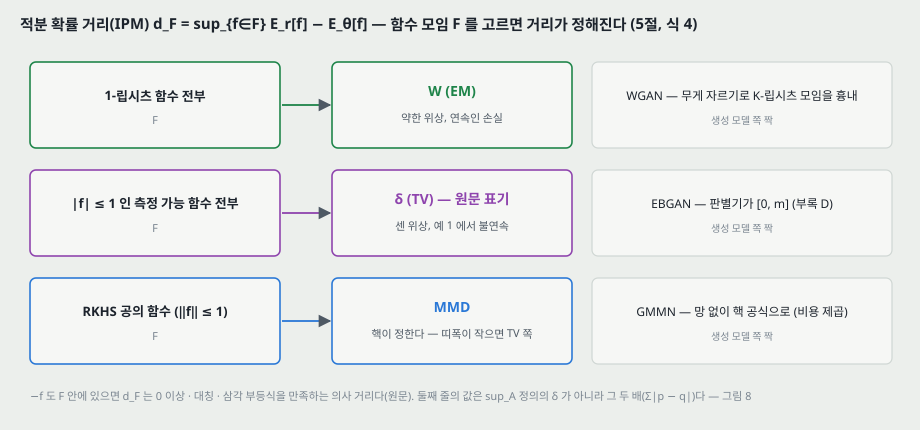

함수 모임 $\mathcal{F}$ 에 대해

$$d_\mathcal{F}(P_r, P_\theta) = \sup_{f \in \mathcal{F}} \mathbb{E}_{x \sim P_r}[f(x)] - \mathbb{E}_{x \sim P_\theta}[f(x)] \qquad (4)$$

를 IPM 이라 한다. $f \in \mathcal{F}$ 이면 $-f \in \mathcal{F}$ 일 때 $d_\mathcal{F}$ 는 0 이상 · 대칭 · 삼각 부등식을 만족하는 의사 거리다.

| $\mathcal{F}$ | $d_\mathcal{F}$ | 원문의 말 |
|---|---|---|
| 1-립시츠 함수 전부 | $W$ (칸토로비치-루빈시테인). $K$-립시츠면 $K \cdot W$ | — |
| $-1$ 과 1 사이의 측정 가능 함수 전부 | 원문은 $\delta$ (TV) 라 적는다 — **sup$_A$ 정의로는 $2\delta$** (21절) | 1-립시츠에서 1-유계로 바꾸면 위상과 손실의 정칙성이 크게 바뀐다 |
| RKHS 의 단위 공 | MMD [5] | 핵이 보편적이면 진짜 거리. 띠폭이 작은 핵이면 TV · JS 처럼 포화에 가까울 수 있다. 핵 기법으로 따로 망을 배울 필요가 없지만 표본 수에 대해 비용이 제곱 |

**EBGAN** [25] 은 판별기가 $[0, m]$ 에 갇혀 있어 TV 의 생성 모델 쪽 짝이고(부록 D), 판별기가 최적에 가까워지면 TV 를 근사한다. 그래서 「고전 GAN 과 같은 문제 — 판별기를 최적까지 배울 수 없어 기울기가 아주 불완전하다 — 를 겪는다」 고 적는다. **GMMN** [10, 2] 은 MMD 의 생성 모델 쪽 짝이다.

### 20.1 MMD 비용 셈

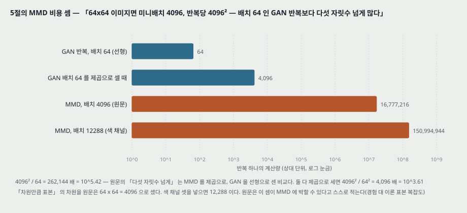

원문 셈: 가우스 MMD 검정이 믿을 만하려면 표본 수가 차원에 비례해 늘어야 하고([19]), MMD 비용은 배치 크기의 제곱이므로 64x64 이미지면 **미니배치 4096 이상, 반복당 $4096^2$** 이 들고, 이는 배치 64 인 GAN 반복보다 **다섯 자릿수 넘게** 많다.

**내가 따라간 셈.**

| 비교 | 값 | 자릿수 |
|---|---:|---:|
| $4096^2 / 64$ (MMD 를 제곱, GAN 을 선형으로) | 262,144 | $10^{5.42}$ |
| $4096^2 / 64^2$ (둘 다 제곱으로) | 4,096 | $10^{3.61}$ |
| 색 채널을 넣은 차원 $64 \times 64 \times 3$ | 12,288 | — |

원문의 「다섯 자릿수 넘게」 는 첫째 줄의 비교다 — **MMD 는 제곱으로, GAN 은 선형으로 센 것이다.** 그리고 차원을 $64 \times 64 = 4096$ 으로 셌는데 3 채널 이미지면 12,288 이다. 원문은 이 셈이 MMD 에 박할 수 있다고 스스로 적는다 — GAN 의 **경험적** 표본 복잡도와 MMD 의 **이론적** 표본 복잡도를 견준 것이라서. 다만 원 GMMN 논문이 실제로 미니배치 1000 을 썼다고 덧붙인다.

**나머지 둘.** Montavon 외 [14] 는 이산 공간에서 RBM 을 바서슈타인 거리로 배웠다 — 유한 이산 공간에서는 $W$ 와 JS 의 위상이 같아지지만, 「바탕 공간의 기하를 쓰는 비교」 라는 동기는 같다고 적는다. Genevay 외 [3] 의 대규모 최적 수송 계산은 생성 모델 평가의 새 길이 될 수 있다고 적는다.

---

## 21. 부록 D — EBGAN 은 TV 를 최적화한다 (정리 4)

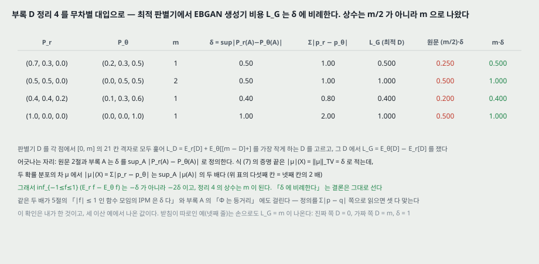

**설정.** EBGAN 의 판별기는 $L_D(D, g_\theta) = \mathbb{E}_{P_r}[D(x)] + \mathbb{E}_z[[m - D(g_\theta(z))]^+]$ 를 내리고($D \ge 0$), 생성기는 $L_G = \mathbb{E}_z[D(g_\theta(z))] - \mathbb{E}_{P_r}[D(x)]$ 를 내린다. 원 EBGAN 은 생성기 손실에 첫 항만 썼는데, 둘째 항이 $\theta$ 와 무관해 같다고 적는다.

**정리 4.** 최적 판별기 $D^*$ 가 있고 $L_G(D^*, g_\theta) = \frac{m}{2}\,\delta(P_r, P_\theta)$.

**증명의 길.** $D$ 를 $\min(D, m)$ 으로 잘라도 $L_D$ 가 커지지 않으니 $[0, m]$ 안에서 찾으면 된다. 그 안에서 $L_D = m + \mathbb{E}_{P_r}[D] - \mathbb{E}_{P_\theta}[D]$ 이고, $D = \frac{m}{2}f + \frac{m}{2}$ 로 바꾸면 $-1 \le f \le 1$ 위의 문제가 된다. 그리고 식 (7)

$$\inf_{-1 \le f(x) \le 1} \mathbb{E}_{P_r}[f(x)] - \mathbb{E}_{P_\theta}[f(x)] = -\delta(P_r, P_\theta) \qquad (7)$$

을 한 분해(Hahn decomposition)로 보인다.

**내가 따라간 것 — 상수가 $m/2$ 가 아니라 $m$ 으로 나왔다.** 판별기 값을 각 점에서 $[0, m]$ 의 21 칸 격자로 모두 훑어 $L_D$ 를 최소로 하는 $D$ 를 고르고 그 $D$ 에서 $L_G$ 를 쟀다.

| $P_r$ | $P_\theta$ | $m$ | $\delta$ | $\sum \lvert p_r - p_\theta \rvert$ | $L_G$ | 원문 $\frac{m}{2}\delta$ | $m\delta$ |
|---|---|---:|---:|---:|---:|---:|---:|
| (0.7, 0.3, 0) | (0.2, 0.3, 0.5) | 1 | 0.50 | 1.00 | **0.500** | 0.250 | **0.500** |
| (0.5, 0.5, 0) | (0, 0.5, 0.5) | 2 | 0.50 | 1.00 | **1.000** | 0.500 | **1.000** |
| (0.4, 0.4, 0.2) | (0.1, 0.3, 0.6) | 1 | 0.40 | 0.80 | **0.400** | 0.200 | **0.400** |
| (1, 0, 0) | (0, 0, 1) | 1 | 1.00 | 2.00 | **1.000** | 0.500 | **1.000** |

받침이 따로인 넷째 줄은 손으로도 나온다 — 진짜 쪽에서 $D = 0$, 가짜 쪽에서 $D = m$ 이면 $L_D = 0$ 이 가장 작고, $L_G = m - 0 = m$, $\delta = 1$.

**어디서 두 배가 생기나.** 원문 2절과 부록 A 는 $\delta$ 를 $\sup_A \lvert P_r(A) - P_\theta(A) \rvert$ 로 정의한다. 식 (7) 의 증명 끝은 $\lvert \mu \rvert(\mathcal{X}) = \lVert \mu \rVert_{TV} = \delta(P_r, P_\theta)$ 로 적는데, 두 확률 분포의 차 $\mu = P_r - P_\theta$ 에서 $\lvert \mu \rvert(\mathcal{X}) = \sum \lvert p_r - p_\theta \rvert$ 는 $\sup_A \lvert \mu(A) \rvert$ 의 **두 배**다(위 표 다섯째 칸 = 넷째 칸의 2 배). 그래서 식 (7) 의 좌변은 $-2\delta$ 이고 정리 4 의 상수는 $m$ 이다. **「$L_G$ 가 $\delta$ 에 비례한다」 는 결론은 그대로 선다.**

같은 두 배가 두 자리에 더 걸린다 — 5절의 「$\lvert f \rvert \le 1$ 인 함수 모임의 IPM 은 $\delta$ 다」 와 부록 A 의 「$\Phi$ 는 $(\text{Prob}, \delta)$ 에서 쌍대 노름 공간으로의 등거리 몰입이다」. 셋 다 $\delta$ 를 $\sum \lvert p - q \rvert$ (곧 $\lvert \mu \rvert(\mathcal{X})$)로 읽으면 맞고, 그러면 이번엔 2절의 정의 · 예 1 의 $\delta = 1$ · 정리 2 증명의 핀스커 부등식 $\delta \le \sqrt{\text{KL}/2}$ 와 두 배가 어긋난다. **결론(위상 · 비례)은 두 배에 영향받지 않는다.** 이 확인은 내가 한 것이고, 세 이산 예와 손 계산 하나에서 나온 값이다.

---

## 22. 부록 A — 왜 $W$ 가 약한가

원문 각주 3 이 「우리가 어떻게 $W$ 를 최적화해야 한다는 생각에 닿았는지」 를 여기 적었다며 「수학이 두렵지 않은 독자」 에게 권한다. 요지:

- 콤팩트 $\mathcal{X}$ 위의 연속 유계 함수 공간 $C_b(\mathcal{X})$ 에 상한 노름을 주면 노름 공간이고, 그 쌍대 $C_b(\mathcal{X})^*$ 에 쌍대 노름을 준다.
- $\Phi(P)(f) = \mathbb{E}_{x \sim P}[f(x)]$ 로 확률 분포를 쌍대 공간 안에 넣으면(리스 표현 정리), **TV 거리가 쌍대 공간의 노름 거리**가 된다(21절의 두 배 단서와 함께).
- 노름 위상은 아주 세서 $\theta \mapsto P_\theta$ 가 연속인 경우가 많지 않을 것이다. 정리 2 로 TV 와 JS 는 같은 위상이니 JS 도 아주 센 거리다.
- 쌍대 공간에는 센 위상(노름)과 **약* 위상**이 있고, $\text{Prob}(\mathcal{X})$ 에서 센 위상은 TV 가, 약* 위상은 $W$ 등이 준다.

곧 「$W$ 를 쓰자」 는 생각은 **확률 분포의 공간에 줄 수 있는 가장 약한 쪽 위상을 손실로 쓰자**는 것이다.

---

## 23. 결론 (6절)

원문: 「WGAN 이라는 알고리즘을 소개했다. 학습의 안정성을 높이고, 모드 붕괴 같은 문제를 없애고, 디버깅과 초매개변수 찾기에 쓸 수 있는 의미 있는 학습 곡선을 줄 수 있음을 보였다. 대응하는 최적화 문제가 건전함을 보였고, 분포 사이의 다른 거리들과의 깊은 연결을 짚는 이론 작업을 폭넓게 내놓았다.」

---

## 24. 이 논문이 스스로 적은 한계와 조건

1. **무게 자르기는 「분명히 끔찍한」 립시츠 제약이다** — 크면 느리고, 작으면 층이 많거나 BN 이 없을 때 기울기가 사라진다(3절).
2. **식 (2) 의 상한이 자른 가족 안에서 닿는다는 것은 「꽤 센 가정」** 이다(3절).
3. **EM 추정을 정량 평가 방법이라 주장하지 않는다** — critic 구조에 달린 배율과 유한 용량 때문(4.2절).
4. **Adam 이나 높은 학습률에서 가끔 불안정하다**(4.2절).
5. **따름정리 1 의 ReLU 경우 증명을 뺐다**(각주 4).
6. **예 1 은 받침이 따로인 경우**이고, 교집합이 측도 0 인 경우로의 일반화는 [1] 에 기댄다(2절).
7. **MMD 와의 비용 비교가 MMD 에 박할 수 있다** — 경험 대 이론 표본 복잡도(5절).

---

## 25. 논문이 적지 않은 것 — 내가 읽으며 짚은 자리

**하나. 「EM 추정이 표본 질과 잘 맞는다」 에 수가 없다.** 근거는 곡선 셋(그림 3)과 그 위에 얹은 표본 일곱 장씩이다. 표본 질의 정량 지표가 없어 상관을 숫자로 적을 수 없고, 실행 횟수도 없다. 원문의 「분명히(clearly)」 · 「놀랍도록(remarkably)」 은 눈으로 본 판단이다.

**둘. 모드 붕괴를 두고 한 말 넷의 세기가 다르고, 가장 센 말(결론)의 근거가 가장 약한 말(관찰)과 같다**(14절). 「불가능」 은 critic 이 최적일 때의 논증이고, 학습의 critic 이 최적에 얼마나 가까운지는 재지 않는다.

**셋. 그림 2 의 대비는 M-GAN 과의 대비인데, 실험의 비교 상대는 NS-GAN 이다**(13절). 같은 1 차원 설정에서 최적 판별기 아래 NS-GAN 의 기울기 크기는 10.0 으로 사라지지 않는다(내 계산). 이 편이 NS-GAN 에 대해 직접 보인 것은 그림 8 (생성기 비용이 표본 질과 맞지 않는다)뿐이다.

**넷. 그림 2 가 「곧은 critic」 의 유일한 그림이고 설정이 없다.** 분포 · 망 모양 · 학습 걸음 수 · $c$ 가 적혀 있지 않고, 부호가 식 (3) 과 반대로 그려져 있다. 이미지 실험에서 생성기가 받은 기울기의 크기는 재지 않았다.

**다섯. 견준 축이 계산량이 아니다.** WGAN 은 생성기 한 번에 critic 을 5 (또는 6) 번 배우고 DCGAN 은 판별기를 한 번 배운다. 그림 3 은 60만, 그림 4 · 8 은 40만 반복이고 학습 시간은 없다. 같은 계산에서의 비교가 아니다.

**여섯. 「모든 실험이 기본값」 이 그림 3 아래 칸에서 깨진다**(12절). 그 칸은 학습 실패의 예로 쓰이므로, 실패가 MLP critic 때문인지 높은 학습률 때문인지 가를 수 없다.

**일곱. 데이터셋이 하나다**(LSUN 침실 64x64). 다른 데이터에서 같은 곡선 모양이 나오는지는 이 편이 보이지 않는다.

**여덟. 무게 자르기를 바꿔 본 실험이 없다.** $c$ 는 늘 0.01 이고, 「구 위 사영」 변형과의 비교는 「차이가 적었다」 한 줄이다.

---

## 26. 읽을 때 헷갈리는 지점

**$P_g$ 와 $P_\theta$.** 2절은 $P_g$, 3절부터 $P_\theta$. 같은 생성 분포다.

**critic 은 판별기가 아니다.** 출력이 확률이 아니어서 「진짜일 확률」 로 읽을 수 없다. 값 자체에는 배율($K$)이 붙어 있어 critic 이 다르면 값끼리 견줄 수 없다(16절).

**「최적까지 배운다」 와 $n_\text{critic} = 5$.** 3절의 논증은 critic 이 최적이라는 가정에 서고, 알고리즘은 5 걸음이다. 원문 4.2절은 「상대적으로 잘(relatively well)」 배운다고 적는다.

**그림 1 과 그림 2.** 그림 1 은 예 1 의 $W$ · JS 를 $\theta$ 의 함수로 그린 것이고, 판별기 포화 대 critic 직선은 **그림 2** 다.

**JS 의 1/2.** 2절의 정의에는 없고, 예 1 · 그림 1 · 4.2절 · 부록 C 는 1/2 을 붙인 값을 쓴다(5절).

**TV 의 두 배.** $\delta$ 를 $\sup_A$ 로 정의해 놓고 부록 D · A 와 5절 둘째 항목에서 $\lvert \mu \rvert(\mathcal{X})$ 와 같다고 쓴다(21절).

**「$\log D$ trick」 의 방향.** 원문 4.1절의 「$-\log D$ trick」 은 생성기가 $-\log D(G(z))$ 를 **내리는** 것, 곧 원 GAN 3절 끝의 「$\log D(G(z))$ 를 올린다」 와 같은 것이다.

---

## 27. 원문 안의 어긋남 모음

| 자리 | 원문 | 바른 것 또는 짚을 것 |
|---|---|---|
| 2절 JS 정의 | $\text{KL}(P_r \Vert P_m) + \text{KL}(P_g \Vert P_m)$ | 1/2 무게가 빠졌다. 예 1 의 $\log 2$ · 그림 1 · 부록 C 와 맞추려면 각 항에 1/2 |
| 알고리즘 1, 2행 | for $t = 0, \dots, n_\text{critic}$ | 글자대로면 $n_\text{critic} + 1 = 6$ 번. 요구 조건 줄의 뜻은 $n_\text{critic}$ 번 |
| 알고리즘 1 캡션 대 그림 3 캡션 | 「모든 실험이 기본값」 | 그림 3 아래 칸은 「학습률이 상당히 높은」 실행 |
| 그림 2 | critic 이 가짜 쪽에서 높다 | 식 (3) 의 $f$ 는 진짜 쪽에서 높아야 한다. $-f$ 를 그린 것으로 읽힌다 |
| 그림 1 캡션 대 축 | 캡션 $\rho(P_\theta, P_0)$, 축 $W(P_r, P_\theta)$ · $JSD(P_r \Vert P_\theta)$ | 같은 것을 다른 기호로 |
| 부록 D 정리 4 · 식 (7) | $L_G = \frac{m}{2}\delta$, $\inf = -\delta$ | $\delta = \sup_A$ 정의로는 $L_G = m\delta$, $\inf = -2\delta$ (21절, 내 확인) |
| 부록 D 정리 4 증명 | $m + \frac{m}{2}\mathbb{E}_{P_r}[D^*(x)] - \mathbb{E}_{P_\theta}[f^*(x)]$ | 두 항 모두 $f^*$ 이고 괄호로 묶어야 한다 |
| 부록 D 끝 | 「$\mathbb{E}\mathbb{E}_{x \sim P_r}$」, 「$\delta(P_r, P_g)$」 | E 가 두 번, $P_g$ 와 $P_\theta$ 가 섞임 |
| 따름정리 1 증명 | $L(\theta, Z) \le \lVert \nabla_{\theta, x} g_\theta(z) \rVert + \epsilon$ | $\nabla_{\theta, z}$ |
| 따름정리 1 증명 | $L^H \prod_{i=H}^{K} \lVert W_i \rVert$ | $\prod_{i=1}^{H}$ |
| 따름정리 1 증명 | $\lVert f_{1:k-1}(z) \rVert \le \lVert z \rVert L^{k-1} \prod W_i$ | 곱 안에 노름 $\lVert W_i \rVert$ |
| 정리 2 증명 (1) | $P_m(A_m) \le \frac{1}{\epsilon}\delta(P_n, P)$ | $P_m(A_n)$ |
| 정리 2 증명 (1) 끝 | $\delta \le 2\sqrt{\text{JS}}$ | 맞지만 앞 줄에서 나오는 것은 $\sqrt{2\,\text{JS}}$ (7절) |
| 참고 문헌 [1] · [20] | 「ICLR 2017. Under review」 | v3 (2017-12) 시점에는 이미 학회가 끝났다. 판을 고치면서 갱신하지 않은 것으로 보인다 |
| 철자 | assymetric · succesful · yeald · aproximate · commmon · Radamacher · Rubenstein (24쪽) · Nykodim · existance · constistently · sufice · unsuccess | asymmetric · successful · yield · approximate · common · Rademacher · Rubinstein · Nikodym · existence · consistently · suffice · lack of success |

---

## 28. 앞 노트(원 GAN · CACM GAN)와 맞춰 보기

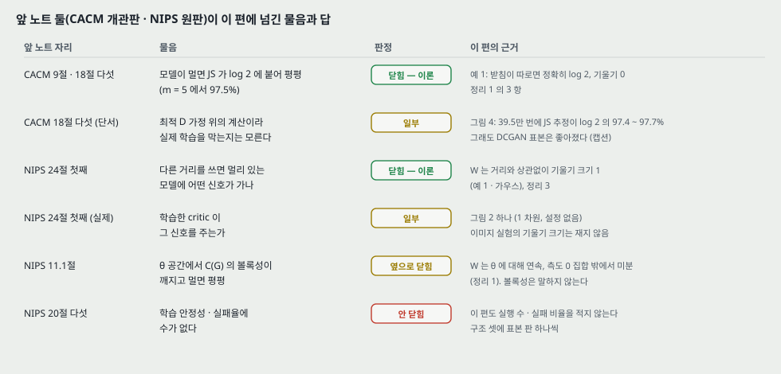

| 앞 노트의 자리 | 앞 노트에 적은 것 | 이 편 | 판정 |
|---|---|---|---|
| CACM 9절 · 18절 다섯 | 모델이 멀면 JS 가 $\log 2$ 에 붙어 평평 ($m = 5$ 에서 97.5%). 이 편이 이 자리를 다루는지는 읽고 확인한다 | 예 1 이 극단의 경우 — 받침이 따로면 정확히 $\log 2$ 이고 $\theta$ 에 대해 불연속. 정리 1 의 3 항. 4.2절이 그 포화를 학습 곡선에서 보인다 | **다룬다 — 이론으로 닫힘** |
| CACM 18절 다섯의 단서 | 최적 $D$ 가정 위의 계산이라 실제 학습을 막는지는 모른다 | 그림 4: 학습 중 하한이 39.5만 번에 $\log 2$ 의 97.4 ~ 97.7%. 그런데 DCGAN 표본은 좋아짐 | **일부 — 손실이 진척을 알려 주지 않는다는 데까지** |
| NIPS 24절 첫째 | 다른 거리를 쓰면 멀리 있는 모델에 어떤 신호가 가는가 | $W$ 의 기울기 크기는 거리와 상관없다(예 1 에서 ±1, 가우스에서 1, 8절). 정리 3 이 그 기울기를 critic 으로 얻는 식 | **이론으로 닫힘** |
| NIPS 24절 첫째 (실제 학습) | — | 곧은 critic 은 1 차원 그림 하나(그림 2). 이미지 실험의 기울기 크기는 재지 않음 | **일부** |
| NIPS 8절 | NS 꼴의 가상 기준은 $m$ 을 따라 계속 큰다 ($m = 5$ 에서 12.52) | 13절 내 계산: 같은 방향 — 그림 2 설정에서 NS 꼴의 기울기 크기 10.0. 이 편은 NS 꼴의 기울기를 재지 않는다 | **이 편이 다루지 않는 쪽** |
| NIPS 11.1절 | $\theta$ 공간에서 $C(G)$ 의 볼록성이 깨지고 멀면 평평 | $W$ 는 $\theta$ 에 대해 연속 · 측도 0 밖에서 미분(정리 1). 평평함은 풀리지만 볼록성은 말하지 않는다 | **평평함만 닫힘** |
| NIPS 20절 다섯 · CACM 18절 여섯 | 학습 안정성 · 실패율에 수가 없다. 모드 붕괴를 말하지 않는다 | 이 편은 모드 붕괴를 정면으로 말하지만(14절) 실행 수 · 실패 비율 · 모드 수를 세지 않는다 | **안 닫힘** |
| NIPS 23절 둘 | 「$G$ 와 $D$ 맞추기(확장 5)는 WGAN 으로 이어진 것으로 안다」 | 4.3절: 「생성기와 판별기의 용량을 더는 맞출 필요가 없다」 | **이어진 것이 맞다** |

**앞 노트에서 고쳐 적을 자리 — 이 노트에서 고치지 않고 적어만 둔다.**

- **NIPS 노트 8절 표 아래와 24절 첫 행의 「97.6%」.** 그 표의 $2 \cdot \text{JSD}$ 를 반올림한 1.353 으로 $2\log 2 = 1.386$ 을 나눈 값이다. 반올림 전 값으로는 $2 \times 0.6759 / 1.3863 = 97.5\%$ 이고 CACM 노트 9절 · 이 노트 8절과 같다.
- **CACM 노트 9절 끝 · 22절 WGAN 행의 「그 편이 이 자리를 다루는지는 그 편을 읽고 확인한다」.** 다룬다 — 예 1 · 정리 1 · 4.2절. 날짜 단 인용 블록으로 답을 달 자리다.
- **CACM 노트 18절 다섯 「이 자리가 실제 학습을 막는지는 이 노트가 말하지 않는다」.** 원문 그림 4 로 「막는다」 가 아니라 「손실이 진척을 알려 주지 않는다」 까지 왔다는 것을 덧붙일 자리다.

---

## 29. 계보와 내가 가져갈 것

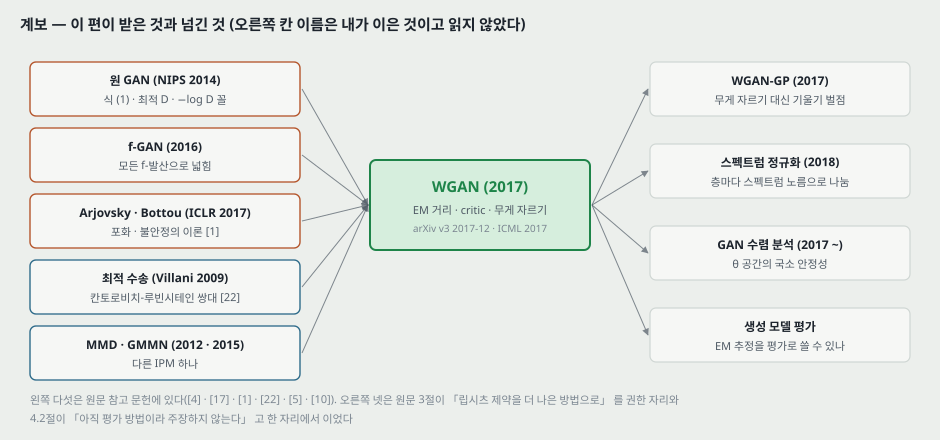

**하나. 앞 칸에서 받은 것.** 원 GAN [4] 의 틀(생성기 · 판별 쪽 함수 · 번갈아 갱신)을 그대로 두고 **거리 하나만 바꾼다.** f-GAN [17] 이 JS 를 모든 f-발산으로 넓혔고, 같은 저자의 [1] 이 포화와 $-\log D$ 꼴의 불안정을 이론으로 다뤘다. 이 편은 f-발산 바깥의 거리(EM)로 나가고, 그 계산은 최적 수송의 쌍대 [22] 에 기댄다.

**둘. 넘긴 것 — 오른쪽 칸 이름은 내가 이은 것이고 읽지 않았다.** 원문 3절이 「립시츠 제약을 더 나은 방법으로」 를 적극 권한 자리는 기울기 벌점(WGAN-GP) · 스펙트럼 정규화로 이어진 것으로 안다. 4.2절이 「아직 평가 방법이라 주장하지 않는다」 고 한 자리는 생성 모델 평가 쪽으로 이어진다.

**셋. 이상 탐지로 가는 곁가지 — 원문은 이 쓰임을 적지 않는다(이 문단 전체가 내가 이은 것).** critic 은 확률이 아니라 배율이 붙은 실수를 내므로, 원 GAN 노트 22절의 「판별기 점수」 처럼 쓰려면 **critic 이 데이터 쪽에서 높게 매긴 값**을 점수로 읽게 된다. 9절의 이산 예에서 최적 $f$ 는 질량이 남는 쪽에서 높은 직선이었다 — 곧 critic 값은 「정상일 확률」 이 아니라 **「정상 데이터와 생성 표본 사이의 수송 방향」** 이고, 생성기가 좋아질수록 그 신호가 준다. 이 점은 원 GAN 노트 22절이 판별기에 대해 짚은 것과 같은 자리다.

**넷. 로드맵 쪽.** 생성 모델 칸(VAE · GAN · Diffusion)의 GAN 줄에 원판 · 개관판 · WGAN 셋이 모였다. 로드맵의 다음 새 칸은 그대로 RNN 이다.

---

## 30. 다음에 읽을 것

**한계를 적고 그 한계를 푼 것이 다음 논문이다.** 이 노트가 남긴 자리에서 넷을 꼽는다.

| 다음 | 이 노트의 어느 자리에서 나오는가 | 무엇을 확인하고 싶은가 |
|---|---|---|
| **WGAN-GP** — Improved Training of Wasserstein GANs (Gulrajani 외, NeurIPS 2017) | 11 · 24절 하나 — 원문 스스로 「분명히 끔찍한」 이라 적은 무게 자르기. 감사의 글에 Gulrajani 의 이름이 있다 | 자르기 대신 무엇을 걸었는가. 「크면 느리고 작으면 사라진다」 를 수로 보였는가. critic 의 기울기 크기를 이미지 실험에서 쟀는가 |
| **Towards Principled Methods for Training GANs** (Arjovsky · Bottou, ICLR 2017, 원문 [1]) | 5 · 13절 셋 — 받침의 교집합이 측도 0 이라는 일반화와 $-\log D$ 꼴의 불안정을 이 편이 [1] 에 맡긴다 | NS-GAN 의 기울기가 왜 불안정한지(이 노트 13절의 「사라지지 않는다」 와 어떻게 맞물리는지), 정리 2.4 의 「사라지는 기울기」 가 어떤 조건인지 |
| **Unrolled GAN** (Metz 외, ICLR 2017, 원문 [11]) | 14절 — 모드 붕괴 논증(고정된 판별기에 대한 최적 생성기는 델타의 합)이 이 편에서 짚였다고 원문이 적는다 | 모드 붕괴를 수로 쟀는가(덮은 모드 수 같은 지표) |
| **스펙트럼 정규화** — Spectral Normalization for GANs (Miyato 외, ICLR 2018) — 후보 | 11절 — 립시츠 제약을 층마다 거는 다른 길. 원문 참고 문헌에는 없다(뒤에 나온 편) | 무게 자르기와 같은 비교에서 무엇이 달라지는가 |

읽는 순서로는 **WGAN-GP 가 먼저**다. 이 편이 스스로 꼽은 가장 큰 한계를 바로 받는다. 이미 INDEX 에 있는 **생성 모델 평가 편**(Theis 외, ICLR 2016)도 16절 — 「EM 추정을 평가로 쓸 수 있나」 — 과 닿는다.

---

## 31. 돌려 볼 것

노트를 쓰며 나온 물음 중 **직접 잴 수 있는 것 다섯**이다. **아직 실험 폴더를 만들지 않았고 돌리지 않았다.** 돌리게 되면 질문과 가설을 먼저 적는 규칙대로 폴더를 만든다. 앞 GAN 노트의 돌려 볼 것과 겹치는 것은 그쪽 번호를 적는다.

| 무엇 | 이 노트의 어느 자리 | 묻는 것 |
|---|---|---|
| A | 13절 (NIPS 노트 25절 B 와 짝) | 그림 2 설정($\mathcal{N}(-5, 1)$ 대 $\mathcal{N}(5, 1)$)에서 판별기(M-GAN · NS-GAN)와 critic($c$ = 0.001 · 0.01 · 0.1)을 같은 작은 MLP 로 끝까지 배워, **가짜 표본에서 생성기가 받는 기울기 크기**를 셋 다 잰다. 읽은 critic 기울기 0.038 ~ 0.079 가 $c$ 에 따라 어떻게 바뀌는가 |
| B | 5절 | 예 1 그대로 $g_\theta(z) = (\theta, z)$ 를 $\theta_0 = 1$ 에서 WGAN 과 NS-GAN 으로 배워 $\lvert \theta \rvert < 0.05$ 에 닿는 걸음 수를 seed 다섯으로 센다 |
| C | 14 · 25절 둘 (CACM 노트 23절 C 와 같이 돌릴 수 있다) | 2 차원 가우스 여덟 개 섞음에서 WGAN · NS-GAN 을 $n_\text{critic}$ = 1 · 5 · 25 로 배워 **덮은 모드 수**를 센다(덮음의 기준은 돌리기 전에 정한다). 「모드 붕괴 증거를 보지 못했다」 에 수를 붙인다 |
| D | 16 · 25절 하나 | MNIST 에서 critic 의 EM 추정과 표본 질 지표(미리 배운 분류기로 낸 특징 거리)를 같은 걸음마다 적어 **순위 상관**을 낸다. seed 셋 |
| E | 12 · 25절 다섯 | C 의 설정에서 **같은 벽시계 시간**으로 맞춰 WGAN 과 NS-GAN 을 견준다 |

---

## 32. 물어 두는 것

- **학회판(ICML 2017)에서 2절의 JS 정의와 부록 D 의 상수가 고쳐졌는가.** 학회판은 받지 않았다.
- **공개 코드가 알고리즘 1 과 같은 일정인가** — critic 반복 수가 5 인지 6 인지, 학습 초반에 다른 일정이 있는지. 원문에 코드 주소가 없어 확인하지 않았다.
- **그림 2 의 설정**(두 가우스의 평균 · 분산, 망 모양, $c$, 걸음 수)과 **critic 의 부호**.
- **그림 3 아래 칸의 학습률 값.**
- **「어느 실험에서도」 는 몇 번의 실험인가.** 그림 3 · 4 · 5 ~ 7 의 각 조합이 실행 하나인가.
- **그림 3 · 4 · 8 의 중앙값 거르개 창 크기.**
- **LSUN 침실 학습 이미지 수**와 학습 시간.

---

## 33. 참고 문헌

이 노트가 부른 편만 적는다. 원리는 원 출처를, 구현은 그 라이브러리의 편을 적는 규칙을 따른다. 그림 코드는 파이썬 표준 라이브러리만 쓰고, 원문 그림을 잘라 낸 코드와 그림 곡선을 픽셀로 읽은 일만 PyMuPDF 를 썼다(PyMuPDF 는 논문이 따로 없어 적지 않는다).

- Arjovsky, M., Chintala, S., and Bottou, L. (2017). Wasserstein GAN. arXiv:1701.07875 (v3, 2017-12-06). 학회판: Wasserstein generative adversarial networks. ICML 2017, PMLR 70. — 이 노트의 대상. 학회판은 읽지 않았다.
- Goodfellow, I. J. 외 (2014). Generative adversarial nets. NIPS 27. — 원 GAN(원문 [4]). 앞서 읽음.
- Goodfellow, I. 외 (2020). Generative adversarial networks. Communications of the ACM, 63(11):139–144. — 앞서 읽은 개관판.
- Arjovsky, M. and Bottou, L. (2017). Towards principled methods for training generative adversarial networks. ICLR. — 포화 · 불안정의 이론(원문 [1]). **읽지 않았다.**
- Villani, C. (2009). Optimal Transport: Old and New. Springer. — 칸토로비치-루빈시테인 쌍대, $W$ 와 약* 위상(원문 [22]). **읽지 않았다.**
- Nowozin, S., Cseke, B., and Tomioka, R. (2016). f-GAN. NIPS. — 모든 f-발산(원문 [17]).
- Radford, A., Metz, L., and Chintala, S. (2015). Unsupervised representation learning with deep convolutional generative adversarial networks. arXiv:1511.06434. — DCGAN, 비교 상대(원문 [18]).
- Zhao, J., Mathieu, M., and LeCun, Y. (2016). Energy-based generative adversarial network. arXiv:1609.03126. — EBGAN(원문 [25]).
- Gretton, A. 외 (2012). A kernel two-sample test. JMLR, 13:723–773. — MMD(원문 [5]).
- Li, Y., Swersky, K., and Zemel, R. (2015). Generative moment matching networks. ICML. — GMMN(원문 [10]).
- Ramdas, A. 외 (2014). On the high-dimensional power of linear-time kernel two-sample testing under mean-difference alternatives. arXiv:1411.6314. — MMD 비용 셈의 근거(원문 [19]).
- Metz, L., Poole, B., Pfau, D., and Sohl-Dickstein, J. (2016). Unrolled generative adversarial networks. arXiv:1611.02163. — 모드 붕괴 논증(원문 [11]).
- Milgrom, P. and Segal, I. (2002). Envelope theorems for arbitrary choice sets. Econometrica, 70(2):583–601. — 정리 3 의 포락 정리(원문 [12]).
- Wu, Y., Burda, Y., Salakhutdinov, R., and Grosse, R. (2016). On the quantitative analysis of decoder-based generative models. arXiv:1611.04273. — 1절의 잡음 0.1 (원문 [23]).
- Yu, F. 외 (2015). LSUN. arXiv:1506.03365. — 데이터(원문 [24]).
- Tieleman, T. and Hinton, G. (2012). Lecture 6.5 — RMSProp. COURSERA. — 최적화기(원문 [21]).
- Kingma, D. P. and Ba, J. (2014). Adam. arXiv:1412.6980. — 쓰지 않은 최적화기(원문 [8]).
- Montavon, G., Müller, K.-R., and Cuturi, M. (2016). Wasserstein training of restricted Boltzmann machines. NIPS. — 원문 [14].
- Genevay, A., Cuturi, M., Peyré, G., and Bach, F. (2016). Stochastic optimization for large-scale optimal transport. NIPS. — 원문 [3].
- Gulrajani, I. 외 (2017). Improved training of Wasserstein GANs. NeurIPS. — 다음에 읽을 것. **원문 참고 문헌에는 없다(뒤에 나온 편). 읽지 않았다.**
- Miyato, T. 외 (2018). Spectral normalization for generative adversarial networks. ICLR. — 다음에 읽을 것 후보. **원문 참고 문헌에는 없다. 읽지 않았다.**

---

## 34. 경로

| 무엇 | 어디 |
|---|---|
| 원문 PDF (arXiv v3, 부록 포함 32 쪽) | `papers/ICML17_WGAN_Wasserstein_GAN.pdf` |
| 이 노트 | `notes/ICML17_WGAN_Wasserstein_GAN.md` |
| 앞서 읽은 GAN 노트 둘 | `notes/NIPS14_GAN_Generative_Adversarial_Nets.md`, `notes/CACM20_GAN_Generative_Adversarial_Networks.md` |
| 이 노트의 그림 (직접 그린 것) | `figures/ICML17_WGAN/fig01_parallel_lines.svg` 부터 `fig15_lineage.svg` 까지 열다섯 |
| 이 노트의 그림 (원문에서 잘라 낸 것) | `figures/ICML17_WGAN/paper_fig3_wgan_curves.png`, `paper_fig4_gan_js_curves.png`, `paper_fig5_dcgan_samples.png`, `paper_fig6_nobn_samples.png`, `paper_fig7_mlp_samples.png` |
| 그림을 만드는 코드 | `figures/ICML17_WGAN/make_figures.py` — 바깥 데이터를 읽지 않으므로 `python make_figures.py` 로 어디서나 다시 만든다(표준 라이브러리만). 2 · 3 · 4 · 5 · 6 · 7 · 8 · 12 번 그림의 수는 이 파일이 계산해 화면에도 찍는다. 9 · 10 번 그림의 곡선 값과 7 번 그림의 critic 값은 원문 그림에서 픽셀로 읽은 값을 상수로 적어 둔 것이다 |
| 원문 그림을 잘라 내는 코드 | `figures/ICML17_WGAN/crop_paper_figures.py` — PyMuPDF 가 필요하다 |
