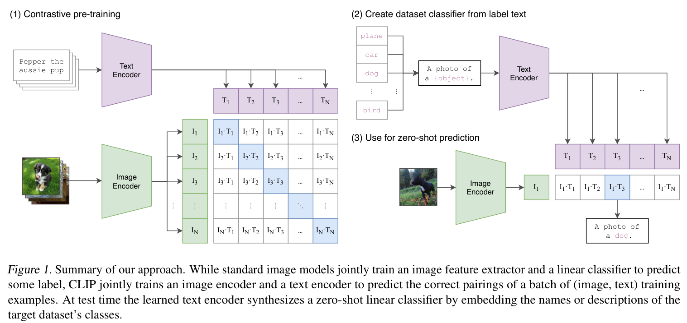
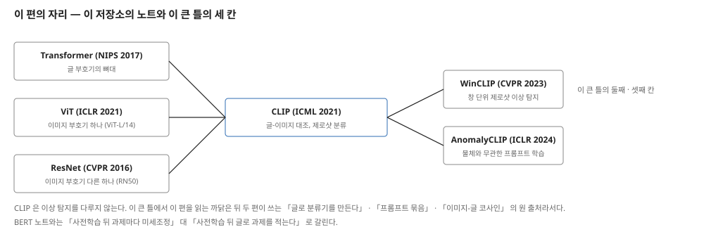
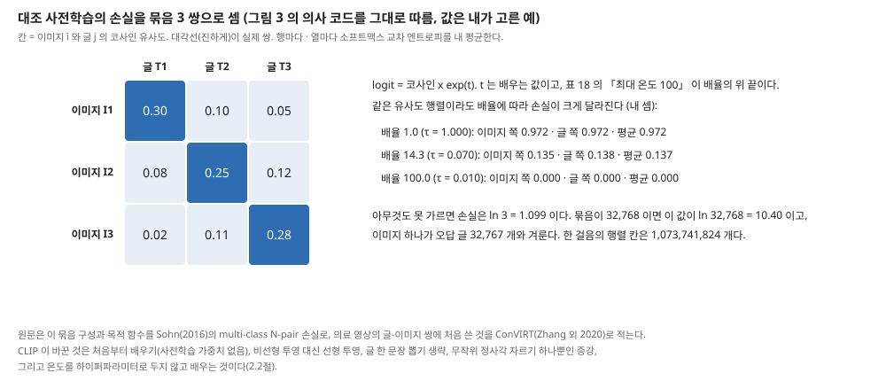
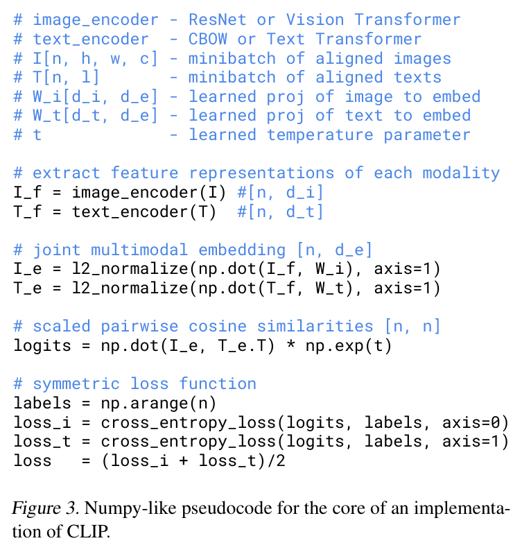
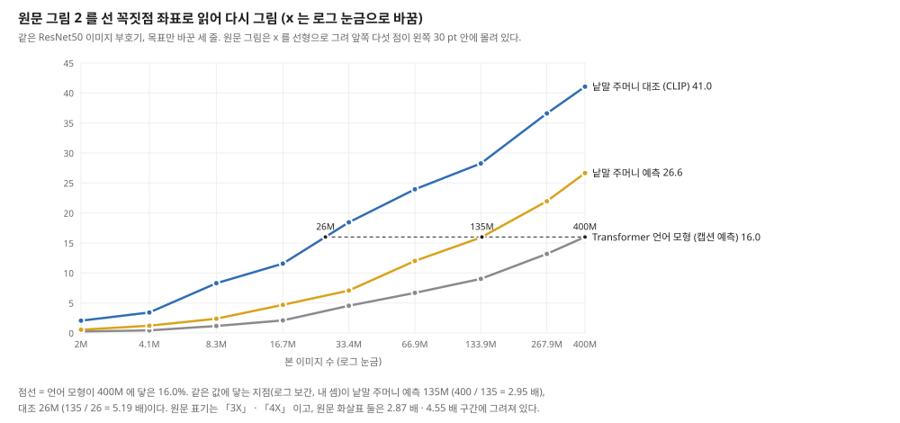
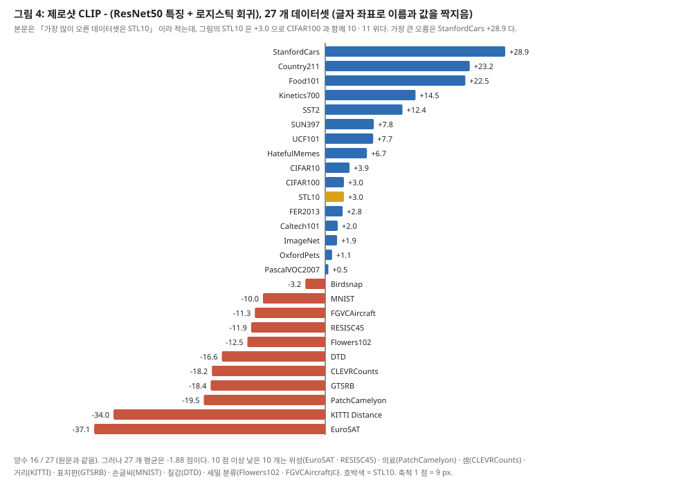
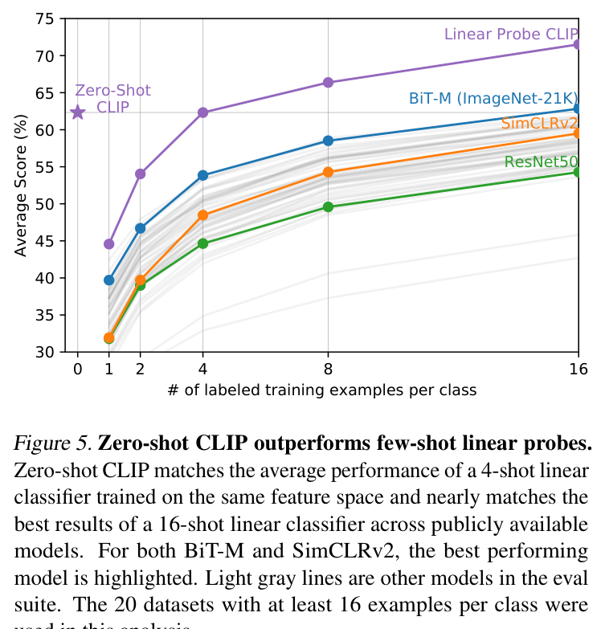
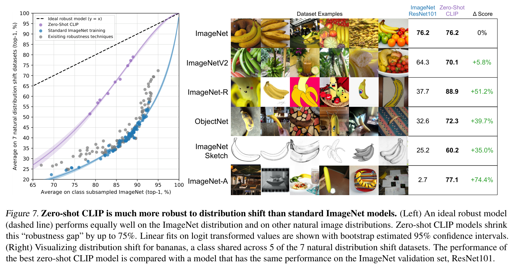
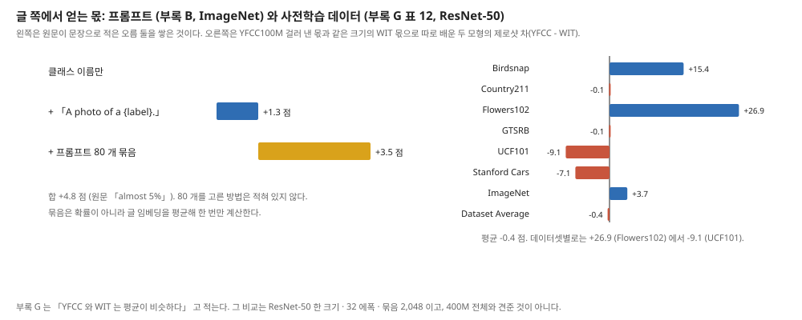

# CLIP — Learning Transferable Visual Models From Natural Language Supervision (ICML 2021, 요약)

> **한 줄.** 인터넷에서 모은 이미지-글 4 억 쌍(WIT)으로 이미지 부호기와 글 부호기를 처음부터 함께 배운다. 묶음 $N$ 쌍의 $N \times N$ 코사인 유사도에서 실제 쌍 $N$ 개를 맞히도록 하는 **대칭 교차 엔트로피(대조 손실)** 를 쓴다. 다 배운 뒤에는 클래스 이름을 「A photo of a {label}.」 같은 글로 넣어 글 임베딩을 만들고, 그것을 선형 분류기의 무게로 쓴다. 그 데이터셋의 학습 이미지를 한 장도 보지 않는다(**제로샷**). 가장 큰 모형 ViT-L/14@336px 의 ImageNet 제로샷 정확도는 76.2% 로, 128 만 장으로 배운 원래 ResNet50 과 같다.

> **이 노트에서 가장 먼저 볼 자리 다섯.** (1) **「제로샷 CLIP 이 ResNet50 특징 위 지도 학습 기준선을 앞선다(원문 「slightly」, 16 / 27)」 는 이긴 개수로만 맞다.** 그림 4 의 27 개 차를 평균하면 **−1.88 점**이고, 10 점 이상 낮은 데이터셋이 10 개다(7절). (2) **「제로샷 CLIP 이 가장 많이 오른 데이터셋은 STL10」(3.2절)이라는 문장이 그림 4 와 맞지 않는다.** 글자 좌표로 이름과 값을 짝지으면 STL10 은 +3.0 으로 CIFAR100 과 함께 10 · 11 위다. 가장 큰 오름은 StanfordCars +28.9 다(7절). (3) **그림 2 의 「3X · 4X」 를 선 좌표로 다시 읽으면 2.95 배 · 5.19 배다**(로그 보간, 내 셈). 원문 그림의 두 화살표는 2.87 배 · 4.55 배 구간에 그려져 있다. 세 줄 모두 ResNet50 한 크기, 한 번 실행이다(6절). (4) **「제로샷」 이지만 검증 집합을 거듭 보며 개발했다고 6절이 스스로 적는다.** 프롬프트를 데이터셋마다 손으로 고르고 ImageNet 에 80 개를 묶었는데, 어떤 데이터로 골랐는지 적혀 있지 않다. 부록 B 는 Flowers102 · GTSRB 에 클래스 이름 매핑이 없어 「제로샷 전이가 아예 막힌다」 고 적는데, 그림 4 에는 두 데이터셋의 제로샷 값이 있다(11 · 16절). (5) **이 큰 틀(제로샷 이상 탐지)로 가져갈 자리는 부록 C 의 한 단락이다.** 저자들이 CLIP 자신의 특징으로 중복 이미지를 찾으려다 그만둔 까닭이 둘이다. 하나는 특징 공간이 의미 유사도 쪽으로 쏠려 있다는 것이다. 다른 하나는 털 · 줄무늬 같은 고주파 질감 이미지를 다른 크기 조정 방법으로 줄이면 유사도가 「놀랄 만큼 낮다」 는 것이다. 질감 · 미세 결함을 가르는 일과 정면으로 닿는다(10 · 19절).

---

## Paper Metadata

| Item | Content |
|---|---|
| Title | Learning Transferable Visual Models From Natural Language Supervision |
| Authors | Alec Radford\*, Jong Wook Kim\*, Chris Hallacy, Aditya Ramesh, Gabriel Goh, Sandhini Agarwal, Girish Sastry, Amanda Askell, Pamela Mishkin, Jack Clark, Gretchen Krueger, Ilya Sutskever (\* 공동 기여) |
| 소속 | OpenAI (열둘 모두) |
| Conference / Journal | **ICML 2021**, PMLR 139 (첫 쪽 여백에 찍혀 있다) |
| Year | 2021 |
| DOI | 파일에 찍혀 있지 않다 |
| 원 출처 | [PMLR 139:8748-8763 (ICML 2021)](https://proceedings.mlr.press/v139/radford21a.html) · [arXiv 2103.00020](https://arxiv.org/abs/2103.00020) (2026-11-17 두 주소가 열리고 저자 · 제목이 맞는 것을 확인) |
| 코드 | 초록에 `github.com/OpenAI/CLIP` 이 적혀 있고 「코드와 사전학습 무게를 공개한다」 고 적는다. **이 노트는 코드를 보지 않았다** |
| Stored PDF | 본문 · 보충 자료 두 파일. 경로는 23절 |
| 왜 읽었는가 | 2026-11-17 에 고른 큰 틀 「CLIP 계열 제로샷 이상 탐지(CLIP → WinCLIP → AnomalyCLIP)」 의 첫 칸. 이 저장소의 이상 탐지 여덟 편(PatchCore 에서 EfficientAD 까지)은 모두 장면마다 정상 이미지로 따로 배운다. 뒤 두 편은 그 전제를 없애고 CLIP 의 이미지-글 유사도로 판정한다. 그 판정의 원 출처를 먼저 읽는다 |
| 읽은 범위 | **2026-11-17 에 읽었다.** 본문 1 \~ 9 쪽 전부(1 \~ 8절, 감사, 표 1, 그림 1 \~ 7 과 캡션). 보충 자료 25 쪽 가운데 A.2 \~ A.4 의 글, B(제로샷 분석, 그림 13 \~ 16 캡션), C(데이터 겹침, 그림 17 캡션), D(분포 이동, 그림 18 · 19 캡션), F(사람과 비교, 표 11 · 그림 21 캡션), G(YFCC100M 대조, 표 12), I(표 18 \~ 20). 그림 2 · 4 는 PDF 벡터 경로와 글자 좌표로 값을 읽었다(5절). **미독: 본문 참고 문헌 서지, 보충 자료 A.1(데이터셋 표 2), 표 3 · 4(데이터셋별 선형 탐침 · 제로샷 점수), 그림 9 \~ 12, E(편향 · 감시 · 향후 과제, 표 5 \~ 10, 그림 20), H(검색 · OCR · 행동 · 위치 · 강건성, 표 13 \~ 17).** 읽지 않은 절의 수치는 이 노트에 옮기지 않는다 |

### 저장한 파일의 상태

- **PMLR 게재판이다.** 본문 16 쪽(본문 9 쪽 + 참고 문헌 7 쪽), 보충 자료 25 쪽. 둘 다 PMLR 누리집에서 2026-11-17 에 받았다.
- **arXiv v1(2021-02-26, 48 쪽)은 받아 열어 보았으나 저장하지 않았고 숫자를 대조하지 않았다.** 게재판은 arXiv 판을 줄인 판이라, 다른 노트나 글에서 「CLIP 논문 n 쪽」 으로 인용된 자리가 이 파일과 맞지 않을 수 있다.
- 본문 · 보충 자료의 값과 그림에서 읽은 값을 상수로 `figures/ICML21_CLIP/data_clip.py` 에 두었다.

---

## 1. 용어

- **WIT (WebImageText)**: 이 편이 모은 이미지-글 4 억 쌍. 영어 위키백과에 100 번 이상 나온 낱말 등으로 만든 질의 50 만 개마다 최대 2 만 쌍을 담았다(2.1절). 작은 예시(내 셈): 질의 50 만 x 상한 2 만 = 100 억이므로, 4 억은 상한을 다 채운 경우의 4% 다.
- **대조 손실 (contrastive objective)**: 묶음 $N$ 쌍에서 이미지 $N$ 개와 글 $N$ 개의 코사인 유사도 $N \times N$ 을 만들고, 행마다(이미지 → 글) · 열마다(글 → 이미지) 실제 쌍을 맞히는 교차 엔트로피를 내 평균한다. 작은 예시는 4절 ② 와 그림 1.
- **온도 $\tau$ (temperature)**: 유사도에 곱하는 배율 $\exp(t) = 1/\tau$ 의 역수. 배우는 값이고, 표 18 의 「최대 온도 100」 이 배율의 위 끝이다. 작은 예시: 배율 100 이면 $\tau$ = 0.01 이다.
- **제로샷 전이 (zero-shot transfer)**: 그 데이터셋의 학습 예를 쓰지 않고 클래스 이름 글만으로 분류기를 만들어 평가하는 것. 이 편은 「보지 않은 범주」 가 아니라 「보지 않은 **데이터셋**」 으로 정의한다고 적는다(3.2절).
- **선형 탐침 (linear probe)**: 얼린 특징 위에 L2 정칙화 로지스틱 회귀를 배워 표현의 질을 재는 방식(부록 A.3).
- **프롬프트 템플릿 · 프롬프트 묶음 (prompt template · ensembling)**: 클래스 이름을 「A photo of a {label}.」 같은 문장 틀에 넣는 것이 템플릿이다. 여러 틀로 만든 글 임베딩을 **평균**해 분류기 하나로 쓰는 것이 묶음이다(부록 B). 작은 예시: ImageNet 에서 틀 하나가 +1.3 점, 80 개 묶음이 다시 +3.5 점이다.
- **유효 강건성 · 상대 강건성 (effective / relative robustness)**: Taori 외(2020)의 정의를 따른다. 상대 강건성은 분포 이동 아래 정확도의 오름 전부다. 유효 강건성은 ImageNet 정확도로 예측되는 이동 아래 정확도를 **넘는** 몫이다(3.4절).
- **점**: 정확도의 차를 「1.9 점」 처럼 적는다. 원문은 「1.9%」 로 적는다.

---

## 2. 한 문단 요약

원문의 물음은 이것이다(1절). NLP 에서는 웹 글을 그대로 쓰는 사전학습이 사람이 붙인 레이블 데이터를 넘어섰다. 비전에서도 그렇게 되는가. 앞선 시도(VirTex · ICMLM · ConVIRT)는 이미지 10 \~ 20 만 장, 가속기 며칠 규모였다. 이 편은 규모를 4 억 쌍 · V100 수백 대 x 수십 일로 키우고 목적을 「캡션 맞히기」 에서 「어느 글이 어느 이미지와 짝인가 맞히기」 로 바꾼다. 실험은 넷이다. 제로샷 분류(표 1, 그림 4 · 5, 부록 B), 선형 탐침(그림 6), 자연 분포 이동(그림 7, 부록 D), 데이터 겹침 검사(4절, 부록 C)다. 사회적 영향(5절)과 한계(6절)를 본문에 둔다.

---

## 3. 문제 / 동기

**이 논문이 없앤 전제: 비전 모형은 미리 정한 고정 범주 집합으로 배우고, 새 범주를 쓰려면 그 범주의 레이블 데이터가 더 필요하다.**

원문이 적은 앞선 연구의 문제는 셋이다.

1. **고정 범주 지도는 일반성을 제한한다**(초록). 새 시각 개념마다 레이블 데이터가 필요하다.
2. **글로 배운 앞선 모형은 규모가 작았다**(1절). VirTex · ICMLM · ConVIRT 는 가속기 며칠 · 이미지 10 \~ 20 만 장이고, 같은 시기 Instagram · JFT 계열은 가속기 몇 년 · 이미지 수백만 \~ 수십억 장이다. 원문은 차이의 원인을 「규모」 라 적는다. **같은 규모에서 목적만 바꾼 비교는 그림 2 하나다.**
3. **기존 이미지-글 데이터는 작거나 메타데이터가 거칠다**(2.1절). MS-COCO · Visual Genome 은 학습 사진 10 만 장 안팎이다. YFCC100M 은 1 억 장이지만 영어 제목 · 설명이 있는 것만 남기면 1,500 만 장으로 6 분의 1 이 된다.

---

## 4. 핵심 기술

**① 데이터 WIT (2.1절).** 공개 인터넷 출처에서 이미지-글 4 억 쌍을 모았다. 질의 목록은 영어 위키백과에 100 번 이상 나온 낱말, 점별 상호 정보가 높은 두 낱말 묶음, 검색량이 많은 위키백과 문서 제목, WordNet 동의어 집합이다(각주 1). 질의마다 최대 2 만 쌍으로 클래스 균형을 맞췄다고 적는다(원문 「approximately class balance」, 질의별 실제 쌍 수는 적혀 있지 않다). 전체 낱말 수가 GPT-2 의 WebText 와 비슷하다고 적는다. **어떤 「공개 출처」 인지, 걸러 낸 규칙(성인물 · 중복 · 언어)은 읽은 범위에 적혀 있지 않다.** 부록 G 는 YFCC100M 을 걸러 낸 몫이 WIT 의 3.7% 라 적는다(1,500 만 / 4 억 = 3.75%, 내 셈).

**② 목적 함수 (2.2절, 그림 3).** 묶음 $N$ 쌍에서

$$\ell_{ij} = \exp(t) \cdot \frac{f(I_i)^\top g(T_j)}{\lVert f(I_i) \rVert \, \lVert g(T_j) \rVert}, \qquad \mathcal{L} = \frac{1}{2}\left[ \frac{1}{N}\sum_i \mathrm{CE}\big(\ell_{i,\cdot}, i\big) + \frac{1}{N}\sum_j \mathrm{CE}\big(\ell_{\cdot,j}, j\big) \right]$$

이다. $f$ · $g$ 는 이미지 · 글 부호기 뒤의 **선형 투영**(비선형 투영 없음)이다. 식은 그림 3 의 의사 코드를 내가 식으로 옮긴 것이고, 원문 본문에는 식이 없다. 원문은 이 묶음 구성과 목적을 Sohn(2016)의 multi-class N-pair 손실로, 글-이미지 쌍에 처음 쓴 것을 ConVIRT(Zhang 외 2020, 의료 영상)로 인용한다. ConVIRT 에서 바꾼 것은 다섯이다. 처음부터 배우기, 선형 투영만, 글에서 한 문장 뽑기를 뺌, 무작위 정사각 자르기 하나만 남긴 증강, 온도를 배우는 값으로 둔 것이다.

작은 예시(내 셈, 그림의 3 x 3 행렬): 배율 1 이면 손실 0.972 로 아무것도 못 가를 때의 $\ln 3$ = 1.099 와 가깝다. 배율 14.3($\tau$ = 0.07)이면 0.137 이고, 배율 100 이면 0.000 이다. 대각선이 행마다 0.13 \~ 0.20 만 높아도 배율이 크면 손실이 0 에 닿는다. 묶음이 32,768 이면 한 걸음의 logit 이 1,073,741,824 개이고, 이미지 하나가 오답 글 32,767 개와 겨룬다.

**③ 부호기 (2.3절, 표 19 · 20).** 이미지 쪽은 둘이다. ResNet 계열은 ResNet-D 개선, 앤티앨리어싱 blur 풀링, 전역 평균 풀링 대신 **주의 풀링**(평균 풀링한 표현을 질의로 하는 QKV 주의 한 층)을 쓴다. ViT 계열은 조각 + 자리 임베딩 뒤에 층 정규화를 하나 더하고 초기화 방식을 바꿨다(원문 「slightly different」, 무엇인지는 적혀 있지 않다). 글 쪽은 GPT-2 식 수정을 한 Transformer 이고, 기본 12 층 · 폭 512 · 머리 8, 소문자 BPE 다. [EOS] 자리의 마지막 층 활성을 층 정규화 · 선형 투영해 글 임베딩으로 쓴다. 가려진 자기 주의를 쓴 까닭은 언어 모형 보조 목적을 붙일 여지를 남기려는 것이고, 그 실험은 하지 않았다고 적는다. ResNet 은 폭 · 깊이 · 해상도를 함께 키우고(EfficientNet 식), 글 부호기는 폭만 키운다. 「글 부호기에 덜 민감했다」 가 근거이고 잰 값은 없다.

**글 부호기 파라미터(내 셈).** 12 층 x 3,152,384 + 낱말 임베딩 49,408 x 512 + 자리 임베딩 = **63,165,952 개(63.2 백만)** 다. MLP 폭을 4 배로, 문맥 길이를 77 로 놓은 셈이고 **둘 다 읽은 범위에 적혀 있지 않은 내 가정이다**(문맥 길이 몫은 39,424 개로 합의 0.06%). 2.2절의 「6,300 만 파라미터 Transformer 언어 모형」(캡션 예측 기준선)과 같은 크기다. 그 기준선이 CLIP 글 부호기와 같은 구조인지는 원문에 적혀 있지 않다.

**④ 학습 (2.4절, 표 18).** ResNet 다섯(RN50 · RN101 · RN50x4 · x16 · x64)과 ViT 셋(B/32 · B/16 · L/14)을 배웠다. 묶음 32,768, 32 에폭, 가중치 감쇠 0.2, 예열 2,000 걸음, 낱말 49,408, 최대 온도 100, Adam(β2 = 0.999 ResNet · 0.98 ViT). 32 에폭 x 4 억 = 128 억 장, 390,625 걸음이다(내 셈). RN50x64 는 V100 592 대로 18 일(10,656 GPU 일), ViT-L/14 는 256 대로 12 일(3,072 GPU 일)이다(내 곱셈, 3.47 배). ViT-L/14 는 336 화소로 한 에폭 더 배워 **ViT-L/14@336px** 를 만들고, 따로 적지 않으면 「CLIP」 은 이 모형이다.

**⑤ 제로샷 분류기 (2.5절, 그림 1 (2)(3), 부록 B).** 데이터셋의 클래스 이름 전부를 글 후보로 넣고, 이미지와 코사인이 가장 큰 글을 고른다. 글 임베딩 $K$ 개가 곧 선형 분류기의 무게 $K$ 줄이다. 클래스 이름만 넣는 것보다 「A photo of a {label}.」 이 낫고, 데이터셋마다 틀을 바꾸면(「..., a type of pet.」, 위성 영상이면 「a satellite photo of a {label}.」, OCR 이면 따옴표) 더 낫다고 적는다. 여러 틀의 글 임베딩을 **확률이 아니라 임베딩 공간에서 평균**해 한 번만 계산한다. ImageNet 은 80 개를 묶는다.

**적혀 있지 않은 설정 (읽은 범위).** WIT 의 출처 · 거르기 규칙, 온도의 초깃값, 문맥 길이, 글 부호기의 MLP 폭, 학습률 일정, 데이터셋마다 프롬프트를 고른 데이터(6절은 「검증 집합을 거듭 조회했다」 고 적는다), ImageNet 80 개 틀의 목록과 고른 방법, Flowers102 · GTSRB 의 클래스 이름을 어디서 얻었는지, 어느 표에도 반복 수가 없다는 것.

---

## 5. 평가 (읽은 범위) · 그림을 읽은 방법

- **데이터:** 제로샷은 27 개(그림 4), 표 1 의 셋(aYahoo · ImageNet · SUN), 부록 B 의 36 개 데이터셋 39 개 평가(그림 16). 선형 탐침은 Kornblith 외(2019)의 12 개와 이 편의 27 개(그림 6). 분포 이동은 ImageNet 변형 7 개(그림 7).
- **지표:** 정확도(대부분 top-1). 데이터셋마다 다른 지표가 있다고 부록 A 가 적는데, 그 표(표 2)는 읽지 않았다.
- **비교 상대:** 선형 탐침은 공개된 모형 50 개 넘게(EfficientNet · Noisy Student · Instagram ResNeXt · BiT · ViT · SimCLRv2 · BYOL · MoCo · ResNet). **모두 저자들이 같은 로지스틱 회귀 절차로 다시 잰 값이다**(부록 A.3: 끝에서 둘째 층 특징, L-BFGS 최대 1,000 반복, 정칙화 세기 $10^{-6}$ \~ $10^{6}$ 를 검증 몫에서 이분 탐색).
- **장비:** V100(학습). 평가 장비는 적혀 있지 않다.
- **반복:** 읽은 범위의 어느 표 · 그림에도 반복 수가 없다. 부록 A.4 는 「각 데이터셋 최고 점수의 Clopper-Pearson 99.5% 신뢰 구간 안이면 최고와 같은 것으로 센다」 는 규칙을 쓴다. 이것은 시험 표본 수에서 오는 흩어짐이고 학습 실행 사이 흩어짐이 아니다.

**그림을 읽은 방법.** 그림 2 · 4 는 PDF 벡터다. 그림 2 는 선 세 개의 꼭짓점(각 9 개)을 PyMuPDF `get_drawings()` 로 뽑았다. x 는 눈금 글자 2M(76.19 pt) · 400M(281.04 pt) 사이 선형, y 는 0(221.12 pt) · 40(74.98 pt) 글자 가운데로 환산했다. 눈금 글자가 있는 여섯 자리(2M · 33M · 67M · 134M · 268M · 400M)에서 꼭짓점의 x 가 글자 가운데와 0.01 pt 안에서 같아, 꼭짓점 9 개가 측정점이다. 그림 4 는 막대 대신 **이름 글자와 값 글자의 상자 세로 가운데**를 짝지었다. 27 쌍 모두 가운데 차가 0.0 pt 다.

---

## 6. 목적을 바꾸면 — 그림 2 (2.2절)

| 본 이미지 수 (백만) | 2 | 4.1 | 8.3 | 16.7 | 33.4 | 66.9 | 133.9 | 267.9 | 400 |
|---|---:|---:|---:|---:|---:|---:|---:|---:|---:|
| Transformer 언어 모형 (캡션 예측) | 0.25 | 0.44 | 1.17 | 2.10 | 4.54 | 6.69 | 9.03 | 13.18 | **16.01** |
| 낱말 주머니 예측 | 0.54 | 1.22 | 2.39 | 4.69 | 7.08 | 12.01 | 15.91 | 21.96 | **26.65** |
| 낱말 주머니 대조 (CLIP) | 2.05 | 3.42 | 8.30 | 11.57 | 18.45 | 23.96 | 28.26 | 36.60 | **41.05** |

(제로샷 ImageNet 정확도 %, 내가 좌표로 읽은 값)

- **「3X」 · 「4X」 를 다시 내면(셈 4).** 언어 모형이 400M 에서 닿은 16.01% 에 낱말 주머니 예측은 135.4M 에 닿는다(로그 보간, 2.95 배). 대조는 26.1M 에 닿는다(예측 대비 **5.19 배**, 언어 모형 대비 15.3 배). 선형 보간이면 2.94 배 · 4.95 배다. 원문 그림의 화살표는 395.8M → 138.1M(2.87 배), 129.7M → 28.5M(4.55 배) 구간에 그려져 있다. **「4X」 는 그림의 선보다 작게 적힌 값이다.**
- **같은 목적끼리만 바꾼 줄이 아니다.** 언어 모형 → 낱말 주머니 예측은 글 쪽 구조(Transformer → 낱말 주머니)와 목적(문장 생성 → 낱말 집합 예측)이 함께 바뀐다. 낱말 주머니 예측 → 대조만 같은 글 부호기에서 목적 하나를 바꾼 비교다.
- 세 줄 모두 ResNet50 이미지 부호기 한 크기, 한 번 실행이다. 「언어 모형이 ResNet50 의 두 배 계산을 쓴다」 는 값이 붙어 있지 않다.
- 400M 은 WIT 한 에폭에 해당하는 수지만, 이 실험이 WIT 전체를 썼는지, 학습률 일정이 같았는지 적혀 있지 않다.

---

## 7. 제로샷 분류 — 표 1, 그림 4 · 5, 부록 B

**표 1 (Visual N-Grams 대비).** aYahoo 72.4 → 98.4, ImageNet 11.5 → 76.2, SUN 23.0 → 58.5. 원문 스스로 「많은 차이를 통제하지 않은 비교」 라 적는다. 더 가까운 비교로 CLIP ResNet50 을 Visual N-Grams 와 같은 YFCC100M 에서 배웠더니, V100 하루 안에 그 편의 ImageNet 값에 닿았다고 적는다. **그 값과 설정은 표에 없다.**

**그림 4 (제로샷 CLIP − ResNet50 특징 + 로지스틱 회귀, 27 개).**

- **이긴 수 16 / 27 은 맞다**(양수 16, 셈 5). **평균은 −1.88 점, 중앙값 +1.9 점이다.** 원문 문장 「outperforms this baseline slightly」 는 이긴 개수로만 맞고 평균으로는 반대다.
- **「가장 많이 오른 데이터셋은 STL10」 은 그림과 다르다.** STL10 은 +3.0 이고, 위로 StanfordCars +28.9 · Country211 +23.2 · Food101 +22.5 · Kinetics700 +14.5 · SST2 +12.4 · SUN397 +7.8 · UCF101 +7.7 · HatefulMemes +6.7 · CIFAR10 +3.9 가 있다. 같은 단락이 STL10 의 99.3% 를 「새 SOTA 로 보인다」 고 적는다. 「가장 많이 오른」 이 이 절대 정확도를 뜻한 것으로 읽힐 수는 있으나 문장은 「improves by the most」 다.
- **10 점 이상 낮은 10 개**는 위성(EuroSAT −37.1 · RESISC45 −11.9), 거리(KITTI −34.0), 림프절 종양(PatchCamelyon −19.5), 표지판(GTSRB −18.4), 셈(CLEVRCounts −18.2), 질감(DTD −16.6), 꽃(Flowers102 −12.5), 항공기(FGVCAircraft −11.3), 손글씨(MNIST −10.0)다. 원문은 「전문 · 복잡 · 추상 과제에서 약하다」 로 묶는다. **질감(DTD)이 이 목록에 있다는 것은 이 큰 틀에 닿는다**(19절).
- 행동 인식 둘(Kinetics700 +14.5 · UCF101 +7.7)은 본문 문장과 같다. 원문의 해석 「글이 동사가 든 개념을 더 넓게 지도한다」 는 잰 것이 아니라 추측이라 적혀 있다(「We speculate」).

**그림 5 (적은 표본 선형 탐침과 견줌, 16 장 이상인 20 개 데이터셋).** 원문은 제로샷 CLIP 이 같은 특징 공간의 **4 장** 로지스틱 회귀 평균과 같고, 다른 모형 가운데 가장 좋은 16 장 분류기(BiT-M ResNet152x2)와 같다고 적는다(원문 「nearly matches」 · 「roughly matches」, 차의 값은 그림에만 있고 읽지 않았다). **반복 · 흩어짐이 없고, 20 개 평균이다.** 부록 B 의 데이터셋별 셈(그림 14)으로는 제로샷과 같아지는 장 수가 1 장 미만(Flowers102 · EuroSAT)에서 184 장까지이고, 중앙값 5.4 · 평균 20.8 이다. **ImageNet 은 16 장**과 같다.

**부록 B 의 둘.** 제로샷 정확도와 전체 지도 선형 탐침 정확도의 상관은 0.82 다(그림 15). 제로샷이 선형 탐침에 3 점 안으로 닿는 데이터셋은 5 개(STL10 · CIFAR10 · Food101 · OxfordPets · Caltech101)이고, 다섯 모두 두 정확도가 90% 를 넘는다. 선형 회귀 기울기 1.28 의 95% 구간은 0.93 \~ 1.79 로 1 을 품는다. 원문도 이렇게 적는다. 계산량 44 배 범위의 ResNet 다섯에서 평균 제로샷 오류가 로그-로그 직선을 따른다(그림 16). 원문은 개별 평가가 시끄럽다고 적고(「much noisier」, 흩어짐의 값은 없다), 그것이 실행 사이 흩어짐인지 계산량에 대한 비단조인지 모른다고 적는다.

---

## 8. 표현 학습 — 그림 6 (3.3절, 부록 A.4)

- Kornblith 외의 12 개 평균에서 가장 큰 CLIP 이 Noisy Student EfficientNet-L2 를 점수 · 계산 효율 둘 다 앞서고(원문 「slightly」, 점수 차는 그림에만 있다), ViT-L/14@336px 는 기존 최고보다 평균 2.6 점 높다고 적는다. 27 개로 넓히면 그 차가 5 점이다.
- **CLIP ViT 가 CLIP ResNet 보다 계산 효율이 3 배** 높다고 적는다(그림 6, 순전파 GFLOPs 기준). 그림 6 의 점 값은 읽지 않았다.
- 부록 A.4: ViT-L/14@336px 가 27 개 중 21 개에서 최고 구간 안이고, Noisy Student EfficientNet-L2 보다 21 / 27 에서 높다. GTSRB +14.7 을 「ImageNet-1K 가 모든 교통 표지를 한 레이블로 묶는 문제」 의 증거일 수 있다고 적는다. 추측으로 적힌 문장이다.
- **선택 편향을 원문이 스스로 짚는다.** 12 개 묶음은 ImageNet 과 겹치는 과제 쪽으로 치우쳤을 수 있다고 적고 27 개를 더했다. 그런데 6절은 그 27 개가 「CLIP 의 능력과 함께 맞춰진(co-adapted)」 묶음이라 적는다(15절).

---

## 9. 자연 분포 이동 — 그림 7 (3.4절), 부록 D

| | ImageNet | V2 | A | R | ObjectNet | Sketch |
|---|---:|---:|---:|---:|---:|---:|
| ImageNet ResNet101 | 76.2 | 64.3 | 2.7 | 37.7 | 32.6 | 25.2 |
| 제로샷 CLIP | 76.2 | 70.1 | 77.1 | 88.9 | 72.3 | 60.2 |
| 차 (그림의 값) | 0 | +5.8 | +74.4 | +51.2 | +39.7 | +35.0 |

- **오른쪽 판의 뺄셈은 여섯 모두 맞다**(셈 6). 이 다섯 이동의 평균은 ResNet101 32.50 · CLIP 73.72 이고, ImageNet 과의 틈이 43.70 → 2.48 로 94% 준다(내 셈). 원문의 「강건성 틈을 최대 75% 줄인다」 는 왼쪽 판(7 개 이동, 로짓 변환 직선)의 값이라 범위가 다르다.
- **원인을 가르는 실험이 부록 D 에 있다.** CLIP 특징 위에 ImageNet 로지스틱 회귀를 배우면 ImageNet 은 9.2 점 올라 85.4% 가 되고(76.2 + 9.2, 셈 맞음), 이동 평균은 내려간다(원문 「slightly decreases」, 평균의 차는 그림 18 에만 있고 읽지 않았다). 데이터셋별로 ImageNet-R −4.7 · ObjectNet −3.8 · Sketch −2.8 · A −1.9 이고 V2 만 오른다. 그림 19 는 1 장 → 128 장 → 전체 지도로 갈수록 유효 강건성이 준다고 보인다. 원문의 결론은 「분포 특정 학습 데이터를 줄이는 것이 유효 강건성을 낳는 것으로 보인다」 이고, 왜 그런지는 「확신 있는 답이 없다」 고 적는다.
- 오른쪽 판의 바나나 예시는 다섯 데이터셋이 공유하는 한 클래스의 그림이다. 표의 수치는 각 데이터셋 전체의 값이다.

---

## 10. 데이터 겹침 — 4절, 부록 C

- 35 개 데이터셋 중 9 개는 겹침이 검출되지 않았다. 겹침 비율 중앙값 2.2% · 평균 3.2% 다. 전체 정확도가 0.1 점 넘게 바뀐 것이 7 개이고, Bonferroni 보정 뒤 유의한 것은 2 개다. 가장 큰 오름은 Birdsnap 0.6 점(겹침 12.1%)이다. 가장 많이 겹친 Country211(21.5%, YFCC100M 에서 만든 데이터셋)은 0.2 점이다.
- 본문은 「보정 뒤 2 개」 를, 부록 그림 17 은 「한쪽 이항 검정으로 6 개」 · 「99.5% 구간이 0 을 빼는 것 5 개」 를 적는다. 세 수는 다른 검정의 값이다.
- **중복 검출기를 따로 만든 까닭이 이 큰 틀에 닿는다.** 처음에 CLIP 자신의 임베딩 최근접으로 중복을 찾으려 했는데 두 문제가 있었다고 적는다. (가) 특징 공간이 **의미 유사도로 크게 쏠려**, 같은 말로 묘사될 서로 다른 물체(축구공, 같은 종의 꽃)가 유사도가 1 에 닿았다(원문 「almost perfect」, 값은 없다). (나) 털 · 줄무늬 같은 **고주파 질감**의 이미지를 다른 보간(최근접 대 쌍선형)으로 크기 조정하면 유사도가 「놀랄 만큼 낮았다」. 그래서 자르기 · 비율 왜곡 · 축소 확대 · 회전 · JPEG · HSV 를 섞은 증강으로 ResNet-50(가중치 정규화, GELU)을 InfoNCE(온도 0.07 고정)로 따로 배웠다. 묶음 1,712, 3,000 만 장이다.
- 원문이 적은 한계: 4 억 장 전체에서 검출기의 재현율을 확인할 수 없다. Overlap 과 Clean 의 분포가 다를 수 있다(Kinetics-700 의 「겹침」 은 많은 수가 검은 전환 프레임이라 겹침 몫이 20 점 낮게 나온다).

---

## 11. 프롬프트와 사전학습 데이터 — 부록 B · G

- **프롬프트.** ImageNet 에서 「A photo of a {label}.」 하나가 +1.3 점, 80 개 묶음이 다시 +3.5 점, 합 +4.8 점이다(원문 「almost 5%」, 셈 맞음). 36 개 데이터셋 평균으로도 5 점 아래의 오름이고(원문 「almost 5 points」, 그림 13 에서 값은 읽지 않았다), 같은 기준 방법에서 계산을 4 배 쓴 것과 같은 몫이라 적는다(그림 13). **데이터셋마다 틀을 어떤 데이터로 골랐는지, 80 개를 어떻게 골랐는지 읽은 범위에 적혀 있지 않다.**
- **다의어.** ImageNet 에 건설 크레인과 나는 두루미(crane)가 둘 다 있고, Oxford-IIIT Pets 의 boxer 는 개 품종인데 글 부호기는 권투 선수로도 읽을 수 있다고 적는다. 클래스 이름이 유일한 정보면 생기는 문제다.
- **Flowers102 · GTSRB.** 부록 B 는 두 데이터셋의 공개판에 번호 → 이름 매핑이 없어 보여 「제로샷 전이를 아예 막는다」 고 적는다. 그런데 그림 4 에는 두 데이터셋의 제로샷 값(−12.5 · −18.4)이 있고, 표 12 에도 있다. **이름을 어디서 얻었는지 적힌 문장은 읽은 범위에 나오지 않았다.**
- **부록 G (YFCC100M 대 같은 크기 WIT, ResNet-50, 32 에폭, 묶음 2,048).** 평균은 선형 −1.1 · 제로샷 −0.4 점(YFCC − WIT)이고, 데이터셋마다는 제로샷 Flowers102 +26.9 에서 UCF101 −9.1 까지 갈린다. 원문은 「걸러 낸 이미지-글 데이터면 된다(any reasonably filtered collection)」 고 읽고, WIT 의 이점을 크기(「much larger size」, 4 억 대 1,500 만)로 추측한다. **크기를 바꾼 비교는 이 표에 없다.** 표 12 는 선형 차가 가장 큰 쪽 · 작은 쪽 셋씩만 보이고 나머지 데이터셋 값은 이 표에 없다. 이긴 수의 합이 선형 25 · 제로샷 37 로 평가 수가 다르다. 그 까닭(비긴 칸 · 평가 묶음 차이)은 적혀 있지 않다.

---

## 12. 사람과 견줌 — 부록 F

Oxford-IIIT Pets 시험 3,669 장, 37 품종, 사람 다섯. 정확도는 제로샷 사람 53.7 · 1 장 75.7 · 2 장 75.7 · 제로샷 CLIP 93.5 다. 사람은 0 → 1 장에서 +22.0 점, 1 → 2 장에서 +0.0 점이다(전체 정확도 기준, 「추측」 만 세면 80.3 → 85.0). 원문은 사람의 오름이 「모르는 줄 아는」 이미지에 몰려 있다고 읽는다. CLIP 의 적은 표본 선형 탐침은 제로샷보다 떨어질 수 있다(6절 한계). 사람은 이전 지식을 쓰고 이 편의 적은 표본 방법은 그러지 못한다는 해석이 원문에 있다. 사람 다섯의 흩어짐은 적혀 있지 않다.

---

## 13. 사회적 영향 — 5절 (본문만 읽음)

FairFace 인종 레이블에 「criminal」 · 「animal」 같은 모욕적 낱말 몇 개를 섞으면 0 \~ 20 세 사람 이미지의 32.3% 가 모욕적 범주로 간다. 「child」 를 넣으면 8.7% 로 준다. CelebA 유명인 식별은 후보 100 명에서 top-1 59.2%, 1,000 명에서 43.3% 다. **부록 E 의 표 5 \~ 10 은 읽지 않았다.** 원문의 요지는 「클래스를 어떻게 설계하느냐가 성능과 편향을 함께 정한다」 이다. 이 노트의 큰 틀과의 접점은 같은 문장이다. 이상 탐지에서도 「정상 · 결함」 을 어떤 글로 적느냐가 결과를 바꿀 것이다(19절).

---

## 14. 실험 분석 — 표 · 그림마다

| 표 · 그림 | 무엇을 바꿨나 | 무엇을 고정했나 | 결과 | 반복 · 흩어짐 | 주장이 결과보다 센가 |
|---|---|---|---|---|---|
| 그림 2 | 글 쪽 목적 · 구조 셋 | ResNet50, 본 이미지 수 | 400M 에서 16.0 · 26.7 · 41.1% | 없음 | 「4X」 는 선으로 5.19 배. 언어 모형 → 낱말 주머니는 구조와 목적이 함께 바뀐다 |
| 표 1 | 방법 둘 | 데이터셋 셋 | ImageNet 11.5 → 76.2 | 없음 | 원문 스스로 통제하지 않은 비교라 적는다 |
| 그림 4 | 데이터셋 27 | 제로샷 CLIP 대 RN50 선형 탐침 | 16 / 27 승, 평균 −1.88 | 없음 | 「slightly outperforms」 는 승수로만. 「STL10 이 가장 많이 오름」 은 그림과 다르다 |
| 그림 5 · 14 | 레이블 장 수 0 \~ 16 | CLIP 특징, 20 개 | 제로샷 = 4 장 평균, 데이터셋별 1 미만 \~ 184 | 없음 | 「평균」 과 「데이터셋별」 이 다른 그림을 준다(ImageNet 은 16 장) |
| 그림 6 | 모형 50+ | 같은 로지스틱 회귀 절차 | 12 개 +2.6, 27 개 +5 | 시험 표본 신뢰 구간만 | 27 개 묶음이 CLIP 과 함께 맞춰졌다고 원문이 적는다 |
| 그림 7 | 모형 · 이동 7 | ImageNet 정확도를 맞춘 짝 | 오른쪽 다섯 틈 94% 감소(내 셈) | 왼쪽 판에 부트스트랩 95% 구간 | 「최대 75%」 는 왼쪽 판 기준. 원인은 부록 D 가 「데이터 양」 쪽으로 좁힌다 |
| 부록 D 그림 18 · 19 | ImageNet 에 맞추기 · 장 수 | CLIP 특징 | ImageNet +9.2, 이동 평균 내림(「slightly」, 값은 그림에만) | 없음 | 원문이 「확신 있는 답이 없다」 고 적는다 |
| 4절 · 부록 C | 겹침 유무 | RN50x64 제로샷 | 최대 +0.6 (Birdsnap) | 이항 검정 · 신뢰 구간 | 재현율을 확인할 수 없다고 원문이 적는다 |
| 부록 B 그림 13 | 프롬프트 | 모형 다섯 | +4.8 (ImageNet) | 없음 | 프롬프트를 고른 데이터가 적혀 있지 않다 |
| 부록 G 표 12 | 사전학습 데이터 둘 | RN50, 크기, 32 에폭 | 평균 −0.4 · −1.1 | 없음 | 「WIT 의 이점은 크기」 는 크기를 바꾸지 않은 표에서 낸 추측 |
| 부록 F 표 11 | 사람 0 · 1 · 2 장 | Oxford Pets | 53.7 → 75.7 → 75.7 | 사람 다섯, 흩어짐 없음 | 해석(「모르는 줄 안다」)은 「추측」 열로 뒷받침 |

---

## 15. 이 논문이 스스로 적은 한계 (6절)

1. **제로샷 CLIP 은 ResNet-50 선형 탐침 기준선과 「대개 겨룰 만한」 수준이고, 그 기준선은 전체 SOTA 보다 한참 아래다.** 27 개 묶음에서 SOTA 에 닿으려면 계산이 1,000 배 정도 필요하다고 추정하고 「지금 하드웨어로는 불가능」 이라 적는다. 추정 방법은 읽은 범위에 없다.
2. **제로샷을 강조했지만 개발 중에 검증 집합의 성능을 거듭 조회했다.** 「참 제로샷 시나리오에는 비현실적」 이라 원문이 적는다.
3. **27 개 평가 묶음은 되는 대로 모은 것(원문 「somewhat haphazard」)이고 CLIP 의 능력과 함께 맞춰졌다.** 넓은 제로샷 전이를 재는 새 벤치마크가 필요하다고 적는다.
4. **글로 분류기를 적는 방식의 한계.** 복잡한 과제는 글로 적기 어렵다. CLIP 은 적은 표본 성능을 직접 최적화하지 않아, 제로샷에서 적은 표본으로 넘어갈 때 성능이 떨어지는 「반직관적」 일이 생긴다.

---

## 16. 원문 안의 어긋남 모음

| 자리 | 원문 | 맞대 보니 | 내 판단 |
|---|---|---|---|
| 3.2절 | 「The dataset zero-shot CLIP improves by the most is STL10」 | 그림 4 의 STL10 +3.0 (10 · 11 위), 가장 큰 오름 StanfordCars +28.9 | 문장과 그림이 다르다 |
| 3.2절 | 「Zero-shot CLIP outperforms this baseline slightly」 | 16 / 27 승, 평균 −1.88 | 승수로만 맞다 |
| 그림 2 | 「4X efficiency」 | 선으로 5.19 배(로그 보간) · 4.95 배(선형), 화살표 구간 4.55 배 | 작게 적은 값 |
| 부록 B 대 그림 4 | Flowers102 · GTSRB 「preventing zero-shot transfer entirely」 | 그림 4 · 표 12 에 두 데이터셋 제로샷 값 | 이름을 얻은 방법이 적혀 있지 않다 |
| 2.2절 | 「to avoid turning as a hyper-parameter」 | 「tuning」 | 낱말 오기 |
| 2.2절 대 표 18 | 온도를 하이퍼파라미터로 두지 않는다 | 「Maximum temperature 100.0」 이 하이퍼파라미터로 표에 있다 | 위 끝은 하이퍼파라미터다 |
| 3.2절 | 「existing image classification datasets in the manner described above」 | 문장 끝 마침표가 없다 | 글 오기(3.1절 문장을 옮겨 둔 자리) |
| 그림 7 캡션 대 오른쪽 판 | 「up to 75%」 | 오른쪽 다섯 이동으로 94%(내 셈) | 왼쪽 판(7 개, 로짓 직선) 기준의 값 |
| 4절 대 부록 C | 「only 2 are statistically significant after Bonferroni」 | 그림 17 은 이항 검정 6 개 · 구간 5 개 | 다른 검정의 수. 부록은 같은 몫을 「Overlap」 · 「Dirty」 두 이름으로 부른다 |
| 2.1절 | 「collected form a variety of」 | 「from」 | 낱말 오기 |
| 부록 A.2 | 「EfficietNet」 | EfficientNet | 낱말 오기 |
| 부록 D | 「ImageNet datatset」 | dataset | 낱말 오기 |

---

## 17. 논문이 적지 않은 것 — 내가 읽으며 짚은 자리

1. **반복이 없다.** 그림 16 에서 원문 스스로 개별 평가가 시끄럽다(「much noisier」)고 적고 그것이 실행 사이 흩어짐일 수 있다고 적는다. 그런데 그림 2 · 4 · 5 · 13 과 표 12 는 모두 한 번 값이다.
2. **프롬프트 고르기가 평가와 분리되었는지 알 수 없다.** 15절 2 와 겹친다. 이 큰 틀의 다음 편들이 「프롬프트를 손으로 만든다」 · 「프롬프트를 배운다」 로 갈리는데, 그 출발점부터 고른 데이터가 적혀 있지 않다.
3. **대조 목적과 규모의 몫이 갈리지 않는다.** 그림 2 는 RN50 · 400M 장까지의 한 조건이다. 같은 규모에서 캡션 예측을 끝까지 배운 줄은 없다(부록 A.2 의 「LM RN50」 은 선형 탐침 표 3 에 있고, 그 표는 읽지 않았다).
4. **WIT 의 구성이 재현 가능하게 적혀 있지 않다.** 출처, 거르기, 질의별 실제 쌍 수 분포가 없다.
5. **이상 탐지 · 분할은 다루지 않는다.** 픽셀 단위 출력도 없다. 이미지 하나에 임베딩 하나다. 뒤 두 편이 조각 단위 판정을 어떻게 얻는지가 이 큰 틀의 첫 물음이다.

---

## 18. 앞 노트와 맞춰 보기

**ViT 노트.** CLIP 의 가장 좋은 이미지 부호기가 ViT-L/14 다. 원문은 ViT 구현을 따랐고(「closely follow」) 조각 + 자리 임베딩 뒤 층 정규화 하나와 초기화만 바꿨다고 적는다. 「데이터가 크면(sufficiently large datasets) ViT 가 합성곱보다 계산 효율이 높다」 는 ViT 원문의 결과를 CLIP 의 선형 탐침에서 다시 본다고 적는다(3 배). ViT 노트의 JFT-300M 대신 WIT 4 억 쌍이다.

**Transformer · BERT 노트.** 글 부호기는 GPT-2 식 Transformer 이고 가려진 자기 주의를 쓴다. BERT 는 사전학습 뒤 과제마다 미세조정한다. CLIP 은 사전학습 뒤 과제를 **글로 적어** 무게를 만든다. 둘의 차이가 이 편 1절의 동기(GPT-3 의 제로샷)다.

**ResNet · Wide ResNet 노트.** CLIP ResNet 은 ResNet-D 개선 · blur 풀링 · 주의 풀링을 더한 변형이라, PatchCore · EfficientAD 가 쓰는 torchvision WRN 특징과 단계 구성이 다를 수 있다. 이 편은 ResNet 의 중간 층 특징을 쓰지 않는다(선형 탐침도 끝에서 둘째 층).

**EfficientAD · PatchCore 노트.** 그 편들은 ImageNet 분류 특징을 얼려 쓰고, 정상 이미지로 장면마다 무언가(뱅크 · 학생 · 판별기)를 배운다. CLIP 의 제로샷은 그 장면의 이미지를 한 장도 쓰지 않는다. EfficientAD 노트 9절에서 짚은 「시험 값으로 설정 고르기」 는 이 편에서도 15절 2 로 원문이 스스로 적는다.

---

## 19. 내가 가져갈 것

**하나. 이 큰 틀로 가져갈 경고 둘.** (가) 그림 4 에서 질감(DTD −16.6) · 의료 영상(PatchCamelyon −19.5) · 위성 영상이 크게 낮다. (나) 부록 C 에서 CLIP 특징은 의미 쪽으로 쏠리고, 고주파 질감의 작은 차이(크기 조정 방법)에 둔하다. 산업 결함은 대개 「같은 물체의 미세한 질감 차이」 다. WinCLIP · AnomalyCLIP 이 이 두 약점을 어떻게 다루는지(조각 단위, 프롬프트, 추가 학습)를 다음 칸에서 본다.

> 2026-11-18 AnomalyCLIP 을 읽고: 경고 (가) 는 그 편의 비교 상대 CLIP(두 문장 프롬프트, 백본은 적혀 있지 않다)에서 화소 단위로 나온다. MVTec AD 질감 다섯의 화소 AUROC 평균이 25.14 로 우연(50) 아래이고, 의료 분할 여섯도 모두 50 아래다. 그 편이 프롬프트와 조각 지도를 다른 데이터셋의 마스크로 배우면 질감 다섯이 94.6 \~ 98.8, 의료 분할 여섯이 78.9 \~ 89.7 이 된다. 그 편의 「제로샷」 은 대상 데이터셋 이미지를 쓰지 않을 뿐, 다른 데이터셋의 마스크로는 배운다(넷째 자리와 이어진다).

**둘. 「이긴 수」 와 「평균」 을 함께 본다.** 16 / 27 승인데 평균 −1.88 이었다. 표가 데이터셋별 차를 주면 승수와 평균을 둘 다 낸다.

**셋. 그림 속 배수 표기는 선으로 다시 낸다.** 「4X」 가 선으로는 5.19 배였다. 그림에 적힌 숫자와 그림의 선이 다를 수 있다.

**넷. 「제로샷」 이라는 말의 범위를 확인한다.** 이 편의 제로샷은 「그 데이터셋의 학습 예를 쓰지 않는다」 이고, 「개발 중 그 데이터셋을 보지 않았다」 가 아니다(15절 2). 다음 편들이 「제로샷 이상 탐지」 라 할 때도 무엇을 안 봤는지부터 확인한다.

**다섯. 지금 확인된 것은 여기까지다.** 논문이 잰 것은 27 개(선형 탐침 · 제로샷) · 12 개(선형 탐침) · 이동 7 개의 정확도, 목적 셋의 학습 곡선, 겹침 검사, 프롬프트 · YFCC 대조, 사람 비교이고 모두 한 번 값이다. 논문이 말만 한 것은 동사 개념의 지도, ImageNet 레이블의 좁음, WIT 이점이 크기라는 것, 1,000 배 계산 추정이다. 내가 책상에서 센 것은 손실 예시 · 묶음 · 걸음 · GPU 일 · 글 부호기 파라미터(가정 둘) · 그림 2 의 배수 · 그림 4 의 평균과 순위 · 그림 7 의 틈 · 부록 B · D · G 의 덧셈이다.

---

## 20. 남는 질문

- **조각 단위의 이미지-글 유사도는 쓸 만한가?** CLIP 은 이미지 하나에 임베딩 하나다. WinCLIP 이 창으로 자른 조각에 CLIP 을 다시 돌리는지, 중간 특징을 쓰는지 본다.
- **「정상」 · 「결함」 을 어떤 글로 적어야 하나?** 이 편의 프롬프트 몫(+4.8)과 다의어 문제가 이상 탐지에서 어떤 꼴로 나오는지.
- **질감 차이에 둔한 특징 공간으로 MVTec AD 의 질감 다섯 부류를 어떻게 가르나?** 부록 C 의 관찰이 다음 편의 질감 부류 점수에 나오는지 본다.
- **CLIP 사전학습 데이터에 MVTec AD · VisA 이미지가 들어 있었나?** 읽은 범위(4절 · 부록 C 의 글과 그림 17 의 이름표)에 산업 이상 탐지 데이터셋 이름은 나오지 않았다. 35 개의 전체 목록은 읽지 않은 부록 표에 있을 수 있다.
- **Flowers102 · GTSRB 의 클래스 이름은 어디서 왔나?** 읽지 않은 부록 A.1 · 표 2 나 코드에 있을 수 있다.

> 2026-11-17 WinCLIP(CVPR 2023)을 읽고 앞 세 물음에 답한 것. (1) 조각 단위: WinCLIP 은 중간 특징이 아니라 **창으로 가린 이미지를 CLIP 에 다시 넣어** 창마다 클래스 토큰을 얻는다. ViT 의 마지막 층 조각 토큰을 그대로 쓰면 MVTec AD 0 장 pAUROC 가 22.4 로 우연 아래였다. (2) 글: 상태 낱말 11 개(정상 7 · 결함 4) x 문장 틀 22 개를 쪽마다 평균한다. 이 편의 ImageNet 80 개 묶음은 그 과제에서 AUROC 를 +0.1(MVTec AD) · −1.1(VisA) 바꿨고, 상태 낱말 묶음이 +15.8 을 냈다. 22 개 틀 가운데 18 개는 이 편의 80 개 목록에 있는 문장이다. (3) 질감: 0 장 분류에서는 MVTec AD 질감 다섯이 평균 99.64 로 물체 열(87.90)보다 높아 경고가 나타나지 않았고, 분할의 작은 결함 실패로 나타났다. 다만 WinCLIP 의 기본 백본은 OpenAI CLIP 이 아니라 OpenCLIP 의 LAION-400M ViT-B/16+ 라, 이 노트의 WIT 관련 관찰이 그대로 옮겨지지는 않는다. 넷째 물음(사전학습 데이터에 MVTec AD · VisA 가 있었나)은 WinCLIP 도 확인하지 않았다.

> 2026-11-18 AnomalyCLIP 을 읽고 넷째 물음에: 그 편은 이 편의 ViT-L/14@336px 를 그대로 쓰는데 산업 · 의료 데이터셋과의 겹침 검사가 없다. 답은 나오지 않았다.

---

## 21. 다음에 읽을 것

**이 큰 틀(CLIP → WinCLIP → AnomalyCLIP)의 다음 칸은 WinCLIP(CVPR 2023)이다.** 원문은 `papers/` 에 있다. 아래는 이 노트 안에서 나온 후속 편이다.

> 2026-11-17: WinCLIP 은 같은 날 CVF 공개판(본문 + 보충 자료)으로 읽었다. 남은 칸은 AnomalyCLIP 이다.

> 2026-11-18: AnomalyCLIP 도 arXiv v8 로 읽었다. 이 큰 틀은 끝났다.

| 논문 | 이 노트의 어느 자리에서 나오는가 | 무엇을 확인하고 싶은가 | 원문 참고 문헌 |
|---|---|---|---|
| **ConVIRT** — Contrastive learning of medical visual representations from paired images and text (Zhang 외, 2020) | 4절 ② | CLIP 이 「단순화」 했다는 원판. 비선형 투영 · 글 한 문장 뽑기 · 증강을 왜 넣었나 | Zhang et al. (2020) |
| **Multi-class N-pair loss** (Sohn, NIPS 2016) | 4절 ② | 묶음 안 대조 손실의 원 출처 | Sohn (2016) |
| **Visual N-Grams** — Learning visual n-grams from web data (Li 외, ICCV 2017) | 7절 | 표 1 의 비교 상대, 「YFCC100M 에서 하루 안에 같은 값」 의 조건 | Li et al. (2017) |
| **Taori 외** — Measuring robustness to natural distribution shifts in image classification (NeurIPS 2020) | 1 · 9절 | 유효 · 상대 강건성의 정의와 로짓 직선 | Taori et al. (2020) |
| **arXiv 판 CLIP** (2103.00020, 48 쪽) | 저장한 파일의 상태 · 17절 3 | 게재판에서 빠진 LM RN50 비교, 온도 초깃값, 문맥 길이가 적혀 있는가 | — |

---

## 22. 참고 문헌

- Dosovitskiy, A. 외 (2020). An image is worth 16x16 words (ViT). — 2026-11-05 에 ICLR 2021 게재판으로 읽었다.
- Vaswani, A. 외 (2017). Attention is all you need. NIPS. — 2026-11-04 에 읽었다.
- Devlin, J. 외 (2018). BERT. — 2026-11-05 에 NAACL 2019 게재판으로 읽었다.
- He, K. 외 (2016a). Deep residual learning. CVPR. — ResNet 노트.
- Zhang, Y. 외 (2020). ConVIRT. — **읽지 않았다.**
- Sohn, K. (2016). Improved deep metric learning with multi-class N-pair loss objective. — **읽지 않았다.**
- Li, A. 외 (2017). Visual N-Grams. — **읽지 않았다.**
- Taori, R. 외 (2020). Measuring robustness to natural distribution shifts. — **읽지 않았다.**
- Kornblith, S. 외 (2019). Do better ImageNet models transfer better? — **읽지 않았다.** 12 개 선형 탐침 묶음의 출처.
- Radford, A. 외 (2019). GPT-2. — **읽지 않았다.** 글 부호기 구조의 출처.
- 이 편 밖: Jeong, J. 외 (2023). WinCLIP. CVPR. · Zhou, Q. 외 (2024). AnomalyCLIP. ICLR. — 이 큰 틀의 다음 두 칸, 원문을 받아 두었다. WinCLIP 은 2026-11-17 에 CVF 공개판(본문 + 보충 자료)으로, AnomalyCLIP 은 2026-11-18 에 arXiv v8 로 읽었다.

---

## 23. 경로

| 무엇 | 어디 |
|---|---|
| 원문 PDF (PMLR 게재판 본문 16 쪽) | `papers/ICML21_CLIP_Learning_Transferable_Visual_Models_From_Natural_Language_Supervision.pdf` |
| 원문 보충 자료 (25 쪽) | `papers/ICML21_CLIP_Learning_Transferable_Visual_Models_From_Natural_Language_Supervision_Supplemental.pdf` |
| 이 노트 | `notes/ICML21_CLIP_Learning_Transferable_Visual_Models_From_Natural_Language_Supervision.md` |
| 이 노트의 그림 (직접 그린 것) | `figures/ICML21_CLIP/fig01_contrastive_example.svg` 부터 `fig05_lineage.svg` 까지 다섯 |
| 이 노트의 그림 (원문에서 잘라 낸 것) | `figures/ICML21_CLIP/paper_fig1_overview.png` · `paper_fig3_pseudocode.png` · `paper_fig5_fewshot.png` · `paper_fig7_robustness.png` |
| 표 값 · 그림에서 읽은 값 상수 | `figures/ICML21_CLIP/data_clip.py` — 그림 2 · 4 · 7, 표 1 · 11 · 12 · 18 \~ 20, 부록 B · C · D 의 문장 값 |
| 그림과 다시 계산한 값을 만드는 코드 | `figures/ICML21_CLIP/make_figures.py` — 표준 라이브러리만 쓰고 바깥 데이터를 읽지 않는다. `python make_figures.py` 로 셈 1 \~ 8(손실 예시 · 묶음과 GPU 일 · 글 부호기 파라미터 · 그림 2 배수 · 그림 4 평균과 순위 · 표 1 과 그림 7 과 부록 B · D · 표 12 · 표 11)을 찍고 그림 다섯을 쓴다 |
| 원문 그림을 잘라 내는 코드 | `figures/ICML21_CLIP/crop_paper_figures.py` — PyMuPDF 가 필요하다 |
| 그림 좌표를 읽은 방법 | 5절. PyMuPDF 의 `get_drawings()` 로 선 꼭짓점을, `get_text("dict")` 로 글자 상자를 뽑아 환산 · 짝지었다. 이 읽기 코드는 저장소에 넣지 않았고 읽은 값만 상수 파일에 두었다 |
