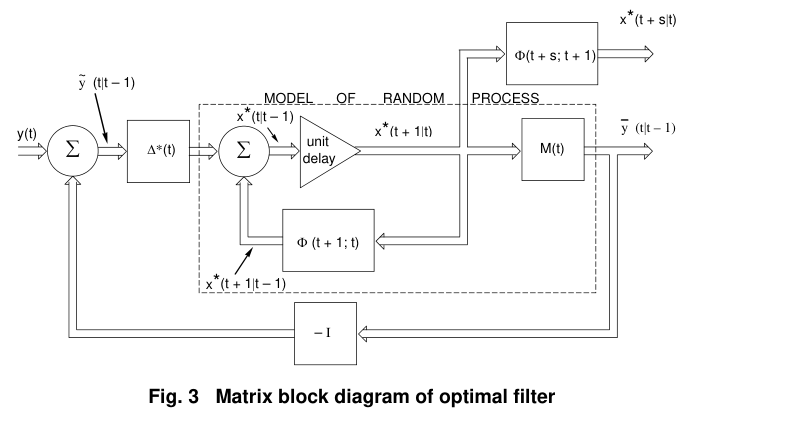
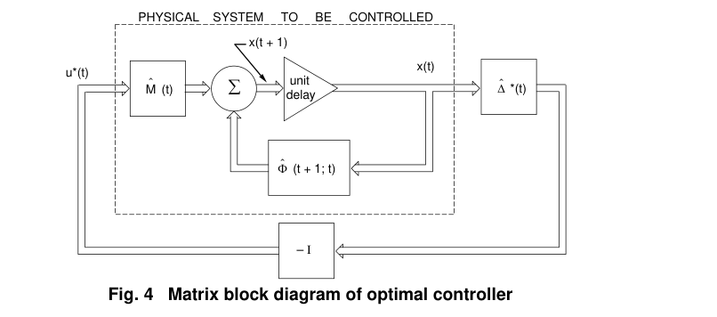
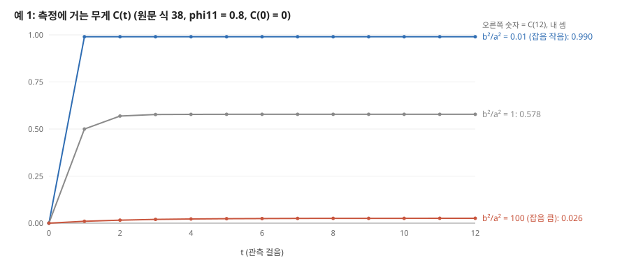
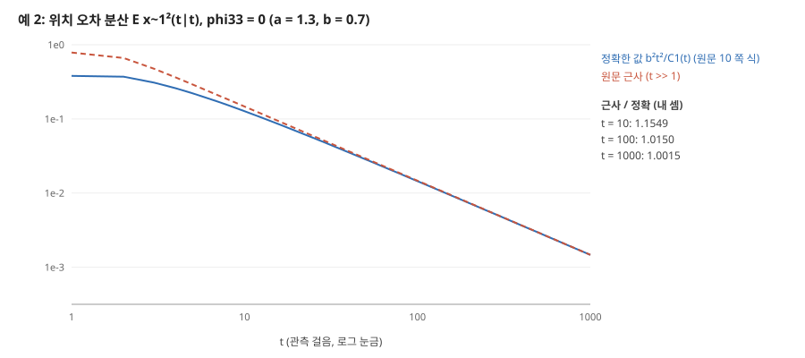

# 칼만 필터 — A New Approach to Linear Filtering and Prediction Problems (Journal of Basic Engineering 1960, 요약)

> **한 줄.** 신호를 「서로 독립인 가우스 잡음이 움직이는 선형 상태 모형」 $x(t+1) = \Phi(t+1;t)\,x(t) + u(t)$, $y(t) = M(t)\,x(t)$ 로 두고(식 16 · 17), 최적 추정을 **관측들이 펼치는 공간으로의 직교 사영**으로 본다(정리 2). 새 관측 $y(t)$ 에서 앞 관측으로 설명되는 몫을 빼고 남은 것(이 노트의 **혁신**)만 받아 추정을 고치면, 최적 예측기가 앞 추정을 상태로 갖는 선형 되먹임 계 $x^{st}(t+1 \mid t) = \Phi^{st}\,x^{st}(t \mid t-1) + \Delta^{st}\,y(t)$ 가 된다(식 21). 가중치 $\Delta^{st}$ 는 오차 공분산 $P^{st}(t)$ 에서 바로 나오고, $P^{st}$ 는 비선형 차분 식 하나(식 32)로 걸음마다 갱신된다. 원문이 스스로 새 것이라 한 것은 정리 3(이 풀이)과 정리 4(최적 조절 문제와의 쌍대) 둘이다. **수치 실험은 없고**, 닫힌 꼴로 푼 예 둘이 있다.

> **이 노트에서 가장 먼저 볼 자리 다섯.** (1) **원문 식에는 측정 잡음 항이 따로 없다.** $y = Mx$ 이고, 측정 잡음은 상태의 한 좌표로 넣는다(예 1 의 $x_2$). 오늘 교과서 꼴($z = Hx + v$, 공분산 $R$)과 같은지 셈으로 맞췄다. 측정 잡음을 상태에 넣은 원문 꼴과 $R$ 이 있는 꼴의 예측값 차가 60 걸음 동안 최대 $8.9 \times 10^{-16}$ 이다(7절, 셈 8). (2) **원문의 가중치 $\Delta^{st}$ 는 오늘 칼만 이득 $K$ 에 전이 행렬을 곱한 것이다.** $\Delta^{st} = \Phi K$ 이고, 원문 식 (21) 은 「갱신 한 번 + 예측 한 번」 을 한 줄에 접은 예측기 꼴이다(7절). (3) **혁신이 백색이라는 것을 원문이 적는다**(맺음말 (m), 8 쪽). 모형이 맞으면 혁신은 시점끼리 직교한다. 이 성질을 이상 탐지 점수로 쓰는 것은 원문에 없고 내 연결이다(15절). (4) **재입력판에서 어긋남 열셋을 찾았다.** 그중 식 (32) 의 끝 곱 $P^{st}(t)M(t)$ 는 크기가 맞지 않아 곱이 정의되지 않는다. $M(t)P^{st}(t)$ 로 고치면 식 (30) 과 같다(차 $1.1 \times 10^{-14}$, 셈 2). 정리 2 증명의 (A) · (B) 는 서로 뒤바뀌어 있다. 원판 스캔과 대조하지 않아 원판의 오식인지 재입력의 오식인지 가르지 못했다(14절). (5) **예 1 · 예 2 의 닫힌 꼴은 식 (28) \~ (30) 을 돌린 값과 계산 정밀도 안에서 맞는다**(최대 차 $5.1 \times 10^{-15}$, 셈 3 · 5). 다만 예 1 의 $\Phi^{st}$ (1,2) 칸은 원문이 0 으로 적고, 돌린 값은 $-\phi_{11} C(t)$ 다. 원문이 「잡음의 예측값이 늘 0 이라 이 칸을 0 으로 둘 수 있다」 고 밝힌 자리다(9절).

---

## Paper Metadata

| Item | Content |
|---|---|
| Title | A New Approach to Linear Filtering and Prediction Problems |
| Authors | R. E. Kalman (단독) |
| 소속 | Research Institute for Advanced Study, Baltimore, Md. (각주의 주소 7212 Bellona Ave.) |
| Conference / Journal | **Transactions of the ASME, Journal of Basic Engineering 82 (Series D), 35-45쪽** |
| Year | 1960 (3 월호). ASME 접수 1959-02-24, 1959-03-29 \~ 04-02 Instruments and Regulators Conference 발표, Paper No. 59-IRD-11 |
| DOI | 10.1115/1.3662552 |
| 원 출처 | ASME 게재판은 무료 공개를 확인하지 못했다. 읽은 파일은 [Yale 사본](https://www.cs.yale.edu/homes/yry/readings/general/Kalman1960.pdf) 이다. 2026-11-18 에 받았고 171,508 바이트 · 12 쪽이다. UNC Welch 의 사본 주소(`cs.unc.edu/~welch/kalman/media/pdf/Kalman1960.pdf`)는 같은 날 PDF 대신 HTML 을 돌려줘 받지 못했다 |
| 코드 | 1960 년 논문이라 없다 |
| Stored PDF | 재입력판 12 쪽 한 파일. 경로는 21절 |
| 연구비 | U. S. Air Force Office of Scientific Research, Contract AF 49 (638)-382 (각주 1) |
| 왜 읽었는가 | 큰 틀 「시계열 이상 탐지(Kalman → Telemanom → OmniAnomaly → Anomaly Transformer)」 의 첫 칸. 뒤 세 편이 모두 「앞을 예측하고 어긋남을 잰다」 는 틀을 쓰는데, 그 틀의 원형이 이 편이다. 이 저장소의 이상 탐지 노트 열두 편은 모두 이미지를 다뤄, 시간 축이 있는 데이터는 이 편부터다 |
| 읽은 범위 | **2026-11-18 에 읽었다.** 본문 1 \~ 10 쪽 전부(머리 요약, Introduction, Notation Conventions, Optimal Estimates, Orthogonal Projections, Models for Random Processes, Solution of the Wiener Problem, The Dual Problem, Applications, Conclusions, 표 1, 그림 3 · 4), 부록(11 쪽, 확률 과정 기초와 정리 5), 참고 문헌 29 편 목록, 재입력자 설명(12 쪽). **그림 1 · 2(연속 · 이산 선형계의 행렬 블록도)는 글자 층의 조각만 보고 그림으로 보지 않았다.** 예 1 · 2 의 행렬은 쪽을 그림으로 그려 읽었다. 참고 문헌의 본문은 한 편도 읽지 않았다 |

### 저장한 파일의 상태

- **원판을 스캔한 것이 아니라 John Lukesh 가 2002 년에 다시 입력한 판이다.** 12 쪽 가운데 1 \~ 11 쪽이 본문이고, 원 게재 쪽(35 \~ 45, 11 쪽)과 쪽 수가 같다. 12 쪽은 재입력자의 설명이다. 재입력자는 원판 복사본을 보고 Word 로 옮겼고, 쪽과 줄 바꿈을 원판에 맞췄다고 적는다.
- **재입력자가 스스로 밝힌 한계.** 평문은 OCR 로 옮겨 정확하다고 보지만, 아래 · 위 첨자와 식은 손으로 옮겨 틀린 자리가 있을 수 있다고 적는다. 원판의 오식으로 보이는 것도 고치지 않고 두었다고 적고, 그 예로 식 (32) 의 $P^{st}(t)M(t)$ 를 든다. 그래서 이 노트의 식은 **글자로 옮긴 뒤 셈으로 맞춰 본 것**만 확정으로 적는다(셈 1 \~ 9).
- **식 대조에 해설서 하나를 썼다.** Welch · Bishop, 「An Introduction to the Kalman Filter」(UNC TR 95-041, 2006-07-24 수정판)의 표 1-1 · 1-2(식 1.9 \~ 1.13)만 봤고, 해설서의 나머지는 읽지 않았다. 이 노트에서 「교과서 꼴」 은 그 다섯 식을 뜻한다.

---

## 1. 용어

원문은 위너(Wiener)의 틀에서 출발해 「Wiener problem」 이라 부르는데, 이 노트는 원문의 이름을 괄호로 두고 아래 이름을 쓴다.

- **추정 (estimation)**: 관측 $y(t_0), \dots, y(t)$ 로 보이지 않는 $x(t_1)$ 의 값을 맞히는 일. 원문은 셋을 하나로 묶는다. $t_1 < t$ 면 다듬기(smoothing), $t_1 = t$ 면 거르기(filtering), $t_1 > t$ 면 예측(prediction)이다. 작은 예시: 0 \~ 10 걸음의 관측으로 11 걸음의 상태를 맞히면 예측이고, 10 걸음의 상태를 맞히면 거르기다.
- **상태 (state)**: 원문의 정의는 「계의 앞으로의 움직임을 예측하는 데 알아야 할 과거 정보의 최소량」 이다(5 쪽). 이 노트에서 $x(t)$ 는 $n$ 개 수의 벡터다. 작은 예시(원문 예 2): 일정한 속도로 움직이는 입자 하나는 위치 · 속도 · 측정 잡음의 세 수가 상태다.
- **전이 행렬 $\Phi(t+1; t)$ (transition matrix)**: 상태를 한 걸음 앞으로 보내는 $n \times n$ 행렬. 시간에 따라 바뀌어도 된다. 작은 예시(예 2): 위치 · 속도 상태에서 $\begin{bmatrix}1&1\\0&1\end{bmatrix}$ 는 「새 위치 = 위치 + 속도, 새 속도 = 속도」 다.
- **관측 행렬 $M(t)$**: 상태에서 보이는 값을 고르는 $p \times n$ 행렬($p \le n$). 교과서 꼴의 $H$ 다. 작은 예시(예 2): $M = [1\ 0\ 1]$ 이면 「위치 + 잡음」 하나만 보인다.
- **구동 잡음 $u(t)$ · 그 공분산 $Q(t)$**: 상태를 흔드는 독립 가우스 잡음과 그 공분산($Q(t) = E\,u(t)u'(t)$). 원문은 5 쪽에서 이 공분산을 $G(t)$ 라 적었다가 6 쪽부터 $Q(t)$ 로 적는다(14절). 이 노트는 $Q$ 로 쓴다.
- **최적 추정 $x^{st}(t_1 \mid t)$**: $y(t_0), \dots, y(t)$ 가 주어졌을 때 기대 손실을 가장 작게 하는 $x(t_1)$ 의 추정. 별표는 「최적」 이라는 표시다.
- **직교 · 직교 사영 (orthogonal projection)**: 평균이 0 인 확률 변수 $u, v$ 가 $E\,uv = 0$ 이면 직교라 한다. $Y(t)$ 를 $y(t_0), \dots, y(t)$ 의 선형 결합 전체로 두면, 어떤 $x$ 든 $Y(t)$ 안의 몫 $\bar{x}$ 와 $Y(t)$ 에 직교하는 몫 $\tilde{x}$ 로 한 가지로만 쪼개진다(식 9). $\bar{x}$ 가 직교 사영이다. 원문은 이것을 $\hat{E}[x \mid Y(t)]$ 로 적는다.
- **혁신**: 새 관측 $y(t)$ 에서 앞 관측이 펼치는 공간 $Y(t-1)$ 으로 설명되는 몫을 뺀 나머지, $\tilde{y}(t \mid t-1) = y(t) - M(t)\,x^{st}(t \mid t-1)$ (식 20). **원문에는 이 이름이 없다.** 원문은 「$y(t)$ 의 $Y(t-1)$ 에 직교하는 성분」 이라 적는다. 오늘 교과서가 쓰는 이름(innovation)을 가져왔다. 작은 예시: 예측한 위치가 3.0 이고 잰 값이 3.4 면 혁신은 0.4 다.
- **예측 오차 공분산 $P^{st}(t)$**: $\tilde{x}(t \mid t-1) = x(t) - x^{st}(t \mid t-1)$ 의 공분산(식 26). 교과서 꼴의 $P^-_k$(사전 오차 공분산)와 같은 것이다. 대각합이 기대 제곱 손실이다(식 27).
- **가중치 $\Delta^{st}(t)$**: 혁신을 추정에 얼마나 넣을지 정하는 $n \times p$ 행렬(식 19 · 25). 원문은 「최적 거르기」 의 별표라 적고 따로 이름을 주지 않는다. 교과서 꼴의 칼만 이득 $K$ 와는 $\Delta^{st} = \Phi K$ 관계다(7절). **이 노트는 원문 식을 말할 때 「가중치 $\Delta^{st}$」, 교과서 식을 말할 때 「이득 $K$」 로 가른다.**
- **쌍대 (dual)**: 두 문제의 식에서 행렬을 전치하고 시간을 거꾸로 하면 한 문제의 식이 다른 문제의 식이 되는 관계(정리 4). 여기서는 추정 문제(문제 I)와 잡음 없는 최적 조절 문제(문제 II)다.

---

## 2. 한 문단 요약

원문의 출발점은 위너 거르개다. 위너는 정상(통계가 시간에 따라 바뀌지 않는) 신호의 예측 · 분리 문제를 위너-호프 적분 방정식으로 풀었고, 그 뒤 연구들이 경우를 넓혔다(35 쪽). 원문은 이 방법들의 실제 쓰임을 막는 한계 넷을 든다(3절). 그리고 같은 문제를 **상태와 상태 전이**로 다시 세운다. 신호를 백색 가우스 잡음이 움직이는 선형계의 출력으로 두면(식 16 · 17), 최적 추정은 관측 공간으로의 직교 사영이고(정리 2), 새 관측의 혁신만 받아 고치는 되먹임 식(식 21)이 나온다. 가중치는 오차 공분산의 비선형 차분 식(식 32)을 $t_0$ 에서부터 걸음마다 풀면 바로 얻는다. 정상 · 비정상 통계, 관측 길이가 늘어나는 경우와 무한한 경우를 하나의 유도로 덮는다. 끝으로 이 풀이가 저자가 앞서 푼 잡음 없는 최적 조절 문제와 쌍대임을 보이고(정리 4, 표 1), 닫힌 꼴로 풀리는 예 둘을 든다. 수치 계산 결과는 「다른 곳에서 내겠다」 고 적고 싣지 않는다(9 쪽).

---

## 3. 문제 / 동기 (원문 35 \~ 36 쪽)

**이 논문이 없앤 전제: 최적 거르개는 충격 응답(impulse response)으로 주어지고, 그것을 구하려면 문제마다 적분 방정식을 새로 풀어야 한다.**

원문이 적은 위너 방법의 한계 넷(35 쪽)을 그대로 옮긴다.

1. **최적 거르개가 충격 응답으로 주어지고, 그 자료에서 실제 거르개를 짓기가 쉽지 않다.**
2. **최적 충격 응답을 수로 구하는 일이 복잡하고 기계 계산에 맞지 않는다.** 문제가 복잡해지면 빠르게 나빠진다.
3. **중요한 일반화(관측이 늘어나는 거르개, 비정상 예측)마다 유도를 새로 해야 하고**, 원문은 그 유도가 비전문가에게 「꽤 어렵다(of considerable difficulty)」 고 적는다.
4. **유도의 수학이 투명하지 않다.** 기본 가정과 그 결과가 가려진다.

원문은 이 넷을 각각 무엇으로 피했는지 짝지어 적는다(35 \~ 36 쪽의 (5) \~ (9)). (4) 는 조건부 분포와 직교 사영으로 다시 세워 피하고, 모든 계산이 1 차 · 2 차 평균만 쓴다는 것이 드러난다고 적는다. (3) 은 상태 전이로 세우면 「하나의 유도가 여러 문제를 덮는다」 고 적는다. (1) · (2) 는 오차 공분산의 차분 식을 풀면 가중치가 「더 계산 없이」 나온다는 것으로 답한다.

원문은 무엇이 자기 것인지도 적는다(36 쪽). **「정리 3 과 4 만 독창적이다.」** 다음 절(최적 추정 · 직교 사영)과 부록은 알려진 것을 이 목적에 맞게 다시 적은 것이라 한다.

---

## 4. 최적 추정은 직교 사영이다 (원문 36 \~ 38 쪽, 정리 1 · 2)

**① 손실과 조건부 기댓값 (정리 1).** 손실 $L(\varepsilon)$ 을 0 에서 0, 대칭, $|\varepsilon|$ 에 대해 줄지 않는 함수로 둔다(식 2). 예로 $a\varepsilon^2$, $a\varepsilon^4$, $a|\varepsilon|$, $a[1 - \exp(-\varepsilon^2)]$ 을 든다. 조건부 분포가 평균에 대해 대칭이고 평균 아래에서 볼록하면, 평균 손실을 가장 작게 하는 추정은 조건부 기댓값이다.

$$x_1^{st}(t_1 \mid t) = E[x_1(t_1) \mid y(t_0), \dots, y(t)] \qquad (5)$$

가우스 과정이면 조건이 늘 맞는다(따름 정리). 손실이 $\varepsilon^2$ 이면 분포 조건 없이 맞는다(정리 1-a). 원문은 증명을 Sherman(참고 문헌 25)과 Doob 에 맡긴다.

**② 직교 사영 (정리 2).** $x, y$ 의 평균이 0 이고, (A) 가우스 과정이거나 (B) 추정을 관측의 선형 함수로 묶고 손실을 $\varepsilon^2$ 로 두면, 최적 추정은 $x(t_1)$ 을 $Y(t)$ 에 직교 사영한 것이다(식 11). 핵심 식은 (10) 이다. $\bar{x}$ 가 아닌 $Y(t)$ 안의 어떤 $w$ 를 써도

$$E(x - w)^2 = E(x - \bar{x})^2 + E(\bar{x} - w)^2 \ge E(x - \bar{x})^2 \qquad (10)$$

이라 제곱 오차는 $\bar{x}$ 에서 가장 작다. 오차 $\tilde{x} = x - \bar{x}$ 가 $Y(t)$ 의 모든 벡터와 직교하기 때문에 교차항이 사라진다.

원문이 이 자리에서 끌어내는 말(37 쪽): **선형 추정을 비선형 추정으로 더 낫게 할 수 있는 것은 과정이 가우스가 아닐 때뿐이고, 그때도 3 차 이상의 분포를 볼 때뿐이다.** 그리고 스스로 이 정리의 무게를 단정하지 않는다. 물리에서 온 과정이 얼마나 가우스에 가까운지 알기 어려워, 정리 2 의 뜻이 넓은지 좁은지 정하기 어렵다고 적는다(맺음말 (e)).

**정리 2 의 증명은 (A) · (B) 의 꼬리표가 뒤바뀌어 있다.** 「(A) 는 (10) 에서 바로 나온다」 고 적는데 (10) 은 선형 · 제곱 손실의 경우, 곧 (B) 다. 「(B)」 로 적힌 증명은 직교하는 가우스 변수가 독립이라는 것을 써서 조건부 기댓값과 사영이 같음을 보이는데, 이것은 (A) 다. 바로 앞 문장도 「$\hat{E}$ 표기는 정리의 (b) 에서 왔다: 과정이 가우스면 사영이 조건부 기댓값과 같다」 고 적어, 가우스 쪽을 (b) 로 부른다(14절).

---

## 5. 확률 과정의 모형 (원문 38 \~ 40 쪽, 식 12 \~ 17)

원문은 「거시적인 무작위 현상의 근원은 서로 독립인 가우스 과정」 이라는 것을 「꽤 널리 받아들여진 사실(fairly generally accepted fact)」 로 두고, 관측된 신호의 시간 상관은 근원과 관측자 사이에 동역학계가 있어서 생긴다고 설명한다(39 쪽). 가우스 신호는 선형계를 지나도 가우스이고(정리 5 (A)), 1 차 · 2 차 평균만 알면 같은 평균 · 공분산의 가우스 과정이 하나 있으므로(정리 5 (C)), **통계 자료가 적을 때 가우스와 선형 동역학은 서로 어울리는 가정**이라고 적는다.

연속 시간 선형계 $dx/dt = F(t)x + D(t)u(t)$, $y = M(t)x$ (식 12)를 표본 주기 1 로 이산화하면

$$x(t+1) = \Phi(t+1; t)\,x(t) + \Delta(t)\,u(t), \qquad y(t) = M(t)\,x(t) \qquad (14)$$

이고, 정상계면 $\Phi(1) = \exp F$ 다. 원문이 쓰는 모형은 $\Delta = I$ 로 둔

$$x(t+1) = \Phi(t+1; t)\,x(t) + u(t) \qquad (16)$$

$$y(t) = M(t)\,x(t) \qquad (17)$$

이고, $u(t)$ 는 평균 0, 시점끼리 독립, 공분산 $Q(t)$ 인 가우스 과정이다.

**측정 잡음 항이 식 (17) 에 없다.** 측정 잡음이 있는 문제는 잡음을 상태의 한 좌표로 넣어 푼다. 예 1 에서는 신호 $x_1$ 과 잡음 $x_2$ 를 둘 다 상태에 넣고 $y_1 = x_1 + x_2$ 로 본다. 이 꼴이 교과서 꼴($R$ 이 있는 꼴)과 같은 답을 내는지는 7절에서 셈으로 맞췄다.

**원문이 따로 미뤄 둔 문제가 있다**(40 쪽). 실제로는 공분산 $E\,x(t)x'(s)$ 를 적은 자료에서 추정하고, 거기서 모형 (15) 와 $u$ 의 통계를 얻어야 한다. 원문은 이것을 「미묘하고 지금 대부분 풀리지 않은 실험 · 자료 처리 문제」 라 적고, **모형의 수를 실험 자료에서 얻는 방법은 다루지 않는다**고 밝힌다. 모형 얻기와 거르기를 함께 최적화한 연구도 저자가 아는 범위에서 없다고 적는다.

---

## 6. 풀이 — 정리 3 (원문 40 \~ 42 쪽, 식 18 \~ 32, 그림 3)

**문제 I.** 모형 (16) · (17) 에서 $y(t_0), \dots, y(t)$ 를 보고 기대 손실을 가장 작게 하는 $x^{st}(t_1 \mid t)$ 를 찾는다. 원문은 $p < n$ 이면 이 문제가 「일부 상태만 잡음 섞여 보일 때 모든 상태를 되살리는 문제」 도 품는다고 적는다.

**① 공간을 둘로 쪼갠다.** $Y(t)$ 는 $Y(t-1)$ 과, 혁신 $\tilde{y}(t \mid t-1)$ 이 펼치는 $Z(t)$ 의 합이고, 둘은 서로 직교한다. 그래서 사영도 둘로 쪼개진다.

$$x^{st}(t_1 \mid t) = \hat{E}[x(t_1) \mid Y(t-1)] + \hat{E}[x(t_1) \mid Z(t)] \qquad (18)$$

$t_1 \ge t$ 면 $u(t_1 - 1)$ 이 $Y(t-1)$ 과 독립이라 첫 항은 앞 추정을 $\Phi$ 로 한 걸음 보낸 것이 된다. 원문은 $t_1 = t + 1$ 만 자세히 다루고 나머지는 그리로 줄인다.

**② 새 몫은 혁신에 선형이다.** $\hat{E}[x(t+1) \mid Z(t)] = \Delta^{st}(t)\,\tilde{y}(t \mid t-1)$ (식 19)이고, 혁신은

$$\tilde{y}(t \mid t-1) = y(t) - M(t)\,x^{st}(t \mid t-1) \qquad (20)$$

이다. 셋을 합치면

$$x^{st}(t+1 \mid t) = \Phi^{st}(t+1; t)\,x^{st}(t \mid t-1) + \Delta^{st}(t)\,y(t) \qquad (21)$$

$$\Phi^{st}(t+1; t) = \Phi(t+1; t) - \Delta^{st}(t)\,M(t) \qquad (22)$$

**최적 추정기 자체가 식 (14) 와 같은 꼴의 선형 동역학계다.** 상태는 앞 추정, 입력은 마지막 관측, 전이 행렬은 $\Phi^{st}$ 다. 원문은 이 거르개를 실제로 지으려면 (i) 확률 과정의 모형과 (ii) $\Delta^{st}(t)$ 둘만 있으면 된다고 적는다.

그림 3 은 식 (21) 의 블록도다. 점선 안이 「확률 과정의 모형」 을 그대로 복사한 부분이고, 바깥 고리가 $-I$ 로 예측 관측 $\bar{y}(t \mid t-1)$ 을 빼 혁신을 만든다. 위 가지 $\Phi(t+s; t+1)$ 은 여러 걸음 예측(식 31)이다. **그림은 재입력자가 다시 그린 것이다.**

**③ 오차도 같은 전이 행렬로 움직인다.**

$$\tilde{x}(t+1 \mid t) = \Phi^{st}(t+1; t)\,\tilde{x}(t \mid t-1) + u(t) \qquad (23)$$

여기서 $P^{st}(t) = \operatorname{cov} \tilde{x}(t \mid t-1)$ 의 갱신 식이 나온다. 원문 식 (24) 는 둘째 줄에서 $\Phi^{st} P^{st} \Phi^{*\prime}$ 을 $\Phi^{st} P^{st} \Phi'$ 로 바꾸는데, 이유를 적지 않는다. **$\Phi^{st} P^{st} M' = 0$ 이라 두 줄이 같다**(내 유도: $\Phi^{st} P^{st} M' = \Phi P^{st} M' - \Delta^{st} M P^{st} M' = 0$, 식 25 를 넣으면 나온다). 무작위 행렬($n = 4$, $p = 2$)로 $\max|\Phi^{st} P^{st} M'| = 3.3 \times 10^{-15}$, 두 줄의 차 $1.1 \times 10^{-14}$ 이다(셈 1).

**④ 가중치.** 혁신과 새 오차가 직교해야 한다는 조건에서

$$\Delta^{st}(t) = \Phi(t+1; t)\,P^{st}(t)\,M'(t)\,[M(t)\,P^{st}(t)\,M'(t)]^{-1} \qquad (25)$$

이다. $M P^{st} M'$ 이 역행렬을 가지려면 $P^{st}$ 가 양의 정부호이고 $M$ 의 행이 일차 독립이어야 한다. 원문은 $P^{st}(t_0)$ 와 모든 $Q(t)$ 가 양의 정부호면 모든 걸음에서 이 조건이 맞는다고 적는다.

**⑤ 정리 3 의 묶음.** 걸음마다 아래 셋을 돈다($t \ge t_0$). 시작값은 $P^{st}(t_0) = E\,x(t_0)x'(t_0)$ 이다.

$$\Delta^{st}(t) = \Phi(t+1; t)\,P^{st}(t)\,M'(t)\,[M(t)\,P^{st}(t)\,M'(t)]^{-1} \qquad (28)$$

$$\Phi^{st}(t+1; t) = \Phi(t+1; t) - \Delta^{st}(t)\,M(t) \qquad (29)$$

$$P^{st}(t+1) = \Phi^{st}(t+1; t)\,P^{st}(t)\,\Phi'(t+1; t) + Q(t) \qquad (30)$$

기대 제곱 손실은 $\operatorname{tr} P^{st}(t)$ (식 27)다. $\Delta^{st}$ 와 $\Phi^{st}$ 를 지우면 $P^{st}$ 만의 비선형 차분 식이 된다(맺음말 (h)).

$$P^{st}(t+1) = \Phi(t+1; t)\,\{P^{st}(t) - P^{st}(t)\,M'(t)\,[M(t)\,P^{st}(t)\,M'(t)]^{-1}\,M(t)\,P^{st}(t)\}\,\Phi'(t+1; t) + Q(t) \qquad (32)$$

**위 식 (32) 는 고친 꼴이다.** 재입력판은 중괄호 안 끝 곱을 $P^{st}(t)M(t)$ 로 적는다. $P^{st}$ 는 $n \times n$, $M$ 은 $p \times n$ 이라 $p < n$ 이면 이 곱은 정의되지 않는다($4 \times 4$ 곱하기 $2 \times 4$). $M(t)P^{st}(t)$ 로 읽으면 식 (30) 과의 차가 $1.1 \times 10^{-14}$ 다(셈 2). 원문은 식 (32) 가 위너-호프 방정식의 자리에 있고, 그것을 푸는 것보다 「훨씬 쉬운 일(a much simpler task)」 이라 적는다. **이 「훨씬 쉬운」 은 원문에 잰 값이 없다**(12절).

**⑥ 거르기와 여러 걸음 예측.** $\Phi$ 가 역행렬을 가지면 $x^{st}(t \mid t) = \Phi(t; t+1)\,x^{st}(t+1 \mid t)$ 이고, $s \ge 1$ 이면 $x^{st}(t+s \mid t) = \Phi(t+s; t+1)\,x^{st}(t+1 \mid t)$ 다. 원문은 $s < 0$(다듬기)이면 「꽤 복잡해진다(considerable complications result)」 고 적고 다루지 않는다.

**⑦ 맺음말에서 원문이 더 적는 것.**
- (k) 거르개는 일반으로 시간에 따라 바뀐다. $\Phi$ 와 $M$ 의 시간 변화 때문이기도 하고, 추정이 $t_0$ 에서 시작해 자료가 쌓일수록 나아지기 때문이기도 하다. $\Phi, M$ 이 상수면 $t \to \infty$ 에서 정상계가 되고, 이것이 고전 위너 이론이 다룬 경우라고 적는다.
- (m) 그림 3 에서 첫 덧셈기 뒤의 신호(혁신)는 **백색 잡음이다.** $\tilde{y}(t \mid t-1)$ 이 시점끼리 직교하는 과정이기 때문이다. 원문은 이것이 「모든 위너 거르개를 되먹임 계로 지을 수 있다는 첫 엄밀한 증명」 이라 적고, 그런 거르개가 「매우 약한 가정에서」 늘 안정하다는 것은 다른 논문(참고 문헌 29)에서 보이겠다고 적는다.

---

## 7. 오늘 교과서 꼴과 맞추기 (내 셈)

오늘 흔히 쓰는 꼴은 상태 $x_k = A x_{k-1} + w_{k-1}$, 관측 $z_k = H x_k + v_k$ 이고 $w$ 의 공분산이 $Q$, $v$ 의 공분산이 $R$ 이다. Welch · Bishop 표 1-1 · 1-2 의 다섯 식은 이렇다.

$$\hat{x}^-_k = A \hat{x}_{k-1}, \qquad P^-_k = A P_{k-1} A^T + Q \qquad (\text{예측, 1.9 · 1.10})$$

$$K_k = P^-_k H^T (H P^-_k H^T + R)^{-1}, \qquad \hat{x}_k = \hat{x}^-_k + K_k (z_k - H \hat{x}^-_k), \qquad P_k = (I - K_k H) P^-_k \qquad (\text{갱신, 1.11 · 1.12 · 1.13})$$

(제어 입력 $Bu$ 는 원문 모형에 없어 뺐다.) 두 꼴의 짝은 다음과 같다.

| 원문 (1960) | 교과서 꼴 | 맞춘 방법 |
|---|---|---|
| $\Phi(t+1; t)$ | $A$ | 이름만 다르다 |
| $M(t)$ | $H$ | 이름만 다르다 |
| $Q(t)$ | $Q$ | 같다 |
| (없음, 잡음을 상태에 넣는다) | $R$ | 셈 8 |
| $x^{st}(t \mid t-1)$ | $\hat{x}^-_t$ (사전 추정) | 정의가 같다 |
| $x^{st}(t \mid t)$ | $\hat{x}_t$ (사후 추정) | 정의가 같다 |
| $P^{st}(t)$ | $P^-_t$ (사전 오차 공분산) | 정의가 같다 |
| $\Delta^{st}(t)$ | $A K_t$ | 내 유도, 셈 8 |
| 식 (21) 한 줄 | 갱신(1.12) 뒤 예측(1.9) | 내 유도 |
| 식 (30) 한 줄 | 갱신(1.13) 뒤 예측(1.10) | 내 유도 |

**$R = 0$ 일 때의 유도.** 식 (28) 은 $\Delta^{st} = \Phi \cdot P^{st} M' (M P^{st} M')^{-1}$ 이고, 뒤쪽이 $R = 0$ 인 (1.11) 의 $K$ 다. 그래서 식 (21) 은 $x^{st}(t+1 \mid t) = \Phi[x^{st}(t \mid t-1) + K(y - M x^{st}(t \mid t-1))]$, 곧 사후 추정을 한 걸음 보낸 것이다. 무작위 행렬에서 $\max|\Delta^{st} - AK| = 2.2 \times 10^{-16}$ 이다(셈 8).

**$R > 0$ 일 때.** 측정 잡음 $v$ 를 상태 끝에 붙여 $[x; v]$ 로 두고, $v(t+1) = u_2(t)$ (공분산 $R$), 관측 행렬 $[H\ \ I]$ 로 쓰면 원문 꼴이 된다. 예 1 이 신호와 잡음을 다룬 방식 그대로다. 무작위 계($n = 3$, $p = 2$, 60 걸음)에서 원문 식 (21) · (28) \~ (30) 을 붙인 상태에 돌린 값과 교과서 다섯 식을 돌린 값을 비교했다. 예측값 차 최대 $8.9 \times 10^{-16}$, 오차 공분산 차 최대 $4.4 \times 10^{-16}$ 이다(셈 8). **이 맞춤은 시작 공분산의 잡음 칸을 $R$ 로 두었을 때의 것이다.** 원문 꼴로 쓰면 상태가 $p$ 만큼 커진다. 원문 맺음말 (j) 는 최적 거르개에 상태 $n - p$ 개면 된다고 적는데, 그 줄이는 방법은 「뒤 논문에서」 다룬다고 하고 싣지 않는다.

---

## 8. 쌍대 문제 — 정리 4 (원문 42 \~ 43 쪽, 표 1, 그림 4)

**문제 II(잡음 없는 조절).** $x(t+1) = \hat{\Phi}(t+1; t)\,x(t) + \hat{M}(t)\,u(t)$ 에서, 지금 상태 $x(t)$ 가 정확히 보일 때 $\sum_{\tau = t+1}^{T} x'(\tau)\hat{Q}(\tau)x(\tau)$ 를 가장 작게 하는 제어 $u(t), \dots, u(T)$ 를 찾는다. 확률은 들어가지 않는다. 저자가 앞서 푼 답(참고 문헌 18)은 $u^{st}(t) = -\hat{\Delta}^{st}(t)\,x(t)$ (식 34)이고, 행렬들은 $T$ 에서 거꾸로 도는 식 (35) \~ (37) 로 정해진다.

**정리 4.** 식 (28) \~ (30) 의 모든 행렬 $X(t_0 + \tau)$ 를 $\hat{X}'(T - \tau)$ 로 바꾸면 식 (35) \~ (37) 이 되고, 거꾸로도 된다. 표 1 은 짝 아홉을 적는다. 관측 $y$ 와 제어 $u$, 첫 관측 $t_0$ 과 마지막 제어 $T$, 오차 공분산 $P^{st}$ 와 성능 지수의 이차 형식 $\hat{P}^{st}$, 관측 행렬 $M$ 과 제어 입력 행렬 $\hat{M}$, 구동 잡음 공분산 $Q$ 와 오차 기준의 $\hat{Q}$ 가 짝이다.

**셈으로 맞췄다.** 시간에 따라 바뀌는 무작위 계($n = 3$, $p = 2$, 12 걸음)에서 원문의 바꿈 규칙대로 $\hat{\Phi} = \Phi'$, $\hat{M} = M'$, $\hat{Q} = Q$ 를 시간 거꾸로 넣고 식 (35) \~ (37) 을 돌렸다. $\hat{P}^{st}$ 와 $P^{st}$ 의 차가 최대 $3.3 \times 10^{-13}$ 이다(셈 9). 이 셈에서 $P^{st}$ 칸 절댓값의 최댓값이 23.8 이라 상대 차로는 $1.4 \times 10^{-14}$ 다.

원문은 쌍대의 수학적 뜻을 「두 문제가 모두 식 (32) 를 푸는 일로 줄어든다」 로 적는다(맺음말 (n)). 물리적 뜻은 「흥미롭다. 왜 관측과 제어가 쌍대인가?」 라는 물음으로 남기고, 뒤 연구(참고 문헌 29)가 출력 쪽 제약과 입력 쪽 제약의 쌍대로 본다고만 적는다(맺음말 (o)).

---

## 9. 예 1 — 잡음 섞인 신호의 한 걸음 예측 (원문 43 쪽, 식 38, 그림 1)

모형: 신호 $x_1(t+1) = \phi_{11} x_1(t) + u_1(t)$, 잡음 $x_2(t+1) = u_2(t)$, 관측 $y_1 = x_1 + x_2$. 조건: $t_1 = t + 1$, $t_0 = 0$, $x_1(0) = 0$, $E u_1^2 = a^2$, $E u_2^2 = b^2$, 둘은 무상관, $\phi_{11}$ 상수.

원문의 닫힌 꼴은

$$\Delta^{st}(t) = \begin{bmatrix} \phi_{11} C(t) \\ 0 \end{bmatrix}, \quad \Phi^{st}(t+1;t) = \begin{bmatrix} \phi_{11}[1 - C(t)] & 0 \\ 0 & 0 \end{bmatrix}, \quad P^{st}(t+1) = \begin{bmatrix} a^2 + \phi_{11}^2 b^2 C(t) & 0 \\ 0 & b^2 \end{bmatrix}$$

$$C(t+1) = 1 - \frac{b^2}{a^2 + b^2 + \phi_{11}^2 b^2 C(t)}, \quad C(0) = 0 \qquad (38)$$

이다. $C(t)$ 가 측정에 거는 무게다. 원문은 $C(0) = 0$ 의 까닭을 「$x_1(0) = 0$ 이라 $y_1(0)$ 은 순수한 잡음이고 아무것도 예측하지 못한다」 로 적는다.

**셈으로 맞췄다**($a = 1.3$, $b = 0.7$, $\phi_{11} = 0.8$, $t = 1$ \~ $29$). 식 (28) \~ (30) 을 돌린 값과 위 닫힌 꼴의 차는 $\Phi^{st}$ (1,2) 칸을 빼고 최대 $2.2 \times 10^{-16}$ 이다(셈 3). **$\Phi^{st}$ (1,2) 칸은 돌린 값이 $-\phi_{11} C(t)$ 다**(t = 1 에서 −0.620, t = 29 에서 −0.639). 원문은 이 칸을 0 으로 적고, 「$x_2^{st}(t \mid t-1) = 0$ 이다. 독립 잡음은 예측할 수 없다. 그래서 $\phi^{st}_{12}$ 를 0 으로 둘 수 있다」 고 밝힌다. 이 칸이 곱하는 값($x_2$ 의 예측)이 늘 0 이라 추정값은 바뀌지 않는다. 그래서 이 칸은 닫힌 꼴의 오류가 아니라 원문이 밝히고 고른 표기다.

원문의 두 극한 문장(43 쪽)은 「$b^2/a^2 \ll 1$ 이면 $C(t) \approx 1$, 순수한 예측」 · 「$b^2/a^2 \gg 1$ 이면 $C(t) \approx 0$, 측정에 아주 작은 무게만 건다」 이다. **원문은 이 두 문장에 수를 넣지 않았다.** $\phi_{11} = 0.8$ 로 수렴값을 셌다(셈 4, 2,000 걸음).

| $b^2/a^2$ | $C(\infty)$ (내 셈) | $C(12)$ (내 셈) | 차 |
|---|---|---|---|
| 0.01 | 0.9902 | 0.9902 | 0 (부동소수 같음) |
| 1 | 0.5781 | 0.5781 | $3.4 \times 10^{-12}$ |
| 100 | 0.0259 | 0.0258 | $6.8 \times 10^{-5}$ |

그림 1(내 그림)에서 12 걸음 값과 수렴값의 차는 세 경우 가운데 $b^2/a^2 = 100$ 일 때 가장 크고 $6.8 \times 10^{-5}$ 이다. 잡음 분산이 신호 구동 분산의 100 배면 측정에 거는 무게가 0.026 이고, 1/100 이면 0.990 이다. 원문은 정상 위너 거르개를 얻으려면 식 (38) 양쪽에 $t = \infty$ 를 넣고 $C(\infty)$ 의 이차 방정식을 풀라고 적는다. 셈 3 의 설정($a = 1.3$, $b = 0.7$, $b^2/a^2 = 0.29$)에서 그 근이 0.798385 이고, 2,000 걸음 반복으로 낸 값과 소수 여섯째 자리까지 같다(셈 4).

---

## 10. 예 2 — 일정한 속도로 움직이는 입자 (원문 43 \~ 44 쪽, 식 39, 그림 2)

모형: 위치 $x_1(t+1) = x_1 + x_2$, 속도 $x_2(t+1) = x_2$, 상관 있는 잡음 $x_3(t+1) = \phi_{33} x_3 + u_3$, 관측 $y_1 = x_1 + x_3$. 조건: $t_1 = t$ (거르기), $x_1(0) = 0$, 속도의 분산 $a^2$, $E u_3^2 = b^2$. 원문은 $P^{st}(1)$ 과 $\Delta^{st}(0) = [0\ 0\ 1]'$ 에서 출발해 모든 $t \ge 1$ 의 $P^{st}(t)$, 거르기 행렬, $\operatorname{cov} \tilde{x}(t \mid t)$ 를 닫힌 꼴로 적는다. 보조 수열은 $C_1(0) = b^2/a^2$, $C_1(t) = C_1(t-1) + C_2(t)^2$, $C_2(t) = t - \phi_{33}(t - 1)$ 이다.

**셈으로 맞췄다**($a = 1.3$, $b = 0.7$, $\phi_{33} = 0.6$, $t = 1$ \~ $200$, 셈 5).

| 원문 닫힌 꼴 | 돌린 값과의 차 (최대) |
|---|---|
| $P^{st}(t)$ (9 쪽) | 상대 차 $4.0 \times 10^{-16}$ |
| $\Phi(t; t+1)\,\Delta^{st}(t)$ (10 쪽) | $3.3 \times 10^{-16}$ |
| $\Phi(t; t+1)\,\Phi^{st}\,\Phi(t+1; t)$ (10 쪽) | $3.3 \times 10^{-16}$, **(1,2) 칸의 $C_3(t)$ 를 $C_2(t)$ 로 읽었을 때** |
| $\operatorname{cov} \tilde{x}(t \mid t)$ (10 쪽) | 상대 차 $5.1 \times 10^{-15}$ |

**10 쪽 행렬의 (1,2) 칸은 $C_1(t) - t\,C_3(t)$ 로 적혀 있는데, $C_3$ 은 원문 어디에도 정의되지 않는다.** $C_2$ 로 읽으면 맞는다(14절).

**큰 $t$ 의 극한(식 39).** 원문은 $dC_1/dt \approx C_2^2$ 로 놓고 $C_1(t) \approx (1 - \phi_{33})^2 t^3/3 + \phi_{33}(1 - \phi_{33}) t^2 + \phi_{33}^2 t + b^2/a^2$ 를 낸다. 정확한 합과의 비(내 셈, 셈 7)는 다음과 같다.

| $\phi_{33}$ | $t = 10$ | $t = 100$ | $t = 1000$ |
|---|---|---|---|
| 0 | 0.8659 | 0.9852 | 0.9985 |
| 0.6 | 0.8839 | 0.9854 | 0.9985 |

원문은 극한에서 거르기 행렬이 $\begin{bmatrix}1&1&0\\0&1&0\\-1&-1&0\end{bmatrix}$, 혁신 가중치가 $[0\ 0\ 1]'$ 로 간다고 적고, 「관측은 거의 전적으로 잡음을 추정하는 데 쓰인다(almost exclusively)」 · 「점 수가 늘어날 때 직선 맞추기와 닮았다」 고 해석한다. **$t = 200$ 에서 센 값**($\phi_{33} = 0.6$, 셈 6)은 혁신 가중치 $[0.0367\ \ 0.0002\ \ 0.9633]'$ 이고, 거르기 행렬 첫 행이 $[0.9633\ \ 0.9633\ \ {-0.0220}]$ 다. 곧 $t = 200$ 에서 혁신의 96.3% 가 잡음 좌표로 가고 위치 좌표로 3.7% 가 간다. 극한값과의 차가 3.7% 점이라, 원문의 「거의 전적으로」 는 이 값으로 읽는다.

**$\phi_{33} = 0$ 의 두 번째 확인.** 원문은 이때 위치 오차 분산이 $E\,\tilde{x}_1^2(t \mid t) \approx a^2 b^2 t^2 / (b^2 + a^2 t^3/3)$ 이고, 이것이 Shinbrot 의 예 1 · Solodovnikov 의 예 2(연속 관측, 다른 방법)와 「같다」 고 적는다. **두 참고 문헌은 읽지 않아 그 「같다」 는 맞춰 보지 못했다.** 원문의 근사와 원문 자신의 정확한 닫힌 꼴 $b^2 t^2 / C_1(t)$ 의 비는 $t = 10$ 에서 1.1549, 100 에서 1.0150, 1000 에서 1.0015 다(셈 7, 그림 2).

원문은 결과가 $\phi_{33}$ 이 시간에 따라 바뀌어도 맞고, 예 1 도 그렇다고 적는다. 그리고 「정상 잡음과 비정상 잡음이 본질적으로 다르다는 인상은 위너-호프 방정식을 푸는 특수한 방법이 만든 오해」 라고 적는다. **시간에 따라 바뀌는 $\phi_{33}$ 으로는 셈하지 않았다.**

---

## 11. 평가 (읽은 범위)

- **데이터셋**: 없다. 1960 년의 이론 논문이다.
- **지표**: 기대 제곱 손실 $\operatorname{tr} P^{st}(t)$ (식 27)가 원문이 정의한 유일한 성능 값이다. 예 2 에서 위치 오차 분산의 극한 꼴을 낸다.
- **비교 상대**: 수치 비교는 없다. 예 2 의 극한 꼴이 Shinbrot(참고 문헌 11) · Solodovnikov(14)의 결과와 같다는 문장 하나, 관측이 늘어나는 거르개의 되풀이 식은 Blum(12)이 먼저 냈지만 「훨씬 복잡하다」 는 문장 하나(맺음말 (l))가 있다.
- **장비**: 없다. 원문은 「수로 주어진 문제면 식 (28) \~ (30) 을 그냥 계산하면 된다. 실용적으로 관심 있는 경우의 결과는 다른 곳에서 내겠다」 고 적는다(9 쪽).

---

## 12. 실험 분석 — 예 · 표마다

**원문에는 실험이 없다.** 그래서 아래 표의 「결과」 는 원문이 낸 닫힌 꼴과 문장이고, 「반복 수 · 흩어짐」 칸은 해석적 결과라 반복이라는 개념이 없다는 것을 적는다. 셈은 모두 이 노트를 쓰면서 내가 돌린 것이다.

| 예 · 표 | 무엇을 바꿨나 (변인) | 무엇을 고정했나 | 결과 | 반복 수 · 흩어짐 | 주장이 결과보다 센가 |
|---|---|---|---|---|---|
| 예 1 (식 38) | 잡음과 신호의 분산 비 $b^2/a^2$ (글로만, 「≪ 1」 · 「≫ 1」 두 경우) | $\phi_{11}$ 상수, $x_1(0) = 0$, $t_0 = 0$, 한 걸음 예측 | 닫힌 꼴. 원문에 수 없음. 내 셈으로 $\phi_{11} = 0.8$ 에서 0.01 → 0.990, 1 → 0.578, 100 → 0.026 | 해석적. 내 셈은 결정적 계산 | **센 곳 없음.** 「≈ 1」 · 「≈ 0」 이 셈과 맞는다. $\Phi^{st}_{12} = 0$ 은 원문이 까닭을 밝힌 표기다 |
| 예 2 (9 \~ 10 쪽 닫힌 꼴) | 관측 걸음 $t$ | $\phi_{33}$ 상수, $x_1(0) = 0$, 거르기 | $P^{st}(t)$, 거르기 행렬, $\operatorname{cov}\tilde{x}(t \mid t)$ 닫힌 꼴 | 해석적 | 닫힌 꼴은 셈과 $5.1 \times 10^{-15}$ 안에서 맞는다(한 칸의 $C_3$ 오식 빼고) |
| 예 2 극한 (식 39) | $t \to \infty$ | 같음 | 거르기 행렬 · 혁신 가중치의 극한, 「거의 전적으로 잡음을 추정」 | 해석적 | **「t ≫ 1」 의 크기를 원문이 적지 않았다.** 식 (39) 는 $t = 10$ 에서 정확한 합의 0.866 배, $t = 100$ 에서 0.985 배다. $t = 200$ 에서 혁신 가중치가 잡음 좌표에 0.963 이다 |
| 예 2, $\phi_{33} = 0$ | 같음 | 같음 | $E\tilde{x}_1^2 \approx a^2b^2t^2/(b^2 + a^2t^3/3)$, 앞 연구와 「같다」 | 해석적 | 앞 연구와의 「같다」 는 그 논문들을 읽지 않아 판정하지 못했다. 근사는 원문 자신의 정확한 꼴보다 $t = 10$ 에서 15.5% 크다 |
| 표 1 (쌍대) | 문제 I ↔ 문제 II | 행렬 바꿈 규칙 | 짝 아홉 | 해석적. 내 셈 12 걸음 1 회 | 센 곳 없음. 셈 9 에서 차 $3.3 \times 10^{-13}$ |
| 식 (32) 가 위너-호프보다 「훨씬 쉽다」 (42 쪽) | (없음) | (없음) | 문장만 | 잰 값 없음 | **결과 없이 적은 주장이다.** 계산 시간이나 연산 수 비교가 원문에 없다 |
| 「모든 위너 거르개를 되먹임 계로 지을 수 있다는 첫 엄밀한 증명」 (맺음말 (m)) | (없음) | (없음) | 그림 3 과 정리 3 | 해석적 | 「첫」 은 원문이 앞 연구를 훑은 범위의 말이다. 그 범위를 적지 않았다 |

짚은 자리: 원문의 수치 주장은 모두 닫힌 꼴이라 반복 · 흩어짐 칸이 비어 있는 것이 결함은 아니다. **다만 원문이 「실용적으로 관심 있는 경우」 의 수치 결과를 다른 곳에 미뤘기 때문에, 이 편만으로는 거르개가 실제 신호에서 얼마나 잘 맞는지 알 수 없다.** 그것은 이 편이 가정하는 모형(선형 · 가우스 · 수를 아는 $\Phi, M, Q$)이 맞을 때의 결과다.

---

## 13. 이 논문이 스스로 적은 한계

1. **모형의 수를 실험 자료에서 얻는 문제는 다루지 않는다**(40 쪽). 공분산에서 모형 (15) 와 $u$ 의 통계를 얻는 일을 「미묘하고 지금 대부분 풀리지 않은」 문제라 적는다. 모형 얻기와 거르기의 공동 최적화 연구도 저자가 아는 범위에서 없다고 적는다.
2. **비선형 거르개에 대해서는 「지금 거의 또는 전혀 알려진 것이 없다(little or nothing is known)」**(각주 4). 일반으로 비선형 거르개가 더 잘할 수 있다고 적는다.
3. **가우스 가정의 무게를 판정하지 못한다**(맺음말 (e)). 물리 과정이 얼마나 가우스에 가까운지 확인하기 어려워, 정리 2 의 뜻이 넓은지 좁은지 정하기 어렵다고 적는다. 정리 1 의 조건을 맞추는 가장 넓은 과정의 부류도 「알려져 있지 않다」 고 적는다(맺음말 (a)).
4. **정리 3 은 문제 I 을 다 풀지 않았다**(맺음말 (i)). 식 (25) 의 가정의 물리적 뜻, 식 (32) 의 수렴과 안정, 거르개 (21) 의 안정은 「뒤 논문에」 남긴다.
5. **연속 시간 꼴로 넘어가는 것과 상태를 $n - p$ 개로 줄이는 것은 뒤 출판물로 미룬다**(맺음말 (j)). $\Phi^{st}$ 가 특이 행렬이라 로그를 바로 취할 수 없다고 적는다.
6. **다듬기($t_1 < t$)는 「꽤 복잡해진다」 고 적고 다루지 않는다**(41 쪽).
7. **수치 결과를 싣지 않는다**(9 쪽).

---

## 14. 원문 안의 어긋남 모음 (재입력판)

**원판 스캔과 대조하지 않아 아래가 1960 년 원판의 오식인지 2002 년 재입력의 오식인지 가르지 못했다.** 셈으로 확인한 것은 그렇게 적는다.

| 자리 | 적힌 것 | 맞는 것으로 보는 것 | 근거 |
|---|---|---|---|
| 식 (32), 7 쪽 | 끝 곱 $P^{st}(t)M(t)$ | $M(t)P^{st}(t)$ | 크기가 안 맞아 곱이 정의되지 않는다. 고치면 식 (30) 과 차 $1.1 \times 10^{-14}$ (셈 2). 재입력자도 짚었다 |
| 10 쪽, $\Phi(t;t+1)\Phi^{st}\Phi(t+1;t)$ 의 (1,2) 칸 | $C_1(t) - t\,C_3(t)$ | $C_1(t) - t\,C_2(t)$ | $C_3$ 은 정의가 없다. $C_2$ 로 읽으면 차 $3.3 \times 10^{-16}$ (셈 5) |
| 정리 2 의 증명, 4 쪽 | (A) 의 증명이 (10) 에서, (B) 의 증명이 가우스 독립에서 | 꼬리표가 서로 바뀌었다 | 정리의 (A) 는 가우스, (B) 는 선형 · 제곱 손실이다(4절) |
| 정리 2 뒤 문장, 4 쪽 | 「$\hat{E}$ 표기는 정리의 (b) 에서: 가우스면 …」 | (A) | 가우스 쪽은 정리의 (A) 다 |
| 6 쪽 | 「From Theorem 2-a」 | 정리 2 | 정리 2-a 는 없다. 정리 1-a 와 정리 2 가 있다 |
| 식 (14) 첫 줄, 5 쪽 | $x(t+1) = \Phi(t+1;t) + \Delta(t)u(t)$ | $\Phi(t+1;t)\,x(t) + \Delta(t)u(t)$ | $x(t)$ 가 빠졌다. 정상계 꼴(같은 쪽)은 $\Phi(1)x(t)$ 로 적는다 |
| 5 쪽 | $M(t)$ 는 「$n \times p$」 | $p \times n$ | $y = Mx$ 에서 $y$ 가 $p$ 개다. 6 쪽 문제 I 은 「$p \times n$」 으로 적는다 |
| 맺음말 (c), 3 쪽 | 「$M$ 이 특이(singular) 행렬」 | 역행렬이 없는 행렬 | $p < n$ 이면 정사각이 아니라 「특이」 가 정의되지 않는다. 뜻은 「모든 좌표가 보이지는 않는다」 로 원문이 바로 풀어 적는다 |
| 5 \~ 6 쪽 | 구동 잡음 공분산을 $G(t)$ 로 정의하고 바로 다음 식부터 $Q(r)$ | 한 이름 | 같은 것에 두 이름 |
| 식 (18) 둘째 줄, 6 쪽 | $\Phi(t+1;t)\,x^{st}(t_1 - 1 \mid t-1)$ | $\Phi(t_1; t_1 - 1)$ | $t_1$ 이 일반인 식이다. $t_1 = t + 1$ 이면 같다 |
| 8 쪽, 문제 II | $V^{st}[x(t)] = x'(t)P^{st}(t-1)x(t)$ | $\hat{P}^{st}(t-1)$ | 문제 II 의 행렬은 모두 모자를 쓴다 |
| 9 쪽, 맺음말 (o) 뒤 | 「출력 쪽 제약(문제 I 의 $\hat{M}(t)$)」 | 문제 I 의 $M(t)$ | 모자는 문제 II 쪽 표기다 |
| 10 쪽 | $x_3^{st}(t \mid t) \approx y_1^{st}(t) - x_1^{st}(t \mid t)$ | $y_1(t)$ | 관측값에는 별표(최적 추정)가 붙지 않는다 |

이 밖에 예 1 조건 3 의 「$E u^2(t) = b^2$」 에서 아래 첨자 2 가 빠졌다(맥락으로 $u_2$). 열셋에 세지 않았다.

---

## 15. 논문이 적지 않은 것 — 내가 읽으며 짚은 자리

- **이상 탐지라는 말은 원문에 없다.** 원문의 목적은 신호를 잡음에서 갈라 내고 예측하는 것이다. 이 큰 틀에서 이 편을 첫 칸에 둔 까닭은 맺음말 (m) 의 한 줄이다. **모형이 맞으면 혁신은 백색이고 공분산을 안다**($M P^{st} M'$, 교과서 꼴로는 $H P^- H^T + R$). 그래서 혁신이 그 공분산보다 크게 튀거나 시점끼리 상관을 보이면 「모형이 지금 맞지 않는다」 는 신호가 된다. 혁신을 공분산으로 정규화한 제곱 $\tilde{y}' (M P^{st} M')^{-1} \tilde{y}$ 가 가우스 가정에서 자유도 $p$ 의 카이제곱을 따른다는 것도 **원문에 없는 내 연결**이다.
- **문턱을 정하는 방법은 원문에 없다.** 혁신이 얼마나 크면 이상인지는 원문의 질문이 아니다. 다음 칸 Telemanom 이 바로 이 자리(예측 잔차에 문턱을 데이터에서 정하기)를 다룬다고 색인에 적어 두었다.
- **모형이 틀릴 때 무슨 일이 생기는지 원문은 다루지 않는다.** 모든 결과가 $\Phi, M, Q$ 를 정확히 안다는 가정 위에 있다. 13절 한계 1 과 같은 자리다. 이상 탐지에 쓰면 「정상일 때의 모형」 을 자료에서 맞춰야 하므로, 원문이 미룬 문제가 바로 앞에 놓인다.
- **시작값 $P^{st}(t_0)$ 를 모를 때를 원문은 다루지 않는다.** 원문은 $P^{st}(t_0) = E\,x(t_0)x'(t_0)$ 를 안다고 둔다. 예 1 에서 12 걸음 값과 수렴값의 차가 $6.8 \times 10^{-5}$ 이하인 것(그림 1, 셈 4)은 그 예의 설정에서의 내 셈이고, 시작값을 잘못 줬을 때 얼마나 빨리 잊는지는 원문이 맺음말 (i) 에서 미룬 「수렴과 안정」 의 문제다.
- **계산량을 원문은 적지 않는다.** 내 셈으로, 걸음마다 $p \times p$ 역행렬 하나와 $n \times n$ 행렬 곱 몇 개다. 위너-호프보다 「훨씬 쉽다」 는 원문 말의 근거가 여기에 있을 것으로 보지만, 원문은 수를 대지 않았다.

---

## 16. 앞 노트와 맞춰 보기

- **단순 순환망(Elman 1990) · LSTM(1997).** 둘 다 「앞 걸음의 상태를 다음 걸음 입력에 붙인다」 는 점에서 식 (21) 과 모양이 같다. 다른 점은 칼만의 상태 전이 $\Phi$ 와 가중치 $\Delta^{st}$ 가 **모형에서 계산되고 배우지 않는다**는 것이다. 순환망은 그 자리를 자료에서 배운다. 다음 칸 Telemanom 이 LSTM 으로 예측하므로, 「모형을 알고 계산하는 예측기」 에서 「자료로 배우는 예측기」 로 넘어가는 자리가 된다.
- **VAE(2014).** 가우스 분포를 다루고 평균과 공분산으로 불확실성을 적는다는 점이 같다. 칼만은 선형 · 가우스라 사후 분포가 닫힌 꼴(평균 $x^{st}$, 공분산 $P^{st}$)로 정확히 갱신되고, VAE 는 그것이 안 되는 비선형 모형에서 근사 사후 분포를 배운다. 셋째 칸 OmniAnomaly 가 순환망 위에 VAE 를 얹는다고 색인에 적어 두었다.
- **PaDiM(beyond-mvtec 저장소의 노트).** 칸마다 가우스를 맞추고 마할라노비스 거리로 점수를 매긴다. 위 15절의 「혁신을 공분산으로 정규화한 제곱」 도 마할라노비스 거리다. 다른 점은 PaDiM 의 가우스가 학습 이미지에서 고정되고, 칼만의 공분산 $M P^{st} M'$ 은 걸음마다 갱신된다는 것이다. **이 맞춤은 내 연결이고 두 원문 어디에도 없다.**

---

## 17. 내가 가져갈 것

**하나. 「예측하고 어긋남을 잰다」 의 원형.** 식 (20) 의 혁신이 뒤 세 편이 쓰는 「예측 잔차」 의 원형이다. 차이는 셋이다. 칼만은 예측기를 모형에서 계산하고(배우지 않는다), 잔차의 분포(백색, 공분산 $M P^{st} M'$)를 이론으로 안다. 뒤 편들은 예측기를 배우고, 잔차의 분포를 모르니 문턱을 자료에서 정한다.

**둘. 원문 꼴과 교과서 꼴을 오가는 짝.** $\Delta^{st} = \Phi K$, $P^{st}(t) = P^-_t$, 측정 잡음은 상태에 넣으면 같다(7절, 셈 8). 센서 시계열(예: 디스크 SMART 값)에 거르개를 짤 때는 교과서 꼴로 짜고, 원문을 인용할 때는 원리(직교 사영, 혁신이 백색)를 이 편에서 가져온다(규칙 5: 원리는 원 출처).

**셋. 지금 확인된 것은 여기까지다.** 원문이 증명한 것: 선형 · 가우스 모형에서 식 (21) · (28) \~ (30) 이 최적 예측기라는 것, 쌍대 정리. 내가 셈으로 맞춘 것: 식 (24) · (32)(고친 꼴) · 예 1 · 예 2 의 닫힌 꼴 · 쌍대 · 교과서 꼴과의 짝(셈 1 \~ 9). **원문이 말만 하고 수를 대지 않은 것**: 식 (32) 가 위너-호프보다 쉽다는 것, 거르개의 안정(뒤 논문), 실용 문제의 수치 결과(다른 곳). **이 편으로 알 수 없는 것**: 실제 센서 자료에서 모형이 맞는지, 혁신으로 이상을 얼마나 잘 잡는지.

---

## 18. 남는 질문

- **혁신으로 이상을 잡을 때 문턱을 어떻게 정하나.** 가우스 가정이면 카이제곱 분위수를 쓸 수 있지만(15절, 내 연결), 실제 잔차가 가우스가 아니면 맞지 않는다. 다음 칸 Telemanom 의 비모수 동적 문턱이 이 물음에 답하는지 본다.
- **모형을 모를 때 $\Phi, Q, R$ 을 자료에서 어떻게 맞추나.** 원문이 미룬 문제다(13절 한계 1). 이 큰 틀의 넷 중에는 이것을 다루는 편이 없다. 뒤 세 편은 선형 모형 대신 신경망을 배우는 쪽으로 간다.
- **비선형 모형이면.** 원문 각주 4 는 「거의 알려진 것이 없다」 고 적는다. 오늘 쓰는 확장 칼만 거르개는 Welch · Bishop 해설서 2 절이 다루는데, 그 절은 읽지 않았다.
- **원판과의 대조.** 14절 열셋 가운데 어느 것이 원판의 오식인지는 ASME 원판 스캔을 봐야 갈린다.

---

## 19. 다음에 읽을 것

**큰 틀의 둘째 칸 Telemanom**(Hundman 외, 「Detecting Spacecraft Anomalies Using LSTMs and Nonparametric Dynamic Thresholding」, KDD 2018). 칼만의 선형 예측기를 LSTM 으로 바꾸고, 잔차의 문턱을 자료에서 정한다. 18절 첫 물음과 둘째 물음(모형을 자료에서 얻기, 여기서는 신경망을 배우는 방식)을 다룬다.

원문이 뒤로 미룬 자리(연속 시간 꼴, 거르개의 안정)는 Kalman · Bucy(1961) 와 원문 참고 문헌 29(Kalman 1960, 모스크바 학회)가 다룬다고 원문이 적는다. 이 큰 틀의 칸에는 넣지 않았다.

---

## 20. 참고 문헌

- Kalman, R. E. (1960). A New Approach to Linear Filtering and Prediction Problems. Transactions of the ASME, Journal of Basic Engineering, 82 (Series D), 35-45. DOI 10.1115/1.3662552. — 2026-11-18 에 Lukesh 2002 재입력판으로 읽었다.
- Welch, G. & Bishop, G. (2006). An Introduction to the Kalman Filter. UNC-Chapel Hill TR 95-041 (2006-07-24 수정판). — 표 1-1 · 1-2(식 1.9 \~ 1.13)만 식 대조에 썼다. **나머지는 읽지 않았다.**
- Wiener, N. (1949). The Extrapolation, Interpolation and Smoothing of Stationary Time Series. — **읽지 않았다.** 원문의 출발점.
- Kalman, R. E. & Koepcke, R. W. (1958). Optimal Synthesis of Linear Sampling Control Systems Using Generalized Performance Indexes. Trans. ASME 80. — **읽지 않았다.** 문제 II 의 답(식 34 \~ 37)의 출처.
- Kalman, R. E. (1960). On the General Theory of Control Systems. Proc. First IFAC Congress, Moscow. — **읽지 않았다.** 원문이 안정 · 쌍대의 뒷이야기를 미룬 곳.
- Shinbrot, M. (1958). Trans. ASME 80 · Solodovnikov, V. V. & Batkov, A. M. (1956) · Blum, M. (1958). IRE Trans. IT-4. — **읽지 않았다.** 예 2 의 대조 상대와 관측이 늘어나는 거르개의 앞 연구.
- Doob, J. L. (1953/1955). Stochastic Processes · Loève, M. (1955). Probability Theory. — **읽지 않았다.** 직교 사영의 출처.
- Elman, J. L. (1990). Finding Structure in Time. Cognitive Science. — 2026-11-04 에 읽었다.
- Hochreiter, S. & Schmidhuber, J. (1997). Long Short-Term Memory. Neural Computation. — 2026-11-04 에 읽었다.
- Kingma, D. P. & Welling, M. (2014). Auto-Encoding Variational Bayes. ICLR. — 읽었다.
- Defard, T. 외 (2021). PaDiM. — beyond-mvtec 저장소에 노트가 있다.

---

## 21. 경로

| 무엇 | 어디 |
|---|---|
| 원문 PDF (Lukesh 2002 재입력판, 12 쪽) | `papers/JBE60_Kalman_A_New_Approach_to_Linear_Filtering_and_Prediction_Problems.pdf` |
| 이 노트 | `notes/JBE60_Kalman_A_New_Approach_to_Linear_Filtering_and_Prediction_Problems.md` |
| 이 노트의 그림 (직접 그린 것) | `figures/JBE60_Kalman/fig01_example1_gain.svg` · `fig02_example2_error.svg` |
| 이 노트의 그림 (원문에서 잘라 낸 것) | `figures/JBE60_Kalman/paper_fig3_optimal_filter.png` · `paper_fig4_optimal_controller.png` |
| 셈 1 \~ 9 와 그림을 만드는 코드 | `figures/JBE60_Kalman/make_figures.py` — 표준 라이브러리만 쓴다. `python make_figures.py` 로 셈을 찍고 그림 둘을 쓴다 |
| 원문 그림을 잘라 내는 코드 | `figures/JBE60_Kalman/crop_paper_figures.py` — PyMuPDF 가 필요하다 |
| 식 대조에 쓴 해설서 | 저장소 밖(로컬). Welch · Bishop TR 95-041 |
