# U-Net — Convolutional Networks for Biomedical Image Segmentation (MICCAI 2015, 요약)

> **한 줄.** 픽셀마다 조각을 잘라 분류하던 창 밀기 대신, 줄이는 길과 그에 대칭인 늘리는 길을 잇고 같은 단의 특징을 **잘라 이어 붙여** 입력 조각 전체를 한 번에 분할한다. 학습 이미지 20 ~ 35 장에 탄성 변형을 쏟아 붓는다. ISBI EM 도전의 왜곡 오차 0.000353, 세포 추적 도전의 IOU 0.9203(PhC-U373) · 0.7756(DIC-HeLa).

> **이 노트에서 가장 먼저 볼 자리 다섯.** (1) **장치를 뺀 값이 읽은 8 쪽에 한 줄도 없다.** 표는 둘이고 둘 다 최종 모델 한 줄씩이다. 결론의 「탄성 변형 덕분에 적은 이미지로 된다」 를 받치는 끈 실험을 찾지 못했다(9 · 11절). (2) **표 1 의 1 위는 왜곡 오차 하나이고 2 위와 0.000002 차이다.** Rand 오차는 보인 다섯 행 중 3 위, 픽셀 오차는 3 위이며, 5 ~ 9 위 행이 표에서 빠져 있다(7절). (3) **식 (1) 에 음의 부호가 없다.** 글자 그대로면 $E$ 는 음수 로그 우도가 아니라 로그 우도이고, 같은 문단의 「벌한다(penalizes)」 와 어긋난다(12절). (4) **학습률 · 반복 수 · 드롭아웃 비율 · $w_c$ 의 식이 본문에 없다.** 적힌 설정은 운동량 0.99 · 배치 1 · $w_0 = 10$ · $\sigma \approx 5$ · 변형 격자 3 x 3 · 표준편차 10 픽셀이다(4절). (5) **「이어 붙이기」 가 파라미터에 주는 몫은 내가 세니 전체 31,030,658 중 3,133,440, 10.1% 다**(5절). Latent Diffusion 노트가 남긴 물음의 답이고, 성능에 주는 몫은 이 편으로 답이 나오지 않는다.

---

## Paper Metadata

| Item | Content |
|---|---|
| Title | U-Net: Convolutional Networks for Biomedical Image Segmentation |
| Authors | Olaf Ronneberger, Philipp Fischer, Thomas Brox |
| 소속 | University of Freiburg, Computer Science Department and BIOSS Centre for Biological Signalling Studies |
| Conference / Journal | **MICCAI 2015**, Part III, LNCS 9351, 234-241쪽 (Springer) |
| Year | 2015. arXiv 제출은 2015-05-18(v1 하나) |
| DOI | 10.1007/978-3-319-24574-4_28 |
| 코드 | Caffe 구현과 학습한 망을 원문이 `http://lmb.informatik.uni-freiburg.de/people/ronneber/u-net` 에 있다고 적었다. 이 노트는 코드를 보지 않았고 주소가 지금도 열리는지 확인하지 않았다 |
| Stored PDF | `papers/MICCAI15_UNet_Convolutional_Networks_for_Biomedical_Image_Segmentation.pdf` |
| 왜 읽었는가 | 2026-11-08 에 사용자가 정한 큰 틀 「분할 · 검출(U-Net → Faster R-CNN → Mask R-CNN → YOLO)」 의 첫 칸. 지금까지 읽은 비전 노트에 분할 · 검출을 본론으로 다룬 편이 없었고, DDPM · Latent Diffusion · AnoDDPM 이 쓴 골격의 원형이다 |
| 읽은 범위 | **2026-11-08 에 8 쪽을 전부 읽었다.** 곧 Abstract · 1 ~ 5절 · 식 (1) · (2) · 표 1 · 2 · 그림 1 ~ 4 와 캡션 · 참고 문헌 14 건의 서지. 쪽 이미지를 함께 띄워 식과 그림을 맞췄다. 참고 문헌의 편들과 보충 자료 · 코드는 읽지 않았다. **FCN · Ciresan 2012 에 관한 말은 이 편이 적은 범위만 옮긴다** |

### 저장한 파일의 상태

- **Springer 게재판 8 쪽(234-241)이다.** 첫 쪽 꼬리에 저작권 표시와 DOI 가 있다.
- **arXiv v1(1505.04597)을 받아 숫자를 맞췄다.** 쪽수 8 · 표 2 · 그림 4 로 같고, 소수 표기 숫자를 집합으로 비교하니 다른 것은 각자의 식별자(DOI 10.1007 · arXiv 번호)뿐이다. 문장 하나하나를 대조하지는 않았다.
- 그림 1 은 PDF 안에 벡터, 그림 2 ~ 4 는 래스터다. 값을 읽을 곡선은 없다.

---

## 1. 용어

이 노트에서 쓸 이름을 먼저 정한다. 논문의 원래 용어는 괄호로 함께 적는다.

- **의미 분할 (segmentation)**: 이미지의 픽셀마다 부류를 하나 붙이는 일. 작은 예시로, 입력이 388 x 388 이면 답은 150,544 개의 부류 값이다.
- **창 밀기 (sliding-window)**: 픽셀 하나의 부류를 그 둘레 조각을 분류해 정하는 방식. 작은 예시로, 512 x 512 이미지 한 장에 262,144 번 망을 지난다.
- **줄이는 길 · 늘리는 길 (contracting path, expansive path)**: 그림 1 의 왼쪽과 오른쪽. 왼쪽은 해상도를 줄이고 채널을 늘리며, 오른쪽은 그 반대다.
- **이어 붙이기 (concatenation, copy and crop)**: 줄이는 길의 특징을 가운데만 잘라 늘리는 길의 특징과 채널 방향으로 잇는 것. 작은 예시로, 맨 위 단은 568 x 568 을 392 x 392 로 잘라(한쪽 88 픽셀) 64 + 64 = 128 채널을 만든다.
- **조각 (tile)**: 큰 이미지를 나눠 넣는 입력 한 칸. 원문 예시는 572 x 572 입력에 388 x 388 출력이다. 원문의 「patch」 는 창 밀기 쪽 입력을 가리키고 이 노트는 「창 조각」 이라 부른다.
- **유효 합성곱 (unpadded, valid)**: 테두리를 채우지 않는 합성곱. 3 x 3 한 번에 한 변이 2 픽셀 준다.
- **탄성 변형 (elastic deformation)**: 거친 격자의 무작위 변위를 보간해 이미지를 부드럽게 휘는 증강. 원문 값은 3 x 3 격자, 표준편차 10 픽셀, 쌍삼차 보간이다.
- **경계 가중치 $w(\mathbf{x})$**: 맞닿은 세포 사이 픽셀의 손실을 키우는 가중치 지도. 식 (2).
- **왜곡 오차 · Rand 오차 · 픽셀 오차 (warping, Rand, pixel error)**: EM 도전의 지표 셋. 작을수록 좋다. 원문은 정의를 적지 않고 주최 측 페이지를 인용한다. 이 노트도 정의를 옮기지 않는다.
- **IOU (intersection over union)**: 예측과 정답의 겹침 / 합집합. 예측 100 픽셀, 정답 100 픽셀, 겹침 50 픽셀이면 50 / 150 = 0.333.

---

## 2. 한 문단 요약

분류 망은 이미지 한 장에 부류 하나를 내는데, 의학 영상은 픽셀마다 부류가 필요하고 라벨 붙은 이미지가 수십 장뿐이다. 앞선 창 밀기 CNN 은 창 조각을 표본으로 쳐서 표본 수 문제를 풀었으나 느리고, 창이 크면 위치가 무뎌지고 작으면 맥락을 못 보는 맞바꿈이 있다. 이 편은 FCN 을 고쳐 늘리는 길에도 채널을 많이 두어 대칭으로 만들고, 같은 단의 특징을 이어 붙이며, 완전 연결 층을 빼서 어떤 크기든 조각으로 처리한다. 학습은 큰 조각 하나를 배치로 쓰고 운동량을 0.99 로 올리며, 맞닿은 세포를 가르려고 경계 픽셀에 무게를 주고, 탄성 변형으로 표본을 늘린다. 재는 데이터는 EM 도전 하나와 세포 추적 도전의 투과광 데이터 둘이다.

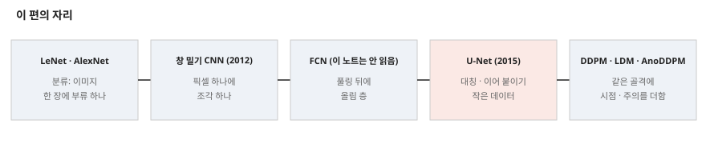

---

## 3. 문제 / 동기

**이 논문이 없앤 전제: 깊은 망을 배우려면 라벨 붙은 이미지가 수천 장 있어야 한다, 그리고 분할은 창 조각 단위로 해야 한다.**

원문이 적은 앞선 방법의 약점(235쪽)은 창 밀기 CNN(Ciresan 외, NIPS 2012)의 둘이다.

1. **느리다.** 창 조각마다 망을 따로 돌리고 조각끼리 겹쳐 계산이 중복된다. 이 편은 그 시간을 수로 적지 않았다.
2. **위치와 맥락의 맞바꿈.** 창이 크면 풀링이 늘어 위치가 무뎌지고, 작으면 맥락이 줄어든다.

여러 층의 특징을 함께 쓰는 분류기 출력([11] · [4])이 이미 있었다고 적고, 곧장 FCN([9])을 고친다. 고친 점은 원문 기준으로 다음이다(235 ~ 236쪽).

- 늘리는 길에도 **채널을 많이** 두어 맥락을 높은 해상도 층으로 넘긴다. 그래서 U 자가 된다.
- 완전 연결 층이 없고 유효 합성곱만 써서, 출력의 픽셀은 입력 안에 맥락이 다 있는 픽셀이다.
- 그 덕에 조각을 겹쳐 임의 크기 이미지를 이음매 없이 분할한다. 경계 맥락은 거울상으로 채운다.

---

## 4. 핵심 기술

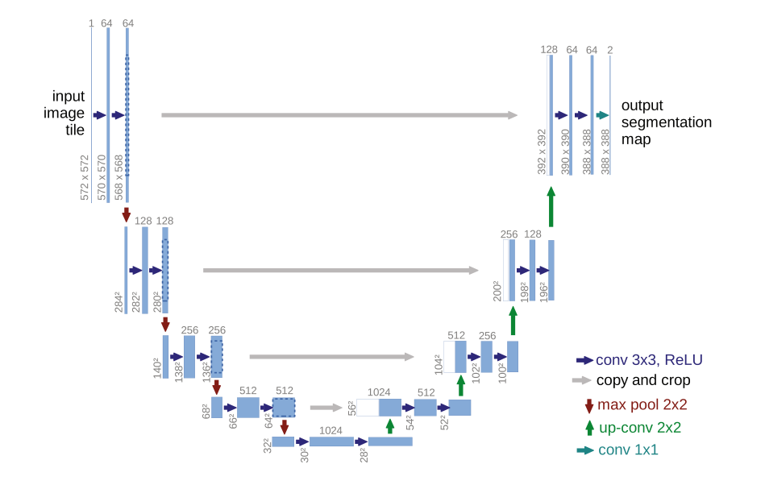

**① 줄이는 길.** 3 x 3 유효 합성곱 둘(각각 ReLU) 뒤 2 x 2 최대 풀링(걸음 2). 내려갈 때마다 채널을 두 배로 해 64 → 128 → 256 → 512 → 1024.

**② 늘리는 길.** 특징 지도를 올린 뒤 2 x 2 합성곱(「up-convolution」)으로 채널을 반으로 줄이고, 잘라 낸 줄이는 길의 특징과 잇고, 3 x 3 합성곱 둘(ReLU). 맨 끝은 1 x 1 합성곱으로 64 채널을 부류 수로 옮긴다. 합성곱 층은 원문이 23 개라 적고, 내가 세면 줄이는 길 10 + 늘리는 길 4 x 3 + 출력 1 = 23 으로 맞는다.

**③ 겹침 조각과 거울상.** 그림 2. 모든 풀링이 짝수 크기에 걸려야 이음매 없이 이어진다(237쪽).

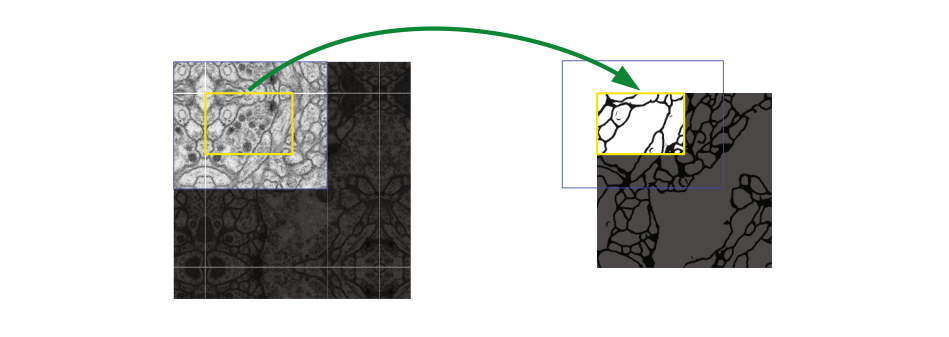

**④ 손실.** 픽셀별 소프트맥스와 교차 엔트로피에 가중치 지도를 곱한다. 아래는 원문 그대로 옮긴 식이고 부호 문제는 12절에 적었다.

$$E = \sum_{\mathbf{x} \in \Omega} w(\mathbf{x}) \log\left(p_{\ell(\mathbf{x})}(\mathbf{x})\right) \qquad (1)$$

**⑤ 경계 가중치.** 부류 빈도 보정 $w_c$ 에 경계 항을 더한다. $d_1$ · $d_2$ 는 가장 가까운 세포와 둘째로 가까운 세포의 경계까지 거리이고, 원문 설정은 $w_0 = 10$, $\sigma \approx 5$ 픽셀이다. 분리 경계 자체는 형태학 연산으로 미리 만든다.

$$w(\mathbf{x}) = w_c(\mathbf{x}) + w_0 \cdot \exp\left(-\frac{(d_1(\mathbf{x}) + d_2(\mathbf{x}))^2}{2\sigma^2}\right) \qquad (2)$$

작은 예시(내 계산)로, 맞닿은 두 세포의 틈 픽셀이 $d_1 + d_2 = 2$ 면 경계 항이 9.23, 10 이면 1.35, 20 이면 0.0034 다. $d_1 + d_2 = 20$ 의 값은 $w_0$ 의 0.034% 다.

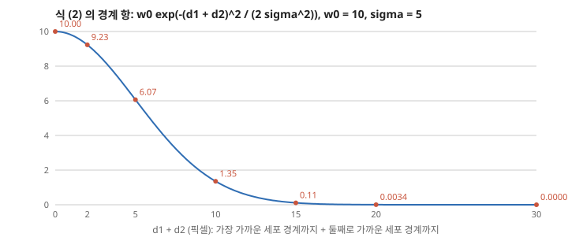

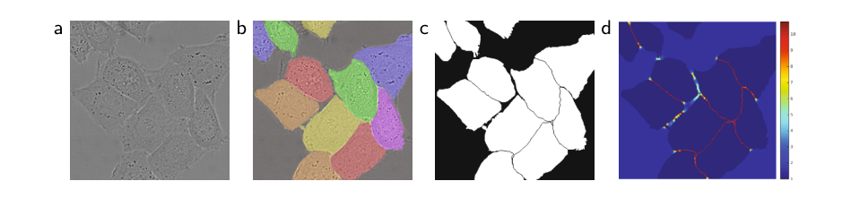

**⑥ 초기화.** 평균 0, 표준편차 $\sqrt{2/N}$ 인 가우스($N$ 은 뉴런 하나로 들어오는 수). 원문 예시 $N = 9 \cdot 64 = 576$ 이면 표준편차 0.0589(내 계산). He 초기화([5])의 인용이다.

**⑦ 증강.** 이동 · 회전 불변, 변형과 밝기 변화에 대한 강건성이 필요하다고 적고, 탄성 변형을 핵심으로 꼽는다. 3 x 3 거친 격자의 변위를 표준편차 10 픽셀 가우스에서 뽑고 쌍삼차 보간. 줄이는 길 끝의 드롭아웃이 「암묵적 증강」 을 더 한다고 적었고 비율은 적혀 있지 않다.

**⑧ 큰 조각과 운동량.** GPU 메모리를 조각 크기에 쓰려고 배치를 이미지 **하나**로 줄이고 운동량을 0.99 로 올린다. 작은 예시(내 계산)로, 운동량 0.99 는 지난 갱신을 시간 상수 1 / (1 - 0.99) = 100 걸음으로 평균하니, 조각 100 장에 해당한다. 배치 1 이어도 갱신 방향은 이미지 수십 장에 걸친다는 원문 말의 수다.

**적혀 있지 않은 설정.** 학습률 · 반복 수 · 드롭아웃 비율 · $w_c$ 의 식 · 데이터별 조각 크기 · 이동과 회전의 범위 · 판정 문턱. 장비는 NVIDIA Titan(6 GB), 프레임워크는 Caffe.

---

## 5. 크기와 파라미터 — 내가 세었다

**크기.** 그림 1 을 따라가면 원문 숫자와 다 맞는다.

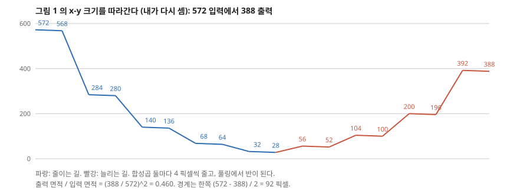

- 출력 = 입력 - 184. 한쪽 경계 92 픽셀이다. 572 입력의 출력 면적은 입력의 46.0% 다.
- 가능한 입력 크기는 188 + 16k(188 · 204 · ... · 572 · 588 ...)이다. 내가 100 ~ 699 를 돌려 풀링이 모두 짝수에 걸리는 값을 뽑으니 간격이 16 이다. 작은 예시로, 572 = 188 + 16 x 24.
- 잘라 내는 양은 위 단부터 한쪽 88 · 40 · 16 · 4 픽셀이다(568 → 392, 280 → 200, 136 → 104, 64 → 56).

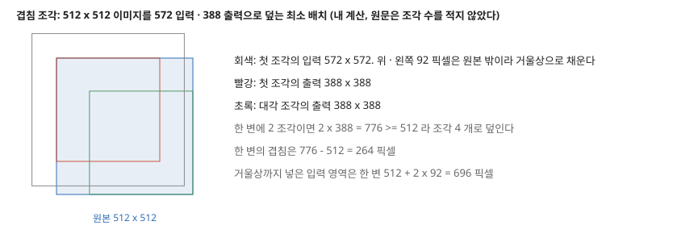

**파라미터.** 입력 1 채널, 출력 2 부류, 치우침 포함으로 세면 31,030,658 이다. 원문은 파라미터 수를 적지 않았다. 올림 층은 원문 그대로 2 x 2 합성곱으로 쳤다.

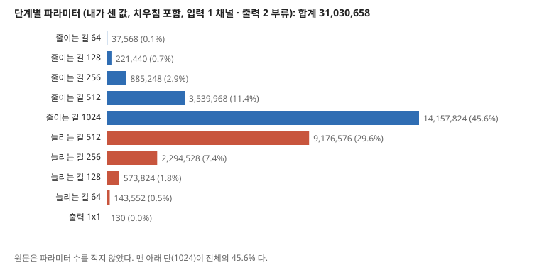

| 묶음 | 파라미터 | 전체 대비 |
|---|---|---|
| 줄이는 길 (맨 아래 포함) | 18,842,048 | 60.7% |
| 그중 맨 아래 단(1024) | 14,157,824 | 45.6% |
| 늘리는 길 | 12,188,480 | 39.3% |
| 출력 1 x 1 | 130 | 0.0004% |
| **이어 붙이기 때문에 는 몫** | **3,133,440** | **10.1%** |

마지막 줄은 늘리는 길 각 단의 첫 3 x 3 이 입력 $c$ 채널이 아니라 $2c$ 채널을 받아 생기는 차이 $9c^2$ 를 $c$ = 512, 256, 128, 64 로 더한 값이다. **이 값은 파라미터 몫이지 성능 몫이 아니다.** 이어 붙이기를 뺀 실험을 이 편에서 찾지 못했다.

**표본 수와 맞대기(내 셈).** EM 학습은 512 x 512 이미지 30 장이니 라벨 달린 픽셀이 7,864,320 개이고, 파라미터는 그 3.95 배다. 이 비율은 픽셀끼리 독립이 아니라는 점을 빼고 센 값이라 일반화를 말해 주지 않는다. 다만 「파라미터가 라벨 수보다 많다」 는 사정이 증강을 왜 강조했는지의 배경이다.

---

## 6. 평가 (읽은 범위)

| 데이터 | 학습 | 시험 | 지표 | 비교 상대 |
|---|---|---|---|---|
| **ISBI EM 분할 도전** (초파리 유충 복부 신경삭, 전자 현미경) | 512 x 512 이미지 30 장, 전부 라벨 | 공개 이미지 · 정답 비공개, 막 확률 지도를 보내 주최 측이 채점. 문턱 10 개 | 왜곡 · Rand · 픽셀 오차 | 2015-03-06 순위표. **도전에 낸 값을 옮긴 것**이고 같은 코드로 돌린 것이 아니다 |
| **PhC-U373** (위상차 현미경 교모세포종) | 부분 라벨 35 장 | 수가 적혀 있지 않다 | 평균 IOU | ISBI 세포 추적 도전 2014 · 2015 참가자 |
| **DIC-HeLa** (미분 간섭 현미경) | 부분 라벨 20 장 | 수가 적혀 있지 않다 | 평균 IOU | 같음 |

- **장비:** NVIDIA Titan 6 GB. 학습 10 시간, 512 x 512 분할 1 초 미만. **어느 데이터의 10 시간인지, 분할 시간에 7 회전 평균이 드는지는 적혀 있지 않다.**
- **EM 값은 7 회전 평균**이고 전처리 · 후처리는 없다고 적었다. 세포 데이터에 평균을 썼는지는 적혀 있지 않다.

---

## 7. 표 1 — EM 도전 순위표

| 순위 | 팀 | 왜곡 오차 | Rand 오차 | 픽셀 오차 |
|---|---|---|---|---|
| | 사람 | 0.000005 | 0.0021 | 0.0010 |
| 1 | **u-net** | **0.000353** | 0.0382 | 0.0611 |
| 2 | DIVE-SCI | 0.000355 | 0.0305 | 0.0584 |
| 3 | IDSIA [2] | 0.000420 | 0.0504 | 0.0613 |
| 4 | DIVE | 0.000430 | 0.0545 | 0.0582 |
| ... | (5 ~ 9 위는 원문 표에 없다) | | | |
| 10 | IDSIA-SCI | 0.000653 | **0.0189** | 0.1027 |

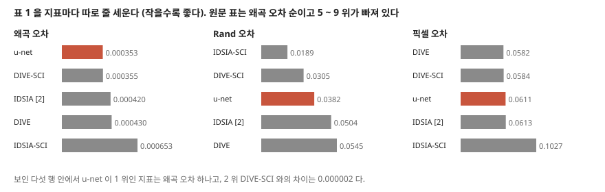

내 계산으로 다음을 짚는다.

- **왜곡 오차의 2 위와의 차는 0.000002, 0.6% 다.** 이 표에 흩어짐이 없고 지표 자체의 판정 폭도 적혀 있지 않으니 순서를 근거로 「낫다」 고 하기 어렵다. 원문의 「new best score」 는 순위표 안의 사실로만 맞다.
- **보인 행 안에서 Rand 오차는 3 위(0.0189 · 0.0305 다음), 픽셀 오차는 3 위(0.0582 · 0.0584 다음)다.** 표가 왜곡 오차 순이라 1 위로 보인다.
- **「significantly better」 는 앞선 창 밀기 CNN 대비 왜곡 16.0% 낮음, Rand 24.2% 낮음이다.** 픽셀 오차는 0.0611 대 0.0613, 0.3% 차이다. 검정은 없고 「significantly」 는 통계 말이 아니다.
- **사람 값과의 비**: 왜곡 70.6 배, Rand 18.2 배, 픽셀 61.1 배다. 사람의 값까지는 거리가 남아 있다.
- **제출 횟수를 맞대지 못한다.** 각주는 Rand 오차가 더 나은 쪽이 해답을 78 개 냈다고 적는다. u-net 이 몇 번 냈는지는 적혀 있지 않다. 또 본문은 Rand 가 더 나은 알고리즘을 「데이터 전용 후처리」 라 적는데, 표에서 그 값이 둘(DIVE-SCI · IDSIA-SCI)이고 어느 쪽이 그런 후처리인지 각주가 가리지 않는다. 문장의 대상 「Ciresan 확률 지도에 얹은 후처리」 는 이름상 IDSIA-SCI 로 읽힌다.

---

## 8. 표 2 — 세포 추적 도전

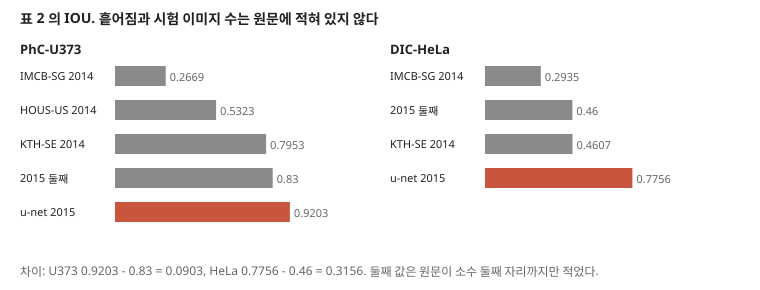

| 이름 | PhC-U373 | DIC-HeLa |
|---|---|---|
| IMCB-SG (2014) | 0.2669 | 0.2935 |
| KTH-SE (2014) | 0.7953 | 0.4607 |
| HOUS-US (2014) | 0.5323 | - |
| 2015 의 둘째 | 0.83 | 0.46 |
| **u-net (2015)** | **0.9203** | **0.7756** |

- 차이는 0.0903, 0.3156 이다. 두 값 모두 이 표 안에서 가장 높다. 다만 **표에 흩어짐이 없고 시험 이미지 수가 적혀 있지 않아**, 이 차이가 시험 이미지 몇 장에서 나온 것인지 이 편으로는 알 수 없다.
- 본문은 「77.5%」 라 적고 표는 0.7756 이다(12절).
- 그림 4 는 데이터마다 입력 일부 한 장의 결과를 보인다. 수치를 읽을 수 없는 정성 그림이다.

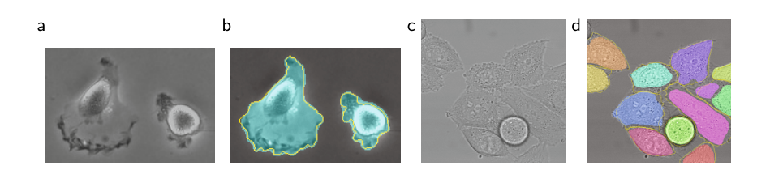

---

## 9. 실험 분석 (논문의 표 · 그림마다)

**직접 돌리지 않는다.** 논문이 낸 실험을 표 · 그림 하나씩 같은 틀로 읽는다. 값 읽기와 재계산은 「내가 센 것」으로 밝힌다.

| 표 · 그림 | 무엇을 바꿨나 (변인) | 무엇을 고정했나 | 결과 | 반복 수 · 흩어짐 | 주장이 결과보다 센가 |
|---|---|---|---|---|---|
| **표 1** (239쪽) | 팀(방법). 같은 코드로 돌린 것이 아니라 순위표 | EM 도전 시험 집합, 주최 측 채점, 문턱 10 개. u-net 은 7 회전 평균 · 전후처리 없음 | 왜곡 0.000353(1 위), Rand 0.0382, 픽셀 0.0611 | 적혀 있지 않다. 제출 횟수도 u-net 쪽은 적혀 있지 않다 | **세다.** 「significantly」 에 검정이 없고, 2 위와 왜곡 0.6% 차다. Rand · 픽셀은 보인 행 안 3 위다 |
| **표 2** (240쪽) | 참가자 · 연도, 데이터 둘 | 세포 추적 도전의 IOU | 0.9203 · 0.7756, 2015 의 둘째 0.83 · 0.46 | 적혀 있지 않다. 시험 이미지 수도 적혀 있지 않다 | 「large margin」 은 표 안에서 맞다. 「significantly」 에는 검정이 없다. 차이의 원인은 재지 않았다 |
| **그림 1** (235쪽) | 없음(구조도) | 572 입력 예시 | 크기 · 채널. 내가 다시 세어 모두 맞음 | 해당 없음 | 해당 없음 |
| **그림 2** (236쪽) | 없음(EM 조각 한 장의 분할 예) | 겹침 조각 · 거울상 | 수치 없음 | 한 장 | 「이음매 없이(seamless)」 를 잰 값이 없다. 이음매 유무를 비교한 실험을 찾지 못했다 |
| **그림 3** (238쪽) | 없음(HeLa 이미지 · 정답 · 마스크 · 가중치 지도) | 같은 이미지 | 수치 없음 | 한 장 | 가중치의 효과가 아니라 가중치 지도의 모습만 보인다. 가중치를 뺀 값을 찾지 못했다 |
| **그림 4** (240쪽) | 데이터 둘 | u-net | 결과 마스크 · 정답 테두리. 수치 없음 | 데이터마다 입력 일부 한 장 | 대표성이 적혀 있지 않다. 표 2 의 IOU 와 짝을 지을 값이 없다 |

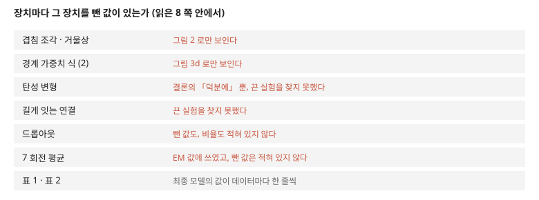

**문장으로만 적힌 실험적 주장.** 「매우 적은 이미지로 끝까지 학습된다」 · 「탄성 변형이 핵심 개념으로 보인다(seem to be)」 · 「512 x 512 분할 1 초 미만」 · 「학습 10 시간」 · 「손쉽게 더 많은 과제에 쓸 수 있다」. 뒤 둘은 수치 또는 전망이고, 앞 둘은 장치를 켜고 끈 비교가 없다. 3.1절의 「seem to be」 는 조심스럽고, 결론의 「Thanks to」 는 그보다 세다.

---

## 10. 이 논문이 스스로 적은 한계

**이 편은 U-Net 자신의 한계를 절로 적지 않았다.** 찾은 범위(8 쪽 전부)에서 자기 한계로 읽히는 문장은 다음뿐이다.

1. 사람의 값이 표 1 맨 위에 있어, 격차가 남아 있음을 표로 보인다. 다만 문장으로 말하지는 않는다.
2. Rand 오차에서 더 나은 쪽이 있다고 적는다(후처리 쓴 쪽이라는 단서와 함께).
3. 조각 크기는 풀링이 짝수에 걸리게 골라야 한다는 제약(237쪽). 한계라기보다 조건이다.

---

## 11. 논문이 적지 않은 것 — 내가 읽으며 짚은 자리

1. **어느 장치가 값을 만들었는지 가르지 않았다.** 대칭 채널 · 이어 붙이기 · 탄성 변형 · 경계 가중치 · 드롭아웃 · 회전 평균이 한 번에 켜져 있다. 초록 첫 문장의 「증강의 강한 사용」 도 끈 실험이 없다. **안 한 것이지 못 한 것이 아니다.** 같은 EM 데이터로 하나씩 끌 수 있다.
2. **FCN 과 같은 조건으로 잰 값이 없다.** 표 1 의 상대는 창 밀기 CNN 이고, 표 2 의 상대는 도전 참가자다. 원문이 고쳤다는 FCN 은 표에 나오지 않는다. 그래서 「더 정밀한 분할」 은 FCN 대비로 재지 않은 말이다.
3. **속도 비교의 분모가 없다.** 「창 밀기가 느리다」 를 적고 시간을 적지 않았다. 「1 초 미만」 만 있어 몇 배인지 이 편으로 셀 수 없다.
4. **「적은 이미지」 의 곡선이 없다.** 30 · 35 · 20 장의 한 점씩이고 이미지 수를 줄여 간 실험을 찾지 못했다. 「몇 장까지 되는가」 는 이 편으로 답이 나오지 않는다.
5. **세 과제 모두 의학 · 생물 현미경 이미지다.** 그림 1 의 출력은 2 채널이고 그림 3 의 마스크도 전경 · 배경 둘이다. 여러 부류, 큰 맥락이 필요한 장면은 재지 않았다. 「더 많은 과제에 손쉽게」 는 전망이다.

---

## 12. 원문 안의 어긋남 모음

| 자리 | 원문 | 맞대 보니 | 내 판단 |
|---|---|---|---|
| 식 (1), 237쪽 | $E = \sum w \log p$ 를 「벌한다(penalizes)」 고 적음 | 쪽 이미지로 확인해도 음의 부호가 없다. $\log p \le 0$ 이라 $E \le 0$ 이고, 최소화하면 $p$ 가 0 쪽으로 간다 | 인쇄상 부호 빠짐으로 읽는다. arXiv 판도 숫자 대조상 같으나 식 글자는 따로 맞추지 않았다 |
| 본문 240쪽 · 표 2 | 「77.5%」 | 표 0.7756 은 반올림하면 77.6 | 사소한 어긋남 |
| 본문 239쪽 · 표 1 | 「0.0003529」 | 표 0.000353 | 자리 수만 다르고 어긋나지 않는다 |
| 240쪽 · 표 2 | 「second best algorithm with 46%」 | 표에 2014 의 KTH-SE 0.4607 이 있다. 2015 의 둘째를 가리키는 말로 읽어야 맞다 | 표는 연도를 나눠 적어 어긋나지 않는다 |
| 239쪽 | 「three different segmentation tasks」 | 데이터 셋으로 맞다 | 어긋나지 않는다 |
| 초록 | 「large consent(폭넓은 동의)」 | 인용 없음 | 배경 문장이고 수치로 받치지 않았다 |

---

## 13. 앞 노트와 맞춰 보기

**Latent Diffusion 노트의 물음(「지름길 이어 붙이기가 파라미터에 주는 몫」).** 원형에서는 10.1% 다(5절). LDM 쪽 UNet 은 자기 표 설정으로 세었고 채널 배수와 주의가 달라 이 값을 그대로 옮기지 않는다.

**DDPM · AnoDDPM 노트.** 두 편의 「U-Net」 은 이름과 U 자 · 이어 붙이기만 같다. 이 원형에는 시점 입력 · 주의 · 그룹 정규화가 없고, 유효 합성곱이라 출력이 입력보다 작다. 그쪽은 잡음을 입력과 같은 크기로 내야 하니 크기가 같아야 한다. 같은 이름의 다른 망으로 적어 둔다.

**PatchCore · SPADE 노트.** 이상 위치를 찾는 데 얼린 분류 망의 중간 특징을 쓰는 편들이고, 여기서는 라벨 픽셀로 끝까지 배운다. **결함 라벨 픽셀이 있으면 이쪽, 정상만 있으면 저쪽**으로 갈리는 자리다. 이 편의 경계 가중치가 답하는 「맞닿은 물체 가르기」 는 그쪽에서 다루지 않았다.

**AlexNet · VGG 노트.** 초록의 「수천 장」 전제가 그쪽 ImageNet 100 만 장이고, 표준편차 $\sqrt{2/N}$ 은 ResNet 저자들의 초기화다. VGG 도 인용([12])되어 있다.

---

## 14. 내가 가져갈 것

**하나. 크기 계산을 손으로 하는 습관.** 출력 = 입력 - 184, 입력 188 + 16k. 이런 제약을 세어 보면 어떤 입력을 넣을 수 있는지 설계 단계에서 보인다. 지금은 대개 패딩으로 없애지만, 그때 경계 픽셀의 맥락이 모자라다는 사정까지 없어지지는 않는다.

**둘. 순위표는 지표별로 다시 줄 세운다.** 표 1 은 왜곡 오차 순이라 1 위로 보이고, 지표를 바꾸면 3 위다. 앞으로 도전 순위표를 근거로 든 편을 읽으면 정렬 기준과 빠진 행을 먼저 본다.

**셋. 공장 결함 분할에 닿는 자리.** 맞닿은 물체를 가르는 경계 가중치, 큰 이미지를 조각으로 처리하는 겹침 전략, 라벨이 적을 때의 변형 증강은 그대로 옮겨 생각할 수 있다. 다만 **탄성 변형은 세포의 변형을 흉내 낸 것**이고 원문도 그 이유를 생물 조직의 변형으로 적는다. 금속 표면이나 기판처럼 휘지 않는 물체에 같은 증강이 맞는지는 이 편이 답하지 않는다.

**넷. 지금 확인된 것은 여기까지다.** 논문이 잰 것은 최종 모델의 도전 값 셋이다. 논문이 말만 한 것은 증강 · 가중치 · 이어 붙이기의 효과와 속도 우위다. 내가 책상에서 센 것은 크기 · 파라미터 · 이어 붙이기의 파라미터 몫이고, 성능 몫은 재지 않았다.

---

## 15. 남는 질문

- **이어 붙이기를 더하기로 바꾸거나 빼면 값이 얼마나 변하나?** 이 편에 없다. FCN 원문과 후속 소거 실험을 봐야 한다.
- **탄성 변형은 몇 점의 몫인가?** 같은 EM 데이터로 끈 값을 낸 편을 찾아야 한다.
- **몇 장까지 내려가도 되나?** 학습 이미지 수를 줄인 곡선이 필요하다.
- **휘지 않는 산업 대상에 어떤 증강이 맞나?** 이 편의 범위 밖이다.
- **뒤에 읽는 Mask R-CNN 의 마스크 가지는 왜 작은 FCN 으로 충분한가?** 물체 후보 안으로 범위를 좁혔기 때문으로 짐작한다. 그 노트에서 맞춰 본다.

---

## 16. 다음에 읽을 것

큰 틀의 다음 칸은 **Faster R-CNN** 이다. 분할에서 검출로 넘어가면서, 픽셀마다 답하는 대신 상자를 어떻게 제안하는지 본다. 아래는 이 노트 안에만 남겨 두는 후속 편이다.

| 논문 | 이 노트의 어느 자리에서 나오는가 | 무엇을 확인하고 싶은가 | 원문 참고 문헌 |
|---|---|---|---|
| **FCN** (Long · Shelhamer · Darrell, CVPR 2015, 이 편은 arXiv 2014 를 인용) | 3 · 11절 | 이 편이 고쳤다는 원형과 그 값 | [9] |
| **창 밀기 CNN** (Ciresan 외, NIPS 2012) | 3 · 7절 | 시간과 표 1 의 값 | [2] |
| **Hypercolumns** (Hariharan 외, 이 편은 arXiv 2014 를 인용) | 3절 | 여러 층 특징을 쓰는 또 다른 길 | [4] |

---

## 17. 참고 문헌

- [2] Ciresan, D. C. 외 (2012). Deep neural networks segment neuronal membranes in electron microscopy images. NIPS. — **읽지 않았다.**
- [3] Dosovitskiy, A. 외 (2014). Discriminative unsupervised feature learning with convolutional neural networks. NIPS. — 증강의 인용. **읽지 않았다.**
- [4] Hariharan, B. 외 (2014). Hypercolumns for object segmentation and fine-grained localization. arXiv:1411.5752. — **읽지 않았다.**
- [5] He, K. 외 (2015). Delving deep into rectifiers. arXiv:1502.01852. — 초기화. **읽지 않았다.**
- [6] Jia, Y. 외 (2014). Caffe. arXiv:1408.5093. — 구현. **읽지 않았다.**
- [7] Krizhevsky, A. 외 (2012). ImageNet classification with deep convolutional neural networks. NIPS. — 2026-11-08 전에 읽었다.
- [8] LeCun, Y. 외 (1989). Backpropagation applied to handwritten zip code recognition. Neural Computation. — 원 CNN. 이 저장소의 LeNet 노트는 1998 년 편이다.
- [9] Long, J., Shelhamer, E., Darrell, T. (2014). Fully convolutional networks for semantic segmentation. arXiv:1411.4038. — **읽지 않았다.**
- [11] Seyedhosseini, M. 외 (2013). Image segmentation with cascaded hierarchical models and logistic disjunctive normal networks. ICCV. — **읽지 않았다.**
- [12] Simonyan, K., Zisserman, A. (2014). Very deep convolutional networks for large-scale image recognition. — 2026-11-08 전에 읽었다.
- [1] · [10] · [13] · [14] 데이터와 도전 페이지. — **읽지 않았다.**

---

## 18. 경로

| 무엇 | 어디 |
|---|---|
| 원문 PDF (Springer 게재판, 8 쪽) | `papers/MICCAI15_UNet_Convolutional_Networks_for_Biomedical_Image_Segmentation.pdf` |
| 이 노트 | `notes/MICCAI15_UNet_Convolutional_Networks_for_Biomedical_Image_Segmentation.md` |
| 이 노트의 그림 (직접 그린 것) | `figures/MICCAI15_UNet/fig01_size_trace.svg` 부터 `fig08_lineage.svg` 까지 여덟 |
| 이 노트의 그림 (원문에서 잘라 낸 것) | `figures/MICCAI15_UNet/paper_fig1_architecture.png` · `paper_fig2_tile.png` · `paper_fig3_hela_weight.png` · `paper_fig4_results.png` |
| 그림을 만드는 코드 | `figures/MICCAI15_UNet/make_figures.py` — 바깥 데이터를 읽지 않으므로 `python make_figures.py` 로 어디서나 다시 만든다(표준 라이브러리만). 파라미터 · 크기를 돌릴 때 찍는다 |
| 원문 그림을 잘라 내는 코드 | `figures/MICCAI15_UNet/crop_paper_figures.py` — PyMuPDF 가 필요하다 |
