# BERT — Pre-training of Deep Bidirectional Transformers for Language Understanding (NAACL 2019 발표집 판, 요약)

> **한 줄.** Transformer 의 **인코더만** 남겨, 라벨 없는 글 33 억 낱말에서 사전학습한 뒤 과제마다 출력 층 하나만 붙여 전체를 미세조정한다. 왼쪽만 보는 언어 모델 대신 **입력 토큰의 15% 를 가리고 그 자리를 맞히는 과제(가림 과제)** 와 **B 문장이 A 문장의 다음 문장인지 맞히는 과제(NSP)** 로 사전학습해, 모든 층에서 양쪽 문맥을 보는 표현을 얻는다. Base(12 층, 폭 768)와 Large(24 층, 폭 1024) 두 크기로 GLUE 표 1 평균 79.6 · 82.1(OpenAI GPT 75.1), SQuAD 1.1 시험 F1 93.2(앙상블), SQuAD 2.0 83.1, SWAG 86.3 을 냈다.

> **이 노트에서 가장 먼저 볼 자리 다섯.** (1) **사전학습의 몫을 잰 줄이 없다.** 같은 짜임을 처음부터 학습한 줄이 표 1 ~ 표 8 어디에도 없고, 그림 5 의 첫 점도 k = 30(천 걸음)이다(21절). 이 편이 잰 것은 「어떤 과제로 사전학습하느냐」 의 차이다. (2) 표 5 의 **차를 나누면** NSP 의 몫이 QNLI 에서 85.4% 인데 MRPC 2.2% · SQuAD 5.6% 다. 가림 과제만 뺀 줄은 없어 **가림 과제의 몫은 표로 뽑을 수 없다**(15절). (3) **표 8 의 80/10/10 줄이 표 7 의 같은 설정과 1.0 · 1.2 F1 다르다.** 이 차는 표 8 안의 어느 줄 차이(최대 0.9)보다 크고, 표 8 은 모델 크기를 적지 않는다(19 · 25절). (4) 본문 「단일 시스템으로 top leaderboard 를 +1.3」 은 **표의 #2(QANet)와의 차**에서만 나온다. #1 과의 차는 +0.1 이다(12절, 내가 센 것). (5) A.2 절의 「약 40 에폭」 은 같은 절의 「걸음의 90% 는 길이 128」 과 함께 읽으면, 배치가 256 열 그대로일 때 **12.9 에폭**이다. 이 파일은 그 구간의 배치 크기를 적지 않는다(8절, 내가 센 것).

---

## Paper Metadata

| Item | Content |
|---|---|
| Title | BERT: Pre-training of Deep Bidirectional Transformers for Language Understanding |
| Authors | Jacob Devlin, Ming-Wei Chang, Kenton Lee, Kristina Toutanova |
| 소속 | Google AI Language |
| Conference / Journal | **NAACL-HLT 2019**, 발표집 4171 ~ 4186 쪽 (Minneapolis, 2019-06-02 ~ 06-07). 바탕화면에서 받은 파일 이름은 `N19-1423.pdf`. arXiv 판(1810.04805)은 받지 않았고, 발표집 판과 무엇이 다른지 이 노트는 확인하지 않았다 |
| Year | 2019. 파일 정보의 만든 날 2019-04-29 |
| DOI | 파일 안에 적혀 있지 않다 (ACL Anthology 번호 N19-1423) |
| 코드 | `https://github.com/google-research/bert` (원문 1절). 이 노트는 코드를 보지 않았다 |
| Stored PDF | `papers/NAACL19_BERT_Pre_training_of_Deep_Bidirectional_Transformers_for_Language_Understanding.pdf` |
| 왜 읽었는가 | Transformer 노트가 꼽은 큰 틀 후보 둘 가운데 하나. 그 편은 번역 두 과제에서 처음부터 학습만 했다. 물음은 둘이었다 — **인코더만 떼어 번역 밖 과제로 옮기면 무엇이 나오는가, 그리고 사전학습의 몫을 처음부터 학습한 같은 짜임과 견줘 갈랐는가.** 큰 틀의 다음 칸은 ViT 로 정했고 이 편은 그 사이사이에 함께 읽는 편이다 |
| 읽은 범위 | **2026-11-05 에 16 쪽을 전부 읽었다.** 곧 Abstract · 1 ~ 6절 · 부록 A · B · C · 그림 1 ~ 5 와 캡션 · 표 1 ~ 8 과 캡션 · 각주 1 ~ 15 · 참고 문헌 목록. 참고 문헌의 편들은 읽지 않았다. **읽지 않은 판(arXiv)의 수치는 이 노트에 옮기지 않는다** |

### 저장한 파일의 상태

- **본문 4171 ~ 4179 쪽, 참고 문헌 4180 ~ 4182 쪽, 부록 4182 ~ 4186 쪽**이 한 파일에 있다. 부록 A · B · C 가 빠지지 않았다.
- **글자 층이 살아 있다.** 다만 그림 2 의 글자는 뽑으면 순서가 섞이고(뽑은 글자에서 `he likes` 가 앞에 온다) 표의 칸 맞춤은 글자로 갈리지 않아, 표 1 ~ 8 이 있는 쪽과 그림 쪽을 120 dpi 그림으로 띄워 맞췄다.
- **그림 5 는 벡터 그림이다.** 눈금과 곡선의 좌표를 PDF 에서 직접 꺼냈고 점 열여섯이 모두 0.1 단위 값으로 떨어졌다(18절).
- **번호 붙은 식이 없다.** 이 노트의 식 번호는 내가 붙였다.

---

## 1. 용어

이 노트에서 쓸 이름을 먼저 정한다. 논문의 원래 용어는 괄호로 함께 적는다.

- **사전학습 (pre-training)**: 라벨 없는 글로 표현을 먼저 배우는 단계. 작은 예시로, Base 는 16 TPU 칩으로 4 일, 100 만 걸음.
- **미세조정 (fine-tuning)**: 사전학습한 값으로 시작해 라벨 있는 과제에서 **전체 파라미터를** 함께 배우는 단계. 작은 예시로, GLUE 는 배치 32 · 3 에폭 · 학습률 5e-5 ~ 2e-5.
- **미세조정 방식 · 특징 방식 (fine-tuning · feature-based)**: 앞의 것은 사전학습 모델까지 함께 고치고, 뒤의 것은 사전학습 모델을 얼려 출력만 다른 모델의 입력으로 쓴다. 작은 예시로, 표 7 의 특징 줄은 BERT 를 얼리고 그 위에 2 층 BiLSTM 을 배운다.
- **토큰 (token)**: WordPiece 로 나눈 입력 단위. 낱말 하나가 여럿으로 갈릴 수 있다. 작은 예시로, `playing` 은 `play` · `##ing` 둘이다. 원문의 어휘는 30,000 토큰이다.
- **문장 (sentence)**: 원문 정의로 **이어진 글의 임의 구간**이다. 실제 문장일 필요가 없다. **열 (sequence)** 은 BERT 에 들어가는 토큰 열 하나로, 문장 하나이거나 둘을 이은 것이다. 작은 예시로, `[CLS] my dog is cute [SEP] he likes play ##ing [SEP]` 은 문장 둘 · 11 토큰인 열 하나다.
- **`[CLS]` · `[SEP]`**: 열 맨 앞에 늘 두는 분류 토큰과 문장을 가르는 토큰. `[CLS]` 자리의 마지막 은닉 벡터를 $C \in \mathbb{R}^H$ 라 쓰고 열 전체를 대표하게 한다. $i$ 번째 토큰의 마지막 은닉 벡터는 $T_i \in \mathbb{R}^H$.
- **문장 표지 임베딩 (segment embedding)**: 토큰이 문장 A 쪽인지 B 쪽인지 나타내는 학습되는 벡터. 값이 둘뿐이다. 작은 예시로, Base 에서 2 × 768 = 1,536 개의 수다.
- **자리 임베딩 (position embedding)**: 자리마다 학습되는 벡터. 사인 · 코사인으로 정하는 Transformer 의 자리 부호화와 다르다. 작은 예시로, 512 자리 × 768 = 393,216 개의 수.
- **가림 과제 (masked LM, MLM)**: 입력 토큰의 15% 를 골라 가리거나 바꾸고, 그 자리의 마지막 은닉 벡터로 원래 토큰을 맞히는 사전학습 과제. 원문은 Cloze 과제라고도 부른다. 작은 예시로, `my dog is hairy` 의 넷째 토큰을 `[MASK]` 로 바꾸고 hairy 를 맞힌다.
- **다음 문장 과제 (next sentence prediction, NSP)**: 문장 B 가 A 의 실제 다음 문장인지(50%) 무작위 문장인지(50%) $C$ 로 맞히는 사전학습 과제. 원문 각주 5 로 최종 모델의 이 과제 정확도는 97 ~ 98%.
- **왼쪽만 모델 (left-to-right, LTR)**: 각 토큰이 왼쪽 문맥만 보며 다음 토큰을 맞히는 보통의 언어 모델. OpenAI GPT 가 이 꼴이다.
- **양방향 (bidirectional)**: 이 편에서는 **층마다 양쪽 문맥을 보는 것**을 뜻한다(`deep bidirectional`). 왼쪽 모델과 오른쪽 모델을 따로 배워 맨 위에서 잇는 ELMo 의 꼴은 원문이 `shallow` 라 부른다. 그림 1 이 두 꼴을 칸으로 보인다.
- **절제 연구 (ablation)**: 장치 하나를 빼거나 바꿔 차이를 보는 실험. 작은 예시로, 표 5 의 No NSP 줄은 NSP 를 뺐다.
- **혼잡도 (perplexity, ppl)**: 언어 모델이 다음에 올 토큰을 평균 몇 개 중에서 고르는 셈인지 나타내는 값. 낮을수록 잘 맞힌다. 작은 예시로, 표 6 의 Base 는 3.99.
- **EM · F1 (SQuAD)**: 답 구간이 정답과 정확히 같은 비율과, 답과 정답의 낱말 겹침으로 낸 F1. **이 파일에 정의가 없고** SQuAD 의 지표 이름만 쓴다.
- **재시작 (random restart)**: 같은 사전학습 값에서 데이터 섞기와 분류 층 시작값만 바꿔 미세조정을 다시 돌리는 것(원문 4.1절). 작은 예시로, 표 6 · 7 은 5 재시작 평균이다.

---

## 2. 한 문단 요약

앞선 사전학습 언어 모델은 왼쪽만 보거나(GPT), 왼쪽과 오른쪽을 따로 배워 맨 위에서 이었다(ELMo). 원문은 이 제약이 미세조정 쪽 표현의 힘을 막는다고 주장한다. 양쪽을 그대로 보면서 다음 토큰을 맞히게 하면 토큰이 자기 자신을 볼 수 있어 배울 것이 없어지므로, 입력의 15% 를 가리고 그 자리만 맞힌다. 여기에 문장 쌍 관계를 배우는 NSP 를 더했다. 짜임은 Transformer 인코더이고 입력은 토큰 · 문장 표지 · 자리 임베딩의 합이다. 사전학습 뒤에는 과제마다 출력 층만 바꿔 전체를 미세조정한다. 결과는 GLUE 여덟 과제와 SQuAD 둘, SWAG 하나, 합해 열한 과제에서 비교 상대를 넘었다(개수는 내가 세어 맞췄다, 11절). 절제 연구는 NSP 와 양방향을 뺀 줄(표 5), 크기(표 6), 특징 방식(표 7), 걸음 수(그림 5), 가림 비율(표 8)을 잰다. **같은 짜임을 사전학습 없이 학습한 줄은 없다.**

---

## 3. 문제 — 언어 모델은 한쪽만 본다 (1 · 2절)

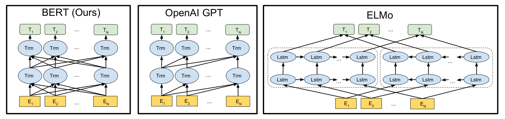

*원문 그림 3. 왼쪽부터 BERT · OpenAI GPT · ELMo. 원문 캡션: 셋 가운데 BERT 표현만 모든 층에서 양쪽 문맥에 함께 조건을 건다.*

**원문의 구도.** 사전학습한 표현을 쓰는 길이 둘 있다. 특징 방식(ELMo)은 과제 전용 모델의 입력에 더해 넣고, 미세조정 방식(GPT)은 과제 전용 파라미터를 최소로 두고 사전학습 값을 함께 고친다. 둘 다 사전학습 목적 함수가 한 방향 언어 모델이다.

**원문이 짚은 제약.** 언어 모델이 한 방향이라 사전학습 때 고를 수 있는 짜임이 막힌다. GPT 는 토큰이 앞 토큰에만 주의를 줄 수 있다. 원문은 이것이 문장 수준 과제에 `sub-optimal` 하고 질의응답 같은 토큰 수준 과제에는 `very harmful` 할 수 있다고 적는다(`could be`). 질의응답에서 양쪽 문맥이 중요하기 때문이다.

**기여로 적은 셋(1절).** (가) 양방향 사전학습의 중요성을 보인다. (나) 사전학습 표현이 과제 전용으로 공들여 만든 짜임의 필요를 줄인다 — 문장 수준 · 토큰 수준 과제 묶음에서 최고 성능을 낸 첫 미세조정 방식이라고 적는다. (다) 열한 과제의 최고 기록을 넘는다.

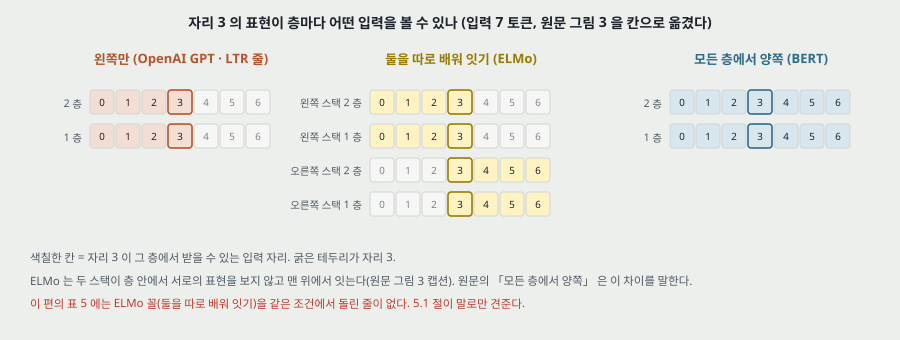

**관련 일 세 갈래(2절).** 비지도 특징 방식(낱말 임베딩 · 문장 임베딩 · ELMo), 비지도 미세조정 방식(Dai · Le, ULMFiT, GPT), 지도 데이터에서 옮기기(NLI · 번역, 그리고 ImageNet 사전학습 후 미세조정). 마지막 갈래에서 컴퓨터 비전의 ImageNet 사전학습을 「효과적인 레시피」 로 인용한다.

---

## 4. 모델 전체 (3절)

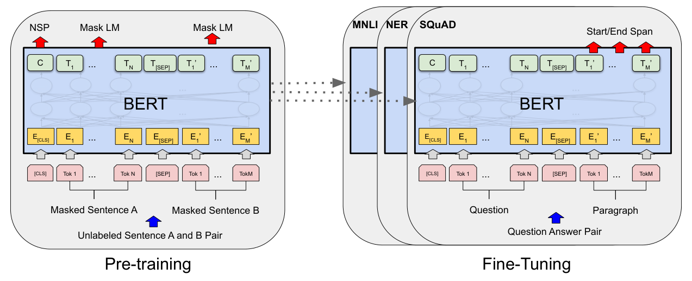

*원문 그림 1. 왼쪽이 사전학습, 오른쪽이 과제별 미세조정. 출력 층 말고는 같은 짜임이다.*

- **짜임**: 여러 층 양방향 Transformer 인코더. `tensor2tensor` 판을 바탕으로 했고 `almost identical` 이라며 짜임 설명을 생략한다.
- **기호**: 층 수 $L$, 은닉 폭 $H$, 주의 머리 수 $A$. 앞먹임 폭은 언제나 $4H$(각주 3).
- **두 크기**: **Base** $(L, H, A) = (12, 768, 12)$, 전체 파라미터 110M. **Large** $(24, 1024, 16)$, 340M. 머리 하나의 폭은 둘 다 64 다($768/12 = 1024/16$, 내가 셈).
- **Base 의 크기를 고른 까닭**: 비교를 위해 OpenAI GPT 와 같은 크기로 골랐다. 차이는 양방향 주의다.
- **Transformer 원 편과 다른 자리**(이 파일로 확인되는 것만): 디코더가 없다. 자리 표현이 학습된다(A.2 절 「to learn the positional embeddings」). 활성 함수가 ReLU 가 아니라 GELU 다(A.2 절, GPT 를 따랐다고 적는다). 번역에서 처음부터 배우지 않고 사전학습한다.

---

## 5. 입력 표현 (3절)

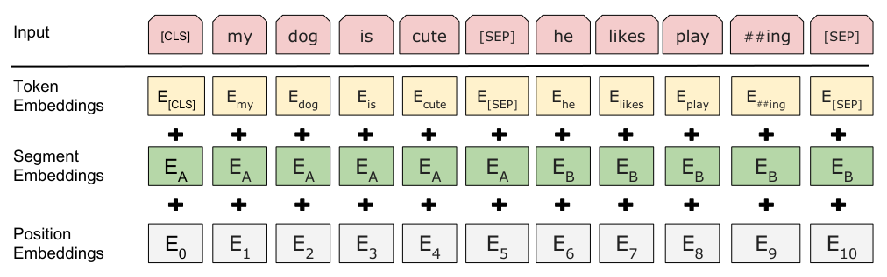

*원문 그림 2. 입력 임베딩은 토큰 · 문장 표지 · 자리 임베딩의 합이다.*

$$E_i = E^{\text{tok}}(x_i) + E^{\text{seg}}(s_i) + E^{\text{pos}}(i) \qquad (1)$$

$x_i$ 는 $i$ 번째 토큰, $s_i \in \{A, B\}$ 는 그 토큰이 속한 문장이다.

**작은 예시(원문 그림 2).** 열 `[CLS] my dog is cute [SEP] he likes play ##ing [SEP]` 은 11 토큰이다. 첫 `[SEP]` 까지 여섯 토큰이 $E_A$, 나머지 다섯이 $E_B$, 자리는 $E_0$ ~ $E_{10}$ 이다. 문장을 가르는 표시가 `[SEP]` 과 문장 표지 **둘**이다.

문장 하나만 쓰는 과제는 문장 B 가 빈 꼴로 들어간다(원문 3.2절 「text-$\varnothing$ pair」).

---

## 6. 과제 1 — 가림 과제 (3.1절 · A.1 절)

**왜 그냥 양쪽을 볼 수 없나.** 원문: 양방향으로 조건을 걸면 각 낱말이 간접적으로 「자기 자신을 볼」 수 있어 여러 층 문맥에서 목표 낱말을 쉽게 맞힌다. 아래 그림은 내가 두 층으로 푼 것이다.

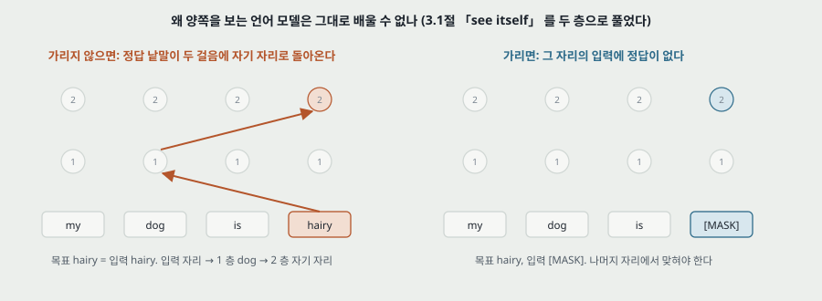

**절차.**

1. 열마다 토큰 자리의 15% 를 무작위로 고른다. `[CLS]` · `[SEP]` 을 빼는지, 쪼개진 토큰을 묶어 고르는지: 원문은 「`no special consideration given to partial word pieces`」 라 적고 특수 토큰은 적지 않는다.
2. 고른 자리를 **80% 는 `[MASK]` 로, 10% 는 무작위 토큰으로, 10% 는 그대로** 둔다.
3. 그 자리의 $T_i$ 를 어휘 위 소프트맥스에 넣어 원래 토큰을 교차 엔트로피로 맞힌다. **고른 자리만** 맞힌다 — 입력 전체를 복원하는 잡음 제거 오토인코더와 다른 점이라고 원문이 적는다.

**왜 80 · 10 · 10 인가(원문).** `[MASK]` 는 미세조정에 나타나지 않으므로 사전학습과 미세조정이 어긋난다. 모델이 어느 낱말이 맞힐 대상인지 · 어느 낱말이 바뀌었는지 모르게 해, 모든 토큰의 문맥 표현을 유지하도록 한다(A.1 절). 10% 를 그대로 두는 까닭은 「실제 관찰된 낱말 쪽으로 표현을 치우치게」 하려는 것이다.

**열 하나에서 몇 개인가(내가 센 것).**

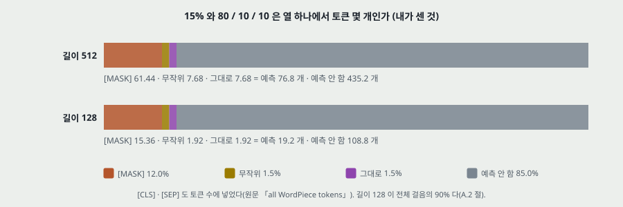

| 열 길이 | 맞힐 자리(15%) | `[MASK]` (전체의 12%) | 무작위 (1.5%) | 그대로 (1.5%) | 맞히지 않는 자리 |
|---|---|---|---|---|---|
| 512 | 76.8 | 61.44 | 7.68 | 7.68 | 435.2 |
| 128 | 19.2 | 15.36 | 1.92 | 1.92 | 108.8 |

- 원문 A.1 절의 「무작위 교체는 전체 토큰의 1.5%(10% of 15%)」 와 맞다.
- **입력이 원본과 다른 토큰은 13.5% 다**(12% + 1.5%). 길이 512 에서 69.1 개, 길이 128 에서 17.3 개다. 맞힐 자리 가운데 그대로인 1.5% 는 입력에 정답이 들어 있는 채로 맞힌다.
- 왼쪽만 모델은 모든 토큰을 맞히므로, 가림 과제가 배치마다 맞히는 토큰 수는 그 15% 다(비 6.67 배). 원문 A.1 절은 이 때문에 더 많은 사전학습 걸음이 필요할 수 있다고 적고 C.1 절에서 잰다(18절).

---

## 7. 과제 2 — 다음 문장 과제 (3.1절 · A.1 절)

문장 쌍을 뽑을 때 50% 는 B 가 A 의 실제 다음 문장(`IsNext`), 50% 는 말뭉치의 무작위 문장(`NotNext`)이다. $C$ 로 둘을 가른다. 원문의 예:

```
Input = [CLS] the man went to [MASK] store [SEP] he bought a gallon [MASK] milk [SEP]
Label = IsNext
Input = [CLS] the man [MASK] to the store [SEP] penguin [MASK] are flight ##less birds [SEP]
Label = NotNext
```

원문이 적은 것 셋.

- **최종 모델의 NSP 정확도는 97 ~ 98%**(각주 5). 각주 6: 미세조정 없이는 $C$ 가 의미 있는 문장 표현이 아니다(NSP 로 배웠기 때문).
- 3.1절은 5.1절에서 NSP 가 질의응답과 NLI 에 `very beneficial` 함을 보이겠다고 적는다. **표 5 의 해당 칸은 QNLI 3.5 · MNLI-m 0.5 · SQuAD 0.6 이다**(15절).
- 앞선 비슷한 목적 함수(Jernite 외, Logeswaran · Lee)는 문장 임베딩만 옮기는데 BERT 는 모든 파라미터를 옮긴다는 점이 다르다고 적는다.

---

## 8. 사전학습 데이터와 절차 (3.1절 · A.2 절)

- **말뭉치**: BooksCorpus 8 억 낱말 + 영어 위키백과 25 억 낱말(목록 · 표 · 머리글 뺌), 합 33 억. 섞은 문장 단위 말뭉치가 아니라 문서 단위여야 한다고 적는다.
- **열 만들기**: 글 구간 둘을 뽑고(실제 문장보다 대개 길다) 합친 길이가 512 토큰 이하가 되게 한다.
- **학습**: 배치 256 열, 100 만 걸음. Adam, 학습률 $10^{-4}$, $\beta_1 = 0.9$, $\beta_2 = 0.999$, L2 가중치 감쇠 0.01, 처음 10,000 걸음 데우기 뒤 선형 감소. 드롭아웃 0.1. GELU.
- **손실**:

$$\mathcal{L} = \overline{\ell}_{\text{MLM}} + \overline{\ell}_{\text{NSP}} \qquad (2)$$

  원문은 「평균 가림 과제 가능도와 평균 NSP 가능도의 합」 이라 적는다. 두 항의 무게는 같다.

- **장비와 시간**: Base 4 Cloud TPU(16 칩), Large 16 Cloud TPU(64 칩), 각각 4 일.
- **길이 일정**: 걸음의 90% 는 **길이 128**, 나머지 10% 는 **길이 512**. 주의 비용이 길이의 제곱이기 때문이고, 뒤 구간은 「자리 임베딩을 배우기 위해서」 라고 적는다.

**에폭을 다시 세면(내가 센 것).**

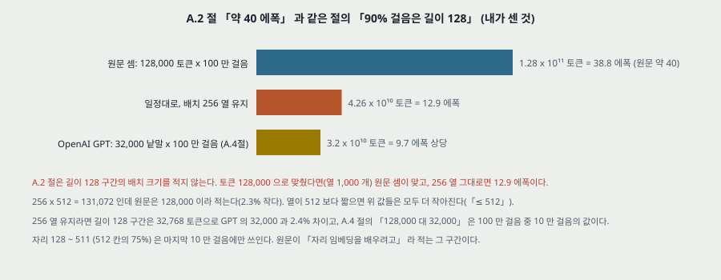

원문 A.2 절: `256 sequences * 512 tokens = 128,000 tokens/batch` 로 100 만 걸음이 33 억 낱말 말뭉치를 **약 40 에폭** 돈다.

- 곱은 131,072 다(원문 값이 2.3% 작다). 128,000 × 100 만 ÷ 33 억 = **38.8 에폭**으로 「약 40」 은 맞다.
- 그런데 같은 절의 길이 일정을 넣으면, 256 열을 유지할 때 토큰 합은 $0.9 \times 10^6 \times 32{,}768 + 0.1 \times 10^6 \times 131{,}072 = 4.26 \times 10^{10}$, 곧 **12.9 에폭**이다. 열이 512 보다 짧은 경우를 넣으면 더 작아진다.
- A.2 절은 길이 128 구간의 배치 크기를 적지 않는다. 토큰 128,000 을 유지했다면(열 1,000 개) 38.8 이 맞다. **이 파일로 가릴 수 없다.**
- 같은 까닭으로 A.4 절의 GPT 비교 「배치 128,000 낱말 대 32,000 낱말」 도, 256 열 유지라면 100 만 걸음 가운데 90 만 걸음은 32,768 대 32,000(2.4% 차)이고 토큰 합의 비는 4 배가 아니라 **1.33 배**다.
- 토큰과 낱말을 섞어 쓴다. 33 억은 낱말, 128,000 은 A.2 절에서 토큰, C.1 절과 A.4 절에서 낱말이다.

**자리 임베딩이 받는 걸음(내가 센 것).** 길이 128 구간에서 자리 128 ~ 511(512 칸의 75%)은 입력에 나타나지 않는다. 그 자리들이 배우는 걸음은 마지막 10 만 걸음뿐이다.

**걸음 속도와 칩 수(내가 센 것).** 100 만 걸음 ÷ 4 일 = 2.89 걸음/초. 층당 계산이 $L H^2$ 에 비례한다고 보면 Large / Base = 3.56 배이고 칩은 4 배다. 「둘 다 4 일」 과 어긋나지 않는다.

---

## 9. 미세조정 (3.2절 · 4절 · A.3 · A.5 절)

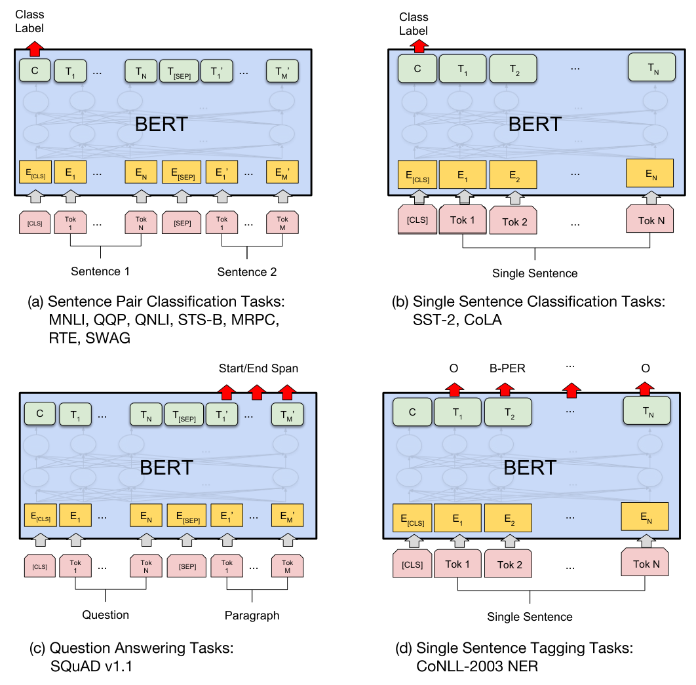

*원문 그림 4. (a) 문장 쌍 분류 (b) 문장 하나 분류 (c) 질의응답 (d) 문장 하나 태깅.*

입력에서 문장 A · B 는 말바꾸기 문장 쌍, 전제-가설 쌍, 질문-지문 쌍이 되고, 문장 하나 과제는 B 가 빈다. 문장 쌍을 따로 부호화한 뒤 양방향 교차 주의를 두는 흔한 꼴 대신, **이어 넣은 자기 주의 하나로 두 단계를 합친다**고 적는다.

**과제별 출력.**

- **분류(GLUE)**: 새 파라미터는 $W \in \mathbb{R}^{K \times H}$ 뿐이다.

$$\log\left(\text{softmax}(C W^{\top})\right) \qquad (3)$$

- **SQuAD 1.1**: 시작 벡터 $S$ 와 끝 벡터 $E$ (둘 다 $\mathbb{R}^H$) 만 새로 둔다.

$$P_i = \frac{e^{S \cdot T_i}}{\sum_j e^{S \cdot T_j}} \qquad (4)$$

  끝도 같다. 구간 점수는 $S \cdot T_i + E \cdot T_j$ 이고 $j \ge i$ 에서 최대인 구간을 고른다.

- **SQuAD 2.0**: 답이 없는 질문은 시작 · 끝이 `[CLS]` 인 구간으로 친다.

$$s_{\text{null}} = S \cdot C + E \cdot C, \qquad \hat{s}_{i,j} > s_{\text{null}} + \tau \text{ 이면 답을 낸다} \qquad (5)$$

  $\tau$ 는 개발셋 F1 이 최대가 되게 고른다.

- **SWAG**: 네 후보마다 열 하나를 만들고, $C$ 와 벡터 하나의 내적을 점수로 삼아 소프트맥스.
- **NER**: 첫 하위 토큰의 표현을 토큰 분류 층에 넣는다. CRF 층을 쓰지 않는다.

**설정(원문에 적힌 대로).**

| 과제 | 배치 | 에폭 | 학습률 | 재시작 · 고르기 |
|---|---|---|---|---|
| GLUE | 32 | 3 | 5e-5 · 4e-5 · 3e-5 · 2e-5 중 개발셋으로 고름 | Large 만 작은 데이터에서 여러 번 재시작해 개발셋 최고 |
| SQuAD 1.1 | 32 | 3 | 5e-5 | Large 는 TriviaQA 로 먼저 미세조정한 줄이 따로. 앙상블은 사전학습 체크포인트와 시작값이 다른 7 개 |
| SQuAD 2.0 | 48 | 2 | 5e-5 | TriviaQA 안 씀 |
| SWAG | 16 | 3 | 2e-5 | 적혀 있지 않다 |
| A.3 절 권장 범위 | 16 · 32 | 2 · 3 · 4 | 5e-5 · 3e-5 · 2e-5 | 개발셋으로 전수 탐색 |

**시간(3.2절).** 이 편의 모든 결과는 같은 사전학습 모델에서 Cloud TPU 1 개로 1 시간 안에, GPU 로 몇 시간에 재현할 수 있다고 적는다. 각주 7: SQuAD 모델이 TPU 1 개 30 분에 개발 F1 91.0%.

---

## 10. 파라미터 다시 세기 (내가 센 것)

원문은 110M · 340M 이라고만 적고 셈한 방식을 적지 않는다.

**셈한 방식(가정을 밝힌다).**

- 층 하나: 질의 · 키 · 값 투영 $3(H^2 + H)$ + 출력 투영 $H^2 + H$ + 층 정규화 $2H$ + 앞먹임 $(4H^2 + 4H) + (4H^2 + H)$ + 층 정규화 $2H$ = $12H^2 + 13H$.
- 입력: 낱말 표 $VH$ + 자리 $512H$ + 문장 표지 $2H$ + 표 뒤 층 정규화 $2H$.
- `[CLS]` 변환 $H^2 + H$.
- **층 정규화의 자리 · `[CLS]` 변환 · 낱말 표와 소프트맥스 공유는 이 파일에 적혀 있지 않다.** 공개 구현의 꼴을 가정했다.
- 머리 수 $A$ 는 셈에 들어가지 않는다. 머리 폭이 $H/A$ 라 투영이 언제나 $H \times H$ 다.

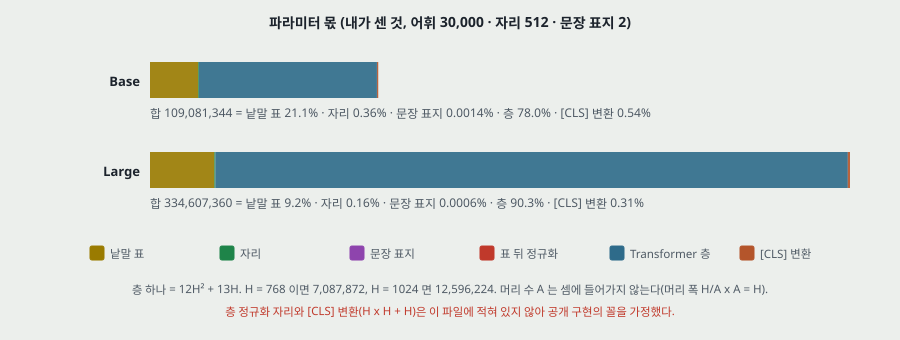

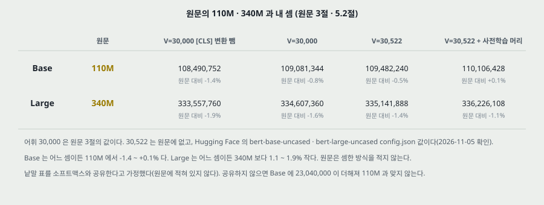

| | 원문 | $V = 30{,}000$ (원문 3절) | $V = 30{,}522$ (원문에 없다) | $V = 30{,}522$ + 사전학습 머리 |
|---|---|---|---|---|
| Base | 110M | 109,081,344 | 109,482,240 | 110,106,428 |
| Large | 340M | 334,607,360 | 335,141,888 | 336,226,108 |

- **30,522** 는 이 파일에 없는 값이다. Hugging Face 에 올라온 `bert-base-uncased` · `bert-large-uncased` 의 `config.json` 에서 2026-11-05 에 받아 확인했다. 원문 코드 저장소의 판과 같은지는 보지 않았다.
- **Base 는 110M 과 어느 셈으로도 −1.4 ~ +0.1% 안이다. Large 는 어느 셈으로도 340M 보다 1.1 ~ 1.9% 작다.** 반올림 방향이 어긋난다(335 ~ 336M 을 340M 으로 적었다). 원문이 다른 어휘나 다른 짜임으로 셌는지 이 파일로 가릴 수 없다.
- **몫**: 낱말 표가 Base 21.1%, Large 9.2%. 자리 0.36% · 0.16%. 문장 표지 0.0014% · 0.0006%. 층 78.0% · 90.3%.
- **사전학습 머리**(가림 과제 변환 $H^2 + 3H$ · 어휘 치우침 $V$ · NSP 층 $2H + 2$)는 Base 624,188 · Large 1,084,220 이다($V = 30{,}522$). 미세조정에서 새로 붙는 분류 층은 라벨 $K$ 개에 $K(H + 1)$ 이고, $K = 3$ 이면 Base 에서 2,307 개로 전체의 0.002% 다. 원문의 「사전학습 값을 쓰고 새로 배울 파라미터가 적다」 는 이 비로 맞다.

**5.2절의 비교 상대.** 원문은 Vaswani 외의 가장 큰 Transformer $(6, 1024, 16)$ 인코더를 100M, Al-Rfou 외의 $(64, 512, 2)$ 를 235M 이라 적는다. 같은 셈으로 앞의 것은 층만 75,577,344, 어휘 30,000 낱말 표를 더하면 106,297,344 다. 원문의 어휘가 적혀 있지 않아 100M 을 맞출 수 없다. 뒤의 것은 앞먹임이 $4H$ 라고 가정하면 층만 201,752,576 이고 그 편을 읽지 않아 맞추지 못한다.

---

## 11. 표 1 — GLUE (4.1절)

| 시스템 | MNLI-m / mm | QQP | QNLI | SST-2 | CoLA | STS-B | MRPC | RTE | 평균 |
|---|---|---|---|---|---|---|---|---|---|
| 학습 예시 | 392k | 363k | 108k | 67k | 8.5k | 5.7k | 3.5k | 2.5k | |
| Pre-OpenAI SOTA | 80.6 / 80.1 | 66.1 | 82.3 | 93.2 | 35.0 | 81.0 | 86.0 | 61.7 | 74.0 |
| BiLSTM+ELMo+Attn | 76.4 / 76.1 | 64.8 | 79.8 | 90.4 | 36.0 | 73.3 | 84.9 | 56.8 | 71.0 |
| OpenAI GPT | 82.1 / 81.4 | 70.3 | 87.4 | 91.3 | 45.4 | 80.0 | 82.3 | 56.0 | 75.1 |
| BERT Base | 84.6 / 83.4 | 71.2 | 90.5 | 93.5 | 52.1 | 85.8 | 88.9 | 66.4 | 79.6 |
| BERT Large | 86.7 / 85.9 | 72.1 | 92.7 | 94.9 | 60.5 | 86.5 | 89.3 | 70.1 | 82.1 |

*시험셋, 평가 서버 채점. 지표: QQP · MRPC 는 F1, STS-B 는 스피어만, 나머지는 정확도(원문 캡션). BERT 와 GPT 는 단일 모델 · 단일 과제. 시험 제출은 Base · Large 각 1 회(각주 9).*

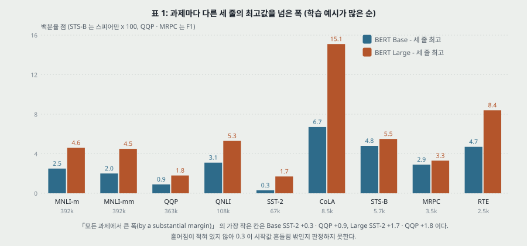

**맞는 것(내가 센 것).**

- **평균 칸은 칸 아홉의 단순 평균이다**(MNLI 를 m · mm 둘로 친다). 다섯 줄 모두 반올림 안에서 맞다(74.00 · 70.94 · 75.13 · 79.60 · 82.08). F1 · 스피어만 · 정확도를 같은 눈금으로 더한 값이다. 본문이 이것을 「평균 정확도 향상」 이라 부른다.
- 본문 4.5 · 7.0 은 79.6 − 75.1 · 82.1 − 75.1 로 맞다. MNLI 4.6 은 86.7 − 82.1 로 맞다.
- 「열한 과제」 는 표 1 의 여덟 + SQuAD 1.1 · 2.0 + SWAG 로 세어 맞다. MNLI 는 한 과제, WNLI 는 빠지고, 표 7 의 NER 은 들어가지 않는다.

**세기를 따질 것.**

- **「모든 과제에서 큰 폭으로(by a substantial margin)」**: 세 비교 줄의 칸별 최고와 비교한 가장 작은 폭이 Base SST-2 +0.3 · QQP +0.9, Large SST-2 +1.7 · QQP +1.8 이다. 표에 흩어짐이 없어 0.3 이 재시작 폭 안인지 판정하지 못한다. 흩어짐을 잴 수 있는 재료는 이 표에 없다.
- **「Large 가 Base 를 유의하게(significantly) 넘고, 특히 학습 데이터가 아주 적은 과제에서」**: 검정이 적혀 있지 않다. 아래 그림처럼 표 1 의 Large − Base 와 학습 예시 수의 스피어만 순위 상관은 여덟 점에서 **0.05** 이고(MNLI-m 사용, 내가 센 것), 가장 작은 네 과제의 차가 RTE 3.7 · MRPC 0.4 · STS-B 0.7 · CoLA 8.4 로 흩어진다. **그리고 재시작 골라내기는 Large 쪽에만, 작은 데이터에서 적용했다**(4.1절). 재시작이 없는 Base 와의 차에는 고르기 효과가 함께 들어 있다.

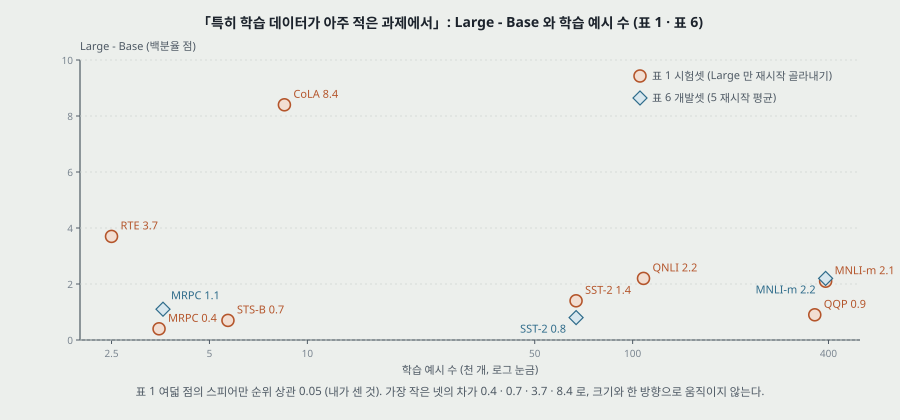

- **Abstract 의 7.7 점과 표의 7.0 점.** 7.7 은 공식 GLUE 점수의 차(80.5 − 72.8)이고 7.0 은 WNLI 를 뺀 표의 차다. WNLI 칸에서 BERT 제출은 **언제나 다수 부류를 낸 값**이고(부록 B.1, 65.1), 원문은 학습한 시스템이 모두 그 아래였다고 적는다. 머리기사의 수에 이 칸이 들어 있고 표에는 빠져 있다. 칸 열 평균으로 BERT Large 를 다시 세면 80.38 이라 80.5 와 0.12 다르다. 공식 점수 식이 이 파일에 없어 더 가르지 못한다.
- **비교 상대의 조건.** BERT 쪽은 과제마다 학습률을 개발셋으로 골랐고 GPT 는 모든 과제에 5e-5 다(A.4 절). 표의 앞 세 줄을 누가 언제 돌렸는지는 캡션에 평가 서버라고만 있다.
- **STS-B 의 손실.** 4.1절은 GLUE 전체에 분류 손실 식 (3) 을 적는다. STS-B 는 1 ~ 5 점 유사도이고 그림 4 (a) 도 `Class Label` 로 그린다. 회귀로 바꿨는지 이 파일에 없다.
- **CoLA 의 지표.** 캡션은 정확도라 적는다. 내 기억으로 GLUE 의 CoLA 지표는 매튜스 상관인데 **이번에 확인하지 않았다**(29절). 확인되면 칸 평균의 뜻도 함께 바뀐다.

---

## 12. 표 2 — SQuAD 1.1 (4.2절)

| 시스템 | Dev EM | Dev F1 | Test EM | Test F1 |
|---|---|---|---|---|
| Human | - | - | 82.3 | 91.2 |
| #1 앙상블 nlnet (리더보드 2018-12-10) | - | - | 86.0 | 91.7 |
| #2 앙상블 QANet | - | - | 84.5 | 90.5 |
| BiDAF+ELMo 단일 (출판) | - | 85.6 | - | 85.8 |
| R.M. Reader 앙상블 (출판) | 81.2 | 87.9 | 82.3 | 88.5 |
| BERT Base 단일 | 80.8 | 88.5 | - | - |
| BERT Large 단일 | 84.1 | 90.9 | - | - |
| BERT Large 앙상블 | 85.8 | 91.8 | - | - |
| BERT Large 단일 + TriviaQA | 84.2 | 91.1 | 85.1 | 91.8 |
| BERT Large 앙상블 + TriviaQA | 86.2 | 92.2 | 87.4 | 93.2 |

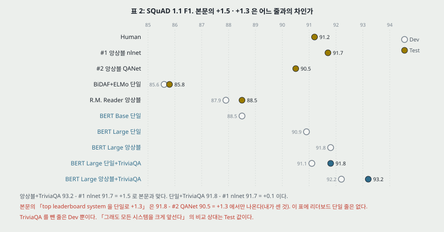

**본문 세 문장을 표와 맞대면(내가 센 것).**

1. **「top leaderboard 를 앙상블로 +1.5 F1」**: 93.2 − 91.7 = 1.5 로 맞다.
2. **「단일 시스템으로 +1.3 F1」**: 단일 91.8 − #1 91.7 = **+0.1** 이다. +1.3 은 91.8 − #2 QANet 90.5 에서만 나온다. 이 표의 리더보드 줄 둘은 모두 앙상블이라 리더보드 단일 상대는 표에 없다. 바로 다음 문장 「단일 BERT 가 F1 로 top 앙상블을 넘는다」 는 +0.1 로 맞고, EM 으로는 85.1 대 86.0 이라 원문이 「F1 로」 라 한정한 것이 맞다.
3. **「TriviaQA 없이도 0.1 ~ 0.4 F1 만 잃고 모든 시스템을 크게 앞선다」**: F1 로는 91.1 → 90.9 = 0.2 · 92.2 → 91.8 = 0.4 다. 0.1 은 EM 칸(84.2 → 84.1)에만 있다. 그리고 TriviaQA 를 뺀 줄은 **Test 값이 없다**. 리더보드 상대는 Dev 값이 없다. 단일 Dev 90.9 는 #1 의 Test 91.7 아래이고, 다른 집합이라 이 문장은 표로 확인되지 않는다.

**다른 어긋남 하나.** 각주 7 의 개발 F1 91.0 과 표의 90.9 · 91.1 이 어느 줄과도 같지 않다(0.1 차).

**앙상블의 구성.** 사전학습 체크포인트와 미세조정 시작값이 서로 다른 7 개다. 3.2절의 「모든 결과를 같은 사전학습 모델에서 1 시간 안에 재현」 은 이 줄을 말하는 것일 수 없다.

---

## 13. 표 3 — SQuAD 2.0 (4.3절)

| 시스템 | Dev EM | Dev F1 | Test EM | Test F1 |
|---|---|---|---|---|
| Human | 86.3 | 89.0 | 86.9 | 89.5 |
| #1 단일 MIR-MRC (F-Net) | - | - | 74.8 | 78.0 |
| #2 단일 nlnet | - | - | 74.2 | 77.1 |
| unet 앙상블 (출판) | - | - | 71.4 | 74.9 |
| SLQA+ 단일 (출판) | - | - | 71.4 | 74.4 |
| BERT Large 단일 | 78.7 | 81.9 | 80.0 | 83.1 |

+5.1 은 83.1 − 78.0 으로 맞고 **단일 대 단일**이다. 답 없음 처리는 식 (5) 하나로, 원문이 말하는 「간단한 확장」 이다. 사람 칸(89.5)에는 6.4 모자란다. BERT 줄은 하나뿐이라 재시작 폭도 Base 값도 없다.

---

## 14. 표 4 — SWAG (4.4절)

| 시스템 | Dev | Test |
|---|---|---|
| ESIM+GloVe | 51.9 | 52.7 |
| ESIM+ELMo | 59.1 | 59.2 |
| OpenAI GPT | - | 78.0 |
| BERT Base | 81.6 | - |
| BERT Large | 86.6 | 86.3 |
| Human (expert) | - | 85.0 |
| Human (5 annotations) | - | 88.0 |

+27.1 · +8.3 은 표와 맞다. **GPT 의 78.0 은 출처가 적혀 있지 않다.** 사람 값은 100 표본이고 SWAG 논문에서 옮겼다는 캡션이 있다. Large 86.3 은 사람 두 줄 사이지만, 100 표본 값의 표집 폭이 없어 사람과 순서를 매기지 않는다.

---

## 15. 표 5 — 사전학습 과제 절제 (5.1절)

| 줄 | MNLI-m (정확도) | QNLI | MRPC (정확도) | SST-2 | SQuAD (F1) |
|---|---|---|---|---|---|
| BERT Base | 84.4 | 88.4 | 86.7 | 92.7 | 88.5 |
| No NSP | 83.9 | 84.9 | 86.5 | 92.6 | 87.9 |
| LTR & No NSP | 82.1 | 84.3 | 77.5 | 92.1 | 77.8 |
| + BiLSTM | 82.1 | 84.1 | 75.7 | 91.6 | 84.9 |

*개발셋. Base 짜임. 줄마다 사전학습 데이터 · 미세조정 방식 · 초매개변수가 같다(원문). **실행 수와 흩어짐이 적혀 있지 않다.***

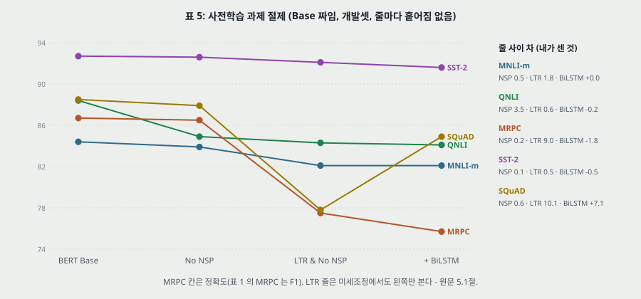

**이 편에서 조건이 가장 잘 맞춰진 표다.** 저자들이 같은 짜임에서 사전학습 목적 함수를 바꿔 돌렸다.

**LM 과 NSP 의 몫(내가 센 것).**

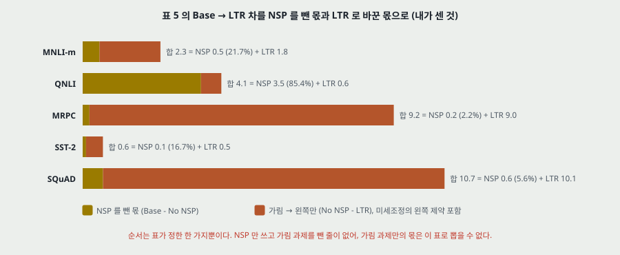

| 칸 | Base − No NSP (NSP 몫) | No NSP − LTR | Base − LTR | NSP 비율 |
|---|---|---|---|---|
| MNLI-m | 0.5 | 1.8 | 2.3 | 21.7% |
| QNLI | 3.5 | 0.6 | 4.1 | 85.4% |
| MRPC | 0.2 | 9.0 | 9.2 | 2.2% |
| SST-2 | 0.1 | 0.5 | 0.6 | 16.7% |
| SQuAD | 0.6 | 10.1 | 10.7 | 5.6% |

- **NSP 의 몫은 한 칸에 몰린다.** 1.0 을 넘는 칸은 QNLI 뿐이다. 3.1절의 「QA 와 NLI 에 very beneficial」 에서 MNLI-m 0.5 와 SQuAD 0.6 은 표로 그 세기를 받치지 못한다. 흩어짐이 없어 0.5 · 0.6 이 재시작 폭 밖인지 판정하지 못한다. 본문이 `significantly` 라 한 칸(QNLI · MNLI · SQuAD)과 안 한 칸(MRPC 0.2 · SST-2 0.1)의 경계도 정의되어 있지 않다.
- **QNLI 의 3.5 는 그 과제의 짜임과 맞물릴 수 있다.** 부록 B.1 정의로 QNLI 는 같은 문단 안의 (질문, 문장) 쌍을 답 포함 여부로 가른다. 문장 쌍 관계를 묻는 NSP 와의 관련은 내 짐작이고 원문은 까닭을 적지 않는다.
- **가림 과제의 몫은 뽑히지 않는다.** 표에는 「NSP 만 쓰고 가림 과제를 뺀」 줄이 없다. 「No NSP − LTR」 은 **가림 과제를 왼쪽만 언어 모델로 바꾼 차**이고, 양방향의 몫과 묶여 있다.
- **LTR 줄은 두 가지가 함께 바뀌었다.** 사전학습 목적 함수에 더해 **미세조정에서도 왼쪽만 본다**. 원문은 「제약을 풀면 어긋남이 생겨 성능이 떨어졌다」 고 적고 그 값은 표에 없다. 그래서 SQuAD 의 10.1 에는 「사전학습을 한 방향으로 했다」 와 「과제를 풀 때 오른쪽을 못 본다」 가 섞인다. 원문도 SQuAD 에서 「오른쪽 문맥이 없으니 당연하다」 고 적는다.
- **+BiLSTM 으로 그 둘을 일부 가른다(내 해석).** 오른쪽 문맥을 BiLSTM 으로 돌려주면 SQuAD 가 77.8 → 84.9, **10.1 가운데 7.1(70.3%)이 회복**되고 87.9 까지 3.0 이 남는다. 이 3.0 이 사전학습 쪽 몫에 가까운 값이지만, 위에 붙은 BiLSTM 은 무작위로 시작한 다른 장치라 같은 칸에 놓을 수 없다.
- **MRPC 의 9.0 은 까닭이 적혀 있지 않다.** 문장 수준 과제인데 SQuAD 와 맞먹게 떨어지고, QNLI(0.6) · SST-2(0.5) · MNLI-m(1.8)과 크기가 다르다. 학습 예시 3.5k 인 과제이고 BiLSTM 을 붙이면 1.8 더 떨어진다.
- **「BiLSTM 이 GLUE 과제 성능을 해친다」**: MNLI-m 은 82.1 대 82.1 로 같다. 넷 중 셋에서 낮다.
- **ELMo 꼴(왼쪽 모델 + 오른쪽 모델 잇기)은 돌리지 않았다.** 원문 5.1절은 (a) 비용이 두 배 (b) 질의응답에 직관적이지 않다 (c) 모든 층에서 양쪽을 보는 모델보다 `strictly less powerful` 이라 적는데, 셋 모두 이 표의 값이 아니다.

**A.4 절 「개선의 대부분이 사전학습 과제와 양방향에서 온다」(내가 센 것).**

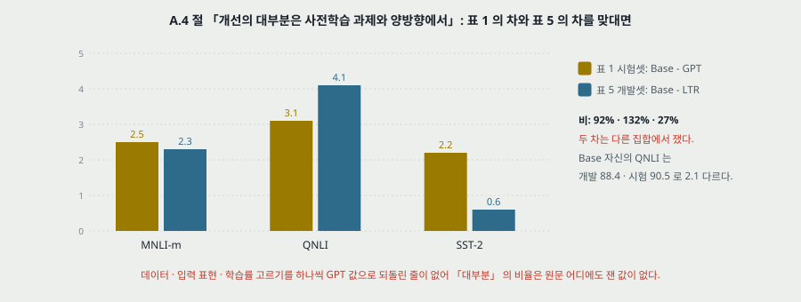

표 5 의 LTR 줄은 「GPT 와 직접 비교되나 데이터 · 입력 표현 · 미세조정 방식이 우리 것」 이다. 표 1 의 Base − GPT(시험)과 표 5 의 Base − LTR(개발)을 맞대면 MNLI-m 2.5 대 2.3(92%) · QNLI 3.1 대 4.1(132%) · SST-2 2.2 대 0.6(27%)이다. **둘은 다른 집합에서 쟀고**(Base 의 QNLI 는 개발 88.4 · 시험 90.5 로 2.1 다르다), MRPC 는 표 1 이 F1 · 표 5 가 정확도라 맞댈 수 없다. **데이터 양 · 학습률 고르기를 하나씩 GPT 값으로 되돌린 줄이 없어** 「대부분」 은 이 편 어디서도 비율로 재지 않았다. A.4 절의 「to isolate the effect of these differences」 는, 표 5 가 그 차이들을 BERT 값에 고정한 채 나머지를 잰 표이지 그 차이들 자체를 잰 표가 아니다.

---

## 16. 표 6 — 모델 크기 (5.2절)

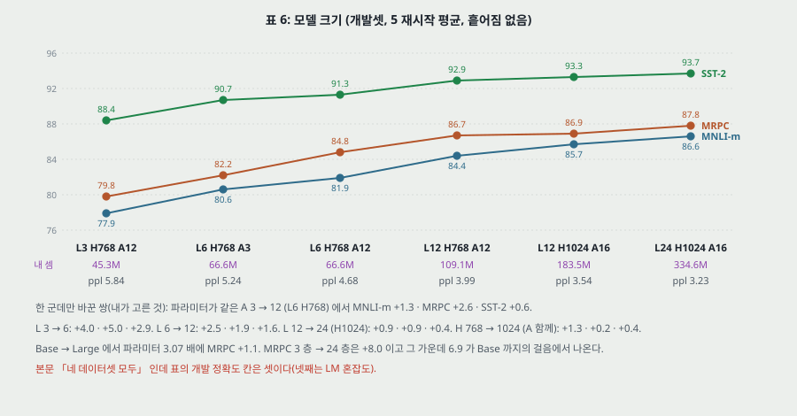

| L | H | A | 파라미터 (내 셈, V = 30,000) | LM ppl | MNLI-m | MRPC | SST-2 |
|---|---|---|---|---|---|---|---|
| 3 | 768 | 12 | 45,290,496 | 5.84 | 77.9 | 79.8 | 88.4 |
| 6 | 768 | 3 | 66,554,112 | 5.24 | 80.6 | 82.2 | 90.7 |
| 6 | 768 | 12 | 66,554,112 | 4.68 | 81.9 | 84.8 | 91.3 |
| 12 | 768 | 12 | 109,081,344 | 3.99 | 84.4 | 86.7 | 92.9 |
| 12 | 1024 | 16 | 183,452,672 | 3.54 | 85.7 | 86.9 | 93.3 |
| 24 | 1024 | 16 | 334,607,360 | 3.23 | 86.6 | 87.8 | 93.7 |

*개발 정확도, **5 재시작 평균**. 흩어짐은 적혀 있지 않다. 재시작은 미세조정에만 걸리므로 사전학습 쪽의 흔들림은 이 평균에 들어가지 않는다.*

- **「더 큰 모델이 모든 칸에서 나아진다(strict)」**: 여섯 줄 순서대로 모든 칸이 오른다. 표 안에서 맞다. 단 줄 순서가 파라미터 순서와 정확히 같지 않다 — 둘째와 셋째 줄은 파라미터 수가 같다.
- **머리 수만 바꾼 쌍(L6 H768, A 3 → 12).** **파라미터 수가 같은데**(내 셈) MNLI-m +1.3 · MRPC +2.6 · SST-2 +0.6, ppl −0.56 이다. 원문은 이 쌍을 따로 말하지 않는다. 따라서 표의 흐름을 「파라미터가 많아질수록」 으로만 읽으면 안 된다. 머리 하나의 폭이 256 대 64 로 다르다.
- **한 군데씩 바꾼 걸음(내가 고른 쌍).** L 3 → 6: +4.0 · +5.0 · +2.9. L 6 → 12: +2.5 · +1.9 · +1.6. H 768 → 1024(A 함께): +1.3 · +0.2 · +0.4. L 12 → 24: +0.9 · +0.9 · +0.4.
- **「아주 작은 과제에서도 극단적인 크기가 큰 개선(large improvements)」**: 근거 칸은 MRPC 하나다. **Base → Large 는 파라미터 3.07 배에 +1.1** 이고, MRPC 전체 +8.0 가운데 6.9 는 Base 까지의 걸음에서 나온다. 극단적이라 부를 크기의 구간에서는 차가 0.2 · 0.9 다. MNLI-m(392k)의 같은 구간 +2.2 보다 작다. 원문의 「첫 번째로 설득력 있게 보였다」 는 이 한 칸에 서 있고, 다른 작은 과제(CoLA · STS-B · RTE)는 이 표에 없다.
- 원문이 「provided that the model has been sufficiently pre-trained」 로 조건을 달지만, **사전학습 없는 줄이 없어 그 조건을 잰 것이 아니다.**
- 「네 데이터셋 모두」: 개발 정확도 칸은 셋이고 넷째는 LM 혼잡도다.
- MRPC 를 「3,600 라벨」 이라 적는데 표 1 은 3.5k 다.

---

## 17. 표 7 — 개체명 인식과 특징 방식 (5.3절)

| 시스템 | Dev F1 | Test F1 |
|---|---|---|
| ELMo | 95.7 | 92.2 |
| CVT | - | 92.6 |
| CSE | - | 93.1 |
| 미세조정 Large | 96.6 | 92.8 |
| 미세조정 Base | 96.4 | 92.4 |
| 특징 Base: 임베딩 | 91.0 | - |
| 특징 Base: 끝에서 둘째 층 | 95.6 | - |
| 특징 Base: 마지막 층 | 94.9 | - |
| 특징 Base: 끝 넷 가중합 | 95.9 | - |
| 특징 Base: 끝 넷 잇기 | 96.1 | - |
| 특징 Base: 12 층 가중합 | 95.5 | - |

*초매개변수는 개발셋으로 고르고 **값은 그 초매개변수의 5 재시작 평균**이다. 고른 집합과 같은 개발셋 값이다.*

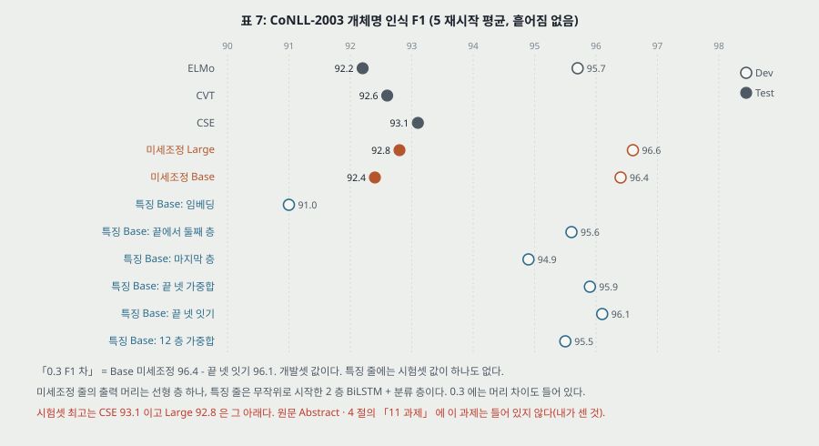

- **시험셋 최고는 CSE 93.1 이고 BERT Large 92.8 은 0.3 아래다.** 원문은 `competitively` 로 적어 세기가 맞다. 「열한 과제」 에 이 과제가 들지 않는다.
- **「미세조정에 0.3 F1 뒤진다」**: 96.4 − 96.1 로 맞고 개발셋 값이다. **특징 줄에는 시험셋 값이 하나도 없다.** 원문의 개발-시험 간격이 ELMo 3.5 · Base 4.0 · Large 3.8 이라, 특징 줄을 시험셋 줄과 맞댈 수 없다.
- **두 방식의 머리가 다르다.** 미세조정 줄은 분류 층 하나, 특징 줄은 **무작위로 시작한 2 층 768 차원 BiLSTM + 분류 층**이다. 0.3 은 「BERT 를 고쳤느냐」 와 「머리가 무엇이냐」 의 합이다. 내가 세면 방향마다 768 · 입력 3,072(끝 넷 잇기)일 때 BiLSTM 이 37,761,024 개이고 Base 의 34.6% 다. 선형 머리는 라벨 9 개 가정에서 6,921 개다. 「768 차원」 이 방향마다인지 합인지 원문이 적지 않아 이 값은 위쪽 경우의 값이다.
- **층 고르기.** 끝 넷 잇기 96.1 > 끝 넷 가중합 95.9 > 끝에서 둘째 95.6 > 12 층 가중합 95.5 > 마지막 층 94.9 > 임베딩 91.0. 흩어짐이 적혀 있지 않아 위 넷의 차 0.2 · 0.3 · 0.1 은 순서를 매기지 않는다. **마지막 층이 끝에서 둘째보다 0.7 낮다**는 것은 표에 있고 까닭은 없다.
- **얼린 낱말 표에서 층까지의 차.** 임베딩 줄(91.0)과 층을 쓴 줄(94.9 ~ 96.1)의 차 3.9 ~ 5.1 은 「같은 머리에서 문맥 층의 표현을 썼을 때」 의 차다.

---

## 18. 그림 5 — 사전학습 걸음 수 (C.1 절)

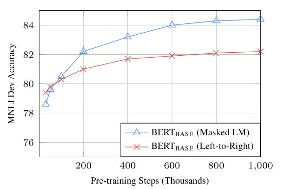

*원문 그림 5.*

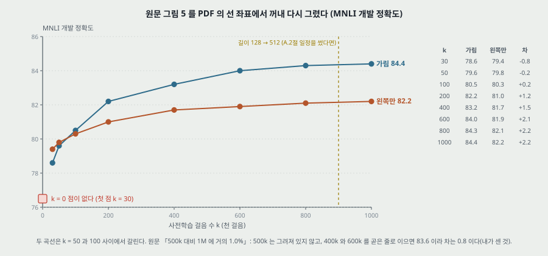

**읽은 값.** PDF 안의 선 좌표를 눈금(x: 200 = 131.104pt · 1,000 = 261.122pt, y: 84 = 583.419pt · 76 = 669.783pt)으로 옮겼다.

| k (천 걸음) | 30 | 50 | 100 | 200 | 400 | 600 | 800 | 1,000 |
|---|---|---|---|---|---|---|---|---|
| Base 가림 과제 | 78.6 | 79.6 | 80.5 | 82.2 | 83.2 | 84.0 | 84.3 | 84.4 |
| Base 왼쪽만 | 79.4 | 79.8 | 80.3 | 81.0 | 81.7 | 81.9 | 82.1 | 82.2 |
| 차 | −0.8 | −0.2 | +0.2 | +1.2 | +1.5 | +2.1 | +2.2 | +2.2 |

- **C.1 절 물음 1 「그만큼 큰 사전학습이 정말 필요한가」 답 「Yes ... almost 1.0% ... 1M steps compared to 500k」**: 500k 는 그려져 있지 않다. 400k 와 600k 를 곧은 줄로 이으면 83.6 이라 **0.8** 이다(내가 센 것). 800k → 1M 은 +0.1 이다. 과제는 MNLI 하나이고 곡선 하나, 흩어짐 없음.
- **C.1 절 물음 2 「곧 앞선다」**: 두 곡선은 k = 50 과 100 사이에서 갈린다. 「수렴이 느리다」 는 값으로 정의되어 있지 않다. 400k → 1M 에서 가림 쪽 +1.2 · 왼쪽 쪽 +0.5 로 오름이 더 오래 간다는 것은 표에서 읽힌다.
- **표들과 맞대면**: 1M 가림 84.4 는 표 5 · 표 6 과 같다. 1M 왼쪽만 82.2 는 표 5 의 LTR 82.1 과 0.1 다르다.
- **길이 일정과 맞대면.** A.2 절의 일정을 이 곡선에도 썼다면 k ≤ 800 의 점들은 모두 길이 128 구간의 체크포인트다. 원문은 이 곡선의 일정을 적지 않는다. 학습률 감소를 k 마다 새로 맞췄는지, 한 실행의 중간 값인지도 적지 않는다.
- **k = 0 점이 없다.** 21절.

---

## 19. 표 8 — 가림 비율 (C.2 절)

| MASK | SAME | RND | MNLI 미세조정 | NER 미세조정 | NER 특징 (끝 넷 잇기) |
|---|---|---|---|---|---|
| 80% | 10% | 10% | 84.2 | 95.4 | 94.9 |
| 100% | 0% | 0% | 84.3 | 94.9 | 94.0 |
| 80% | 0% | 20% | 84.1 | 95.2 | 94.6 |
| 80% | 20% | 0% | 84.4 | 95.2 | 94.7 |
| 0% | 20% | 80% | 83.7 | 94.8 | 94.6 |
| 0% | 0% | 100% | 83.6 | 94.9 | 94.6 |

*개발셋. 모델 크기 · 재시작 수 · 흩어짐이 적혀 있지 않다.*

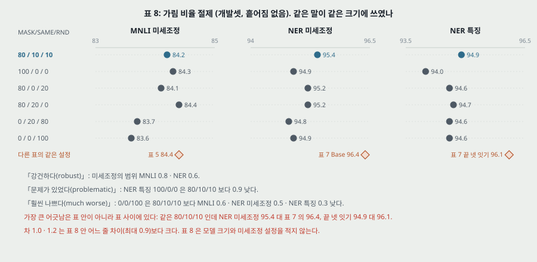

**같은 크기에 다른 낱말.**

| 원문 낱말 | 원문이 가리키는 곳 | 값(내가 센 것) |
|---|---|---|
| `surprisingly robust` | 미세조정의 여섯 줄 | 범위 MNLI 0.8 · NER 0.6 |
| `problematic` | NER 특징, MASK 만 | 80/10/10 보다 0.9 낮다 |
| `much worse` | RND 만 | 80/10/10 보다 MNLI 0.6 · NER 미세조정 0.5 · NER 특징 0.3 낮다 |

- `robust` 라 한 범위(0.6 · 0.8)와 `much worse` 라 한 차(0.3 ~ 0.6)의 크기가 겹친다. 흩어짐이 있어야 가를 수 있다.
- **MNLI 에서 80/10/10 은 여섯 줄 중 넷째다**(84.2). 80/20/0 이 84.4, 100/0/0 이 84.3 이다. 이 비율은 NER 쪽에서만 맨 위다. 원문은 이 비율을 이 표로 고른 것이라 적지 않았다.
- **표 사이가 표 안보다 크게 어긋난다.** 같은 80/10/10 인데 NER 미세조정이 표 8 은 95.4, 표 7 의 Base 는 96.4(1.0 차). NER 특징 끝 넷 잇기가 표 8 은 94.9, 표 7 은 96.1(1.2 차). MNLI 는 표 8 의 84.2 와 표 5 · 6 의 84.4(0.2 차). **표 8 의 NER 차이는 그 표 안의 어느 줄 차이(최대 0.9)보다 크다.** 원문은 이 표의 모델 크기와 설정을 적지 않아 까닭을 가르지 못한다. **그래서 표 8 의 숫자는 표 8 안에서만 읽는다.**
- 왜 특징 방식에서 어긋남이 커질 것으로 예상했는지(「표현을 고칠 기회가 없으니」)는 원문의 예상이고, 표에서 범위가 NER 미세조정 0.6 · 특징 0.9 로 그 방향과 어긋나지 않는다. 흩어짐이 없어 더 세게 쓰지 않는다.

---

## 20. 실험 분석 (논문의 표 · 그림마다)

**직접 돌리지 않는다.** 논문이 낸 실험을 표 · 그림 하나씩 같은 틀로 읽는다. 책상에서 센 값은 「내가 센 것」 으로 밝힌다.

| 표 · 그림 | 무엇을 바꿨나 (변인) | 무엇을 고정했나 | 결과 | 반복 수 · 흩어짐 | 주장이 결과보다 센가 |
|---|---|---|---|---|---|
| **표 1 GLUE** | 시스템 다섯 | 시험셋 · 평가 서버. **그 밖은 같지 않다** — BERT 는 과제별 학습률 고르기, Large 만 재시작 고르기, GPT 는 5e-5 고정, 앞 세 줄은 다른 저자의 값 | 평균 79.6 · 82.1 대 75.1, 공식 80.5 대 72.8 | 시험 제출 Base · Large 각 1 회. 흩어짐 없음 | 「모든 과제에서 큰 폭」 의 가장 작은 칸 +0.3 · +1.7. 「Large 가 특히 작은 데이터에서」 의 순위 상관 0.05(내가 센 것), 고르기가 Large 에만. **센 편** |
| **표 2 SQuAD 1.1** | 시스템, 단일 · 앙상블, TriviaQA 유무 | BERT 끼리 설정 같음. 상대는 리더보드 · 출판 값 | Test F1 91.8(단일) · 93.2(앙상블) 대 91.7 | 줄마다 1. 앙상블 7 개. 흩어짐 없음 | +1.5 맞음. **+1.3 은 #2 와의 차, #1 과는 +0.1.** 「0.1 ~ 0.4 F1」 의 0.1 은 EM 칸. TriviaQA 없는 줄은 Test 없음. **센 편** |
| **표 3 SQuAD 2.0** | 시스템 | 단일. TriviaQA 안 씀. $\tau$ 는 개발셋으로 고름 | 83.1 대 78.0 | BERT 줄 하나. 흩어짐 없음 | +5.1 맞음. 세기 맞음 |
| **표 4 SWAG** | 시스템 | Test. 상대의 조건 없음 | 86.3 대 59.2 · 78.0, 사람 85.0 · 88.0 | 사람 100 표본. BERT 줄 하나 | 차는 맞음. GPT 값 출처 없음. 사람과 순서 매기지 않음 |
| **표 5** | 사전학습 목적 함수: 가림 + NSP · 가림 · 왼쪽만 · 왼쪽만 + BiLSTM | 데이터 · 미세조정 방식 · 초매개변수 · Base 짜임(원문). **LTR 줄은 미세조정의 주의 제약도 함께 바뀐다** | 15절 표 | 실행 수 적혀 있지 않음. 흩어짐 없음 | NSP `very beneficial`: QNLI 3.5, 나머지 0.1 ~ 0.6. 「BiLSTM 이 GLUE 를 해친다」: 넷 중 하나는 같다. ELMo 꼴 세 주장은 표 밖. **이 편에서 조건은 가장 잘 맞췄고 낱말은 센 편** |
| **표 6** | L · H · A | 초매개변수 · 절차(원문). 미세조정 5 재시작 | 77.9 → 86.6 · 79.8 → 87.8 · 88.4 → 93.7 | **5 재시작 평균**, 흩어짐 없음. 사전학습 재현 없음 | 「모든 칸 상승」 맞음. 「극단적 크기가 작은 과제에 큰 개선」: Base → Large 의 MRPC +1.1, 칸 하나. **센 편** |
| **표 7** | 미세조정 대 특징 방식, 쓰는 층 | CoNLL-2003. **머리가 다르다**(선형 대 2 층 BiLSTM) | 개발 96.4 대 96.1, 시험 92.8 대 CSE 93.1 | **5 재시작 평균**, 흩어짐 없음. 고른 집합과 보고 집합이 같은 개발셋 | `competitively` 맞음. 「특징 방식도 효과적」 은 개발셋 값뿐. 특징 줄 시험값 없음 |
| **표 8** | MASK · SAME · RND 비율 여섯 | 모델 크기 · 설정이 적혀 있지 않음 | 19절 표 | 흩어짐 없음 | `robust` · `problematic` · `much worse` 가 0.3 ~ 0.9 안에 겹친다. **표 7 과 1.0 · 1.2 어긋남.** **센 편** |
| **그림 5** | 사전학습 걸음 k(30 ~ 1,000 천), 가림 대 왼쪽만 | Base, MNLI 개발셋 | 84.4 대 82.2 | 점마다 값 하나, 흩어짐 없음. **k = 0 없음** | `almost 1.0%`(500k 대비)는 그 점이 없고 보간 0.8. 과제 하나로 「그렇다」 |
| **3.2절 · 각주 7 시간** | (없음) | Cloud TPU 1 | 1 시간 안, SQuAD 30 분 | 표 없음 | 앙상블 7 개 줄은 「같은 사전학습 모델」 이 아니다 |
| **A.2 절 시간** | 크기 | TPU 칩 16 · 64 | 각 4 일 | 한 줄 | 내 셈 2.89 걸음/초, $LH^2$ 비 3.56 대 칩 비 4. 「약 40 에폭」 은 길이 일정과 함께 읽으면 12.9 가 될 수 있다 |

**비교 상대가 같은 조건인가.** 표 1 · 2 · 3 · 4 · 7 의 BERT 밖 줄은 다른 저자의 값(평가 서버 · 리더보드 · 출판 · SWAG 논문)이다. **같은 조건에서 저자들이 돌린 비교는 표 5 · 6 · 8 · 그림 5 와 표 7 의 BERT 줄끼리**이고 모두 개발셋이다.

**반복과 흩어짐.** 재시작이 적힌 곳은 표 6 · 7(5 번 평균)과 Large 의 GLUE 고르기뿐이고 **흩어짐은 어느 표에도 없다.** 표 6 · 7 에 5 번 돌린 값이 있으므로 폭을 적을 수 있었던 자리다. 그 폭을 모르므로 이 노트는 차 0.5 이하를 순서로 읽지 않는다.

---

## 21. 사전학습의 몫은 어디에 있나 — 앞 노트의 물음

**물음(Transformer 노트).** 「사전학습의 몫을 처음부터 학습한 같은 짜임과 견줘 갈랐는가.」

**답: 갈지 않았다.** 훑은 범위는 이 파일 전체이고, 낱말 `scratch` 는 2.1절 · 2.2절 · A.5 절에 일반론으로 나올 뿐 표의 줄이 아니다.

| 가까운 자리 | 무엇을 쟀나 | 사전학습의 몫이 아닌 까닭 |
|---|---|---|
| 표 5 | 가림 + NSP · 가림 · 왼쪽만 | 모든 줄이 사전학습을 했다. 어떤 과제로 하느냐의 차이다 |
| 표 6 | 크기 | 모든 줄이 사전학습을 했다 |
| 그림 5 | k = 30 ~ 1,000 에서 MNLI 78.6 → 84.4 | **가장 가까운 자리.** 그러나 첫 점이 k = 30 이고, 그 값과 k = 0 의 차는 모른다. +5.8 은 이 구간의 차이지 전체 몫이 아니다 |
| 표 7 의 임베딩 줄 | 얼린 낱말 표 + BiLSTM 91.0 | 얼린 낱말 표도 사전학습의 산물이다 |
| 표 1 의 BiLSTM+ELMo+Attn | 다른 짜임 | 짜임이 달라 대조가 아니다 |

**이것이 왜 비어 있는가는 원문이 적지 않았다.** 이 저장소의 앞 칸 가운데 사전학습을 다룬 2010 편은 같은 짜임의 처음부터 학습과 견주는 것을 실험의 중심에 두었다. 이 편의 제목은 Pre-training 인데 그 줄이 없다. 원문의 「rich, unsupervised pre-training is an integral part」(6절)는 앞선 일들에 대한 문장이다. **「안 했다」 이지 「못 한다」 가 아니다** — 이 파일 어디에도 그 줄을 돌릴 수 없었다는 말은 없고, 왜 넣지 않았는지도 적혀 있지 않다.

**다른 물음(인코더를 번역 밖으로 옮기면).** 답은 표 1 ~ 4 · 7 이다. 다만 같은 칸의 비교 상대가 다른 저자의 다른 설정이라, 「인코더가 그 과제에서 무엇을 낼 수 있는가」 까지만 보이고 「왜 그 차이가 났는가」 를 가르는 표는 5 · 6 뿐이다.

---

## 22. 이 논문이 스스로 적은 한계와 조건

1. **`[MASK]` 는 미세조정에 나타나지 않아 두 단계가 어긋난다**(3.1절). 80/10/10 이 그 대응이다.
2. **가림 과제는 배치마다 15% 만 맞혀 사전학습 걸음이 더 필요할 수 있다**(A.1 절). C.1 절이 `slightly slower` 라 답한다.
3. **미세조정이 작은 데이터에서 때로 불안정했다**(4.1절). 그래서 Large 에 재시작을 썼다.
4. **큰 데이터(10 만 예시 이상)는 초매개변수에 덜 민감하고 작은 데이터는 민감하다**(A.3 절). 값은 없다.
5. **과제가 Transformer 인코더로 쉽게 표현되지 않을 수 있다**(5.3절). 특징 방식의 이득 둘 가운데 하나로 적는다.
6. **단일 과제 미세조정만 보고한다.** 여러 과제를 함께 하면 더 오를 수 있고 RTE 에서 MNLI 와 함께 했을 때 큰 개선을 봤다고 각주 14 가 적는다(값 없음).
7. **$C$ 는 미세조정 없이는 의미 있는 문장 표현이 아니다**(각주 6).
8. **긴 열은 비용이 제곱으로 커서 사전학습의 90% 를 길이 128 로 돌렸다**(A.2 절).
9. **WNLI 칸은 다수 부류를 냈다**(부록 B.1). 데이터 구성 문제 때문이라 적는다.

---

## 23. 논문이 적지 않은 것 — 내가 읽으며 짚은 자리

1. **처음부터 학습한 줄이 없다**(21절).
2. **흩어짐이 어디에도 없다.** 5 재시작을 돌린 표 6 · 7 에도 없다.
3. **유의성을 검정한 값이 없는데 `significantly` 가 여러 번 나온다.** 4.1절(Large 대 Base), 5.1절(NSP, BiLSTM), 5.2절.
4. **가림 과제만 뺀 줄이 없다**(15절). NSP 와 가림 과제의 순서를 바꿔 잰 값도 없다.
5. **ELMo 꼴을 같은 짜임으로 돌린 줄이 없다.** 5.1 절의 세 주장이 말로만 있다.
6. **양방향 사전학습 + 왼쪽만 미세조정, 왼쪽만 사전학습 + 양방향 미세조정의 값이 없다.** 뒤의 것은 「떨어졌다」 고만 적는다.
7. **데이터 양의 몫이 없다.** GPT 와 다른 네 가지(A.4 절) 가운데 하나씩 되돌린 줄이 없다.
8. **표 8 의 모델 크기.** 위 19절.
9. **대소문자를 과제마다 어떻게 다뤘는지.** NER 만 `case-preserving` 이라 적고 나머지는 적지 않는다.
10. **15% 자체를 바꾼 줄이 없다.** 표 8 은 맞힐 자리 15% 를 고정하고 그 안의 비율만 바꾼다.
11. **언어 하나.** 모든 말뭉치와 과제가 영어다.
12. **어휘 30,000 인데 파라미터 셈이 Large 에서 맞지 않는 까닭**(10절).

---

## 24. 읽을 때 헷갈리는 지점

- **양방향의 두 뜻.** 이 편의 「bidirectional」 은 모든 층이 양쪽을 본다는 뜻이다. 양방향 RNN 의 두 방향을 이어 붙이는 꼴(앞 칸 Attention 노트의 인코더)과 다르다.
- **인코더 · 디코더의 이름.** 각주 4: 문헌에서 양방향 Transformer 를 Transformer encoder, 왼쪽만 쓰는 것을 Transformer decoder 라 부른다. 이 이름의 「디코더」 는 왼쪽만 보는 꼴을 말한다. 원 Transformer 의 디코더처럼 인코더 출력을 받는지는 각주가 말하지 않는다.
- **「문장」 은 문장이 아니다.** 임의의 연속 구간이다. A.2 절 「대개 한 문장보다 길다」.
- **`[MASK]` 비율.** 입력의 15% 가 `[MASK]` 가 아니라 **12%** 가 `[MASK]` 다. 15% 는 맞힐 자리의 비율이다.
- **그대로 둔 10%.** 그 자리도 맞힌다. 입력이 정답인 자리에도 손실이 걸린다.
- **MNLI 와 MNLI-m.** 표 1 은 matched / mismatched 를 둘 다, 표 5 · 6 은 m 만, 그림 5 · 표 8 은 이름이 그냥 MNLI 다. 값이 84.4 · 84.2 라 m 으로 읽히나 원문이 적지 않는다.
- **표 1 과 표 5 의 MRPC.** 앞은 F1, 뒤는 정확도.
- **Base 의 시험값이 있는 표와 없는 표.** 표 1 은 시험값, 표 2 · 4 는 Base 시험값 없음, 표 3 은 Base 줄 없음.
- **GLUE 평균과 GLUE 점수.** 표의 평균(82.1)은 WNLI 를 뺀 칸 평균, Abstract 의 80.5 는 공식 점수다.
- **Large 의 표 1 값은 고른 값, 표 6 의 값은 평균.** 재시작 고르기 대 재시작 평균이다.

---

## 25. 원문 안의 어긋남 모음

| # | 자리 | 내용 | 판정 |
|---|---|---|---|
| 1 | 표 8 대 표 7 | 같은 80/10/10, NER 미세조정 95.4 대 96.4 · 끝 넷 잇기 94.9 대 96.1 | 설정이 다른 것으로 읽을 수밖에 없고 적혀 있지 않다 |
| 2 | 표 8 대 표 5 · 6 | MNLI 84.2 대 84.4 | 0.2 차. 표 8 의 설정이 적혀 있지 않다 |
| 3 | 표 5 대 표 6 | 같은 Base 짜임, SST-2 92.7 대 92.9. MNLI-m · MRPC 는 같다 | 표 6 은 5 재시작 평균, 표 5 는 적혀 있지 않다 |
| 4 | 표 5 대 그림 5 | 왼쪽만 1M, 82.1 대 82.2 | 0.1 차 |
| 5 | 4.2절 대 표 2 | 「top leaderboard 를 단일로 +1.3」, #1 과는 +0.1 | +1.3 은 #2 와의 차 |
| 6 | 4.2절 대 표 2 | 「0.1 ~ 0.4 F1」, F1 은 0.2 · 0.4 | 0.1 은 EM 칸의 값 |
| 7 | 각주 7 대 표 2 | 개발 F1 91.0, 표는 90.9 · 91.1 | 0.1 차 |
| 8 | A.2 절 | 256 × 512 = 128,000 | 곱은 131,072 |
| 9 | A.2 절 | 약 40 에폭 대 길이 128 이 90% | 256 열 유지면 12.9. 배치 적혀 있지 않음 |
| 10 | 표 1 대 5.2절 | MRPC 3.5k 대 3,600 | 원문 안의 두 값 |
| 11 | 5.2절 대 표 6 | 「네 데이터셋」 | 정확도 칸은 셋 |
| 12 | 4.1절 대 A.3 절 | 학습률 넷(4e-5 포함) 대 셋 | 범위가 다르다 |
| 13 | 4.3절 대 A.3 절 | SQuAD 2.0 배치 48, 범위는 16 · 32 | 범위 밖 |
| 14 | 3절 대 내 셈 | Large 340M 대 334.6 ~ 336.2M | 1.1 ~ 1.9% (10절) |
| 15 | 3.2절 대 표 2 | 「같은 사전학습 모델」 대 앙상블의 다른 체크포인트 | 앙상블 줄에 안 맞는다 |
| 16 | 그림 4 (c) 대 4.3절 | 그림은 SQuAD v1.1 만 적는다 | 그림의 범위 |
| 17 | 5.1절 | 「this it is strictly less powerful ... since it can use both」 | 인쇄된 문장이 지시어가 꼬였다. 뜻은 앞뒤로 읽힌다 |
| 18 | C.2 절 | 「The right part of the paper」 | `table` 의 잘못으로 읽힌다 |

**판 차이.** 이 파일은 NAACL 발표집 판이다. arXiv 판은 안 읽었고, 위 어긋남 가운데 어느 것이 판 사이에 고쳐졌는지 **확인하지 않았다.**

---

## 26. 앞 칸들과 맞춰 보기

| 칸 | 그 편이 남긴 자리 | 이 편에서 |
|---|---|---|
| DBN · 오토인코더 (2006) | 층별 비지도 사전학습 후 미세조정 | 층별이 아니라 **전체를 한 번에** 비지도로 배운다. 사전학습 목적 함수가 재구성 · 가능도에서 **가린 자리 맞히기**로 바뀌었다 |
| 사전학습은 왜 돕는가 (2010) | 처음부터 학습과 견줘 사전학습이 최적화인지 정규화인지 따졌다 | **그 비교를 하지 않았다**(21절) |
| 잡음 제거 오토인코더 (Vincent 2008, 원문 인용) | 잡음 낸 입력에서 전체를 복원 | 원문이 대비한다 — 가린 자리만 맞힌다 |
| Transformer (2017) | 번역 둘에서 과제마다 처음부터. 인코더만 옮기는 시험은 없음 | 인코더만 옮겼다. 자리 표현을 사인에서 학습으로, ReLU 를 GELU 로. 머리 폭 64 는 같다. 그 편 표 3 (E) 는 사인 · 학습이 25.8 · 25.7 이었다 |
| Bahdanau 외 (2015) | RNN 인코더 위의 주의, 양방향 RNN 주석 | 층마다 양쪽을 보는 쪽으로 간다. 이 파일은 그 편을 부르지 않는다 |
| ImageNet 사전학습 (PatchCore 노트의 WRN-50-2 가 이 자리) | 큰 지도 데이터에서 배워 옮긴다 | 원문 2.3절이 같은 맥락으로 부른다. **라벨 없는 말뭉치**에서 배운다는 점이 다르다 |

---

## 27. 계보와 내가 가져갈 것

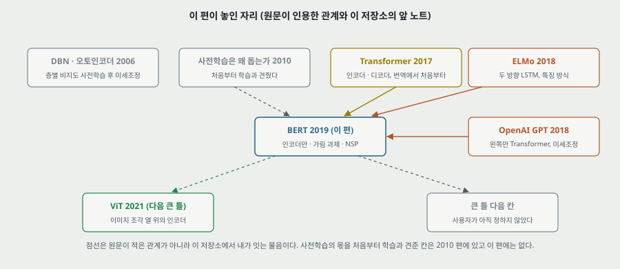

**하나. 닿는 자리.** 이 편의 틀은 「큰 데이터에서 표현을 먼저 배우고, 얇은 머리를 붙여 옮긴다」 이다. 내가 연구에서 쓴 PatchCore 는 ImageNet 망을 **얼린 채** 특징을 뽑으니 표 7 의 특징 방식 자리에 있고, 표 7 은 「미세조정과의 차 0.3 · 어느 층이냐에 따라 94.9 ~ 96.1」 이라는 같은 물음의 NLP 쪽 값을 준다. 층 고르기가 끝 층이 아닌 쪽에 유리한 것(마지막 층 94.9 대 끝 넷 잇기 96.1)도 같은 모양이나, **과제 · 데이터 · 머리가 달라 그 값을 옮겨 쓰지 않는다.**

**둘. 옮겨 쓸 수 있는 것.**

- **표끼리 같은 설정의 값을 맞대기.** 표 8 의 80/10/10 과 표 7 의 같은 줄을 맞대니 표 안의 어느 차이보다 큰 어긋남이 나왔다. 절제 표를 읽을 때 기준 줄이 다른 표와 같은지 먼저 본다.
- **문장의 수를 표로 재계산하기.** 「+1.3」 을 표 칸 뺄셈으로 찾아가니 다른 줄과의 차였다. 낱말 「single system」 은 맞고 비교 상대가 달랐다.
- **낱말의 세기를 같은 값 범위에서 맞대기.** `robust` · `problematic` · `much worse` 가 0.3 ~ 0.9 안에서 겹친다(19절).
- **골라낸 값과 평균을 구별하기.** 표 1 은 Large 만 재시작 고르기, 표 6 은 평균이다. 고르기가 한쪽에만 걸리면 차이에 고르기 몫이 들어간다.
- **뺀 줄을 찾기.** 이 편에서 가장 중요한 것은 표에 있는 값이 아니라 없는 줄(처음부터, 가림 과제만 뺀 것, ELMo 꼴)이다.
- **파라미터 표에 머리 수 쌍을 놓아 보기.** 파라미터가 같은 쌍을 찾으면 「크기」 와 「짜임」 이 갈린다(표 6 의 A 3 대 12).

**셋. 지금 확인된 것은 여기까지다.**

- **논문이 잰 것**: 표 1 ~ 8 의 값, 그림 5 의 곡선, 사전학습 시간 4 일, NSP 정확도 97 ~ 98%.
- **논문이 말만 한 것**: 사전학습의 효과 그 자체(처음부터 학습 줄 없음), ELMo 꼴이 `strictly less powerful` 하다, ELMo 꼴이 두 배 비싸다, 개선의 대부분이 양방향과 두 과제에서 온다(A.4), 극단적 크기가 작은 과제에 이롭다는 일반화, 무작위 교체 1.5% 가 언어 이해 능력을 해치지 않는 듯하다, 다수 과제 함께 하기의 이득.
- **내가 책상에서 센 것**: 파라미터 Base 109,081,344 · Large 334,607,360(어휘 30,000)과 다른 셈 셋, 표 6 여섯 줄의 파라미터, 머리 수 쌍의 파라미터 동일, 가림 개수, 표 1 평균 재계산과 칸별 차, 순위 상관 0.05, 공식 점수 재계산 80.38, 표 2 의 차 셋, 표 5 의 몫 다섯, A.4 맞대기 92 · 132 · 27%, BiLSTM 파라미터 37,761,024, 그림 5 의 값 열여섯과 500k 보간 83.6, 에폭 38.8 · 12.9, 토큰 합 비 1.33 배, 걸음 속도 2.89, $LH^2$ 비 3.56.

---

## 28. 다음에 읽을 것

**큰 틀.** 로드맵 다음 칸은 **ViT(Dosovitskiy 외, ICLR 2021)** 로 정했고, 이 BERT 노트는 그 사이에 함께 읽은 편이다. **ViT 다음 칸은 사용자가 아직 정하지 않았다.** 이 노트가 칸을 늘리지 않는다.

**이 노트의 자리에서 나온 후속 편(세부).** 큰 틀을 따라간 뒤에 고른다.

| 다음 | 이 노트의 어느 자리에서 나오는가 | 무엇을 확인하고 싶은가 |
|---|---|---|
| **Deep contextualized word representations** (ELMo, Peters 외, NAACL 2018, 원문 인용) | 표 1 · 표 7 의 비교 상대, 5.1절의 세 주장 | 왼쪽 · 오른쪽 모델을 잇는 꼴의 값과 층 가중합. 표 7 의 층 가중합과 맞대기 |
| **Improving Language Understanding by Generative Pre-Training** (GPT, Radford 외, 2018, 원문 인용) | A.4 절의 네 차이, 표 1 · 표 4 | 파라미터 수와 학습 설정, 표의 값이 그 편에서 온 것인지 |
| **GLUE** (Wang 외, 2018, 원문 인용) | 11절 — 공식 점수 식, CoLA 지표, WNLI | 80.5 를 칸에서 맞출 수 있는가 |
| **Dissecting Contextual Word Embeddings** (Peters 외, EMNLP 2018, 원문 인용) | 5.2절 「mixed results」 | 크기 효과의 반대쪽 값 |
| **How transferable are features in deep neural networks?** (Yosinski 외, NIPS 2014, 원문 인용) | 2.3절 · 21절 | 층마다 옮기기와 처음부터 학습을 견줘 잰 편인지 |
| **Rethinking ImageNet Pre-training** (He 외, ICCV 2019) — 후보 | 21절 — 처음부터 학습 대조의 이미지 쪽 | **원문 참고 문헌에 없다.** 읽고 이 자리에 맞는 편인지 가린다 |
| **RoBERTa** (Liu 외, 2019) — 후보 | 15절 — NSP 의 몫 | **원문 참고 문헌에 없다.** 읽고 이 자리에 맞는 편인지 가린다 |

---

## 29. 남는 질문

- **같은 짜임을 처음부터 미세조정하면 표 1 · 표 5 칸이 얼마인가.** 이 편의 제목이 묻는 값이다.
- **재시작 폭이 얼마인가.** 표 6 · 7 에서 돌린 다섯 번의 표준편차. 표 5 의 0.1 ~ 0.6 이 그 안인지.
- **NSP 만 쓰고 가림 과제를 뺀 줄은 얼마인가.** 가림 과제의 몫을 뽑는 값.
- **ELMo 꼴을 같은 Transformer 로 돌리면 얼마인가.** 5.1 절 세 주장의 값.
- **표 8 의 설정은 무엇이었나.** 표 7 과 1.0 · 1.2 다른 까닭.
- **길이 128 구간의 배치 크기.** 12.9 에폭인가 38.8 에폭인가. 공개 코드나 arXiv 판에 있는지 이 노트는 확인하지 않았다.
- **Large 는 어떤 셈으로 340M 인가.**
- **QNLI 의 NSP 3.5 는 왜 그 칸에 몰리나.** 원문은 까닭을 적지 않는다.
- **MRPC 의 LTR 9.0 은 왜 그 크기인가.**
- **CoLA 지표.** 캡션은 정확도이고 내 기억은 매튜스 상관이다. GLUE 편을 읽으면 확인된다.
- **머리 수 A 를 3 에서 12 로 바꾸면 왜 오르나**(파라미터 같음). 이 편은 말하지 않는다.
- 위에서 처음 셋과 다섯째는 저자의 실행이나 공개 코드 없이는 답이 안 나온다. 넷째의 일부와 CoLA · 공식 점수는 28절의 ELMo · GLUE 를 읽으면 다른 쪽 수가 생긴다.

---

## 30. 참고 문헌

이 노트가 부른 편만 적는다. 원리는 원 출처를, 구현은 그 라이브러리의 편을 적는 규칙을 따른다. 그림 코드는 파이썬 표준 라이브러리만 쓰고, 원문 그림을 잘라 낸 일만 PyMuPDF 를 썼다(PyMuPDF 는 논문이 따로 없어 적지 않는다).

- Devlin, J., Chang, M.-W., Lee, K., and Toutanova, K. (2019). BERT: pre-training of deep bidirectional transformers for language understanding. NAACL-HLT, 4171–4186. — 이 노트의 대상. arXiv:1810.04805 판은 읽지 않았다.
- Vaswani, A. 외 (2017). Attention is all you need. NIPS. — 짜임(원문 인용).
- Peters, M. 외 (2018a). Deep contextualized word representations. NAACL. — ELMo. **읽지 않았다.**
- Peters, M. 외 (2018b). Dissecting contextual word embeddings: architecture and representation. EMNLP. **읽지 않았다.**
- Radford, A., Narasimhan, K., Salimans, T., and Sutskever, I. (2018). Improving language understanding with unsupervised learning. 기술 보고서. — OpenAI GPT(원문이 적은 제목 그대로). **읽지 않았다.**
- Wang, A. 외 (2018a). GLUE: a multi-task benchmark and analysis platform for natural language understanding. **읽지 않았다.**
- Wu, Y. 외 (2016). Google's neural machine translation system. arXiv:1609.08144. — WordPiece(원문 인용). **읽지 않았다.**
- Taylor, W. L. (1953). Cloze procedure: a new tool for measuring readability. — 가림 과제의 이름. **읽지 않았다.**
- Vincent, P. 외 (2008). Extracting and composing robust features with denoising autoencoders. ICML. — 원문의 대비. **읽지 않았다.**
- Hendrycks, D. and Gimpel, K. (2016). Bridging nonlinearities and stochastic regularizers with Gaussian error linear units. — GELU. **읽지 않았다.**
- Yosinski, J. 외 (2014). How transferable are features in deep neural networks? NIPS. **읽지 않았다.**
- Al-Rfou, R. 외 (2018). Character-level language modeling with deeper self-attention. arXiv:1808.04444. — 5.2절의 235M. **읽지 않았다.**
- Rajpurkar, P. 외 (2016). SQuAD. · Zellers, R. 외 (2018). SWAG. · Tjong Kim Sang, E. and De Meulder, F. (2003). CoNLL-2003. — 데이터. **읽지 않았다.**
- Erhan, D. 외 (2010). Why does unsupervised pre-training help deep learning? AISTATS. — 26 · 21절의 대비. **원문 참고 문헌에는 없다.**
- He, K. 외 (2019). Rethinking ImageNet pre-training. ICCV. · Liu, Y. 외 (2019). RoBERTa. arXiv:1907.11692. — 다음에 읽을 것 후보. **원문 참고 문헌에 없다. 읽지 않았다.**
- 코드: `https://github.com/google-research/bert` (원문 1절). 이 노트는 코드를 보지 않았다. 어휘 30,522 는 Hugging Face 의 `bert-base-uncased` · `bert-large-uncased` `config.json` 에서 2026-11-05 에 받았다.

---

## 31. 경로

| 무엇 | 어디 |
|---|---|
| 원문 PDF (NAACL 2019 발표집 판, 16 쪽) | `papers/NAACL19_BERT_Pre_training_of_Deep_Bidirectional_Transformers_for_Language_Understanding.pdf` |
| 이 노트 | `notes/NAACL19_BERT_Pre_training_of_Deep_Bidirectional_Transformers_for_Language_Understanding.md` |
| 이 노트의 그림 (직접 그린 것) | `figures/NAACL19_BERT/fig01_context_per_layer.svg` 부터 `fig17_lineage.svg` 까지 열일곱 |
| 이 노트의 그림 (원문에서 잘라 낸 것) | `figures/NAACL19_BERT/paper_fig1_pretrain_finetune.png` · `paper_fig2_input.png` · `paper_fig3_architectures.png` · `paper_fig4_finetune_tasks.png` · `paper_fig5_steps.png` |
| 그림을 만드는 코드 | `figures/NAACL19_BERT/make_figures.py` — 바깥 데이터를 읽지 않으므로 `python make_figures.py` 로 어디서나 다시 만든다(표준 라이브러리만). 파라미터 · 표 1 평균 · 가림 개수 · 에폭의 수를 이 파일이 계산해 화면에도 찍는다. 원문 표의 수는 상수 `T1` · `T2` · `T5` · `T6` · `T7` · `T8`, 그림 5 는 `F5_K` · `F5_MLM` · `F5_LTR` 에 옮겨 적었다 |
| 원문 그림을 잘라 내는 코드 | `figures/NAACL19_BERT/crop_paper_figures.py` — PyMuPDF 가 필요하다 |
