# LSTM — Long Short-Term Memory (저자 배포본, 요약)

> **한 줄.** 순환망을 BPTT · RTRL 로 배우면 오차가 시간을 거슬러 갈 때 걸음마다 $\lvert f'(net)\, w \rvert$ 가 곱해져 지수로 사라지거나 터진다(식 1 · 2). 이 편은 그 곱을 **정확히 1.0 으로 묶은 유닛**(항등 활성 · 자기 연결 무게 1.0, 「상수 오차 회전목마」 CEC)을 셀 한가운데 두고, 그 셀에 무엇을 쓰고 언제 꺼낼지를 **곱셈 게이트 둘(입력 · 출력)** 이 정하게 한다. 학습은 RTRL 변형인데 **오차가 셀 밖으로 새어 나가면 잘라 버려서** 셀 안에서만 오차가 시간을 거슬러 가고, 그 덕에 무게 하나당 걸음마다 셈이 $O(1)$ 이다. 실험 여섯은 모두 인공 과제다. 최소 지연 1,001 걸음(과제 2c, $q = 1000$)을 20 번 모두 풀었고, 덧셈 · 곱셈 · 시간 순서 과제처럼 연속값 · 분산 표현이 든 과제도 풀었다. **견준 방법을 저자가 같은 조건에서 돌린 것은 실험 2a · 2b 뿐**이고, 결과는 모두 평균이며 흩어짐은 두 자리에만 범위로 적혀 있다.

> **이 노트에서 가르는 것.** 지금 흔히 「LSTM」 이라 부르는 셀($c_t = f_t \odot c_{t-1} + i_t \odot g_t$)은 **이 논문의 셀이 아니다.** 이 논문에는 **망각 게이트가 없고**(뒤에 Gers 외 2000 이 더했다), 기울기를 **자르며**(뒤에 Graves 외 2005 가 자르지 않은 BPTT 로 바꿨다), $g$ · $h$ 의 범위가 $[-2, 2]$ · $[-1, 1]$ 이다. 이 노트의 식과 수치는 모두 1997 원판의 것이고, 나중 판은 7절 한 곳에서만 견준다.

---

## Paper Metadata

| Item | Content |
|---|---|
| Title | Long Short-Term Memory |
| Authors | Sepp Hochreiter, Jürgen Schmidhuber |
| 소속 | Hochreiter 는 Fakultät für Informatik, Technische Universität München. Schmidhuber 는 IDSIA (스위스 루가노) |
| Conference / Journal | **Neural Computation 9(8):1735–1780, 1997.** 이 노트가 읽은 파일은 **학술지 조판본이 아니라 저자 배포본**이다(아래 「저장한 파일의 상태」). 학술지판의 쪽 번호(1735 ~ 1780, 46 쪽)로는 이 노트의 쪽을 옮길 수 없다 |
| Year | 1997. 접수 · 게재 날짜는 파일에 없다. 감사의 글이 「이 논문의 앞선 판」 으로 1995 년 기술 보고서(FKI-207-95, TU München)를 든다 |
| DOI | 10.1162/neco.1997.9.8.1735 |
| 코드 | **본문에 적혀 있지 않다.** 32 쪽을 그림으로 띄워 읽는 동안 저장소 주소를 찾지 못했다 |
| Stored PDF | `papers/NC97_LSTM_Long_Short_Term_Memory.pdf` (바탕화면에서 받은 이름은 `32_Pages_pdf.pdf`, 복사해 넣었다) |
| 왜 읽었는가 | 로드맵 갈래 B(순차 데이터)의 둘째 칸. 첫 칸(단순 순환망, Elman 1990)의 한계로 꼽히는 「긴 지연을 배우지 못한다」 를 이 편이 받는다. 저장소의 앞선 역전파 실험에서 층을 하나 내려갈 때마다 기울기가 10 ~ 12 배 줄어드는 것을 잰 적이 있는데, 이 편 3.1절이 같은 곱을 **시간 축**에서 다룬다 |
| 읽은 범위 | **2026-11-04 에 32 쪽을 전부 읽었다.** 곧 1 ~ 8절 · 그림 1 ~ 4 · 표 1 ~ 11 과 캡션 · 부록 A.1 (식 3 ~ 29) · A.2 (식 30 ~ 41) · 참고 문헌 목록(54 건, 목록만). 인용된 편은 읽지 않았다 |

### 저장한 파일의 상태

- **쪽 번호가 1 ~ 32 인 저자 배포본**이다. 첫 쪽 머리에 「Neural Computation 9(8):1735–1780, 1997」 이 찍혀 있지만 조판은 학술지 것이 아니다. 학술지판과 문장 · 수치가 한 글자도 다르지 않은지는 **학술지판을 받지 않아 확인하지 않았다.**
- 파일 정보: 만든 프로그램 GPL Ghostscript 9.26, 만든 날 2025-11-03. 원래 파일을 다시 인쇄해 만든 것으로 보인다.
- **글자 층이 깨져 있다.** 글자 뽑기를 하면 낱말이 글자 단위로 흩어지고 숫자 일부가 제어 문자로 나온다. 그래서 **32 쪽을 모두 110 dpi 로 띄워 이미지로 읽었고**, 표 10 과 그 캡션은 200 dpi 로 다시 띄워 읽었다.
- 그림 1 ~ 4 는 PDF 안에 벡터로 그려져 있다. 노트에는 쪽을 잘라 png 로 넣었다(6 · 12절).

---

## 1. 용어

이 노트에서 쓸 이름을 먼저 정한다. 논문의 원래 용어는 괄호로 함께 적는다.

- **최소 시간 지연 (minimal time lag)**: 관련 있는 입력이 들어온 걸음과 그 입력이 필요한 목표 신호가 오는 걸음 사이의 가장 짧은 간격. 작은 예시로, 과제 2c 에서 $q = 1000$ 이면 둘째 기호를 기억해 1,001 걸음 뒤에 써야 한다.
- **오차 신호 (error signal)** $\vartheta$: 유닛의 순입력에 대한 오차의 기울기. 출력 유닛 $k$ 에서는 $\vartheta_k(t) = f'_k(net_k(t))\,(d_k(t) - y^k(t))$. 작은 예시로, 목표 1.0, 출력 0.6, $f' = 0.24$ 이면 $\vartheta = 0.096$.
- **오차 배율 (scaling factor)**: 유닛 $u$ 의 오차가 $q$ 걸음 거슬러 유닛 $v$ 에 닿을 때 곱해진 값 $\partial \vartheta_v(t-q) / \partial \vartheta_u(t)$. 작은 예시로, 걸음마다 0.9 를 곱하면 100 걸음 뒤 $2.7 \times 10^{-5}$.
- **BPTT (back-propagation through time)** · **RTRL (real-time recurrent learning)**: 순환망의 기울기를 구하는 두 방법. BPTT 는 서열 전체의 활성을 쌓아 두고 거꾸로 훑고, RTRL 은 무게마다 활성의 미분을 앞으로 들고 간다. 원문의 정의: BPTT 는 「공간에서 국소적이지만 시간에서 아니다」, RTRL 은 반대.
- **공간 · 시간에서 국소적 (local in space and time)**: 걸음마다 무게 하나당 셈이 망 크기에 매이지 않으면 공간에서, 저장량이 서열 길이에 매이지 않으면 시간에서 국소적이다(원문 각주 3, Schmidhuber 1989 를 따름). 작은 예시로, BPTT 는 1,000 걸음 서열이면 1,000 걸음치 활성을 쌓아야 하므로 시간에서 국소적이지 않다.
- **상수 오차 회전목마 (constant error carrousel, CEC)**: 항등 활성 $f(x) = x$ 와 무게 1.0 짜리 자기 연결을 가진 유닛. 오차 배율이 걸음마다 $f' \cdot w = 1.0$ 이라 사라지지도 터지지도 않는다. 원문 철자는 carrousel 이다. 작은 예시로, 1,000 걸음 뒤에도 배율이 1.0 이다.
- **기억 셀 (memory cell)** $c_j$: CEC 하나를 가운데 두고, 들어오는 값을 $g$ 로 누르고 나가는 값을 $h$ 로 누른 단위. 그 CEC 의 값을 **내부 상태 (internal state)** $s_{c_j}$ 라 부른다.
- **입력 게이트 · 출력 게이트 (input gate $in_j$ · output gate $out_j$)**: 로지스틱 시그모이드 출력 $[0, 1]$ 을 곱해 셀로 들어가는 값과 셀에서 나가는 값을 여닫는 **곱셈 유닛 (multiplicative unit, MU)**. 작은 예시로, $y^{in} = 0.02$ 면 셀로 들어가는 값이 50 분의 1 로 준다.
- **셀 블록 (memory cell block) · 블록 크기 $S$**: 입력 게이트와 출력 게이트를 함께 쓰는 셀 $S$ 개. 작은 예시로, 「블록 3 개 · 크기 2」 는 셀 6 개 · 게이트 6 개다.
- **$g$ · $h$ (squashing function)**: 셀 입력을 누르는 $g$ 와 셀 출력을 누르는 $h$. 실험에서는 $g(x) = 4\sigma(x) - 2 \in [-2, 2]$, $h(x) = 2\sigma(x) - 1 \in [-1, 1]$ (식 4 · 5). **$h(x) = \tanh(x/2)$, $g(x) = 2\tanh(x/2)$ 와 같다**(내가 맞춰 본 항등식).
- **잘린 역전파 (truncated backprop)** $\approx_{tr}$: 셀 · 게이트의 순입력이 앞 걸음 활성에 대해 갖는 미분을 0 으로 두는 근사. 원문은 이 근사를 등호 위에 「tr」 을 단 기호로 적는다.
- **무게 충돌 (input / output weight conflict)**: 같은 무게 하나가 때에 따라 반대 일을 해야 해서 서로 반대 방향의 갱신을 받는 일(5절).
- **남용 문제 (abuse problem)** · **상태 표류 (internal state drift)**: 학습 초기에 셀을 기억이 아니라 치우침 유닛처럼 쓰는 일 · 셀 입력이 한쪽 부호로 몰려 $s$ 가 커지는 일(10절).
- **방해 기호 (distractor symbol)**: 과제에 필요 없는 입력 기호. 과제 2c 에서 $p$ 종류가 섞여 들어온다.
- **실행 (trial)** · **성공까지 (success after)**: 무게 초기값을 달리해 한 번 학습한 것 · 성공 기준에 닿을 때까지 본 **학습 서열의 수**. 작은 예시로, 표 1 맨 아래 줄 8,440 은 서열 8,440 개를 본 뒤 기준을 넘었다는 뜻이다. **시간이나 셈의 양이 아니다**(19절).
- **망각 게이트 (forget gate)**: $s$ 에 곱하는 세 번째 게이트. **이 논문에는 없다.** 7절에서만 나중 판과 견주려고 쓴다.

---

## 2. 한 문단 요약

순환망은 되먹임 연결로 지난 입력을 활성에 담아 둘 수 있지만, 그것을 기울기로 배우는 BPTT · RTRL 은 지연이 길면 오차가 걸음마다 같은 꼴의 값을 곱하며 거슬러 가서 지수로 사라지거나 터진다(1 · 3.1절). 이 편은 Hochreiter 의 1991 년 학위논문 분석을 정리한 뒤(식 1 · 2), 오차 배율을 정확히 1.0 으로 묶는 가장 단순한 길 — 항등 활성에 자기 연결 1.0, 곧 CEC — 을 보이고, 그 유닛을 다른 유닛과 이으면 **같은 무게가 「저장하라」 와 「무시하라」(입력 쪽), 「꺼내라」 와 「흔들지 마라」(출력 쪽)를 함께 떠맡는 충돌**이 생긴다고 짚는다(3.2절). 해법은 CEC 를 셀 한가운데 두고 들어오는 쪽과 나가는 쪽에 곱셈 게이트를 하나씩 단 **기억 셀**이다(4절, 그림 1). 학습은 RTRL 변형으로 하되 셀 · 게이트의 순입력에서 앞 걸음으로 가는 오차를 잘라, 오차는 셀 안 CEC 에서만 시간을 거슬러 간다. 그래서 걸음마다 무게 하나당 셈이 $O(1)$ 이고 저장량이 서열 길이에 매이지 않는다. 실험 여섯(Reber 문법 · 잡음 있는/없는 긴 지연 · 같은 줄의 잡음과 신호 · 덧셈 · 곱셈 · 시간 순서)에서 LSTM 은 견준 방법보다 성공한 실행이 많고 성공까지 본 서열이 적었으며, 다른 방법이 푼 적 없다고 적은 과제(최소 지연 1,001 걸음 등)를 풀었다(5절). 6절은 한계 넷(강하게 지연된 XOR, 게이트 몫의 무게, 무작위 추측이 이기는 과제, 정확한 걸음 세기)을 스스로 적는다.

---

## 3. 문제 — 오차가 시간을 거슬러 가며 사라진다 (1 · 3.1절)

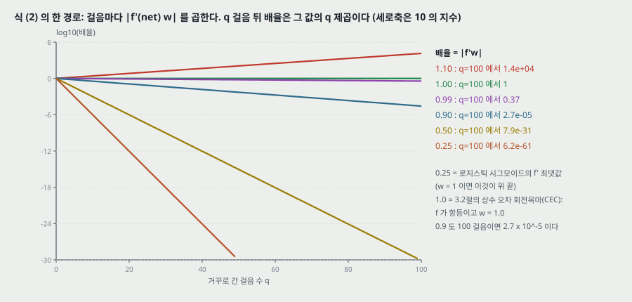

**보통의 BPTT (3.1절).** 숨은 유닛 $j$ 의 오차는 다음 걸음 유닛들의 오차를 무게로 모은 뒤 자기 미분을 곱한 것이다.

$$\vartheta_j(t) = f'_j(net_j(t)) \sum_i w_{ij}\, \vartheta_i(t+1) \qquad (\text{3.1절})$$

**Hochreiter (1991) 의 분석.** 유닛 $u$ 의 오차가 $q$ 걸음 거슬러 유닛 $v$ 에 닿을 때의 배율은 재귀식 (1) 이고, 풀면 경로마다의 곱을 모두 더한 꼴이 된다($l_q = v$, $l_0 = u$).

$$\frac{\partial \vartheta_v(t-q)}{\partial \vartheta_u(t)} = \sum_{l_1=1}^{n} \cdots \sum_{l_{q-1}=1}^{n} \prod_{m=1}^{q} f'_{l_m}(net_{l_m}(t-m))\, w_{l_m l_{m-1}} \qquad (2)$$

**읽는 법(원문).** 모든 $m$ 에서 $\lvert f'_{l_m} w_{l_m l_{m-1}} \rvert > 1.0$ 이면 가장 큰 곱이 $q$ 를 따라 지수로 커지고(오차가 터져 무게가 진동한다), $< 1.0$ 이면 지수로 작아져 「받아들일 만한 시간 안에 아무것도 배울 수 없다」. 항이 $n^{q-1}$ 개이고 부호가 다를 수 있어 유닛 수 $n$ 을 늘린다고 오차 흐름이 반드시 커지지는 않는다고 덧붙인다.

**로지스틱 시그모이드의 경우(원문).** $f'$ 의 최댓값이 0.25 이므로 $\lvert w \rvert < 4.0$ 이면 곱이 1.0 보다 작다. 보내는 활성 $y$ 가 0 이 아닌 상수면 $\lvert f' w \rvert$ 는 $w = \frac{1}{y}\coth(\frac{1}{2} net)$ 에서 가장 크고, $\lvert w \rvert \to \infty$ 이면 0 으로 간다. 그래서 큰 초기 무게도, 큰 학습률도 돕지 않는다 — 학습률은 먼 오차와 가까운 오차의 **비**를 바꾸지 않는다.

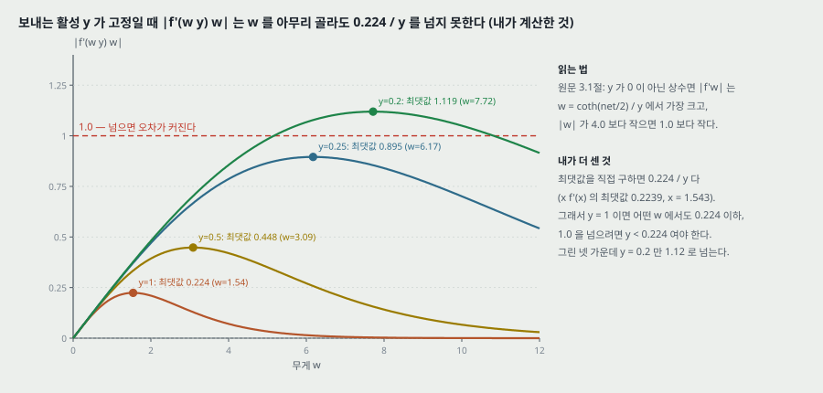

**내가 더 센 것 — 최댓값의 값.** 원문의 조건을 끝까지 풀면 $\max_w \lvert f'(w y)\, w \rvert = \frac{1}{y} \max_x x\,\sigma'(x) = 0.2239 / y$ 이다($x = 1.543$ 에서, 이 점이 원문의 $\coth$ 조건 $x = \coth(x/2)$ 를 만족한다). 그러므로 **보내는 활성이 $y = 1$ 이면 어떤 무게를 골라도 걸음당 배율이 0.224 를 넘지 않고**, 1.0 을 넘으려면 $y < 0.224$ 여야 한다. 원문의 「$\lvert w \rvert < 4.0$ 이면 1.0 아래」 는 $f'$ 의 최댓값 0.25 만 쓴 더 느슨한 조건이다.

**전역 오차 흐름과 약한 상한(원문).** 출력 유닛 전부로 더해도 사라짐은 같다. 식 (2) 를 행렬 꼴로 다시 쓰면 $\lvert \partial \vartheta_v(t-q) / \partial \vartheta_u(t) \rvert \le n (f'_{max} \lVert W \rVert_A)^q$ 이고, 행 합 노름에서 $f'_{max} = 0.25$ 이므로 모든 무게가 $\lvert w_{ij} \rvert \le w_{max} < 4.0 / n$ 이면 $\tau := n w_{max} / 4.0 < 1.0$ 으로 두어 $\le n \tau^q$ 가 된다. 원문은 이것을 「약한, 극단의 경우의 상한」 이라 부른다 — 모든 $\lVert F'(t-m) \rVert_A$ 가 최대이고 모든 경로의 부호가 같을 때만 닿는다. **작은 예시(내가 고른 수):** $n = 10$, $w_{max} = 0.3$ 이면 $\tau = 0.75$ 이고 $q = 100$ 에서 상한이 $10 \times 0.75^{100} = 3.2 \times 10^{-12}$ 다.

**1절의 두 갈래.** (1) 터지면 무게가 진동하고 (2) 사라지면 긴 지연을 배우는 데 「엄두를 못 낼 만큼」 오래 걸리거나 아예 안 된다. 이 편이 겨누는 것은 (2) 다.

---

## 4. 앞선 방법들이 막힌 자리 (2절)

원문 2절은 시간에 따라 바뀌는 입력을 받는 순환망만 다룬다. 무엇이 왜 안 되는지를 원문의 말로 옮긴다.

| 갈래 | 원문이 든 것 | 원문이 짚은 막힘 |
|---|---|---|
| 기울기 하강 변형 | Elman (1988), Fahlman (1991), Williams (1989), Schmidhuber (1992a), Pearlmutter (1989) 등 | BPTT · RTRL 과 같은 문제(3절) |
| 시간 지연 | TDNN (Lang 외 1990), Plate (1993), NARX (Lin 외 1995) | 짧은 지연에서만 실용적 |
| 시간 상수 | Mozer (1992), de Vries · Principe (1991), Sun 외 (1993) | 긴 지연에는 바깥에서 미세 조정이 필요. Sun 외는 순입력이 저장된 정보를 흔든다 |
| Ring (1993) | 충돌하는 오차가 오면 고차 유닛을 더한다 | 지연 100 에 유닛 100 개가 필요할 수 있고, 보지 못한 지연 길이로 일반화하지 않는다 |
| Bengio 외 (1994) | 담금질 · 다중 격자 무작위 탐색 · 이산 오차 전파 등 | 「래치」 · 「2-서열」 문제가 실험 3a 와 같다. 상태망 $n$ 개면 상태가 $n$ 개뿐이라 덧셈 같은 연속 문제에 상태가 너무 많이 든다 |
| 칼만 거르개 | Puskorius · Feldkamp (1994) | 과거의 미분 영향을 지수로 줄이는 할인 인자를 쓴다 |
| 2 차 망 | Watrous · Kuhn (1992) | 상수 오차 흐름을 강제하지 않고, 걸음당 셈이 $O(W^2)$ (LSTM 은 $O(W)$) |
| 무작위 무게 추측 | 저자들의 1996 · 1997 보고 | 앞선 논문들의 여러 문제를 제안된 알고리즘보다 **빨리** 푼다. 「추측이 좋은 알고리즘이라는 뜻이 아니라 문제들이 단순하다는 뜻이다」 |
| 서열 덩이 짓기 (chunker) | Schmidhuber (1992b, 1993) | 지연을 일으키는 부분 서열에 국소적 예측 가능성이 있어야 한다. 잡음이 늘고 압축이 안 될수록 나빠진다 |

**무작위 추측 줄이 이 편의 실험 설계를 정한다.** 5절 서두는 실험 과제의 조건 둘을 건다 — (1) 모든 학습 서열에서 최소 지연이 길어야 하고(짧은 지연 예가 섞이면 안 된다), (2) 무작위 무게 추측 같은 단순한 전략으로 빨리 풀리지 않아야 한다. 실험 3a 는 (2) 를 어기는 과제라고 원문이 스스로 적는다(14절).

---

## 5. 단순한 접근 — CEC 와 두 충돌 (3.2절)

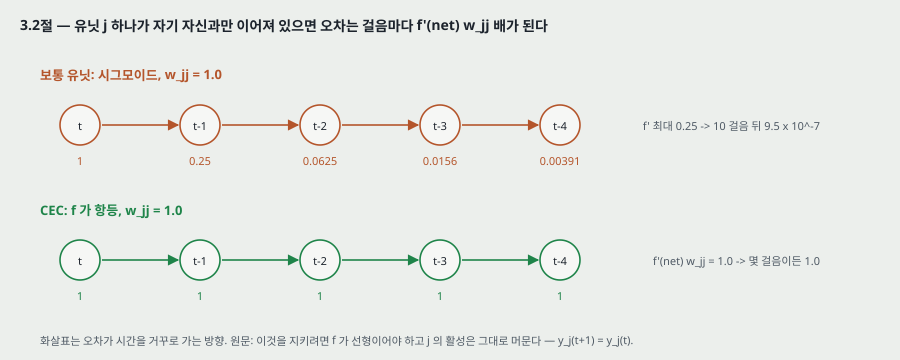

**유닛 하나.** 자기 자신과만 이어진 유닛 $j$ 의 오차는 $\vartheta_j(t) = f'_j(net_j(t))\, \vartheta_j(t+1)\, w_{jj}$ 이다. 오차 흐름을 상수로 만들려면

$$f'_j(net_j(t))\, w_{jj} = 1.0 \qquad (\text{3.2절})$$

이어야 한다. 적분하면 $f_j(net_j(t)) = net_j(t) / w_{jj}$ — **$f_j$ 는 선형이어야 하고**, 유닛의 활성은 $y_j(t+1) = f_j(w_{jj} y^j(t)) = y^j(t)$ 로 그대로 머문다. 실험에서는 $f_j(x) = x$, $w_{jj} = 1.0$ 으로 둔다. 원문은 Mozer (1992) 의 고정 시간 상수와 닮았다고 적고, 시간 상수 1.0 은 무한한 지연에 맞는다고 한다.

**두 충돌 (원문).** 유닛 $j$ 는 자기 자신만이 아니라 다른 유닛과도 이어진다.

1. **입력 무게 충돌.** 들어오는 무게 $w_{ji}$ 하나가 어떤 때는 $j$ 를 켜서 입력을 **저장**하게 하고, 그 뒤에는 무관한 입력에 $j$ 가 꺼지지 않게 **지켜야** 한다. 두 일이 같은 무게에 반대 갱신을 보낸다. 그래서 무게를 통한 「쓰기」 를 문맥에 따라 다스리는 장치가 필요하다.
2. **출력 무게 충돌.** 나가는 무게 $w_{kj}$ 하나가 어떤 때는 $j$ 의 내용을 **꺼내고**, 다른 때는 $j$ 가 $k$ 를 **흔들지 못하게** 해야 한다. 원문의 예 — 학습 초기에 줄인 「짧은 지연 오차」 가 뒤 단계에서 $j$ 가 「긴 지연 오차」 를 줄이려 끼어들면서 다시 생긴다.

두 충돌은 짧은 지연에서도 생기지만, 지연이 길수록 (1) 저장한 것을 지켜야 하는 시간이 길어지고 (2) 이미 맞게 된 출력이 많아져 지켜야 할 것도 는다. 그래서 단순한 접근은 국소 표현 · 반복 없는 입력 같은 단순한 문제 밖에서는 잘 되지 않는다고 적는다(Hochreiter 1991, Silva 외 1996 인용).

---

## 6. 기억 셀과 게이트 (4절, 그림 1)

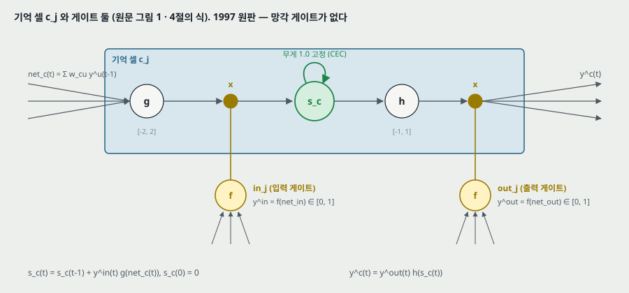

**원문 그림 1 을 PDF 에서 잘라 넣은 것**은 아래다(200 dpi). 상자가 기억 셀 $c_j$, 가운데 1.0 짜리 자기 연결이 CEC 다.

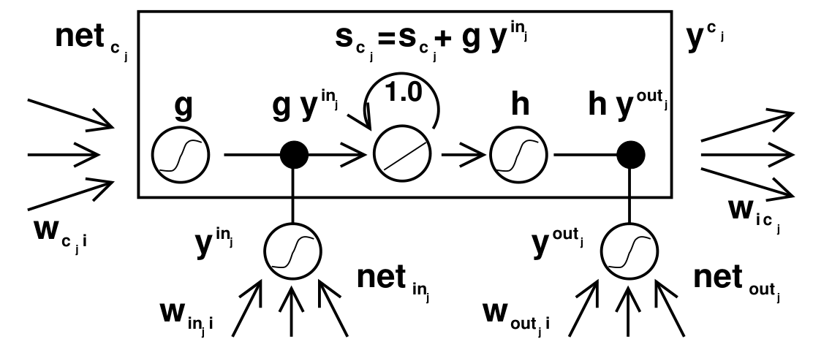

**식 (원문 4절 · 부록 A.1 식 7 ~ 9).** 게이트와 셀은 모두 앞 걸음의 활성을 받는다.

$$y^{in_j}(t) = f_{in_j}\Big(\sum_u w_{in_j u}\, y^u(t-1)\Big), \quad y^{out_j}(t) = f_{out_j}\Big(\sum_u w_{out_j u}\, y^u(t-1)\Big), \quad net_{c_j}(t) = \sum_u w_{c_j u}\, y^u(t-1) \qquad (7, 8, 9)$$

$$s_{c_j}(0) = 0, \qquad s_{c_j}(t) = s_{c_j}(t-1) + y^{in_j}(t)\, g\big(net_{c_j}(t)\big) \qquad (9)$$

$$y^{c_j}(t) = y^{out_j}(t)\, h\big(s_{c_j}(t)\big) \qquad (9)$$

$u$ 는 입력 유닛 · 게이트 · 셀 · 보통 숨은 유닛 무엇이든 될 수 있다. 원문은 망의 짜임을 쓰는 사람이 정한다고 적는다.

**왜 게이트인가 (원문).** 입력 게이트는 셀로 들어오는 연결 $w_{c_j i}$ 로 가는 오차 흐름을, 출력 게이트는 셀에서 나가는 연결로 가는 오차 흐름을 다스린다. 망은 $in_j$ 로 셀의 내용을 언제 지키고 언제 덮어쓸지, $out_j$ 로 언제 꺼내고 언제 다른 유닛을 흔들지 않을지를 고른다. CEC 에 갇힌 오차는 바뀌지 않지만 출력 게이트를 거쳐 다른 때에 들어온 오차들이 겹칠 수 있다 — 그래서 출력 게이트는 **어떤 오차를 가둘지**를, 입력 게이트는 **언제 내보낼지**를 배워야 한다.

**게이트가 둘 다 늘 필요하지는 않다 (원문).** 실험 2a · 2b 는 입력 게이트만 쓴다. 출력 부호화가 국소적이면 출력 게이트 없이도 해당 무게를 0 으로 두면 된다. 그래도 출력 게이트는 배우기 어려운 긴 지연 기억이 배우기 쉬운 짧은 지연 기억을 흔드는 것을 막는다 — 실험 1 이 그 예라고 적는다.

**원판에 없는 것.** 이 식에는 $s$ 를 줄이는 항이 없다. $s$ 는 $y^{in} g$ 를 **더하기만** 하고, 서열이 끝나면 바깥에서 0 으로 되돌린다(11절). 이것이 7절에서 가르는 첫 자리다.

---

## 7. 1997 원판과 나중 판

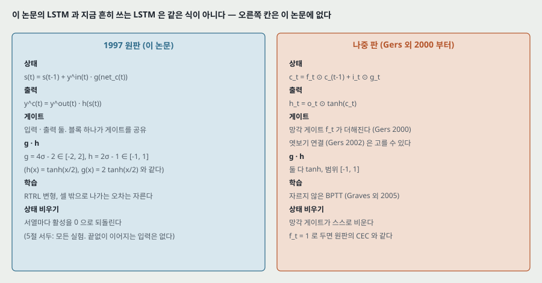

| 자리 | 이 논문 (1997) | 나중 판 — **이 논문에 없다. 이 노트에서 읽지 않았다** |
|---|---|---|
| 상태 갱신 | $s(t) = s(t-1) + y^{in}(t)\, g(net_c(t))$ | $c_t = f_t \odot c_{t-1} + i_t \odot g_t$ — 망각 게이트 $f_t$ (Gers 외 2000) |
| 출력 | $y^c(t) = y^{out}(t)\, h(s(t))$ | $h_t = o_t \odot \tanh(c_t)$ |
| $g$ · $h$ | $g = 4\sigma - 2 \in [-2, 2]$, $h = 2\sigma - 1 \in [-1, 1]$ (식 4 · 5). 실험 2a · 2b 는 $g = \sigma$, $h$ = 항등 | 둘 다 $\tanh$, 범위 $[-1, 1]$ |
| 게이트가 보는 것 | 앞 걸음의 활성 $y^u(t-1)$ | 같고, 엿보기 연결(Gers 외 2002)로 셀 상태를 볼 수도 있다 |
| 기울기 | 셀 · 게이트 순입력에서 앞 걸음으로 가는 오차를 0 으로 자른다. RTRL 변형으로 앞으로 들고 간다 | 자르지 않은 BPTT (Graves · Schmidhuber 2005) |
| 블록 | 셀 $S$ 개가 게이트 한 쌍을 함께 쓴다 | 셀마다 게이트 한 벌이 흔하다 |
| 상태 비우기 | 서열마다 바깥에서 0 으로 | 망각 게이트가 스스로 |

**같은 자리 하나.** 나중 판에서 $f_t = 1$ 로 고정하면 $c_t = c_{t-1} + i_t \odot g_t$ 가 되어 이 논문의 CEC 와 같은 꼴이다. 이 논문의 「오차 배율이 정확히 1.0」(식 35)은 이 고정에서만 선다.

**$h$ · $g$ 와 $\tanh$ (내가 맞춘 것).** $2\sigma(x) - 1 = \frac{1 - e^{-x}}{1 + e^{-x}} = \tanh(x/2)$ 이므로 원판의 $h$ 는 기울기가 반인 $\tanh$ 이고, $g$ 는 그것의 두 배다. 원점에서의 기울기는 $h'(0) = 0.5$, $g'(0) = 1.0$ 이다.

---

## 8. 망 짜임 · 셀 블록 · 계산량 (4절, 부록 A.1)

**원문 그림 2 를 PDF 에서 잘라 넣은 것** — 입력 8 · 출력 4 · 크기 2 인 블록 둘. 캡션은 이것이 실험 6a 의 짜임이고 비입력 유닛의 치우침만 뺐다고 적는다.

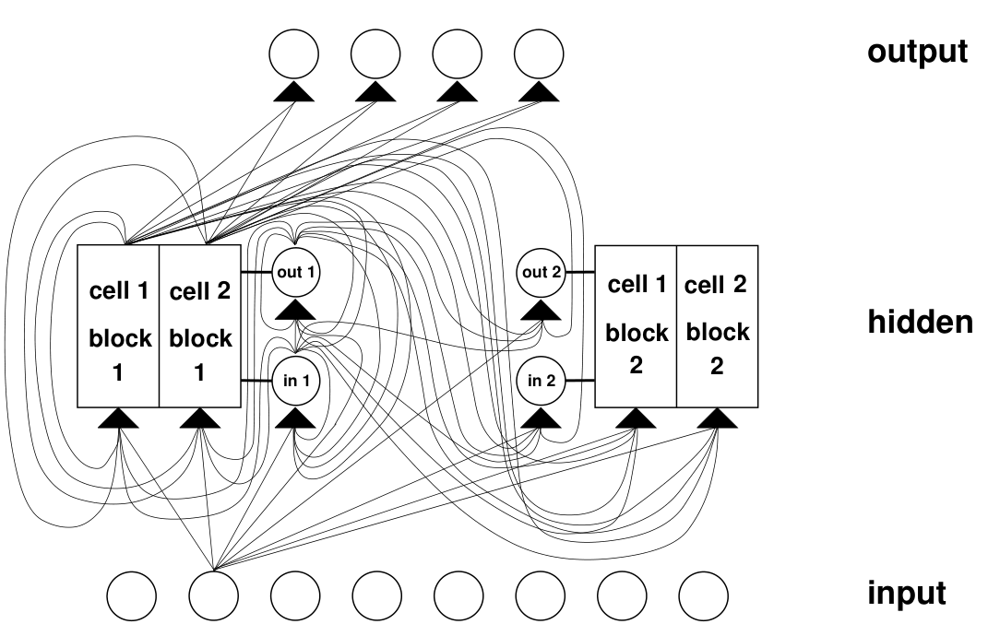

**짜임 (원문).** 입력층 · 숨은 층 · 출력층 하나씩. 숨은 층이 기억 셀과 게이트(편의상 둘 다 숨은 층에 있다고 부른다)를 담고, 숨은 층 안은 완전 연결이다. 보통 숨은 유닛을 더 둘 수 있다. 게이트를 뺀 모든 유닛은 위층 모든 유닛으로 이어진다.

**셀 블록 (원문).** 셀 $S$ 개가 게이트 한 쌍을 함께 쓴다. 블록 하나가 셀 하나만큼의 게이트(둘)를 가지므로 원문 표현으로 「조금 더 효율적」 이고, 셀 하나에 분산 입력을 담기 어려운 것을 블록으로 푼다.

**계산량 (부록 A.1 식 29).** 출력 유닛 $K$, 블록 $C$, 블록 크기 $S$, 보통 숨은 유닛 $H$, 셀 · 게이트 · 숨은 유닛으로 앞쪽에서 이어지는 유닛의 최대 수 $I$ 로 두면

$$W = KH + KCS + CSI + 2CI + HI \qquad (\text{A.1})$$

이고 걸음당 갱신 셈은 $O(KH + KCS + HI + CSI) = O(W)$ 다. 걸음마다 저장할 것은 식 (25) · (27) 의 $\partial s / \partial w$ 값 $2CSI$ 개뿐이라 저장량도 $O(W)$ 이고 서열 길이에 매이지 않는다. **원문 결론: 걸음당 셈은 완전 순환망의 BPTT 와 같고, BPTT 와 달리 시간에서도 국소적이다.**

**내가 맞춰 본 것 — 식 (29) 의 합.** 원문이 적은 식별 걸음 수(식 19: $K$, 20: $KH$, 21: $KSC$, 22: $K(H+C) + HI + CI$, 23: $KCS$, 25 · 26 · 27 · 28: 각 $CSI$)를 더하면 $K + 2KH + KC + 2KSC + HI + CI + 4CSI$ 로 원문의 합과 같다. 다만 식 (22) 의 출력 무게 몫 $K(H + C)$ 는 $W$ 식의 출력 무게 $KH + KCS$ 와 어긋난다 — 출력은 셀 $CS$ 개에서 받으므로 $K(H + CS)$ 여야 맞다. $O(\cdot)$ 결론은 바뀌지 않는다.

**무게가 9 배까지 는다 (6절, 원문).** 보통 숨은 유닛 하나를 크기 1 블록(셀 하나 + 게이트 둘)으로 바꾸면 유닛이 3 배라 완전 연결이면 무게가 $3^2 = 9$ 배까지 는다. **작은 예시(내가 센 것):** 입력 7 · 출력 7 · 숨은 4 인 보통 순환망은 $28 + 16 + 28 = 72$, 같은 자리를 블록 4 개(크기 1)로 바꾸면 치우침 없이 $84 + 144 + 28 = 256$ 으로 3.6 배다. 원문은 실험에서 견준 방법과 무게 수를 「꽤 비슷하게」 맞췄다고 적는다 — 표 1 의 LSTM 264 · 276 대 RTRL ≈170 · ≈494, 표 2 의 10,504 대 10,404 가 그 근거다.

---

## 9. 잘린 역전파 — 어디서 자르나 (4절, 부록 A.1 · A.2)

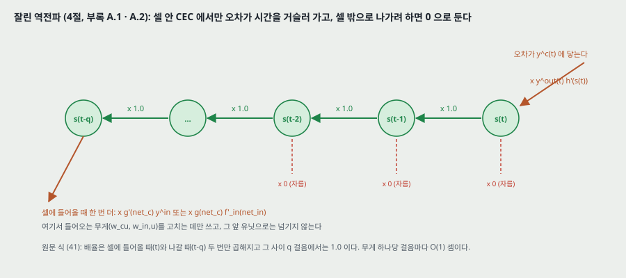

**무엇을 0 으로 두나 (부록 A.1).** 셀 · 입력 게이트 · 출력 게이트의 순입력이 앞 걸음의 어떤 활성에 대해서든 갖는 미분을 0 으로 둔다.

$$\frac{\partial net_{in_j}(t)}{\partial y^u(t-1)} \approx_{tr} 0, \quad \frac{\partial net_{out_j}(t)}{\partial y^u(t-1)} \approx_{tr} 0, \quad \frac{\partial net_{c_j}(t)}{\partial y^u(t-1)} \approx_{tr} 0 \quad \forall u \qquad (\text{A.1})$$

그러면 셀 출력도 앞 걸음 활성에 대한 미분이 0 이 되고, 셀 · 게이트로 들어오지 않는 무게에 대한 셀 출력의 미분이 0 이 된다. 원문의 말: 「오차가 셀 · 게이트를 떠나면 흐름을 자른다. 셀을 입력 · 입력 게이트로 떠난 오차가 출력 · 출력 게이트로 다시 들어오는 고리가 없어지고, 그래서 CEC 를 지나는 오차 흐름이 상수다.」

**셀 안에서는 1.0 (부록 A.2 식 30 · 35).** 자른 미분을 넣으면

$$\frac{\partial s_{c_j}(t-k)}{\partial s_{c_j}(t-k-1)} \approx_{tr} 1, \qquad \frac{\partial \vartheta_{s_{c_j}}(t)}{\partial \vartheta_{s_{c_j}}(t+1)} = \frac{\partial s_{c_j}(t+1)}{\partial s_{c_j}(t)} \approx_{tr} 1 \qquad (30, 35)$$

**배율은 두 번만 곱해진다 (식 41).** 오차 $\vartheta_j(t)$ 가 셀 출력에 닿아 $q$ 걸음 거슬러 입력 게이트나 셀 입력에 이르면

$$\frac{\partial \vartheta_v(t-q)}{\partial \vartheta_j(t)} \approx_{tr} y^{out_j}(t)\, h'(s_{c_j}(t)) \begin{cases} g'(net_{c_j}(t-q))\, y^{in_j}(t-q) & v = c_j \\ g(net_{c_j}(t-q))\, f'_{in_j}(net_{in_j}(t-q)) & v = in_j \end{cases} \qquad (41)$$

곧 **셀에 들어올 때(시각 $t$) 한 번, 나갈 때($t - q$) 한 번**만 곱해지고 그 사이 $q$ 걸음에서는 1.0 이다. 식 (3.1절)의 $\prod_{m=1}^{q}$ 가 사라졌다.

**나간 오차는 어디로 (식 38 · 39).** 셀 출력에 닿은 오차는 $in_j$ · $out_j$ · $c_j$ 로 들어오는 바깥 연결을 따라 다른 유닛 $v$ 로 넘어가지 않는다($\approx_{tr} 0$). 그 오차는 들어오는 무게를 고치는 데만 쓰인다.

**원문이 스스로 다는 단서 셋 (부록 A.2 끝).** (1) 출력 게이트 $y^{out}$ 이 학습 초기에 셀 없이 줄일 수 있는 오차와, 뒤에 셀을 켜고 끄며 생기는 오차를 줄여 준다. (2) $s$ 가 표류해 크면 $h'(s)$ 가 작아진다. (3) 입력 게이트가 음으로 치우치면 $y^{in}$ · $f'_{in}$ 이 작지만 그 몫은 표류에 비하면 작다. 원문: 「이 인자들이 전체 오차 흐름을 줄일 수는 있지만 **지연의 길이에 매인 방식으로는 아니다**.」

---

## 10. 남용 문제 · 상태 표류 (4절)

**남용 (원문).** 학습 초기에는 정보를 시간에 걸쳐 저장하지 않고도 오차를 줄일 수 있어서, 망이 셀을 치우침 유닛처럼(활성을 상수로 두고 나가는 연결을 문턱으로) 쓰기 쉽다. 그런 셀을 다시 풀어 쓰는 데 오래 걸린다. 셀 둘이 같은 정보를 담는 것도 남용이다. 처방 둘: (1) **차례로 망 짓기** — 오차가 더 줄지 않으면 셀과 게이트를 더한다(실험 2). (2) **출력 게이트 치우침** — 출력 게이트마다 음의 초기 치우침을 주어 셀 활성을 0 쪽으로 민다. 더 음으로 치우친 셀이 뒤에 「할당」 된다(실험 1 · 3 · 4 · 5 · 6).

**표류 (원문).** 셀 입력이 대개 양이거나 대개 음이면 $s_j$ 가 시간이 지나며 한쪽으로 흘러 $h'(s_j)$ 가 작아지고 기울기가 사라진다. $h(x) = x$ 로 두면 셀 출력 범위가 막히지 않는 단점이 있다. 원문의 처방: **학습 초기에 입력 게이트 $in_j$ 를 0 쪽으로 치우친다.** $h'(s_j)$ 와 $y^{in_j}$ · $f'_{in_j}$ 사이에 맞바꿈이 있지만 입력 게이트 치우침의 손해는 표류의 손해에 비해 「무시할 만하다」 고 적고, 실험 4 · 5 로 「초기 치우침을 미세 조정할 필요가 없어 보인다」 고 한다.

**짚을 것.** 표류는 망각 게이트가 없어서 생기는 일이고, 원문의 처방은 치우침 초기값 하나다. 실험은 서열마다 활성을 0 으로 되돌리므로(11절) **끝없이 이어지는 입력에서 $s$ 가 어디까지 흐르는지는 이 편이 시험하지 않았다.** 실험 4 는 모든 비입력 유닛을 치우쳐 표류를 일부러 일으킨 과제지만, 그 서열도 길이 $T$ ~ $T + T/10$ 에서 끝난다.

---

## 11. 실험 공통 설정 (5절 서두, 5.7절 표 10 · 11)

| 항목 | 원문 |
|---|---|
| 학습 방식 | 늘 온라인 학습(서열마다 갱신), 활성 함수는 로지스틱 시그모이드 |
| 초기 무게 | 실험 1 · 2 는 $[-0.2, 0.2]$, 나머지는 $[-0.1, 0.1]$ |
| 걸음 하나 | (1) 입력을 놓고 (2) 숨은 유닛(게이트 · 셀 포함)을 계산하고 (3) 출력을 계산한다 — 「부록 A.1 의 표기와 조금 다르다」 |
| 오차 신호 | 실험 1 · 2a · 2b 를 빼면 서열 원소를 온라인으로 무작위 생성하고 오차는 **서열 끝에서만** 낸다 |
| 상태 비우기 | 서열 하나를 처리하면 망의 활성을 되돌린다 |
| 견준 방법 | 기울기 하강 쪽은 RTRL 만 적고, 2a 에서만 BPTT 를 더한다. 자르지 않은 BPTT 는 오프라인 RTRL 과 같은 기울기를 내고, 긴 지연에서 온라인 RTRL 과 「거의 같은 부정적 결과」 라고 적는다(Hochreiter 1991 의 추가 모의실험 인용) |
| 짜임 고르기 | 「꽤 아무렇게나 골랐다」. 복잡도를 모르면 셀 하나로 시작해 안 되면 둘로 늘리라고 권한다 |

**표 10 · 11 을 읽은 것 (원문 21 · 22 쪽).** 과제마다 $p$ · 지연 · 블록 수 · 크기 · 입력 · 출력 · 무게 · 연결 방식 · 출력 게이트 치우침 · 입력 게이트 치우침 · 치우침을 둔 유닛 · $h$ · $g$ · 학습률, 그리고 학습 표본 고르기 · 초기 구간 · 시험 크기 · 멈춤 기준 · 성공 기준이 한 줄씩 있다. 학습률이 과제마다 **0.01 (2c) 에서 1.0 (2a · 2b · 3a · 3b)** 까지 100 배 차이 나고, 게이트 치우침도 과제마다 다르다. 이 표가 21절에서 「미세 조정이 필요 없어 보인다」 를 읽는 근거다.

---

## 12. 실험 1 — 내장 Reber 문법 (5.1절, 표 1)

**원문 그림 3 · 4 를 PDF 에서 잘라 넣은 것** — 왼쪽이 Reber 문법, 오른쪽이 그것을 둘 넣은 내장 Reber 문법.

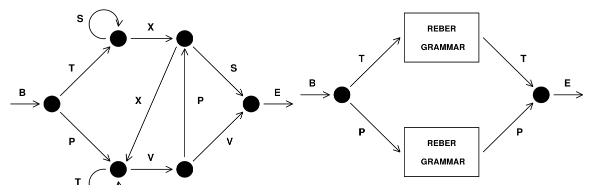

**과제.** 문자열을 한 기호씩 읽으며 다음 기호를 늘 예측한다(오차는 걸음마다). 갈림길에서는 확률 0.5 로 고른다. 끝에서 둘째 기호(T 또는 P)를 맞히려면 **둘째 기호를 기억해야 한다.** 원문은 이것이 긴 지연 문제가 **아니라고** 먼저 적는다 — 학습 서열 중에 지연이 9 걸음인 것도 있다. 넣은 이유 둘: 널리 쓰인 벤치마크라 RTRL · BPTT 가 완전히 실패하지 않는 실험을 하나 두려 했고, 출력 게이트가 왜 이로운지 보여 준다.

**설정.** 국소 표현(입력 7 · 출력 7). Fahlman 을 따라 학습 문자열 256 · 시험 문자열 256(학습에 쓴 것은 시험에서 뺌). 문자열이 끝나면 활성을 0 으로. **성공 = 학습 · 시험 문자열의 모든 기호에서 가능한 다음 기호(들)에 해당하는 출력이 가장 크게 켜진다.** LSTM 은 블록 3 개(크기 2) 또는 4 개(크기 1), 출력 게이트 치우침 −1 · −2 · −3 (· −4), 학습률 0.1 · 0.2 · 0.5. **학습 · 시험 짝 셋 × 초기 무게 10 = 30 번.**

**견준 것 — 셋 다 다른 논문에서 옮겼다.** RTRL 은 Smith · Zipser (1989, 성공한 실행만 적힘), ELM(Elman 망을 Elman 의 절차로) 은 Cleeremans 외 (1989), RCC 는 Fahlman (1991). 원문은 **Smith · Zipser 가 짧은 지연 예의 확률을 올려 과제를 쉽게 만들었고 LSTM 에는 그렇게 하지 않았다**고 적는다. 앞 네 줄의 무게 수는 「추정」 이다.

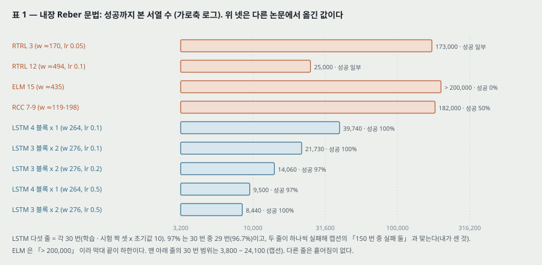

| 방법 | 숨은 유닛 | 무게 | 학습률 | 성공 % | 성공까지 |
|---|---|---|---|---|---|
| RTRL | 3 | ≈ 170 | 0.05 | 「일부」 | 173,000 |
| RTRL | 12 | ≈ 494 | 0.1 | 「일부」 | 25,000 |
| ELM | 15 | ≈ 435 | | 0 | > 200,000 |
| RCC | 7 ~ 9 | ≈ 119 ~ 198 | | 50 | 182,000 |
| LSTM | 블록 4 · 크기 1 | 264 | 0.1 | 100 | 39,740 |
| LSTM | 블록 3 · 크기 2 | 276 | 0.1 | 100 | 21,730 |
| LSTM | 블록 3 · 크기 2 | 276 | 0.2 | 97 | 14,060 |
| LSTM | 블록 4 · 크기 1 | 264 | 0.5 | 97 | 9,500 |
| LSTM | 블록 3 · 크기 2 | 276 | 0.5 | 100 | 8,440 |

**원문의 말.** 「LSTM 만 거의 늘 과제를 푼다(150 번 중 실패 둘). 다른 방법의 실패한 실행을 빼고 보아도 LSTM 이 훨씬 빨리 배운다.」 맨 아래 줄의 필요한 학습 표본 수는 3,800 ~ 24,100 이다(캡션). **출력 게이트의 몫:** 「출력 게이트 없이는 빠른 학습을 얻지 못했다」 — 그 실행의 수치는 없다.

**내가 센 것.** 97% 는 30 번 중 29 번(96.7%)이고, 97% 인 두 줄이 하나씩 실패해 「150 번 중 실패 둘」 과 맞는다. 무게 264 · 276 은 망 짜임에서 다시 세어 같았다(19절).

---

## 13. 실험 2 — 잡음 없는 · 잡음 있는 서열 (5.2절, 표 2 · 3)

### 과제 2a — 잡음 없는 긴 지연

**과제.** 기호 $p + 1$ 개($a_1 \dots a_{p-1}$, $a_p = x$, $a_{p+1} = y$)를 국소 표현. 학습 서열은 둘뿐 — $(y, a_1, \dots, a_{p-1}, y)$ 와 $(x, a_1, \dots, a_{p-1}, x)$, 각 확률 0.5. 걸음마다 다음 기호를 예측한다. 마지막 원소를 맞히려면 첫 원소를 $p$ 걸음 기억해야 한다.

**설정.** 무게 $[-0.2, 0.2]$. 계산 시간 때문에 **서열 500 만 개에서 멈춘다.** 성공 = 학습 뒤 무작위 서열 10,000 개를 잇달아 넣는 동안 모든 출력의 최대 절대 오차가 늘 0.25 아래. 짜임: RTRL 은 자기 연결 숨은 유닛 하나 + 비순환 출력 $p + 1$ 개(각 층이 아래 모든 층에서 받음), BPTT 같음, CH(2-망 서열 덩이 짓기)는 RTRL 짜임 둘에 상대의 숨은 유닛을 예측하는 출력 하나, LSTM 은 RTRL 짜임에서 숨은 유닛을 **기억 셀 + 입력 게이트로 바꿈(출력 게이트 없음)**, $g$ = 로지스틱, $h$ = 항등. 셀과 게이트는 오차가 더 줄지 않을 때 더한다(남용 처방 1). **18 번의 평균.**

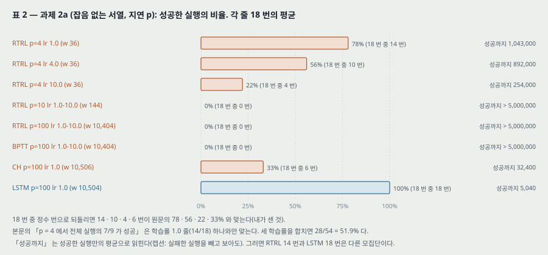

| 방법 | 지연 $p$ | 학습률 | 무게 | 성공 % | 성공까지 |
|---|---|---|---|---|---|
| RTRL | 4 | 1.0 | 36 | 78 | 1,043,000 |
| RTRL | 4 | 4.0 | 36 | 56 | 892,000 |
| RTRL | 4 | 10.0 | 36 | 22 | 254,000 |
| RTRL | 10 | 1.0 ~ 10.0 | 144 | 0 | > 5,000,000 |
| RTRL | 100 | 1.0 ~ 10.0 | 10,404 | 0 | > 5,000,000 |
| BPTT | 100 | 1.0 ~ 10.0 | 10,404 | 0 | > 5,000,000 |
| CH | 100 | 1.0 | 10,506 | 33 | 32,400 |
| LSTM | 100 | 1.0 | 10,504 | 100 | 5,040 |

**원문의 말.** 「짧은 지연 4 에서 전체 실행의 7/9 가 성공했다. $p = 10$ 에서 성공한 실행은 없었다. 긴 지연에서는 서열 덩이 짓기와 LSTM 만 성공했다. $p = 100$ 에서 2-망 덩이 짓기는 1/3, LSTM 은 늘 풀었다.」 덧붙여 **계층 덩이 짓기도 이 과제를 늘 빨리 푼다**고 적는다(Schmidhuber 1992c, 1993).

**내가 센 것.** 78 · 56 · 22 · 33% 는 18 번 중 14 · 10 · 4 · 6 번과 맞는다. 본문의 「7/9」 는 학습률 1.0 줄(14/18) 하나와만 같고, 세 학습률을 합치면 28/54 = 51.9% 다(25절).

### 과제 2b — 국소 규칙성 없음

2a 에서 덩이 짓기가 이긴 것은 입력의 국소 규칙성 덕에 서열을 압축할 수 있어서였다. 2b 는 가운데 부분 서열 $(a_1, \dots, a_{p-1})$ 을 길이 $p - 1$ 의 **무작위** 부분 서열로 바꿔 압축을 없앤다. 완전히 예측할 수 있는 목표는 끝의 $x$ · $y$ 뿐. 성공 = 무작위 서열 10,000 개 동안 서열 끝에서 모든 출력의 최대 절대 오차가 0.25 아래. 결과(본문만, 표 없음): 덩이 짓기 실패(「BPTT · RTRL 도 물론」), **LSTM 은 늘 성공, 18 번 평균으로 $p = 100$ 에서 서열 5,680 개.**

### 과제 2c — 아주 긴 지연, 국소 규칙성 없음

**과제.** 기호 $p + 4$ 개: 방해 기호 $a_1 \dots a_p$, $a_{p+1} = e$ (방아쇠), $a_{p+2} = b$, $a_{p+3} = x$, $a_{p+4} = y$. 학습 서열은 $\{(b, y, a_{i_1}, \dots, a_{i_{q+k}}, e, y)\}$ 와 $\{(b, x, a_{i_1}, \dots, a_{i_{q+k}}, e, x)\}$ 의 합에서 뽑는다. 만드는 법: (1) 길이 $q + 2$ 의 앞부분을 무작위로, (2) 확률 9/10 으로 방해 기호를 하나 더 붙이거나 1/10 로 $e$ 를 붙이고, (3) $e$ 뒤에 둘째 원소와 같은 $x$ 또는 $y$ 로 끝낸다. 오차는 서열 끝에서만. 마지막 원소를 맞히려면 둘째 원소를 **적어도 $q + 1$ 걸음** 기억해야 한다. 성공 = 무작위 서열 10,000 개 동안 마지막 원소의 두 출력 오차가 늘 0.2 아래.

**설정.** 입력 $p + 4$ · 출력 2. 셀 2 개(크기 1 블록 둘 — 「하나로도 되지만」 초기값에 따른 학습 시간 변동을 줄이려고). 다른 숨은 유닛 없음. 출력은 셀에서만, 숨은 층은 완전 연결, **치우침 없음.** $h$ · $g$ 는 범위 $[-1, 1]$ · $[-2, 2]$ 의 로지스틱. 학습률 0.01. **$(p, q)$ 쌍마다 20 번.**

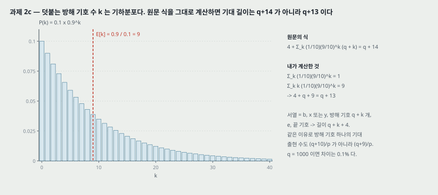

**원문의 길이 식과 내 계산.** 원문은 기대 길이를

$$4 + \sum_{k=0}^{\infty} \frac{1}{10}\left(\frac{9}{10}\right)^k (q + k) = q + 14$$

로 적는다. 이 식을 그대로 계산하면 $\sum_k \frac{1}{10}(0.9)^k = 1$, $\sum_k k \frac{1}{10}(0.9)^k = 9$ 이므로 **$4 + q + 9 = q + 13$** 이다. 서열 구성(앞 $b$ 와 둘째 원소 둘, 방해 기호 $q + k$ 개, $e$ 와 끝 기호 둘 → 길이 $q + k + 4$)으로 세어도 같다. 같은 어긋남이 「방해 기호 하나의 기대 출현 수 $(q + 10)/p$」 에도 있다 — 내 계산은 $(q + 9)/p$. $q = 1000$ 이면 차이는 0.1% 라 결론에 닿지 않는다.

| $q$ (= 지연 − 1) | $p$ (방해 기호 수) | $q/p$ | 무게 | 성공까지 |
|---:|---:|---:|---:|---:|
| 50 | 50 | 1 | 364 | 30,000 |
| 100 | 100 | 1 | 664 | 31,000 |
| 200 | 200 | 1 | 1,264 | 33,000 |
| 500 | 500 | 1 | 3,064 | 38,000 |
| 1,000 | 1,000 | 1 | 6,064 | 49,000 |
| 1,000 | 500 | 2 | 3,064 | 49,000 |
| 1,000 | 200 | 5 | 1,264 | 75,000 |
| 1,000 | 100 | 10 | 664 | 135,000 |
| 1,000 | 50 | 20 | 364 | 203,000 |

**원문의 말.** 「방해 기호 수(와 무게)를 지연에 비례해 늘리면 학습 시간이 **아주 천천히** 는다. 우리가 아는 다른 어떤 방법에도 없는 성질이다. RTRL · BPTT 는 지수로 늘어 보이고 지연이 10 만 넘어도 쓸모없어 보인다.」 아래 칸은 방해 기호가 자주 나올수록($q/p$ 가 클수록) 느려지는 것을 보이며, 자주 보는 입력이 무게를 흔들어서라고 적는다.

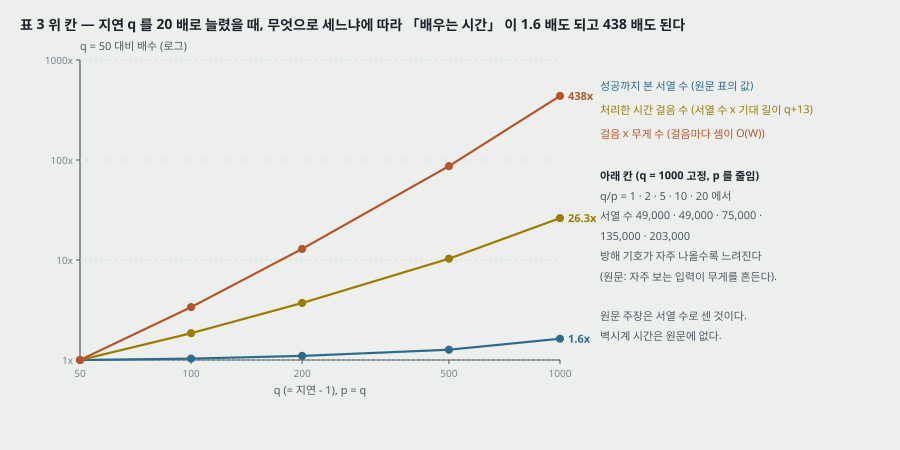

**내가 다시 센 것 — 「천천히」 는 무엇으로 센 것인가.** 표의 값은 성공까지 본 **서열 수**다. 위 칸에서 $q$ 를 50 → 1,000 (20 배)으로 늘리면

| 세는 단위 | $q = 50$ 대비 $q = 1000$ |
|---|---:|
| 성공까지 본 서열 수 (원문 표) | 1.63 배 |
| 처리한 시간 걸음 수 (서열 수 × 기대 길이 $q + 13$) | 26.3 배 |
| 걸음 × 무게 수 (걸음마다 셈이 $O(W)$) | 438 배 |

서열 하나가 길어지고(63 → 1,013 걸음) 무게도 늘어(364 → 6,064) 셈의 양으로는 438 배다. 그래도 RTRL · BPTT 가 지연 10 에서 서열 500 만 개 안에 한 번도 성공하지 못한 것(표 2)과는 다른 자리다. **원문의 「아주 천천히」 는 서열 수로는 맞고, 셈의 양으로 옮기면 안 된다.** 벽시계 시간은 원문에 없다.

---

## 14. 실험 3 — 같은 줄의 잡음과 신호 (5.3절, 표 4 · 5 · 6)

**과제 3a — Bengio 외 (1994) 의 「2-서열 문제」.** 입력 줄 하나. 두 부류가 각 확률 0.5. **처음 $N$ 개의 실수값 원소만** 부류 정보를 담는다($N = 1$: 첫 원소가 부류 1 이면 1.0, 부류 2 면 −1.0. $N = 3$: 처음 셋이 그렇다). $t > N$ 의 원소는 평균 0 · 분산 0.2 가우스. 목표는 서열 끝에서 부류 1 이면 1.0, 부류 2 면 0.0. 맞음 = 서열 끝 절대 오차 0.2 아래. 길이는 $T$ ~ $T + T/10$ 에서 무작위(Bengio 외는 길이 $T/2$ 인 짧은 서열도 허용했다는 차이).

**원문이 먼저 적는 것 — 무작위 추측.** Bengio 외가 이 문제로 7 방법을 시험했는데, **무작위 무게 추측이 그 모두를 쉽게 이긴다** — 문제가 너무 단순해서다(각주 5 에 Bengio 의 사적 대화: 입력 표현과 잡음 종류가 다르면 추측이 나빠질 수 있다).

**설정.** 입력 1 · 출력 1, 블록 3 개(크기 1). 출력은 셀에서만, 셀 · 게이트는 입력 · 셀 · 게이트에서, **치우침 있음.** 게이트와 출력은 $[0, 1]$ 로지스틱, $h$ 는 $[-1, 1]$, $g$ 는 $[-2, 2]$. 무게 $[-0.1, 0.1]$, 입력 게이트 치우침 −1.0 · −3.0 · −5.0, 출력 게이트 치우침 −2.0 · −4.0 · −6.0 (「정확한 값은 큰 상관이 없다, 추가 실험으로 확인」). 학습률 1.0. 서열마다 활성 0. **멈춤 기준:** ST1 = 무작위 시험 서열 256 개 중 틀린 것 없음, ST2 = ST1 이고 시험 평균 절대 오차 0.01 아래. ST2 뒤 시험 서열 2,560 개로 틀린 비율을 잰다. **초기값을 달리한 10 번의 평균.**

| 표 | $T$ | $N$ | ST1 까지 | ST2 까지 | 무게 | ST2 뒤 틀린 비율 |
|---|---:|---:|---:|---:|---:|---:|
| 4 (3a) | 100 | 3 | 27,380 | 39,850 | 102 | 0.000195 |
| 4 (3a) | 100 | 1 | 58,370 | 64,330 | 102 | 0.000117 |
| 4 (3a) | 1,000 | 3 | 446,850 | 452,460 | 102 | 0.000078 |
| 5 (3b) | 100 | 3 | 41,740 | 43,250 | 102 | 0.00828 |
| 5 (3b) | 100 | 1 | 74,950 | 78,430 | 102 | 0.01500 |
| 5 (3b) | 1,000 | 1 | 481,060 | 485,080 | 102 | 0.01207 |

**과제 3b.** 3a 와 같되 **정보를 담은 원소에도** 평균 0 · 분산 0.2 가우스 잡음을 더한다. 멈춤 기준이 3a 와 다르다 — ST1 = 256 개 중 6 개 미만 틀림, ST2 = ST1 이고 평균 절대 오차 0.04 아래. 원문: 「LSTM 이 쉽게 푼다.」

**과제 3c.** 3a 와 같되 목표가 부류 1 은 0.2, 부류 2 는 0.8 이고 **목표에** 가우스 잡음(평균 0, 분산 0.1, 표준편차 0.32)을 더한다. 제곱 오차를 줄이려면 입력이 주어졌을 때 **목표의 조건부 기댓값**을 배워야 한다. 틀림 = 출력과 잡음 없는 목표의 절대 차이가 0.1 넘음. 받아들임 = 그 평균 절대 차이가 0.015 아래. 원문: 높은 무게 정밀도가 필요해 **3a · 3b 와 달리 무작위 추측으로 빨리 풀리지 않는다.** 학습률 0.1.

| 표 | $T$ | $N$ | 멈춤까지 | 무게 | 틀린 비율 | 기댓값과의 평균 차이 |
|---|---:|---:|---:|---:|---:|---:|
| 6 (3c) | 100 | 3 | 269,650 | 102 | 0.00558 | 0.014 |
| 6 (3c) | 100 | 1 | 565,640 | 102 | 0.00441 | 0.012 |

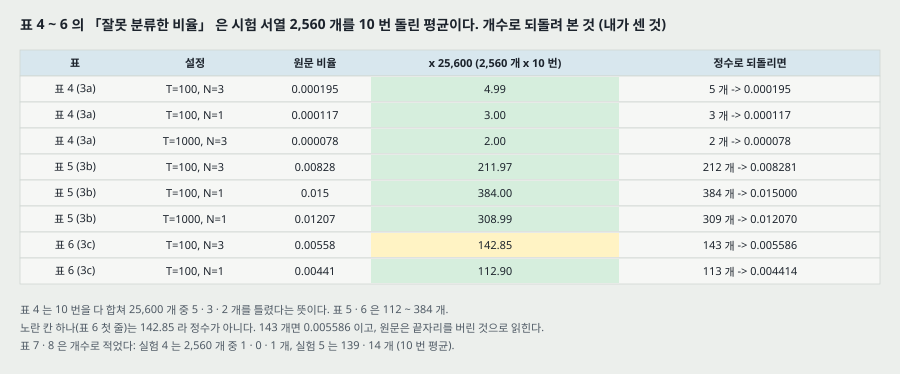

**내가 센 것 — 비율을 개수로.** 비율은 시험 서열 2,560 개를 10 번 잰 평균이므로 25,600 을 곱하면 10 번 동안 틀린 서열의 총수가 된다. 표 4 는 **5 · 3 · 2 개**(25,600 개 중), 표 5 는 212 · 384 · 309 개, 표 6 은 143 · 113 개다. 표 6 첫 줄만 142.85 로 정수가 아니다 — 143 개면 0.005586 이라 반올림하면 0.00559 다. 원문이 끝자리를 버린 것으로 읽힌다.

**읽는 법.** 3a 는 원문 스스로 「이 사소한 문제는 여러 비자명한 알고리즘의 성능을 견주는 시험대로 좋지 않다」 라고 적고, LSTM 이 「무작위 추측만큼 빠르지 못하다(by far not as fast)」 고 적는다. 이 실험이 보이는 것은 원문 말대로 「같은 줄의 신호와 잡음에서 근본적 문제가 없다」 까지다. 3c 의 기댓값과의 평균 차이 0.014 · 0.012 는 받아들임 기준 0.015 아래다.

---

## 15. 실험 4 — 덧셈 문제 (5.4절, 표 7)

**과제.** 서열의 원소마다 성분 둘: 첫째는 $[-1, 1]$ 의 무작위 실수, 둘째는 1.0 · 0.0 · −1.0 중 하나인 **표시**. 처음 10 쌍 중 하나를 골라 표시(첫 성분 $X_1$), 처음 $T/2 - 1$ 쌍 중 아직 표시 안 된 하나를 골라 표시($X_2$). 나머지 둘째 성분은 0, 첫 쌍과 마지막 쌍만 −1. 서열 끝에서 **목표 $0.5 + (X_1 + X_2)/4.0$** ($[0, 1]$ 로 줄인 합). 길이 $T$ ~ $T + T/10$. 맞음 = 서열 끝 절대 오차 0.04 아래. 원문: 다른 순환망 알고리즘으로 풀린 적 없는 종류이고, **분산된 연속값 표현**의 긴 지연을 보인다.

**설정.** 입력 2 · 출력 1, 블록 2 개(크기 2). 출력은 셀에서만, 숨은 층은 완전 연결, **모든 비입력 유닛에 치우침.** 무게(치우침 포함) $[-0.1, 0.1]$ — 원문은 이렇게 **치우침을 무작위로 두어 표류를 일부러 일으켰다**고 적는다. 입력 게이트 치우침 −3.0 · −6.0. 학습률 0.5. 멈춤 = 학습 평균 오차 0.01 아래이고 최근 서열 2,000 개를 맞게 처리. **10 번의 평균.**

| $T$ | 최소 지연 | 무게 | 틀린 예측 (시험 2,560 개) | 성공까지 |
|---:|---:|---:|---:|---:|
| 100 | 50 | 93 | 1 | 74,000 |
| 500 | 250 | 93 | 0 | 209,000 |
| 1,000 | 500 | 93 | 1 | 853,000 |

**원문의 말.** 「시험 평균 오차는 늘 0.01 아래였고 틀린 서열은 3 개를 넘지 않았다.」 캡션: $T = 1000$ 에서 필요한 학습 표본은 370,000 ~ 2,020,000, 700,000 을 넘은 것은 3 번. 결론 셋: (1) 분산 표현으로 잘 된다 (2) 연속값 계산을 배운다 (3) $T/2$ 걸음의 지연에도 연속값을 망가뜨리지 않고 담으므로 「해로운 표류는 없다」.

**내가 센 것.** $T$ 를 10 배(100 → 1,000) 늘리면 서열 수는 11.5 배(74,000 → 853,000)이고, 서열 하나의 기대 길이도 10 배라(105 → 1,050 걸음) 시간 걸음 수로는 115 배다. 무게는 93 으로 같다. 캡션의 범위로 보면 $T = 1000$ 의 10 번은 최솟값과 최댓값이 5.5 배 벌어진다(370,000 → 2,020,000).

---

## 16. 실험 5 — 곱셈 문제 (5.5절, 표 8)

**과제.** 덧셈 문제의 해가 CEC 의 「내장 적분」 을 이용할 수 있다는 반론에 답하려고, 목표를 **곱 $X_1 \times X_2$** 로 바꾼다. 첫 성분은 $[0, 1]$, 첫 쌍이 표시되는 드문 경우 $X_1 = 1.0$. 짜임은 실험 4 와 같고 치우침 포함 무게 $[-0.1, 0.1]$, 학습률 0.1.

**멈춤.** 최근 학습 서열 2,000 개 중 절대 오차 0.04 를 넘는 것이 $n_{seq}$ 개보다 적으면 시험한다. $n_{seq} = 140$ 은 「관련 입력을 담는 법을 배우기에 충분하지만 최종 출력을 미세 조정하기에는 아니고」, $n_{seq} = 13$ 이면 「꽤 만족스러운 결과」. **10 번의 평균.**

| $T$ | 최소 지연 | 무게 | $n_{seq}$ | 틀린 예측 (2,560 개 중) | 시험 MSE | 성공까지 |
|---:|---:|---:|---:|---:|---:|---:|
| 100 | 50 | 93 | 140 | 139 | 0.0223 | 482,000 |
| 100 | 50 | 93 | 13 | 14 | 0.0139 | 1,273,000 |

**원문의 말.** 「$n_{seq} = 140$ (13) 에서 시험 평균 오차는 늘 0.026 (0.013) 아래였고 틀린 서열은 170 (15) 개를 넘지 않았다.」 그리고 보통 숨은 유닛이나 셀 위 숨은 층을 더한 망은 미세 조정 부분을 더 빨리 배울 수 있다고 덧붙인다(수치 없음).

**짚을 것.** 본문의 「13 에서 평균 오차가 늘 0.013 아래」 와 표의 MSE 0.0139 는 **같은 양이라면** 어긋난다 — 평균이 상한 0.013 을 넘을 수 없다. 본문의 「평균 오차」 가 MSE 가 아닌 다른 양(평균 절대 오차 등)일 수 있는데 원문은 가르지 않는다(25절). 성공한 경우에도 틀린 예측이 139 / 2,560 = 5.4% 로, 덧셈 문제(0 ~ 1 개)와 같은 자리가 아니다. **$T = 100$ 하나만 시험했다.**

---

## 17. 실험 6 — 시간 순서 (5.6절, 표 9)

**과제 6a — 멀리 떨어진 관련 기호 둘.** 서열은 $E$ 로 시작해 $B$ (방아쇠)로 끝나고 나머지는 $\{a, b, c, d\}$ 에서 무작위. 다만 위치 $t_1$ ($10 \sim 20$) 과 $t_2$ ($50 \sim 60$) 에는 $X$ 또는 $Y$. 길이 100 ~ 110. 부류 넷 — $X,X \to Q$; $X,Y \to R$; $Y,X \to S$; $Y,Y \to U$.

**과제 6b — 셋.** $t_1$ ($10 \sim 20$), $t_2$ ($33 \sim 43$), $t_3$ ($66 \sim 76$) 에 $X$ 또는 $Y$, 부류 여덟 $Q, R, S, U, V, A, B, C$.

**설정.** 출력은 부류 수만큼, 국소 표현. 오차는 서열 끝에서만, 맞음 = 모든 출력의 최종 절대 오차 0.3 아래. 입력 8, 블록 2 (3) 개 크기 2, 출력 4 (8). 모든 비입력 유닛에 치우침, 출력은 셀에서만, 숨은 층 완전 연결. 학습률 0.5 (0.1). 입력 게이트 치우침 −2.0 · −4.0 (· −6.0). 멈춤 = 학습 평균 오차 0.1 아래이고 최근 2,000 개 맞게 분류.

| 과제 | 무게 | 틀린 예측 (2,560 개 중) | 성공까지 | 반복 |
|---|---:|---:|---:|---|
| 6a | 156 | 1 | 31,390 | 20 번 평균 |
| 6b | 308 | 2 | 571,100 | 10 번 평균 |

**원문의 말.** 시험 평균 오차는 늘 0.1 아래, 틀린 서열은 3 개를 넘지 않았다. 6a 에서 첫째와 둘째 관련 입력 사이, 둘째와 서열 끝 사이가 적어도 30 걸음이다(내가 맞춘 것: $t_2 - t_1 \ge 30$, 끝 $- t_2 \ge 40$).

**전형적인 해 (원문).** 셀 블록 하나에 첫 $X/Y$ 를 담고 둘째가 오면 첫째에 따라 상태를 바꾼다. 해 1 은 셀 출력이 입력 게이트로 돌아가는 연결을 써서 「채워진 블록과 함께 오는 $X$」 와 「빈 블록과 함께 오는 $X$」 가 다른 게이트 활성을 내게 한다. 해 2 는 셀 출력에서 셀 입력으로 가는 강한 양의 연결을 써서 $(X, Y)$ 를 양의 상태로, $(Y, X)$ 를 음의 상태로 둔다. **몇 번의 실행이 어느 해에 닿았는지는 적혀 있지 않다.**

---

## 18. 실험 분석 (논문의 표 · 그림마다)

**직접 돌리지 않는다.** 논문이 낸 실험을 표 · 그림 하나씩 같은 틀로 읽는다. 책상 확인(무게 세기 · 표 숫자 다시 계산)으로 낸 값은 「내가 센 것」 으로 밝힌다.

| 표 · 그림 | 무엇을 바꿨나 (변인) | 무엇을 고정했나 | 결과 | 반복 수 · 흩어짐 | 주장이 결과보다 센가 |
|---|---|---|---|---|---|
| 표 1 (실험 1) | 방법(RTRL · ELM · RCC · LSTM), LSTM 은 짜임 2 · 학습률 3 | 과제 이름(내장 Reber), 학습 · 시험 256 개 | LSTM 다섯 줄 97 ~ 100%, 8,440 ~ 39,740 서열. 남은 넷은 0 ~ 50% 또는 「일부」 | LSTM 줄마다 30 번(짝 3 × 초기값 10). 맨 아래 줄만 범위 3,800 ~ 24,100 | **견준 값이 다른 논문 것이고 조건이 다르다**(RTRL 쪽은 과제가 더 쉬웠다고 원문이 적음). 「거의 늘 푼다」 는 150 번 중 실패 2 로 맞다. 「훨씬 빨리」 는 다른 논문의 다른 기준과 견준 것이다 |
| 표 2 (과제 2a) | 방법(RTRL · BPTT · CH · LSTM), 지연 $p$ = 4 · 10 · 100, RTRL 학습률 | 무게 범위 $[-0.2, 0.2]$, 서열 500 만 개 상한, 성공 기준 | $p = 100$ 에서 LSTM 100% (5,040), CH 33% (32,400), RTRL · BPTT 0% | 줄마다 18 번 평균. 흩어짐 없음 | 저자가 같은 과제에서 돌린 유일한 비교. 다만 **LSTM 은 $p = 100$ 하나만**, RTRL 은 $p = 100$ 에서 학습률 범위 1.0 ~ 10.0 으로 한 줄이다. 「7/9」 는 표와 어긋남(25절) |
| 과제 2b (본문) | 방법(CH · LSTM) | 2a 짜임 · 설정 | LSTM 늘 성공, 5,680 서열 | 18 번 평균. 흩어짐 없음 | CH 의 실패 비율 · 서열 수가 없다. BPTT · RTRL 은 「물론」 으로 적었다 — 돌렸는지 알 수 없다 |
| 표 3 (과제 2c) | $q$ = 50 ~ 1,000 (위 칸, $p = q$), $q/p$ = 1 ~ 20 (아래 칸, $q = 1000$) | 셀 2 개, 치우침 없음, 학습률 0.01 | 30,000 → 49,000 서열 (위), 49,000 → 203,000 (아래) | 쌍마다 20 번 평균. 흩어짐 없음. 실패한 실행은 적혀 있지 않다(성공률 칸 없음) | 「아주 천천히」 는 **서열 수로만** 맞다 — 걸음 수 26.3 배, 걸음 × 무게 438 배(내가 센 것). 「BPTT · RTRL 은 가망이 없다」 는 이 과제에서 돌린 값이 아니라 2a 에서 옮긴 판단 |
| 표 4 (과제 3a) | $T$ = 100 · 1,000, $N$ = 1 · 3 | 블록 3 개, 치우침 값, 학습률 1.0 | 39,850 ~ 452,460 서열(ST2), 틀린 비율 0.000078 ~ 0.000195 | 10 번 평균. 흩어짐 없음 | 원문이 스스로 「무작위 추측이 더 빠르다」 고 적어 주장이 결과보다 약하게 적혀 있다. 추측의 수치는 이 편에 없다(다른 보고서) |
| 표 5 (과제 3b) | 같음 + 정보 원소에 잡음 | 같음, 멈춤 기준을 느슨하게(6 개 미만 · 0.04) | 43,250 ~ 485,080 서열, 틀린 비율 0.008 ~ 0.015 | 10 번 평균 | 「쉽게 푼다」 의 기준이 3a 보다 느슨하다(틀림 0 → 6 개 미만). 같은 기준에서 견준 값이 아니다 |
| 표 6 (과제 3c) | $N$ = 1 · 3 | $T = 100$, 학습률 0.1 | 269,650 · 565,640 서열, 기댓값과의 차이 0.014 · 0.012 | 10 번 평균 | 「추측으로 빨리 풀리지 않는다」 는 추측을 돌린 수치 없이 정밀도 요구에서 나온 논증이다 |
| 표 7 (실험 4) | $T$ = 100 · 500 · 1,000 | 짜임(무게 93), 학습률 0.5, 치우침 | 74,000 · 209,000 · 853,000 서열, 틀림 1 · 0 · 1 개 | 10 번 평균. $T = 1000$ 만 범위 370,000 ~ 2,020,000 | 「해로운 표류는 없다」 는 길이 1,100 걸음 안의 서열에서 본 것이다. 견준 방법 없음 |
| 표 8 (실험 5) | 멈춤 문턱 $n_{seq}$ = 140 · 13 | $T = 100$, 짜임 | 틀림 139 · 14 개, MSE 0.0223 · 0.0139 | 10 번 평균 | 「풀 수 있다」 의 근거가 $T = 100$ 하나다. 본문 0.013 과 표 0.0139 어긋남(같은 양이라면) |
| 표 9 (실험 6) | 과제 6a · 6b | 서열 길이 100 ~ 110 | 31,390 · 571,100 서열, 틀림 1 · 2 개 | 20 번 · 10 번 평균 | 「다른 순환망으로 풀린 적 없다」 는 문헌에 대한 말이고, 이 과제에서 다른 방법을 돌린 값이 없다 |
| 그림 1 · 2 | — (짜임 그림) | — | — | — | 그림 2 는 실험 6a 짜임이라고 캡션이 밝힌다. 무게 156 과 맞는다(내가 센 것, 치우침 넣고) |

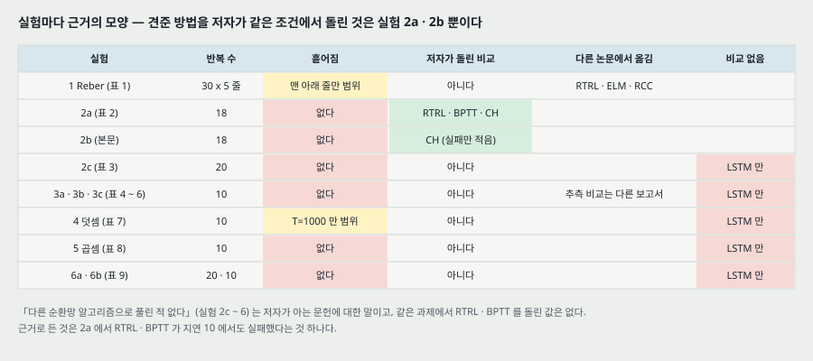

**표 아래에 짚은 것.**

- **같은 조건에서 저자가 돌린 비교는 과제 2a (와 2b 의 CH) 뿐이다.** 표 1 은 세 논문에서 옮긴 값이고, 실험 2c ~ 6 에는 견준 방법이 없다. 원문의 「다른 순환망 알고리즘으로 풀린 적 없다」 는 저자가 아는 문헌의 범위에서 한 말이다.
- **결과는 모두 평균이다.** 표 1 맨 아래 줄과 표 7 의 $T = 1000$ 줄만 범위가 있고, 그 두 범위에서 최댓값이 최솟값의 6.3 배 · 5.5 배다(내가 센 것). 다른 칸의 흩어짐도 이 정도일 수 있는데 적혀 있지 않다.
- **「성공까지」 는 서열 수다.** 서열 길이와 무게 수가 칸마다 다르므로 칸끼리 견줄 때 셈의 양으로 옮기면 안 된다(13절의 438 배).
- **성공률 칸이 없는 표가 많다.** 표 3 ~ 9 는 성공한 실행만의 평균인지, 모든 실행이 성공했는지를 본문으로 가려야 한다. 2b(「늘」) · 2c(20 번) · 4(「늘 0.01 아래」) 는 모두 성공했다고 읽히지만 3 · 5 · 6 은 분명하지 않다.

---

## 19. 내가 센 것 — 무게 수 다시 세기

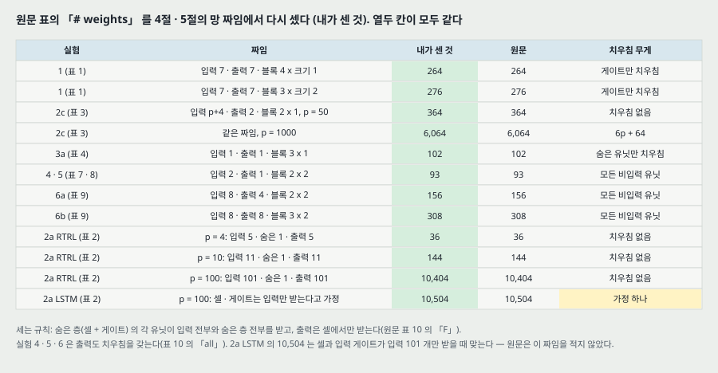

원문 표의 「# weights」 를 4 · 5절과 표 10 에 적힌 짜임에서 다시 셌다. 규칙: 숨은 층(셀 + 게이트)의 유닛마다 입력 전부와 숨은 층 전부를 받고, 출력은 셀에서만 받는다(표 10 의 「F」). 치우침은 표 10 의 「bias」 칸대로 넣는다.

| 실험 | 짜임 | 셈 | 내가 센 것 | 원문 |
|---|---|---|---:|---:|
| 1 | 입력 7 · 출력 7 · 블록 4 × 1 (숨은 12) | $12 \times 19 + 7 \times 4 + 8$ (게이트 치우침) | 264 | 264 |
| 1 | 블록 3 × 2 (숨은 12) | $12 \times 19 + 7 \times 6 + 6$ | 276 | 276 |
| 2c | 입력 $p + 4$ · 출력 2 · 블록 2 × 1 (숨은 6), 치우침 없음 | $6(p + 10) + 4 = 6p + 64$ | 364 ~ 6,064 | 364 ~ 6,064 (다섯 값 모두 같다) |
| 3a | 입력 1 · 출력 1 · 블록 3 × 1 (숨은 9) | $9 \times (1 + 9 + 1) + 3$ | 102 | 102 |
| 4 · 5 | 입력 2 · 출력 1 · 블록 2 × 2 (숨은 8) | $8 \times (2 + 8 + 1) + (4 + 1)$ | 93 | 93 |
| 6a | 입력 8 · 출력 4 · 블록 2 × 2 (숨은 8) | $8 \times 17 + 4 \times 5$ | 156 | 156 |
| 6b | 입력 8 · 출력 8 · 블록 3 × 2 (숨은 12) | $12 \times 21 + 8 \times 7$ | 308 | 308 |
| 2a RTRL | 입력 $p + 1$ · 숨은 1 (자기 연결) · 출력 $p + 1$ | $(p + 2) + (p + 1)(p + 2)$ | 36 · 144 · 10,404 | 36 · 144 · 10,404 |
| 2a LSTM | $p = 100$, 셀 · 입력 게이트가 입력 101 개만 받는다고 가정 | $101 \times 102 + 101 + 101$ | 10,504 | 10,504 |

**이 셈에서 나오는 것.** (1) 원문의 무게 수는 짜임 설명과 **열두 칸 모두 맞는다.** (2) 그래서 숨겨진 연결(예: 출력 유닛의 치우침, 입력에서 출력으로 가는 지름길)이 실험 1 · 2c · 3a 에는 없다는 것이 셈으로 확인된다. (3) **2a LSTM 의 10,504 만은 가정 하나가 든다** — 셀과 입력 게이트가 입력 101 개에서만 받고(자기 연결 1.0 은 고정이라 세지 않음), 출력이 입력과 셀에서 받을 때 맞는다. 원문은 「RTRL 짜임에서 숨은 유닛을 셀과 입력 게이트로 바꿨다」 고만 적는다.

---

## 20. 논의 — 원문이 적은 한계와 장점 (6절)

**한계 넷 (원문).**

1. **강하게 지연된 XOR.** 시끄러운 서열 어딘가에 멀리 떨어져 나온 두 입력의 XOR 를 내는 문제는 잘린 LSTM 이 쉽게 풀지 못한다. 두 입력 중 하나만 담아서는 기대 오차가 줄지 않아 — 더 쉬운 하위 목표를 먼저 풀어 오차를 단계적으로 줄일 수 없는 「분해되지 않는」 문제다. 이론으로는 전체 기울기로 피할 수 있지만 권하지 않는다: 셈이 늘고, CEC 의 상수 흐름은 잘린 판에서만 보일 수 있고, **자르지 않은 LSTM 으로 한 몇 번의 실험에서 「유의한 차이가 없었다」** — CEC 밖의 오차는 어차피 빨리 사라지기 때문이라고.
2. **블록마다 게이트 둘.** 무게가 완전 연결이면 9 배까지 는다. 다만 실험의 무게 수는 견준 방법과 비슷하다.
3. **입력 전체를 한 번에 보는 앞먹임 망과 비슷한 문제.** 무작위 추측으로는 빨리 풀리지만 작은 초기 무게의 잘린 LSTM 으로는 안 풀리는 과제가 있다 — 500 걸음 패리티. 원문: 「그것이 바로 LSTM 이 큰 탐색 공간을 가진 비자명한 과제에서 앞선 방법을 이기는 이유이기도 하다.」
4. **정확한 걸음 세기.** 신호가 99 걸음 전이냐 100 걸음 전이냐가 중요하면 따로 세는 장치가 필요해 보인다. 3 걸음 대 11 걸음 정도는 문제없다 — 셀 출력에서 입력으로 가는 음의 연결로 최근 입력에 무게를 더 두고 감쇠를 배울 수 있다.

**장점 다섯 (원문).** 긴 지연을 잇는다 · 잡음 · 분산 표현 · 연속값을 다룬다(유한 상태 자동기계나 HMM 과 달리 상태 수를 미리 정하지 않는다) · 관련 입력의 위치가 달라도 일반화한다 · **초매개변수 미세 조정이 필요 없어 보인다**(학습률 · 입력 게이트 치우침 · 출력 게이트 치우침의 넓은 범위에서 잘 된다. 큰 학습률은 출력 게이트를 0 쪽으로 밀어 스스로 부작용을 상쇄한다) · 걸음당 무게당 셈 $O(1)$, 공간 · 시간에서 국소적.

**결론 · 앞으로 (7절).** 실제 데이터 — (1) 시계열 예측 (2) 작곡 (3) 음성 처리 — 에 적용해 실용상의 한계를 찾겠다고 적는다. 서열 덩이 짓기를 LSTM 으로 보강해 둘의 장점을 합치는 것도.

---

## 21. 이 논문이 스스로 적은 한계와 조건

1. **강하게 지연된 XOR 같은 분해되지 않는 문제는 잘린 판이 쉽게 풀지 못한다**(6절).
2. **블록마다 게이트 둘 — 무게가 9 배까지 는다**(6절).
3. **무작위 추측에는 쉽고 잘린 LSTM 에는 어려운 과제가 있다**(500 걸음 패리티, 6절).
4. **정확한 걸음 세기에는 따로 세는 장치가 필요해 보인다**(6절).
5. **상수 오차 흐름은 잘린 판에서만 보였다**(6절, 부록 A.2).
6. **남용 문제와 상태 표류** — 처방은 차례로 망 짓기 · 게이트 치우침(4절).
7. **실험 1 은 긴 지연 문제가 아니고, 실험 3a 는 무작위 추측이 더 빠르다**(5.1 · 5.3절).
8. **실제 데이터에는 아직 적용하지 않았다**(7절의 「앞으로」).
9. **계산 시간 때문에 2a 는 서열 500 만 개에서 멈췄다**(5.2절).

---

## 22. 논문이 적지 않은 것 — 내가 읽으며 짚은 자리

**하나. 상태를 줄이는 장치가 없고, 그 빈칸을 시험하지 않았다.** $s$ 는 더하기만 하고 서열마다 바깥에서 0 으로 되돌린다(5절 서두). 그래서 「끝없이 이어지는 입력에서 셀을 비우는 법」 은 이 편의 과제 밖이고, 표류의 처방(입력 게이트 치우침)도 끝이 있는 서열에서만 확인됐다. 이 빈칸을 받은 것이 망각 게이트(Gers 외 2000)다 — 그 편은 이 노트에서 읽지 않았다.

**둘. 견준 방법의 조건이 고르지 않다.** 같은 과제 · 같은 기준으로 저자가 돌린 비교는 2a 하나다. 표 1 은 세 논문의 값을 옮겼고 원문 스스로 RTRL 쪽 과제가 더 쉬웠다고 적는다. 2c ~ 6 의 「풀린 적 없다」 는 문헌 범위의 말이고, 근거로 든 것은 2a 에서 RTRL · BPTT 가 지연 10 에서 실패한 것이다.

**셋. 「배우는 시간」 이 서열 수다.** 서열 길이와 무게 수가 바뀌는 비교(표 3 · 7)에서 서열 수만 보면 걸음 수(26.3 배 · 115 배)와 셈의 양(438 배)이 가려진다(13 · 15절, 내가 센 것). 벽시계 시간은 없다.

**넷. 「미세 조정이 필요 없다」 의 근거가 수치로 없다.** 게이트 치우침 값이 「큰 상관이 없다, 추가 실험으로 확인」 이라는 말이 세 번(3a · 4 · 6) 나오지만 그 실험의 수치가 없다. 학습률은 과제마다 0.01 에서 1.0 까지 100 배 차이 나고, 2c 는 0.01 하나, 3a 는 1.0 하나다. 「넓은 범위에서 된다」 를 학습률을 바꿔 보인 것은 실험 1 (0.1 · 0.2 · 0.5) 뿐이다.

**다섯. 흩어짐이 두 자리에만 있다.** 그 두 자리에서 최댓값이 최솟값의 6.3 · 5.5 배다. 평균만으로 칸끼리의 차이를 읽으면, 예컨대 표 3 아래 칸의 49,000 대 75,000 (1.5 배)이 실행 사이 흩어짐보다 큰지 알 수 없다.

**여섯. 출력 게이트의 몫을 수로 보이지 않았다.** 실험 1 의 「출력 게이트 없이는 빠른 학습을 얻지 못했다」 는 수치 없는 한 문장이다. 게이트 하나씩을 빼 본 비교는 이 편에 없다.

**일곱. 잘린 기울기가 전체 기울기에서 얼마나 먼지 재지 않았다.** 게이트는 셀 출력을 되먹임으로 받지만 그 경로로는 오차가 가지 않는다. 6절의 「유의한 차이가 없었다」 는 「몇 번의 실험」 이고 수치가 없다.

**여덟. 짜임을 「아무렇게나」 골랐고 과제마다 다르다.** 블록 수 · 크기 · 치우침 · 연결 방식 · $g$ 의 종류가 과제마다 바뀐다(표 10). 원문이 스스로 밝힌 것이지만, 그래서 과제 사이의 결과를 「LSTM 이라는 하나의 방법」 의 결과로 묶어 읽기 어렵다.

---

## 23. 읽을 때 헷갈리는 지점

**지금의 LSTM 과 다르다.** 망각 게이트 · $\tanh$ · 자르지 않은 BPTT 는 이 편에 없다(7절).

**출력 유닛의 시점.** 부록 A.1 은 출력 순입력을 $\sum w_{ku} y^u(t-1)$ 로 적지만, 5절 서두는 실험에서 걸음 하나 안에 입력 → 숨은 층 → 출력을 차례로 계산한다고 적는다(「부록의 표기와 조금 다르다」). 실험의 출력은 같은 걸음의 셀 출력을 본다.

**「p」 가 셋.** 2a 의 $p$ 는 지연(서열 길이 − 1), 2c 의 $p$ 는 방해 기호 수, 표 10 의 「p」 열은 「최소 서열 길이」 라 정의되지만 2c 줄에는 $q$ 가 들어 있다(25절).

**「h」 · 「g」 의 범위.** 본문과 식 (4) · (5) 는 $h \in [-1, 1]$, $g \in [-2, 2]$ 다. 표 10 캡션은 반대로 적었다(25절). 실험 2a · 2b 는 $g$ = $[0, 1]$ 로지스틱, $h$ = 항등이다.

**「r」.** 표 10 의 게이트 치우침 칸 「r」 은 $[-0.1, 0.1]$ 에서 무작위라는 뜻이다. 실험 1 의 무게 범위는 $[-0.2, 0.2]$ 라 1 번 줄의 「r」 이 어느 범위인지 갈리지 않는다.

**「성공까지」 와 「멈춤까지」.** 표 1 ~ 3 · 7 ~ 9 는 「성공까지」, 표 4 ~ 6 은 ST1 · ST2 「멈춤까지」 다. 둘 다 학습 서열 수다.

**블록과 셀.** 「블록 3 개 · 크기 2」 는 셀 6 · 게이트 6 이고, 「블록 4 · 크기 1」 은 셀 4 · 게이트 8 이다. 숨은 층 유닛 수는 둘 다 12 다.

**Elman 의 인용.** 이 편은 Elman 을 1988 년 기술 보고서(CRL 8801, 「Finding structure in time」)로 인용한다. 같은 제목의 학술지판이 Cognitive Science 1990 이다.

---

## 24. 계보와 내가 가져갈 것

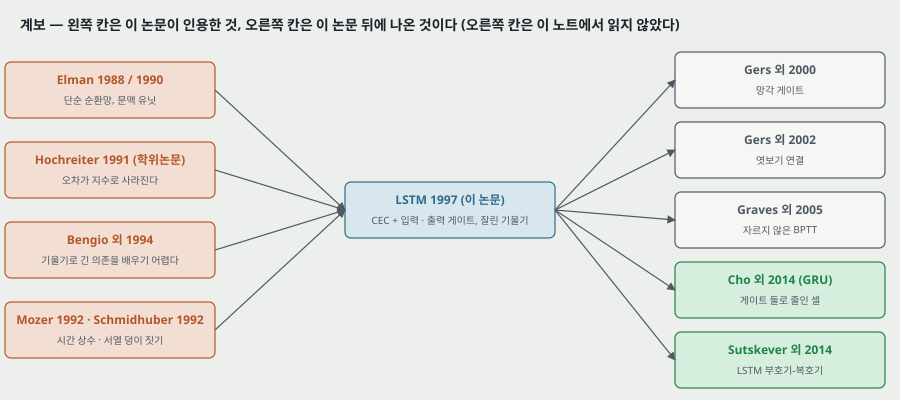

**하나. 앞 칸에서 받은 것.** 단순 순환망(Elman)은 문맥 유닛으로 지난 상태를 들고 가지만, 그것을 배우는 기울기는 3.1절의 곱을 따른다. 이 편은 망의 모양을 바꿔 그 곱을 1.0 으로 묶는다. **깊은 망 쪽에서 본 같은 자리** — 층이 깊어지면 기울기가 층마다 곱해져 사라지고, 잔차 망은 덧셈 지름길로 기울기에 「1 +」 항을 남겼다. CEC 의 $s(t) = s(t-1) + (\dots)$ 도 덧셈이고 $\partial s(t) / \partial s(t-1) = 1$ 이다. **두 편이 같은 장치라고 말하는 것은 내 연결이고, 이 편은 잔차 망보다 18 년 앞이라 그 연결을 적지 않는다.**

**둘. 옮겨 쓸 수 있는 것.**

- **오차 배율을 경로의 곱으로 적고 그 곱이 1 보다 큰지 작은지를 보는 방식**(식 2). 깊은 망이든 순환망이든 「왜 안 배워지나」 를 읽을 때 첫 셈으로 쓴다. 로지스틱이면 걸음당 0.224 / $y$ 가 위 끝이라는 것(3절)이 그 셈의 숫자다.
- **표의 무게 수를 짜임에서 다시 세 보기.** 이 편에서는 열두 칸이 모두 맞아 숨은 연결이 없다는 것까지 확인됐다(19절).
- **「배우는 시간」 의 단위를 묻기.** 서열 수 · 걸음 수 · 셈의 양 · 벽시계 시간 가운데 무엇인지. 같은 표가 1.6 배도 438 배도 된다(13절).
- **비교 상대가 같은 조건에서 돌린 것인지, 다른 논문에서 옮긴 것인지 가르기**(18절 그림).

**셋. 지금 확인된 것은 여기까지다.**

- **논문이 잰 것:** 인공 과제 여섯에서 LSTM 이 성공 기준에 닿은 학습 서열 수(평균)와 시험 오류 수. 2a 에서 RTRL · BPTT · CH 와 같은 조건 비교.
- **논문이 말만 한 것:** 출력 게이트가 없으면 느리다 · 게이트 치우침 값은 큰 상관이 없다 · 자르지 않은 판과 유의한 차이가 없다 · 다른 방법으로 풀린 적 없다. 모두 수치가 없다.
- **내가 책상에서 센 것:** 무게 수 열두 칸 일치, 시그모이드 배율의 위 끝 0.224 / $y$, 2c 기대 길이 $q + 13$, 비율 → 개수(표 4 ~ 6), 표 3 · 7 을 걸음 수 · 셈의 양으로 다시 센 배수, 표 1 · 2 의 백분율을 정수 번으로 되돌린 것.

---

## 25. 원문 안의 어긋남 모음

| 자리 | 원문 | 바른 것 또는 짚을 것 |
|---|---|---|
| 5.2절 과제 2c 기대 길이 | $4 + \sum_k \frac{1}{10}(\frac{9}{10})^k (q + k) = q + 14$ | 식을 계산하면 $q + 13$ (내 계산). 기대 출현 수도 $(q+10)/p$ 가 아니라 $(q+9)/p$ |
| 5.2절 과제 2a 결과 | 「$p = 4$ 에서 전체 실행의 7/9 가 성공」 | 표 2 의 $p = 4$ 세 줄은 78 · 56 · 22%. 7/9 = 77.8% 는 학습률 1.0 줄 하나와만 같다. 합치면 28/54 = 51.9% |
| 표 10 캡션 | 「h1 은 $[-2, 2]$ 의 로지스틱, g2 는 $[-1, 1]$」 | 식 (4) · (5) 와 본문 넷(실험 1 · 2c · 3a · 4 · 6)은 $h \in [-1, 1]$, $g \in [-2, 2]$. 캡션의 범위가 뒤바뀌었다 |
| 5.5절 대 표 8 | 「$n_{seq} = 13$ 에서 시험 평균 오차가 늘 0.013 아래」 | 표 8 의 MSE 는 0.0139. 같은 양이라면 평균이 상한을 넘는다. 다른 양이라면 원문이 가르지 않았다 |
| 표 6 첫 줄 | 틀린 비율 0.00558 | × 25,600 = 142.85 로 정수가 아니다. 143 개면 0.005586 (반올림 0.00559). 끝자리를 버린 것으로 읽힌다 |
| 표 10, 2c 줄 | 「p」 열(최소 서열 길이) = 50 ~ 1,000, 「lag」 열 = 50 ~ 1,000 | 2c 의 최소 서열 길이는 $q + 4$, 최소 지연은 $q + 1$ (본문). 두 열 모두 $q$ 를 적었다 |
| 표 10, 실험 1 줄 | 입력 게이트 치우침 「r」 = $[-0.1, 0.1]$ 에서 무작위 | 실험 1 의 무게 범위는 $[-0.2, 0.2]$ (본문 · 표 11) |
| 부록 A.1 식 (29) 아래 | 식 (22) 가 출력 유닛에 $K(H + C)$ 걸음 | 출력은 셀 $CS$ 개에서 받으므로 $K(H + CS)$. $W$ 식의 $KCS$ 와 맞추려면. $O(\cdot)$ 는 같다 |
| 참고 문헌 | 「Hochreiter, J. (1991). Untersuchungen zu dynamischen neuronalen Netzen」 | 저자 이름 머리글자는 S. (Sepp) |
| 철자 | carrousel | carousel (원문 철자를 이 노트도 용어 정의에서만 그대로 옮겼다) |

---

## 26. 남는 질문

- **학술지판(46 쪽)이 이 배포본과 같은가.** 특히 25절의 어긋남이 학술지판에서 고쳐졌는지. 학술지판을 받으면 확인한다.
- **망각 게이트가 없을 때 끝없는 입력에서 $s$ 가 어디까지 흐르는가.** 이 편에 없다 — Gers 외 2000 (Learning to Forget) 이 받는 자리로 안다.
- **잘린 기울기와 전체 기울기의 차이를 잰 편이 있는가.** 6절의 「몇 번의 실험」 의 수치. Graves · Schmidhuber 2005 가 자르지 않은 BPTT 로 바꾼 편이라 거기서 답이 나올 수 있다.
- **게이트 하나씩을 뺀 비교.** 출력 게이트 · 입력 게이트의 몫을 수로 보인 편 — 게이트를 줄인 GRU (로드맵 다음 칸) 와, 게이트 변형을 대규모로 견준 편(Greff 외 2017, 「LSTM: A Search Space Odyssey」, 후보)에서 답을 찾는다.
- **실험 5 의 「평균 오차」 가 MSE 인가 평균 절대 오차인가.**
- **2a LSTM 짜임 — 셀과 입력 게이트가 되먹임을 받았는가.** 10,504 는 받지 않을 때 맞는다(19절).

---

## 27. 다음에 읽을 것

**한계를 적고 그 한계를 푼 것이 다음 논문이다.** 로드맵 큰 틀을 먼저 따른다.

| 다음 | 이 노트의 어느 자리에서 나오는가 | 무엇을 확인하고 싶은가 |
|---|---|---|
| **GRU** — Learning Phrase Representations using RNN Encoder-Decoder for Statistical Machine Translation (Cho 외, EMNLP 2014) — **로드맵 다음 칸** | 20 · 21절 둘 — 블록마다 게이트 둘이 무게를 9 배까지 늘린다. 22절 여섯 — 게이트 각각의 몫이 수로 없다 | 게이트를 몇 개로 줄였고 상태를 줄이는 장치(망각에 해당하는 것)를 어떻게 넣었는가. 실험이 인공 과제가 아니라 실제 데이터(번역)인가 |
| **Learning to Forget: Continual Prediction with LSTM** (Gers · Schmidhuber · Cummins, Neural Computation 2000) — 세부 | 10 · 22절 하나 — $s$ 를 줄이는 장치가 없고 서열마다 바깥에서 비운다 | 끝없는 입력에서 원판이 실패하는 것을 보였는가, 망각 게이트로 무엇이 달라지는가 |
| **Framewise Phoneme Classification with Bidirectional LSTM** (Graves · Schmidhuber, Neural Networks 2005) — 세부 | 9 · 22절 일곱 — 잘린 기울기 | 자르지 않은 BPTT 와 잘린 판의 차이를 실제 데이터에서 쟀는가 |
| **Learning Long-Term Dependencies with Gradient Descent is Difficult** (Bengio · Simard · Frasconi, IEEE TNN 1994, 원문 인용) — 세부 | 3 · 4절 — 이 편이 「매우 비슷한 최근 분석」 으로 든 편, 2-서열 문제의 출처 | 사라짐을 어떤 조건에서 증명했는가(이 편의 식 2 와 무엇이 같은가) |
| **LSTM: A Search Space Odyssey** (Greff 외, IEEE TNNLS 2017) — 후보 | 22절 여섯 — 게이트 하나씩 뺀 비교가 없다 | 망각 · 입력 · 출력 게이트 · 엿보기를 하나씩 뺐을 때의 차이 |

**읽는 순서로는 GRU 가 먼저다** — 로드맵 다음 칸이고, 그 뒤가 seq2seq (Sutskever 외 2014, LSTM 부호기-복호기). 세부 넷은 큰 틀을 다 읽은 뒤에 고른다.

---

## 28. 참고 문헌

이 노트가 부른 편만 적는다. 원리는 원 출처를, 구현은 그 라이브러리의 편을 적는 규칙을 따른다. 그림 코드는 파이썬 표준 라이브러리만 쓰고, 원문 그림을 잘라 낸 코드만 PyMuPDF 를 썼다(PyMuPDF 는 논문이 따로 없어 적지 않는다).

- Hochreiter, S. and Schmidhuber, J. (1997). Long short-term memory. Neural Computation, 9(8):1735–1780. DOI 10.1162/neco.1997.9.8.1735. — 이 노트의 대상. 읽은 것은 저자 배포본(32 쪽).
- Hochreiter, S. and Schmidhuber, J. (1995). Long short-term memory. Technical Report FKI-207-95, TU München. — 감사의 글이 든 앞선 판. **읽지 않았다.**
- Hochreiter, S. (1991). Untersuchungen zu dynamischen neuronalen Netzen. 학위논문(Diploma), TU München. — 3.1절 분석의 출처(원문 표기는 「Hochreiter, J.」). **읽지 않았다.**
- Bengio, Y., Simard, P., and Frasconi, P. (1994). Learning long-term dependencies with gradient descent is difficult. IEEE Transactions on Neural Networks, 5(2):157–166. — 같은 분석 · 2-서열 문제. **읽지 않았다.**
- Elman, J. L. (1988). Finding structure in time. Technical Report CRL 8801, UC San Diego. 학술지판: Cognitive Science, 14(2):179–211, 1990. — ELM 비교 상대.
- Williams, R. J. and Zipser, D. (1992). Gradient-based learning algorithms for recurrent networks and their computational complexity. — BPTT · RTRL.
- Robinson, A. J. and Fallside, F. (1987). The utility driven dynamic error propagation network. Technical Report CUED/F-INFENG/TR.1. — RTRL.
- Smith, A. W. and Zipser, D. (1989). Learning sequential structures with the real-time recurrent learning algorithm. International Journal of Neural Systems, 1(2):125–131. — 표 1 의 RTRL 값.
- Cleeremans, A., Servan-Schreiber, D., and McClelland, J. L. (1989). Finite-state automata and simple recurrent networks. Neural Computation, 1:372–381. — 표 1 의 ELM 값.
- Fahlman, S. E. (1991). The recurrent cascade-correlation learning algorithm. NIPS 3, 190–196. — 표 1 의 RCC 값, 실험 1 설정.
- Schmidhuber, J. (1992b). Learning complex, extended sequences using the principle of history compression. Neural Computation, 4(2):234–242. — 서열 덩이 짓기(CH).
- Mozer, M. C. (1992). Induction of multiscale temporal structure. NIPS 4. — 시간 상수.
- Schmidhuber, J. and Hochreiter, S. (1996). Guessing can outperform many long time lag algorithms. Technical Report IDSIA-19-96. — 무작위 추측.
- Schmidhuber, J. (1989). The neural bucket brigade. Connection Science, 1(4):403–412. — 「공간 · 시간에서 국소적」 의 정의.
- Gers, F. A., Schmidhuber, J., and Cummins, F. (2000). Learning to forget: Continual prediction with LSTM. Neural Computation, 12(10):2451–2471. — 망각 게이트. **원문 참고 문헌에는 없다(뒤에 나온 편). 읽지 않았다.**
- Gers, F. A., Schraudolph, N. N., and Schmidhuber, J. (2002). Learning precise timing with LSTM recurrent networks. JMLR, 3:115–143. — 엿보기 연결. **읽지 않았다.**
- Graves, A. and Schmidhuber, J. (2005). Framewise phoneme classification with bidirectional LSTM and other neural network architectures. Neural Networks, 18(5–6):602–610. — 자르지 않은 BPTT. **읽지 않았다.**
- Cho, K. 외 (2014). Learning phrase representations using RNN encoder–decoder for statistical machine translation. EMNLP. — 다음에 읽을 것.
- Greff, K. 외 (2017). LSTM: A search space odyssey. IEEE TNNLS, 28(10):2222–2232. — 후보. **읽지 않았다.**

---

## 29. 경로

| 무엇 | 어디 |
|---|---|
| 원문 PDF (저자 배포본, 32 쪽) | `papers/NC97_LSTM_Long_Short_Term_Memory.pdf` |
| 이 노트 | `notes/NC97_LSTM_Long_Short_Term_Memory.md` |
| 이 노트의 그림 (직접 그린 것) | `figures/NC97_LSTM/fig01_decay_factor.svg` 부터 `fig15_lineage.svg` 까지 열다섯 |
| 이 노트의 그림 (원문에서 잘라 낸 것) | `figures/NC97_LSTM/paper_fig1_memory_cell.png`, `paper_fig2_network.png`, `paper_fig3_4_reber.png` |
| 그림을 만드는 코드 | `figures/NC97_LSTM/make_figures.py` — 바깥 데이터를 읽지 않으므로 `python make_figures.py` 로 어디서나 다시 만든다(표준 라이브러리만). 1 · 2 · 8 · 11 · 12 · 13 번 그림의 수는 이 파일이 계산해 화면에도 찍는다. 원문 표의 숫자는 파일 안 상수로 옮겨 적었다 |
| 원문 그림을 잘라 내는 코드 | `figures/NC97_LSTM/crop_paper_figures.py` — PyMuPDF 가 필요하다 |
| 3절 첫머리 · 24절이 부른 역전파 실험(층당 기울기 감쇠 10 ~ 12 배) | `experiments/backprop_1986/` |
