# seq2seq — Sequence to Sequence Learning with Neural Networks (arXiv 판, 요약)

> **한 줄.** 길이가 정해지지 않은 입력 열을 길이가 다른 출력 열로 옮기는 일을, **LSTM 하나(인코더)가 입력을 끝까지 읽어 고정 길이 벡터 $v$ 를 만들고 다른 LSTM 하나(디코더)가 $v$ 에서 출력을 한 낱말씩 내는** 틀로 푼다. 두 LSTM 은 4 층 · 층마다 1,000 칸이고, $v$ 는 8,000 개의 수다. 영어 -> 프랑스어(WMT'14)에서 **시작값만 다른 모델 다섯의 앙상블**이 직접 번역으로 BLEU 34.81 을 내 구 기반 SMT 기준(33.30)을 1.51 넘었다. 같은 조건의 **단일 모델은 30.59 로 기준 아래**다. 원문이 「핵심 기여 하나」 로 꼽는 것은 **원문 낱말 순서를 뒤집어 넣는 것**이고, 단일 모델에서 BLEU 를 25.9 에서 30.6 으로 올렸다. 왜 돕는지는 3.3절 스스로 「완전한 설명은 없다 ... 믿는다」 고 적는다.

> **이 노트에서 가장 먼저 볼 자리 셋.** (1) 「SMT 를 넘었다」 는 앙상블 다섯의 값이고 Abstract 는 그것을 「the LSTM」 이라 부른다(11절). (2) 「긴 문장에서 어려움이 없었다」 의 근거인 그림 3 을 PDF 안 벡터 좌표로 읽으면, 가장 긴 칸(35 ~ 79 낱말)에서 LSTM 앙상블이 2.16 내려가 기준 SMT 와의 차이가 +0.14 로 준다. 그 그림에는 정방향 모델의 곡선이 없다(13절). (3) 입력 뒤집기는 Abstract · 1절에서 원인(because)으로, 3.3절에서 가설로 적혀 있다. 잰 것은 단일 모델의 두 수(혼잡도 · BLEU)뿐이다(19절).

---

## Paper Metadata

| Item | Content |
|---|---|
| Title | Sequence to Sequence Learning with Neural Networks |
| Authors | Ilya Sutskever, Oriol Vinyals, Quoc V. Le |
| 소속 | 셋 다 Google |
| Conference / Journal | **NIPS 2014** (Advances in Neural Information Processing Systems 27) 에 실렸다. **이 노트가 읽은 파일은 학회판이 아니라 arXiv:1409.3215 셋째 판(v3)** 이다. 학회판은 받지 않았다. 학회판과 쪽 번호 · 표 번호 · 수치가 다를 수 있고, 이 노트의 「n 쪽」 은 모두 arXiv v3 의 쪽이다 |
| Year | arXiv 첫 판 2014-09 (번호 1409 로 보아). 이 파일은 v3, 첫 쪽 옆 도장이 **2014-12-14**, 파일 정보의 만든 날이 2014-12-15 |
| DOI | 학회판 DOI 는 이 파일에 없다. arXiv:1409.3215 |
| 코드 | **본문에 적혀 있지 않다.** 9 쪽 글자 층에서 저장소 주소를 찾지 못했다. 3.5절은 「C++ 구현」 이라고만 적는다 |
| Stored PDF | `papers/NIPS14_Seq2Seq_Sequence_to_Sequence_Learning_with_Neural_Networks.pdf` (바탕화면에서 받은 이름은 `1409.3215v3.pdf`) |
| 왜 읽었는가 | 순차 데이터 갈래의 넷째 칸(seq2seq). 앞 칸의 LSTM 이 「긴 지연을 배운다」 를 보였고, 이 편은 그 LSTM 둘을 이어 **입력과 출력의 길이가 다른 문제**에 쓴다. 그리고 이 편이 남긴 「문장 전체를 벡터 하나에 담는다」 가 다음 칸(Attention)이 푸는 자리다 |
| 읽은 범위 | **2026-11-04 에 9 쪽을 전부 읽었다.** 곧 Abstract · 1 ~ 6절 · 그림 1 ~ 3 과 캡션 · 표 1 ~ 3 · 각주 1 · 참고 문헌 31 건의 목록. 참고 문헌의 편들은 읽지 않았다 |

### 저장한 파일의 상태

- **본문 8 쪽 + 참고 문헌 1 쪽**이다. 부록이 없다.
- **글자 층이 살아 있다.** 식은 글자 뽑기에서 첨자가 흩어져 3 · 4 쪽을 그림으로 띄워 맞췄다.
- **그림 1 · 2 · 3 은 PDF 안에 벡터(선과 점)로 들어 있다.** 래스터 이미지가 하나도 없다. 그래서 그림 2 의 점 열두 개와 그림 3 의 곡선 넷의 꼭짓점을 PyMuPDF 로 꺼내 **PDF 좌표를 축 눈금으로 바꿔 읽었다**(13 · 15절). 눈금 자리도 같은 방법으로 꺼냈으므로 읽기 오차는 좌표 반올림(0.01 pt)에서 오는 0.002 BLEU 이고, 표 · 본문에 적을 때는 소수 둘째 자리까지만 적는다.
- **원문 그림 1 은 노트에 잘라 넣었다**(4절). 그림 2 · 3 은 꺼낸 좌표로 다시 그렸다.

---

## 1. 용어

이 노트에서 쓸 이름을 먼저 정한다. 논문의 원래 용어는 괄호로 함께 적는다.

- **열 (sequence)**: 순서가 있는 낱말들. 길이가 문장마다 다르다. 작은 예시로, 「the cat sat」 은 길이 3 의 열이다.
- **인코더 · 디코더 (encoder · decoder)**: 입력 열을 읽는 LSTM 과 출력 열을 내는 LSTM. 원문은 2절에서 이 이름을 쓰지 않고 「입력 열을 위한 LSTM · 출력 열을 위한 LSTM」 이라 적으며, 3.4절에서만 따옴표를 붙여 「"encoder" LSTM」 · 「"decoder" LSTM」 이라 부른다. 이 노트는 인코더 · 디코더로 쓴다.
- **고정 길이 벡터 $v$ (fixed-dimensional representation)**: 인코더가 입력을 다 읽은 뒤의 상태. 디코더의 첫 상태가 된다. 이 편에서는 8,000 개의 수다(4절). 작은 예시로, 낱말 5 개짜리 문장도 50 개짜리 문장도 같은 8,000 개의 수로 줄어든다.
- **LSTM**: 칸마다 기억 값 $c$ 와 내보내는 값 $h$ 를 갖고, 문(gate) 셋이 무엇을 쓰고 지우고 내보낼지 정하는 되먹임 망. 원문은 Graves [10] 의 꼴을 쓴다고만 적는다. 작은 예시로, 한 층이 1,000 칸이면 $h$ 1,000 개와 $c$ 1,000 개, 합 2,000 개의 수를 다음 걸음으로 넘긴다.
- **EOS (end-of-sentence)**: 문장 끝 기호. 원문은 「<EOS>」. 디코더가 이 기호를 내면 멈춘다. 이 기호 덕에 길이가 정해지지 않은 출력에 확률을 줄 수 있다. 작은 예시로, 「W X Y Z <EOS>」 는 다섯 걸음짜리 출력이다.
- **어휘 · UNK**: 모델이 아는 낱말 목록과, 목록 밖 낱말을 바꿔 넣는 기호. 원문 어휘는 원문 쪽(영어) 160,000 · 번역 쪽(프랑스어) 80,000. 작은 예시로, 번역 정답에 사람 이름 「Hackenberg」 가 있고 그 낱말이 80,000 안에 없으면 모델은 「UNK」 를 낼 수밖에 없고, BLEU 는 그 자리를 틀린 것으로 센다(원문 표 3 첫 줄이 이 경우다).
- **정방향 · 뒤집음 (forward · reversed)**: 원문 낱말을 원래 순서로 넣느냐 거꾸로 넣느냐. **번역 쪽 낱말은 어느 경우에도 뒤집지 않는다.** 작은 예시로, a b c -> α β γ 를 배우는 대신 c b a -> α β γ 를 배운다.
- **최소 시간 지연 (minimal time lag)**: 입력에서 정보가 들어온 걸음과 그 정보가 필요한 출력 걸음 사이의 가장 짧은 거리. 원문은 [17] 의 말을 빌린다. 작은 예시로, 다섯 낱말 문장이 다섯 낱말로 순서대로 번역될 때 정방향은 짝마다 6 걸음, 뒤집으면 가장 짧은 짝이 2 걸음이다(5절에서 셈).
- **혼잡도 (perplexity)**: 정답 낱말에 준 확률의 기하평균의 역수. 낮을수록 좋다. 작은 예시로, 혼잡도 5.8 은 정답 낱말에 평균(기하평균) 1/5.8 = 0.172 의 확률을 준 것이고, 4.7 은 0.213 이다.
- **BLEU**: 번역과 정답의 1 ~ 4 낱말 묶음(n-gram)이 겹치는 비율의 기하평균에, 번역이 정답보다 짧으면 벌점을 곱한 값. 0 ~ 100 으로 적는다. 작은 예시로, 정답 「the cat sat on the mat」(6 낱말)에 번역 「the cat sat on mat」(5 낱말)이면 1 · 2 · 3 · 4 낱말 묶음의 겹침이 5/5 · 3/4 · 2/3 · 1/2 이라 기하평균 0.707, 길이 벌점 $e^{1 - 6/5} = 0.819$, BLEU 57.9 다(내가 센 것, 문장 하나 기준. 원문은 시험셋 전체를 한 번에 센다).
- **빔 탐색 (beam search)** · **빔 크기 $B$**: 출력을 한 낱말씩 늘리면서 그때까지의 확률이 가장 높은 앞부분 $B$ 개만 남기는 근사 탐색. $B = 1$ 이면 매 걸음 가장 높은 낱말만 고르는 탐욕 탐색이다. 작은 예시는 7절 그림 9.
- **n-best 목록 · 다시 점수 매기기 (rescoring)**: 기존 번역 시스템이 내놓은 후보 $n$ 개(이 편은 1,000 개)에 새 점수를 매겨 다시 고르는 것. 이 노트에서는 줄여 **다시 매김**이라 쓴다. 작은 예시로, 후보 둘의 SMT 점수가 −10 · −11 이고 LSTM 로그 확률이 −8 · −5 면, 원문의 단순 평균으로 −9 · −8 이라 둘째 후보가 고려진다.
- **직접 번역 (direct translation)**: SMT 의 후보 없이 LSTM 이 빔 탐색으로 번역을 처음부터 만드는 것. 원문 표 1 이 이것, 표 2 가 다시 매김이다. **두 표의 BLEU 를 같은 칸에 놓지 않는다.**
- **앙상블 (ensemble)**: 여러 모델의 확률을 합쳐 쓰는 것. 원문의 앙상블 구성원은 **시작값과 미니배치 순서만 다르다**(3.6절). 합치는 방식(확률 평균인지 로그 확률 평균인지)은 적혀 있지 않다. 작은 예시로, 「앙상블 5」 는 같은 설정으로 다섯 번 학습한 모델 다섯이다.
- **구 기반 SMT (phrase-based statistical machine translation)**: 낱말 묶음(구) 단위의 번역 표와 언어 모델 등을 섞어 점수를 매기는 통계 번역 시스템. 원문의 기준 시스템 [29] 이 이것이다. 이 노트에서는 **기준 SMT** 라 쓴다.
- **기울기 노름 자르기 (gradient norm clipping)**: 기울기 벡터의 길이가 문턱을 넘으면 문턱 길이로 줄이는 것. 원문 문턱 5. 작은 예시로, 128 로 나눈 기울기의 노름이 10 이면 기울기에 5/10 = 0.5 를 곱한다.

---

## 2. 한 문단 요약

깊은 신경망은 입력과 출력의 차원이 정해져 있어야 쓸 수 있는데, 음성 인식 · 기계 번역 · 질의응답은 길이를 미리 모르는 열을 열로 옮기는 문제다(1절). 이 편은 LSTM 하나가 입력 열을 한 걸음씩 읽어 고정 길이 벡터를 만들고, 다른 LSTM 하나가 그 벡터를 첫 상태로 받아 출력 열을 한 낱말씩 내는 틀을 쓴다(식 1). 실제 모델은 이 기본 그림과 세 가지가 다르다 — 인코더와 디코더가 서로 다른 LSTM 이고, LSTM 이 4 층이며, 원문 낱말 순서를 뒤집어 넣는다(2절). 영어 -> 프랑스어 WMT'14 에서 1,200 만 문장 쌍으로 7.5 바퀴, GPU 8 장으로 열흘 남짓 학습했다(3.1 · 3.4 · 3.5절). 직접 번역에서 앙상블 다섯 · 빔 12 가 34.81 로 기준 SMT 33.30 을 넘었고(표 1), 기준 SMT 의 후보 1,000 개를 다시 매기면 36.5 로 당시 최고 37.0 에서 0.5 아래다(표 2). 문장 길이별 · 낱말 빈도별 BLEU(그림 3), 긴 문장 번역 예(표 3), 은닉 상태의 2 차원 주성분 그림(그림 2)이 뒤따른다. 원문 순서를 뒤집으면 단일 모델의 시험 혼잡도가 5.8 에서 4.7 로, BLEU 가 25.9 에서 30.6 으로 바뀌었고, 원문은 이를 「짧은 의존이 많아져 최적화가 쉬워졌기 때문이라고 믿는다」 고 적는다(3.3절).

---

## 3. 문제 — 차원이 정해지지 않은 열 (1절)

**원문이 세우는 전제.** 깊은 신경망은 「적당한 걸음 수 동안 임의의 병렬 계산을 할 수 있어서」 강하고, 예로 **N 비트 수 N 개를 은닉층 둘(크기는 N 의 제곱)로 정렬할 수 있다**는 결과 [27] 를 든다. 그리고 「좋은 결과를 내는 파라미터 설정이 존재하면(예를 들어 사람이 그 과제를 빨리 풀 수 있으므로) 지도 역전파가 그 파라미터를 찾아 문제를 풀 것이다」 라고 적는다.

> 마지막 문장은 원문의 단정이다. 이 편 안에 그 단정을 받치는 측정이 없고, 원문 5절이 「보통 RNN 은 정방향 번역 문제에서 학습시킬 수 없었다」 고 적는 것과도 맞지 않는다 — 보통 RNN 에도 좋은 파라미터 설정은 있을 수 있다. 21절 열에 적었다.

**막히는 자리.** 깊은 신경망은 입력과 목표를 고정 차원 벡터로 적을 수 있는 문제에만 쓰인다. 원문의 예 — 음성 인식과 기계 번역은 순차 문제이고, 질의응답도 질문 낱말 열을 답 낱말 열로 옮기는 것으로 볼 수 있다.

**보통 RNN 으로 왜 안 되나(2절).** 입력 $(x_1, \dots, x_T)$ 에 대해 보통 RNN 은

$$h_t = \mathrm{sigm}\left(W^{hx} x_t + W^{hh} h_{t-1}\right), \qquad y_t = W^{yh} h_t$$

를 되풀이한다. 원문은 「입력과 출력의 정렬을 미리 알면」 RNN 이 열을 열로 쉽게 옮긴다고 적는다 — 위 식은 입력 한 걸음에 출력 한 걸음을 낸다. **입력과 출력의 길이가 다르고 관계가 단조롭지 않으면** 이 꼴을 어떻게 쓸지가 분명하지 않다.

**가장 단순한 답과 그 약점.** RNN 하나로 입력을 고정 크기 벡터로 옮기고, 다른 RNN 으로 그 벡터를 목표 열로 옮긴다(Cho 외 [5] 도 이 길). 정보는 다 들어 있으니 원리로는 되지만 **긴 의존 때문에 학습이 어렵다**고 원문은 적고([14, 4, 16, 15] 인용), LSTM 은 긴 지연을 배운다고 알려져 있으니 이 설정에서 될 수 있다고 본다.

---

## 4. 모델 — 식 (1) 과 실제 모델의 세 가지 차이 (2절)

**목표.** 입력 열 $(x_1, \dots, x_T)$ 에 대해 길이 $T'$ (≠ $T$ 일 수 있다) 인 출력 열의 조건부 확률을 낸다. 인코더의 마지막 상태 $v$ 를 디코더의 첫 상태로 두고, 디코더는 보통의 LSTM 언어 모델처럼 낱말을 하나씩 낸다.

$$p(y_1, \dots, y_{T'} \mid x_1, \dots, x_T) = \prod_{t=1}^{T'} p(y_t \mid v, y_1, \dots, y_{t-1}) \qquad (1)$$

각 $p(y_t \mid v, y_1, \dots, y_{t-1})$ 은 어휘 전체에 대한 소프트맥스다. 모든 문장 끝에 EOS 를 붙여 길이가 다른 출력 모두에 확률을 준다.

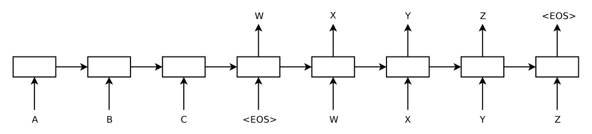

*원문 그림 1 을 잘라 넣은 것(2 쪽). 입력 「ABC」 를 읽고 「WXYZ」 를 낸다.*

**원문 그림 1 은 기본 그림이지 실제 모델이 아니다.** 사슬이 하나(인코더와 디코더가 같은 LSTM 으로 그려졌다)이고, 층이 하나이며, 입력이 A · B · C 순서로 그려져 있다. **캡션은 「LSTM 이 입력을 거꾸로 읽는다」 고 적는데 그림의 입력은 A B C 순서다**(23절).

**실제 모델의 세 가지 차이(원문 2절 끝).**

1. **인코더와 디코더가 서로 다른 LSTM 이다.** 원문의 이유 — 「계산 비용은 거의 그대로(at negligible computational cost)이면서 파라미터 수가 늘고, 여러 언어 쌍을 동시에 배우기 자연스럽다」([18] 인용). 계산 비용 쪽은 맞다 — 걸음마다 한 LSTM 만 돈다. 여러 언어 쌍 동시 학습은 이 편에서 하지 않았다.
2. **LSTM 이 4 층이다.** 원문 — 「깊은 LSTM 이 얕은 LSTM 을 크게 앞섰다」. 수는 3.4절의 「층 하나를 더할 때마다 혼잡도가 거의(nearly) 10% 줄었다」 하나다(8절).
3. **원문 낱말 순서를 뒤집는다.** 5절.

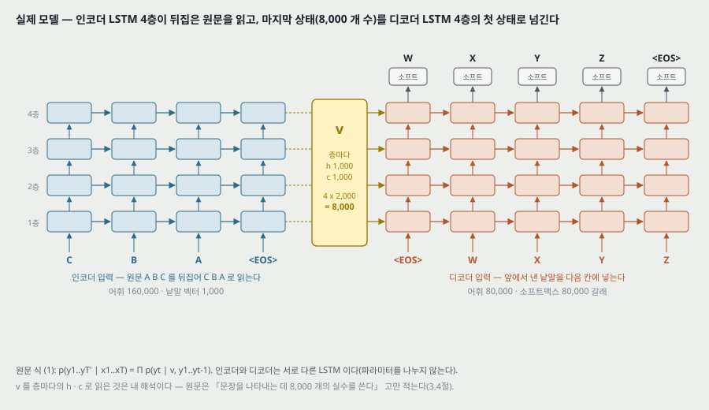

**$v$ 가 8,000 개인 까닭 — 내 해석.** 2절은 $v$ 를 「LSTM 의 마지막 은닉 상태(last hidden state)」 라 적고, 3.4절은 「깊은 LSTM 은 문장을 나타내는 데 8,000 개의 실수를 쓴다」 고 적는다. 층 4 개 × ($h$ 1,000 + $c$ 1,000) = 8,000 이므로, **인코더 4 층 각각의 $h$ 와 $c$ 를 디코더 같은 층의 첫 상태로 넘긴다**고 읽으면 두 문장이 맞는다. 원문은 이 넘김을 식으로 적지 않는다.

---

## 5. 입력 뒤집기 — 최소 시간 지연 (2절 끝 · 3.3절)

**원문의 설명.** 원문 문장과 번역 문장을 이어 놓으면 원문 낱말 하나와 그에 해당하는 번역 낱말 사이가 멀다 — 「최소 시간 지연」 이 크다. 원문을 뒤집으면 **짝 낱말 사이의 평균 거리는 그대로**이지만, 원문의 앞 몇 낱말이 번역의 앞 몇 낱말과 아주 가까워져 최소 지연이 크게 준다. 그래서 역전파가 원문과 번역 사이에 「소통을 세우기(establishing communication)」 쉬워진다.

**책상 확인 — 「평균은 그대로, 최소만 준다」 를 세어 본다(내가 센 것).** 원문 $T$ 낱말이 번역 $T$ 낱말과 **같은 순서로 하나씩 짝을 이룬다**고 두자(단조 1 대 1 정렬. 원문은 이 가정을 적지 않는다). 이어 놓은 열에서 원문 $i$ 번째 낱말은 $i$ 자리, EOS 가 $T+1$ 자리, 번역 $i$ 번째 낱말은 $T+1+i$ 자리다.

- 정방향: 짝 $i$ 의 거리는 $(T + 1 + i) - i = T + 1$, 모든 짝이 같다.
- 뒤집음: 원문 $i$ 번째 낱말이 $T + 1 - i$ 자리로 가서 거리는 $(T + 1 + i) - (T + 1 - i) = 2i$.
- 평균: 정방향 $T + 1$, 뒤집음 $\frac{1}{T}\sum_{i=1}^{T} 2i = T + 1$. **같다.** 최소: $T + 1$ 대 2.

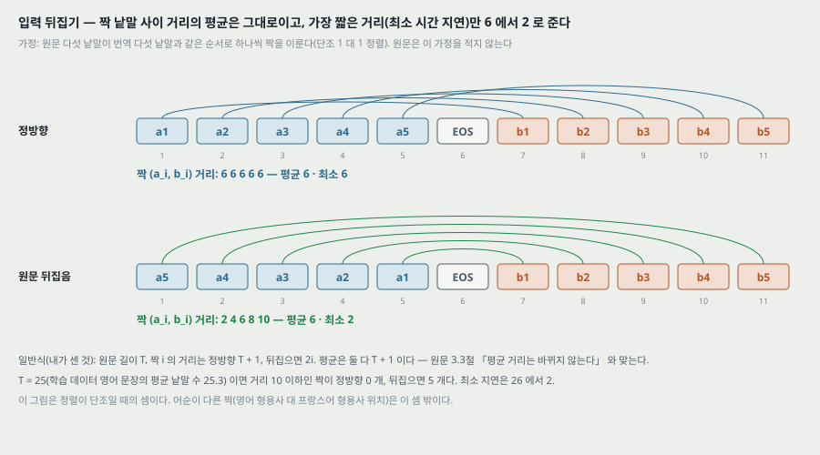

$T = 25$ (학습 데이터 영어 문장의 평균 낱말 수 25.3, 6절) 이면 거리 10 이하인 짝이 정방향 0 개, 뒤집으면 5 개다. **원문 3.3절의 「평균 거리는 바뀌지 않는다」 는 이 가정 아래 정확히 맞는다.** 다만 이 셈은 정렬이 단조인 경우다. 영어와 프랑스어는 형용사 자리 같은 국소 순서 바뀜이 있어, 실제 데이터의 짝 거리 분포는 이 셈과 다르다. 원문은 실제 정렬로 거리를 재지 않았다.

**원문이 잰 것(3.3절).** 원문을 뒤집으니 LSTM 의 시험 혼잡도가 **5.8 에서 4.7** 로, 디코딩한 번역의 시험 BLEU 가 **25.9 에서 30.6** 으로 바뀌었다. 단일 모델의 값이다. 빔 크기는 이 문장에 없다. 표 1 의 단일 모델(빔 12) 값은 26.17 · 30.59 라 **정방향 쪽이 0.27 다르다**(23절).

**원문이 처음에 예상한 것.** 「뒤집으면 번역 앞쪽 예측은 확신이 커지고 뒤쪽은 줄 것」 이라 믿었는데, 「뒤집은 원문으로 배운 LSTM 이 긴 문장에서 훨씬 나았다(did much better, 3.7절 참고)」 — 그래서 「뒤집기가 기억을 더 잘 쓰는 LSTM 을 낳는 것으로 보인다(suggests)」. **3.7절과 그림 3 에는 정방향 모델의 곡선이 없다**(13 · 19절).

---

## 6. 데이터와 어휘 (3.1절)

- **학습 데이터**: WMT'14 영어 -> 프랑스어 가운데 [29] 가 고른 깨끗한 부분 1,200 만 문장. 프랑스어 3 억 4,800 만 낱말, 영어 3 억 400 만 낱말. 문장당 평균 **프랑스어 29.0 · 영어 25.3 낱말**(내가 센 것, 낱말 수 / 문장 수).
- **고른 까닭**: 토큰으로 나눈 학습 · 시험셋과 기준 SMT 의 1,000-best 목록이 공개돼 있어서.
- **어휘**: 원문 쪽 가장 잦은 160,000 낱말, 번역 쪽 80,000 낱말. 나머지는 모두 UNK.
- **시험셋**: 표 1 · 2 의 머리말 「ntst14」(WMT'14 시험셋). **문장 수는 본문에 없다.** 그림 3 의 마지막 점이 길이순 3,003 번째 자리에 놓여 있다(13절에서 잰 자리) — 시험셋 문장 수가 3,003 이라고 읽히는 자리다.
- **검증셋**: **본문 9 쪽에서 검증셋 · 개발셋을 가리키는 말을 찾지 못했다**(valid · held · develop · dev 로 글자 층을 훑었다). 3.3절의 뒤집기 비교는 「시험」 혼잡도 · 「시험」 BLEU 다(21절 여섯).

---

## 7. 학습 목표 · 디코딩 · 다시 매김 (3.2절)

**학습 목표.** 학습셋 $\mathcal{S}$ 의 (번역 $T$, 원문 $S$) 쌍에 대해 정답 번역의 로그 확률을 최대화한다.

$$\frac{1}{\lvert \mathcal{S} \rvert} \sum_{(T, S) \in \mathcal{S}} \log p(T \mid S)$$

**디코딩.** 학습이 끝나면 가장 확률이 높은 번역을 찾는다.

$$\hat{T} = \arg\max_T \, p(T \mid S) \qquad (2)$$

왼쪽에서 오른쪽으로 가는 빔 탐색으로 근사한다. 매 걸음 빔 안의 앞부분 $B$ 개를 어휘의 모든 낱말로 늘리고, 모델의 로그 확률로 위 $B$ 개만 남긴다. EOS 가 붙은 후보는 빔에서 빼 완결 후보 모음에 넣는다. 원문 — 「근사이지만 구현이 쉽다」, 「빔 1 에서도 잘하고 빔 2 가 이득의 대부분을 준다(표 1)」.

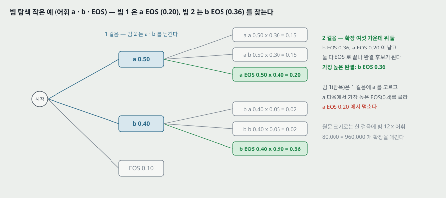

*작은 예(내가 만든 수): 어휘 a · b · EOS. 첫 걸음 확률 a 0.5 · b 0.4 · EOS 0.1. 빔 1 은 a 를 고르고 a 다음에서 가장 높은 EOS(0.4) 로 끝나 0.20. 빔 2 는 a · b 를 남기고, b 다음 EOS 가 0.9 라 b EOS 0.36 을 찾는다.* 원문 크기로는 한 걸음에 빔 12 × 어휘 80,000 = 960,000 개 확장을 매긴다.

**다시 매김.** 기준 SMT 가 낸 1,000-best 목록의 후보마다 LSTM 로그 확률을 계산하고, **SMT 점수와 LSTM 점수의 단순 평균(even average)** 으로 다시 고른다. 두 점수의 척도를 맞추거나 무게를 고른 절차는 적혀 있지 않다.

---

## 8. 학습 설정과 파라미터 (3.4절)

원문의 설정을 그대로 옮긴다. 원문은 「LSTM 모델은 꽤 쉽게 학습된다(fairly easy to train)」 고 적는다.

| 항목 | 값 |
|---|---|
| 층 · 칸 · 낱말 벡터 | 4 층, 층마다 1,000 칸, 낱말 벡터 1,000 |
| 어휘 | 입력 160,000, 출력 80,000. 출력은 80,000 갈래 소프트맥스를 그대로(naive) |
| 시작값 | 모든 파라미터를 $[-0.08, 0.08]$ 균등 분포에서 |
| 최적화 | 모멘텀 없는 SGD, 학습률 0.7 고정. 5 바퀴 뒤부터 반 바퀴마다 반으로. 모두 7.5 바퀴 |
| 배치 | 128 문장, 기울기를 128 로 나눈다 |
| 기울기 자르기 | $s = \lVert g \rVert_2$ ($g$ 는 128 로 나눈 기울기), $s > 5$ 면 $g \leftarrow 5g / s$ |
| 길이 맞춘 배치 | 한 배치의 문장 길이를 비슷하게 맞춰 **속도 2 배**. 원문 — 문장 대부분이 짧고(20 ~ 30 낱말) 일부가 길어(100 넘음) 무작위 배치는 계산을 버린다 |
| 파라미터 | 384M, 그 가운데 64M 이 「순수 되먹임 연결」(인코더 32M, 디코더 32M) |

**책상 확인 하나 — 384M 을 층 · 폭 · 어휘로 다시 센다(내가 센 것).**

- LSTM 한 층: 문 넷(입력 · 잊기 · 출력 문과 새 값) × (입력 1,000 + 되먹임 1,000) × 1,000 + 치우침 4 × 1,000 = **8,004,000**. 첫 층의 입력은 낱말 벡터(1,000), 위층의 입력은 아래층 $h$(1,000) 라 층마다 같다.
- 4 층 = **32,016,000** — 원문의 「인코더 32M, 디코더 32M」 과 같다. 따라서 **원문의 「순수 되먹임 연결 64M」 은 $h \to h$ 무게만이 아니라 입력 -> 문 무게까지 넣은 LSTM 전체**다($h \to h$ 만이면 4 × 1,000 × 1,000 × 4 층 × 2 = 32M).
- 원문 낱말 벡터 160,000 × 1,000 = 160,000,000. 번역 낱말 벡터 80,000 × 1,000 = 80,000,000. 소프트맥스 1,000 × 80,000 + 치우침 80,000 = 80,080,000.
- 합 **384,112,000**. Graves [10] 꼴의 엿보기 연결(peephole, 층마다 3,000)을 넣으면 8 층에 +24,000 이라 384,136,000. 어느 쪽이든 384M 이다.
- **번역 쪽 낱말 벡터와 소프트맥스를 따로 세야 384M 이 된다.** 둘 중 하나를 빼면 304M 이다. 곧 이 모델은 입력 낱말 표와 출력 무게를 나누지 않는다.

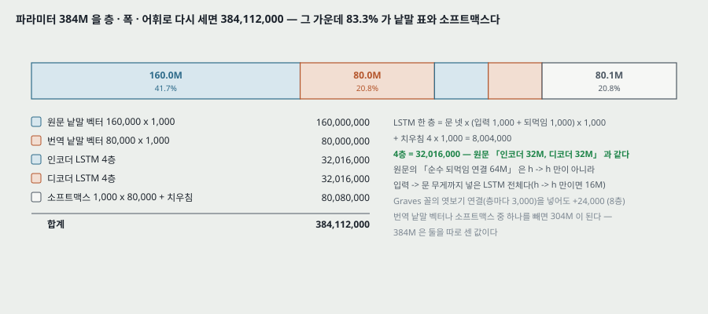

**이 셈이 보여 주는 것.** 384M 가운데 **320M (83.3%) 이 낱말 표 둘과 소프트맥스**이고 LSTM 둘은 64M (16.7%) 이다. 「큰 깊은 LSTM」 의 파라미터 대부분은 어휘 크기에서 온다. 어휘를 160,000 · 80,000 에서 늘리면 LSTM 은 그대로이고 이 표들이 커진다.

**책상 확인 둘 — 학습률 일정의 두 읽기(내가 센 것).** 「5 바퀴 뒤부터 반 바퀴마다 반으로, 모두 7.5 바퀴」 는 첫 반감이 5.0 바퀴인지 5.5 바퀴인지 글로 갈리지 않는다. 5.0 이면 반감 다섯 번으로 마지막 0.7 / 32 = 0.0219, 5.5 면 네 번으로 0.7 / 16 = 0.0438 이다. 갱신 수는 12,000,000 / 128 = 한 바퀴 93,750 번, 7.5 바퀴 703,125 번이고, 처음 468,750 번은 학습률 0.7 이다.

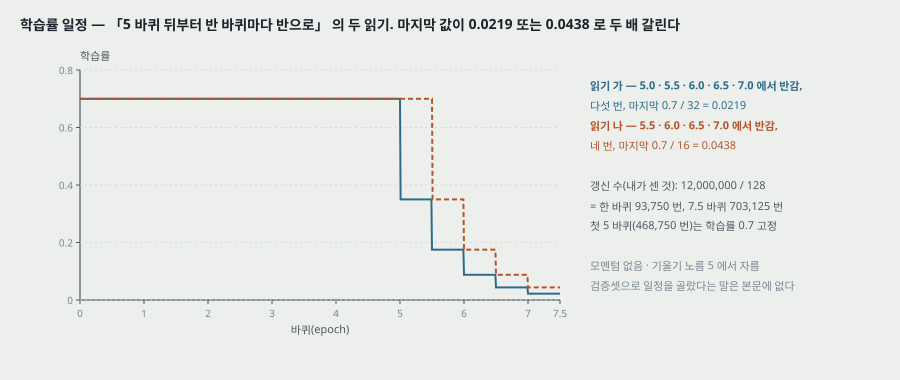

**깊이를 두고 한 말.** 「깊은 LSTM 이 얕은 LSTM 을 크게 앞섰고, 층 하나를 더할 때마다 혼잡도가 거의 10% 줄었다. 아마(possibly) 은닉 상태가 훨씬 커서(much larger hidden state)일 것이다.」 층 수별 혼잡도 표는 없다. 그리고 **층을 더하면 깊이와 $v$ 의 크기(층마다 2,000 개)가 함께 커져**, 원문이 꼽은 두 원인을 이 실험으로 가를 수 없다(21절 다섯).

---

## 9. 병렬화와 학습 시간 (3.5절)

- 위 설정의 깊은 LSTM 을 GPU 한 장에서 C++ 로 돌리면 **초당 1,700 낱말**. 너무 느려 GPU 8 장 기계로 나눴다.
- **LSTM 층마다 GPU 한 장**(넷), 계산이 끝나는 대로 다음 GPU 로 활성값을 넘긴다. **나머지 넷은 소프트맥스를 나눠** 각자 1,000 × 20,000 행렬을 곱한다 — 4 × 20,000 = 80,000 으로 출력 어휘와 맞는다(내가 센 것).
- 배치 128 에서 **초당 6,300 낱말**(영어와 프랑스어를 함께 셈). 학습에 「열흘 남짓(about a ten days)」.

**책상 확인 — 「열흘 남짓」 을 처리 속도로 다시 센다(내가 센 것).** 한 바퀴 낱말 = 3 억 4,800 만 + 3 억 400 만 = 6 억 5,200 만. 7.5 바퀴 = 48 억 9,000 만 낱말. 초당 6,300 낱말이면 776,190 초 = **8.98 일**이다. 원문의 「열흘 남짓」 과 맞는다. 같은 셈으로 GPU 한 장(초당 1,700)이면 33.3 일. 8 장으로 3.71 배, GPU 한 장당 46% 다.

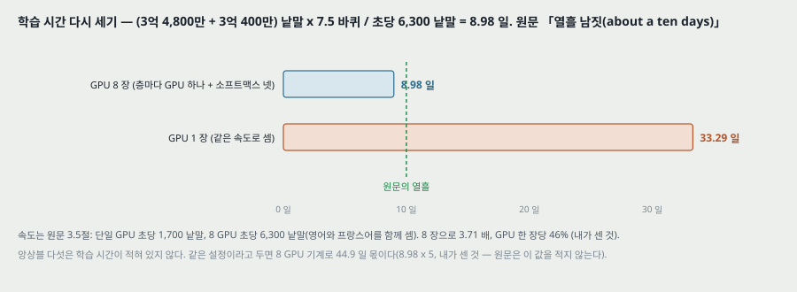

앙상블 다섯의 학습 시간은 적혀 있지 않다. 같은 설정이라고 두면 8 GPU 기계로 44.9 일 몫이다(8.98 × 5, 내가 센 것).

---

## 10. 평가 방식 — BLEU 를 어떻게 셌나 (3.6절)

- **대소문자를 가리는(cased) BLEU** [24], 토큰으로 나눈 예측과 정답에 `multi-bleu.pl` 을 돌렸다.
- 원문 — 이 방식은 [5] · [2] 와 같고, **기준 SMT 의 33.3 을 그대로 재현**한다.
- 그런데 **WMT'14 최고 시스템 [9] 의 공개 예측을 같은 방식으로 세면 37.0** 이고, statmt.org 가 공지한 값은 **35.8** 이다. 같은 번역 출력의 점수가 **셈 방식만으로 1.2 갈린다.**
- 각주 1 — 「BLEU 에는 변형이 여럿이고 변형마다 perl 스크립트가 있다.」

> 이 1.2 는 이 편 안에서 「같은 출력, 다른 셈」 의 차이를 보여 주는 유일한 수다. 이 편의 다른 비교(앙상블 대 기준 1.51, 다시 매김 대 최고 0.5)를 읽을 때 저울로 쓸 수 있다 — **셈 방식을 맞췄다는 것을 확인한 비교인지**를 먼저 본다. 기준 SMT 33.3 과 WMT'14 최고 37.0 은 저자들이 같은 스크립트로 다시 낸 값이라 맞춰진 비교다. Bahdanau 외 28.45 와 Cho 외 34.54 는 원문이 「[5] · [2] 와 같은 방식」 이라 적었을 뿐, 다시 셈했는지는 적지 않는다.

---

## 11. 표 1 — 직접 번역 (3.6절)

원문 표 1 을 옮긴다(시험셋 ntst14).

| 방법 | BLEU |
|---|---:|
| Bahdanau 외 [2] | 28.45 |
| 기준 SMT [29] | 33.30 |
| 단일 · 정방향 LSTM · 빔 12 | 26.17 |
| 단일 · 뒤집은 LSTM · 빔 12 | 30.59 |
| 앙상블 5 · 뒤집음 · 빔 1 | 33.00 |
| 앙상블 2 · 뒤집음 · 빔 12 | 33.27 |
| 앙상블 5 · 뒤집음 · 빔 2 | 34.50 |
| 앙상블 5 · 뒤집음 · 빔 12 | 34.81 |

캡션 — 「앙상블 5 · 빔 2 가 단일 LSTM · 빔 12 보다 싸다.」

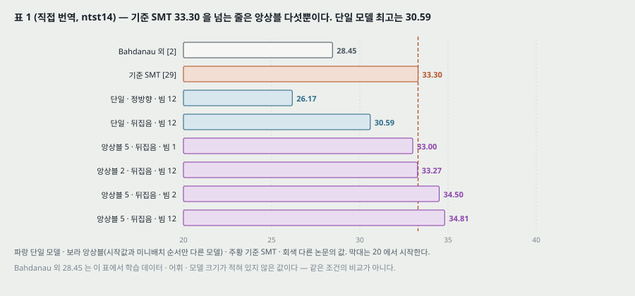

**표를 단계로 가르기(내가 센 것).** 표의 줄들이 한 갈래 길로 이어진다 — 단일 정방향 26.17 -> 뒤집기 30.59 (**+4.42**) -> 앙상블 2 33.27 (+2.68) -> 앙상블 5 34.81 (+1.54). 26.17 에서 34.81 까지 +8.64 가운데 **뒤집기 +4.42, 앙상블 +4.22** 로 둘이 비슷하다. 빔은 앙상블 5 에서만 바꿨다 — 빔 1 33.00 -> 빔 2 34.50 (+1.50) -> 빔 12 34.81 (+0.31). 빔 1 -> 12 의 +1.81 가운데 빔 2 가 82.9% 를 낸다. 원문의 「빔 2 가 이득의 대부분」 은 이 수와 맞는다.

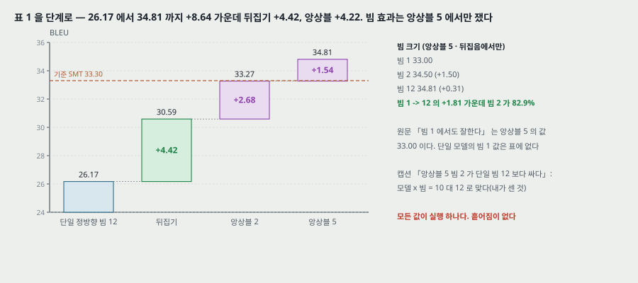

**캡션의 「싸다」 확인.** 걸음마다 모델이 매기는 앞부분 수로 세면 앙상블 5 · 빔 2 는 5 × 2 = 10, 단일 · 빔 12 는 1 × 12 = 12 라 맞다(내가 센 것). 이 단위는 빔에서 위 $B$ 개를 고르는 비용과 앙상블의 확률을 합치는 비용을 넣지 않는다.

**이 표에서 짚는 자리.**

- **기준 SMT 를 넘는 줄은 앙상블 5 · 빔 2 와 앙상블 5 · 빔 12 둘뿐이다.** 앙상블 2 · 빔 12 (33.27) 는 기준에서 0.03 아래, 앙상블 5 · 빔 1 (33.00) 은 0.30 아래다. 단일 모델 최고(30.59)는 기준에서 **2.71 아래**다.
- **원문 Abstract 는 34.8 을 「LSTM 이 낸 번역」 이라 적고, 1절은 「80k 어휘의 LSTM 하나(an LSTM)가 34.81 을 냈다」 고 적는다.** 1절의 다른 문장은 「깊은 LSTM 다섯의 앙상블」 이라 바로 적으므로 원문 안에서 같은 값이 두 이름으로 불린다(22 · 23절).
- **「빔 1 에서도 잘한다」(3.2절)는 앙상블 5 의 33.00 이다.** 단일 모델의 빔 1 값은 표에 없다.
- **Bahdanau 외 28.45 는 다른 논문에서 옮긴 값이다.** 그 시스템의 어휘 · 학습 문장 · 모델 크기는 이 편에 적혀 있지 않다. 같은 조건의 비교가 아니다.

> 2026-11-04 — 28.45 는 Bahdanau 외 표 1 의 RNNsearch-50*(전체 시험셋 열)이다. 조건: 어휘 30,000(두 언어), 단일 모델, 50 낱말 이하 문장으로 학습, Quadro K-6000 한 장에서 252 시간, 개발셋 성능이 멈출 때 끝냄. 빔 크기와 BLEU 스크립트는 그 편에 적혀 있지 않다. 시험셋(3,003 문장) · 기준 수(33.30) · 학습 데이터 크기(348M)는 이 편과 같다.
- **모든 줄이 실행 하나다.** 앙상블 구성원 다섯을 학습했으니 단일 모델의 값도 다섯이 있었을 텐데, 표에는 하나만 있고 어느 구성원인지도 없다(21절 둘).

---

## 12. 표 2 — 다시 매김 (3.6절)

원문 표 2 를 옮긴다(시험셋 ntst14, SMT 와 신경망을 함께 쓴 방법).

| 방법 | BLEU |
|---|---:|
| 기준 SMT [29] | 33.30 |
| Cho 외 [5] | 34.54 |
| WMT'14 최고 결과 [9] | 37.0 |
| 기준 1000-best 를 단일 정방향 LSTM 으로 다시 매김 | 35.61 |
| 기준 1000-best 를 단일 뒤집은 LSTM 으로 다시 매김 | 35.85 |
| 기준 1000-best 를 뒤집은 LSTM 다섯의 앙상블로 다시 매김 | 36.5 |
| 기준 1000-best 의 오라클 다시 매김 | ~45 |

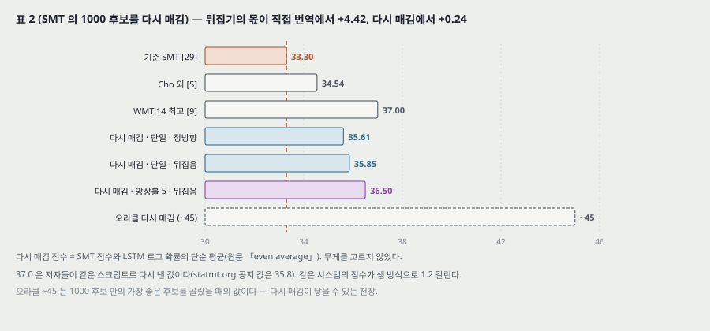

**표를 세어 본 것(내가 센 것).** 기준 대비 다시 매김 이득은 단일 정방향 +2.31, 단일 뒤집음 +2.55, 앙상블 +3.20. 원문 1절의 「기준을 3.2 BLEU 높였다」 와 맞는다. 원문 3.6절의 「WMT'14 최고에서 0.5 BLEU 안」 은 37.0 − 36.5 = 0.5 로 맞는다.

**뒤집기의 몫이 두 표에서 다르다.** 단일 모델에서 정방향 -> 뒤집음 차이가 **직접 번역 +4.42, 다시 매김 +0.24** 다. 다시 매김은 SMT 가 이미 만든 후보 1,000 개 안에서 고르므로, 모델이 스스로 앞부분을 이어 가며 틀림이 쌓이는 직접 번역보다 모델의 약점이 덜 드러나는 것으로 읽힌다 — **이 해석은 내 것이고 원문은 두 차이를 견주지 않는다.**

**짚는 자리.**

- **오라클 ~45 는 다시 매김이 닿을 수 있는 천장**이다. 36.5 는 그 천장에서 8.5 아래다. 원문은 이 값을 표에만 두고 본문에서 말하지 않는다.
- **37.0 은 원문이 같은 스크립트로 다시 센 값**이다(10절). 공지 값(35.8)으로는 다시 매김 앙상블(36.5)이 위에 있다 — 원문은 이 방향의 비교를 하지 않았고, 셈 방식을 맞춘 37.0 쪽을 쓴 것이 맞는 선택이다.
- **Cho 외 34.54 는 원문 1절의 말로 「구 기반 시스템이 낸 가설을 다시 매기는 데에만 쓰인」 모델**이라 이 표의 다시 매김과 같은 종류지만, 그 시스템의 SMT 기준이 이 편의 기준 SMT 와 같은지는 적혀 있지 않다.
- 평균 무게 0.5 하나만 썼다. 무게를 바꿨을 때 36.5 가 얼마나 움직이는지 없다.

---

## 13. 그림 3 — 긴 문장 · 드문 낱말 (3.7절)

원문 3.7절 — 「LSTM 이 긴 문장을 잘한다는 것을 발견하고 놀랐다. 그림 3 이 이를 수로 보인다.」 캡션 — 「35 낱말보다 짧은 문장에서는 성능이 떨어지지 않고(no degradation), 가장 긴 문장에서 조금(minor) 떨어진다.」

**그림 3 을 읽은 방법.** 원문 7 쪽의 그림 3 은 벡터로 들어 있다. 곡선 넷(두 칸 × LSTM · 기준)의 꼭짓점과 축 눈금 자리를 PDF 좌표로 꺼냈다. **파란 곡선이 LSTM(범례 「LSTM (34.8)」 = 앙상블 5 · 빔 12), 빨간 곡선이 기준 SMT** 다. y 눈금은 두 칸 모두 20 이 540.161 pt, 40 이 401.470 pt 라 5 BLEU 마다 34.673 pt 다.

**x 축이 무엇인지.** 오른쪽 칸 x 눈금(0 ~ 3,500)으로 점 자리를 읽으면 **10 · 100 · 200 · 500 · 1,000 · 1,500 · 2,000 · 2,500 · 3,003** 번째 문장이다. **왼쪽 칸 점의 x 자리가 오른쪽 칸 점의 x 자리와 소수 둘째 자리까지 같다.** 곧 두 칸 모두 길이순(또는 빈도순)으로 놓은 문장의 같은 순번 자리에 점을 찍었고, 왼쪽 칸의 눈금 글자(4 · 7 · 8 · 12 · 17 · 22 · 28 · 35 · 79)는 그 순번 자리 문장의 낱말 수다. 마지막 점의 값이 전체 BLEU(34.81 · 33.30)와 다르므로 **처음부터 그 자리까지 모은 값이 아니라 칸마다 따로 센 값**으로 읽힌다. **칸을 어떻게 나눴는지(칸마다 문장 몇 개인지)는 원문에 없다** — 순번 자리로 보면 칸 크기가 90 · 100 · 300 · 500 · 500 · 500 · 500 · 503 으로 고르지 않다.

**왼쪽 칸 — 문장 길이(내가 읽은 것).**

| 자리 문장의 낱말 수 | 7 | 8 | 12 | 17 | 22 | 28 | 35 | 79 |
|---|---:|---:|---:|---:|---:|---:|---:|---:|
| LSTM 앙상블 | 31.18 | 23.87 | 33.79 | 33.21 | 34.70 | 35.76 | 36.41 | 34.25 |
| 기준 SMT | 27.71 | 23.43 | 31.12 | 31.20 | 33.22 | 33.94 | 33.55 | 34.11 |
| 차 | +3.47 | +0.44 | +2.67 | +2.01 | +1.48 | +1.82 | +2.86 | +0.14 |

첫 점(길이 4 자리)은 두 곡선 모두 축 아래(20 밑)로 나가 원문에서 보이지 않는다. 그림 안에 잘려 남은 선분을 같은 직선으로 늘리면 LSTM 0.1 · 기준 0.0 이다.

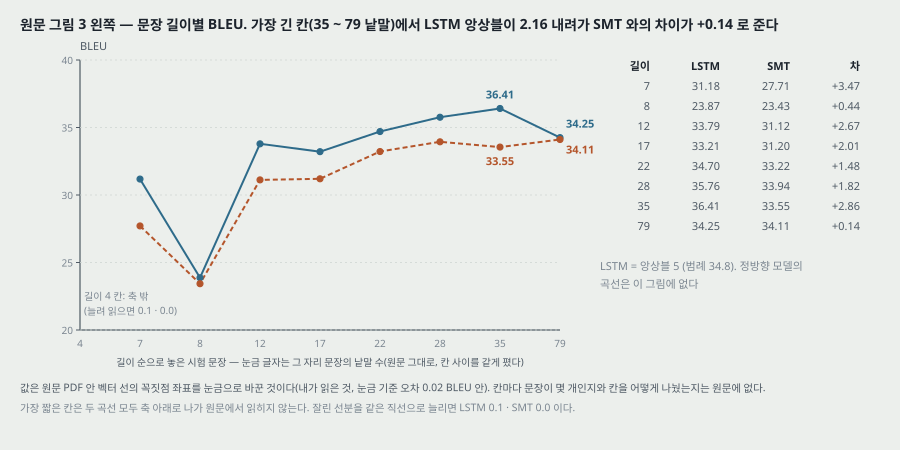

**오른쪽 칸 — 낱말 빈도 순위의 평균(내가 읽은 것).** 오른쪽일수록 드문 낱말이 많은 문장이다.

| 순번 자리 | 10 | 100 | 200 | 500 | 1,000 | 1,500 | 2,000 | 2,500 | 3,003 |
|---|---:|---:|---:|---:|---:|---:|---:|---:|---:|
| LSTM 앙상블 | 23.76 | 40.41 | 39.14 | 38.60 | 36.91 | 36.38 | 35.06 | 32.51 | 28.82 |
| 기준 SMT | 26.16 | 36.94 | 35.27 | 34.72 | 33.87 | 33.81 | 34.23 | 32.24 | 30.10 |
| 차 | −2.40 | +3.47 | +3.87 | +3.88 | +3.04 | +2.57 | +0.83 | +0.27 | −1.28 |

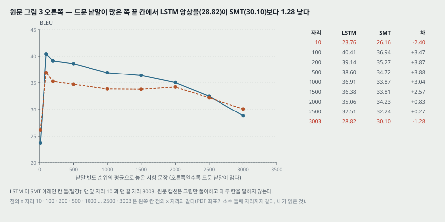

**캡션과 읽은 값을 나란히 놓는다.**

- 「35 낱말보다 짧은 문장에서는 떨어지지 않는다」 — 길이 12 자리부터 35 자리까지 LSTM 이 33.21 에서 36.41 사이이고 오르는 쪽이다. **맞는다.** 다만 길이 8 자리 칸은 23.87 로 두 곡선 모두 7 · 12 자리보다 낮다(원문은 이 칸을 말하지 않는다).
- 「가장 긴 문장에서 조금(minor) 떨어진다」 — 35 자리 36.41 -> 79 자리 34.25 로 **2.16 BLEU** 내려간다. 같은 칸에서 기준 SMT 는 33.55 -> 34.11 로 0.56 오른다. 그래서 **LSTM 과 기준의 차이가 +2.86 에서 +0.14 로 준다.** 「조금」 은 2.16 BLEU 이고, 가장 긴 칸에서 LSTM 이 기준 SMT 를 앞선 몫은 0.14 다 — 흩어짐이 없어 이 0.14 를 앞섰다고 읽을 근거도 없다.
- 오른쪽 칸 — **드문 낱말이 가장 많은 칸(3,003 자리)에서 LSTM 이 기준 SMT 보다 1.28 낮고, 가장 잦은 낱말 칸(10 자리)에서도 2.40 낮다.** 원문 캡션은 그림이 무엇인지만 적고 이 두 칸을 말하지 않는다. 드문 낱말 쪽의 역전은 출력 어휘 80,000 밖의 낱말을 UNK 로밖에 낼 수 없는 한계(원문이 스스로 적은 것)와 같은 방향이다.

**이 그림이 보이지 않는 것.** 원문 3.3절은 「뒤집은 원문으로 배운 LSTM 이 정방향보다 긴 문장에서 훨씬 낫다(3.7절 참고)」 고 적지만, **그림 3 에는 앙상블과 기준 SMT 곡선만 있고 정방향 모델의 곡선이 없다.** 이 주장의 수는 이 편 어디에도 없다.

---

## 14. 표 3 — 긴 문장 번역 예 (3.7절)

긴 문장 셋의 모델 번역과 정답을 나란히 놓았다. 캡션 — 「번역이 말이 되는지는 Google 번역으로 확인할 수 있다.」

- **고른 기준이 없다.** 시험셋에서 어떻게 셋을 골랐는지 적혀 있지 않다.
- **두 문장에서 사람 이름이 UNK 로 나온다**(Hackenberg -> 「Ulrich UNK」, Rosenker -> 「dit UNK」). 출력 어휘 밖 낱말의 예가 이 표에 그대로 들어 있다.
- 셋째 문장은 정답과 구 순서가 다르지만(「Avec la crémation, il y a ...」 대 「Il y a, avec la crémation, ...」) 뜻이 같은 바꿔 쓰기다. BLEU 는 이런 바꿔 쓰기에 점수를 덜 준다.

이 표는 정성 예시다. 수가 없어 실험 분석 표(18절)에서는 「주장 세기」 칸만 채운다.

---

## 15. 그림 2 — 문장 표현 (3.8절)

원문 — 「이 모델의 매력 하나는 낱말 열을 고정 차원 벡터로 바꾸는 것이다.」 그림 2 는 구 여섯씩 두 묶음을 LSTM 에 넣고 얻은 은닉 상태를 **주성분 분석(PCA)으로 2 차원에 던진** 그림이다. 캡션 — 「구들이 뜻으로 모이고, 이 예에서 뜻은 주로 낱말 순서의 함수라 낱말 주머니 모델로는 잡기 어렵다. 두 묶음의 안쪽 구조가 비슷하다.」 3.8절 — 「표현이 낱말 순서에 민감하고 능동 · 수동 바꿈에는 꽤(fairly) 둔하다는 것을 분명히(clearly) 보인다.」

**그림 2 를 읽은 방법.** 점 열둘이 벡터로 들어 있어 가운데 좌표를 꺼내 축 눈금으로 바꿨다(내가 읽은 것).

| 칸 | 구 | 묶음(누가 누구에게) | PC1 | PC2 |
|---|---|---|---:|---:|
| 왼쪽 | John respects Mary | John -> Mary | −6.41 | −4.88 |
| 왼쪽 | John admires Mary | John -> Mary | −7.10 | −0.74 |
| 왼쪽 | John is in love with Mary | John -> Mary | −6.00 | −2.00 |
| 왼쪽 | Mary respects John | Mary -> John | 4.52 | −0.21 |
| 왼쪽 | Mary admires John | Mary -> John | 0.61 | 2.97 |
| 왼쪽 | Mary is in love with John | Mary -> John | 2.13 | 1.96 |
| 오른쪽 | I gave her a card in the garden | 나 -> 그녀 | 4.61 | −15.83 |
| 오른쪽 | In the garden , I gave her a card | 나 -> 그녀 | −12.61 | −7.74 |
| 오른쪽 | She was given a card by me in the garden | 나 -> 그녀 | −3.83 | −5.19 |
| 오른쪽 | She gave me a card in the garden | 그녀 -> 나 | 2.18 | 8.15 |
| 오른쪽 | In the garden , she gave me a card | 그녀 -> 나 | −4.83 | 9.96 |
| 오른쪽 | I was given a card by her in the garden | 그녀 -> 나 | −2.00 | 14.01 |

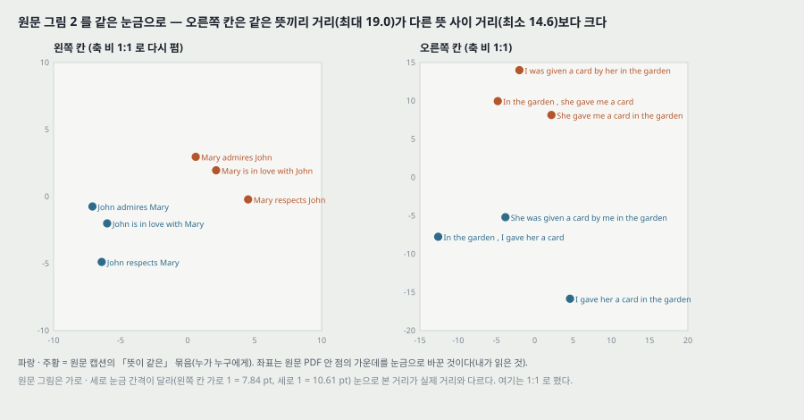

**읽은 값으로 본 것(내가 센 것).**

- **왼쪽 칸은 묶음이 깨끗이 갈린다.** 같은 뜻끼리 거리의 최대가 5.04, 다른 뜻 사이 거리의 최소가 8.27 이다. PC1 하나로도 갈린다(John -> Mary 는 −7.10 ~ −6.00, Mary -> John 은 0.61 ~ 4.52).
- **오른쪽 칸은 PC2 하나로는 갈리지만(−5.19 와 8.15 사이에 틈), 2 차원 거리로는 같은 뜻끼리 거리의 최대(19.02, 「I gave her ...」 와 「In the garden , I gave her ...」)가 다른 뜻 사이 거리의 최소(14.63)보다 크다.** 원문의 「뜻으로 모인다」 는 축 하나를 따라 갈린다는 뜻으로는 맞고, 「같은 뜻이 서로 가깝다」 는 뜻으로는 이 칸에서 맞지 않는다. 오른쪽 칸에서 같은 뜻끼리 가장 먼 두 구는 능동 · 수동 쌍이 아니라 **「in the garden」 의 자리만 바뀐 쌍**이다.
- **원문 그림은 가로 · 세로 눈금 간격이 다르다**(왼쪽 칸 가로 1 = 7.84 pt, 세로 1 = 10.61 pt. 오른쪽 칸 가로 1 = 4.03 pt, 세로 1 = 3.18 pt). 눈으로 본 거리는 실제 거리와 다르다. 위 그림은 1:1 로 다시 폈다.

**그림 2 가 적지 않은 것.** 8,000 개 수 가운데 어느 상태를 썼는지(마지막 층 $h$ 인지 전부인지), 주성분 분석을 이 여섯 구에만 맞췄는지 더 많은 문장에 맞췄는지, 두 주성분이 분산을 얼마나 설명하는지가 없다. **구 열둘은 손으로 고른 예**이고, 같은 성질을 시험셋 규모로 잰 수는 없다.

---

## 16. 관련 연구 (4절)

- **n-best 다시 매김.** RNN 언어 모델 [23] · 앞먹임 신경 언어 모델 [3] 을 기계 번역에 쓰는 가장 단순하고 효과적인 길이 강한 기준의 n-best 를 다시 매기는 것이고 [22], 꾸준히 번역 질을 올린다.
- **원문 정보를 언어 모델에 넣기.** Auli 외 [1] 는 입력 문장의 주제 모델을, Devlin 외 [8] 는 디코더의 정렬 정보로 입력 문장의 쓸모 있는 낱말을 넣었다(「큰 이득」).
- **가장 가까운 편.** Kalchbrenner · Blunsom [18] 이 **처음으로 입력 문장을 벡터로, 다시 문장으로** 옮겼다. 다만 합성곱으로 벡터를 만들어 낱말 순서를 잃는다(원문의 말). Cho 외 [5] 는 LSTM 비슷한 RNN 으로 문장을 벡터로 옮겼다가 되돌리지만 SMT 안에 넣는 데 무게를 뒀다.
- **긴 문장 문제를 다른 길로.** Bahdanau 외 [2] 는 Cho 외 [5] 가 겪은 긴 문장의 낮은 성능을 **주의(attention) 메커니즘**으로 넘으려 했고, Pouget-Abadie 외 [26] 는 원문을 조각내 번역했다. 원문 — 「원문을 뒤집어 학습시키기만 해도 비슷한 개선을 얻을 수 있으리라 짐작한다(suspect).」 **이 짐작도 재지 않았다.**
- **끝에서 끝까지 학습.** Hermann 외 [12] 는 입력과 출력을 앞먹임 망으로 같은 공간에 놓지만 번역을 바로 만들지 못하고 미리 계산한 문장 모음에서 가장 가까운 벡터를 찾는다.

---

## 17. 결론 (5절)

원문의 결론을 줄여 옮긴다.

1. 「어휘가 제한되고 문제 구조에 대한 가정이 거의 없는(almost no assumption) 큰 깊은 LSTM 이, 어휘가 무제한인 표준 SMT 를 큰 규모 번역 과제에서 앞설 수 있다.」 다른 열 학습 문제에서도 「학습 데이터가 넉넉하다면(provided they have enough training data)」 잘할 것이다.
2. 원문을 뒤집어 얻은 개선의 크기에 놀랐다. **짧은 의존이 가장 많은 부호화를 찾는 것이 중요하다고 결론짓는다.** 정방향 번역 문제에서는 보통 RNN 을 학습시킬 수 없었는데, 뒤집으면 보통 RNN 도 쉽게 학습될 것이라 믿는다(**실험으로 확인하지 않았다** — 원문의 괄호).
3. 아주 긴 문장을 맞게 번역하는 능력에 놀랐다. 처음에는 기억이 제한돼 긴 문장에서 실패할 것이라 확신했고, 비슷한 모델로 다른 연구자들이 긴 문장에서 낮은 성능을 보고했다 [5, 2, 26].
4. 단순하고 덜 다듬은 방법이 SMT 를 앞설 수 있음을 보였으니, 더 다듬으면 번역 정확도가 더 오를 것이다.

> 결론 2 의 「보통 RNN 을 정방향에서 학습시킬 수 없었다」 는 수 없이 한 문장으로 적혀 있다. 몇 번, 어떤 설정으로 시도했는지 없다. 이 편이 「LSTM 이 필요했다」 를 보인 유일한 자리인데 근거가 이 한 문장이다.

---

## 18. 실험 분석 (논문의 표 · 그림마다)

**직접 돌리지 않는다.** 논문이 낸 실험을 표 · 그림 하나씩 같은 틀로 읽는다. 책상에서 센 값은 「내가 센 것」 으로 밝힌다.

| 표 · 그림 | 무엇을 바꿨나 (변인) | 무엇을 고정했나 | 결과 | 반복 수 · 흩어짐 | 주장이 결과보다 센가 |
|---|---|---|---|---|---|
| **3.3절 뒤집기** | 원문 순서: 정방향 · 뒤집음 | 단일 모델, 그 밖의 설정은 3.4절과 같다고 읽힌다(명시 없음). 빔 크기 적혀 있지 않음 | 시험 혼잡도 5.8 -> 4.7, 시험 BLEU 25.9 -> 30.6 | 실행 하나씩. 흩어짐 없음. **시험셋으로 잼**(검증셋 언급 없음) | 수 자체는 크다(+4.7 BLEU). 그러나 **Abstract · 1절이 「짧은 의존을 들여왔기 때문에」 를 원인으로 적는다** — 3.3절은 같은 것을 「믿는다」 로 적는다. 원인은 재지 않았다. **센 편** |
| **3.4절 깊이** | 층 수 | 적혀 있지 않음 | 「층 하나마다 혼잡도가 거의 10% 줄었다」 | 표 없음. 몇 층까지 재었는지 없음 | 「크게 앞섰다」 의 근거가 이 한 문장. 깊이와 $v$ 크기가 함께 바뀌어 원문이 든 원인(「상태가 커서」)을 가를 수 없다. **센 편** |
| **3.4절 길이 맞춘 배치** | 배치 구성: 무작위 · 길이 맞춤 | 그 밖의 학습 | 속도 2 배 | 한 줄. 측정 조건 없음 | 속도 주장만 하고 결과(BLEU)가 같은지 말하지 않는다. 주장과 결과가 같은 세기 |
| **3.5절 병렬화** | GPU 1 장 · 8 장 | 모델 · 배치 128 | 초당 1,700 · 6,300 낱말, 열흘 남짓 | 한 줄 | 내가 센 8.98 일과 맞는다. 맞는 세기 |
| **표 1** | 정방향 · 뒤집음, 단일 · 앙상블 2 · 5, 빔 1 · 2 · 12 | 데이터 · 어휘 · 모델 설정 · 시험셋 · BLEU 셈 | 26.17 · 30.59 · 33.00 · 33.27 · 34.50 · 34.81. 기준 33.30 | **줄마다 실행 하나.** 단일 모델 값이 다섯 중 어느 것인지 없음. 흩어짐 없음 | **Abstract 의 「the LSTM ... 34.8」 은 앙상블 5.** 단일 모델은 기준 아래 2.71. 바꾼 변인이 한 번에 하나씩이 아니다(빔은 앙상블 5 에서만). Bahdanau 외 28.45 는 조건이 다른 옮긴 값. **센 편** |
| **표 2** | 다시 매기는 모델: 단일 정방향 · 단일 뒤집음 · 앙상블 5 | 기준 SMT 의 1000-best, 평균 무게 0.5 | 35.61 · 35.85 · 36.5, 최고 37.0, 오라클 ~45 | 실행 하나씩. 무게를 바꾼 값 없음 | 「최고에서 0.5 안」 은 맞다. 37.0 을 같은 스크립트로 다시 센 것이 이 비교를 맞춘다. **맞는 세기** |
| **그림 3 왼쪽** | 문장 길이 칸 | 앙상블 5 · 빔 12 와 기준 SMT 의 같은 출력 | 내가 읽은 값: 길이 35 자리 36.41 -> 79 자리 34.25 (−2.16). 기준과의 차 +2.86 -> +0.14 | 칸마다 문장 수 없음, 신뢰 구간 없음 | 캡션의 「조금 떨어진다」 는 2.16 BLEU. **3.3절이 이 그림을 「뒤집은 모델이 정방향보다 긴 문장에서 훨씬 낫다」 의 근거로 가리키지만 정방향 곡선이 없다.** Abstract 의 「긴 문장에서 어려움이 없었다」 는 가장 긴 칸에서 기준과 0.14 차. **센 편** |
| **그림 3 오른쪽** | 낱말 빈도 순위 칸 | 위와 같음 | 내가 읽은 값: 가장 드문 칸 LSTM 28.82 대 기준 30.10 (−1.28), 가장 잦은 칸 −2.40 | 위와 같음 | 원문이 이 그림에서 주장하지 않는다. 두 끝 칸의 역전을 말하지 않은 것이 빈칸 |
| **표 3** | (없음 — 예시) | — | 긴 문장 셋의 번역. 사람 이름 둘이 UNK | 고른 기준 없음 | 「말이 되는 번역」 은 독자에게 Google 번역으로 확인하라고 넘긴다. 정성 예시라 일반화 근거가 아니다 |
| **그림 2** | 구의 낱말 순서 · 능동/수동 · 부사구 자리 | 학습된 모델 하나, PCA 2 차원 | 내가 읽은 값: 왼쪽 칸 같은 뜻 최대 5.04 < 다른 뜻 최소 8.27. 오른쪽 칸 19.02 > 14.63 | 구 열둘을 손으로 고름. 분산 설명 비율 없음 | 「분명히 보인다(clearly shows)」 는 열둘에 대한 말이다. 오른쪽 칸은 축 하나로만 갈린다. **센 편** |

**비교 상대가 같은 조건인가.** 기준 SMT 33.30 과 WMT'14 최고 37.0 은 저자들이 같은 스크립트로 셈했다(10절). Bahdanau 외 28.45 와 Cho 외 34.54 는 원문이 「[2] · [5] 와 같은 방식」 이라고 적었을 뿐 학습 데이터 · 어휘 · 모델 크기가 이 편에 없다. **같은 조건에서 돌린 비교는 이 편 자신의 모델끼리(정방향 대 뒤집음, 단일 대 앙상블, 빔 크기)와 같은 SMT 출력에 대한 비교(기준 SMT, 다시 매김)뿐이다.**

---

## 19. 입력 뒤집기를 두고 한 말의 세기

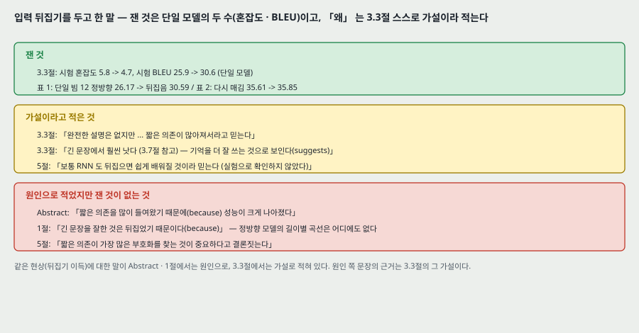

같은 현상에 대한 원문 문장을 세기별로 모은다.

| 세기 | 자리 | 원문 |
|---|---|---|
| **잰 것** | 3.3절 | 시험 혼잡도 5.8 -> 4.7, 시험 BLEU 25.9 -> 30.6 |
| **잰 것** | 표 1 · 표 2 | 단일 빔 12: 26.17 -> 30.59. 다시 매김: 35.61 -> 35.85 |
| **가설이라 적은 것** | 3.3절 | 「이 현상의 완전한 설명은 없지만, 데이터에 짧은 의존이 많이 들어와서라고 믿는다(we believe)」 |
| **가설이라 적은 것** | 3.3절 | 「긴 문장에서 훨씬 나았다(3.7절 참고) — 기억을 더 잘 쓰는 것으로 보인다(suggests)」 |
| **가설이라 적은 것** | 5절 | 「보통 RNN 도 뒤집으면 쉽게 학습될 것이라 믿는다(실험으로 확인하지 않았다)」 |
| **가설이라 적은 것** | 4절 | 「Pouget-Abadie 외도 뒤집기만으로 비슷한 개선을 얻으리라 짐작한다(suspect)」 |
| **원인으로 적은 것** | Abstract | 「원문 낱말 순서를 뒤집으니 성능이 크게 나아졌다. 그렇게 하면 짧은 의존이 많이 생겨 최적화가 쉬워지기 때문이다(because)」 |
| **원인으로 적은 것** | 1절 | 「긴 문장을 잘할 수 있었던 것은 원문을 뒤집었기 때문이다(because)」. 「원문 뒤집기는 이 일의 핵심 기술 기여 가운데 하나다」 |
| **원인으로 적은 것** | 5절 | 「짧은 의존이 가장 많은 부호화를 찾는 것이 중요하다고 결론짓는다(we conclude)」 |

**판정.** 뒤집기가 단일 모델의 BLEU 를 4.4 ~ 4.7 올린다는 것은 측정이다(실행 하나씩). **「짧은 의존이 많아져서」 는 3.3절이 스스로 가설로 적었고, 그 가설을 시험하는 실험(예: 짧은 의존을 늘리되 뒤집지 않는 다른 순서, 또는 짝 거리 분포를 바꾼 데이터)이 이 편에 없다.** 1절의 「긴 문장을 잘한 것은 뒤집어서다」 는 정방향 모델의 길이별 곡선이 없어 측정이 받치지 않는다. 5절의 일반화(「부호화를 찾는 것이 중요하다」)는 번역 한 쌍(영 -> 불)의 단일 실행 비교에서 나왔다.

내 확인(5절)으로 보탤 수 있는 것은 하나다 — **원문의 「평균 거리는 그대로, 최소 지연만 준다」 는 단조 정렬 가정에서 산수로 맞다.** 이것은 가설의 전제가 맞다는 것이지 가설(그래서 학습이 쉬워진다)이 맞다는 것이 아니다.

---

## 20. 이 논문이 스스로 적은 한계와 조건

1. **어휘가 제한된다.** 출력 80,000 낱말 밖은 UNK 이고, 정답에 그런 낱말이 있으면 BLEU 가 깎인다. 원문은 이를 「어휘 밖 낱말을 다루지 못하는데도」 로 적는다(1 · 3.6 · 5절).
2. **디코더가 근사다.** 빔 탐색은 식 (2) 의 arg max 를 보장하지 않는다(3.2절).
3. **뒤집기의 완전한 설명이 없다**(3.3절).
4. **LSTM 도 기울기가 터질 수 있다** — 그래서 노름 5 에서 자른다(3.4절).
5. **앙상블의 직접 번역이 WMT'14 최고 시스템을 넘지 못한다**(3.6절).
6. **보통 RNN 이 뒤집은 문제에서 학습되는지 확인하지 않았다**(5절).
7. **덜 다듬은(relatively unoptimized) 방법이다**, 그리고 다른 문제로 옮기는 데 「학습 데이터가 넉넉하다면」 이라는 조건을 단다(1 · 5절).

---

## 21. 논문이 적지 않은 것 — 내가 읽으며 짚은 자리

**하나. 기준 SMT 를 넘은 것은 앙상블 다섯이다.** Abstract 와 1절이 34.8 을 「the LSTM」 · 「an LSTM」 으로 부른다. 단일 모델 최고는 30.59 로 기준 33.30 아래 2.71 이다. 원문 3.6절의 「순수 신경 번역 시스템이 처음으로 구 기반 SMT 기준을 상당한 차이로 앞섰다」 는 앙상블 다섯 · 빔 12 (또는 빔 2) 의 값에 대한 말이고, 그 차이는 1.51 (빔 2 면 1.20) 이다.

**둘. 흩어짐이 없다.** 앙상블 구성원 다섯을 학습했으므로 단일 모델 값이 다섯 있었을 텐데, 표 1 · 2 의 「단일」 줄은 하나씩이고 어느 구성원인지 없다. 같은 번역 출력이 셈 방식만으로 1.2 BLEU 갈린다는 것을 원문이 스스로 보였는데(10절), 시작값만 바꿨을 때 BLEU 가 얼마나 움직이는지는 없다. 그래서 그림 3 의 칸별 차이(+0.14 · +0.27 · +0.44)를 「앞섰다」 고 읽을 근거가 이 편에 없다.

**셋. 「긴 문장에서 어려움이 없었다」 의 범위.** 그림 3 왼쪽을 읽으면 가장 긴 칸에서 LSTM 앙상블이 2.16 내려가고 기준과의 차가 +0.14 다(13절). 칸 크기와 문장 수가 없다. 그리고 이 그림은 **앙상블 5** 이고 **정방향 곡선이 없다.** 「단일 모델이 긴 문장에서 어떤가」 와 「뒤집기가 긴 문장을 고쳤는가」 둘 다 이 편의 수로 답이 안 나온다.

**넷. 드문 낱말 쪽 끝 칸에서 기준 SMT 보다 낮다.** 그림 3 오른쪽 맨 끝 칸 −1.28, 맨 앞 칸 −2.40 (13절). 원문은 그림을 풀이만 하고 이 역전을 말하지 않는다.

**다섯. 깊이와 상태 크기가 묶여 있다.** 「층마다 혼잡도 거의 10%」 와 「아마 상태가 훨씬 커서」 가 같은 문장에 있는데, 층을 더하면 상태도 함께 커져 둘을 가르는 실험(층 수를 고정하고 폭을 늘리기)이 없다. 층 수별 표도 없다.

**여섯. 검증셋이 보이지 않는다.** 글자 층에서 valid · held · develop · dev 를 훑어 찾지 못했다. 뒤집기 비교(3.3절)는 「시험」 혼잡도 · 「시험」 BLEU 이고, 학습률 일정 · 빔 크기 · 앙상블 수를 무엇으로 골랐는지 적혀 있지 않다. **시험셋으로 고른 것인지 다른 자료로 고른 것인지 이 편으로는 가를 수 없다.**

**일곱. 그림 2 는 열둘의 예다.** 어느 상태를 썼는지, PCA 를 무엇에 맞췄는지, 설명 분산이 없다. 오른쪽 칸은 2 차원 거리로 같은 뜻끼리가 다른 뜻 사이보다 먼 쌍이 있다(15절).

**여덟. Bahdanau 외 28.45 가 같은 표에 있다.** 조건이 적혀 있지 않은 다른 논문의 값을 같은 표에 놓았다. 이 편의 단일 뒤집은 모델(30.59)과의 2.14 차가 모델 차인지 학습 조건 차인지 이 표로는 모른다.

**아홉. 다시 매김의 평균 무게를 고르지 않았다.** SMT 점수와 LSTM 로그 확률은 척도가 다른 수다. 0.5 하나로만 셈했고, 무게를 바꿨을 때의 값이 없다.

**열. 1절의 「역전파가 찾을 것이다」 는 단정이다.** 「좋은 파라미터가 존재하면 지도 역전파가 찾아 문제를 푼다」 는 이 편 안에서 재지 않았고, 5절의 「보통 RNN 은 정방향에서 학습시킬 수 없었다」 와 맞서는 말이다.

---

## 22. 읽을 때 헷갈리는 지점

**「the LSTM」 과 앙상블.** Abstract 의 34.8 · 1절의 「an LSTM ... 34.81」 은 앙상블 5 · 빔 12 다. 그림 3 의 범례 「LSTM (34.8)」 도 같은 것이다.

**34.8 과 34.81, 36.5 와 36.50.** Abstract 와 그림은 소수 첫째 자리, 표 1 은 둘째 자리. 표 2 의 36.5 · 37.0 은 첫째 자리까지만 있다.

**「순수 되먹임 연결 64M」.** $h \to h$ 무게만이 아니라 LSTM 두 묶음의 무게 전체다(8절의 셈). $h \to h$ 만이면 32M 이다.

**$v$ 는 「마지막 은닉 상태」 인가 8,000 개인가.** 2절은 「LSTM 의 마지막 은닉 상태」, 3.4절은 「8,000 개의 실수」. 4 층 × ($h$ + $c$) 로 읽어야 둘이 맞는다(4절, 내 해석).

**식 (1) 의 「LSTM 하나」 와 실제 모델의 「LSTM 둘」.** 2절의 기본 그림과 식은 LSTM 하나로 적혀 있고, 실제 모델은 인코더 · 디코더가 따로다.

**그림 1 의 입력 순서.** 캡션은 거꾸로 읽는다고 적고 그림은 A · B · C 순서다. 「ABC」 를 이미 뒤집은 원문으로 읽거나, 그림이 기본 모델이라고 읽어야 캡션과 맞는다.

**「시험」 이라는 말.** 3.3절의 혼잡도와 BLEU 는 시험셋 값이다. 학습 중 고른 값이 아니다.

**두 BLEU 표.** 표 1 은 직접 번역, 표 2 는 SMT 후보의 다시 매김이다. 표 2 의 36.5 를 표 1 의 34.81 과 견주어 「LSTM 이 36.5 를 낸다」 고 읽으면 안 된다.

**Bahdanau 외의 자리.** 이 편보다 먼저 arXiv 에 나온 편이라 이 편 2 · 4절과 표 1 에 이미 들어 있다. 로드맵에서 이 편 「다음」 인 것은 읽는 순서다.

---

## 23. 원문 안의 어긋남 모음

| 자리 | 원문 | 바른 것 또는 짚을 것 |
|---|---|---|
| 3.3절 대 표 1 | 정방향 단일 모델 BLEU 「25.9」 | 표 1 은 26.17. 뒤집은 쪽 30.6 은 표 1 의 30.59 와 맞는다. 빔 크기가 다른 실행인지 적혀 있지 않다 |
| 그림 1 대 캡션 | 캡션 「LSTM 이 입력 문장을 거꾸로 읽는다」 | 그림의 입력은 A · B · C 순서다 |
| 2절 대 3.4절 | $v$ = 「LSTM 의 마지막 은닉 상태」 | 3.4절은 8,000 개. 마지막 층 $h$ 하나면 1,000 개다 |
| 3.3절 | 「긴 문장에서 훨씬 낫다(3.7절 참고)」 | 3.7절 · 그림 3 에 정방향 곡선이 없다 |
| 1절 | 「34.81 은 80k 어휘의 LSTM 하나(an LSTM)가 냈다」 | 같은 문단 앞 문장이 「깊은 LSTM 다섯의 앙상블」 이라 적는다 |
| 1절 | 「구 기반 SMT 를 앞선다」 의 주어 「상대적으로 덜 다듬은 작은 어휘의 신경망 구조」 | 앞선 것은 그 구조로 학습한 모델 다섯의 앙상블이다 |
| 3절 첫 문단 | 「we it to rescore」 | we used it to rescore |
| 2절 | 「increases the number model parameters」 | the number of model parameters |
| 3.4절 | 「divided it the size of the batch」 · 「we begun halving」 | divided it by · we began |
| 3.5절 | 「processes a speed of approximately 1,700 words」 · 「about a ten days」 | 문법이 깨진 문장. 수는 읽힌다 |
| 3.6절 | 「BELU score」 · 「statmt.org\matrix」 | BLEU · statmt.org/matrix |
| 각주 1 | 「There several variants」 | There are several variants |
| 그림 3 캡션 | 「no degradation on sentences with less than 35 words」 | 길이 8 자리 칸은 두 곡선 모두 23 대로 떨어진다(13절). 캡션은 이 칸을 말하지 않는다 |

---

## 24. 계보와 내가 가져갈 것

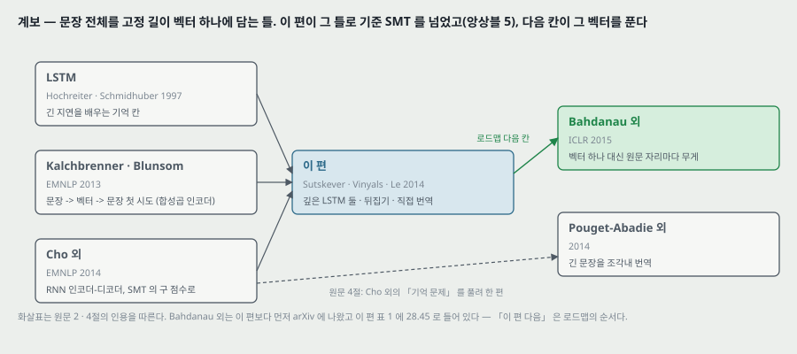

**하나. 다음 칸에 닿는 자리 — 고정 길이 벡터 하나.** 이 편의 틀은 입력이 5 낱말이든 79 낱말이든 같은 8,000 개의 수로 줄인다. 원문은 이 병목을 한계로 적지 않고 오히려 「매력」 으로 꼽지만(3.8절), 그림 3 왼쪽의 가장 긴 칸에서 −2.16 이 나오고 원문 스스로 「처음에는 기억이 제한돼 긴 문장에서 실패할 것이라 확신했다」 고 적는다(5절). 같은 시기 Bahdanau 외 [2] 는 이 자리를 **벡터 하나 대신 원문 자리마다의 상태에 무게를 주는 것**으로 풀었다. 이 편은 같은 자리를 **입력 순서를 바꿔** 최소 지연을 줄이는 것으로 받았다. 두 답이 무엇을 바꾸는지 — 하나는 정보가 지나가는 길을 짧게 하고, 다른 하나는 길 자체를 원문 모든 자리로 연다 — 가 다음 칸을 읽을 때의 물음이다.

**둘. 옮겨 쓸 수 있는 것.**

- **표를 단계로 가르기.** 한 표 안의 줄이 한 갈래 길(정방향 -> 뒤집기 -> 앙상블 -> 빔)로 이어지면 차이를 단계로 나눠 각 장치의 몫을 센다. 이 편에서는 뒤집기 +4.42 와 앙상블 +4.22 가 같은 크기였다. **헤드라인 수가 어느 단계의 값인지**(단일인지 앙상블인지)를 먼저 확인한다.
- **같은 출력, 다른 셈.** 같은 시스템 출력이 BLEU 스크립트만으로 1.2 갈렸다. 다른 논문의 값을 옮겨 놓은 비교를 읽을 때 셈 방식을 맞췄는지 본다.
- **벡터 그림은 좌표로 읽는다.** PDF 그림이 벡터면 꼭짓점 좌표를 꺼내 눈금으로 바꾸면 0.01 BLEU 단위로 읽힌다. 캡션의 「조금」 · 「분명히」 를 수로 바꾸는 데 쓴다.
- **가설과 원인 문장 가르기.** 같은 현상을 두고 Abstract 와 본문이 다른 세기로 적는 경우가 있다. 본문에서 「믿는다 · 보인다 · 짐작한다」 를 찾고, 그 현상에 대한 Abstract · 서론 · 결론의 「because · conclude」 와 나란히 놓는다.

**셋. 지금 확인된 것은 여기까지다.**

- **논문이 잰 것**: 뒤집기 전후 단일 모델의 혼잡도 · BLEU(실행 하나씩), 표 1 · 2 의 BLEU(실행 하나씩), 그림 3 의 칸별 BLEU, 처리 속도.
- **논문이 말만 한 것**: 뒤집기가 돕는 까닭(짧은 의존), 뒤집기가 긴 문장을 고친다는 것, 깊이의 이득이 상태 크기 때문이라는 것, 보통 RNN 은 정방향에서 안 배워지고 뒤집으면 배워질 것이라는 것, 표현이 능동 · 수동에 둔하다는 것(예 열둘).
- **내가 책상에서 센 것**: 파라미터 384,112,000 (원문 384M 과 맞음, 내역 83.3% 가 낱말 표와 소프트맥스), 학습 8.98 일(원문 「열흘 남짓」 과 맞음), 갱신 703,125 번, 학습률 두 읽기(0.0219 · 0.0438), 단조 정렬에서 짝 거리 평균 불변 · 최소 $T+1 \to 2$, 표 1 의 단계 분해, 그림 3 · 그림 2 의 좌표 값과 그로부터 센 차 · 거리.

---

## 25. 다음에 읽을 것

**한계를 적고 그 한계를 푼 것이 다음 논문이다.** 첫째는 로드맵의 다음 칸이다.

| 다음 | 이 노트의 어느 자리에서 나오는가 | 무엇을 확인하고 싶은가 |
|---|---|---|
| **Neural Machine Translation by Jointly Learning to Align and Translate** (Bahdanau · Cho · Bengio, ICLR 2015, 원문 [2]) — **로드맵 다음 칸(Attention)** | 24절 하나 — 입력 전체를 고정 길이 벡터 하나에 담는 병목. 원문 4절이 「긴 문장의 낮은 성능을 주의 메커니즘으로 넘으려 했다」 고 적는 편 | 표 1 의 28.45 가 어떤 조건(어휘 · 학습 문장 길이 · 모델 크기)의 값인가. 문장 길이별 BLEU 를 같은 축으로 그렸는가, 그리고 고정 길이 벡터 모델과 같은 조건에서 견줬는가 |
| **Addressing the Rare Word Problem in Neural Machine Translation** (Luong · Sutskever · Le · Vinyals · Zaremba, ACL 2015) — 후보 | 13 · 21절 넷 — 그림 3 오른쪽 끝 칸의 −1.28, 표 3 의 UNK. 원문 스스로 적은 한계 1. **원문 참고 문헌에는 없다(뒤에 나온 편)** | UNK 를 다루면 드문 낱말 칸의 역전이 사라지는가 |
| **On the Difficulty of Training Recurrent Neural Networks** (Pascanu · Mikolov · Bengio, 2012 arXiv, 원문 [25]) | 8절 — 기울기 노름 5 에서 자르기. 원문은 [10] · [25] 를 인용만 한다 | 노름 자르기의 근거와 문턱을 고르는 방법 |
| **BLEU: a Method for Automatic Evaluation of Machine Translation** (Papineni 외, ACL 2002, 원문 [24]) | 10절 — 같은 출력이 셈 방식으로 1.2 갈린다 | 변형이 어디서 갈리는가(토큰 나누기 · 대소문자 · 길이 벌점의 기준 길이) |

읽는 순서로는 **Bahdanau 외가 먼저**다. 로드맵의 다음 칸이고, 이 편이 남긴 고정 길이 벡터 자리를 바로 받는다.

---

## 26. 남는 질문

- **3.3절의 25.9 와 표 1 의 26.17 은 왜 다른가.** 빔 크기나 모델이 다른 실행인지. NIPS 학회판에서 고쳐졌는지(학회판은 받지 않았다).
- **앙상블을 어떻게 합쳤나** — 걸음마다 확률을 평균했는지 로그 확률을 평균했는지.
- **단일 모델 다섯의 BLEU 는 얼마씩인가.** 시작값만 바꿨을 때 흩어짐이 얼마인지.
- **정방향 모델의 길이별 BLEU.** 3.3절의 「긴 문장에서 훨씬 낫다」 의 수.
- **그림 3 의 칸 나누기.** 순번 자리 10 · 100 · 200 · 500 ... 이 칸의 끝인지 가운데인지, 칸마다 문장 몇 개인지.
- **검증셋을 썼는가.** 학습률 일정 · 빔 · 앙상블 수를 무엇으로 골랐는가.
- **그림 2 의 상태와 PCA.** 8,000 개 가운데 어느 것을 썼고, 주성분을 무엇에 맞췄고, 분산을 얼마나 설명하는가.
- **보통 RNN 을 정방향에서 학습시킨 시도의 설정과 결과.**
- 이 물음 가운데 앞 넷은 학회판이나 저자들의 뒤 편에서, 뒤 넷은 이 편으로는 답이 안 나온다. Bahdanau 외를 읽으면 다섯째(길이별 곡선을 다른 모델로 그린 것)에 다른 쪽 수가 생긴다.

---

## 27. 참고 문헌

이 노트가 부른 편만 적는다. 원리는 원 출처를, 구현은 그 라이브러리의 편을 적는 규칙을 따른다. 그림 코드는 파이썬 표준 라이브러리만 쓰고, 원문 그림 좌표를 꺼낸 일과 그림 1 을 잘라 낸 일만 PyMuPDF 를 썼다(PyMuPDF 는 논문이 따로 없어 적지 않는다).

- Sutskever, I., Vinyals, O., and Le, Q. V. (2014). Sequence to sequence learning with neural networks. arXiv:1409.3215 (v3, 2014-12-14). 학회판: NIPS 27. — 이 노트의 대상. 학회판은 읽지 않았다.
- Hochreiter, S. and Schmidhuber, J. (1997). Long short-term memory. Neural Computation. — LSTM(원문 [16]).
- Graves, A. (2013). Generating sequences with recurrent neural networks. arXiv:1308.0850. — 이 편이 쓴 LSTM 꼴과 기울기 자르기(원문 [10]). **읽지 않았다.**
- Cho, K. 외 (2014). Learning phrase representations using RNN encoder-decoder for statistical machine translation. EMNLP. — RNN 인코더-디코더, 표 2 의 34.54 (원문 [5], 원문은 arXiv 판을 인용).
- Kalchbrenner, N. and Blunsom, P. (2013). Recurrent continuous translation models. EMNLP. — 문장 -> 벡터 -> 문장 첫 시도(원문 [18]). **읽지 않았다.**
- Bahdanau, D., Cho, K., and Bengio, Y. (2014). Neural machine translation by jointly learning to align and translate. arXiv:1409.0473 (ICLR 2015). — 표 1 의 28.45, 다음에 읽을 것(원문 [2]). **읽지 않았다.** **2026-11-04 에 읽었다 — 노트를 따로 썼다.**
- Pouget-Abadie, J. 외 (2014). Overcoming the curse of sentence length for neural machine translation using automatic segmentation. arXiv:1409.1257. — 원문 [26]. **읽지 않았다.**
- Schwenk, H. (2014). University le Mans (기준 SMT · 데이터 · 1000-best 목록 공개 자리). — 원문 [29].
- Durrani, N., Haddow, B., Koehn, P., and Heafield, K. (2014). Edinburgh's phrase-based machine translation systems for WMT-14. WMT. — WMT'14 최고 결과 37.0 (원문 [9]).
- Papineni, K., Roukos, S., Ward, T., and Zhu, W. J. (2002). BLEU: a method for automatic evaluation of machine translation. ACL. — 지표(원문 [24]). **읽지 않았다.**
- Pascanu, R., Mikolov, T., and Bengio, Y. (2012). On the difficulty of training recurrent neural networks. arXiv:1211.5063. — 기울기 자르기(원문 [25]). **읽지 않았다.**
- Hochreiter, S. and Schmidhuber, J. (1997). LSTM can solve hard long time lag problems. — 「최소 시간 지연」 이라는 말(원문 [17]). **읽지 않았다.**
- Razborov, A. (1992). On small depth threshold circuits. — N 비트 수 N 개 정렬(원문 [27]). **읽지 않았다.**
- Rumelhart, D., Hinton, G. E., and Williams, R. J. (1986). Learning representations by back-propagating errors. Nature, 323:533–536. — 원문 [28].
- Luong, M.-T., Sutskever, I., Le, Q. V., Vinyals, O., and Zaremba, W. (2015). Addressing the rare word problem in neural machine translation. ACL. — 다음에 읽을 것 후보. **원문 참고 문헌에는 없다(뒤에 나온 편). 읽지 않았다.**

---

## 28. 경로

| 무엇 | 어디 |
|---|---|
| 원문 PDF (arXiv v3, 9 쪽) | `papers/NIPS14_Seq2Seq_Sequence_to_Sequence_Learning_with_Neural_Networks.pdf` |
| 이 노트 | `notes/NIPS14_Seq2Seq_Sequence_to_Sequence_Learning_with_Neural_Networks.md` |
| 이 노트의 그림 (직접 그린 것) | `figures/NIPS14_Seq2Seq/fig01_model.svg` 부터 `fig14_lineage.svg` 까지 열넷 |
| 이 노트의 그림 (원문에서 잘라 낸 것) | `figures/NIPS14_Seq2Seq/paper_fig1_model.png` |
| 그림을 만드는 코드 | `figures/NIPS14_Seq2Seq/make_figures.py` — 바깥 데이터를 읽지 않으므로 `python make_figures.py` 로 어디서나 다시 만든다(표준 라이브러리만). 2 · 3 · 4 · 5 · 7 · 8 · 9 번 그림의 수는 이 파일이 계산해 화면에도 찍는다. 10 · 11 · 12 번 그림의 값은 원문 그림 3 · 2 의 PDF 벡터 좌표를 상수로 적어 두고 이 파일이 눈금으로 바꾼 것이다 |
| 원문 그림을 잘라 내는 코드 | `figures/NIPS14_Seq2Seq/crop_paper_figures.py` — PyMuPDF 가 필요하다 |
