# Faster R-CNN — Towards Real-Time Object Detection with Region Proposal Networks (NIPS 2015, 요약)

> **한 줄.** 검출기의 시간을 잡아먹던 CPU 후보 영역 단계(Selective Search, 이미지 한 장 1.51 초)를 **합성곱 특징을 나눠 쓰는 작은 망(RPN)** 으로 바꾼다. 특징 지도의 칸마다 앵커 9 개를 기준으로 물체 점수와 상자 보정을 낸다. VGG-16 에서 제안 10 ms, 전체 198 ms, PASCAL VOC 2007 mAP 69.9(2007 학습) · 73.2(2007 + 2012 학습).

> **이 노트에서 가장 먼저 볼 자리 다섯.** (1) **초록의 73.2 · 70.4 는 학습 데이터를 합친 값이다.** VOC 2007 학습만이면 69.9, 2012 학습만이면 67.0 이다. 초록은 이 조건을 적지 않았다(6 · 7절). (2) **표 전체에 흩어짐이 하나뿐인데, 그 하나가 기준선을 움직인다.** 각주의 SS 값이 표의 66.9 가 아니라 같은 저장소로 **68.0 ± 0.3(6 회)** 이다. 그러면 공유 69.9 의 차이가 3.0 에서 1.9 로, 공유 안 함 68.5 의 차이가 1.6 에서 0.5 로 준다(7절). (3) **높은 IoU 에서 RPN 재현율은 SS 아래로 내려간다.** 그림 2 벡터 좌표를 읽으니 교차점이 IoU 0.765 ~ 0.79 이고, 제안 2000 · IoU 0.9 에서 RPN VGG 0.04 대 SS 0.243 이다. 본문은 제안 수에 대한 「우아한(gracefully)」 감소만 말하고 이 쪽은 말하지 않는다(9절). (4) **9.2 배 시간 비는 GPU 와 CPU 를 섞은 값이다.** 표 4 머리글이 SS 만 CPU 라고 적고, 저자도 1절에서 불공평을 인정한다. GPU 로 옮긴 SS 값은 재지 않았다(8절). (5) **한 단계와 두 단계의 4.8 점은 ZF 하나, 한 번, OverFeat 를 Fast R-CNN 으로 흉내 낸 값이다.** 「더 느리다」 에는 시간 값이 없다(10절). 뒤에 읽는 YOLO 가 바로 이 자리를 건드린다.

---

## Paper Metadata

| Item | Content |
|---|---|
| Title | Faster R-CNN: Towards Real-Time Object Detection with Region Proposal Networks |
| Authors | Shaoqing Ren, Kaiming He, Ross Girshick, Jian Sun |
| 소속 | Microsoft Research (Ren 은 USTC 소속, MSR 인턴 때의 일) |
| Conference / Journal | **NIPS 2015** (Advances in Neural Information Processing Systems 28). 파일에 권 · 쪽 번호가 찍혀 있지 않고 쪽 꼬리는 1 ~ 9 다 |
| Year | 2015. arXiv v1 2015-06-04, v2 2015-09-13, v3 2016-01-06 |
| DOI | NeurIPS 쪽 해시 `14bfa6bb14875e45bba028a21ed38046`. arXiv:1506.01497 |
| 코드 | `https://github.com/ShaoqingRen/faster_rcnn` (원문). 이 노트는 코드를 보지 않았다 |
| Stored PDF | `papers/NIPS15_FasterRCNN_Towards_Real_Time_Object_Detection_with_Region_Proposal_Networks.pdf` |
| 왜 읽었는가 | 큰 틀 「분할 · 검출」 의 둘째 칸. 지금까지 ResNet 노트에서 「바탕 망만 바꾼 검출기」 로만 지나간 검출을 원문으로 본다. 앵커 · IoU · mAP · NMS 같은 말을 여기서 처음 정리한다 |
| 읽은 범위 | **2026-11-08 에 NIPS 판 9 쪽을 전부 읽었다.** 곧 Abstract · 1 ~ 5절 · 식 (1) · 앵커 표 · 표 1 ~ 5 · 그림 1 · 2 · 참고 문헌 24 건의 서지. 쪽 이미지와 벡터 좌표로 그림을 맞췄다. **arXiv v3 은 12절에 적은 대목만 읽었다.** 참고 문헌의 편들과 코드는 읽지 않았다. Selective Search · EdgeBoxes · OverFeat · MultiBox 에 관한 말은 이 편이 적은 범위다 |

### 저장한 파일의 상태

- **NIPS 게재판 9 쪽(본문 8 + 참고 문헌 1).** 글자 층이 살아 있고 그림 2 의 글자만 글꼴이 깨져 쪽 이미지로 읽었다.
- **그림 2 는 PDF 안에 벡터로 들어 있다.** 곡선마다 IoU 0.05 간격의 점 11 개를 꺼내 눈금으로 환산했다. y 축은 눈금 글자 위치로 맞춰 읽기 오차를 0.01 로 본다(9절).
- **arXiv v3(2016-01-06, 14 쪽)은 다른 판이다.** 표 12 · 그림 6 까지 있고 MS COCO · 민감도 표가 더 있다. 이 노트의 수치는 **NIPS 판을 기준**으로 하고 v3 에서 옮긴 값은 12절에 모아 「v3」 이라 표시한다.

---

## 1. 용어

- **후보 영역 · 제안 (region proposal)**: 물체가 있을 법한 상자. 검출기는 이 상자마다 부류를 판정한다. 이 노트는 「제안」 으로 통일한다. 작은 예시로, SS 는 이미지 한 장에 약 2,000 개, RPN 은 시험 때 최대 300 개다.
- **Selective Search (SS) · EdgeBoxes (EB)**: 학습하지 않는 제안 방법. 원문 값은 SS 이미지 한 장 CPU 2 초(표 4 평균 1.51 초), EB 0.2 초.
- **RPN (Region Proposal Network)**: 합성곱 특징 위를 미는 작은 망. 3 x 3 합성곱 하나 + 1 x 1 합성곱 둘.
- **앵커 (anchor)**: 칸마다 미리 정한 기준 상자. 넓이 $128^2, 256^2, 512^2$ 와 가로세로 비 1:1, 1:2, 2:1 의 곱으로 $k = 9$ 개. 예측은 앵커에서의 **보정값**이다. 작은 예시로, 60 x 40 특징 지도면 60 x 40 x 9 = 21,600 개다.
- **물체 점수 (objectness)**: 부류를 묻지 않고 물체냐 배경이냐만 가르는 점수. 칸마다 $2k$ 개.
- **IoU (intersection over union)**: 두 상자의 겹침 / 합집합. 100 x 100 상자 둘이 가로로 50 픽셀 겹치면 5,000 / 15,000 = 0.333.
- **NMS (non-maximum suppression)**: 점수 순으로 보며 IoU 가 문턱보다 큰 뒤쪽 상자를 지우는 후처리. 원문 RPN 쪽 문턱은 0.7.
- **mAP (mean average precision)**: 부류별 정밀도-재현율 곡선 아래 넓이의 평균. VOC 20 부류.
- **백분율 점**: mAP 의 차. 원문은 「4.8%」 처럼 적지만 이 노트는 「4.8 점」 으로 적는다.
- **공유 · 공유 안 함 (shared, unshared)**: RPN 과 검출 망이 합성곱 층을 같은 값으로 쓰는지. 4 단계 학습을 3 · 4 단계까지 가면 공유, 2 단계에서 멈추면 공유 안 함.
- **한 단계 · 두 단계 (one-stage, two-stage)**: 부류 판정을 조밀한 칸에서 곧장 하느냐, 제안을 먼저 내고 그 상자에서 다시 하느냐.

---

## 2. 한 문단 요약

R-CNN 은 제안마다 망을 돌렸고, SPPnet · Fast R-CNN 은 합성곱을 공유해 그 비용을 줄였다. 그러자 남은 병목이 CPU 제안이다. 이 편은 제안 계산 자체를 합성곱 특징 위의 작은 망으로 옮겨, 이미 계산한 특징을 다시 쓰게 한다. 칸마다 앵커 9 개에 대해 물체 점수와 상자 보정을 내고, 물체 여부 손실과 smooth L1 손실로 끝까지 배운다. 합성곱을 공유하려면 RPN 과 Fast R-CNN 을 번갈아 배우는 4 단계가 필요하다고 적는다. VOC 2007 에서 제안 300 개로 SS 2,000 개와 맞서고, VGG-16 전체 198 ms 로 5 fps 가 된다.

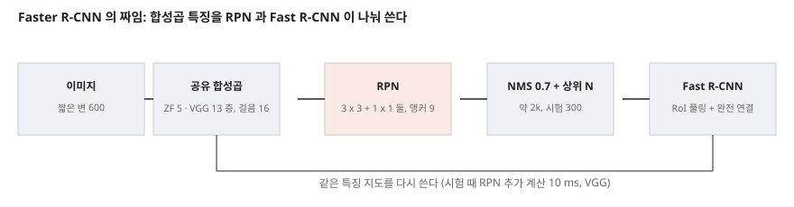

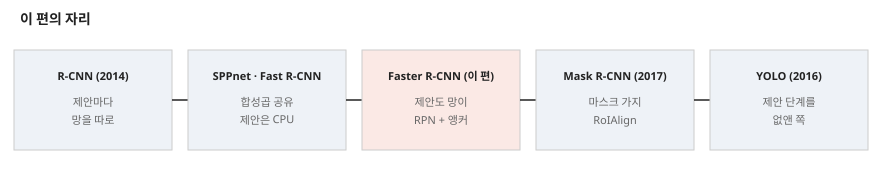

---

## 3. 문제 / 동기

**이 논문이 없앤 전제: 제안은 학습 없는 별도 단계이고 CPU 에서 돈다.**

원문(1절)의 진단은 다음이다.

- 최신 Fast R-CNN 은 제안 시간을 빼면 실시간에 가깝고, 이제 제안이 병목이다.
- SS 는 검출 망보다 **한 자리 수(an order of magnitude) 느리고** 이미지 한 장 2 초, EB 는 0.2 초로 여전히 검출 망만큼 시간을 쓴다.
- 저자가 직접 짚는 함정: 제안은 CPU, 검출은 GPU 라 **시간 비교가 공평하지 않다(inequitable)**. GPU 로 다시 구현하면 공학적으로는 풀리지만 뒤 단계와 계산을 나눌 기회를 놓친다.

풀이는 「제안을 깊은 망으로 계산한다」 이고, 특징을 나눠 쓰니 제안의 **추가 비용**이 작다(10 ms).

---

## 4. 핵심 기술

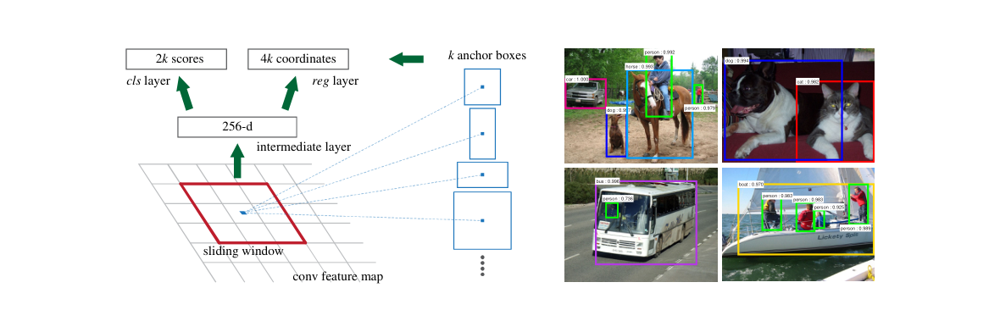

**① RPN 구조.** 마지막 공유 합성곱 층 위에서 $n \times n$($n = 3$) 창을 민다. 창마다 낮은 차원 벡터(ZF 256 · VGG 512)로 옮기고, 상자 보정 층(reg, $4k$ 출력)과 물체 점수 층(cls, $2k$ 출력)으로 나눈다. 구현은 $n \times n$ 합성곱 하나와 1 x 1 합성곱 둘이다. 입력 이미지에서의 받아들임 넓이는 ZF 171 · VGG 228 픽셀이라 적는다.

**② 앵커.** 칸마다 $k = 9$ 개. 이동 불변이라 MultiBox(k-평균으로 고른 앵커 800 개)보다 파라미터가 적다고 적는다. **상자 회귀가 칸마다 $k$ 벌로 나뉘고 가중치를 나누지 않는다**는 점이 앞선 회귀와 다르다. 특징은 같은 크기여도 앵커별 회귀기가 달라 여러 크기를 예측한다. 넓이 $512^2$ 앵커는 받아들임 넓이 228 보다 크다. 원문은 물체 가운데만 보여도 범위를 짐작할 수 있다고 적는다.

**③ 라벨.** 양성: 정답 상자와 IoU 가 가장 높은 앵커, 또는 IoU 0.7 초과인 앵커. 음성: 모든 정답과 IoU 0.3 미만. 나머지는 손실에서 뺀다.

**④ 손실.**

$$L(\{p_i\}, \{t_i\}) = \frac{1}{N_{cls}} \sum_i L_{cls}(p_i, p_i^*) + \lambda \frac{1}{N_{reg}} \sum_i p_i^* L_{reg}(t_i, t_i^*) \qquad (1)$$

$L_{cls}$ 는 두 부류 로그 손실, $L_{reg}$ 는 smooth L1 이다. 보정값은 $t_x = (x - x_a)/w_a$, $t_y = (y - y_a)/h_a$, $t_w = \log(w/w_a)$, $t_h = \log(h/h_a)$ 로 앵커에 맞춰 잰다. 각주 3 은 $\lambda = 10$, $N_{cls} = 256$, $N_{reg} \sim 2{,}400$ 이라 적고 「roughly equally weighted」 고 한다. 내가 나누면 $(10/2400)/(1/256) = 1.07$ 이다. **NIPS 판에는 $\lambda$ 를 바꾼 표가 없다.** v3 표 9 가 그 표다(12절).

**⑤ 표본 뽑기.** 한 이미지에서 앵커 256 개를 뽑고 양성 : 음성을 최대 1:1 로 맞춘다. 양성이 128 개가 안 되면 음성으로 채운다.

**⑥ 4 단계 번갈아 학습.** 1) ImageNet 초기화로 RPN 학습. 2) 1 단계 RPN 의 제안으로 Fast R-CNN 을 따로 학습(이 단계까지는 층을 나누지 않는다). 3) 검출 망 층을 얼리고 RPN 고유 층만 미세조정. 4) 같은 층을 얼리고 Fast R-CNN 완전 연결 층을 미세조정. 원문은 함께 최적화하는 것이 「수렴할지 분명하지 않다」 고 적고 후속 과제로 둔다.

**설정.** 짧은 변 600 픽셀, 단일 축척. 걸음 16(전형 PASCAL 이미지에서 약 10 픽셀). SGD, 학습률 0.001(60k 묶음) → 0.0001(20k 묶음), 운동량 0.9, 가중 감쇠 0.0005. 새 층 초기화 표준편차 0.01. ZF 는 전 층, VGG 는 conv3_1 부터 조정. 경계를 넘는 앵커는 학습에서 빼고, 시험에서는 잘라 쓴다. 제안 NMS 문턱 0.7 로 약 2k 개, Fast R-CNN 학습에 2k, 시험은 상위 $N$. 장비 K40 GPU, Caffe.

---

## 5. 앵커와 파라미터 — 내가 세었다

**파라미터.** 원문 2.4M 은 3 x 3 합성곱 + 1 x 1 합성곱 둘을 세면 맞는다. VGG(512)에서 치우침까지 넣어 2,387,510, ZF(256)는 603,958 이다. 원문 문장 「VGG-16 RPN 2.4M 대 MultiBox 27M」 은 VGG 쪽만 적었다. 계산식은 v3 에 있고 12절에 옮겼다.

**앵커 수.** 원문은 「전형적인 1000 x 600 이미지에 약 20k 개(≈ 60 x 40 x 9), 경계를 넘는 앵커를 빼면 약 6k 개」 라 적는다. 칸 중심 배치 · 넓이 보존 종횡비로 내가 세니 다음과 같다.

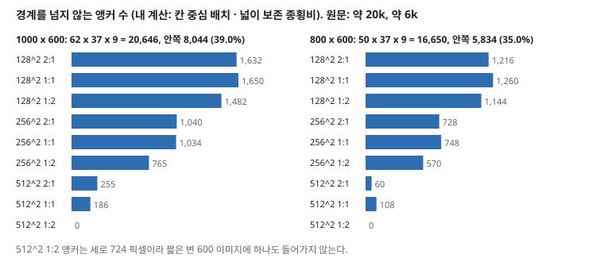

| 이미지 | 특징 지도 | 전체 앵커 | 경계 안쪽 | 안쪽 비율 |
|---|---|---|---|---|
| 1000 x 600 | 62 x 37 | 20,646 | **8,044** | 39.0% |
| 800 x 600 | 50 x 37 | 16,650 | **5,834** | 35.0% |

**1000 x 600 이면 원문 6k 보다 1.34 배 많고, 800 x 600 이면 6k 에 가깝다.** 전형적인 PASCAL 이미지 500 x 375 를 짧은 변 600 으로 키우면 800 x 600 이니, 6k 는 이쪽 값일 수 있다. 내 짐작이고 원문은 세는 방식을 적지 않았다. 앵커 배치가 달라도 이 값이 변한다.

**앵커와 학습된 제안.** 원문 앵커 표(5쪽)의 평균 제안 크기를 앵커와 나눠 봤다.

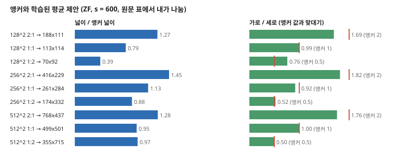

작은 앵커일수록 앵커에서 멀어진다. $128^2$ 1:2 앵커의 평균 제안은 70 x 92 로 넓이가 앵커의 39.3%, 가로세로 비 0.76(앵커 0.5)이다. $512^2$ 1:1 은 499 x 501 로 95.4%, 1.00 이다. 원문은 이 표를 「학습된 평균 제안 크기」 로만 싣고 해석을 적지 않았다.

---

## 6. 평가 (읽은 범위)

- **데이터:** PASCAL VOC 2007(trainval 약 5k, test 약 5k, 20 부류)이 주이고, VOC 2012 는 몇 모델만.
- **지표:** 검출 mAP. 제안 대리 지표(재현율)는 「진단용」 이라 적는다. 시간은 K40 GPU ms.
- **비교 상대:** SS · EB 제안의 Fast R-CNN(저자가 돌림, 그러나 66.9 는 Fast R-CNN 논문의 값), 흉내 낸 한 단계.
- **장비:** K40 GPU. SS 는 CPU.

| 줄 | 제안 | 학습 데이터 | 시험 | mAP |
|---|---|---|---|---|
| SS + Fast R-CNN (VGG) | 2k | 07 | VOC 07 | 66.9 |
| RPN + VGG, 공유 | 300 | 07 | VOC 07 | 69.9 |
| SS + Fast R-CNN (VGG) | 2k | 07+12 | VOC 07 | 70.0 |
| RPN + VGG, 공유 | 300 | 07+12 | VOC 07 | **73.2** |
| SS + Fast R-CNN (VGG) | 2k | 07++12 | VOC 12 | 68.4 |
| RPN + VGG, 공유 | 300 | 07++12 | VOC 12 | **70.4** |

07 은 VOC 2007 trainval, 07+12 는 2007 · 2012 trainval 합집합, 07++12 는 2007 trainval + test 와 2012 trainval 합집합이다.

---

## 7. 정확도 — 표 1 · 2 · 3

**표 2 와 각주.** 원문에서 흩어짐이 적힌 곳은 이 각주 하나다.

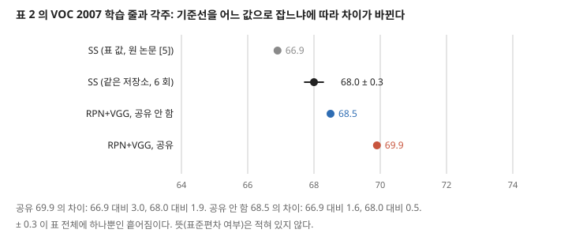

표 값 66.9 는 Fast R-CNN 논문이 보고한 값이고, 같은 저장소를 돌리면 68.0 ± 0.3(6 회)이라 적는다. 표에 그 값이 아닌 66.9 가 올라 있고 본문 문장 「slightly higher than the SS baseline」 의 상대도 이쪽이다. 68.0 으로 놓으면 공유 안 함 68.5 의 차이는 0.5 로 ± 0.3 의 두 배 안쪽에 들어간다. 다른 줄은 몇 번 돌렸는지 적혀 있지 않다. **「공유 안 함이 SS 보다 낫다, 제안 품질이 높기 때문이다」 는 이 기준선에서 약해진다.**

**표 1 위쪽(ZF, 학습 제안과 시험 제안을 같이 바꿈).** SS 58.7 · EB 58.6 · RPN 공유 59.9 · RPN 공유 안 함 58.7. RPN 공유와 SS 의 차이는 1.2 점이고, 공유 안 함은 SS 와 같다. 원문은 「경쟁할 만하다(competitive)」 고 적어 강하게 말하지 않는다.

**표 1 아래쪽(소거).** SS 2k + ZF 로 배운 검출 망을 **얼리고** 시험 제안만 바꾼 값이다.

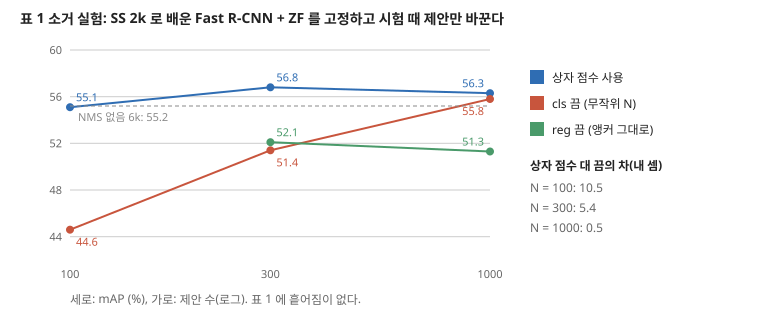

- cls 를 끄면 N = 100 에서 10.5 점, 300 에서 5.4 점, 1000 에서 0.5 점 빠진다(내 셈). 점수가 상위 제안의 정확도를 만든다는 원문 해석과 맞는다.
- reg 를 끄면 300 에서 4.7 점, 1000 에서 5.0 점 빠진다. **N 을 늘려도 회복되지 않고 오히려 0.8 점 낮아진다**(52.1 → 51.3). 원문 문장은 300 값만 말한다.
- **「NMS 는 mAP 를 해치지 않는다」 를 받치는 짝이 없다.** NMS 없음은 6k 하나(55.2)인데 맞댈 NMS 있음 6k 가 없다. 원문은 상위 100 개(55.1)와 비슷하다고 적는다. 표 안에서 NMS 있음 1k(56.3) · 300(56.8)이 더 높으니 방향은 맞지만 같은 제안 수의 비교가 아니다.
- RPN VGG 를 같은 얼린 검출 망에 넣으면 56.8 → 59.2, +2.4 점이다. 얼린 검출 망이 같아 제안 품질 차이로 읽기에 이 표에서 가장 조건이 깨끗한 줄이다.

**공유의 몫.** ZF 59.9 대 58.7 로 +1.2, VGG 69.9 대 68.5 로 +1.4 다. 원문은 「3 단계에서 검출기로 조정한 특징이 RPN 을 낫게 한다」 고 관찰로 적는다(「We observe that this is because」). 이 원인을 따로 잰 줄은 없다.

**표 3(VOC 2012).** SS 65.7 → RPN 67.0, +1.3(12 학습). SS 68.4 → RPN 70.4, +2.0(07++12 학습). 결과는 서버 익명 주소로 적었고, 흩어짐은 없다.

---

## 8. 시간 — 표 4

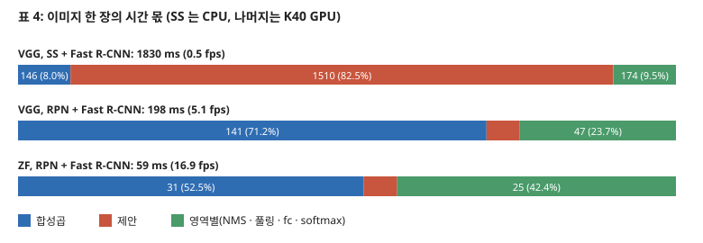

표 4 의 합을 내가 더하면 1830 · 198 · 59 로 모두 맞고, fps 는 0.55 · 5.05 · 16.95 라 원문 표기 0.5 · 5 · 17 과 맞는다.

- **VGG 전체 시간 비는 1830 / 198 = 9.2 배이고, 제안만은 1510 / 10 = 151 배다.** 다만 1510 ms 는 CPU, 10 ms 는 GPU 다. 원문 1절이 이 불공평을 인정하고 표 머리글에 적어 두었으나, **초록의 「nearly cost-free」 는 RPN 추가 계산만 본 말이다.** 공유한 합성곱 141 ms 는 어차피 검출에 드니 뺀 값이고, 그 전제에서 맞다. 제안만 필요한 쓰임에서는 151 ms 가 된다.
- **제안의 몫**: SS 체계 82.5%, RPN 체계 5.1%. 시간이 줄어든 뒤 남는 것은 합성곱이 71.2% 다.
- **영역별 시간이 제안 수에 비례하지 않는다.** 174 ms / 2000 = 0.087 ms, 47 ms / 300 = 0.157 ms(최대 제안 수로 나눈 값, 각주 6 이 실제 평균은 더 적다고 적으므로 하한). 영역별 시간에 NMS 가 들어가니 고정 몫이 섞였을 수 있다. 원문은 나눠 적지 않았다.
- **10 ms 안에 RPN NMS 가 드는지 분명하지 않다.** 표 머리글은 「영역별」 에 NMS 를 넣는다. 그 NMS 가 제안 NMS 까지인지 검출 NMS 만인지 적혀 있지 않다.
- **표 2 의 공유 안 함 342 ms** 는 198 + 144 로, 합성곱 141 ms 를 한 번 더 도는 값과 3 ms 차이다(내 셈). 공유의 시간 몫이 이 수다.

---

## 9. 재현율 — 그림 2

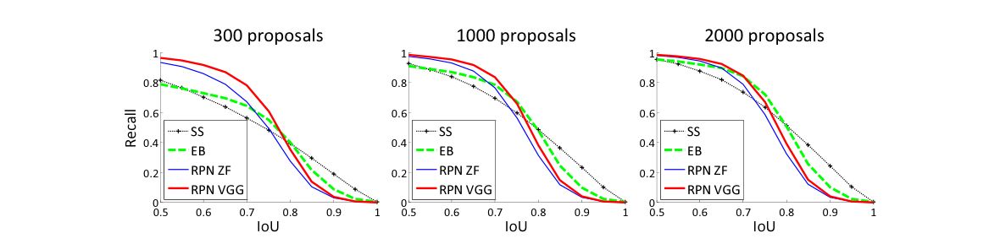

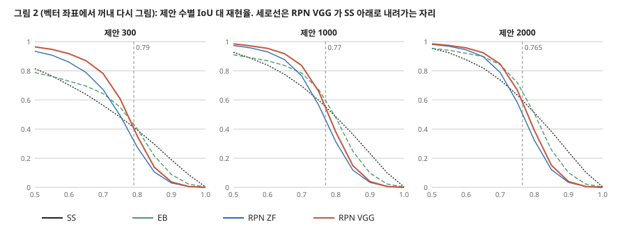

| 제안 수 | 방법 | IoU 0.5 | IoU 0.7 | IoU 0.8 | IoU 0.9 |
|---|---|---:|---:|---:|---:|
| 300 | SS | 0.815 | 0.563 | 0.394 | 0.189 |
| 300 | EB | 0.788 | 0.644 | 0.401 | 0.088 |
| 300 | RPN VGG | **0.964** | **0.781** | 0.353 | 0.037 |
| 2000 | SS | 0.954 | 0.736 | **0.512** | **0.243** |
| 2000 | EB | 0.954 | 0.842 | 0.506 | 0.101 |
| 2000 | RPN VGG | **0.985** | **0.846** | 0.391 | 0.040 |

값은 내가 벡터 좌표에서 읽었다. 읽기 오차는 약 0.01 이다.

- **원문 주장 「제안이 줄어도 우아하게 준다」 는 맞다.** IoU 0.5 에서 2000 → 300 으로 갈 때 RPN VGG 0.021, SS 0.139, EB 0.166 빠진다. IoU 0.7 에서는 0.065 · 0.173 · 0.198 이다.
- **원문이 적지 않은 쪽: 높은 IoU 에서는 뒤집힌다.** RPN VGG 가 SS 아래로 내려가는 자리는 제안 300 · 1000 · 2000 에서 IoU 0.79 · 0.77 · 0.765 다(0.005 간격으로 내가 찾음). EB 에도 IoU 0.8 에서 세 패널 모두 뒤진다(제안 300 은 0.353 대 0.401, 제안 2000 은 0.391 대 0.506). 제안 2000, IoU 0.9 의 차이는 0.04 대 0.243, 6.1 배다.
- **이 재현율은 검출 mAP 가 아니다.** 원문은 이 지표가 mAP 와 느슨하게 관련된다고 먼저 적었고, 뒤 단계에서 Fast R-CNN 이 상자를 다시 보정한다. 그래서 위 뒤집힘이 곧 나쁜 검출을 뜻하지는 않는다. 다만 PASCAL mAP 는 IoU 0.5 하나로 재므로 **이 약점이 표 값에 나타나기 어렵다.** 이 자리를 재는 값은 v3 의 COCO 표에 있다(12절).

---

## 10. 한 단계 대 두 단계 — 표 5

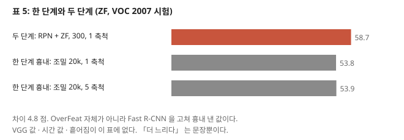

- 원문 「4.8%」 는 58.7 - 53.9 로 맞고, 단위는 점이다.
- **흉내(emulate)다.** OverFeat 자체를 돌린 것이 아니라 Fast R-CNN 에 조밀한 칸을 넣었다. 원문이 그렇게 적었고 구현 차이를 피하려는 선택이라 적는다.
- **ZF 한 망, 한 값씩이다.** 원문은 「이 실험이 정당화한다(justifies)」 고 적는다. 다른 두 편([5] · [13])도 약 6% 떨어졌다고 덧붙이지만 그 값은 이 편이 잰 것이 아니다.
- 1 축척 53.8 대 5 축척 53.9 로 축척 피라미드의 몫이 0.1 점이다.
- **「한 단계가 더 느리다」 는 시간 값 없이 제안 수 20k 를 근거로 든다.** 흉내 낸 쪽의 영역별 시간이니 제안 단계를 없앤 다른 설계의 속도를 말해 주지 않는다. YOLO 노트가 이 자리에서 이어진다.

---

## 11. 실험 분석 (논문의 표 · 그림마다)

**직접 돌리지 않는다.** 논문이 낸 실험을 표 · 그림 하나씩 같은 틀로 읽는다. 값 읽기와 재계산은 「내가 센 것」으로 밝힌다.

| 표 · 그림 | 무엇을 바꿨나 (변인) | 무엇을 고정했나 | 결과 | 반복 수 · 흩어짐 | 주장이 결과보다 센가 |
|---|---|---|---|---|---|
| **앵커 표** (5쪽) | 앵커 9 종 | ZF, $s = 600$ | 평균 제안 크기. 넓이 비 0.39 ~ 1.45 (내 나눔) | 적혀 있지 않다 | 해석을 적지 않아 주장이 없다 |
| **표 1 위** (6쪽) | 제안 방법: SS · EB · RPN 공유 · 공유 안 함 | Fast R-CNN + ZF, VOC 07 | 58.7 · 58.6 · 59.9 · 58.7 | 적혀 있지 않다 | 「competitive」 는 세지 않다. 다만 1.2 점을 판정할 흩어짐이 없다 |
| **표 1 아래** (6쪽) | 시험 제안: 수 · NMS · cls · reg · VGG | **SS + ZF 로 배운 검출 망을 얼림** | 7절 그림 | 적혀 있지 않다 | 「NMS 가 해치지 않는다」 는 같은 N 의 짝이 없어 세다. 「cls 가 상위 제안의 정확도를 만든다」 는 10.5 · 5.4 · 0.5 로 받쳐진다 |
| **표 2** (7쪽) | 제안, 공유, 학습 데이터 | Fast R-CNN + VGG, VOC 07 | 66.9 · 70.0 · 68.5 · 69.9 · 73.2, 시간 1830 · 342 · 198 | **각주 하나만: SS 68.0 ± 0.3 (6 회)**. 나머지는 적혀 있지 않다 | **세다.** 「slightly higher」 의 상대가 66.9 다. 68.0 이면 0.5 점 |
| **표 3** (7쪽) | 제안, 학습 데이터 | VGG, VOC 12 | 65.7 · 68.4 · 67.0 · 70.4 | 적혀 있지 않다 | 서버 값이라 시험 조정은 어렵다. 주장은 세지 않다 |
| **표 4** (7쪽) | 체계: SS / RPN, 망: VGG / ZF | K40, 제안 300 또는 2k | 1830 · 198 · 59 ms | 적혀 있지 않다. 평균 여부도 표에 없다 | **세다.** 「nearly cost-free」 는 공유 합성곱을 뺀 추가 계산의 말이다. CPU · GPU 를 섞었다(저자 인정) |
| **그림 1** (3쪽) | 없음 | 구조도와 결과 예 | 수치 없음 | 예시 이미지 | 「wide range」 를 예시로 보인다 |
| **그림 2** (8쪽) | 제안 수 300 · 1k · 2k, 방법 넷 | VOC 07 시험 | 9절 표 | 곡선 하나씩, 흩어짐 없음 | **덜 적었다.** 제안 수의 감소는 맞고, IoU 0.77 위쪽의 뒤집힘을 말하지 않는다 |
| **표 5** (8쪽) | 두 단계 · 한 단계, 축척 | ZF, RPN 공유 안 함 | 58.7 · 53.8 · 53.9 | 적혀 있지 않다 | **세다.** 「justifies」 를 흉내 낸 체계의 한 값으로 말한다. 「더 느리다」 에 시간 값이 없다 |

**문장으로만 적힌 실험적 주장.** 「4 단계가 빨리 수렴한다(converges quickly)」(곡선 · 값 없음), 「경계 앵커를 넣으면 수렴하지 않는다」(값 없음), 「다중 축척 추출은 속도-정확도가 좋지 않다」([5] 인용, 이 편에 값 없음).

---

## 12. arXiv v3 과 대조 — 이 파일에 없는 것

**v3 은 NIPS 판의 숫자를 대부분 그대로 두고 표를 늘린 판이다.** 이 노트에서 쓴 곳만 찾아 읽었고 나머지 절은 읽지 않았다.

| 항목 | NIPS 판 (이 파일) | v3 |
|---|---|---|
| SS 68.0 ± 0.3 각주 | 「68.0 ± 0.3, 6 회」 | 「68.1」 로 적고 ± 와 횟수가 없다 |
| 파라미터 | 2.4M 대 27M(값만) | 식까지: $3 \times 3 \times 512 \times 512 + 512 \times 6 \times 9 = 2.4 \times 10^6$, $7 \times 7 \times (64 + 96 + 64 + 64) \times 1536 + 1536 \times 5 \times 800 = 27 \times 10^6$. 출력 층만은 $2.8 \times 10^4$ 대 $6.1 \times 10^6$ |
| $\lambda$ 민감도 | 표 없음, 각주만 | 표 9: $\lambda$ = 0.1, 1, 10, 100 에서 67.2 · 68.9 · 69.9 · 69.1 |
| 앵커 민감도 | 없음 | 표 8: 1 축척 1 비율 65.8 · 66.7, 1 축척 3 비율 68.8 · 67.9, 3 축척 1 비율 69.8, 3 축척 3 비율 69.9 |
| 함께 학습 | 후속 과제 | 근사 함께 학습이 비슷한 결과에 학습 시간을 25 ~ 50% 줄인다고 적음 |
| COCO | 없음 | 표 11: test-dev mAP@[.5, .95] Fast R-CNN(이 구현) 19.3 대 Faster R-CNN 21.5, mAP@.5 39.3 대 42.1 |
| COCO 사전학습 | 없음 | VOC 07 시험 76.1(COCO 만) · 78.8(COCO+07+12) |

**이 대조로 달라지는 판단 둘.** 첫째, NIPS 판에서 「$\lambda$ 를 바꾸지 않았다」 는 말은 이 판에만 맞다. 둘째, 9절에 적은 높은 IoU 약점을 재는 지표(mAP@[.5, .95])에서도 COCO 표는 Faster R-CNN 이 2.2 점 높다. **곧 제안 재현율의 뒤집힘이 검출 mAP 의 패배로 이어지지는 않았다.** 뒤 단계 보정이 메운다고 읽히지만 이 분해 값은 내가 읽은 범위에 없다.

---

## 13. 이 논문이 스스로 적은 한계

1. **제안 시간 비교의 불공평.** CPU 대 GPU(1절).
2. **함께 최적화를 풀지 않았다.** 번갈아 학습은 실용적 방안이고, 공동 최적화가 수렴할지는 후속 과제라 적는다(3절).
3. **단일 축척 · 걸음 16.** 「더 작은 걸음이면 정확도가 더 오를 수 있다」, 「다중 축척은 속도 대비 이득이 좋지 않다」(3절).
4. **재현율 지표의 느슨함.** 제안 평가보다 진단에 맞다고 적는다(4절).
5. **제안 수가 평균이 아니라 최대.** 각주 6.

---

## 14. 논문이 적지 않은 것 — 내가 읽으며 짚은 자리

1. **초록의 숫자 조건.** 73.2 · 70.4 의 학습 데이터(6절).
2. **VGG 와 ZF 의 조건이 달라 소거가 ZF 에 몰렸다.** 표 1 소거 11 행 중 10 행이 ZF 다. VGG 로 cls · reg 를 끈 값은 표에 없다. **안 한 것이지 못 한 것이 아니다.**
3. **작은 물체의 값이 없다.** 걸음 16, 가장 작은 앵커 $128^2$, 짧은 변 600. 원문이 이 조건으로 작은 물체를 어떻게 잡는지 재지 않았다(표에 크기별 AP 가 없다). 이 자리를 뒤에 읽는 Mask R-CNN 이 FPN 과 $AP_S$ 로 받는다.
4. **속도의 조건.** 5 fps 는 짧은 변 600 · 제안 300 · K40 에서다. 다른 편이 Faster R-CNN 속도를 인용하면 값이 달라질 수 있다. 실제로 YOLO 표 1 은 같은 Faster R-CNN 을 VGG 7 fps · ZF 18 fps 로 적는다.

---

## 15. 앞 노트와 맞춰 보기

**ResNet 노트 15절.** ResNet 표의 VGG-16 73.2 · 70.4 · 41.5 · 21.2 가 바로 이 체계의 값이다. 73.2 · 70.4 는 이 NIPS 판에서, 41.5 · 21.2 는 v3 표 11 의 COCO val 값과 같다. **그쪽 노트가 「이득은 더 나은 망 때문」 이라 옮긴 비교의 기준선을 여기서 확인했다.**

**VGG 노트.** VGG-16 이 여기서는 합성곱 13 층을 나눠 쓰는 공유 망이다. 짧은 변 600 으로 키운 시험 이미지를 합성곱 전체로 통과시키는 방식이 VGG 노트의 조밀 평가와 같은 뿌리다.

**BN 노트.** 이 편에 정규화 층 이야기가 없다. VGG · ZF 모두 그 층을 쓰지 않는 망으로 읽었고, 층별 얼림과 표준편차 0.01 초기화만 적혀 있다.

**PatchCore · SPADE 노트.** 앵커는 「칸마다 기준 상자」 이고 그쪽의 조각은 「칸마다 특징 벡터」 다. 둘 다 합성곱 특징 지도의 칸을 단위로 삼는다. 산업 쪽 값으로 옮기려면, 이 편의 **가장 작은 앵커 $128^2$ 가 짧은 변 600 이미지 기준** 이라는 점을 먼저 본다. 예를 들어 한 변 16 픽셀 결함은 그 앵커 넓이의 1.6% 다(내 셈).

**U-Net 노트.** U-Net 은 픽셀마다 답하고 라벨이 픽셀 단위다. 여기는 상자 단위다. 라벨 비용과 출력의 세밀함이 맞바뀌는 자리다.

---

## 16. 내가 가져갈 것

**하나. 비용을 「추가 비용」 으로 말하는 문장을 조심한다.** 「nearly cost-free」 는 나눠 쓰는 계산이 어차피 든다는 전제의 말이다. 내 연구에서도 비용을 적을 때 무엇을 이미 치른 것으로 보는지 분모를 적는다.

**둘. 기준선이 어디서 왔는지 본다.** 표 2 의 66.9 와 각주의 68.0 처럼, 표에 오른 값이 남의 논문 값이면 같은 조건으로 돌린 값과 차이가 다를 수 있다. 내 비교표도 같은 실행의 값인지 구분해 적는다.

**셋. 대리 지표는 어느 구간에서 뒤집히는지 본다.** IoU 0.5 만 보면 RPN 이 앞서고 0.8 을 넘기면 뒤진다. 한 숫자로 줄인 지표가 어디를 안 보는지는 곡선을 읽어야 나온다. 이상 탐지의 픽셀 AUROC 와 PRO 도 같은 물음이다.

**넷. 지금 확인된 것은 여기까지다.** 논문이 잰 것은 VOC 위의 mAP · 재현율 · K40 시간이다. 논문이 말만 한 것은 4 단계의 수렴, 경계 앵커를 넣었을 때의 발산, 한 단계의 느림이다. 내가 책상에서 센 것은 파라미터 · 앵커 수 · 시간 몫 · 재현율 값이고, 원인은 분해하지 않았다.

---

## 17. 남는 질문

- **제안 재현율의 약점을 뒤 단계가 얼마나 메우나?** 제안 단독 상자의 mAP@[.5, .95] 와 검출 망 보정 뒤 값을 나눠 재야 한다. 읽은 범위에 없다.
- **작은 물체에서 앵커 설정의 몫은?** 크기별 AP 가 필요하다. Mask R-CNN 노트에서 $AP_S$ 를 본다.
- **SS 를 GPU 로 옮기면 시간 비는 얼마인가?** 원문은 재지 않았다.
- **작은 결함을 잡으려면 앵커와 걸음을 어떻게 고쳐야 하나?** 이 편의 범위 밖이다.

---

## 18. 다음에 읽을 것

큰 틀의 다음 칸은 **Mask R-CNN** 이다. 이 체계에 마스크 가지와 RoIAlign 을 더한다. 아래는 이 노트 안에만 남겨 두는 후속 편이다.

| 논문 | 이 노트의 어느 자리에서 나오는가 | 무엇을 확인하고 싶은가 | 원문 참고 문헌 |
|---|---|---|---|
| **Fast R-CNN** (Girshick, 이 편은 arXiv 2015 를 인용) | 3 · 7절 | 66.9 의 조건, RoI 풀링, smooth L1 | [5] |
| **R-CNN** (Girshick 외, CVPR 2014) | 2절 | 상자 보정값의 원 출처 | [6] |
| **OverFeat** (Sermanet 외, ICLR 2014) | 10절 | 흉내 낸 쪽의 원래 값 | [18] |
| **What makes for effective detection proposals?** (Hosang 외, 2015) | 9절 | 재현율과 mAP 의 관계 | [8] |

---

## 19. 참고 문헌

- [5] Girshick, R. (2015). Fast R-CNN. arXiv:1504.08083. — **읽지 않았다.**
- [6] Girshick, R. 외 (2014). Rich feature hierarchies for accurate object detection and semantic segmentation. CVPR. — **읽지 않았다.**
- [7] He, K. 외 (2014). Spatial pyramid pooling in deep convolutional networks for visual recognition. ECCV. — **읽지 않았다.**
- [13] Lenc, K., Vedaldi, A. (2015). R-CNN minus R. arXiv:1506.06981. — **읽지 않았다.**
- [14] Long, J. 외 (2015). Fully convolutional networks for semantic segmentation. CVPR. — **읽지 않았다.**
- [18] Sermanet, P. 외 (2014). OverFeat. ICLR. — **읽지 않았다.**
- [19] Simonyan, K., Zisserman, A. (2015). Very deep convolutional networks for large-scale image recognition. ICLR. — 2026-11-08 전에 읽었다.
- [20] Szegedy, C. 외 (2015). Scalable, high-quality object detection. arXiv:1412.1441v2. — MultiBox. **읽지 않았다.**
- [22] Uijlings, J. R. 외 (2013). Selective search for object recognition. IJCV. — **읽지 않았다.**
- [23] Zeiler, M. D., Fergus, R. (2014). Visualizing and understanding convolutional neural networks. ECCV. — ZF 망. **읽지 않았다.**
- [24] Zitnick, C. L., Dollár, P. (2014). Edge boxes. ECCV. — **읽지 않았다.**
- Ren, S. 외. arXiv:1506.01497v3 (2016-01-06). — 12절의 대목만 읽었다.

---

## 20. 경로

| 무엇 | 어디 |
|---|---|
| 원문 PDF (NIPS 게재판, 9 쪽) | `papers/NIPS15_FasterRCNN_Towards_Real_Time_Object_Detection_with_Region_Proposal_Networks.pdf` |
| 이 노트 | `notes/NIPS15_FasterRCNN_Towards_Real_Time_Object_Detection_with_Region_Proposal_Networks.md` |
| 이 노트의 그림 (직접 그린 것) | `figures/NIPS15_FasterRCNN/fig01_pipeline.svg` 부터 `fig09_lineage.svg` 까지 아홉 |
| 이 노트의 그림 (원문에서 잘라 낸 것) | `figures/NIPS15_FasterRCNN/paper_fig1_rpn.png` · `paper_fig2_recall.png` |
| 그림을 만드는 코드 | `figures/NIPS15_FasterRCNN/make_figures.py` — 바깥 데이터를 읽지 않으므로 `python make_figures.py` 로 어디서나 다시 만든다(표준 라이브러리만). 앵커 수 · 파라미터를 돌릴 때 찍는다 |
| 원문 그림을 잘라 내는 코드 | `figures/NIPS15_FasterRCNN/crop_paper_figures.py` — PyMuPDF 가 필요하다 |
