# Transformer — Attention Is All You Need (NIPS 2017 학회판, 요약)

> **한 줄.** 입력 열을 출력 열로 옮기는 인코더-디코더에서 **되먹임(RNN)과 합성곱을 모두 빼고 주의(attention)만 남긴다.** 자리마다 같은 층 안에서 다른 모든 자리를 한 번에 보는 **자기 주의(self-attention)** 를 머리 8 개로 나눠 쓰고, 순서 정보는 사인 · 코사인으로 만든 **자리 부호화**를 더해 넣는다. 인코더 · 디코더 각 6 층, 폭 512. WMT 2014 영어 -> 독일어 newstest2014 에서 **big 모델이 BLEU 28.4** 로 앞선 최고(앙상블 포함, 26.36)를 2.04 넘었고, 영어 -> 프랑스어에서는 **단일 모델 최고 41.0** 이다(앙상블 41.29 아래). base 모델은 P100 8 장으로 12 시간 학습했다.

> **이 노트에서 가장 먼저 볼 자리 넷.** (1) 「병렬화가 쉽고 학습이 빠르다」 의 근거는 **표 1 의 차수(이론)와 표 2 의 FLOPs 추정(학습 시간 × GPU 수 × GPU 단정밀도 능력)** 이다. 같은 장비에서 되먹임 모델과 학습 시간을 견준 측정은 없다(21절). (2) 표 1 의 자기 주의 층당 계산량 $O(n^2 \cdot d)$ 는 **질의 · 키 · 값 · 출력 투영 $4n d^2$ 를 뺀 값**이다. 투영을 넣으면 n = 50 에서 주의 부분층은 5,500 만 곱셈-덧셈으로 표 1 의 되먹임 항(1,311 만)보다 많다(11절, 내가 센 것). (3) 표 3 의 params 열을 층 · 폭 · 어휘로 다시 세면 **base 쪽 열 줄은 공유 어휘 40,931 ~ 41,161 에서 함께 맞는데 big 줄(213M)만 35,296 ~ 36,272 를 요구한다.** 본문의 「약 37000」 은 둘 다와 어긋난다(16절). (4) 표 2 · 표 3 의 모든 수는 **줄마다 실행 하나**이고 흩어짐이 없다. 비교 상대의 BLEU 와 비용은 각 논문에서 옮긴 값이다(17 · 18 · 20절).

---

## Paper Metadata

| Item | Content |
|---|---|
| Title | Attention Is All You Need |
| Authors | Ashish Vaswani, Noam Shazeer, Niki Parmar, Jakob Uszkoreit, Llion Jones, Aidan N. Gomez, Łukasz Kaiser, Illia Polosukhin. **여덟 모두 「같은 기여(Equal contribution), 이름 순서는 무작위」** 라고 각주에 적혀 있다. 각주가 사람마다 맡은 일을 적는다 — 자기 주의로 RNN 을 바꾸자는 제안은 Uszkoreit, 비율 맞춘 내적 주의 · 여러 머리 주의 · 파라미터 없는 자리 표현은 Shazeer |
| 소속 | Vaswani · Shazeer · Kaiser 는 Google Brain, Parmar · Uszkoreit · Jones 는 Google Research, Gomez 는 토론토대(일은 Google Brain 에서), Polosukhin 은 개인 메일(일은 Google Research 에서) |
| Conference / Journal | **NIPS 2017** (31st Conference on Neural Information Processing Systems, Long Beach). **이 노트가 읽은 파일은 NeurIPS 발표집에 실린 학회판**이다(바탕화면에서 받은 이름 `NIPS-2017-attention-is-all-you-need-Paper.pdf`). arXiv 판(1706.03762)은 받지 않았고, 학회판과 무엇이 다른지 이 노트는 확인하지 않았다 |
| Year | 2017. 파일 정보의 고친 날 2018-02-12(발표집 파일을 다시 만든 날로 보인다), 만든 날은 비어 있다 |
| DOI | 파일 안에 적혀 있지 않다 |
| 코드 | 결론(7절) 끝에 `https://github.com/tensorflow/tensor2tensor` — 「모델을 학습하고 평가한 코드」 |
| Stored PDF | `papers/NIPS17_Transformer_Attention_Is_All_You_Need.pdf` |
| 왜 읽었는가 | 순차 데이터 갈래의 여섯째이자 마지막 칸(Transformer). 앞 칸의 주의(Bahdanau 외)는 RNN 인코더-디코더 위에 붙은 장치였고, 이 편은 **RNN 을 빼고 주의만 남긴다.** 앞 칸들이 받은 「긴 지연을 배우기 어렵다」 와 「걸음을 하나씩 밟아야 한다」 를 이 편이 어떻게 다루는지가 물음이다 |
| 읽은 범위 | **2026-11-04 에 11 쪽을 전부 읽었다.** 곧 Abstract · 1 ~ 7절 · 식 (1) ~ (3) · 각주 1 ~ 5 · 그림 1 · 2 와 캡션 · 표 1 ~ 3 과 캡션 · 감사의 글 · 참고 문헌 32 건의 목록. 참고 문헌의 편들은 읽지 않았다. **읽지 않은 판(arXiv)의 수치는 이 노트에 옮기지 않는다** |

### 저장한 파일의 상태

- **본문 9 쪽 + 참고 문헌 2 쪽**이다. **부록이 없다.** 그런데 본문 4절 끝이 「주의 분포를 살펴본 예를 부록에서 보이고 논한다(present and discuss examples in the appendix)」 고 적는다 — 이 파일에서 그 부록을 찾지 못했다(25절 둘).
- **글자 층이 살아 있다.** 식 (1) · (3) 과 자리 부호화 식은 글자 뽑기에서 첨자가 흩어져 3 · 4 · 5 · 6 · 7 쪽을 그림으로 띄워 맞췄다. 표 1 · 2 · 3 은 글자로 들어 있고, 칸 맞춤은 8 · 9 쪽을 130 dpi 그림으로 띄워 확인했다(표 3 의 빈칸이 어느 열인지가 글자 뽑기만으로는 갈리지 않는다).
- **그림 1 · 2 는 래스터 이미지**다(3 쪽에 하나, 4 쪽에 둘). 다시 그리지 않고 잘라 넣었다(4 · 6절).

---

## 1. 용어

이 노트에서 쓸 이름을 먼저 정한다. 논문의 원래 용어는 괄호로 함께 적는다.

- **열 옮기기 (sequence transduction)**: 입력 열을 길이가 다를 수 있는 출력 열로 옮기는 일. 번역이 대표다. 작은 예시로, 영어 5 낱말 문장을 독일어 7 낱말 문장으로 옮긴다.
- **인코더 · 디코더 (encoder · decoder)**: 입력 열을 표현 열 $z = (z_1, \dots, z_n)$ 으로 바꾸는 쪽과, $z$ 를 보면서 출력을 한 기호씩 내는 쪽. **이 편의 인코더는 벡터 하나가 아니라 자리마다 하나씩, n 개의 벡터를 낸다.** 작은 예시로, 입력이 20 토큰이면 인코더 출력은 20 × 512 개의 수다.
- **주의 (attention)**: 질의(query) 하나와 키-값(key-value) 짝 여럿을 받아, 질의와 각 키의 맞음 점수로 값들의 가중 평균을 내는 함수. 원문 3.2절의 정의를 따른다. 작은 예시는 5절 그림 2 — 질의 하나 · 키 셋으로 무게 0.506 · 0.186 · 0.307.
- **질의 · 키 · 값 (query · key · value)**: 주의의 세 입력. 질의는 「무엇을 찾나」, 키는 「각 자리의 꼬리표」, 값은 「각 자리에서 가져올 내용」. 이 편에서는 셋 모두 같은 층 출력에 서로 다른 무게 행렬을 곱해 만든다. 작은 예시로, 폭 512 인 자리 하나에서 머리 하나의 질의는 512 × 64 행렬을 곱한 64 개의 수다.
- **비율 맞춘 내적 주의 (scaled dot-product attention)**: 맞음 점수를 질의와 키의 내적을 $\sqrt{d_k}$ 로 나눈 값으로 쓰는 주의(식 1). 작은 예시로, $d_k = 64$ 면 내적을 8 로 나눈다.
- **더하기 주의 (additive attention)**: 맞음 점수를 은닉층 하나짜리 앞먹임 망으로 계산하는 주의. 원문이 [2](Bahdanau 외)를 인용한다. 이 노트에서는 비교 상대로만 나온다.
- **자기 주의 (self-attention, intra-attention)**: 질의 · 키 · 값이 **모두 같은 열**에서 오는 주의. 작은 예시로, 인코더 2 층의 자기 주의에서는 1 층 출력 20 자리가 질의도 키도 값도 된다.
- **인코더-디코더 주의 (encoder-decoder attention)**: 질의는 디코더 앞 층에서, 키 · 값은 인코더 마지막 층 출력에서 오는 주의. 앞 칸(Bahdanau 외)의 주의가 하던 자리다.
- **머리 (head) · 여러 머리 주의 (multi-head attention)**: 질의 · 키 · 값을 $h$ 개의 서로 다른 투영으로 작게 나눠 주의를 $h$ 번 따로 하고 이어 붙이는 것. 작은 예시로, $h = 8$ 이면 512 폭을 64 씩 8 갈래로 본다.
- **가림 (masking)**: 디코더 자기 주의에서 자리 $i$ 가 $i$ 뒤의 자리를 보지 못하게 소프트맥스 입력을 $-\infty$ 로 두는 것. 작은 예시로, 출력 6 토큰이면 6 × 6 점수 행렬의 대각선 위 15 칸이 $-\infty$ 다.
- **부분층 (sub-layer)**: 층 안의 단위 — 인코더 층은 자기 주의 · 앞먹임 둘, 디코더 층은 가린 자기 주의 · 인코더-디코더 주의 · 앞먹임 셋. 각 부분층 출력은 $\mathrm{LayerNorm}(x + \mathrm{Sublayer}(x))$. 작은 예시로, base 모델 전체에 부분층이 6 × 2 + 6 × 3 = 30 개다.
- **자리별 앞먹임 (position-wise feed-forward network, FFN)**: 자리마다 따로, 같은 무게로 적용하는 2 층 완전연결 망(식 2). 작은 예시로, base 는 512 -> 2,048 -> 512.
- **자리 부호화 (positional encoding)**: 낱말 벡터에 더하는, 자리 번호만으로 정해지는 512 개의 수. 이 편은 사인 · 코사인으로 만든다(3.5절). 작은 예시로, 자리 0 의 짝수 차원은 모두 $\sin 0 = 0$, 홀수 차원은 모두 $\cos 0 = 1$ 이다.
- **최대 경로 길이 (maximum path length)**: 망 안에서 입력의 어떤 두 자리를 잇는 신호가 지나는 가장 긴 연산 걸음 수. 표 1 의 셋째 기준. 작은 예시로, 되먹임 층에서 자리 1 과 자리 50 은 49 걸음 떨어져 있다.
- **순차 연산 (sequential operations)**: 앞 연산이 끝나야 할 수 있는 연산의 최소 개수. 병렬화의 잣대로 원문이 쓴다. 작은 예시로, 되먹임 층은 n = 50 이면 50 번을 차례로 해야 한다.
- **BPE · word-piece**: 낱말을 더 작은 조각(서브워드)으로 나누는 두 방식. 영어 -> 독일어는 BPE 로 원문 · 번역 쪽이 함께 쓰는 어휘 약 37,000, 영어 -> 프랑스어는 word-piece 32,000. 작은 예시로, 드문 낱말 「Hackenberg」 가 「Hack」 · 「en」 · 「berg」 셋으로 쪼개지면 모델은 UNK 없이 이 이름을 낸다(예는 내가 고른 것).
- **BLEU · 혼잡도 (perplexity, PPL)**: BLEU 는 번역과 정답의 1 ~ 4 토큰 묶음이 겹치는 비율의 기하평균에 길이 벌점을 곱한 값(0 ~ 100). 혼잡도는 정답 토큰 확률의 기하평균의 역수. **표 3 의 혼잡도는 낱말이 아니라 서브워드 조각마다**라고 원문 캡션이 밝힌다. 작은 예시로, 혼잡도 4.92 는 정답 조각에 기하평균 1/4.92 = 0.203 의 확률을 준 것이다.
- **라벨 다듬기 (label smoothing)**: 정답의 원-핫 목표를 $1 - \epsilon_{ls}$ 로 낮추고 남은 $\epsilon_{ls}$ 를 다른 토큰에 고르게 나누는 것. 이 편 $\epsilon_{ls} = 0.1$. 작은 예시로, 어휘 37,000 이면 정답 토큰 목표 0.9, 나머지 각 0.1/36,999 = 0.0000027.
- **체크포인트 평균 (checkpoint averaging)**: 학습 끝 무렵 저장한 무게 여러 벌을 평균 내 모델 하나로 쓰는 것. base 는 10 분 간격 마지막 5 벌, big 은 마지막 20 벌. **앙상블과 다르다** — 결과는 모델 하나다.
- **학습 비용 FLOPs (training cost)**: 표 2 의 비용 열. **연산을 센 것이 아니라 「학습 시간 × GPU 수 × GPU 단정밀도 능력 추정」** 이다(6.1절 · 각주 5). 작은 예시로, 12 시간 × 8 장 × 9.5 TFLOPS = 3.28 × 10¹⁸.

---

## 2. 한 문단 요약

되먹임 모델은 자리 $t$ 의 상태 $h_t$ 를 $h_{t-1}$ 로 계산하므로 한 학습 예 안에서 병렬화가 막히고, 열이 길수록 기억 한도 탓에 예 사이의 배치도 줄어든다(1절). 주의는 거리와 상관없이 의존을 잇지만 원문이 든 한 경우([22])를 빼면 되먹임 망과 함께 쓰였다. 이 편은 **되먹임 없이 주의만으로** 입력과 출력의 전역 의존을 잇는 Transformer 를 낸다. 인코더 6 층은 각각 자기 주의와 자리별 앞먹임 두 부분층이고, 디코더 6 층은 가린 자기 주의 · 인코더-디코더 주의 · 앞먹임 세 부분층이며, 부분층마다 지름길과 층 정규화가 붙는다(3.1절). 주의는 내적을 $\sqrt{d_k}$ 로 나눠 소프트맥스를 거치고(3.2.1절), 폭 512 를 머리 8 개 × 64 로 나눠 쓴다(3.2.2절). 순서는 사인 · 코사인 자리 부호화로 넣는다(3.5절). 4절은 층 종류를 층당 계산량 · 순차 연산 · 최대 경로 길이로 견주는 표 1 을 낸다. WMT 2014 영어 -> 독일어(문장 쌍 450 만)와 영어 -> 프랑스어(3,600 만)에서 P100 8 장으로 학습했고(5절), newstest2014 에서 big 이 28.4 · 41.0, base 가 27.3 · 38.1 이다(표 2). 표 3 은 base 를 한 군데씩 바꾼 변형의 개발셋(newstest2013) 결과다 — 머리 수 · 키 크기 · 층 수 · 폭 · 드롭아웃 · 라벨 다듬기 · 학습하는 자리 표현.

---

## 3. 문제 — 되먹임의 순차 계산 (1 · 2절)

**원문이 세우는 문제.** 되먹임 모델은 계산을 입력 · 출력 열의 자리를 따라 나눈다. 자리를 계산 걸음에 맞추면 $h_t$ 가 $h_{t-1}$ 과 자리 $t$ 의 입력의 함수가 되고, 원문은 이 **「본디 순차적인 성질(inherently sequential nature)」 이 한 학습 예 안의 병렬화를 막는다**고 적는다. 그리고 열이 길수록 이것이 결정적이 되는데, **기억 한도가 예 사이의 배치를 제한하기 때문**이다. 인수분해 기법 [18] 과 조건부 계산 [26] 이 계산 효율을 올렸지만 「순차 계산이라는 근본 제약은 남는다」.

**주의의 자리.** 주의는 「입력이나 출력 열 안의 거리와 상관없이 의존을 모델링」 하게 해 주었지만, 몇 경우 [22] 를 빼면 되먹임 망과 함께 쓰였다.

**합성곱 쪽(2절).** Extended Neural GPU [20] · ByteNet [15] · ConvS2S [8] 은 합성곱으로 모든 자리의 은닉 표현을 병렬로 계산한다. 그러나 두 자리의 신호를 잇는 데 드는 연산 수가 거리를 따라 자란다 — ConvS2S 는 선형으로, ByteNet 은 로그로. 원문은 이것이 「먼 자리 사이의 의존을 배우기 더 어렵게 한다 [11]」 고 적는다.

**이 편의 답과 그 대가.** Transformer 에서는 두 자리를 잇는 연산 수가 상수로 준다. 원문이 대가를 함께 적는다 — **「주의 무게를 준 자리들을 평균 내므로 실효 분해능이 준다(reduced effective resolution)」**, 그리고 이것을 여러 머리 주의로 상쇄한다(6절).

> 원문은 이 문단에서 「처음(first)」 을 주장한다 — 「우리가 아는 한, 열에 맞춘 RNN 이나 합성곱 없이 자기 주의에만 기대 입력과 출력의 표현을 계산하는 첫 열 옮기기 모델」. 「우리가 아는 한」 이 붙은 주장이다.

---

## 4. 모델 전체 — 인코더 · 디코더 쌓기 (3 · 3.1절)

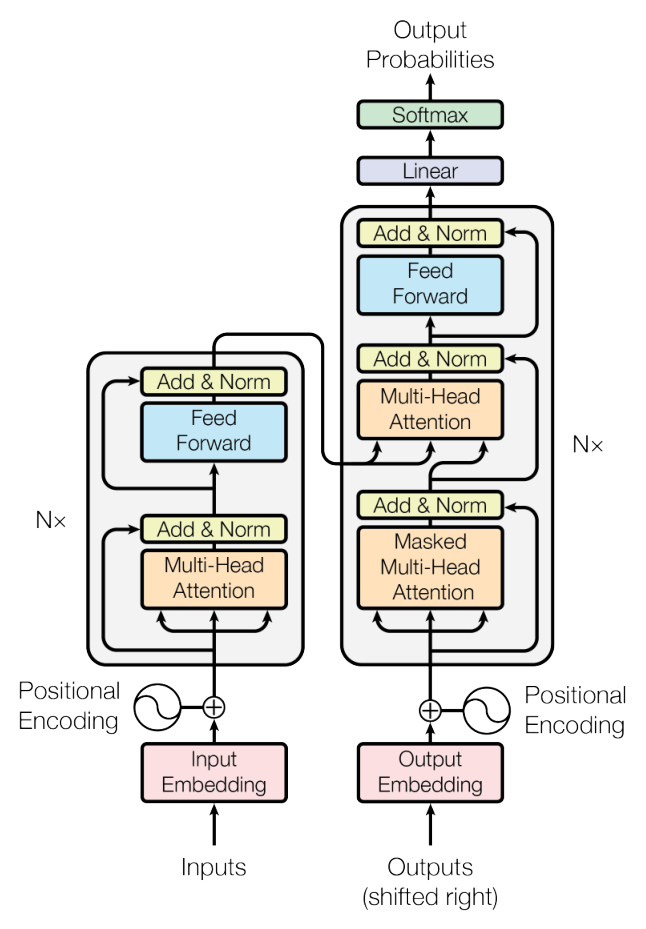

**원문 그림 1.** 왼쪽이 인코더 층, 오른쪽이 디코더 층이고 각각 $N\times$ 로 쌓는다. 디코더 입력은 「출력(오른쪽으로 한 자리 민 것)」.

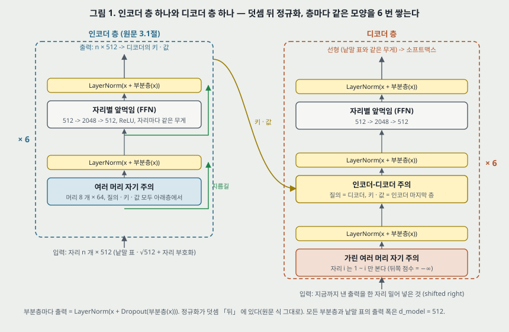

**그림 1.** 원문 3.1절의 글을 그대로 옮겨 그렸다. 디코더 층의 지름길은 인코더와 같은 꼴이라 화살표를 생략했다.

**인코더.** 같은 층 $N = 6$ 개. 층마다 부분층 둘 — 여러 머리 자기 주의, 그리고 자리별 완전연결 앞먹임. 부분층마다 **지름길(residual connection) [10]** 을 두르고 그 뒤에 **층 정규화 [1]** 를 둔다:

$$\text{출력} = \mathrm{LayerNorm}\big(x + \mathrm{Sublayer}(x)\big) \qquad (\text{원문 3.1절})$$

지름길을 쓰려고 모든 부분층과 낱말 표 층의 출력 폭을 $d_{\text{model}} = 512$ 로 맞춘다.

**디코더.** 같은 층 $N = 6$ 개. 인코더 층의 두 부분층 사이에 **인코더 출력 위의 여러 머리 주의**를 셋째 부분층으로 넣는다. 그리고 디코더의 자기 주의를 **뒤 자리를 보지 못하게** 고친다(7절). 출력 낱말 표를 한 자리 미는 것과 합쳐, 자리 $i$ 의 예측이 $i$ 앞의 알려진 출력에만 기댄다.

**자기회귀.** 디코더는 출력을 한 기호씩 내고, 이미 낸 기호를 다음 기호를 낼 때 입력으로 더 쓴다(원문 3절, [9]). **학습 때는 정답 출력 전체를 한 번에 넣고 가림으로 미래를 막으므로 자리 병렬로 계산되지만, 번역을 만들 때는 여전히 한 기호씩이다.** 원문 7절이 「생성을 덜 순차적으로 만드는 것」 을 다음 목표로 적는 것이 이 자리다(22절).

> 정규화가 **덧셈 뒤**에 있다(원문 식 그대로). 뒤에 널리 쓰이는 꼴은 정규화를 부분층 앞에 두는 것이고, 이 노트의 대상이 아니다. 둘을 섞지 않는다(24절).

---

## 5. 비율 맞춘 내적 주의 — 식 (1) (3.2 · 3.2.1절)

**주의의 정의(3.2절).** 질의 하나와 키-값 짝들의 집합을 출력 하나로 보내는 함수. 질의 · 키 · 값 · 출력 모두 벡터다. 출력은 값들의 가중합이고, 각 값의 무게는 질의와 그 키의 맞음 함수(compatibility function)로 계산한다.

**이 편의 주의.** 질의와 키는 $d_k$ 차원, 값은 $d_v$ 차원. 질의와 모든 키의 내적을 각각 $\sqrt{d_k}$ 로 나누고 소프트맥스로 무게를 얻는다. 질의 여럿을 행렬 $Q$ 로, 키 · 값을 $K$ · $V$ 로 묶어 한 번에:

$$\mathrm{Attention}(Q, K, V) = \mathrm{softmax}\left(\frac{Q K^{\top}}{\sqrt{d_k}}\right) V \qquad (1)$$

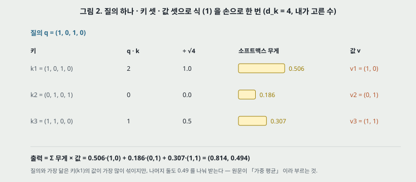

**그림 2.** 식 (1) 을 질의 하나 · 키 셋으로 손으로 한 번 계산한 것(수는 내가 골랐다). 내적 2 · 0 · 1 을 $\sqrt{4} = 2$ 로 나누면 1.0 · 0.0 · 0.5, 소프트맥스 무게 0.506 · 0.186 · 0.307, 출력 (0.814, 0.494). 질의와 같은 키 k1 이 가장 큰 무게를 받지만 나머지 둘도 합 0.493 을 받는다 — 3절이 말한 「평균 내므로 분해능이 준다」 의 작은 꼴이다.

**더하기 주의와의 견줌(원문의 말).**

- 두 주의는 「이론적 복잡도가 비슷하지만」 내적 주의는 「고도로 최적화된 행렬 곱 코드로 구현할 수 있어 실제로 훨씬 빠르고 공간 효율이 좋다」. **이 편 안에서 두 방식의 속도를 잰 수는 없다.**
- $d_k$ 가 작으면 둘이 비슷하고, $d_k$ 가 크면 **나누지 않은** 내적 주의를 더하기 주의가 앞선다고 [3](Britz 외 2017)을 인용한다.
- 원문은 그 까닭을 **「짐작한다(we suspect)」**: $d_k$ 가 크면 내적의 크기가 커져 소프트맥스가 기울기가 아주 작은 영역으로 밀린다. 그래서 $1/\sqrt{d_k}$ 로 나눈다.

**각주 4 의 셈.** 질의와 키의 성분이 평균 0 · 분산 1 의 독립 확률 변수면 $q \cdot k = \sum_{i=1}^{d_k} q_i k_i$ 는 평균 0 · 분산 $d_k$. 작은 예시로, $d_k = 64$ 면 표준편차 8, 나누면 1 이다.

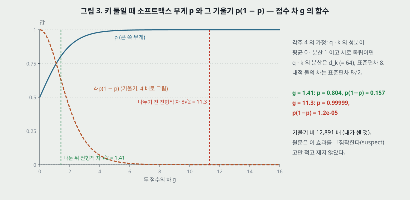

**그림 3 — 「짐작」 을 수로 옮겨 본 것(내가 센 것, 예시이지 증거가 아니다).** 키가 둘이면 소프트맥스 무게는 점수 차 $g$ 의 시그모이드 $p = \sigma(g)$ 이고, $g$ 에 대한 기울기는 $p(1-p)$ 다. 각주 4 의 가정에서 내적 둘의 차의 표준편차는 나누기 전 $8\sqrt{2} = 11.3$, 나눈 뒤 $\sqrt{2} = 1.41$. 전형적인 차에서 $p(1-p)$ 는 나누기 전 $1.2 \times 10^{-5}$, 나눈 뒤 0.157 — **12,891 배**다. 이 그림이 보이는 것은 각주 4 의 가정 아래의 크기이고, **원문은 $1/\sqrt{d_k}$ 를 뺀 변형을 표 3 에 넣지 않았다**(20절 · 23절 넷).

---

## 6. 여러 머리 주의 (3.2.2절)

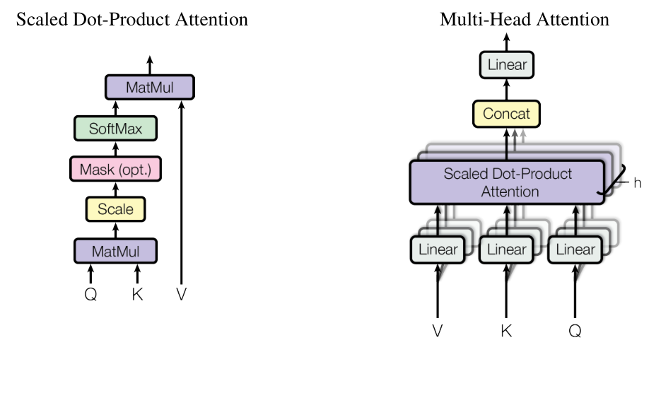

**원문 그림 2.** 왼쪽 비율 맞춘 내적 주의, 오른쪽 여러 머리 주의. **오른쪽 그림의 입력 순서가 V · K · Q 로 왼쪽(Q · K · V)과 반대다**(24절).

**원문의 식.**

$$\mathrm{MultiHead}(Q, K, V) = \mathrm{Concat}(\mathrm{head}_1, \dots, \mathrm{head}_h)\, W^O, \qquad \mathrm{head}_i = \mathrm{Attention}(Q W_i^Q, K W_i^K, V W_i^V)$$

투영 행렬 $W_i^Q, W_i^K \in \mathbb{R}^{d_{\text{model}} \times d_k}$, $W_i^V \in \mathbb{R}^{d_{\text{model}} \times d_v}$, $W^O \in \mathbb{R}^{h d_v \times d_{\text{model}}}$. 이 편은 $h = 8$, $d_k = d_v = d_{\text{model}}/h = 64$.

**원문이 든 까닭.** 「여러 머리 주의는 서로 다른 표현 부분공간의 정보를 서로 다른 자리에서 함께 볼 수 있게 한다. 머리 하나면 평균 내기가 이것을 막는다.」 그리고 「머리마다 차원이 줄어 전체 계산 비용이 폭 전체로 머리 하나를 쓰는 주의와 비슷하다(similar)」.

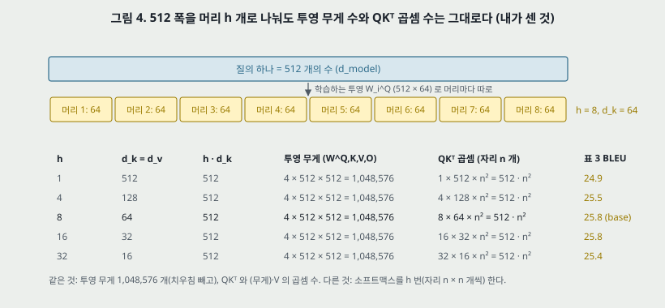

**그림 4 — 「비슷하다」 를 센 것(내가 센 것).** $h \cdot d_k = 512$ 를 지키면 투영 무게는 $h$ 와 상관없이 $4 \times 512 \times 512 = 1{,}048{,}576$ 개(치우침 빼고)로 **같고**, $QK^\top$ 의 곱셈 수도 $h \times d_k \times n^2 = 512 n^2$ 로 **같다**. 다른 것은 소프트맥스를 $h$ 번(각 $n \times n$) 한다는 것뿐이다. 원문 표 3 (A) 가 이 조건으로 머리 수를 바꾼다(18절) — 「계산량을 일정하게 두고」.

---

## 7. 주의를 쓰는 세 자리와 가림 (3.2.3절)

1. **인코더-디코더 주의.** 질의는 디코더 앞 층, 「기억(memory)」 키 · 값은 인코더 출력. 디코더의 모든 자리가 입력 열의 모든 자리를 본다. 원문 — 「[31, 2, 8] 같은 열-대-열 모델의 전형적인 인코더-디코더 주의를 흉내 낸다」.
2. **인코더 자기 주의.** 키 · 값 · 질의가 모두 인코더 앞 층 출력. 인코더의 각 자리가 앞 층의 모든 자리를 본다.
3. **디코더 자기 주의.** 디코더의 각 자리가 **자기와 그 앞 자리까지만** 본다. 자기회귀 성질을 지키려 왼쪽으로 흐르는 정보를 막는데, 비율 맞춘 내적 주의 **안에서** 허용되지 않는 연결의 소프트맥스 입력을 $-\infty$ 로 둔다.

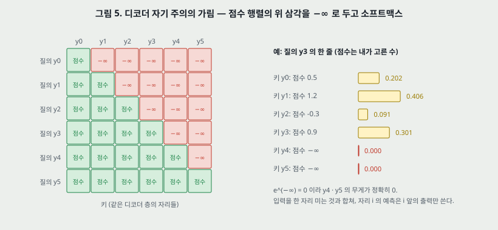

**그림 5.** 출력 6 토큰의 점수 행렬. 대각선 위 15 칸이 $-\infty$ 이고, $e^{-\infty} = 0$ 이라 그 자리의 무게가 정확히 0 이다. 오른쪽은 질의 y3 의 한 줄을 내가 고른 점수로 계산한 것 — 무게 0.202 · 0.406 · 0.091 · 0.301 · 0 · 0.

---

## 8. 자리별 앞먹임 (3.3절)

$$\mathrm{FFN}(x) = \max(0,\, x W_1 + b_1)\, W_2 + b_2 \qquad (2)$$

자리마다 따로, 같은 무게로. 층마다 무게는 다르다. 원문 — 「커널 크기 1 인 합성곱 둘로도 말할 수 있다」. 입력 · 출력 512, 안쪽 $d_{ff} = 2048$.

**책상 확인 — 이 부분층이 층의 파라미터 대부분이다(내가 센 것).** 인코더 층 하나의 파라미터 3,152,384 개 가운데 FFN 이 2,099,712 개(66.6%), 자기 주의가 1,050,624 개(33.3%), 층 정규화 둘이 2,048 개다. 계산량도 같은 비율 쪽이다 — n = 50 에서 FFN 의 곱셈-덧셈 $2 n d\, d_{ff} = 104{,}857{,}600$ 대 주의 부분층 $4 n d^2 + 2 n^2 d = 54{,}988{,}800$(11절).

---

## 9. 낱말 표 공유와 $\sqrt{d_{\text{model}}}$ 곱 (3.4절)

- 입력 · 출력 토큰을 $d_{\text{model}}$ 차원 벡터로 바꾸는 학습하는 낱말 표, 디코더 출력을 다음 토큰 확률로 바꾸는 선형 + 소프트맥스.
- **세 자리 — 원문 쪽 낱말 표, 번역 쪽 낱말 표, 소프트맥스 앞 선형 — 가 무게 행렬 하나를 나눠 쓴다**([24] Press · Wolf 와 비슷하게).
- 낱말 표 층에서 그 무게에 $\sqrt{d_{\text{model}}}$ 를 곱한다. base 면 $\sqrt{512} = 22.6$. 원문은 까닭을 적지 않았다.

> 세 자리가 행렬 하나를 쓰려면 원문 쪽과 번역 쪽이 **같은 어휘**를 써야 한다. 영어 -> 독일어는 5.1절이 「원문과 번역이 함께 쓰는(shared source-target) 어휘」 라고 밝힌다. 영어 -> 프랑스어의 word-piece 32,000 이 함께 쓰는 어휘인지는 원문이 적지 않았다(24절).

---

## 10. 자리 부호화 (3.5절)

되먹임도 합성곱도 없으므로 열의 순서를 쓰려면 자리 정보를 넣어야 한다. 인코더 · 디코더 맨 아래에서 낱말 벡터에 **같은 폭(512)의 자리 부호화를 더한다.**

$$PE_{(pos,\, 2i)} = \sin\left(pos / 10000^{2i/d_{\text{model}}}\right), \qquad PE_{(pos,\, 2i+1)} = \cos\left(pos / 10000^{2i/d_{\text{model}}}\right)$$

$pos$ 는 자리, $i$ 는 차원. 차원마다 사인 곡선 하나다.

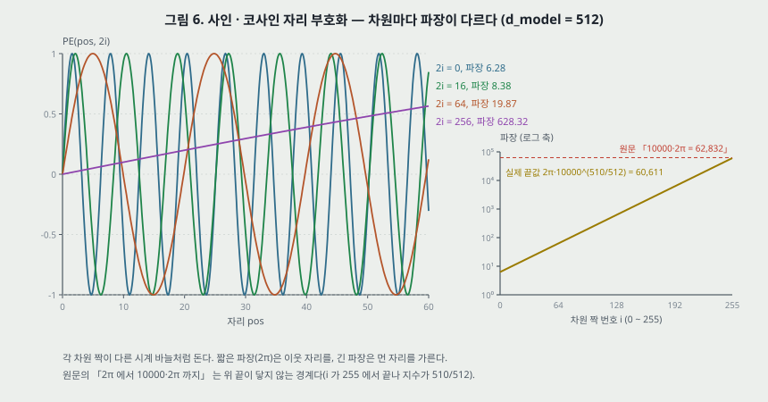

**그림 6.** 왼쪽은 차원 넷의 곡선(자리 0 ~ 60). 오른쪽은 차원 짝 $i = 0, \dots, 255$ 의 파장 $2\pi \cdot 10000^{2i/512}$ (로그 축). 원문은 「파장이 $2\pi$ 에서 $10000 \cdot 2\pi$ 까지 기하수열을 이룬다」 고 적는데, $2i$ 가 510 에서 끝나 **위 끝은 $2\pi \cdot 10000^{510/512} = 60{,}611$** 로 원문의 경계값 62,832 에 닿지 않는다(내가 센 것, 25절 여섯).

**원문이 이 함수를 고른 까닭 — 가설.** 「어떤 고정된 차이 $k$ 에 대해서도 $PE_{pos+k}$ 를 $PE_{pos}$ 의 선형 함수로 나타낼 수 있으므로, 모델이 상대 자리로 주의하는 법을 쉽게 배울 것이라고 **가설을 세웠다(hypothesized)**.」

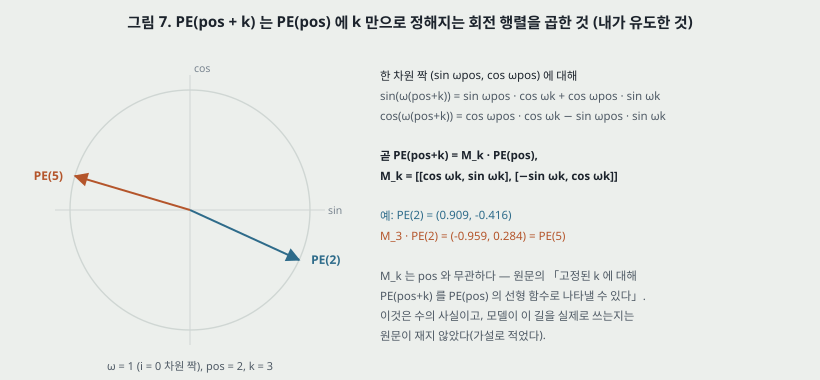

**그림 7 — 「선형 함수」 를 유도한 것(내가 유도한 것).** 한 차원 짝의 진동수를 $\omega_i = 10000^{-2i/d_{\text{model}}}$ 라 두면 덧셈 정리로

$$\begin{pmatrix} \sin \omega_i (pos+k) \\ \cos \omega_i (pos+k) \end{pmatrix} = \begin{pmatrix} \cos \omega_i k & \sin \omega_i k \\ -\sin \omega_i k & \cos \omega_i k \end{pmatrix} \begin{pmatrix} \sin \omega_i\, pos \\ \cos \omega_i\, pos \end{pmatrix}$$

이고 가운데 행렬은 $pos$ 와 무관하다. 512 차원 전체로는 이런 2 × 2 회전 256 개를 대각으로 늘어놓은 행렬 하나다. 작은 예시로, $\omega = 1$, $pos = 2$, $k = 3$ 이면 $PE(2) = (0.909, -0.416)$ 에 회전을 곱해 $(-0.959, 0.284) = PE(5)$. **이것은 수의 사실이고, 모델이 이 길로 상대 자리를 쓰는지는 원문이 재지 않았다.**

**학습하는 자리 표현과의 견줌.** 학습하는 자리 표현 [8] 도 써 보았고 「두 판이 거의 같은 결과(nearly identical results)」 — 표 3 (E) 에서 개발셋 BLEU 25.7 대 25.8, 혼잡도 4.92 대 4.92(18절). 사인 판을 고른 까닭은 「학습 때 본 것보다 긴 열로 넘겨 쓸(extrapolate) **수도 있기(may allow)**」 때문이다. **더 긴 열에서 두 판을 견준 결과는 이 편에 없다**(23절 다섯).

---

## 11. 왜 자기 주의인가 — 표 1 (4절)

원문은 변수 길이 열 $(x_1, \dots, x_n)$ 을 같은 길이의 열 $(z_1, \dots, z_n)$ 으로 보내는 층($x_i, z_i \in \mathbb{R}^d$)을 세 기준으로 견준다 — 층당 전체 계산량, 병렬화할 수 있는 계산량(최소 순차 연산 수로 잼), 먼 의존 사이의 경로 길이.

| 층 종류 | 층당 계산량 | 순차 연산 | 최대 경로 길이 |
|---|---|---|---|
| 자기 주의 | $O(n^2 \cdot d)$ | $O(1)$ | $O(1)$ |
| 되먹임 | $O(n \cdot d^2)$ | $O(n)$ | $O(n)$ |
| 합성곱 | $O(k \cdot n \cdot d^2)$ | $O(1)$ | $O(\log_k n)$ |
| 제한된 자기 주의 | $O(r \cdot n \cdot d)$ | $O(1)$ | $O(n/r)$ |

(원문 표 1 을 옮겼다. $k$ 는 합성곱 핵 크기, $r$ 은 제한된 자기 주의의 이웃 크기.)

**원문의 결론 문장.** 「계산량 면에서, 열 길이 n 이 표현 차원 d 보다 작을 때 자기 주의 층이 되먹임 층보다 빠르고, 이것이 기계 번역의 최고 모델이 쓰는 문장 표현(word-piece · BPE)에서 가장 흔한 경우다.」 그리고 아주 긴 열에는 자리 주변 $r$ 만 보는 제한된 자기 주의를 쓸 수 있고 경로 길이가 $O(n/r)$ 로 는다 — 「다음 연구에서 더 살펴보려 한다」.

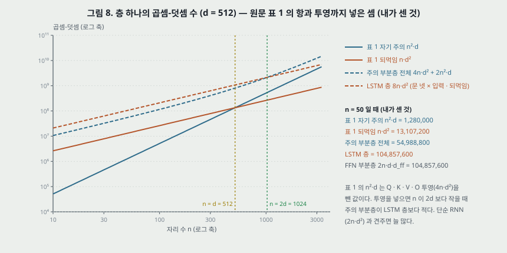

**그림 8 — 표 1 의 첫 열을 수로 옮긴 것(내가 센 것, 곱셈-덧셈, d = 512).** n = 50 에서 표 1 의 두 항은 자기 주의 $n^2 d = 1{,}280{,}000$ 대 되먹임 $n d^2 = 13{,}107{,}200$ 이고, 두 항이 같아지는 자리는 n = d = 512 다. 원문의 「n < d 면 빠르다」 가 이 두 항의 비교다. 그런데 **표 1 의 자기 주의 항은 질의 · 키 · 값 · 출력을 만드는 투영 $4 n d^2$ 를 넣지 않았다.** 이 편의 주의 부분층 전체는 $4 n d^2 + 2 n^2 d$($QK^\top$ 과 무게 × $V$ 가 각각 $n^2 d$) 이고 n = 50 에서 54,988,800 이다.

- **주의 부분층 전체 대 LSTM 층.** LSTM 한 층(문 넷 × 입력 · 되먹임)은 $8 n d^2 = 104{,}857{,}600$. 둘이 같아지는 자리는 $4nd^2 + 2n^2 d = 8nd^2$ 에서 **n = 2d = 1,024**. 이보다 짧으면 주의 부분층이 적다.
- **주의 부분층 전체 대 단순 되먹임 층.** 단순 RNN(입력 · 되먹임 무게 둘)은 $2 n d^2 = 26{,}214{,}400$ — 주의 부분층이 **어느 n 에서나 많다.**
- **Transformer 층 전체.** 인코더 층은 주의 부분층에 FFN($2 n d\, d_{ff} = 104{,}857{,}600$)이 붙어 n = 50 에서 159,846,400. 원문이 같은 문단에서 「분리 합성곱은 k = n 이어도 자기 주의 층과 자리별 앞먹임 층을 합친 것과 계산량이 같다 — 우리 모델이 쓰는 방식」 이라 적으므로 원문도 층 전체 비용이 $n d^2$ 꼴임을 안다.

**곧 표 1 의 첫 열이 보이는 것은 「곱셈 수가 적다」 가 아니라 「n² 항이 n < d 에서 작다」 이고, 이 편의 실제 이득은 둘째 열(순차 연산 $O(1)$)에서 온다.** 원문 1절의 동기도 둘째 열이다.

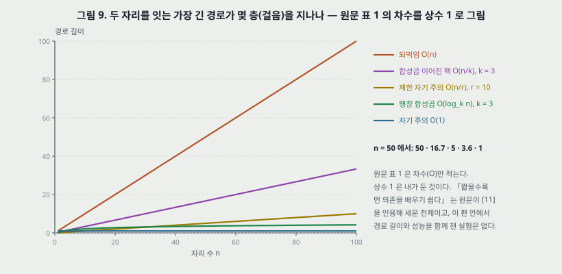

**그림 9.** 셋째 열을 상수 1 로 그린 것(상수는 내가 둔 것). n = 50 이면 되먹임 50, 이어진 핵 합성곱(k = 3) 16.7, 제한된 자기 주의(r = 10) 5, 팽창 합성곱(k = 3) 3.6, 자기 주의 1. **「경로가 짧을수록 먼 의존을 배우기 쉽다」 는 원문이 [11](Hochreiter 외 2001)을 인용해 세운 전제이고, 이 편 안에 경로 길이와 성능을 함께 잰 실험은 없다.**

**덤으로 든 것 — 해석.** 「자기 주의가 더 해석 가능한 모델을 낼 수 있다. 머리마다 다른 일을 배우는 것이 분명하고, 여럿이 문장의 통사 · 의미 구조와 관련된 행동을 보인다.」 근거로 부록을 가리키지만 **이 파일에 부록이 없다.** 이 노트는 이 주장을 받칠 수를 이 편에서 찾지 못했다(25절 둘).

---

## 12. 학습 데이터와 배치 (5.1절)

| 언어 짝 | 데이터 | 토큰 나누기 | 어휘 |
|---|---|---|---|
| 영어 -> 독일어 | WMT 2014, 문장 쌍 약 450 만 | BPE [3] | 원문 · 번역이 함께 쓰는 약 37,000 |
| 영어 -> 프랑스어 | WMT 2014, 문장 3,600 만 | word-piece [31] | 32,000 |

- 문장 쌍을 열 길이가 비슷한 것끼리 묶어 배치했다(원문 「approximate sequence length」). 배치마다 **원문 토큰 약 25,000 · 번역 토큰 약 25,000**.
- **BPE 의 인용 [3] 은 Britz 외 「Massive exploration of NMT architectures」 다.** 같은 편 4절은 BPE 를 [25](Sennrich 외)로 인용한다. 5.1절의 [3] 은 인용 번호 실수로 읽힌다(25절 하나).
- 시험셋 · 개발셋은 6절에서 나온다 — 표 2 는 newstest2014, 표 3 은 newstest2013.

---

## 13. 장비와 일정 (5.2절)

- 기계 한 대, **NVIDIA P100 8 장**.
- base: 걸음마다 약 0.4 초, **100,000 걸음 또는 12 시간**.
- big(표 3 맨 아래 줄): 걸음마다 1.0 초, **300,000 걸음(3.5 일)**.

**책상 확인(내가 센 것).**

- base 100,000 × 0.4 초 = 40,000 초 = **11.1 시간**. 원문 「12 시간」 과 0.9 시간 차인데, 원문이 「약 0.4 초」 라 적었으므로 걸음당 0.43 초면 12 시간이다. 어긋남으로 세지 않는다.
- big 300,000 × 1.0 초 = **3.47 일**. 원문 「3.5 일」 과 맞는다.
- 처리 속도: 걸음마다 원문 · 번역 토큰 약 50,000 개이므로 base 는 초당 약 125,000 토큰, big 은 약 50,000 토큰(8 장 합). **이것이 이 편이 준 수로 셀 수 있는 유일한 속도이고, 같은 장비의 되먹임 모델 속도는 없다**(21절).
- base 가 본 번역 쪽 토큰은 100,000 × 25,000 = 25 억 개. 데이터 전체의 토큰 수를 원문이 적지 않아 몇 바퀴인지는 셀 수 없다.

---

## 14. 최적화 — 식 (3) 학습률 (5.3절)

Adam [17], $\beta_1 = 0.9$, $\beta_2 = 0.98$, $\epsilon = 10^{-9}$. 학습률은

$$lrate = d_{\text{model}}^{-0.5} \cdot \min\left(step\_num^{-0.5},\; step\_num \cdot warmup\_steps^{-1.5}\right) \qquad (3)$$

처음 $warmup\_steps$ 걸음 동안 곧게 오르고 그 뒤 걸음 수의 제곱근에 반비례해 준다. $warmup\_steps = 4000$.

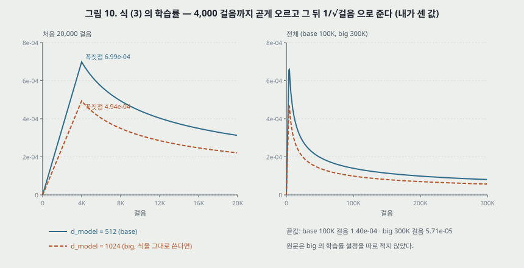

**그림 10 — 식 (3) 의 값(내가 센 것).**

| | d_model = 512 (base) | d_model = 1024 (big, 식을 그대로 쓴다면) |
|---|---|---|
| 꼭짓점(4,000 걸음) | $6.99 \times 10^{-4}$ | $4.94 \times 10^{-4}$ |
| 1,000 걸음 | $1.75 \times 10^{-4}$ | $1.24 \times 10^{-4}$ |
| 끝(base 100K · big 300K) | $1.40 \times 10^{-4}$ | $5.71 \times 10^{-5}$ |

- 두 갈래가 꼭짓점에서 만나는 것은 $4000^{-0.5} = 4000 \cdot 4000^{-1.5}$ 이기 때문이다.
- base 는 전체 100,000 걸음 가운데 4% 가 데우기(warmup)다.
- **원문은 big 에 같은 식 · 같은 4,000 을 썼는지 적지 않았다.** 식이 $d_{\text{model}}$ 을 담고 있어 그대로 쓰면 꼭짓점이 0.71 배($1/\sqrt{2}$)가 된다.
- **데우기를 빼거나 4,000 을 바꾼 결과는 이 편에 없다.** 데우기가 왜 필요한지도 원문이 적지 않았다(23절 넷).

---

## 15. 정칙화 (5.4절)

**잔차 드롭아웃.** 부분층 출력에, 부분층 입력에 더해 정규화하기 **전에** 드롭아웃 [27]. 인코더 · 디코더 맨 아래의 「낱말 벡터 + 자리 부호화」 합에도. base $P_{drop} = 0.1$. big 은 표 3 에서 0.3, 그러나 **영어 -> 프랑스어 big 은 0.1**(6.1절).

**라벨 다듬기.** $\epsilon_{ls} = 0.1$ [30]. 원문 — 「모델이 더 불확실해지도록 배우므로 혼잡도는 나빠지지만 정확도와 BLEU 는 좋아진다」. 이 말의 근거는 표 3 (D) 의 두 줄이다 — $\epsilon_{ls} = 0$ 이면 혼잡도 4.67 · BLEU 25.3, 0.1(base)이면 4.92 · 25.8, 0.2 면 5.47 · 25.7(18절). 혼잡도는 세 값 모두 원문 말대로 움직인다. BLEU 는 0 -> 0.1 에서 +0.5, 0.1 -> 0.2 에서 −0.1 이다. **원문은 「정확도」 를 말하지만 정확도 수는 표에 없다.**

> 원문은 5.4절 머리에서 「세 가지 정칙화」 라고 적고 둘(잔차 드롭아웃, 라벨 다듬기)만 소제목으로 낸다. 셋째가 무엇인지 이 파일에서 찾지 못했다(25절 셋).

---

## 16. 파라미터 다시 세기 — 표 3 의 params 열 (내가 센 것)

원문은 base 65M, big 213M 이라고만 적고 셈한 방식을 적지 않는다. 층 · 폭에서 다시 센다.

**셈한 방식(가정을 밝힌다).**

- 주의 부분층: $W^Q, W^K, W^V, W^O$ 넷 = $4 d^2$(일반형은 $2 d\, h d_k + 2 d\, h d_v$) + 치우침 $2 h d_k + h d_v + d$.
- FFN: $2 d\, d_{ff} + d_{ff} + d$.
- 층 정규화: $\gamma, \beta$ 로 $2d$ 씩. 인코더 층에 둘, 디코더 층에 셋.
- 낱말 표: 3.4절대로 **원문 쪽 · 번역 쪽 낱말 표와 소프트맥스 앞 선형이 $V \times d$ 행렬 하나**. 소프트맥스 치우침은 넣지 않았다($V$ 개, 4 만이면 0.04M).

| | 인코더 6 층 | 디코더 6 층 | 몸통 합 | 낱말 표 ($V$ = 37,000) | 합 | 원문 |
|---|---|---|---|---|---|---|
| base | 18,914,304 | 25,224,192 | 44,138,496 | 18,944,000 | **63,082,496** | 65M |
| big | 75,577,344 | 100,780,032 | 176,357,376 | 37,888,000 | **214,245,376** | 213M |

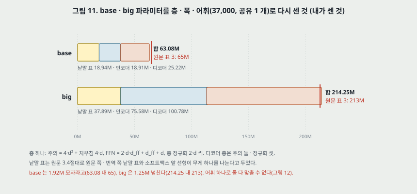

**그림 11.** 본문의 어휘 37,000 으로 세면 base 는 1.92M 모자라고 big 은 1.25M 넘친다.

**거꾸로 — params 열이 허락하는 어휘.** 표 3 에서 params 가 적힌 줄은 열한 줄이다. 줄마다 몸통을 세고, 적힌 정수(M)가 반올림 값이라 ±0.5M 안에 들도록 하는 공유 어휘 $V$ 의 구간을 구했다.

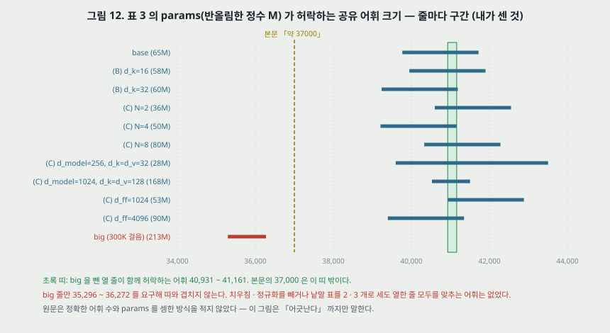

**그림 12.**

- **base 와 그 변형 열 줄(base · (B) 둘 · (C) 일곱)은 $V$ = 40,931 ~ 41,161 에서 모두 맞는다.** 예를 들어 (B) $d_k = 16$ 은 18 개 주의 부분층에서 $W^Q, W^K$ 가 줄어 몸통이 7,091,712 줄고, $V$ = 41,000 이면 58.04M — 원문 58. (C) N = 8 은 79.84M — 원문 80.
- **big 한 줄만 $V$ = 35,296 ~ 36,272 를 요구해 위 구간과 겹치지 않는다.**
- 치우침 · 층 정규화를 빼고 세거나, 낱말 표를 둘(원문 쪽 · 번역 쪽)이나 셋으로 따로 세도 **열한 줄을 모두 맞추는 $V$ 는 없었다.**
- 본문의 「약 37000」 은 base 쪽 구간에도 big 구간에도 들지 않는다.

**이 셈이 말하는 것과 말하지 않는 것.** 원문 표 3 의 params 가 서로 하나의 셈법 · 하나의 어휘로 나온 값이 아니거나, big 의 짜임이 표에 적힌 것과 다르거나, 내 가정 하나가 틀렸다. **원문이 셈법과 정확한 어휘를 적지 않아 이 노트는 「어긋난다」 까지만 말한다.** (A) 네 줄은 params 칸이 비어 있는데, 내 셈으로는 넷 모두 base 와 몸통이 같다(44,138,496) — 원문의 「계산량을 일정하게」 와 맞는다.

---

## 17. 표 2 — 번역 결과와 학습 비용 (6.1절)

| 모델 | BLEU EN-DE | BLEU EN-FR | 비용 EN-DE | 비용 EN-FR |
|---|---|---|---|---|
| ByteNet [15] | 23.75 | | | |
| Deep-Att + PosUnk [32] | | 39.2 | | 1.0·10²⁰ |
| GNMT + RL [31] | 24.6 | 39.92 | 2.3·10¹⁹ | 1.4·10²⁰ |
| ConvS2S [8] | 25.16 | 40.46 | 9.6·10¹⁸ | 1.5·10²⁰ |
| MoE [26] | 26.03 | 40.56 | 2.0·10¹⁹ | 1.2·10²⁰ |
| Deep-Att + PosUnk 앙상블 [32] | | 40.4 | | 8.0·10²⁰ |
| GNMT + RL 앙상블 [31] | 26.30 | 41.16 | 1.8·10²⁰ | 1.1·10²¹ |
| ConvS2S 앙상블 [8] | 26.36 | **41.29** | 7.7·10¹⁹ | 1.2·10²¹ |
| Transformer (base) | 27.3 | 38.1 | **3.3·10¹⁸** (두 칸에 걸친 값 하나) | |
| Transformer (big) | **28.4** | 41.0 | 2.3·10¹⁹ (두 칸에 걸친 값 하나) | |

(원문 표 2 를 옮겼다. 굵은 글씨도 원문 그대로. 시험셋 newstest2014.)

**설정(6.1절).** base 는 10 분 간격으로 쓴 마지막 체크포인트 5 개의 평균, big 은 마지막 20 개의 평균. 빔 크기 4, 길이 벌점 $\alpha = 0.6$ [31] — 「개발셋에서 실험한 뒤 골랐다」. 출력 최대 길이는 입력 길이 + 50, 가능하면 일찍 끝낸다.

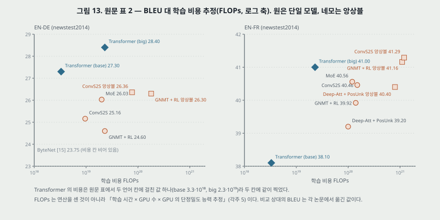

**그림 13.** 원문 표 2 를 BLEU 대 비용(로그 축)으로 찍은 것.

**원문의 주장과 표의 수를 나란히(내가 센 차).**

| 원문 문장 | 표의 수 | 판정 |
|---|---|---|
| big EN-DE 가 「앙상블을 포함한 앞 최고를 2.0 넘게」 앞선다 | 28.4 − 26.36 = **2.04** | 맞다 |
| 「base 조차 앞서 나온 모든 모델 · 앙상블을 넘는다, 경쟁 모델 누구의 학습 비용보다 작은 몫으로」 | EN-DE 27.3 − 26.36 = 0.94. 비용 3.3·10¹⁸ 은 다음으로 싼 ConvS2S(9.6·10¹⁸)의 0.34 배 | EN-DE 에서 맞다. **EN-FR base 38.1 은 표의 모든 EN-FR 모델(최저 39.2)보다 낮다** — 문장은 EN-DE 문단 안이라 틀린 말은 아니다 |
| big EN-FR 41.0 이 「앞서 나온 모든 단일 모델을 넘는다」 | 단일 최고 MoE 40.56, 차 0.44 | 맞다 |
| 「앞 최고 모델의 학습 비용의 1/4 아래로」 | MoE 1.2·10²⁰ 대비 0.19 배 | 맞다 |
| 표 2 캡션: 「EN-DE 와 EN-FR 시험셋에서 앞 최고 모델들보다 나은 BLEU 를, 학습 비용의 작은 몫으로」 | EN-FR 앙상블 41.29 · 41.16 이 41.0 보다 높다. big EN-DE 비용 2.3·10¹⁹ 은 GNMT + RL 단일과 같고, MoE(2.0·10¹⁹)의 1.15 배, ConvS2S(9.6·10¹⁸)의 2.40 배 | **센 편.** EN-FR 은 단일 모델끼리만 맞고, 「작은 몫」 은 base 와 앙상블 대비로만 맞는다 |
| 결론: 「두 과제 모두에서 새 최고」 | EN-FR 41.0 < 41.29 | **센 편**(Abstract 는 「단일 모델 최고」 로 정확히 적었다) |

**책상 확인 — 비용 열 다시 세기(내가 센 것).** 각주 5 의 P100 9.5 TFLOPS 로

- base: 12 시간 × 3,600 초 × 8 장 × 9.5 × 10¹² = **3.28 × 10¹⁸** — 원문 3.3·10¹⁸.
- big: 3.5 일 × 86,400 초 × 8 장 × 9.5 × 10¹² = **2.30 × 10¹⁹** — 원문 2.3·10¹⁹.

두 값 모두 맞는다. 그리고 이 셈이 보이는 것은 **「비용」 이 GPU 의 단정밀도 최대 능력을 학습 시간 동안 다 썼다고 친 상한**이라는 점이다. 실제로 쓴 연산 수가 아니다. 비교 상대의 비용은 같은 셈을 그 논문들이 적은 학습 시간 · GPU 종류(K80 2.8, K40 3.7, M40 6.0 TFLOPS)로 한 것으로 읽힌다 — **원문은 상대마다 어떤 시간 · 몇 장을 넣었는지 적지 않았다.** GPU 의 실효 사용률이 모델 종류마다 다르면(행렬 곱이 큰 모델은 높고, 걸음이 순차인 되먹임 모델은 낮다), 이 열은 그 차이를 「비용」 쪽에 그대로 싣는다.

**같은 조건인가.** 비교 상대의 BLEU 는 모두 각 논문에서 옮긴 값이다. 이 편이 같은 데이터 · 같은 셈법으로 상대를 다시 돌리지 않았다. **BLEU 를 어떻게 셌는지(토큰 나누기 · 대소문자 · 독일어 합성어 쪼개기)가 이 파일에 적혀 있지 않다** — 그래서 0.94 · 2.04 의 차이가 셈법 차이를 넘는지 이 표로 가를 수 없다. Transformer 쪽만 체크포인트 평균 · 개발셋에서 고른 빔 · 길이 벌점을 썼고, 상대의 해독 설정은 각자의 것이다.

---

## 18. 표 3 — 변형 (6.2절)

**설정.** base 를 한 군데씩 바꿔 **영어 -> 독일어 개발셋 newstest2013** 에서 잰다. 빔 탐색은 6.1절대로, **체크포인트 평균은 하지 않았다.** 적히지 않은 값은 base 와 같다. 혼잡도는 BPE 조각마다라 낱말 단위 혼잡도와 견주면 안 된다고 캡션이 밝힌다.

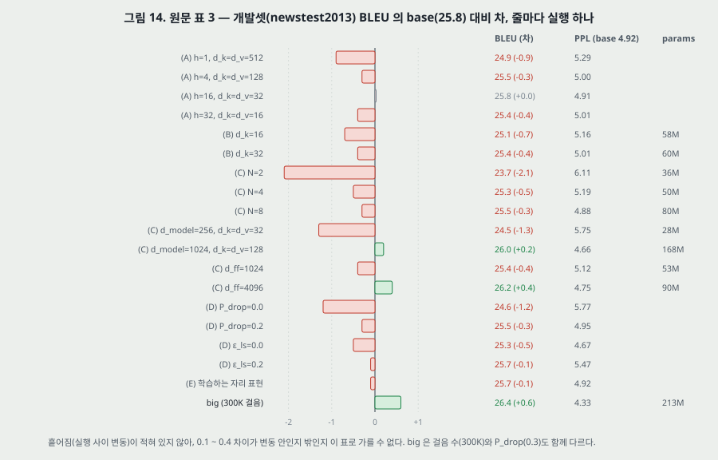

**그림 14.** 원문 표 3 의 BLEU 를 base(25.8) 대비 차로. 오른쪽에 혼잡도 · params.

**(A) 머리 수 — 계산량 일정.**

| h | d_k = d_v | PPL | BLEU |
|---|---|---|---|
| 1 | 512 | 5.29 | 24.9 |
| 4 | 128 | 5.00 | 25.5 |
| 8 (base) | 64 | 4.92 | 25.8 |
| 16 | 32 | 4.91 | 25.8 |
| 32 | 16 | 5.01 | 25.4 |

원문 — 「머리 하나는 가장 좋은 설정보다 0.9 BLEU 나쁘고, 머리가 너무 많아도 질이 떨어진다.」 0.9 는 25.8 − 24.9 로 맞다. 「너무 많아도」 의 근거는 h = 32 의 −0.4 한 줄이다. h = 16 은 base 와 BLEU 같고 혼잡도 0.01 낮다.

**(B) 키 크기 $d_k$ 만 줄임.** $d_k$ = 16 -> 25.1 (58M), 32 -> 25.4 (60M). 원문 — 「키 크기를 줄이면 질이 나빠진다. 맞음을 정하기가 쉽지 않고 내적보다 정교한 맞음 함수가 이로울 수 있음을 **시사한다(suggests)**.」 이 두 줄은 **파라미터(65 -> 58 · 60M)와 주의 계산량도 함께 줄인다**(16절). 「맞음을 정하기 어렵다」 와 「작아져서 나빠졌다」 를 가르는 줄은 없다. 「정교한 맞음 함수」 는 시험하지 않았다 — 더하기 주의 줄이 표에 없다.

**(C) 크기.**

| 바꾼 것 | PPL | BLEU | params |
|---|---|---|---|
| N = 2 | 6.11 | 23.7 | 36M |
| N = 4 | 5.19 | 25.3 | 50M |
| N = 8 | 4.88 | 25.5 | 80M |
| d_model = 256 (d_k = d_v = 32) | 5.75 | 24.5 | 28M |
| d_model = 1024 (d_k = d_v = 128) | 4.66 | 26.0 | 168M |
| d_ff = 1024 | 5.12 | 25.4 | 53M |
| d_ff = 4096 | 4.75 | 26.2 | 90M |

원문 — 「(C) 와 (D) 에서, 예상대로 **큰 모델이 더 낫다**.」

- **혼잡도는 대체로 그 말대로다.** 다만 28M(d_model = 256)이 5.75 로 36M(N = 2)의 6.11 보다 낮다.
- **BLEU 는 그 말과 어긋나는 줄이 둘이다.** N = 8(80M)이 25.5 로 base(65M) 25.8 보다 낮고, d_model = 1024(168M)가 26.0 으로 d_ff = 4096(90M) 26.2 보다 낮다.
- 차이는 대부분 0.2 ~ 0.5 이고 흩어짐이 없어, 이 표로는 「크면 낫다」 를 혼잡도로만 말할 수 있다.

**(D) 정칙화.** 드롭아웃 0.0 -> 24.6 (혼잡도 5.77), 0.2 -> 25.5. 라벨 다듬기 0.0 -> 25.3 (4.67), 0.2 -> 25.7 (5.47). 원문 — 「드롭아웃이 과적합을 피하는 데 아주 도움이 된다(very helpful)」. 드롭아웃 0 의 −1.2 BLEU · 혼잡도 +0.85 가 그 근거다. **학습 혼잡도가 없어 「과적합」 인지(학습은 좋은데 개발이 나쁜지)는 이 표로 확인되지 않는다.**

**(E) 학습하는 자리 표현.** 4.92 · 25.7 — base 와 혼잡도 같고 BLEU −0.1. 원문 「거의 같은 결과」.

**big.** N 6, d_model 1024, d_ff 4096, h 16, $P_{drop}$ 0.3, **300K 걸음**, 혼잡도 4.33, BLEU 26.4, 213M. $d_k \cdot d_v$ 칸이 비어 있어 「base 와 같음」 규칙으로 64 다($h \cdot d_k = 1024 = d_{\text{model}}$). **big 줄은 짜임 · 드롭아웃 · 걸음 수 셋이 한꺼번에 다르다** — 다른 줄과 달리 한 군데만 바꾼 변형이 아니다.

**표 3 과 표 2 를 같은 칸에 놓지 않는다.** base 의 25.8(개발셋 newstest2013, 체크포인트 평균 없음)과 27.3(시험셋 newstest2014, 마지막 5 개 평균)은 셋도 해독 설정도 다르다.

---

## 19. 결론 (7절)

- Transformer 는 「주의에만 기댄 첫 열 옮기기 모델」.
- 번역에서 「되먹임이나 합성곱 층에 기댄 짜임보다 **훨씬 빨리(significantly faster)** 학습될 수 있다」. 두 과제 모두 새 최고. 앞 과제(EN-DE)에서는 앞서 보고된 모든 앙상블보다 낫다.
- 다음 할 일: **텍스트 밖의 입력 · 출력 형식(이미지 · 소리 · 영상)**, 큰 입력 · 출력을 효율적으로 다루는 **국소 · 제한된 주의**, **생성을 덜 순차적으로**.
- 코드: tensor2tensor.

> 「훨씬 빨리 학습될 수 있다」 는 이 편에서 표 2 의 비용 추정 열로만 받쳐진다(21절). 「두 과제 모두에서 새 최고」 는 EN-FR 에서 앙상블보다 낮다(17절).

---

## 20. 실험 분석 (논문의 표 · 그림마다)

**직접 돌리지 않는다.** 논문이 낸 실험을 표 · 그림 하나씩 같은 틀로 읽는다. 책상에서 센 값은 「내가 센 것」 으로 밝힌다.

| 표 · 그림 | 무엇을 바꿨나 (변인) | 무엇을 고정했나 | 결과 | 반복 수 · 흩어짐 | 주장이 결과보다 센가 |
|---|---|---|---|---|---|
| **표 1** | 층 종류: 자기 주의 · 되먹임 · 합성곱 · 제한된 자기 주의 | 열 길이 n · 폭 d · 핵 k · 이웃 r 를 기호로 | 차수(O) 세 열 | **실험이 아니다** — 차수 분석 | 「n < d 면 자기 주의 층이 빠르다」 는 투영 $4nd^2$ 를 뺀 항의 비교. 투영을 넣으면 LSTM 층과는 n < 2d, 단순 RNN 층보다는 늘 많다(내가 센 것). **센 편** |
| **표 2 EN-DE** | 모델 짜임(Transformer base · big 대 앞 모델 다섯 · 앙상블 둘) | 시험셋 newstest2014. **그 밖은 같지 않다** — 데이터 처리 · 어휘 · 해독 · BLEU 셈이 논문마다 | base 27.3, big 28.4, 앞 최고 26.36(ConvS2S 앙상블) | **Transformer 줄마다 실행 하나.** 흩어짐 없음. 비교 상대는 다른 논문의 값 | 「2.0 넘게」 는 2.04 로 맞다. 셈법 차이의 크기를 모르므로 0.94 · 2.04 가 그 밖인지는 판정 못 함 |
| **표 2 EN-FR** | 같음 | newstest2014 | big 41.0, 단일 최고 40.56, 앙상블 최고 41.29 | 같음 | Abstract 「단일 모델 최고」 는 맞다. **결론 「새 최고」 와 표 캡션은 센 편** |
| **표 2 비용 열** | 모델 | 「시간 × GPU 수 × 능력」 셈법 | base 3.3·10¹⁸, big 2.3·10¹⁹ | 추정 하나 | 내 셈 3.28·10¹⁸ · 2.30·10¹⁹ 로 맞다. 「작은 몫」 은 big EN-DE 를 단일 상대와 견주면 맞지 않다(1.0 ~ 2.4 배). 연산 수를 잰 것이 아니다. **센 편** |
| **표 3 (A)** | 머리 수 1 · 4 · 8 · 16 · 32, $d_k = d_v = 512/h$ | 나머지 base, 계산량 · 파라미터 같음(내 셈으로 확인) | 24.9 · 25.5 · 25.8 · 25.8 · 25.4 | **줄마다 실행 하나.** 개발셋 | 머리 하나의 −0.9 는 다섯 줄 중 가장 큰 차. 「너무 많아도 떨어진다」 는 −0.4 한 줄. 흩어짐을 모르니 −0.4 는 판정 못 함 |
| **표 3 (B)** | $d_k$ 16 · 32 ($d_v$ 는 64 그대로) | 나머지 base | 25.1 · 25.4 | 실행 하나 | 파라미터 · 계산량이 함께 준다. 「더 정교한 맞음 함수가 이로울 수 있다」 는 시험하지 않은 시사. 원문이 「suggests」 로 적어 세기는 맞다 |
| **표 3 (C)** | 층 수 · d_model · d_ff | 나머지 base | 23.7 ~ 26.2 | 실행 하나 | 「큰 모델이 낫다」 — 혼잡도는 한 쌍 빼고 맞고, BLEU 는 두 쌍에서 어긋난다. **센 편** |
| **표 3 (D)** | 드롭아웃 0 · 0.2, 라벨 다듬기 0 · 0.2 | 나머지 base | 24.6 · 25.5 · 25.3 · 25.7 | 실행 하나 | 드롭아웃 0 의 −1.2 는 표에서 큰 차에 든다. 「과적합」 은 학습 쪽 수 없이 붙인 이름 |
| **표 3 (E)** | 자리 표현: 사인 · 학습 | 나머지 base | 25.8 대 25.7, 혼잡도 같음 | 실행 하나 | 「거의 같다」 는 맞다. 사인을 고른 까닭(「더 긴 열로 넘겨 쓸 수도」)은 시험하지 않았다 |
| **표 3 big** | 짜임 · $P_{drop}$ · 걸음 수 셋 함께 | — | 26.4, 213M | 실행 하나 | 한 군데만 바꾼 변형이 아니라 「무엇 때문에」 를 이 줄로 말할 수 없다. 원문도 이 줄로 원인을 말하지 않는다 |
| **5.2절 시간** | (없음) | P100 8 장 | base 0.4 초/걸음 · 12 시간, big 1.0 초 · 3.5 일 | 한 줄 | 내 셈 11.1 시간 · 3.47 일로 맞다. **같은 장비의 되먹임 모델 시간은 없다** |
| **3.2.1절 나누기** | (없음) | — | — | 실험 없음 | $1/\sqrt{d_k}$ 의 효과는 「짐작」 이고 [3] 을 인용. 원문이 그 세기로 적었다 |
| **4절 해석** | (없음) | — | 부록을 가리킨다 | 이 파일에 부록 없음 | 「머리마다 다른 일을 배우는 것이 분명하다(clearly)」 를 받칠 그림 · 수가 이 파일에 없다. **센 편** |

**비교 상대가 같은 조건인가.** 표 2 의 모든 비교 상대는 다른 논문에서 옮긴 값이다(BLEU 와 비용 둘 다). **같은 조건에서 돌린 비교는 표 3 안의 Transformer 변형끼리뿐이다.** 그 안에서도 big 줄은 세 가지가 함께 바뀌었다.

**반복과 흩어짐.** 이 편의 모든 표에 실행 횟수 · 시작값 수 · 흩어짐이 적혀 있지 않다. 표 3 의 base 대비 차이 열아홉 개 가운데 열셋이 절댓값 0.0 ~ 0.5 BLEU 다(내가 센 것). 같은 설정을 시작값만 바꿔 다시 돌렸을 때의 폭을 모르므로 이 열셋의 순서는 매기지 않는다.

---

## 21. 「병렬화가 쉽다 · 학습이 빠르다」 는 무엇으로 쟀나

원문이 이 주장을 하는 자리는 다섯이다 — Abstract(「더 병렬화가 쉽고 학습 시간이 훨씬 적다」), 1절(「훨씬 더 많은 병렬화」, 「P100 8 장으로 12 시간만에」), 4절(표 1), 6.1절(표 2 비용), 7절(「훨씬 빨리 학습될 수 있다」).

| 근거 | 무엇인가 | 같은 조건의 비교인가 |
|---|---|---|
| 표 1 둘째 열 | 순차 연산 차수 $O(1)$ 대 $O(n)$ — 이론 | 실험이 아니다 |
| 표 1 첫째 열 | 층당 계산량 차수 | 실험이 아니다. 투영을 빼고 셈(11절) |
| 표 2 비용 열 | 학습 시간 × GPU 수 × GPU 최대 능력 | 상대는 다른 GPU · 다른 논문의 시간. 연산 수가 아니다 |
| 5.2절 | Transformer 자신의 걸음당 시간 · 학습 시간 | 상대 모델의 같은 장비 시간 없음 |

**곧 이 편은 「같은 장비 · 같은 데이터에서 되먹임 모델보다 몇 배 빨리 같은 BLEU 에 닿았다」 를 재지 않았다.** 잰 것은 「Transformer 가 P100 8 장으로 12 시간 · 3.5 일에 이 BLEU 에 닿았다」 이고, 견준 것은 그 시간을 FLOPs 로 바꾼 값과 다른 논문들의 시간을 같은 식으로 바꾼 값이다. 순차 연산이 $O(1)$ 이라는 것은 학습 때의 이야기이고, **번역을 만들 때 디코더는 여전히 한 토큰씩**이다 — 원문이 7절에서 스스로 다음 목표로 적는다.

> 「병렬화가 쉽다」 는 짜임에서 바로 나오는 성질(학습 때 자리 사이 의존이 같은 층 안에 없다)이라 차수 분석으로 받쳐진다. 「학습이 빠르다」 는 측정의 말인데, 측정이 FLOPs 추정 하나다. 두 문장을 같은 세기로 읽지 않는다.

---

## 22. 이 논문이 스스로 적은 한계와 조건

1. **평균 내기가 실효 분해능을 줄인다**(2절). 주의 무게를 준 자리들을 평균 내므로. 여러 머리 주의로 상쇄한다고 적는다.
2. **아주 긴 열.** 자기 주의의 계산량이 $n^2$ 이라 긴 열에는 이웃 $r$ 만 보는 제한된 주의를 쓸 수 있고 경로가 $O(n/r)$ 로 늘어난다 — 「다음 연구에서」(4절). 결론도 큰 입력 · 출력에 국소 · 제한된 주의를 다음 할 일로 적는다.
3. **큰 $d_k$ 에서 내적이 커져 소프트맥스 기울기가 작아진다고 짐작**(3.2.1절) — 그래서 나눈다.
4. **키 크기를 줄이면 나빠진다 — 내적보다 정교한 맞음 함수가 이로울 수 있다**(6.2절).
5. **라벨 다듬기는 혼잡도를 나쁘게 한다**(5.4절).
6. **생성은 여전히 순차적이다**(7절 「생성을 덜 순차적으로 만드는 것이 또 하나의 목표」).
7. **텍스트만 다뤘다**(7절 「텍스트 밖의 형식으로 넓히려 한다」).
8. **표 3 의 혼잡도는 BPE 조각마다**라 낱말 단위 혼잡도와 견주면 안 된다(표 3 캡션).

---

## 23. 논문이 적지 않은 것 — 내가 읽으며 짚은 자리

1. **반복과 흩어짐이 없다.** 표 2 · 3 모두 줄마다 실행 하나로 읽힌다. 표 3 의 base 대비 차이 열아홉 가운데 열셋이 절댓값 0.5 BLEU 이하다(20절).
2. **BLEU 셈법이 이 파일에 없다.** 표 2 는 다른 논문의 BLEU 를 옮겨 놓고 견준다. 같은 출력도 셈법(토큰 나누기 · 합성어 쪼개기 · 대소문자)만으로 값이 달라질 수 있는데, 이 편은 어떤 셈을 썼고 상대가 어떤 셈을 썼는지 맞췄다고 적지 않았다.
3. **「비용」 은 측정이 아니다.** GPU 최대 능력 × 시간이다(17절). 상대마다 넣은 시간 · GPU 장수도 적혀 있지 않다.
4. **장치 하나씩을 뺀 결과가 없는 자리.** $1/\sqrt{d_k}$, 지름길, 층 정규화(와 그 자리), 데우기 · 4,000, 낱말 표 공유와 $\sqrt{d_{\text{model}}}$ 곱, 체크포인트 평균, 길이 벌점 — 모두 표 3 에 줄이 없다. 표 3 이 뺀 것은 머리 · 키 크기 · 크기 · 정칙화 · 자리 표현이다.
5. **사인 자리 부호화의 넘겨 쓰기.** 「학습 때보다 긴 열로 넘겨 쓸 수도」 가 사인 판을 고른 까닭인데, 긴 열에서 견준 결과가 없다. (E) 는 같은 길이 분포의 개발셋이다.
6. **표 1 의 첫 열은 투영을 뺐다**(11절). 원문의 「n < d 면 빠르다」 는 그 항의 비교다.
7. **표 3 params 가 하나의 셈법으로 맞지 않는다**(16절, 내가 센 것). big 줄만 다른 어휘를 요구한다.
8. **문장 길이별 결과가 없다.** 앞 칸들(seq2seq · Bahdanau 외)은 문장 길이별 BLEU 를 그렸다. 「먼 의존을 배우기 쉽다」 를 주장하는 이 편은 그 그림을 내지 않았다.
9. **언어 짝 둘, 시험셋 하나.** newstest2014 의 EN-DE · EN-FR. 결론의 「번역에서」 는 이 둘에 대한 말이다.
10. **EN-FR base 의 학습 시간 · 걸음이 따로 적혀 있지 않다.** 표 2 는 비용 값 하나를 두 언어 칸에 걸쳐 적었다. 데이터가 8 배(문장 450 만 대 3,600 만)인 EN-FR 도 같은 걸음 수였는지 원문이 밝히지 않는다(Abstract 는 EN-FR big 이 3.5 일이라 적는다).

---

## 24. 읽을 때 헷갈리는 지점

- **「주의」 의 두 갈래.** 앞 칸(Bahdanau 외)의 주의는 RNN 상태 위의 더하기 주의이고 「정렬(alignment)」 이라는 이름으로 나왔다. 이 편은 질의 · 키 · 값이라는 이름과 내적을 쓴다. 이 편도 더하기 주의를 [2] 로 인용하며 견준다(5절).
- **정규화 자리.** 이 편은 $\mathrm{LayerNorm}(x + \mathrm{Sublayer}(x))$ — 덧셈 **뒤**. 정규화를 부분층 앞에 두는 꼴과 섞지 않는다.
- **표 3 base 25.8 과 표 2 base 27.3.** 셋(개발 · 시험)과 체크포인트 평균 여부가 다르다.
- **표 3 의 빈칸은 「base 와 같음」.** big 의 $d_k = d_v$ 는 64, $\epsilon_{ls}$ 는 0.1.
- **big 의 드롭아웃.** 표 3 의 0.3 은 EN-DE. EN-FR big 은 0.1(6.1절).
- **표 2 의 Transformer 비용 칸.** 값 하나가 EN-DE · EN-FR 두 열에 걸쳐 있다.
- **원문 그림 2 의 입력 순서.** 왼쪽은 Q · K · V, 오른쪽은 V · K · Q 순으로 그려져 있다. 오른쪽에서 각 화살표 아래 글자를 보고 읽는다.
- **「12 시간」 은 base, 「3.5 일」 은 big.** Abstract 의 EN-FR 41.0 은 3.5 일, 1절의 「12 시간만에 새 최고」 는 base 의 EN-DE 27.3 이다.
- **「word-piece」 와 「BPE」.** EN-DE 는 BPE, EN-FR 은 word-piece 인데, EN-DE 개발셋만 쓰는 표 3 캡션이 「per-wordpiece, according to our byte-pair encoding」 이라 두 이름을 섞어 적는다(25절 넷).
- **인코더 출력은 벡터 하나가 아니다.** seq2seq 의 「고정 길이 벡터 $v$」 와 달리 자리마다 512 개씩, 열 길이만큼 있다.

---

## 25. 원문 안의 어긋남 모음

1. **BPE 의 인용 번호.** 5.1절 「byte-pair encoding [3]」 의 [3] 은 Britz 외(NMT 짜임 탐색). 같은 편 4절은 BPE 를 [25](Sennrich 외)로 인용한다.
2. **없는 부록.** 4절 「부록에서 예를 보이고 논한다」. 이 학회판 파일(11 쪽)에 부록이 없다.
3. **「세 가지 정칙화」 에 소제목이 둘.** 5.4절 머리 「세 가지 정칙화를 쓴다」 아래에 잔차 드롭아웃과(8 쪽의) 라벨 다듬기만 나온다. 「잔차 드롭아웃」 문단 안에 낱말 벡터 + 자리 부호화 합의 드롭아웃이 함께 적혀 있어, 그것을 셋째로 센 것일 수도 있다 — 원문이 가르지 않았다.
4. **표 3 캡션의 이름 섞음.** 「per-wordpiece, according to our byte-pair encoding」 — EN-DE 의 토큰 나누기는 5.1절에서 BPE 다.
5. **표 3 params 의 셈.** base 쪽 열 줄과 big 줄이 하나의 어휘로 맞지 않는다(16절, 내가 센 것). 본문 37,000 은 어느 쪽과도 맞지 않는다.
6. **파장의 위 끝.** 「$2\pi$ 에서 $10000 \cdot 2\pi$ 까지」 의 위 끝은 닿지 않는다 — 실제 최대 $2\pi \cdot 10000^{510/512} = 60{,}611$ (내가 센 것). 경계를 적은 말로 읽으면 틀리지 않는다.
7. **결론 · 표 2 캡션의 「두 과제에서 최고」.** EN-FR 41.0 은 표 2 의 두 앙상블(41.16 · 41.29)보다 낮다. Abstract 와 6.1절은 「단일 모델」 로 정확히 적었다.

---

## 26. 앞 칸들과 맞춰 보기

| 칸 | 그 편이 남긴 자리 | 이 편에서 |
|---|---|---|
| 단순 순환망 (Elman 1990) | 은닉을 복사해 되먹이는 것만으로 기억을 준다. 기억이 걸음마다 지수로 준다 | 되먹임을 뺐다. 자리 사이 정보는 같은 층 안의 주의로 한 번에 오간다 |
| LSTM (1997) | 오차 배율 1.0 셀과 곱셈 문으로 1,000 걸음 지연을 배운다. 걸음은 여전히 하나씩 | 경로 길이 $O(n) \to O(1)$ 로 「먼 의존」 문제를 경로 쪽에서 다룬다. 원문은 LSTM 을 [12] 로 인용 |
| RNN 인코더-디코더 (Cho 외 2014) | 입력 전체를 벡터 $c$ 하나로 줄인다. 문 둘 유닛 | 인코더 출력이 자리마다 하나. 문(gate) 대신 주의 무게와 지름길 |
| seq2seq (2014) | 4 층 LSTM, 8,000 개의 수 하나에 담는다. 입력 뒤집기로 최소 지연을 줄인다. 앙상블 5 가 34.81 (EN-FR) | 같은 WMT 2014 EN-FR 에서 단일 모델 41.0 (시험셋 · 셈법이 같은지는 두 편이 밝히지 않아 같은 칸에 놓지 않는다). 순서는 뒤집기 대신 자리 부호화 |
| Bahdanau 외 (2015) | 디코더 걸음마다 원문 자리 상태에 무게를 준다(더하기 주의). RNN 위에 붙은 장치 | 같은 주의를 인코더-디코더 주의로 남기고, 인코더 · 디코더 안의 되먹임도 자기 주의로 바꿨다 |

**지름길과 층 정규화.** 부분층의 지름길은 ResNet [10] 에서, 정규화는 Layer Normalization [1] 에서 가져왔다. 배치 정규화가 미니배치 통계에 기대는 것과 달리 층 정규화는 자리 하나의 512 개 값으로 평균 · 분산을 낸다 — 열 길이가 문장마다 다른 이 편에서 그 차이가 왜 중요한지는 원문이 적지 않았다.

---

## 27. 계보와 내가 가져갈 것

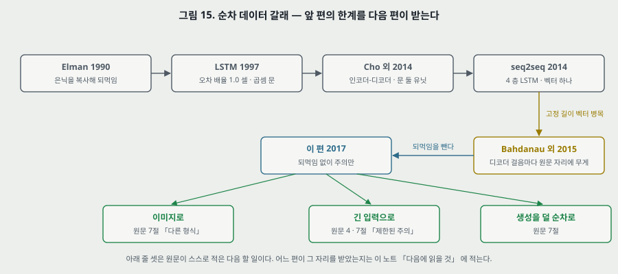

**하나. 갈래의 끝에서 보이는 것.** 순차 데이터 갈래의 다섯 편은 모두 「먼 자리의 정보를 어떻게 지금 자리로 가져오나」 를 다뤘다. 단순 순환망은 상태를 복사했고, LSTM 은 오차가 줄지 않는 셀을 두었고, 인코더-디코더는 벡터 하나로 넘겼고, seq2seq 는 입력을 뒤집어 거리를 줄였고, Bahdanau 외는 원문 자리마다 무게를 줬다. 이 편은 **거리를 1 로 만들고 그 대가로 자리 수의 제곱 계산과 순서 정보의 따로 넣기를 받는다.** 남긴 자리는 원문 7절이 직접 적었다 — 다른 형식(이미지), 긴 입력(제한된 주의), 덜 순차적인 생성.

**둘. 옮겨 쓸 수 있는 것.**

- **차수 표의 항을 셈으로 풀기.** $O(\cdot)$ 표는 무엇을 셈에서 뺐는지 숨긴다. 숫자 하나(n = 50, d = 512)를 넣어 층 전체를 세면 「n < d 면 빠르다」 같은 문장이 무엇을 견준 것인지 보인다(11절).
- **params 열에서 짜임을 거꾸로 맞추기.** 표가 여러 짜임의 파라미터 수를 반올림해 적으면, 알 수 없는 값 하나(어휘)를 줄마다 구간으로 역산해 겹치는지 본다. 겹치지 않는 줄이 셈법이나 짜임이 다른 줄이다(16절).
- **「비용」 열의 정체를 먼저 확인.** FLOPs 가 센 연산인지, 장비 능력 × 시간인지. 뒤의 것이면 실효 사용률의 차이가 비용 차이로 읽힌다(17절).
- **줄 하나가 한 군데만 바꿨는가.** 변형 표에서 「큰 모델」 줄이 걸음 수 · 드롭아웃까지 함께 바꾸면 그 줄로 원인을 말할 수 없다(18절 big).

**셋. 지금 확인된 것은 여기까지다.**

- **논문이 잰 것**: 표 2 의 BLEU(Transformer 둘, 실행 하나씩), 표 3 의 개발셋 혼잡도 · BLEU(줄마다 실행 하나), 걸음당 시간.
- **논문이 말만 한 것**: $1/\sqrt{d_k}$ 가 기울기 문제를 막는다(짐작), 사인 자리 부호화가 상대 자리 · 긴 열에 이롭다(가설), 머리마다 다른 일 · 통사 구조를 배운다(부록 없음), 경로가 짧으면 먼 의존을 배우기 쉽다(인용), 되먹임 모델보다 학습이 빠르다(FLOPs 추정), 더 정교한 맞음 함수가 이로울 수 있다(시사).
- **내가 책상에서 센 것**: 파라미터 base 63,082,496 · big 214,245,376(어휘 37,000), params 열의 어휘 역산(base 쪽 40,931 ~ 41,161, big 35,296 ~ 36,272), FLOPs 3.28·10¹⁸ · 2.30·10¹⁹(원문과 맞음), 학습 시간 11.1 시간 · 3.47 일, 학습률 꼭짓점 $6.99 \times 10^{-4}$, n = 50 의 층당 곱셈-덧셈(주의 부분층 54,988,800 · LSTM 104,857,600 · 단순 RNN 26,214,400), 주의 부분층과 LSTM 층이 같아지는 n = 2d, 자리 이동의 회전 행렬, 파장 위 끝 60,611, 표 2 의 차(2.04 · 0.94 · 0.44 · 비용비 0.19 · 0.34 · 1.15 · 2.40), 그림 2 · 3 · 5 의 작은 예.

---

## 28. 다음에 읽을 것

**한계를 적고 그 한계를 푼 것이 다음 논문이다.** 이 편으로 로드맵의 순차 데이터 갈래가 끝난다. 큰 틀 둘을 먼저 적고 자잘한 후속 편은 뒤에 둔다.

**큰 틀.**

| 다음 | 이 노트의 어느 자리에서 나오는가 | 무엇을 확인하고 싶은가 |
|---|---|---|
| **An Image is Worth 16x16 Words: Transformers for Image Recognition at Scale** (Dosovitskiy 외, ICLR 2021) — 후보 | 22절 일곱 · 원문 7절 「텍스트 밖의 형식(이미지)으로 넓히려 한다」. 22절 둘 — 이미지는 자리 수가 많아 $n^2$ 가 문제다 | 이미지를 자리 열로 어떻게 자르는가(그래서 n 이 얼마인가). 합성곱의 국소성 없이 같은 조건의 합성곱 망과 견줬는가. 자리 부호화를 무엇으로 썼는가 |
| **BERT: Pre-training of Deep Bidirectional Transformers for Language Understanding** (Devlin 외, NAACL 2019) — 후보 | 23절 아홉 — 이 편은 번역 둘에서 과제마다 처음부터 학습했다. 인코더만 떼어 다른 과제로 옮겨 쓸 수 있는지는 시험하지 않았다 | 인코더만 쓴 짜임이 번역 밖 과제에서 무엇을 보였는가. 사전학습의 몫을 처음부터 학습한 같은 짜임과 견줘 갈랐는가 |

**자잘한 후속 편.**

| 다음 | 이 노트의 어느 자리에서 나오는가 | 무엇을 확인하고 싶은가 |
|---|---|---|
| **Massive Exploration of Neural Machine Translation Architectures** (Britz · Goldie · Luong · Le, EMNLP 2017, 원문 [3]) | 5절 — 「$d_k$ 가 크면 나누지 않은 내적 주의를 더하기 주의가 앞선다」 의 출처 | 그 비교의 $d_k$ 범위와 흩어짐 |
| **On Layer Normalization in the Transformer Architecture** (Xiong 외, ICML 2020) — 후보 | 14절 · 23절 넷 — 데우기가 왜 필요한지, 정규화 자리를 바꾼 결과가 없다 | 덧셈 뒤 정규화와 데우기의 관계 |
| **Self-Attention with Relative Position Representations** (Shaw · Uszkoreit · Vaswani, NAACL 2018) — 후보 | 10절 · 23절 다섯 — 「상대 자리를 쉽게 배울 것」 은 가설, 긴 열 넘겨 쓰기는 시험 안 함 | 상대 자리를 직접 넣으면 사인 부호화보다 나은가 |
| **A Call for Clarity in Reporting BLEU Scores** (Post, WMT 2018) — 후보 | 17절 · 23절 둘 — BLEU 셈법이 적혀 있지 않은 채 다른 논문의 값과 견준다 | 셈법 차이로 BLEU 가 얼마나 갈리는가(이 편의 차 0.94 · 2.04 와 견줄 크기) |
| **Using the Output Embedding to Improve Language Models** (Press · Wolf, EACL 2017, 원문 [24]) | 9절 — 낱말 표 셋을 한 행렬로 | 공유가 성능에 준 몫. 이 편 표 3 에는 그 줄이 없다 |
| **Convolutional Sequence to Sequence Learning** (Gehring 외, ICML 2017, 원문 [8]) | 17절 — 표 2 의 가장 센 상대, 10절 — 학습하는 자리 표현의 출처 | 그 편의 BLEU 셈법 · 학습 시간 · GPU 가 이 편 표 2 의 비용 셈과 맞는가 |

읽는 순서로는 **ViT 가 먼저**다. 원문이 스스로 적은 다음 할 일(다른 형식)을 바로 받고, 이 저장소의 앞 갈래(이미지 · 합성곱 망)와 이어진다.

> **2026-11-05 에 ViT 를 읽었다.** (1) 자르는 법과 n: 겹치지 않는 $P \times P$, 224 / 16 이면 $N = 196$, 분류 토큰까지 $n = 197$. 22절 둘의 $n^2$ 걱정은 이 범위에서 블록 곱셈-덧셈의 1.1 ~ 15.1% 이고 몫은 $n/(n+6D)$ 다(ViT 노트에서 내가 센 것). (2) 같은 조건의 합성곱 망과 견줬나: 표 2 는 문헌 값이고, 표 6 · 그림 4 는 같은 JFT · 같은 Adam 이다. 다만 학습률은 모델마다 다르고 ResNet 은 BiT 설정 실행까지 골라 쓰며 흩어짐이 없다. (3) 자리 부호화: 학습하는 1 차원. 2 차원 · 상대와의 폭 0.00328, 없음과의 차 0.02824. 이 편의 사인 · 코사인은 시험하지 않았다.

---

## 29. 남는 질문

- **표 3 params 는 어떤 셈법 · 어휘로 나왔나.** base 쪽과 big 쪽이 하나로 맞지 않는 까닭. big 이 다른 어휘 · 다른 짜임이었는지.
- **같은 설정을 시작값만 바꾸면 BLEU 가 얼마나 흔들리나.** 표 3 의 0.1 ~ 0.5 차가 그 안인지.
- **BLEU 를 어떻게 셌나.** 그리고 표 2 의 상대들과 셈을 맞췄는가.
- **같은 P100 8 장에서 같은 데이터로 되먹임 모델(GNMT 꼴)을 학습하면 같은 BLEU 까지 몇 시간인가.**
- **$1/\sqrt{d_k}$ 를 빼면 표 3 의 base 가 얼마인가.** 그리고 더하기 주의로 바꾸면.
- **데우기 4,000 은 어떻게 골랐고, 빼면 학습이 되는가.** big 에도 같은 식을 썼는가.
- **사인 자리 부호화가 학습 때 본 것보다 긴 문장에서 학습하는 표현보다 나은가.**
- **문장 길이별 BLEU.** 앞 칸들이 그렸던 그림을 이 편 모델로 그리면 긴 칸에서 어떻게 되나.
- **빠진 부록의 주의 분포 예.** arXiv 판에 있는지 이 노트는 확인하지 않았다.
- 앞 넷은 이 편으로는 답이 안 나온다. 다섯째 · 여섯째는 정규화 자리를 다룬 뒤 편(Xiong 외 후보)에서, 일곱째는 상대 자리 편(Shaw 외 후보)에서 다른 쪽 수가 생긴다. 마지막은 arXiv 판을 받으면 확인된다.

---

## 30. 참고 문헌

이 노트가 부른 편만 적는다. 원리는 원 출처를, 구현은 그 라이브러리의 편을 적는 규칙을 따른다. 그림 코드는 파이썬 표준 라이브러리만 쓰고, 원문 그림 1 · 2 를 잘라 낸 일만 PyMuPDF 를 썼다(PyMuPDF 는 논문이 따로 없어 적지 않는다).

- Vaswani, A., Shazeer, N., Parmar, N., Uszkoreit, J., Jones, L., Gomez, A. N., Kaiser, Ł., and Polosukhin, I. (2017). Attention is all you need. NIPS 30. — 이 노트의 대상(학회판). arXiv:1706.03762 판은 읽지 않았다.
- Bahdanau, D., Cho, K., and Bengio, Y. (2014). Neural machine translation by jointly learning to align and translate. arXiv:1409.0473 (ICLR 2015). — 더하기 주의(원문 [2]).
- Britz, D., Goldie, A., Luong, M.-T., and Le, Q. V. (2017). Massive exploration of neural machine translation architectures. arXiv:1703.03906. — 큰 $d_k$ 에서의 비교, 5.1절의 BPE 인용 번호(원문 [3]). **읽지 않았다.**
- Sennrich, R., Haddow, B., and Birch, A. (2015). Neural machine translation of rare words with subword units. arXiv:1508.07909. — BPE(원문 [25]). **읽지 않았다.**
- Wu, Y. 외 (2016). Google's neural machine translation system. arXiv:1609.08144. — word-piece, 길이 벌점, GNMT 비교 값(원문 [31]). **읽지 않았다.**
- Gehring, J. 외 (2017). Convolutional sequence to sequence learning. arXiv:1705.03122. — ConvS2S, 학습하는 자리 표현(원문 [8]). **읽지 않았다.**
- Kalchbrenner, N. 외 (2017). Neural machine translation in linear time. arXiv:1610.10099. — ByteNet(원문 [15]). **읽지 않았다.**
- Shazeer, N. 외 (2017). Outrageously large neural networks: the sparsely-gated mixture-of-experts layer. arXiv:1701.06538. — MoE(원문 [26]). **읽지 않았다.**
- Zhou, J. 외 (2016). Deep recurrent models with fast-forward connections for neural machine translation. arXiv:1606.04199. — Deep-Att(원문 [32]). **읽지 않았다.**
- Hochreiter, S., Bengio, Y., Frasconi, P., and Schmidhuber, J. (2001). Gradient flow in recurrent nets: the difficulty of learning long-term dependencies. — 경로 길이 논거(원문 [11]). **읽지 않았다.**
- Hochreiter, S. and Schmidhuber, J. (1997). Long short-term memory. Neural Computation 9(8):1735–1780. — 원문 [12].
- Cho, K. 외 (2014). Learning phrase representations using RNN encoder-decoder for statistical machine translation. — 원문 [5](arXiv 판 인용).
- Sutskever, I., Vinyals, O., and Le, Q. V. (2014). Sequence to sequence learning with neural networks. NIPS. — 원문 [29].
- He, K., Zhang, X., Ren, S., and Sun, J. (2016). Deep residual learning for image recognition. CVPR. — 지름길(원문 [10]).
- Ba, J. L., Kiros, J. R., and Hinton, G. E. (2016). Layer normalization. arXiv:1607.06450. — 층 정규화(원문 [1]). **읽지 않았다.**
- Press, O. and Wolf, L. (2016). Using the output embedding to improve language models. arXiv:1608.05859. — 낱말 표 공유(원문 [24]). **읽지 않았다.**
- Srivastava, N. 외 (2014). Dropout: a simple way to prevent neural networks from overfitting. JMLR 15:1929–1958. — 원문 [27].
- Szegedy, C. 외 (2015). Rethinking the inception architecture for computer vision. arXiv:1512.00567. — 라벨 다듬기(원문 [30]). **읽지 않았다.**
- Kingma, D. and Ba, J. (2015). Adam: a method for stochastic optimization. ICLR. — 원문 [17]. **읽지 않았다.**
- Dosovitskiy, A. 외 (2021). An image is worth 16x16 words: Transformers for image recognition at scale. ICLR. — 다음에 읽을 것 후보. **원문 참고 문헌에는 없다(뒤에 나온 편). 2026-11-05 에 읽었다.**
- Devlin, J. 외 (2019). BERT: pre-training of deep bidirectional transformers for language understanding. NAACL. — 다음에 읽을 것 후보. **원문 참고 문헌에는 없다. 읽지 않았다.**
- Xiong, R. 외 (2020). On layer normalization in the Transformer architecture. ICML. · Shaw, P., Uszkoreit, J., and Vaswani, A. (2018). Self-attention with relative position representations. NAACL. · Post, M. (2018). A call for clarity in reporting BLEU scores. WMT. — 다음에 읽을 것 후보. **원문 참고 문헌에는 없다. 읽지 않았다.**
- 코드: tensor2tensor (`https://github.com/tensorflow/tensor2tensor`, 원문 7절). 이 노트는 코드를 보지 않았다.

---

## 31. 경로

| 무엇 | 어디 |
|---|---|
| 원문 PDF (NIPS 2017 학회판, 11 쪽) | `papers/NIPS17_Transformer_Attention_Is_All_You_Need.pdf` |
| 이 노트 | `notes/NIPS17_Transformer_Attention_Is_All_You_Need.md` |
| 이 노트의 그림 (직접 그린 것) | `figures/NIPS17_Transformer/fig01_layer.svg` 부터 `fig15_lineage.svg` 까지 열다섯 |
| 이 노트의 그림 (원문에서 잘라 낸 것) | `figures/NIPS17_Transformer/paper_fig1_architecture.png` · `paper_fig2_attention.png` |
| 그림을 만드는 코드 | `figures/NIPS17_Transformer/make_figures.py` — 바깥 데이터를 읽지 않으므로 `python make_figures.py` 로 어디서나 다시 만든다(표준 라이브러리만). 파라미터 · 어휘 역산 · FLOPs · 학습률 · 작은 예의 수를 이 파일이 계산해 화면에도 찍는다. 원문 표 2 · 3 의 수는 이 파일 안 상수 `T2` · `T3` 에 옮겨 적었다 |
| 원문 그림을 잘라 내는 코드 | `figures/NIPS17_Transformer/crop_paper_figures.py` — PyMuPDF 가 필요하다 |
