# UniAD — A Unified Model for Multi-class Anomaly Detection (NeurIPS 2022, 요약)

> **한 줄.** 이상 탐지 모델은 부류마다 하나씩 두는 것이 보통인데, 이 편은 **부류 라벨 없이 MVTec AD 15 부류를 모델 하나로** 다룬다. 얼린 EfficientNet-b4 특징을 Transformer 로 재구성하고 그 오차를 이상 점수로 쓴다. 재구성 망이 입력을 그대로 베끼면 이상도 복원되어 탐지가 안 되므로, 이를 막는 장치 셋(층마다 넣는 질의 임베딩 · 이웃을 가리는 주의 · 입력 특징에 넣는 잡음)을 얹는다. 통합 설정의 이미지 AUROC 96.5 ± 0.08(앞선 최고 DRAEM 88.1), 픽셀 AUROC 96.8 ± 0.02(앞선 최고 PaDiM 89.5).

> **이 노트에서 가장 먼저 볼 자리 다섯.** (1) **「베끼기」 를 수로 잰 자리가 없다.** 근거는 손실이 줄 때 AUROC 가 떨어지는 곡선(그림 2a · 4)과 표본 그림(그림 2b · S2)이다(4 · 12절). (2) **그림 4 는 가로축이 에폭이라 같은 갱신 횟수의 비교가 아니다.** 부류별 1000 에폭은 평균 3,780 회로 통합의 66.7 에폭이고, 통합 곡선은 에폭 119 · 149 에서 꺾인다. 그래서 「부류별은 안 떨어진다」 를 이 그림으로 말할 수 없다(내 셈, 부류별도 배치 64 라는 가정, 8절). (3) **「질의 임베딩이 결정적」 은 조건부다.** 표 5b 의 (4, 0) 줄은 질의가 없는데 94.9 / 96.0 이고, 표 S2 에서 NMA + FJ 위에 층별 질의를 더한 몫은 +0.3 / +0.2 점이다(10절). (4) **「떨어졌다」 는 다른 논문의 값과 저자가 돌린 값의 차이다.** 부류별 칸은 그 논문에서 옮겼고 통합 칸만 저자가 돌렸으며, 상대의 입력 크기 · 백본 · 체크포인트가 적혀 있지 않다(7절). (5) **성적표는 여전히 부류마다 AUROC 를 낸 평균이다.** 부류를 섞어 문턱 하나로 가른 값이 표에 없고, **PatchCore 는 어느 표에도 없다**(16절). 설정값도 모두 시험 이미지 값으로 고른 것으로 읽힌다(14절).

---

## Paper Metadata

| Item | Content |
|---|---|
| Title | A Unified Model for Multi-class Anomaly Detection |
| Authors | Zhiyuan You, Lei Cui, Yujun Shen, Kai Yang, Xin Lu, Yu Zheng, Xinyi Le. **앞의 둘이 같은 기여, Le 가 교신** |
| 소속 | Shanghai Jiao Tong University(You · Zheng · Le), Tsinghua University(Cui), CUHK(Shen), SenseTime(Yang · Lu) |
| Conference / Journal | **NeurIPS 2022** (36th Conference on Neural Information Processing Systems, 첫 쪽 각주). 권 · 쪽은 파일에 없다 |
| Year | 2022. arXiv 판 v1 2022-06-08, v3 2022-10-25. 게재판 PDF 생성 2023-01-11 |
| DOI | DOI 는 파일에 없다. NeurIPS 발표집 식별자 `1d774c112926348c3e25ea47d87c835b`, arXiv:2206.03687 |
| 코드 | 초록에 `https://github.com/zhiyuanyou/UniAD`. **이 노트는 코드를 보지 않았다** |
| Stored PDF | `papers/NeurIPS22_UniAD_A_Unified_Model_for_Multi_class_Anomaly_Detection.pdf`(본문 14 쪽) · `papers/NeurIPS22_UniAD_A_Unified_Model_for_Multi_class_Anomaly_Detection_Supplemental.pdf`(보충 자료 8 쪽) |
| 왜 읽었는가 | 2026-11-06 에 정한 큰 틀 「산업 이상 탐지」 의 넷째 칸(후보). 기억 뱅크(PatchCore)와 위치별 가우스(PaDiM)는 부류마다 모델을 따로 둔다. 모델 하나로 여러 부류를 다루면 무엇이 달라지는지 보려고 읽었다 |
| 읽은 범위 | **2026-11-07 에 게재판 본문 14 쪽과 보충 자료 8 쪽을 전부 읽었다.** 곧 초록 · 1 ~ 5 절 · 참고 문헌 53 건의 서지 · 체크리스트 · 보충 자료 A ~ E · 식 (1) ~ (5) · (S1) ~ (S3) · 표 1 ~ 5 · S1 ~ S7 · 그림 1 ~ 6 · S1 ~ S3. 참고 문헌의 편들은 읽지 않았다. **DRAEM · CutPaste · PaDiM 등 상대의 수치는 이 편이 옮기거나 돌린 값만 쓴다** |

### 저장한 파일의 상태

- **게재판을 정본으로 삼았다.** NeurIPS 발표집의 본문 파일과 보충 자료 파일이 따로 있어 둘 다 넣었다.
- **arXiv v3(19 쪽)와 맞춰 봤다.** 본문 1 ~ 10 쪽은 수와 낱말이 인용 번호 한 칸 밀림과 표기 몇 곳(`oneclass` 와 `one-class` 등) 외에 같다. arXiv 쪽 참고 문헌에 ResNet(arXiv [20])이 한 건 더 있어 그 뒤 번호가 한 칸씩 밀린다. arXiv 판에는 체크리스트가 없고, 게재판 본문 파일에는 부록이 없다.
- **부록 표도 맞췄다.** 보충 자료 3 ~ 5 쪽과 arXiv 15 ~ 19 쪽의 소수 값이 94 개씩이고 값과 개수가 모두 같다. 줄 단위로 대조해 다른 것은 쪽 번호뿐이었다(글자 층 대조이므로 칸의 자리까지 하나씩 본 것은 아니다). 번호만 다르다: 표 A1 ~ A7 이 표 S1 ~ S7, 그림 A1 ~ A3 이 그림 S1 ~ S3, 절 A ~ D 가 절 B ~ E 다(보충 자료의 절 A 는 개요). 이 노트는 게재판 번호를 쓴다.
- **글자 층이 살아 있다.** 표는 글자로 옮기고 쪽 이미지로 맞췄다. 식은 쪽을 150 dpi 로 띄워 확인했다.
- **그림 2a · 4 는 래스터다**(734x556, 870x675 픽셀 등). 원 이미지를 꺼내 곡선 색으로 값을 읽었다. 1 픽셀이 그림 2a 에서 AUROC 0.00068 · 손실 0.0677, 그림 4 에서 0.00055 · 0.0554 다. 평가는 10 에폭마다다.

---

## 1. 용어

이 노트에서 쓸 이름을 먼저 정한다. 논문의 원래 용어는 괄호로 함께 적는다.

- **부류별 설정 (separate case)**: 부류 하나마다 모델 하나를 따로 배운다. 작은 예시로, MVTec AD 면 모델이 15 개다.
- **통합 설정 (unified case)**: 15 부류의 정상 이미지로 모델 하나를 배우고, 부류 라벨을 학습과 추론 어디에도 주지 않으며, 미세조정 없이 모든 부류를 판정한다(1 절). 작은 예시로, 병과 나사의 정상 이미지가 한 학습 집합에 섞인다.
- **베끼기 해 (identical shortcut, identity shortcut)**: 재구성 망이 내용과 상관없이 입력을 그대로 내는 상태. 작은 예시로, 식 (1) 에서 $w \to I$, $b \to 0$ 이면 $y = x$ 다. **원문은 「shortcut」 이라 부르지만 이 저장소에서 「지름길」 은 ResNet 의 건너뛰는 연결을 뜻하므로 다른 이름을 쓴다.** 건너뛰는 연결은 이 노트에서 「잔차 연결」 이라 부른다. 원문 안에서도 identical · identity 두 낱말이 섞여 있다.
- **특징 토큰 (feature token)**: 특징 지도 한 칸을 낱말처럼 다룬 벡터. 작은 예시로, 14 x 14 지도면 토큰 196 개다.
- **질의 임베딩 (query embedding)**: 학습되는 벡터 묶음 $q \in \mathbb{R}^{K \times C}$. 주의의 질의 자리에 넣는다. 작은 예시로, $K = 196$, $C = 256$ 이면 한 벌에 50,176 개의 수다(내 셈).
- **층별 질의 디코더 (Layer-wise Query Decoder, LQD)**: 디코더 층마다 질의 임베딩을 따로 넣는 디코더. 보통 Transformer 는 첫 층에만 넣는다.
- **이웃 가림 주의 (Neighbor Masked Attention, NMA)**: 주의 지도를 만들 때 자기 자신과 2 차원 이웃 토큰을 가린다. 작은 예시로, 7 x 7 이면 가운데 토큰은 196 칸 중 49 칸(25.0%)을 못 본다(내 셈).
- **이웃 가림 인코더 (Neighbor Masked Encoder, NME)**: 보통 인코더에서 주의만 NMA 로 바꾼 것.
- **특징 흔들기 (Feature Jittering, FJ)**: 입력 토큰에 가우스 잡음을 더해 잡음 제거 과제로 배운다. 잡음 크기는 $\alpha$, 더할 확률은 $p$ 다. 작은 예시로, $\alpha = 20$, $C = 256$ 이면 잡음 노름이 특징 노름의 1.25 배다(내 셈, 5 절).
- **검출 (Det., anomaly detection)**: 이미지에 이상이 있는지. 이 노트의 **이미지 AUROC** 다. 15 칸이면 부류마다 내어 평균한다.
- **위치 찾기 (Loc., anomaly localization)**: 이상이 어느 픽셀인지. 이 노트의 **픽셀 AUROC** 다.
- **점 (percentage point)**: 원문은 AUROC 차이도 「%」 로 적는다. 이 노트는 백분율 점이라 적는다. 작은 예시로, 88.1 에서 96.5 면 8.4 점이다.
- **갱신 횟수**: 가중치를 고친 횟수. 원문은 쓰지 않는 내 이름이다. 작은 예시로, 3,629 장 · 배치 64 면 에폭당 56.7 회다.

---

## 2. 한 문단 요약

얼린 EfficientNet-b4 의 단계 1 ~ 4 특징을 14 x 14 로 맞춰 이어 붙이면(272 채널) 토큰 196 개가 나온다. 이를 256 채널로 줄여 인코더 4 층과 디코더 4 층에 넣고, 원래 272 채널로 되돌려 입력 특징과의 제곱 오차를 줄인다. 시험 때 칸마다 오차의 노름이 이상 점수이고, 이를 올려 픽셀 점수로 쓰며, 평균 풀링한 점수의 최댓값이 이미지 점수다. 논문의 주장은 **통합 설정에서 재구성 망이 베끼기 해에 더 쉽게 빠진다**는 것이고, 표 1 · 2 의 값은 부류별 96.6 / 96.6 에서 통합 96.5 / 96.8 로 떨어지지 않은 반면 다른 방법은 5.8 ~ 28.7 점 떨어진다.

---

## 3. 문제 / 동기

**이 논문이 없앤 전제: 「부류마다 모델을 따로 둔다」.**

1 절이 드는 이유는 둘이다. 부류 수를 따라 **메모리를 많이 쓴다(memory-consuming)**는 것, 한 물체 안에 여러 종류가 있어 정상의 부류 안 다양성이 큰 경우에 **맞지 않는다(uncongenial)**는 것이다. 메모리를 잰 값은 이 편에 없다. 표 S7 은 모델 하나의 크기만 적는다.

통합 설정이 어려운 까닭을 논문은 이렇게 적는다. 초록색 부류만 보면 파란 부류의 정상 표본도 이상으로 취급해야 하는데, 경계는 모든 부류에 하나다(그림 1b, 2 쪽). 모델이 모든 부류의 결합 분포를 배우기는 어렵고 베끼는 것은 쉬우므로 베끼기 문제가 커진다는 것이다.

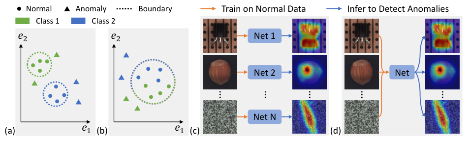

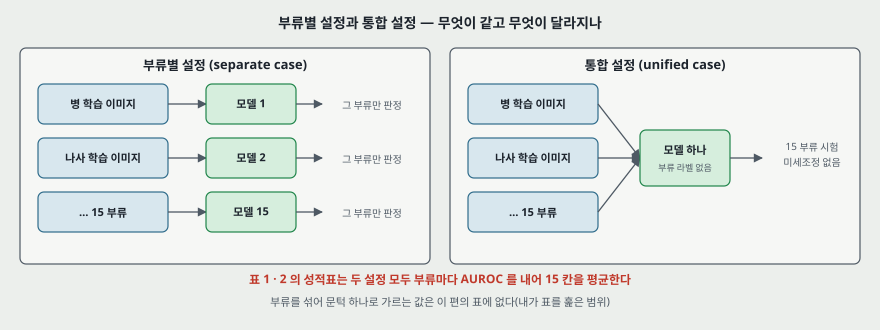

**앞선 연구 넷(2 절).** (1) 단일 부류 분류 계열(OC-SVM · SVDD), (2) 가짜 이상으로 지도 학습을 하는 계열(CutPaste · DRAEM · FCDD), (3) 사전학습 특징으로 정상 분포를 맞춘 뒤 거리를 재는 계열(PaDiM · MDND) — 논문은 이 계열이 정상 특징을 모두 기억하고 모델링해야 해 계산이 비싸다고 적는다, (4) 지식 증류 계열(US · MKD). 재구성 계열은 따로 들고, 「어떤 짜임이 재구성에 가장 좋은가」 를 「has not been well studied」 라 적는다(3 쪽).

**논문의 주장이 무엇을 건드리는가.** 부류별 값은 이미 높다(표 1 의 DRAEM 98.0). 이 편의 새로운 점은 정확도 기록이 아니라 **평가 설정 자체**다. 7 쪽은 「기존 문헌은 부류별만 연구했다」 고 적는다. 내가 그 문장을 확인한 범위는 이 편이 옮긴 인용뿐이다.

---

## 4. 베끼기 해의 분석 — 식 (1) · (2) (3.1 절)

**세 망의 곡선부터.** 특징 재구성 틀에서 MLP · CNN · Transformer(질의 있음)를 같은 조건으로 배운다. 평가는 10 에폭마다이고, 논문은 「이상을 학습 중에 쓸 수 없어 이 주기 평가는 실제로는 불가능하다」 고 적는다.

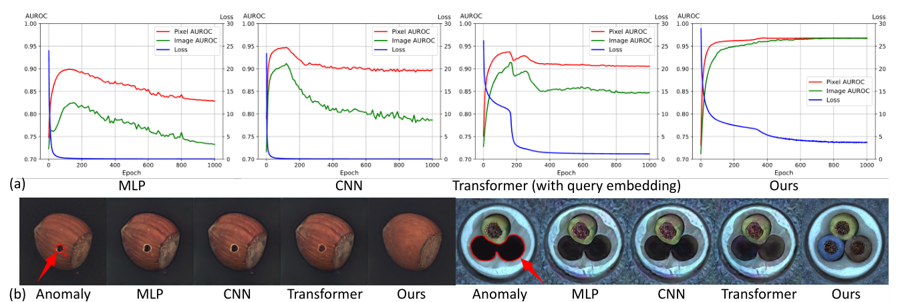

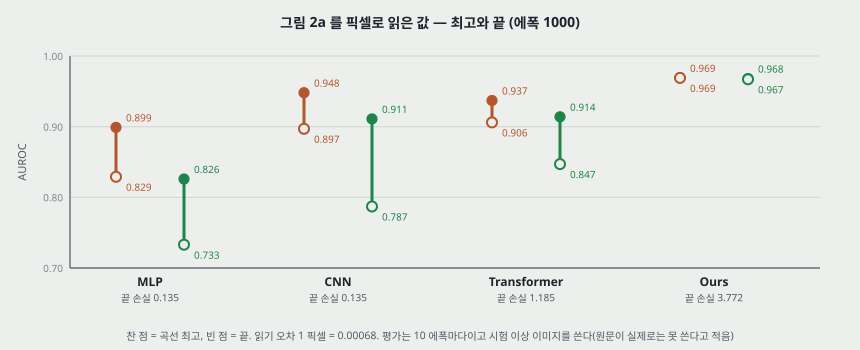

**내가 곡선에서 읽은 값 (그림 2a, 1 픽셀 = 0.00068).**

| 망 | 픽셀 최고 (에폭) | 픽셀 끝 | 낙폭 | 이미지 최고 (에폭) | 이미지 끝 | 낙폭 | 끝 손실 |
|---|---:|---:|---:|---:|---:|---:|---:|
| MLP | 0.899 (122) | 0.829 | 0.070 | 0.826 (151) | 0.733 | 0.093 | 0.135 |
| CNN | 0.948 (120) | 0.897 | 0.051 | 0.911 (120) | 0.787 | 0.124 | 0.135 |
| Transformer | 0.937 (142) | 0.906 | 0.031 | 0.914 (162) | 0.847 | 0.067 | 1.185 |
| UniAD | 0.969 (794) | 0.969 | 0.000 | 0.968 (960) | 0.967 | 0.001 | 3.772 |

- **본문에 MLP · CNN 의 표 값이 없다.** 위 값이 그 두 망의 유일한 수다.
- **Transformer 는 손실 절벽과 AUROC 낙폭이 같은 자리에 있다.** 에폭 150 의 손실 10.97 이 에폭 200 에 3.08 이 되는 사이 이미지 AUROC 가 0.914(162) 에서 0.886(200) 으로 내려간다. 논문은 수치 없이 그림만 든다.
- **UniAD 의 끝 손실 3.772 는 앞 셋과 견줄 수 없다.** 입력에 잡음을 넣고 깨끗한 특징을 맞히는 과제라 목표가 다르다(내 판단).

**식 (1) 완전연결 층.** $w \in \mathbb{R}^{C \times C}$, $b \in \mathbb{R}^{C}$ 일 때

$$y = x^{+} w + b \in \mathbb{R}^{K \times C} \qquad (1)$$

MSE 가 $y$ 를 $x^{+}$ 쪽으로 밀면 $w \to I$, $b \to 0$ 으로 갈 수 있고, 그러면 $x^{-}$ 도 복원된다. 합성곱은 1 x 1 이 완전연결과 같고 큰 커널이 1 x 1 을 표현할 수 있으므로 같은 위험이 있다.

**식 (2) 질의 있는 주의 층.** $q \in \mathbb{R}^{K \times C}$ 일 때

$$y = \mathrm{softmax}\left(q (x^{+})^{T} / \sqrt{C}\right) x^{+} \in \mathbb{R}^{K \times C} \qquad (2)$$

$y \to x^{+}$ 이려면 주의 지도가 $I$ 에 가까워야 하고, 그러면 $q$ 가 $x^{+}$ 와 맞물려야 한다. 배운 $q$ 는 정상 표본에 맞춰져 있으니 $x^{-}$ 는 잘 복원되지 않는다는 논증이다. 근거로 표 5a 의 질의 유무 차이(18.1 · 13.4 점)를 든다.

**논증의 세기.** 논문 스스로 「rough analysis」 이고 **1 층 망**의 이야기라 적는다. 실험의 MLP 는 Transformer 의 주의 자리를 선형 층으로 바꾼 인코더 4 층 + 디코더 4 층이다(보충 자료 C.1). $w$ 가 $I$ 에 얼마나 가까운지, 주의 지도가 $I$ 에 얼마나 가까운지를 잰 값은 본문 · 보충 자료 전체에 없다(내가 읽은 범위).

---

## 5. 핵심 기술 (3.2 · 3.3 절)

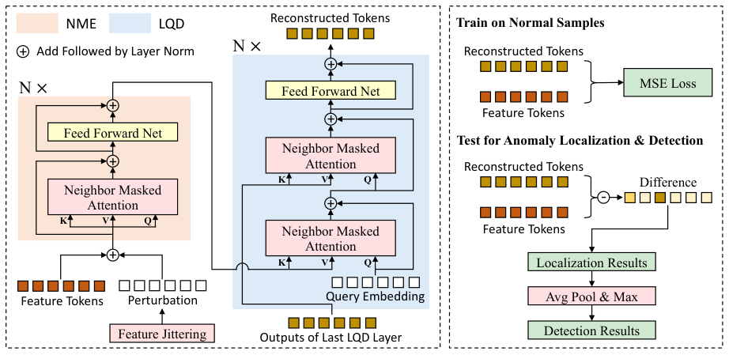

**① 특징 추출.** ImageNet 으로 배운 EfficientNet-b4 를 얼리고 단계 1 ~ 4 를 쓴다. 「단계」 는 특징 지도 크기가 같은 블록 묶음이다. 14 x 14 로 크기를 맞춰 채널로 이어 붙이면 $f_\text{org} \in \mathbb{R}^{C_\text{org} \times H \times W}$, MVTec 에서 $C_\text{org} = 272$ 다.

> **내가 센 것 (torchvision EfficientNet-b4, 가중치 없이 짜임만).** 224 입력에서 단계 끝 채널 · 크기는 24 · 112, 32 · 56, 56 · 28, 160 · 14 이고 **합이 272** 로 원문과 같다. 7 x 7 단계의 마지막 블록 448 을 더하면 720 으로 CIFAR-10 설정(단계 1 ~ 5)과 같다. 쓰는 앞부분의 파라미터는 3,635,984 개로 전체 19,341,616 개의 18.8% 다. **표 S6 의 「19M」 은 이 앞부분이 아니라 분류기까지 든 전체다.**

**② 특징 재구성.** 토큰 $H \times W$ 개를 선형 사영으로 $C = 256$ 까지 줄이고 NME · LQD 를 지난 뒤, 다른 사영으로 $C_\text{org}$ 로 되돌린다. 학습되는 자리 임베딩을 주의 모듈마다 더한다. 손실은

$$\mathcal{L} = \frac{1}{H \times W} \lVert f_\text{org} - f_\text{rec} \rVert_2^2 \qquad (4)$$

**③ 이웃 가림 주의.** 한 토큰이 자기 자신을 보면 베끼기 쉽고, 합성곱 특징이라 이웃도 닮았다는 것이 근거다(「suspect」 라고 적는다). 이웃은 2 차원 기준이다.

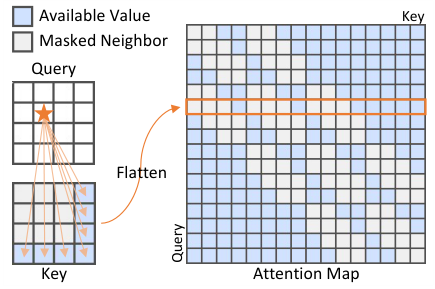

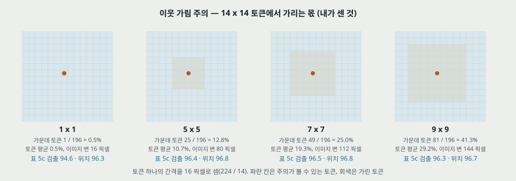

| 이웃 크기 | 가운데 토큰이 가리는 몫 (분모 196) | 토큰 평균 | 이미지 변 (간격 16 픽셀) | 표 5c 검출 / 위치 |
|---|---:|---:|---:|---:|
| 1 x 1 | 0.5% | 0.5% | 16 | 94.6 / 96.3 |
| 5 x 5 | 12.8% | 10.7% | 80 | 96.4 / 96.8 |
| 7 x 7 | 25.0% | 19.3% | 112 | 96.5 / 96.8 |
| 9 x 9 | 41.3% | 29.2% | 144 | 96.3 / 96.7 |

앞 세 칸은 내가 센 값이다. 가장자리 토큰은 창이 잘려 가리는 몫이 작다(7 x 7 의 모서리는 16 칸, 8.2%).

**④ 층별 질의 디코더.** 층마다 학습되는 질의가 먼저 인코더 임베딩과 섞이고, 그 결과가 앞 층 출력과 다시 섞인다(첫 층은 자기 자신). 두 번의 섞기 모두 NMA 이고 그 뒤에 2 층 앞먹임 망(256 → 1024 → 256, 표 S1)과 잔차 연결이 붙는다. 어느 입력을 질의 · 키 · 값에 넣을지 여섯 설계를 시험해 (a)를 골랐다(표 S3).

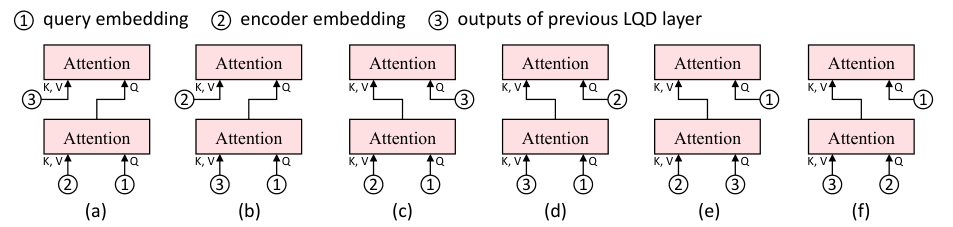

**⑤ 특징 흔들기.** 잡음 제거 오토인코더에서 착상을 얻어 토큰 $f_\text{tok} \in \mathbb{R}^{C}$ 에

$$D \sim N\left(\mu = 0,\ \sigma^{2} = \left(\alpha \frac{\lVert f_\text{tok} \rVert_2}{C}\right)^{2}\right) \qquad (3)$$

을 확률 $p$ 로 더한다. 기본값은 $\alpha = 20$, $p = 1$ 로 모든 토큰에 늘 더한다. 시험 때 끄는지는 글로 적혀 있지 않고 그림 3 의 학습 쪽에만 그려져 있다.

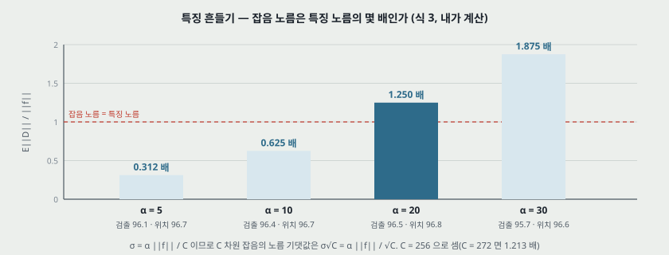

> **내가 계산한 것.** $C$ 차원 잡음의 노름 기댓값은 $\sigma \sqrt{C}$ 에 가까우므로 $\lVert D \rVert / \lVert f \rVert = \alpha / \sqrt{C}$ 다. $C = 256$ 이면 $\alpha$ = 5 · 10 · 20 · 30 에서 0.312 · 0.625 · **1.250** · 1.875 배다. **기본값은 잡음이 특징보다 큰 자리다.** 이 비는 원문에 없다.

**⑥ 점수.** 위치 찾기는 칸마다

$$s = \lVert f_\text{org} - f_\text{rec} \rVert_2 \in \mathbb{R}^{H \times W} \qquad (5)$$

를 이선형으로 이미지 크기까지 올린다. 검출은 $s$ 를 평균 풀링한 뒤의 최댓값이다. **풀링 창 크기는 본문 · 보충 자료에 없다.**

**설정 (4.2 절).** 입력 224 x 224, 특징 14 x 14, AdamW(가중치 감쇠 $10^{-4}$), 1000 에폭, 배치 64, NVIDIA Tesla V100 16GB 여덟 대, 학습률 $10^{-4}$ 에서 800 에폭 뒤 0.1 배. 인코더 · 디코더 각 4 층, 이웃 7 x 7, $\alpha = 20$, $p = 1$. **평가는 random seed 5 개로 한다.** 머리 수는 적혀 있지 않다.

---

## 6. 평가 (읽은 범위)

- **데이터셋**: MVTec AD 15 부류(물체 10 · 질감 5), CIFAR-10 다섯 대 다섯 조합 넷. 학습 · 시험 장 수는 본문에 없다. 체크리스트는 분할을 4.1 · 4.4 절에서 보라고 적지만 그 절에 장 수가 없다.
- **지표**: AUROC 하나(검출 · 위치). PRO · F1 · 혼동 행렬은 없다.
- **비교 상대**: US · PSVDD · PaDiM · CutPaste · MKD · DRAEM(표 1), FCDD 가 CutPaste 자리에 들어간 여섯(표 2), US · FCDD · FCDD+OE · PANDA · MKD(표 3), InTra · VT-ADL · AnoVit(표 4). **PatchCore 와 SPADE 는 없다.**
- **장비**: V100 16GB 8 대. 상대를 돌린 장비는 적혀 있지 않다.

**표마다 입력 크기 · 백본 · 층 (질문에 대한 답).**

| 표 | Ours 입력 | Ours 백본 · 층 | 특징 | 배치 | 상대의 입력 · 백본 · 층 |
|---|---|---|---|---|---|
| 1 · 2 MVTec | 224 | b4, 단계 1 ~ 4 | 14 x 14, 272 → 256 | 64 | **적혀 있지 않다.** 「공개 구현으로 돌렸다」 뿐 |
| 3 CIFAR-10 | 224 | b4, **단계 1 ~ 5** | 14 x 14, **720** → 256 | **128** | 적혀 있지 않다 |
| 4 Transformer 꼴 | 224 | b4, 단계 1 ~ 4 | 표 1 과 같음 | 표 1 로 읽음 | 적혀 있지 않다. 이미지 재구성 쪽이라는 것은 2 절 문장 |
| 5 · S2 ~ S5 | 224 | b4, 단계 1 ~ 4 | 표 1 과 같음 | 표 1 로 읽음 | 상대 없음 |
| S6 백본 | 표 1 로 읽음 | 여덟 가지 | **ResNet 의 어느 단계 · 채널인지 없다** | 표 1 로 읽음 | 상대 없음 |
| S7 복잡도 | 224 | b4 | | | 「224 로 고정」. 층 · 백본은 없다. 다만 PaDiM 은 값으로 역산된다(11 절) |

**같은 표 안에서 Ours 는 조건이 하나로 맞지만 상대와는 맞는지 알 수 없다.** 표 3 만 Ours 의 단계와 배치가 표 1 과 다르고, 이유는 「의미 차이의 이상이라 깊은 층이 낫다」 는 문장이다(C.4).

**값이 어디서 왔나.**

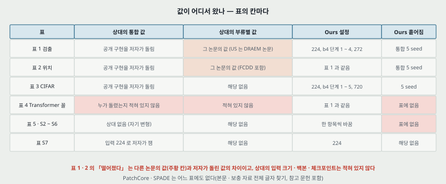

---

## 7. MVTec AD — 표 1 · 2 (4.2 · 4.3 절)

| | US | PSVDD | PaDiM | CutPaste | MKD | DRAEM | Ours |
|---|---:|---:|---:|---:|---:|---:|---:|
| 검출 통합 | 74.5 | 76.8 | 84.2 | 77.5 | 81.9 | 88.1 | **96.5 ± 0.08** |
| 검출 부류별 | 87.7 | 92.1 | 95.5 | 96.1 | 87.8 | 98.0 | 96.6 |
| 차이 (통합 − 부류별) | −13.2 | −15.3 | −11.3 | −18.6 | −5.9 | −9.9 | −0.1 |

| | US | PSVDD | PaDiM | FCDD | MKD | DRAEM | Ours |
|---|---:|---:|---:|---:|---:|---:|---:|
| 위치 통합 | 81.8 | 85.6 | 89.5 | 63.3 | 84.9 | 87.2 | **96.8 ± 0.02** |
| 위치 부류별 | 93.9 | 95.7 | 97.4 | 92 | 90.7 | 97.3 | 96.6 |
| 차이 (통합 − 부류별) | −12.1 | −10.1 | −7.9 | −28.7 | −5.8 | −10.1 | +0.2 |

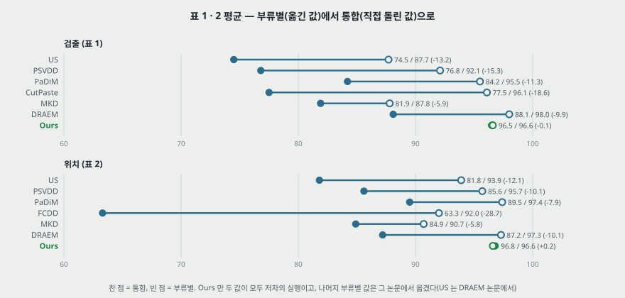

**다시 계산한 것 (내가 센 것).** 부류 15 칸의 평균은 인쇄 값과 표 1 에서 최대 0.08(PaDiM 부류별 95.42 대 95.5), 표 2 에서 FCDD 부류별(정수 칸) 91.6 대 92 를 빼면 최대 0.04 다. 칸이 소수 첫째 자리로 반올림되어 ±0.10 안은 반올림 폭이다. 본문의 차이 넷(9.9 · 18.6 · 12.1 · 28.7)과 8.4 · 7.3 도 표와 같다.

**짚을 자리 다섯.**

- **「부류별에서 통합으로」 는 같은 실행 조건의 비교가 아니다.** 7 쪽: 상대의 부류별 값은 그 논문에서 옮겼고(US 는 DRAEM 논문에서) 통합 값은 공개 구현으로 저자가 돌렸다. Ours 만 두 값이 모두 저자의 실행이다. 그래서 **통합이 부류별보다 높은 칸이 상대에도 있다** — 표 1 은 US 3 칸(Screw 66.9 대 54.9 · Leather 97.2 대 88.2 · Hazelnut) · DRAEM 3 칸 · PSVDD 1 · MKD 1, 표 2 는 PSVDD 3(같은 값 1 포함) · MKD 2(Cable 89.3 대 82.4 등) · DRAEM 1(Carpet 98.6 대 95.5)이다(내가 센 것). 평균이 떨어졌다는 말은 맞지만 칸 단위 차이에 실행 차이가 섞여 있다.
- **Ours 부류별에는 ± 가 없다.** 96.6 에서 96.5 를 「almost no performance drop」, 96.6 에서 96.8 을 「gains a slight improvement ... proving the suitability」 라 적는데 ± 는 통합 쪽 값만 있다. 부류별 칸의 흩어짐은 적혀 있지 않아 이 차이 −0.1 · +0.2 의 부호를 판정할 자리가 없다.
- **Ours 부류별이 통합보다 낮은 칸이 있다.** Pill 은 88.3 대 93.7(5.4 점), Capsule 85.3 대 86.9 이고, 표 2 는 15 칸 중 10 칸이 통합 쪽이 같거나 높다. 부류별 모델은 같은 에폭이면 평균 15 분의 1 의 갱신만 받는다는 것이 후보 설명이지만(8 절) 잰 값이 아니다(내 판단).
- **차이의 출처가 물체 쪽이다 (내 셈).** 통합 칸의 물체 10 / 질감 5 평균은 다음과 같다. 검출은 Ours 95.18 / 99.18, DRAEM 82.55 / 99.12 로 질감 차이가 0.06 점이고 물체 차이가 12.63 점이다. 위치는 Ours 97.32 / 95.76, PaDiM 91.96 / 84.60, DRAEM 81.89 / 97.72 로 **질감 위치 찾기는 DRAEM 이 1.96 점 높다.** 평균 하나로 적은 「8.4 점」 은 물체 부류의 차이에서 나온다.
- **이긴 칸 수.** 검출 15 칸 중 9 칸, 위치 15 칸 중 8 칸에서 Ours 가 최고다. 진 칸은 검출 Toothbrush −5.2(PSVDD) · Screw −4.5 · Zipper −3.0 · Wood −1.2 · Grid −1.1 · Tile −0.5(뒤의 다섯은 DRAEM), 위치 Tile −6.2 · Wood −2.8 · Grid −2.2 · Zipper −1.5 · Carpet −0.1(이 다섯은 DRAEM) · Pill −1.5 · Metal Nut −1.2(이 둘은 PSVDD) 이다.

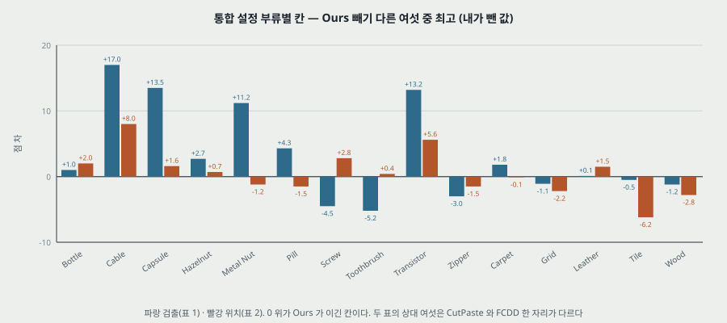

**흩어짐.** ± 는 통합 Ours 칸에만 있다. 부류 칸의 최대가 Cable 0.84(검출) · Zipper 0.24(위치)이고, ± 의 종류(표준편차 · 표준오차)는 적혀 있지 않다. 부류 칸을 독립으로 합치면 0.103 · 0.028 이라 인쇄된 0.08 · 0.02 와 같은 자릿수다(내 셈). 상대는 반복 수가 없다.

---

## 8. 통합 설정이 베끼기를 키우는가 — 그림 4 (3.1 절 끝)

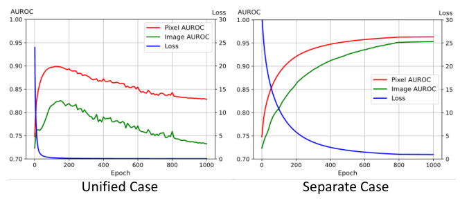

MLP 를 부류별로도 돌렸더니(15 부류 평균) 정확도가 손실과 함께 계속 오른다는 것이 그림 4 다. 논문의 결론은 「통합 설정이 더 어려워 베끼기 문제를 키운다」 이고 캡션은 「a smaller reconstruction error but much worse performance」 라 적는다.

**내가 읽은 값 (1 픽셀 = 0.00055).** 통합은 그림 2a 의 MLP 와 같은 곡선이다. 픽셀 0.899(119) → 0.828, 이미지 0.825(149) → 0.733, 끝 손실 0.111. 부류별은 픽셀 0.963, 이미지 0.953, 끝 손실 0.997 로 끝이 곧 최고다.

**같은 손실에 닿는 에폭(내가 읽은 값).** 손실 10 · 5 · 3 · 2 · 1.5 · 1.2 에 부류별은 에폭 112 · 232 · 351 · 482 · 600 · 722, 통합은 9 · 15 · 20 · 24 · 29 · 33 에 닿는다. 부류별 / 통합 비가 12.4 · 15.5 · 17.6 · 20.1 · 20.7 · 21.9 배다.

**왜 이 비가 중요한가 (내 셈).** 에폭은 이미지를 한 번 다 보는 단위이고, 통합의 학습 집합은 부류별의 15 배다. MVTec AD 학습 3,629 장(이 값은 이 편에 없고 MVTec AD 논문의 값이다), 배치 64 를 부류별에도 썼다고 **가정**하면 다음과 같다.

| | 에폭당 갱신 | 1000 에폭의 갱신 |
|---|---:|---:|
| 통합 | 56.7 | 56,703 |
| 부류별 (15 부류 평균) | 3.78 | 3,780 |

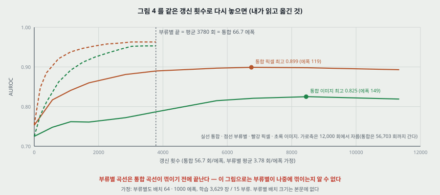

- **부류별 곡선의 끝은 통합의 에폭 66.7 과 같은 갱신 수다.** 통합 곡선은 그 자리에서 아직 오르는 중이고(픽셀 0.890 · 이미지 0.787) 꺾이는 곳은 에폭 119 · 149 다. **부류별을 그만큼 더 돌렸을 때 꺾이는지는 이 그림으로 알 수 없다.** 부류별 곡선이 「안 떨어진다」 가 아니라 「떨어질 자리까지 안 갔다」 일 수 있다.
- **캡션의 「재구성 오차가 더 작다」 도 그 몫이 크다.** 같은 에폭 1000 에서 손실 비는 0.997 / 0.111 = 9.0 배이고, 같은 갱신 수에서는 0.997 / 0.443 = 2.25 배다.
- **그래도 남는 것.** 같은 갱신 수에서 부류별이 픽셀 0.963 · 이미지 0.953, 통합이 0.890 · 0.787 로 7.3 · 16.6 점 낮다. **통합이 더 어렵다는 말은 이 비교에서도 선다.** 다만 이 차이는 꺾이기 전에 이미 있는 차이이고, 베끼기를 키운다는 증거가 아니라 학습 속도 또는 모델 용량의 차이일 수 있다.

가정이 틀릴 자리: 부류별 배치 크기는 본문에 없고 부류마다 장 수가 다르다. 위 수는 평균이다. 재현하려면 부류별 실행의 일정을 코드에서 봐야 한다. 나는 코드를 보지 않았다.

---

## 9. CIFAR-10 · Transformer 꼴 — 표 3 · 4 (4.4 · 4.5 절)

**표 3.** 다섯 부류를 정상, 나머지 다섯을 이상으로 놓는 조합 넷이다.

| 정상 | US | FCDD | FCDD+OE | PANDA | MKD | Ours |
|---|---:|---:|---:|---:|---:|---:|
| {01234} | 51.3 | 55.0 | 71.8 | 66.6 | 64.2 | **84.4 ± 0.02** |
| {56789} | 51.3 | 50.3 | 73.7 | 73.2 | 69.3 | **80.9 ± 0.02** |
| {02468} | 63.9 | 59.2 | 85.3 | 77.1 | 76.4 | **93.0 ± 0.03** |
| {13579} | 56.8 | 58.5 | 85.0 | 72.9 | 78.7 | **90.6 ± 0.09** |
| 평균 | 55.9 | 55.8 | 78.9 | 72.4 | 72.1 | **87.2 ± 0.03** |

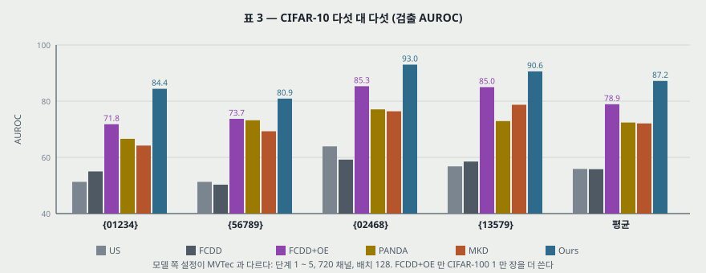

- 네 칸 평균을 내면 55.825 · 55.750 · 78.950 · 72.450 · 72.150 · 87.225 로 반올림 폭 안이다. 본문의 8.3 점도 맞다.
- **이 표는 MVTec 표와 뜻이 다르다.** 한 이미지의 결함이 아니라 부류 자체가 이상이다. 보충 자료 B 는 부류를 이상으로 놓는 의미 이상 탐지와 설정이 다르다고 설명한다. Ours 쪽 단계를 5 까지 늘린 것도 이 차이 때문이라고 적는다.
- PaDiM · DRAEM · CutPaste 는 이 표에 없다. 이유는 적혀 있지 않다.
- FCDD+OE 는 CIFAR-100 1 만 장을 보조 이상으로 더 쓴 값이다.

**표 4.**

| 방법 | 검출 통합 / 부류별 | 위치 통합 / 부류별 | 1 질의 | 층별 질의 |
|---|---:|---:|---:|---:|
| InTra | 65.3 / 95.0 | 70.6 / 96.6 | 아니오 | 아니오 |
| VT-ADL | 55.4 / 78.7 | 64.4 / 82.0 | 아니오 | 아니오 |
| AnoVit | 69.6 / 78 | 68.4 / 83 | 아니오 | 아니오 |
| Ours (baseline) | 87.6 / 94.7 | 92.8 / 95.8 | 예 | 아니오 |
| Ours | 96.5 / 96.6 | 96.8 / 96.6 | 아니오 | 예 |

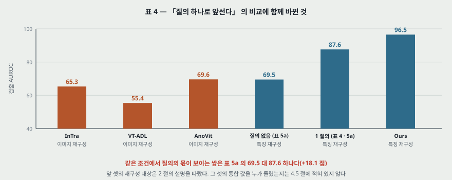

- **표가 질의 열만 보여 주지만 함께 바뀐 것이 더 있다.** 2 절에 따르면 앞 셋은 이미지를 재구성하고, Ours 는 얼린 CNN 특징을 재구성한다. 4.5 절은 이 표를 「질의 하나만 넣어도 앞선다」 의 근거로 쓴다. **질의 하나의 몫을 같은 조건에서 보여 주는 것은 표 5a 의 69.5 대 87.6(18.1 점)이다.**
- **맨 아래 행의 Ours 에는 NMA · FJ 도 들어 있는데 표에 그 열이 없다.**
- 앞 세 줄의 값을 누가 돌렸는지 4.5 절에 없다. 부류별 칸의 정수 값(78 · 83)은 옮긴 값으로 보인다(내 판단).
- **보통 Transformer 도 부류별에서 통합으로 7.1 · 3.0 점 떨어진다.** 표에서 재구성 짜임을 같게 두고 두 설정을 모두 저자가 돌린 짝은 이 줄과 Ours 줄이다.

---

## 10. 소거 실험 — 표 5 · S2 ~ S6 (4.6 절 · 보충 자료 D)

전부 MVTec AD 통합 설정, 시험 이미지 값이다. **반복 수와 흩어짐은 표에 없다.**

**표 S2 (표 5a 의 여섯 행 + 세 행).**

| 질의 | NMA | FJ | 검출 | 위치 | 표 5a 에 있나 |
|---|---|---|---:|---:|---|
| 없음 | | | 69.5 | 79.4 | 있다 |
| 1 | | | 87.6 | 92.8 | 있다 |
| 1 | 예 | | 96.1 | 96.3 | 있다 |
| 1 | | 예 | 95.0 | 95.8 | 있다 |
| 1 | 예 | 예 | **96.2** | **96.6** | **없다** |
| 층별 | | | 95.0 | 96.5 | 있다 |
| 층별 | 예 | | **95.8** | **96.5** | **없다** |
| 층별 | | 예 | **94.9** | **96.2** | **없다** |
| 층별 | 예 | 예 | 96.5 | 96.8 | 있다 |

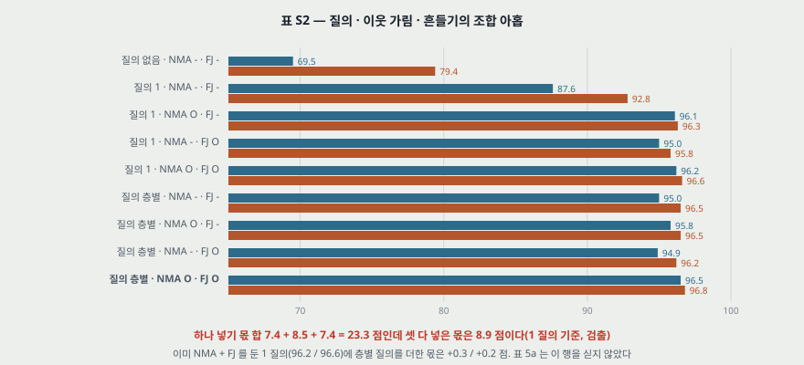

**세 가지가 서로 겹친다 (내 뺄셈).**

| 1 질의(87.6 / 92.8)에 넣은 것 | 검출 | 위치 |
|---|---:|---:|
| 층별 질의 | +7.4 | +3.7 |
| NMA | +8.5 | +3.5 |
| FJ | +7.4 | +3.0 |
| 세 몫의 합 | 23.3 | 10.2 |
| NMA + FJ 함께 | +8.6 | +3.8 |
| 셋 함께 | **+8.9** | **+4.0** |

- **본문이 드는 수(7.4 · 8.5 · 7.4)는 모두 1 질의 기준이다.** 표 5a 만 보면 셋 다 큰 몫을 내는 것으로 읽힌다.
- **이미 NMA + FJ 를 둔 망에 층별 질의를 더한 몫은 +0.3 · +0.2 점이다**(96.2 / 96.6 → 96.5 / 96.8). 흩어짐이 적힌 곳은 완성본의 ±0.08 · ±0.02 뿐이다.
- 층별 질의를 기준으로 하면 NMA 몫은 +0.8 · 0.0, FJ 몫은 −0.1 · −0.3 이다. 보충 자료 D.1 은 이를 「FJ 는 NMA 와 함께여야 듣는다」 고 적는다. 본문 4.6 절에는 이 문장이 없고, 「페이지 제한으로 전체를 싣지 않았다」 고 D.1 이 적는다.

**표 5b.** 층 수를 바꾼다.

| 인코더, 디코더 | Vanilla 검출 / 위치 | Ours 검출 / 위치 |
|---|---:|---:|
| 4, 0 | 69.8 / 79.2 | **94.9 / 96.0** |
| 0, 4 | 80.5 / 88.3 | 96.1 / 96.3 |
| 2, 2 | 84.7 / 90.6 | 95.1 / 96.0 |
| 4, 4 | 87.6 / 92.8 | 96.5 / 96.8 |
| 6, 6 | 86.1 / 91.9 | 96.5 / 96.7 |

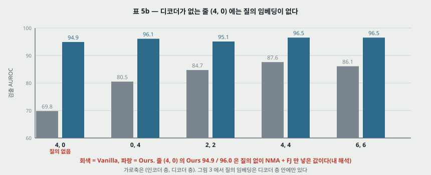

**(4, 0) 줄이 이 편의 중심 주장과 부딪힌다 (내 해석).** 그림 3 에서 질의 임베딩은 디코더 층 안에만 있다. 디코더가 0 층이면 질의가 없다. 그런데 Ours 는 94.9 / 96.0 이고 질의 없는 Vanilla 와 25.1 · 16.8 점 차이이며 완성본과는 −1.6 · −0.8 점이다. 곧 **NMA + FJ 만으로 질의 없는 망이 표 5a 의 층별 질의(95.0 / 96.5)와 검출 0.1 · 위치 0.5 점 차이까지 간다.** 3.1 · 4.6 절의 「질의 임베딩은 결정적으로 중요하다(of vital significance)」 는 NMA · FJ 가 없는 망에서 잰 말이다. 게다가 NME 에는 잔차 연결이 있어(그림 3) 토큰 자신의 값이 주의를 건너 출력까지 간다. 베끼는 길이 열려 있는데도 이 값이 나오는 까닭은 FJ 쪽으로 짐작되지만, FJ 를 뺀 (4, 0) 행이 없어 가를 수 없다.

**표 5c ~ 5f, S4, S6.** 각 표의 기본값 말고 값이 어디까지 내려가는지 본다.

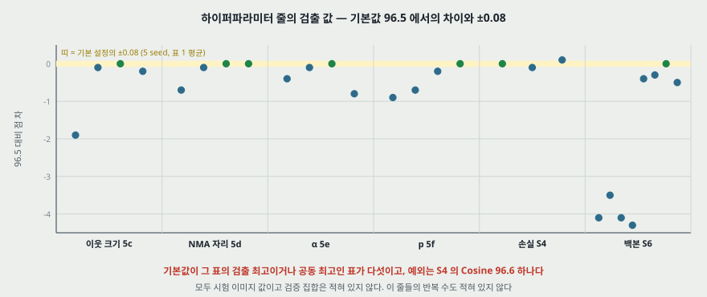

| 표 | 바꾼 것 (값) | 검출 | 위치 | 논문의 말 |
|---|---|---|---|---|
| 5c | 이웃 1 · 5 · 7 · 9 | 94.6 · 96.4 · **96.5** · 96.3 | 96.3 · **96.8** · **96.8** · 96.7 | 「obviously much better」 는 1 x 1 대비로 값과 맞다. 「the best」 7 은 5 와 0.1 차 |
| 5d | NMA 자리 Enc · +Dec1 · +Dec2 · All | 95.8 · 96.4 · **96.5** · **96.5** | 96.3 · **96.8** · 96.7 · **96.8** | 디코더의 온전한 주의도 샌다 |
| 5e | $\alpha$ 5 · 10 · 20 · 30 | 96.1 · 96.4 · **96.5** · 95.7 | 96.7 · 96.7 · **96.8** · 96.6 | 30 은 너무 흔든다 |
| 5f | $p$ 0.25 · 0.5 · 0.75 · 1 | 95.6 · 95.8 · 96.3 · **96.5** | 96.5 · 96.7 · 96.7 · **96.8** | 전부 잡음 제거가 가장 좋다 |
| S4 | MSE · Norm MSE · Cosine | 96.5 · 96.4 · **96.6** | 96.8 · **96.9** · 96.8 | 「비슷하다, 보편성을 증명한다」, MSE 는 흔해서 골랐다 |
| S5 | 백본 학습 · 얼림 | 65.9 · **96.5** | 65.5 · **96.8** | −30.6 · −31.3 점. 까닭은 추측(speculate)이라 적는다 |
| S6 | Res-18 · 34 · 50 · 101 | 92.4 · 93.0 · 92.4 · 92.2 | 95.8 · 96.2 · 96.0 · 95.9 | EfficientNet 이 낫다 |
| S6 | Eff-b0 · b2 · b4 · b6 | 96.1 · 96.2 · **96.5** · 96.0 | 96.4 · **97.0** · 96.8 · 96.7 | 중간 크기가 맞고 깊으면 의미 특징에 쏠린다(「might」) |

**표 S3 (LQD 설계 여섯).** NMA · FJ 없이 (a) 95.0 / 96.5, (b) 94.4 / 96.3, (c) 78.4 / 87.0, (d) 77.9 / 87.0, (e) 78.2 / 89.9, (f) 89.8 / 94.0, Vanilla 87.6 / 92.8. 넣으면 (a) 96.5 / 96.8, (b) 96.3 / 96.7, (f) 96.0 / 96.6 이다. **(c) · (d) · (e) 는 NMA · FJ 를 넣은 값이 없다.** 넣으면 간격이 주는 것은 위 표와 같은 모양이다: (a) 대 (f) 가 5.2 · 2.5 점에서 0.5 · 0.2 점으로 준다.

---

## 11. 복잡도 — 표 S7 (보충 자료 E.1)

| | US | PSVDD | PaDiM | CutPaste | FCDD | MKD | DRAEM | Ours |
|---|---:|---:|---:|---:|---:|---:|---:|---:|
| FLOPs (G) | 60.32 | 149.74 | 23.25 | 3.65 | 13.16 | 32.11 | 245.15 | 6.46 |
| 학습 파라미터 (M) | 9.55 | 0.41 | 950.36 | 13.61 | 4.51 | 0.34 | 69.05 | 7.48 |

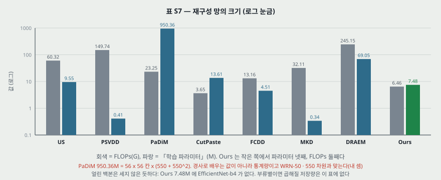

논문은 「UniAD 의 이점이 더 큰 모델 용량에서 오지 않는다」 고 결론짓는다. 파라미터로 작은 쪽 넷째(앞에 MKD · PSVDD · FCDD), FLOPs 로 둘째(앞에 CutPaste)이니 값과 맞는다.

**내가 센 것 셋.**

- **PaDiM 950.36M 의 정체.** 56 x 56 칸 x (평균 550 개 + 공분산 550² 개) = 950,364,800 이다. 곧 **이 표의 PaDiM 은 WRN-50 · 550 차원 · 224 입력과 맞고, 공분산 행렬의 대칭을 줄이지 않고 센 값이다.** 경사로 배우는 값이 아니라 정상 특징의 통계량이다. 표 1 · 2 의 PaDiM 이 같은 설정인지는 적혀 있지 않다.
- **Ours 7.48M 은 내 셈과 1.038 배 차이다.** 표 S1 의 앞먹임과 표준 주의 층($4d^2 + 4d$, 머리 수와 무관)으로 세면 인코더 층 789,760 · 디코더 층 1,053,440 이고, 4 + 4 층이면 7,372,800 이다. 사영 둘을 더하면 7,512,592, 층마다 질의 50,176 넷과 자리 임베딩 한 벌을 더하면 7,763,472 다. **내가 해 본 조합 여섯 중 7.48M 에 가장 가까운 것은 질의 · 자리 한 벌씩이고 사영을 뺀 7,473,152 인데, 설계와 맞는 조합이 아니다.** 어느 항을 뺐는지는 본문으로 가릴 수 없고, 코드를 보지 않았다.
- **표 S6 의 파라미터.** torchvision 전체 값과 견주면 Res-18 11.4 대 11.69M, Res-34 21.5 대 21.80M 로 −0.29 · −0.30M 다르고, 나머지 여섯은 ±0.34M 안에서 표기 자릿수 차이다(Eff-b4 19 대 19.34M). 앞 두 줄의 차이가 어디서 왔는지는 적혀 있지 않다.

**이 표가 답하지 않는 것.** 얼린 백본은 세지 않았고(CutPaste 13.61M 은 학습하는 백본을 포함한 값으로 보인다), 부류별로 두면 15 배가 되는 저장량 비교는 표에 없다. 1 절의 「memory-consuming」 은 여기서도 재지 않는다.

---

## 12. 실험 분석 (논문의 표 · 그림마다)

**직접 돌리지 않았다.** 논문이 낸 실험을 표 · 그림 하나씩 같은 틀로 읽는다. 「내가 센 것」 은 `make_figures.py` 와 PDF 픽셀로 낸 값이다. 구조 그림(그림 3 · 5 · S1)과 표 S1, 설정 그림(그림 1)은 실험이 아니라 행을 두지 않았다.

| 표 · 그림 | 무엇을 바꿨나 (변인) | 무엇을 고정했나 | 결과 | 반복 수 · 흩어짐 | 주장이 결과보다 센가 |
|---|---|---|---|---|---|
| 그림 2a | 재구성 망 MLP · CNN · Transformer · Ours | MVTec AD 통합, b4 단계 1 ~ 4, 보조 모듈 · 학습 설정(C.1) | 4 절 표. 앞 셋은 최고 뒤 3.1 ~ 12.4 점 떨어지고 Ours 는 0.1 점 안 | 곡선 하나. seed 표시 없음 | **그렇다.** 「베끼기 때문이다(caused by)」 인데 잰 것은 AUROC 와 손실뿐이다. 3.1 절은 「attribute · speculation」 이라 적고 캡션은 단정한다 |
| 그림 2b | 같은 망 넷 | 표본 2 장(개암 · 케이블), 복호기 하나 | 눈으로 본 복원 | 표본 선택 규칙 없음 | 시각 근거다. 복호기는 정상 + 이상으로 미리 배운다(C.3). 복호기 오차 수치 없음 |
| 그림 4 | 설정 통합 · 부류별 | MLP 한 망, 에폭 축 1000 | 통합 0.828 / 0.733, 손실 0.111. 부류별 0.963 / 0.953, 손실 0.997 | 부류별은 15 부류 평균, seed 표시 없음 | **그렇다.** 같은 에폭은 15 배 다른 갱신 수다(8 절). Transformer · Ours 의 같은 대조 없음 |
| 표 1 | 설정, 방법 일곱 | MVTec AD 15 부류, 이미지 AUROC. Ours 224 · b4 | 7 절. Ours 96.5 대 DRAEM 88.1 | Ours 통합 5 seed ±0.08, 칸 최대 0.84. 나머지 없음 | 부분적. 8.4 점은 ±0.08 밖이지만 상대의 흩어짐이 없다. 「dramatically large」 는 물체 부류 차이 12.63 점, 질감 0.06 점(내 셈) |
| 표 2 | 표 1 + FCDD 로 교체 | 픽셀 AUROC, 같은 설정 | Ours 96.8 대 PaDiM 89.5 | Ours 통합 ±0.02, 칸 최대 0.24 | 「proving the suitability」: +0.2 는 부류별 칸 ± 가 없어 판정 불가. 「의사 이상은 통합에 맞지 않는다」: 같은 계열 DRAEM 이 검출 2 위 · 위치 3 위 |
| 그림 6 · S3 | 부류 · 결함 네 칸, 서른 칸 | Ours 하나 | 정상 · 이상 · 복원 · 정답 · 예측 지도 | 표본 선택 규칙 없음 | 「accurately」 는 눈으로 본 말이다. S3(j) 왼쪽 나사는 정답이 끝의 작은 점인데 예측 지도의 높은 값이 몸통을 따라 이어진다(내가 본 것). 실패 표본은 싣지 않았다 |
| 표 3 | 조합 넷, 방법 여섯 | CIFAR-10, Ours 단계 1 ~ 5 · 720 · 배치 128 | 87.2 대 FCDD+OE 78.9 | Ours 5 seed ±0.03, 칸 최대 0.09. 나머지 없음 | 「stably outperform」 은 넷 다 앞서는 것과 맞다. 상대 설정이 없고 PaDiM · DRAEM 도 없다 |
| 표 4 | 방법 다섯 | MVTec AD. 재구성 대상은 맞지 않다 | 9 절 | 없음 | **그렇다.** 질의 유무와 재구성 대상이 함께 바뀐다 |
| 표 5a · S2 | 질의 3 · NMA 2 · FJ 2 의 아홉 조합 | Ours 기본 설정 | 10 절 | 표에 없음 | **그렇다.** 「NMA · FJ 의 효과가 증명된다」 는 1 질의 기준이다. 층별 기준으로는 +0.8 · 0.0, −0.1 · −0.3 |
| 표 5b | 층 수 다섯, Vanilla · Ours | 기본 설정 | 10 절 | 표에 없음 | 「4, 4 가 최고」: 6, 6 과 검출 같고 위치 0.1 차. 「질의가 결정적」 과 (4, 0) 의 94.9 가 부딪힌다 |
| 표 5c | 이웃 크기 넷 | 기본 설정 | 10 절 | 표에 없음 | 1 x 1 만 뒤지는 것은 값과 맞다. 「the best」 7 x 7 은 5 x 5 와 0.1 · 0.0 차 |
| 표 5d | NMA 자리 넷 | 기본 설정 | 10 절 | 표에 없음 | 「stably improved」 는 Enc 대비 +0.6 ~ +0.7 · +0.4 ~ +0.5 로 값과 맞다. 뒤 세 줄끼리는 0.1 차라 순서를 매기지 않는다 |
| 표 5e | $\alpha$ 넷 | 기본 설정 | 10 절. 잡음 / 특징 노름 0.312 ~ 1.875 배(내 셈) | 표에 없음 | 값과 맞다. 96.4 대 96.5 는 0.1 차 |
| 표 5f | $p$ 넷 | 기본 설정 | 10 절. $p$ 와 함께 단조 증가 | 표에 없음 | 값과 맞다 |
| 표 S3 | LQD 설계 여섯 | NMA · FJ 유무 | 10 절 | 표에 없음 | 「(a) 가 최고」: NMA · FJ 뒤로 (b) 와 0.2 · 0.1 차. (c) ~ (e) 는 넣은 값이 없다 |
| 표 S4 | 손실 셋 | 기본 설정 | 10 절 | 표에 없음 | 「보편성을 증명」 은 세 줄로는 세다. Cosine 이 검출, Norm MSE 가 위치에서 0.1 높다 |
| 표 S5 | 백본 학습 여부 | 기본 설정 | −30.6 · −31.3 | 표에 없음 | 까닭은 논문이 추측으로 적는다. 값은 큰 차이다 |
| 표 S6 | 백본 여덟 | 나머지 기본 | 10 절. EfficientNet 넷의 최저 96.0 이 ResNet 넷의 최고 93.0 위 | 표에 없음 | 값과 맞다. **WRN 이 없고** ResNet 의 단계 · 채널이 없다 |
| 표 S7 | 방법 여덟 | 입력 224 | 11 절 | 해당 없음 | 파라미터 넷째 · FLOPs 둘째와 맞다. 백본 · 저장량 제외 |
| 그림 S2 | 망 넷, 표본 서른 | Ours 와 세 망 | 눈으로 본 복원 | 표본 선택 규칙 없음 | 「all tend to」: 트랜지스터 오른쪽 칸은 MLP · CNN 이 입력을 베끼지 않고 무늬를 깬다(내가 본 것). 베끼기 말고 다른 실패도 있다 |
| 그림 1 · 3 · 5 · S1 · 표 S1 | 실험이 아니다 | 설정 설명(그림 1) · 구조(그림 3 · 5 · S1) · 층 설정(표 S1) | 수치 결과 없음. 표 S1 의 층 설정은 파라미터 셈(내 셈)에 썼다 | 해당 없음 | 수치 주장이 없어 판정하지 않는다 |

**짚을 자리.** (1) 표 1 · 2 · 3 의 상대 칸만 「직접 돌렸다」 고 적혔고 표 4 는 적혀 있지 않다. (2) 소거 표의 어느 칸에도 반복 수가 없다. 기본값 행이 표 1 의 5 seed 평균과 같다는 것만 보인다. (3) 체크리스트 3(c)의 「오차 막대를 보고했다」 는 표 1 · 2 · 3 의 Ours 통합 칸에 해당한다.

**반복 수와 판정 한계.** ±0.08 을 기본 설정의 판정 폭으로 빌리면(소거 칸의 흩어짐이 없어 빌린 값이다) 0.1 점 차이는 판정하지 않는다. 5c 의 96.4 대 96.5, 5e 의 96.4 대 96.5, S4 의 96.4 · 96.6 이 여기 든다.

---

## 13. 이 논문이 스스로 적은 한계

1. **부류 라벨을 쓰지 않았다.** 「라벨이 모델을 다부류 데이터에 더 잘 맞추는 데 도움이 될 수 있고, 어떻게 합칠지 더 연구해야 한다」(5 절 Discussion).
2. **실제 데이터의 정상은 MVTec AD 만큼 일관되지 않다.** 다만 논문은 이어서 15 부류를 다루므로 「실제 장면에 더 맞을 것」 이라 적는다. 이 문장은 잰 값이 아니다.
3. **이상 탐지가 영상 감시에 쓰이면 사생활을 침해할 수 있다**(5 절). 사회적 영향으로 적은 항목이다.
4. **주기 평가는 실제로는 불가능하다**(3.1 절). 곡선을 그리려고 시험 이상을 썼다는 말이다. 다만 재구성 망이 언제 멈춰야 하는지에 대한 답은 이 편에 없다. Ours 곡선에서는 평평해서 문제가 드러나지 않는다.
5. **6 층은 학습이 더 어려울 수 있다**(4.6 절, 「may be」). 추측으로 적었다.

체크리스트 1(b)가 「한계는 5 절 Discussion」 이라 적으므로 논문이 한계로 든 것은 1 ~ 3 이고, 4 · 5 는 내가 원문에서 모은 것이다.

---

## 14. 논문이 적지 않은 것 — 내가 읽으며 짚은 자리

**하나. 베끼기를 잰 값.** $w$ 와 $I$ 의 거리, 주의 지도와 $I$ 의 거리, 정상 · 이상의 재구성 오차 분포 어느 것도 없다. 곡선과 표본 그림뿐이다. 「못 잰다」 가 아니라 「안 쟀다」 다.

**둘. 설정값을 고른 집합.** 체크리스트 3(b)는 하이퍼파라미터 선택을 4.6 절에서 보라고 한다. 4.6 절과 D 절의 값은 모두 AUROC 이고, MVTec AD 에 검증 집합이 있다는 말은 없다. **표 5c ~ 5f · S6 의 다섯 표에서 기본값이 검출 최고이거나 공동 최고다.** 그러니 96.5 는 시험 값으로 고른 설정의 시험 값으로 읽힌다. 상대는 「공개 구현으로 돌렸다」 고만 적혀 있어 같은 조정이 있었는지 알 수 없다.

**셋. 표 값이 어느 체크포인트인가.** 표 1 의 Ours 는 곡선이 평평해 상관이 적다(곡선 끝 0.967 / 0.969, 표 96.5 / 96.8). 그러나 **「1 질의」 87.6 / 92.8 은 그림 2a 곡선의 끝(84.7 / 90.6)과 2.9 · 2.2 점, 최고(91.4 / 93.7)와 3.8 · 0.9 점 다르다.** 곡선은 하나의 실행이고 표의 반복 수가 없어 이 차이가 체크포인트인지 seed 인지 가를 수 없다. 앞 세 망은 체크포인트에 따라 3.1 ~ 12.4 점 움직이므로 상대의 재구성 계열도 고른 자리에 따라 값이 달라질 수 있다.

**넷. 문턱 하나.** 그림 1b 는 「경계 하나로 모든 부류를 가른다」 고 그리지만 표는 부류별 AUROC 와 그 평균이다. 부류마다 AUROC 를 내면 부류 사이의 점수 눈금이 맞는지는 시험되지 않는다. **시험 이미지를 섞어 낸 AUROC 는 어느 표에도 없다.** 부류 라벨을 안 쓰는 설정의 값어치가 여기 걸려 있다.

**다섯. 상대를 통합 설정에 어떻게 맞췄는가.** 예를 들어 PaDiM 의 칸별 가우스 하나에 15 부류를 넣었는지, 어떤 입력 전처리를 썼는지 적혀 있지 않다. 표 S7 로 역산한 것이 전부다.

**여섯. 지표가 AUROC 하나다.** 픽셀 AUROC 는 결함 영역이 작은 이미지에서 정상 픽셀이 수를 지배한다. PRO · AUPR 을 함께 낸 표가 없다. PatchCore 노트에서 쓴 PRO 와 맞춰 볼 수 없다.

**일곱. 해상도의 값.** 토큰 간격 16 픽셀에서 이선형으로 올린다. 단계 1(112 x 112)도 14 x 14 로 줄이므로 앞 단계의 해상도가 주는 이득은 합쳐지는 순간 준다(내 해석). 14 x 14 자체를 바꾼 행이 소거 표에 없다.

---

## 15. 원문 안의 어긋남 모음

| # | 자리 | 내용 |
|---:|---|---|
| 1 | 초록 · 2 쪽 | 같은 것을 「identical shortcut」 과 「identity shortcut」 으로 섞어 적는다 |
| 2 | 그림 2a 대 표 5a | 1 질의의 끝 84.7 / 90.6(내가 읽은 값) 대 87.6 / 92.8 |
| 3 | 7 쪽 대 표 1 | 「모든 상대가 부류별에서 뛰어나다(excellent)」 인데 US · MKD 평균 87.7 · 87.8, US Screw 54.9 |
| 4 | 8 쪽 대 7 쪽 | FCDD 의 낙폭으로 「의사 이상은 통합에 맞지 않는다」 고 적는데, 7 쪽이 의사 이상 계열로 적은 DRAEM 은 통합 검출 상대 중 1 위(88.1)다 |
| 5 | 식 (S3) | 글은 「코사인 거리를 줄인다」 인데 식은 $\sum \cos(f_\text{org}, f_\text{rec})$ 다. 글자 그대로 코사인 유사도면 부호가 반대다. $\cos$ 를 거리로 쓴 표기로 읽어야 말이 된다 |
| 6 | 식 (4) · (5) | 같은 $\lVert \cdot \rVert$ 표기가 (4) 에서는 전체 합, (5) 에서는 칸별 노름이다 |
| 7 | 표 4 | 맨 아래 Ours 에 NMA · FJ 가 들어 있는데 열이 질의뿐이다 |
| 8 | 표 S6 | Res-18 · 34 파라미터가 torchvision 전체 값보다 0.29 · 0.30M 작다(내 셈) |
| 9 | 체크리스트 3(b) | 분할을 4.1 · 4.4 절에서 보라는데 장 수가 없다 |
| 10 | 전체 | Ablation(소거 실험의 표기 오류)으로 통일되어 있다 |

---

## 16. 모델 하나로 여러 부류 — 무엇이 달라지나, 이 자리에 맞는 편인가

**읽기 전의 물음.** PatchCore · PaDiM 은 부류마다 모델을 따로 둔다. 모델 하나로 여러 부류를 다룰 때 무엇이 달라지는가.

| 바뀌는 것 | 이 편이 낸 근거 | 세기 |
|---|---|---|
| 학습 입력 | 15 부류의 정상이 섞인다. 라벨을 학습 · 추론에 안 준다 | 설정의 정의 |
| 상대의 성능 | 평균 5.8 ~ 28.7 점 하락. PaDiM −11.3 · −7.9 | 부류별 칸은 옮긴 값, 조건 불명 |
| 재구성 쪽 곡선 | MLP 통합이 최고 뒤 7.0 · 9.2 점 하락 | 부류별 곡선이 그 갱신 수까지 안 갔다 |
| 같은 갱신 수의 값 | MLP 부류별 0.963 / 0.953, 통합 0.890 / 0.787 | 내가 읽고 옮긴 값, 배치 가정 |
| 시험 판정 | 달라지지 않는다. 성적표는 부류별 AUROC 평균이다 | 표의 짜임 |
| 저장량 | 재지 않았다 | 안 쟀다 |

**판정: 이 칸에 맞는 편이다. 다만 PatchCore 쪽 답은 이 편에 없다.**

- 맞는 까닭: MVTec AD 로 통합 설정을 정의하고 PaDiM 을 같은 설정에서 돌린 값(84.2 / 89.5)을 낸다. 재구성 망의 곡선과 소거 실험으로 어디가 어려운지도 보인다.
- 빠진 자리: **PatchCore 는 본문 · 보충 자료 · 참고 문헌 어디에도 없다**(글자 찾기). 기억 뱅크 하나에 15 부류를 넣으면 어떻게 되는지는 이 편으로 답이 안 난다. 내 짐작으로는 뱅크가 부류 라벨 없이 최근접만 보므로 위치별 가우스와는 다른 모양으로 망가질 수 있지만, 잰 값이 아니다.
- 「후보」 표시를 뗄 근거는 위의 표 1 · 2 로 있지만, 통합 설정에서 PatchCore 를 잰 값이 필요하면 이 편 뒤의 비교 논문을 찾아야 한다. **이 편은 그 값을 안 쟀다.**

---

## 17. 앞 노트와 맞춰 보기

- **PatchCore.** 이 저장소의 PatchCore 노트가 옮긴 부류별 값은 PatchCore-25% 99.1 / 98.1 이다. 이 편의 Ours 부류별은 96.6 / 96.6 이므로 부류별 설정에서는 2.5 · 1.5 점 낮다. 두 값은 다른 논문, 다른 조건의 값이라 같은 표에 놓이지 않는다. **「부류별에서 PatchCore 가 앞선다」 까지만 이 수로 적을 수 있고 통합에서는 알 수 없다.**
- **PaDiM 의 옮긴 값이 편마다 다르다.** 이 편의 부류별 PaDiM 은 95.5 / 97.4 이고 PatchCore 노트가 옮긴 PaDiM 은 95.3 / 97.5 다. 어느 표가 어느 설정을 옮겼는지 이 편으로 가를 수 없다.
- **백본.** PatchCore 는 WRN-50-2 의 layer2 · layer3 을 쓰고, 이 편은 EfficientNet-b4 단계 1 ~ 4 를 쓴다. 표 S6 에 WRN 줄이 없어 그 백본의 재구성 값은 알 수 없다. S6 에서 ResNet 넷이 EfficientNet 넷보다 검출로 3.0 점 이상 낮은 것이 재구성 틀에 한정된 말인지도 이 편으로 알 수 없다. 합성곱 특징 맞대기 쪽의 PatchCore 노트 표 S6 은 ResNet-50 대 WRN-50 차이가 −0.3 ~ +0.3 이었다.
- **잡음 제거 오토인코더.** FJ 의 착상이 [3] · [43] 이다. 오토인코더는 가운데 층을 좁혀 입력을 그대로 못 넘기게 하는데, 이 편의 재구성 망은 토큰 수를 유지하고 채널을 272 에서 256(94.1%)으로만 줄인다. 베끼기를 막는 일을 차원 축소 대신 주의 가림과 잡음에 맡긴 셈이다(내 해석).
- **Transformer · ViT · BERT.** 토큰과 학습되는 자리 임베딩은 ViT · BERT([15] · [16])를 인용한 것이고, 디코더 층에 질의를 넣는 것이 이 편의 변경이다. 잔차 연결은 그대로라 베끼는 길이 인코더에 남아 있다(10 절).
- **DDPM.** 재구성 오차를 이상 점수로 쓰는 틀은 DDPM 노트 14 절이 적은 AnoDDPM 쪽 절차와 같다. 이쪽은 특징을 재구성하고, 그 절차는 이미지를 재구성한다. 두 틀을 같은 표에서 견준 값은 이 편에 없다.

---

## 18. 내가 가져갈 것

**하나. 닿는 자리 — 「설정이 바뀌면 순위가 바뀌는가」.** 이 편의 표 1 은 부류별 순위(DRAEM 98.0 · Ours 96.6 · CutPaste 96.1 · PaDiM 95.5)와 통합 순위(Ours 96.5 · DRAEM 88.1 · PaDiM 84.2 · MKD 81.9)가 다르다는 것을 보인다. MKD 는 부류별 여섯째에서 통합 넷째로 오른다. 설정 순위가 데이터셋을 넘어 유지되는가를 볼 때와 같은 질문의 모양이다. 다만 이 편은 부류별 값을 옮겨 왔으니, 같은 질문을 쓰려면 양쪽을 같은 코드로 돌려야 한다.

**둘. 옮겨 쓸 수 있는 것 — 곡선을 읽을 때 쓰는 세 가지.** (가) **에폭 축이 다른 데이터 크기를 가로지르면 갱신 횟수로 다시 놓는다.** (나) **조합 소거에서는 전부 넣은 망에서 하나씩 뺀 값과 빈 망에 하나씩 넣은 값을 나란히 놓는다.** 표 5a 와 S2 의 차이가 이 때문에 생겼다. (다) **파라미터 칸을 역산해 본다.** 표 S7 의 950.36M 이 상대의 설정을 알려 줬다.

**셋. 지금 확인된 것은 여기까지다.** 논문이 잰 것: 표 1 ~ 5 · S2 ~ S7 의 AUROC 와 복잡도. 논문이 말만 한 것: 베끼기가 원인이라는 것, 통합이 그것을 키운다는 것, 메모리를 아낀다는 것, 실제 장면에 더 맞다는 것. 내가 책상에서 센 것: 그림 2a · 4 의 읽은 값, 갱신 횟수(배치 가정), 잡음 비, 가림 몫, PaDiM 역산, 평균 재계산, 물체 · 질감 분해, 조합 몫, torchvision 파라미터.

---

## 19. 남는 질문

- **부류별을 같은 갱신 수까지 돌리면 MLP 곡선도 꺾이는가.** 그림 4 가 답하지 않는다. 코드로 일정을 먼저 봐야 한다.
- **시험을 섞은 AUROC 는 몇인가.** 이 편에 없다. 부류 라벨 없는 배치에서 문턱 하나로 되는지가 여기 걸린다.
- **PatchCore 를 통합 설정에 넣으면 몇인가.** 이 편의 비교 상대에 없다. 후속 비교 논문을 찾아야 한다.
- **FJ 없는 (4, 0) 은 몇인가.** 질의 없는 NMA 의 몫을 가르는 행이 없다.
- **표 5 의 반복 수는 몇인가.** 0.1 점 차이의 순서를 매길 근거가 여기 걸린다.
- **DRAEM 이 질감에서 통합으로도 무너지지 않는 까닭은 무엇인가.** DRAEM 원문이 필요하다.

  > 2026-11-10(DRAEM 노트): DRAEM 원문에는 통합 설정 실험이 없어 이 물음에 답하지 않는다. 이 편의 통합 질감 평균 99.12 는 DRAEM 원문의 부류별 질감 평균 99.12 와 같지만, **부류 값은 다르고 합(495.6)만 같다.** 후보 설명(가짜 이상을 배경에도 붙여 판별 망이 부류에 덜 묶인다)은 DRAEM 노트 14절에 재지 않은 가설로 적었다.

- **7.48M 은 무엇을 세지 않았나 · 검출 풀링 창은 얼마인가 · 머리 수는 몇인가.** 코드에 답이 있을 자리다. 이 노트는 코드를 보지 않았다.
- **이 편의 PaDiM 칸(95.5 / 97.4)과 PatchCore 노트의 PaDiM 칸(95.3 / 97.5)의 차이는 어디서 오나.** PaDiM 원문과 맞춘다.

  > 2026-11-10(DRAEM 노트): 이 편 표 1 의 부류별 PaDiM · US 칸은 DRAEM 표 1 과 같다(14 부류를 맞춰 봤고 bottle 은 대조하지 않았다). DRAEM 표 2 의 PaDiM 부류별 픽셀 AUROC 는 PaDiM 원 논문과 15 칸 중 4 칸만 같고 wood 가 0.8 다르다. PaDiM 원 논문에는 부류별 이미지 AUROC 가 없다. 곧 **95.5 / 97.4 는 DRAEM 저자들의 실행으로 읽히는 값**(DRAEM 그림 7 캡션 「our implementation」)이고, 95.3 / 97.5 는 PaDiM 원 논문 값이다. 95.5 는 그 표의 부류 평균 95.42 와도 0.08 어긋난다.

---

## 20. 다음에 읽을 것

추천 목록 맨 앞에 올리는 줄이 아니라 이 노트 안에 남기는 후속 편이다.

| 논문 | 이 노트의 어느 자리에서 나오는가 | 무엇을 확인하고 싶은가 |
|---|---|---|
| **DRAEM** (Zavrtanik 외, ICCV 2021, 참고 문헌 52) | 7 · 19 절 | 부류별 98.0 의 구성, 질감 통합 값이 버티는 까닭 |
| **Reverse Distillation** (Deng · Li, CVPR 2022, 참고 문헌 13) | 2 절에 들지만 표에 없다 | 증류 계열이 통합에서 어떤지 |
| **ADTR** (You 외, arXiv 2022, 참고 문헌 49) | 재구성 틀의 앞 편 | 같은 저자의 부류별 특징 재구성, 그림 2a 와 같은 곡선이 있는지 |
| **후보 — 통합 설정에서 PatchCore 를 잰 후속 편.** 원문 참고 문헌에 없다. 읽고 맞는지 가린다 | 16 절 | 표 1 의 설정에 기억 뱅크를 넣은 값 |

> 2026-11-10: DRAEM 을 읽었다(노트 `ICCV21_DRAEM`). 부류별 98.0 의 구성은 그 노트 6절, 질감 통합 값의 까닭은 원문에 통합 실험이 없어 답하지 못했다(14절).

---

## 21. 참고 문헌

원문의 참고 문헌 53 건(본문) · 16 건(보충 자료)은 서지만 읽었다. 아래는 이 노트에 값을 옮겨 온 자리이고, 이 노트를 쓰며 원문을 함께 읽은 편은 없다.

- [4] Bergmann, P. 외 (2019). MVTec AD. CVPR. — 데이터셋. 다른 저장소에 노트가 있다.
- [6] Bergmann, P. 외 (2020). Uninformed students. CVPR. — 표 1 ~ 3 의 US. 다른 저장소에 노트가 있다.
- [11] Defard, T. 외 (2021). PaDiM. ICPR. — 표 1 · 2. 다른 저장소에 노트가 있다.
- [13] Deng, H. and Li, X. (2022). Reverse distillation. CVPR. — 읽지 않았다.
- [25] Li, C.-L. 외 (2021). CutPaste. CVPR. — 표 1. 읽지 않았다.
- [27] Liznerski, P. 외 (2021). FCDD. ICLR. — 표 2 · 3. 읽지 않았다.
- [28] Mishra, P. 외 (2021). VT-ADL. · [31] Pirnay, J. and Chai, K. (2021). InTra. · [50] Yunseung, L. and Pilsung, K. (2022). AnoViT. — 표 4. 읽지 않았다.
- [33] Reiss, T. 외 (2021). PANDA. CVPR. · [37] Salehi, M. 외 (2021). MKD. CVPR. · [48] Yi, J. and Yoon, S. (2020). Patch SVDD. ACCV. — 표의 상대. 읽지 않았다.
- [49] You, Z. 외 (2022). ADTR. arXiv:2209.01816. — 읽지 않았다.
- [52] Zavrtanik, V. 외 (2021). DRAEM. ICCV. — 읽지 않았다. **2026-11-10 에 읽었다**(노트 `ICCV21_DRAEM`).
- [40] Tan, M. and Le, Q. (2019). EfficientNet. ICML. — 백본. 읽지 않았다. 채널 수는 torchvision 짜임으로 셌다.
- [42] Vaswani, A. 외 (2017). Attention is all you need. NIPS. — 2026-11-04 에 읽었다(Transformer 노트).
- [3] Bengio, Y. 외 (2013). Generalized denoising auto-encoders. NeurIPS. · [43] Vincent, P. 외 (2008). Denoising autoencoders. ICML. — FJ 의 착상. 읽지 않았다. **Vincent 2008 은 색인의 「나중에 볼 세부」 에 있다.**
- [15] Devlin, J. 외. BERT. · [16] Dosovitskiy, A. 외. ViT. — 2026-11-05 에 읽었다(각 노트).
- 코드: `https://github.com/zhiyuanyou/UniAD`(초록). 이 노트는 코드를 보지 않았다.

---

## 22. 경로

| 무엇 | 어디 |
|---|---|
| 원문 PDF, 본문 (NeurIPS 2022 게재판, 14 쪽) | `papers/NeurIPS22_UniAD_A_Unified_Model_for_Multi_class_Anomaly_Detection.pdf` |
| 원문 PDF, 보충 자료 (8 쪽) | `papers/NeurIPS22_UniAD_A_Unified_Model_for_Multi_class_Anomaly_Detection_Supplemental.pdf` |
| 이 노트 | `notes/NeurIPS22_UniAD_A_Unified_Model_for_Multi_class_Anomaly_Detection.md` |
| 이 노트의 그림 (직접 그린 것) | `figures/NeurIPS22_UniAD/fig01_two_settings.svg` 부터 `fig14_value_sources.svg` 까지 열넷 |
| 이 노트의 그림 (원문에서 잘라 낸 것) | `figures/NeurIPS22_UniAD/paper_fig1_setting.png` · `paper_fig2_shortcut.png` · `paper_fig3_framework.png` · `paper_fig4_unified_separate.png` · `paper_fig5_nma.png` · `paper_figS1_lqd_designs.png` |
| 그림과 재계산을 만드는 코드 | `figures/NeurIPS22_UniAD/make_figures.py` — 바깥 데이터를 읽지 않으므로 `python make_figures.py` 로 어디서나 다시 만든다(표준 라이브러리만). 표 재계산 · 칸 세기 · 갱신 횟수를 화면에 찍는다. 곡선 값은 `CURVES` · `FIG2A` 상수에 옮겨 적었다 |
| 원문 그림을 잘라 내는 코드 | `figures/NeurIPS22_UniAD/crop_paper_figures.py` — PyMuPDF 가 필요하다 |
