# EfficientAD — EfficientAD: Accurate Visual Anomaly Detection at Millisecond-Level Latencies (WACV 2024, 요약)

> **한 줄.** PatchCore 가 쓰는 WRN-101 특징을 **합성곱 넷 층짜리 작은 망(PDN, 수용장 33 x 33)** 에 증류해 선생으로 쓰고, 같은 꼴 학생이 정상 이미지에서 선생을 흉내 내게 배운다. 학생이 이상까지 흉내 내지 않도록 손실을 둘 더한다. 하나는 차가 가장 큰 원소 0.1% 만 쓰는 **어려운 특징 손실**, 다른 하나는 ImageNet 이미지에서 학생 출력을 0 으로 미는 **사전학습 벌점**이다. 위치 · 개수 같은 **논리 이상**은 이미지 전체를 64 차원으로 눌렀다 푸는 **자기부호기**로 잡는다. 학생에 출력 384 채널을 덧붙여 자기부호기 출력도 흉내 내게 하고, 두 차 지도를 검증 이미지의 분위수로 맞춰 평균한다. MVTec AD · VisA · MVTec LOCO 32 개 장면의 평균 이미지 AU-ROC 는 EfficientAD-S 95.4 · M 96.0 이다. RTX A6000 에서 지연은 2.2 ms 다.

> **이 노트에서 가장 먼저 볼 자리 다섯.** (1) **「검출과 위치 모두 큰 차이로 앞선다」 는 세 모음 평균의 말이고, MVTec AD 에서는 1 위가 아니다.** 이미지 AU-ROC 는 PatchCoreEns 99.3 > M 99.1 > AST 98.9 > S 98.8 이다. AU-PRO 는 PatchCoreEns 95.6 이 M 93.5 보다 2.1 높다. 픽셀 AU-PRC 는 DSR 69.2 가 S 65.9 보다 3.3 높고, **세 모음 평균으로도 M 50.5 가 DSR 50.6 보다 낮다.** 평균의 앞섬(AU-ROC +3.6)은 LOCO(+7.3)가 만든다(6 · 7절). (2) **상대는 「시험 집합으로 고르기」 를 끄고 돌렸는데, 이 편의 기본값도 같은 32 개 시험 집합의 값으로 정해졌다.** 공식 SimpleNet 코드는 학습 중 시험 이미지로 여러 번 재 최댓값을 낸다고 이 편이 적는다. 그것을 끄면 MVTec AD 가 원 논문 99.6 에서 98.2 로 1.4 내려간다. 반대로 EfficientAD 에 조기 종료를 켜면 99.8 이다. 그런데 표 3 의 기본값 셋(a = 0.9 · b = 0.995 · $p_{hard}$ = 0.999)은 모두 그 표에서 가장 높은 칸이다. 검증 몫을 따로 두었다는 문장은 없다(9 · 10절). (3) **표 16 의 FLOPs 76 · 235 는 패딩을 끈 PDN 으로 셀 때만 맞는다.** 표 6 \~ 8 로 곱셈-덧셈을 세어 두 배 하면 패딩 있음 93.3 · 287.4, 없음 75.9 · 235.4 다. 패딩을 끄면 PDN 출력이 64 x 64 가 아니라 56 x 56 이 되는데, 자기부호기 출력(표 8)은 64 x 64 로 적혀 있다. 둘을 어떻게 맞췄는지 원문에 적혀 있지 않다(12절). (4) **끈 실험에 자기부호기를 뺀 줄이 없다.** 표 4 의 첫 줄 「PDN」 에도 자기부호기 갈래가 들어 있어, 논리 이상 갈래의 몫이 재어지지 않았다. 「어려운 특징 손실 +1.0」 은 더한 차례의 값이고, 하나씩 뺀 표 5 로는 0.7 이다(10절). (5) **같은 열 방법의 순위가 지표 · 모음마다 바뀐다.** 상대 여덟만 두면 검출 순위와 위치 순위의 순위 상관이 −0.38 이다. 이미지 AU-ROC 의 MVTec AD 순위와 LOCO 순위의 상관은 +0.19 다. `beyond-mvtec` 의 물음에 바로 닿는 표다(8절).

---

## Paper Metadata

| Item | Content |
|---|---|
| Title | EfficientAD: Accurate Visual Anomaly Detection at Millisecond-Level Latencies |
| Authors | Kilian Batzner, Lars Heckler, Rebecca König |
| 소속 | MVTec Software GmbH (셋 모두, arXiv v3 기준. 게재판에는 TU Munich 가 더 적혀 있다). **Batzner 는 이 편이 평가에 쓰는 MVTec AD (IJCV 판, 참고 문헌 [7]) · MVTec LOCO ([8]) 의 공저자다** |
| Conference / Journal | **WACV 2024** (이 저장소의 파일 이름과 목록이 적어 둔 게재처다. **받은 arXiv v3 에는 학회 이름이 찍혀 있지 않다**) |
| Year | arXiv:2303.14535v3, 2024-02-08 (첫 쪽 여백에서 읽었다) |
| DOI | 파일에 찍혀 있지 않다 |
| 코드 | **이 편 자신의 코드 주소는 본문 · 부록에 적혀 있지 않다.** 부록에 상대 다섯의 공식 코드 커밋 주소와, 32 장면별 결과 파일(`per_scenario_results.json`)의 내려받기 주소가 있다. 이 노트는 어느 코드도 보지 않았다 |
| Stored PDF | 본문 + 부록 한 파일. 경로는 23절 |
| 왜 읽었는가 | 큰 틀 「산업 이상 탐지 2막」(DRAEM → Reverse Distillation → SimpleNet → EfficientAD)의 넷째이자 마지막 칸. RD 노트가 「같은 꼴 학생의 보통 증류」 를, SimpleNet 노트가 「SimpleNet 을 남이 어떻게 돌렸나 · SimpleNet 의 PRO」 를, DRAEM · RD · SimpleNet 노트가 함께 「DRAEM 의 PRO」 를 이 편에서 찾으라고 남겼다 |
| 읽은 범위 | **2026-11-16 에 arXiv v3 27 쪽을 전부 읽었다.** 곧 Abstract · 1 \~ 5절 · Limitations · 참고 문헌 74 건의 서지 · 부록 A \~ F · 알고리즘 1 \~ 3 · 표 1 \~ 17 · 그림 1 \~ 11 과 캡션. 그림 1 · 6 · 8 은 PDF 의 벡터 경로 좌표로 값을 읽었다(5절). 장면별 결과 파일은 내려받지 않았다. 참고 문헌의 편들과 코드는 읽지 않았다 |

### 저장한 파일의 상태

- **arXiv v3 27 쪽이다.** 본문 8 쪽 + 참고 문헌 4 쪽 + 부록 15 쪽. 학회 머리글이 없다.
- 게재판(IEEE Xplore)은 학교 라이선스 문구가 쪽마다 찍혀 있어 저장소에 두지 않았다. **2026-11-10 에 본문(1 \~ 8 쪽)의 소수점 수치 172 개가 게재판과 모두 같다는 것을 대조했다.** 글자가 다른 자리는 다섯이다. 게재판에만 저자 소속 TU Munich 가 더 있다. arXiv 판에만 문장 둘이 있다(「어려운 특징 손실로 정상 이미지 점수의 이상치, 곧 거짓 양성을 피한다」 · 「전체 손실은 세 손실의 합」). 「pixel-wise AU-ROC computed on pixel anomaly scores」 가 게재판에서 「AU-ROC」 로 줄었다. 「Appendix X」 가 게재판에서 「the supplementary material」 이다. 참고 문헌 수가 달라 인용 번호가 밀린다. **이 노트의 참고 문헌 번호는 arXiv v3 의 것이다.**
- 표 1 \~ 17 의 값은 PDF 글자 층에서 옮겼고, 그림에서 읽은 값과 함께 상수로 `figures/WACV24_EfficientAD/data_efficientad.py` 에 두었다.

---

## 1. 용어

- **장면 (scenario)** · **모음 (dataset collection)**: 원문의 낱말. 장면 하나가 학습 · 시험 집합 한 벌이고(MVTec AD 의 screw 하나), 모음은 장면 묶음이다. MVTec AD 15 + VisA 12 + MVTec LOCO 5 = 32 장면. 이 노트는 MVTec AD 를 표 머리에서 **MAD** 로 줄인다(원문 표 2 의 줄임).
- **구조 이상 · 논리 이상 (structural / logical anomaly)**: 얼룩 · 긁힘처럼 그 자리만 보아도 다른 것이 구조 이상, 정상 부품이 틀린 위치 · 개수 · 조합으로 놓인 것이 논리 이상이다. 작은 예시: 정상 이미지는 두 커넥터를 케이블 **한 줄**로 잇는데, 케이블이 **두 줄**이면 각 조각은 정상이어도 논리 이상이다(그림 5 오른쪽).
- **PDN (patch description network)**: 합성곱 넷 층 + 평균 풀링 두 층의 작은 망. 출력 벡터 하나가 입력 33 x 33 조각 하나만 보고 만들어진다. EfficientAD-S 의 선생 PDN 은 파라미터 2,694,144 개다(내 셈, 12절).
- **선생 · 학생 (teacher · student)**: 선생은 증류로 배운 뒤 얼린 PDN, 학생은 같은 꼴(마지막 층 출력만 768)을 처음부터 배우는 PDN 이다. 학생 출력 768 채널 중 앞 384 는 선생을, 뒤 384 는 자기부호기를 흉내 낸다.
- **어려운 특징 손실 (hard feature loss)**: 선생 · 학생 출력의 원소별 제곱 차 $D_{c,w,h}$ 가운데 $p_{hard}$ 분위수 이상인 원소만 평균한 손실. 작은 예시(내 셈): 384 x 64 x 64 = 1,572,864 원소에 $p_{hard}$ = 0.999 면 차가 가장 큰 1,573 개만 쓴다.
- **사전학습 벌점 (pretraining penalty)**: 학습 단계마다 ImageNet 이미지 한 장 $P$ 를 뽑아, 학생 출력(앞 384 채널)의 제곱 평균을 손실에 더한 것. 학생이 ImageNet 이미지에서 0 을 내도록 민다.
- **국소 지도 · 전역 지도 (local / global anomaly map)**: 선생 대 학생 앞 384 의 차를 채널 평균한 지도가 국소 지도, 자기부호기 대 학생 뒤 384 의 차가 전역 지도다.
- **지도 정규화 (quantile-based map normalization)**: 검증 이미지의 픽셀 점수에서 분위수 $q_a$ 를 0, $q_b$ 를 0.1 로 보내는 1 차 변환을 지도마다 따로 정하고, 두 지도를 그 변환 뒤에 평균하는 것. 작은 예시: $q_a$ = 0.002, $q_b$ = 0.012 면 점수 0.022 는 $0.1 \times (0.022 - 0.002) / 0.010 = 0.2$ 가 된다.
- **AU-PRO · AU-sPRO**: 결함 영역마다 겹친 비율(PRO)을 FPR 30% 까지 적분한 넓이(원문 [7] 의 권고). LOCO 는 논리 이상까지 다루도록 넓힌 AU-sPRO([8])를 쓴다. 표 머리에는 원문을 따라 AU-PRO 로 함께 적는다.
- **지연 · 처리량 (latency · throughput)**: 지연은 묶음 1 장으로 이미지 한 장의 결과가 CPU 에 돌아오기까지의 시간, 처리량은 묶음 16 장으로 잰 초당 장 수다.
- **점**: AU-ROC 등의 차를 「0.4 점」 처럼 적는다. 원문은 「0.4 %」 로 적는다.

---

## 2. 한 문단 요약

원문은 문제를 둘로 나눈다(1 · 3절). 하나는 **비용**이다. 최근 방법은 묶음 · 큰 백본 · 768 해상도로 정확도를 올리고 계산을 잃는다. 다른 하나는 **논리 이상**이다. 조각 단위 방법은 조각마다 정상이면 놓친다. 답도 둘이다. 비용 쪽은 WRN-101 특징을 PDN 에 증류해 선생 · 학생을 모두 PDN 으로 만들고, 작아진 학생이 이상까지 흉내 내지 않게 손실 둘을 더한다. 논리 쪽은 선생 특징 공간의 자기부호기를 붙이되, 자기부호기의 흐린 재구성을 학생이 따라 배우게 해 그 차만 남긴다. 실험은 상대 여덟과 32 장면(표 1 · 2 · 10 \~ 15), 비용(표 16 · 17, 그림 1 · 6 · 8), 끈 실험(표 3 · 4 · 5), 증류 백본(표 9), 정성 그림(그림 7 · 9 \~ 11)이다.

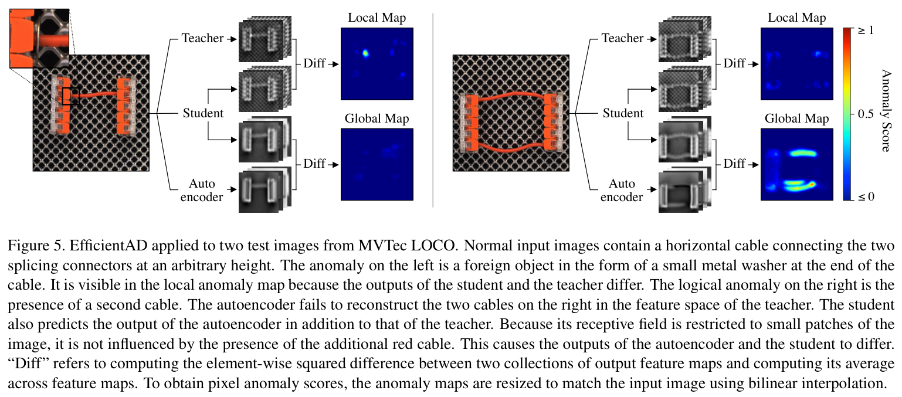

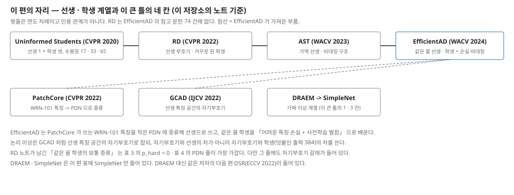

---

## 3. 문제 / 동기

**이 논문이 없앤 전제: 선생 · 학생 방법이 이상을 잘 가르려면 큰 사전학습 백본, 여러 선생 · 학생의 묶음, 또는 선생과 다른 학생 구조가 필요하다.**

원문이 적은 앞선 방법의 문제는 넷이다.

1. **최근 방법은 계산을 희생해 정확도를 얻는다**(1절). 묶음, 큰 백본, 768 x 768 까지 키운 입력을 든다. 공장에는 생산 속도가 정한 시간 한도가 있다는 근거로 [4] 를 단다.
2. **파라미터 수는 지연의 대리 지표로 오해를 부른다**(3.1절). Uninformed Students(S-T)의 망은 1.6 \~ 2.7 백만 개인데 실행 시간과 메모리가 3,100 만 개짜리 U-Net 보다 크다고 적는다. **이 문장에는 잰 값이 붙어 있지 않다.** 부록 E 의 표 16 이 방법 단위의 값을 준다(12절).
3. **사전학습 분류망의 특징은 먼 자리에 기대고, 그 때문에 한 곳의 이상이 먼 곳의 특징을 바꿀 수 있다**(3.1절, 그림 3). 증거는 그림 3 의 기울기 지도 한 장과 ImageNet 1,000 장 평균 특징 지도다(13절).
4. **조각 단위 방법은 논리 이상을 못 본다**(3.3절). LOCO 저자들의 권고([8])를 따라 자기부호기를 쓴다.

선생 · 학생 계열의 앞선 해법은 묶음([10]), 층 피라미드([66]), 구조 비대칭(AST [54])이다. 이 편은 이것을 「손실이 만드는 비대칭」 으로 바꾼다고 적는다(1절). **같은 PDN 선생에 구조 비대칭(AST 식)을 준 줄과 손실 비대칭을 준 줄을 나란히 놓은 실험은 없다.** 비교는 표 1 의 AST(다른 백본 · 다른 선생)와의 맞대기뿐이다.

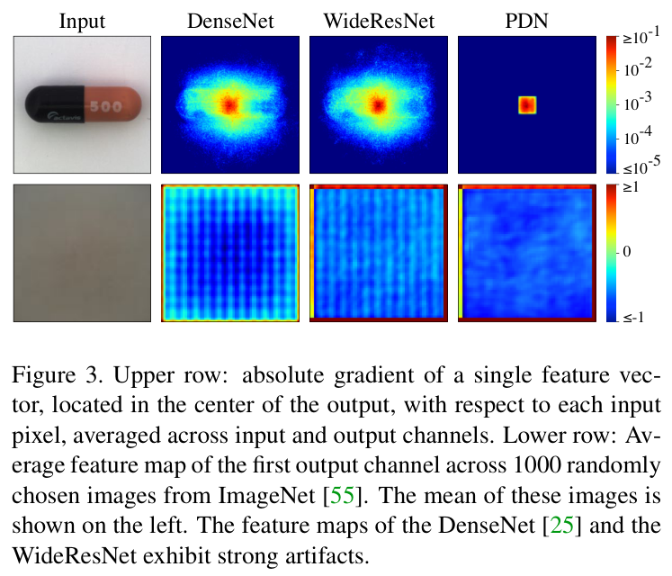

---

## 4. 핵심 기술

**① PDN (3.1절, 그림 2, 표 6 · 7).** EfficientAD-S 는 4x4 합성곱(128) → 2x2 평균 풀링(보폭 2) → 4x4 합성곱(256) → 2x2 평균 풀링 → 3x3 합성곱(256) → 4x4 합성곱(384)이다. M 은 숨은 층 커널 수를 두 배로 하고 1x1 합성곱을 두 자리에 끼운다. 둘 다 수용장 33, 256 입력에 출력 384 x 64 x 64 다(패딩이 있을 때, 내 셈, 12절). 원문은 256 x 256 이미지의 특징을 RTX A6000 에서 800 µs 안에 얻는다고 적는다.

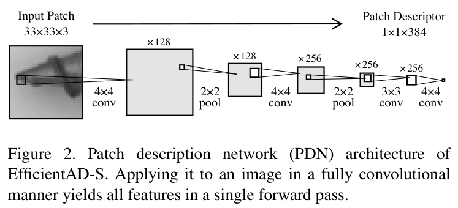

**② 증류 (부록 A.2, 알고리즘 3).** PatchCore 공식 코드의 WRN-101 특징(layer2 · 3 을 모아 384 차원으로 투영한 것, 코어셋 직전 단계)을 512 x 512 입력으로 뽑아 채널마다 정규화하고, 256 x 256 입력의 PDN 출력과 평균 제곱 차로 맞춘다. ImageNet, 묶음 16, 60,000 반복(내 셈: 960,000 장, ImageNet 학습 1,281,167 장의 75%), Adam 학습률 $10^{-4}$, 회색조 변환 확률 0.1.

**③ 선생 · 학생과 어려운 특징 손실 (3.2절).** $D_{c,w,h} = (T(I)_{c,w,h} - S(I)_{c,w,h})^2$ 의 $p_{hard}$ 분위수 $d_{hard}$ 이상인 원소의 평균이 $L_{hard}$ 다. $p_{hard}$ = 0 이면 원래 S-T 손실이고, 기본값은 0.999 다. 원문은 이것을 「세 차원 각각에서 평균 10% 의 값을 쓰는 것」 이라 적는다($0.1^3 = 0.001$, 셈 맞음). 추론의 국소 지도는 $M_{w,h} = C^{-1}\sum_c D_{c,w,h}$ 다. 동기는 「S-T 에서 학습 이미지를 늘리면 학생이 이상까지 흉내 내 성능이 떨어진다」 는 관찰인데, **그 관찰을 보인 표나 그림은 없다.** 「어려운 특징 손실로 정상 이미지 점수의 이상치, 곧 거짓 양성을 피한다」(arXiv 판에만 있는 문장)에도 잰 값이 붙어 있지 않다.

**④ 사전학습 벌점 (3.2절).**

$$L_{ST} = L_{hard} + (CWH)^{-1}\sum_c \lVert S(P)_c \rVert_F^2$$

$P$ 는 단계마다 뽑은 ImageNet 이미지다(512 로 줄여 확률 0.3 로 회색조, 가운데 256 자르기). 알고리즘 1 은 합을 $c = 1 \ldots 384$ 로 적어 학생의 앞 384 채널에만 건다. 선생 출력은 학습 이미지에서 채널마다 평균 0 · 표준편차 1 로 정규화되므로(알고리즘 1 의 3 \~ 10 줄), 「0 으로 민다」 는 「학습 이미지의 채널 평균으로 민다」 와 같다. 이 해석은 내 것이다.

**⑤ 자기부호기와 학생 덧출력 (3.3절, 표 8).** 부호기는 보폭 2 의 4x4 합성곱 다섯과 8x8 합성곱 하나로 256 x 256 을 **1 x 1 x 64** 로 누른다. 복호기는 쌍선형 보간과 4x4 합성곱을 여섯 번 되풀이하고(드롭아웃 0.2), 3x3 합성곱 둘로 384 x 64 x 64 를 낸다. 파라미터는 1,096,320 개다(내 셈). 손실은 셋이다.

$$L_{AE} = (CWH)^{-1}\sum_c \lVert T(I)_c - A(I)_c \rVert_F^2, \qquad L_{STAE} = (CWH)^{-1}\sum_c \lVert A(I)_c - S'(I)_c \rVert_F^2$$

전체 손실은 $L_{ST} + L_{AE} + L_{STAE}$ 다. $L_{STAE}$ 의 기울기는 자기부호기에도 흐른다(부록 A.1). 자기부호기 쪽 학습 이미지에만 밝기 · 대비 · 채도 중 하나를 0.8 \~ 1.2 배 바꾸는 증강을 준다. 원문의 논리는 이렇다. 학생은 정상 이미지에서 자기부호기가 늘 내는 재구성 오차(흐림)를 배우고, 이상 이미지의 재구성 오차는 배운 적이 없다. 그래서 둘의 차가 논리 이상에만 남는다. **이 논리를 재는 대조 줄(자기부호기 대 선생의 차를 바로 쓴 줄)은 없다.**

**⑥ 지도 정규화와 합치기 (3.4절, 알고리즘 2).** 검증 이미지에서 국소 · 전역 지도의 픽셀 점수를 모아 $q_a$ (a = 0.9), $q_b$ (b = 0.995) 를 내고, $\hat M = 0.1 (M - q_a)/(q_b - q_a)$ 로 바꾼 두 지도를 0.5 씩 더한다. 이미지 점수는 합친 지도의 최댓값이다. 원문은 0 · 0.1 이라는 목표값이 AU-ROC 에 영향을 주지 않는다고 적는다(순위만 보는 지표라서). **두 지도의 상대 크기는 이 변환이 정하므로, a · b 는 AU-ROC 에 영향을 준다**(표 3).

**⑦ 학습 · 추론 설정 (부록 A.1).** 256 x 256 으로 줄임, 묶음 1, 70,000 반복, Adam 학습률 $10^{-4}$ · 가중치 감쇠 $10^{-5}$, 66,500 반복(95%) 뒤 학습률 $10^{-5}$. 평균 학습 이미지 439 장이면 159 에폭, toothbrush 60 장이면 1,167 에폭이다(내 셈). 추론은 float16, PDN 패딩을 끈 설정이다(부록 E). 학습에 20 분이 걸린다고 적는다(Limitations).

**적혀 있지 않은 설정.** 검증 이미지가 학습 집합의 몇 장인지(「학습 집합에서 보지 않은 이미지」 라고만 적는다. LOCO 의 공식 검증 몫을 썼는지도). 평가한 모형이 70,000 반복의 마지막인지(조기 종료를 껐다는 문장으로 그렇게 읽힌다). 20 분을 잰 GPU. 패딩을 끈 PDN 과 64 x 64 자기부호기 출력을 맞춘 방법. 표 3 · 4 · 5 · 9 가 몇 번 실행의 평균인지. 자기 코드 주소.

---

## 5. 평가 (읽은 범위) · 그림을 읽은 방법

- **데이터:** MVTec AD 15 · VisA 12 · MVTec LOCO 5 장면. 모두 256 x 256 으로 줄여 넣고 지도를 원래 크기로 되돌린다.
- **지표:** 본문은 이미지 AU-ROC 와 AU-PRO(FPR 30%, LOCO 는 AU-sPRO). 부록 D 는 이미지 AU-PRC, AU-PRO 5%, 픽셀 AU-ROC 5%, 픽셀 AU-PRC 를 더한다. 모음 값은 장면 평균, 「전체」 는 세 모음 평균의 평균이다. LOCO 는 공식 평가 코드로 구조 · 논리를 따로 내 평균한다. 그래서 전체 평균에서 논리 이상의 무게는 $1/3 \times 1/2 = 1/6$ 이다(원문이 적고, 셈 맞음).
- **비교 상대:** GCAD · SimpleNet · S-T · FastFlow · DSR · PatchCore · PatchCoreEns · AST. **모두 저자들이 다시 돌린 값이다**(공식 코드가 있으면 그것으로). 설정은 9절.
- **장비:** 성능 표는 장비를 적지 않는다. 시간은 RTX A6000 · RTX A5000 · Tesla V100 · RTX 3080 · RTX 2080 Ti 다섯 대(표 17).
- **반복:** **EfficientAD 만 다섯 번 실행의 평균 · 표준편차를 적는다**(표 1 · 16: 검출 ±0.06 · ±0.09, 위치 ±0.05 · ±0.04). 상대는 반복 수가 적혀 있지 않다. AST 의 MVTec AD 재현값만 「다섯 번」 이라 적혀 있다(부록 B.1).

**표끼리 맞대기(셈 1).** 표 2 와 표 10 은 열 순서만 다르고 10 줄이 모두 같다. 표 1 · 16 의 두 성능 열은 표 10 · 12 의 전체 평균과 10 줄이 모두 같다. 표 1 의 지연은 표 17 의 A6000 열을 정수로 반올림한 값이고 10 줄 모두 맞다. 표 10 \~ 15 의 LOCO 평균 · 전체 평균을 인쇄 값으로 다시 내면 가장 큰 차가 0.067(표 13 S-T 의 전체 70.4 대 70.333)이다. 인쇄 값 셋이 각각 ±0.05 의 반올림 폭을 가지므로 0.1 까지는 반올림으로 설명되고, 0.1 을 넘는 칸은 없다.

**그림을 읽은 방법.** 그림 1 · 6 · 8 은 PDF 벡터 경로다. PyMuPDF 로 X 표식 상자의 가운데와 막대 윗변 좌표를 뽑아 눈금으로 환산했다. 그림 1 은 x 가 로그 눈금(한 자릿수 = 66.83 pt), y 는 1 점 = 12.35 pt 다. 그림 8 은 눈금 선 대신 눈금 글자 상자의 가운데를 눈금 자리로 잡았다.

- **그림 1 의 열 점과 표 1 · 17 의 차는 AU-ROC 0.05 · 지연 0.01 ms 이하다.** 다만 **GCAD 점(10.70 ms, 85.36)은 그림 상자 아래(상자 아래 끝 = AU-ROC 87.40)에 찍혀 보이지 않고, 이름표도 없다.** 그림 1 이 보이는 상대는 일곱이다.
- **그림 8 의 스무 점은 표와 0.14 이하로 맞다.** 눈금 글자 가운데로 눈금을 잡은 읽기 오차가 들어 있다.
- **그림 6 은 단색 막대 넷(EfficientAD-S · SimpleNet · PatchCore · PatchCoreEns)만 읽었고 스무 개가 표 17 과 0.1 ms 이하로 맞다.** 나머지 여섯 방법의 막대는 무늬 채우기 경로라 읽지 않았다.

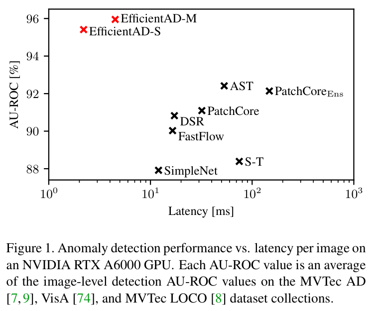

---

## 6. 주 결과 — 표 1 · 2 (이미지 AU-ROC · AU-PRO)

| 방법 | MAD | VisA | LOCO 구조 | LOCO 논리 | LOCO | **전체 AU-ROC** | **전체 AU-PRO** | 지연 ms | 장/초 |
|---|---:|---:|---:|---:|---:|---:|---:|---:|---:|
| GCAD | 89.1 | 83.7 | 82.7 | 83.9 | 83.3 | 85.4 | 88.0 | 11 | 121 |
| SimpleNet | 98.2 | 87.9 | 83.7 | 71.5 | 77.6 | 87.9 | 74.4 | 12 | 194 |
| S-T | 93.2 | 94.6 | 88.3 | 66.5 | 77.4 | 88.4 | 89.7 | 75 | 16 |
| FastFlow | 96.9 | 93.9 | 82.9 | 75.5 | 79.2 | 90.0 | 86.5 | 17 | 120 |
| DSR | 98.1 | 91.8 | 90.2 | 75.0 | 82.6 | 90.8 | 78.6 | 17 | 104 |
| PatchCore | 98.7 | 94.3 | 84.8 | 75.8 | 80.3 | 91.1 | 80.9 | 32 | 76 |
| PatchCoreEns | **99.3** | 97.7 | 87.7 | 71.0 | 79.4 | 92.1 | 80.7 | 148 | 13 |
| AST | 98.9 | 94.9 | 87.1 | 79.7 | 83.4 | 92.4 | 77.2 | 53 | 41 |
| EfficientAD-S | 98.8 | 97.5 | 94.1 | 85.8 | 90.0 | 95.4 | 92.5 | **2.2** | **614** |
| EfficientAD-M | 99.1 | **98.1** | **94.7** | **86.8** | **90.7** | **96.0** | **93.3** | 4.5 | 269 |

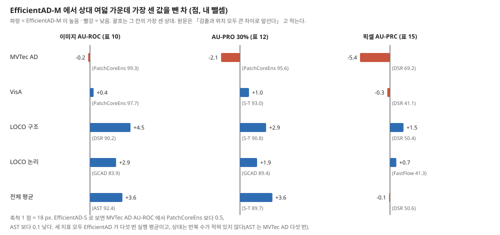

**EfficientAD-M 에서 상대 여덟 가운데 가장 센 값을 빼면(셈 2, 내 뺄셈):**

| 표 | MAD | VisA | LOCO 구조 | LOCO 논리 | 전체 |
|---|---|---|---|---|---|
| 이미지 AU-ROC (표 10) | **−0.2** (PatchCoreEns) | +0.4 (PatchCoreEns) | +4.5 (DSR) | +2.9 (GCAD) | +3.6 (AST) |
| AU-PRO 30% (표 12) | **−2.1** (PatchCoreEns) | +1.0 (S-T) | +2.9 (S-T) | +1.9 (GCAD) | +3.6 (S-T) |
| 픽셀 AU-PRC (표 15) | **−5.4** (DSR) | **−0.3** (DSR) | +1.5 (DSR) | +0.7 (FastFlow) | **−0.1** (DSR) |

- **MVTec AD 에서는 이미지 AU-ROC · AU-PRO 모두 PatchCoreEns 가 1 위다.** S 로 보면 AU-ROC 가 PatchCoreEns 보다 0.5, AST 보다 0.1 낮다. 표 2 캡션은 이것을 「MVTec AD 만으로 방법을 개발하면 남은 몇 장의 오분류에 설계를 과적합하기 쉽다」 로 받는다.
- **VisA 의 앞섬은 M 으로 +0.4(AU-ROC) · +1.0(AU-PRO)이고, S 는 AU-ROC 가 PatchCoreEns 보다 0.2 낮고 AU-PRO 는 S-T 보다 0.1 높다.**
- **전체 평균의 앞섬은 LOCO 에서 나온다.** AU-ROC 의 LOCO 열은 M − AST = +7.3 이고, MAD · VisA 의 차는 −0.2 · +0.4 다.
- **「AST 가 둘째」 는 검출 AU-ROC 로만 맞다.** 위치 AU-PRO 로는 AST 77.2 가 열 방법 중 9 위이고, 둘째는 S-T 89.7 이다. 결론의 「둘째 방법 AST 대비 지연 24 배 · 처리량 15 배」(53 / 2.2 = 24.09, 614 / 41 = 14.98, 셈 맞음)는 검출 순위의 둘째와 견준 값이다.
- **오류율로 적으면(내 셈)** 전체 AU-ROC 오류 100 − 92.4 = 7.6 이 4.6 으로 39.5% 준다(S, AST 대비). 원문은 이 셈을 적지 않았다.

**「LOCO 의 앞섬은 논리 · 구조가 같은 몫」(4절, 셈 3).** S − AST 는 LOCO +6.6 = 논리 +6.1 · 구조 +7.0 의 평균이다. AST 와 견주면 문장이 맞다. **열마다 가장 센 상대와 견주면 논리 +1.9(GCAD) · 구조 +3.9(DSR)로 구조가 두 배다.** 그리고 GCAD 는 저자들이 고른 단일 판이다. 원 저자의 묶음판은 논리 86.0 으로 S 85.8 보다 0.2 높고 M 86.8 보다 0.8 낮다(부록 B.4, 9절).

---

## 7. 다른 지표 — 표 11 \~ 15 (부록 D)

| 표 (전체 평균) | S | M | 가장 센 상대 | M − 그 상대 |
|---|---:|---:|---|---:|
| 표 11 이미지 AU-PRC | 95.4 | 95.7 | PatchCoreEns 92.8 | +2.9 |
| 표 12 AU-PRO 30% | 92.5 | 93.3 | S-T 89.7 | +3.6 |
| 표 13 AU-PRO 5% | 76.5 | 78.0 | S-T 70.4 | +7.6 |
| 표 14 픽셀 AU-ROC 5% | 74.4 | 75.0 | S-T 67.4 | +7.6 |
| 표 15 픽셀 AU-PRC | **51.1** | 50.5 | DSR 50.6 | **−0.1** |

- **픽셀 AU-PRC 는 S 가 1 위(51.1)이고 M 은 DSR 보다 0.1 낮다.** 모음별로 DSR 은 MAD 69.2 · VisA 41.1 로 둘 다 1 위다. 부록 F 는 DSR 을 「매우 정밀한 분할을 내지만 거짓 양성이 있다」 고 적는다. 원문은 S 와 M 의 순서가 표 15 에서 뒤집히는 것(S 51.1 > M 50.5)을 다루지 않는다.
- **MAD 열에서 EfficientAD 가 1 위인 표는 여섯(표 10 \~ 15) 가운데 표 14 하나다**(S 79.7 > PatchCoreEns 79.4 = M 79.4). 이미지 AU-PRC 는 PatchCoreEns 99.0 > M 98.9, AU-PRO 5% 는 PatchCoreEns 79.5 > DSR 78.9 > M 78.4 다.
- **LOCO 논리의 픽셀 AU-ROC 5% 는 열 방법 모두 20.4 \~ 35.3 이다.** M 35.3 이 1 위이고 FastFlow 33.7 이 다음이다. 같은 칸의 AU-sPRO 5% 는 M 76.5 · GCAD 67.1 이라, 지표에 따라 같은 논리 이상 위치 결과가 35 와 77 로 갈린다.
- 부록 D.2 는 FPR 30% 한도를 「정상 픽셀의 30% 넘게 이상으로 칠하는 방법은 쓸모가 적다」 로 설명한다. 5% 한도 표를 더한 까닭은 적혀 있지 않다.

---

## 8. 순위가 바뀐다 — 지표 사이 · 모음 사이 (표 10 · 12 로 내가 매김)

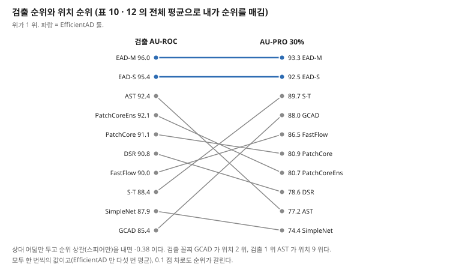

**검출 대 위치(셈 4).** 상대 여덟의 전체 평균 검출 AU-ROC 순위와 AU-PRO 순위의 스피어만 상관은 **−0.38** 이다. 검출 1 위 AST 는 위치 7 위(열 방법 중 9 위), 검출 8 위 GCAD 는 위치 2 위다. 부록 E 의 그림 8 캡션은 「EfficientAD 를 빼면 방법 순위가 검출과 위치 사이에서 크게 바뀐다」 고 적는다. 그 문장을 수로 옮긴 것이다. EfficientAD 둘을 넣은 열 방법으로는 +0.30 이다.

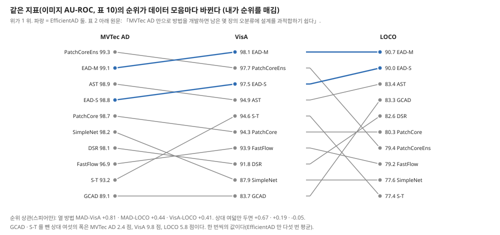

**모음 사이(셈 4).** 이미지 AU-ROC 순위의 상관은 다음과 같다.

| | 열 방법 | 상대 여덟 |
|---|---:|---:|
| MAD 대 VisA | +0.81 | +0.67 |
| MAD 대 LOCO | +0.44 | +0.19 |
| VisA 대 LOCO | +0.41 | −0.05 |

- **GCAD · S-T 를 뺀 상대 여섯의 폭은 MAD 2.4 점(96.9 \~ 99.3), VisA 9.8 점, LOCO 5.8 점이다.** MVTec AD 의 위 일곱 자리(99.3 \~ 98.1)는 이웃 순위 사이 차가 0.1 \~ 0.5 점이고, 이 순위가 다른 모음에서 뒤집힌다. 예: MAD 6 위 SimpleNet(98.2)은 VisA 9 위(87.9)이고, MAD 9 위 S-T(93.2)는 VisA 5 위(94.6)다.
- **반복이 없다.** 상대의 값은 한 번씩이고, EfficientAD 의 표준편차(0.06 · 0.09)를 상대에도 그대로 놓을 근거는 없다. 순위 상관은 이 단서를 달고 읽는다.
- **이 표는 `beyond-mvtec` 의 물음(MVTec AD 에서 매긴 설정 순위가 다른 데이터셋에서도 유지되나)에 방법 단위의 사례 하나를 준다.** 그 저장소는 한 방법 안의 설정 순위를 묻고, 이 표는 서로 다른 방법의 순위다. 둘을 같은 물음으로 묶지 않는다(18절).

---

## 9. 상대를 어떻게 돌렸나 — 4절 · 부록 B

| 상대 | 이 편이 적은 설정 | 원 논문 값과의 관계 | 짚을 자리 |
|---|---|---|---|
| **SimpleNet** | 공식 코드. 「학습 중 시험 이미지로 거듭 평가해 최댓값을 내는」 것을 끄고 마지막 모형 | 「공식 결과를 재현했다」, 재현 수치는 적지 않음. 이 편 MAD 98.2, 원문 99.6(SimpleNet 노트) | **차 −1.4.** 가운데 자르기를 껐는지는 적혀 있지 않다 |
| **PatchCore** | 공식 코드, 코어셋 1%, 224 x 224, **WRN-101**, 가운데 76.6% 자르기 끔 | 「MVTec AD 결과를 재현했다」 | 76.6% 는 $(224/256)^2$ = 76.56% 다(내 셈). 이 편은 WRN-101 을 「PatchCore 의 기본」 · 「가장 짧은 지연을 보고한 설정」 이라 적는데, PatchCore 노트(21절)의 원문 기본 백본은 WRN-50 이다 |
| **PatchCoreEns** | WRN-101 · ResNeXt-101 · DenseNet-201, 1%, 320 x 320, 자르기 끔 | PatchCore 원문 같은 설정 99.6(PatchCore 노트 12절), 이 편 99.3 | 차 −0.3 이 자르기를 끈 몫으로 읽히지만, 반복이 없어 가르지 않는다 |
| **GCAD** | 직접 구현. 두 묶음 원소(조각 17 · 33) 중 **평균 성능이 나은 33 하나**만 보고 | 「재현했다」. LOCO 논리 단일 83.9, 원 묶음판 86.0. LOCO 전체는 같다고 적는다 | 고른 기준이 시험 결과다. 지연이 반으로 준다 |
| **FastFlow** | anomalib 구현, WRN-50-2, 조기 종료를 끄고 **모든 데이터셋에 평균으로 잘 맞는** 200 단계 | 적혀 있지 않다 | 200 단계를 무엇으로 골랐는지 적혀 있지 않다 |
| **AST** | 공식 코드, 기본 설정 | 원문 99.2 를 재현 못 하고 98.9(다섯 번) | 차 −0.3 |
| **DSR** | 공식 코드. VisA 에서는 반복 수를 맞추려 50 에폭 | 원문 98.2, 이 편 98.1 | 차 −0.1 |
| **S-T** | 직접 구현, 기본 설정 | 위치는 원문보다 높고 [7] 의 값과 같다 | [7] 은 이 편 저자가 공저한 MVTec AD IJCV 판 |

- **「시험 집합으로 학습 길이를 고르기」 를 끈 것은 SimpleNet · FastFlow 둘이다.** 원문의 근거는 둘이다. 보지 않은 이미지에서의 성능을 부풀리고, 실제로 쓰려면 이상 이미지가 든 검증 몫이 필요하다는 것이다. 그리고 「EfficientAD 도 조기 종료를 켜면 MVTec AD 99.8」 이라 적는다. **S · M 어느 판인지는 적혀 있지 않다**(M 99.1 이면 +0.7, S 98.8 이면 +1.0).
- **SimpleNet 노트가 남긴 물음 하나가 여기서 풀린다.** 「평가한 모형이 어느 에폭의 것인지」 는 SimpleNet 원문에 적혀 있지 않았다. 이 편에 따르면 공식 코드가 학습 중 시험 점수의 최댓값을 낸다. **이 노트는 코드를 보지 않았으므로 이 편의 말로만 옮긴다.**
- **이 편 자신의 기본값도 같은 32 개 시험 집합의 값으로 골라졌다.** 표 3 의 굵은 칸(기본값) a = 0.9 · b = 0.995 · $p_{hard}$ = 0.999 는 그 표의 최댓값 칸이다(b 는 0.99 와 같은 값 96.0). 반복 수 70,000 · 학습률을 줄이는 자리 66,500 · 증강 폭을 고른 근거는 적혀 있지 않다. 검증 몫을 따로 두었다는 문장이 없어 표 3 은 「시험 집합 위의 감도 분석」 으로 읽는다. 학습 길이를 시험으로 고르는 것과 같은 꼴은 아니다. 다만 상대에게 끈 「시험 값으로 고르기」 의 한 형태가 이 편의 기본값에도 들어 있다.
- **PatchCore 의 자르기를 끈 근거**는 「MVTec AD 결함의 99.9% 가 가운데 76.6% 안에 온전히 또는 일부 걸쳐 있다」 와 「자르기는 시험 집합 이상에 대한 지식을 뜻한다」 다. EfficientAD 는 이미지 전체를 256 으로 줄인다. 같은 기준을 SimpleNet(원문이 256 → 224 가운데 자르기)에 적용했는지는 적혀 있지 않다.

---

## 10. 끈 실험 — 표 3 · 4 · 5

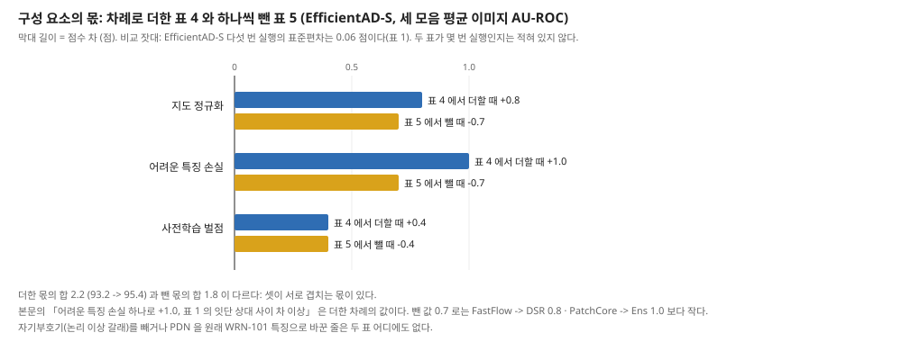

**표 4 (누적, EfficientAD-S) 대 표 5 (하나씩 빼기).** 지도 정규화가 없는 줄은 검증 픽셀 점수를 평균 0 · 분산 1 로 맞추는 가우스 정규화를 대신 쓴다.

| 구성 요소 | 표 4 에서 더할 때 | 표 5 에서 뺄 때 |
|---|---:|---:|
| 지도 정규화 | +0.8 | −0.7 |
| 어려운 특징 손실 | +1.0 | −0.7 |
| 사전학습 벌점 | +0.4 | −0.4 |
| 합 | +2.2 (93.2 → 95.4) | −1.8 |

- **더한 몫의 합과 뺀 몫의 합이 0.4 다르다.** 셋이 서로 겹치는 몫이 있다는 뜻이다. 원문은 겹침을 다루지 않는다.
- **「어려운 특징 손실 하나로 +1.0, 표 1 의 잇단 상대 사이 차 이상」(4절).** 표 1 에서 FastFlow → DSR → PatchCore → PatchCoreEns → AST 의 잇단 차는 0.8 · 0.3 · 1.0 · 0.3 이라 1.0 은 모두 이상이다(셈 5, 맞음). **뺀 표의 0.7 로 견주면 0.8 · 1.0 보다 작다.** 문장은 더한 차례를 고른 값이다.
- **두 표에 자기부호기 갈래를 뺀 줄이 없다.** 표 4 의 첫 줄 「PDN」 은 가우스 정규화를 쓰는데, 정규화는 두 지도를 합칠 때만 필요하다. 그러니 그 줄에도 자기부호기가 들어 있다. **논리 이상을 맡은 부품의 몫(LOCO 논리 85.8 중 얼마가 자기부호기 덕인지)이 재어지지 않았다.** 학생이 자기부호기를 따라 배우는 장치(⑤)를 빼고 자기부호기 대 선생의 차를 바로 쓴 줄도 없다.
- **PDN 대신 원래 WRN-101 특징을 선생으로 쓴 줄이 없다.** 「PDN 이 정확도를 잃지 않는다」 는 표 9 의 백본 비교와 표 1 의 PatchCore 와의 맞대기로만 간접 지지된다.
- **두 표의 몫(0.4 \~ 1.0)은 S 의 다섯 번 표준편차 0.06 의 6.7 \~ 16.7 배다.** 다만 표 4 · 5 의 줄이 몇 번 실행인지는 적혀 있지 않다.

**표 3 (EfficientAD-M, 기본값을 하나씩 바꿈).**

| 값 | a (q_a) | AU-ROC | b (q_b) | AU-ROC | $p_{hard}$ | AU-ROC |
|---|---:|---:|---:|---:|---:|---:|
| 1 | 0.5 | 95.9 | 0.95 | 95.8 | 0 | 94.9 |
| 2 | 0.8 | 95.9 | 0.98 | 95.9 | 0.9 | 94.9 |
| 3 | **0.9** | **96.0** | 0.99 | 96.0 | 0.99 | 95.7 |
| 4 | 0.95 | 95.9 | **0.995** | **96.0** | **0.999** | **96.0** |
| 5 | 0.98 | 95.9 | 0.998 | 95.9 | 0.9999 | 95.8 |
| 6 | 0.99 | 95.8 | 0.999 | 95.9 | 0.99999 | 95.7 |

- **a · b 는 여섯 값의 폭이 0.2 점이다.** M 의 표준편차 0.09 의 2.2 배다. 원문의 「견고하다」 는 이 폭으로 맞다.
- **$p_{hard}$ = 0 (손실을 끔)은 M 에서 −1.1 이고, S 의 표 5 는 −0.7 이다.** $p_{hard}$ = 0.9 도 0 과 같은 94.9 다. 0 에서 0.999 까지의 오름 1.1 점 가운데 0.8 점(73%)이 0.9 와 0.99 사이에서, 0.3 점이 0.99 와 0.999 사이에서 생긴다.

---

## 11. 증류 백본 — 표 9 (부록 C)

| 모음 | 방법 | WRN-101 | ResNeXt-101 | DenseNet-201 | 폭 |
|---|---|---:|---:|---:|---:|
| MAD | PatchCore | 98.7 | 98.8 | 98.7 | 0.1 |
| MAD | EfficientAD-S | 98.8 | 98.9 | 98.8 | 0.1 |
| MAD | EfficientAD-M | 99.1 | 99.0 | 99.2 | 0.2 |
| LOCO | PatchCore | 80.3 | 78.9 | 76.5 | 3.8 |
| LOCO | EfficientAD-S | 90.0 | 90.1 | 90.6 | 0.6 |
| LOCO | EfficientAD-M | 90.7 | 89.9 | 88.3 | 2.4 |
| VisA | PatchCore | 94.3 | 95.2 | 94.8 | 0.9 |
| VisA | EfficientAD-S | 97.5 | 97.3 | 97.1 | 0.4 |
| VisA | EfficientAD-M | 98.1 | 98.0 | 97.7 | 0.4 |

- 원문의 「PatchCore 와 비슷하게 견고하다」 는 폭으로 맞다. 부록 F 는 같은 표를 들어 「EfficientAD 는 특징 추출기 선택에 견고하다」 고 적는데, M 의 LOCO 폭 2.4 는 S 0.6 의 4 배다.
- **세 백본 중 어느 것도 세 모음 · 두 판에서 모두 가장 높지 않다.** WRN-101 을 고른 근거는 「PatchCore 와 통제된 비교를 위해」 다(3.1절).
- 표 9 의 PatchCore 단일 백본 셋은 PatchCoreEns(셋을 묶고 320 입력)와 해상도가 다를 수 있다. 단일 판의 입력 크기는 표 9 에 적혀 있지 않다.

---

## 12. 비용 — 표 16 · 17, 그림 6, 부록 E

**시간을 재는 방법(부록 E).** CPU → GPU 로 이미지를 옮기는 것부터 이상 지도가 CPU 에 돌아올 때까지. float16, 손실 계산 같은 불필요한 부분을 뺐다. 1,000 번 예열 뒤 1,000 번의 평균이다. 처리량은 16,000 을 묶음 16 의 1,000 번 시간 합으로 나눈다. **모든 방법에 같은 규칙을 적용했다고 적는다.** float16 으로 바꿔도 EfficientAD 의 결과가 32 장면에서 바뀌지 않았다고 적고, 상대에 대해서는 적지 않는다.

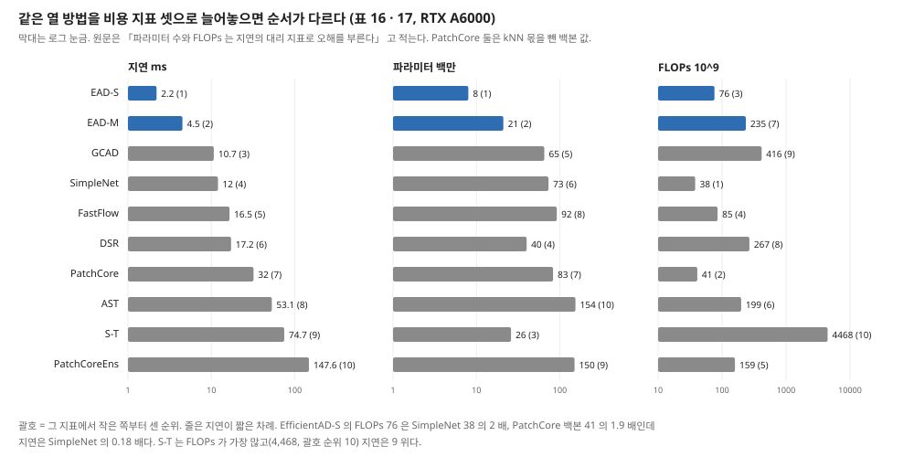

| 방법 | 지연 ms | 장/초 | 파라미터 백만 | FLOPs $10^9$ | GPU 메모리 MB |
|---|---:|---:|---:|---:|---:|
| EfficientAD-S | 2.2 | 614 | 8 | 76 | 100 |
| EfficientAD-M | 4.5 | 269 | 21 | 235 | 161 |
| GCAD | 11 | 121 | 65 | 416 | 555 |
| SimpleNet | 12 | 194 | 73 | 38 | 508 |
| FastFlow | 17 | 120 | 92 | 85 | 404 |
| DSR | 17 | 104 | 40 | 267 | 314 |
| PatchCore | 32 | 76 | 83 + 3 | 41 + kNN | 637 + kNN |
| AST | 53 | 41 | 154 | 199 | 618 |
| S-T | 75 | 16 | 26 | 4,468 | 1,077 |
| PatchCoreEns | 148 | 13 | 150 + 8 | 159 + kNN | 1,335 + kNN |

- **EfficientAD-S 의 FLOPs 76 은 SimpleNet 38 의 2.0 배, PatchCore 백본 41 의 1.9 배인데 지연은 SimpleNet 의 0.18 배다.** 「FLOPs 는 병렬화를 보지 않아 효율의 대리 지표로 믿기 어렵다」(부록 E)의 예가 이 편 자신에게도 들어 있다. 원문은 S-T(4,468)를 예로 들고 이 줄은 들지 않는다.
- **GPU 메모리 100 MB 는 다음으로 작은 DSR 314 MB 의 31.8% 다.** 메모리는 「예약 메모리의 최고치」 로 쟀다.
- **PatchCore 의 kNN 몫은 VisA cashew(학습 450 장) 한 장면으로 쟀다.** 32 장면 평균 학습 이미지 439 장에 가장 가까워서라고 적는다. kNN 검색의 FLOPs · 메모리는 쓰는 라이브러리로 잴 수 없어 빠졌다. 지연 · 처리량에는 들어 있다.
- **WRN-101 의 쓰는 층까지 파라미터 「83 백만」 은 맞다.** torchvision 의 `wide_resnet101_2` 에서 layer4 · fc 를 뺀 파라미터가 82,865,984 개다(내 셈, WRN-50-2 는 24,862,528 개).

**배수를 적는 두 방식(셈 6).** 부록 E 는 「FastFlow 의 파라미터는 S-T 의 2.5 배 크다」 · 「처리량이 6.5 배 높다」 고 적는다. 표로 나누면 92 / 26 = 3.54 배, 120 / 16 = 7.50 배다. 원문의 2.5 · 6.5 는 **(차 / S-T)** 로 센 값이다. 「S-T 의 FLOPs 가 AST 보다 2000% 넘게 많다」 도 (차 / AST) = 2,145% 다. 반면 결론의 「지연 24 배 줄임」 은 나눈 값(53 / 2.2)이다. 한 편 안에 두 방식이 섞여 있다. 「S-T 의 지연이 AST 보다 42% 높다」 는 표 1 의 정수로 41.5%, 표 17 의 소수로 40.7% 다.

**GPU 다섯 대(표 17, 그림 6).** 「GPU 마다 순위가 같고, DSR 이 FastFlow 보다 빠른 두 경우만 다르다」(원문 「slightly faster」)는 표로 맞다(셈 7). 그 두 경우는 V100(DSR 24.8 대 26.1, 5.0% 짧음)과 RTX 3080(24.6 대 27.5, 10.5% 짧음)이다. EfficientAD-S 의 가장 느린 GPU 값(4.5 ms, 2080 Ti)은 상대 중 가장 빠른 값(GCAD 10.7 ms, A6000)의 0.42 배다.

**PDN 의 크기를 표 6 · 7 · 8 로 세면(셈 9, 내 셈).**

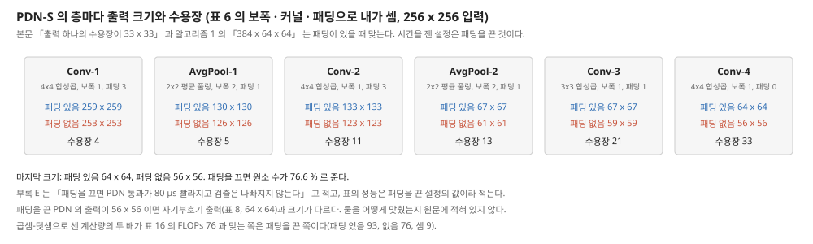

| | 파라미터 (선생 + 학생 + 자기부호기) | 곱셈-덧셈 x 2, 패딩 있음 | 곱셈-덧셈 x 2, 패딩 없음 | 표 16 |
|---|---:|---:|---:|---|
| EfficientAD-S | 2,694,144 + 4,267,392 + 1,096,320 = **8,057,856** | 93.3 G | **75.9 G** | 8 백만 · **76 G** |
| EfficientAD-M | 8,026,624 + 11,615,488 + 1,096,320 = **20,738,432** | 287.4 G | **235.4 G** | 21 백만 · **235 G** |

- **파라미터는 두 판 모두 표 16 과 맞는다.** 자기부호기의 잠재는 1 x 1 x 64 = 64 차원으로 3.3절 「64 latent dimensions」 와 맞고, 복호기의 층마다 크기도 표 8 의 보간 크기와 모두 맞는다(3 → 4, 8 → 9, 15 → 16, 32 → 33, 63 → 64, 127 → 128).
- **FLOPs 는 패딩을 끈 셈이 두 판 모두 맞는다(76 · 235).** 자기부호기 출력을 56 x 56 으로 둘 때의 값이다. 64 x 64 로 두면 S 는 76.4 G 로 역시 76 이 되고, M 은 235.9 G 로 236 이 된다. FLOPs 를 곱셈-덧셈의 두 배로 놓은 것은 내 가정이다. PyTorch 프로파일러가 합성곱을 어떻게 세는지 이 노트에서 확인하지 않았다. **그래도 두 판이 같은 가정으로 함께 맞는다.**
- **패딩을 끄면 PDN 출력은 56 x 56 이다(64 x 64 의 76.6%).** 알고리즘 1 · 2 와 표 6 · 7 은 모두 64 x 64 를 적는다. 표 8 의 자기부호기는 마지막에 64 x 64 로 보간하므로, 패딩을 끈 학생 출력(56 x 56)과 원소끼리 빼려면 어딘가에서 크기를 맞춰야 한다. **그 방법은 원문에 적혀 있지 않다.** 「패딩을 꺼도 검출이 나빠지지 않는다」 는 수치 없이 적힌 문장이고, 표의 성능이 패딩을 끈 설정의 값이라고만 적는다.
- **PDN-S 선생 하나의 파라미터(2.69 백만)는 S-T 망 한 개의 범위(1.6 \~ 2.7 백만)의 위 끝과 같다.** 3.1절의 논지(파라미터가 아니라 일찍 줄이는 것이 속도를 만든다)와 맞는 수다. 곱셈-덧셈으로는 PDN-S 선생이 18.78 G(패딩 있음)다. S-T 망 하나의 값은 이 편에 없어 견주지 않는다.
- **「최근 방법의 특징 추출기보다 한 자릿수 빠르다」(1절 기여 둘째)는 특징 추출기만의 시간을 잰 표가 없다.** PDN 800 µs 와 견줄 WRN-101 의 시간이 적혀 있지 않다.

---

## 13. 정성 그림 — 그림 3 · 4 · 7 · 9 \~ 11

- **그림 3** (2절 끝에 넣었다): 출력 가운데 특징 하나의 입력 기울기(위)와 ImageNet 1,000 장 평균 첫 채널 지도(아래). PDN 의 기울기는 33 x 33 안에만 있고, DenseNet · WRN 은 이미지 전체에 퍼진다. **수치가 없는 한 장이고, 「먼 곳 이상이 지도를 해친다」 를 재는 위치 지표 비교는 없다.** 전역 지도(자기부호기)는 설계상 이미지 전체를 보므로, 이 논지는 국소 지도에만 해당한다.
- **그림 4**: 어려운 특징 손실이 고른 원소 수를 밝기로 그린 학습 이미지 다섯 장(screw). 「학생이 배경은 이미 흉내 내고 돌아간 나사를 배우는 데 집중한다」 는 캡션의 설명이다.

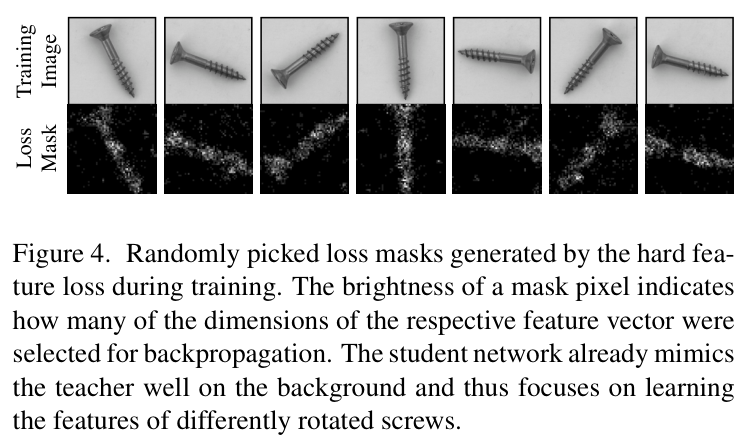

- **그림 7**: VisA 12 장면에서 무작위로 고른 결함 이미지와 M 의 지도. 「cherry-pick 하지 않았다」 고 적는다. 무작위 뽑기의 seed 는 적혀 있지 않다.
- **그림 9 \~ 11 (부록 F)**: 열 방법의 지도. 방법마다 색 눈금이 다르고(AST 는 2 \~ 10), 눈금 양 끝은 「참 양성 · 참 음성이 잘 보이도록」 저자가 골랐다. 부록 F 스스로 「정성 결과만으로 방법을 비교하지 말라」 고 적는다.

---

## 14. 실험 분석 — 표 · 그림마다

| 표 · 그림 | 무엇을 바꿨나 | 무엇을 고정했나 | 결과 | 반복 · 흩어짐 | 주장이 결과보다 센가 |
|---|---|---|---|---|---|
| 표 1 · 2 · 10 · 12 | 방법 열 | 32 장면, 256 입력(상대는 각자 설정) | 전체 AU-ROC M 96.0 · AU-PRO 93.3 | EfficientAD 다섯 번(±0.06 \~ 0.09), 상대 적혀 있지 않음 | 「검출 · 위치 모두 큰 차이」 는 세 모음 평균으로 맞다. MAD 에서는 AU-ROC · AU-PRO 모두 PatchCoreEns 가 1 위 |
| 표 2 (LOCO) | 방법 열 | LOCO 5 장면 | S − AST 논리 +6.1 · 구조 +7.0 | 같음 | 「같은 몫」 은 AST 기준으로 맞고, 열마다 가장 센 상대 기준으로는 구조가 두 배 |
| 표 11 \~ 15 | 지표 넷 | 같은 실행 | 픽셀 AU-PRC 는 M < DSR | 같음 | 부록이라 본문 주장에 들지 않는다. 표 15 의 M 은 1 위가 아니다 |
| 표 3 | a · b · $p_{hard}$ 하나씩 | M, 나머지 기본 | a · b 폭 0.2, $p_{hard}$ 폭 1.1 | 적혀 있지 않음 | 「견고하다」 는 a · b 로 맞다. 기본값이 모두 표의 최댓값 칸이고 검증 몫이 없다 |
| 표 4 | 세 기법을 차례로 더함 | S | 93.2 → 95.4 | 적혀 있지 않음 | 「+1.0 이 상대 사이 차 이상」 은 더한 차례의 값. 자기부호기를 뺀 줄이 없다 |
| 표 5 | 세 기법을 하나씩 뺌 | S | −0.7 · −0.7 · −0.4 | 적혀 있지 않음 | 합 1.8 ≠ 2.2 (겹침) |
| 표 9 | 증류 백본 셋 | 나머지 기본 | 폭 S 0.1 \~ 0.6, M 0.2 \~ 2.4 | 적혀 있지 않음 | 「PatchCore 만큼 견고」 는 맞다. M 의 LOCO 폭 2.4 |
| 표 16 · 17 · 그림 6 | 방법 열, GPU 다섯 | 같은 시간 규칙, float16 | S 2.2 ms · 614 장/초 · 100 MB | EfficientAD 다섯 번(±0.01 ms) | 「순위가 같다」 는 맞다. FLOPs 76 은 패딩을 끈 셈과 맞고, 그때 출력 크기 64 는 맞지 않는다 |
| 그림 1 · 8 | 방법 열 | 표 1 과 같은 값 | 표와 0.14 이하로 맞음 | 표와 같음 | GCAD 점이 그림 1 상자 밖에 있다 |
| 그림 3 · 4 · 7 · 9 \~ 11 | 정성 | | | 해당 없음 | 수치 주장과 엮지 않는다고 원문 스스로 적는다 |

---

## 15. 이 논문이 스스로 적은 한계

**Limitations 단락(5절 끝)이 둘을 적는다.**

1. **작은 논리 이상**: 2 mm 긴 나사처럼 세밀한 논리 이상은 여전히 어렵고, 측정(metrology) 방법을 써야 한다고 적는다([62]). 해당 장면의 값은 없다.
2. **학습이 필요하다**: kNN 계열과 달리 학습이 필요하고, 특히 자기부호기가 논리 제약을 배우는 데 20 분이 걸린다. 몇 번 재서 무엇을 냈는지, 어느 GPU 인지 적혀 있지 않다.

이 밖에 부록 F 가 자기 지도에 대해 「breakfast box · pushpins 의 논리 이상에서 반응 세기가 모자랄 때가 있다」 고 적는다.

---

## 16. 원문 안의 어긋남 모음

| 자리 | 원문 | 맞대 보니 | 내 판단 |
|---|---|---|---|
| 초록 · 결론 | 「detection and localization ... by a large margin」 | MAD AU-ROC · AU-PRO 는 PatchCoreEns 가 1 위, 전체 픽셀 AU-PRC 는 M < DSR | 세 모음 평균의 본문 두 지표로만 맞다 |
| 결론 | 「AST, the second-best method」 | 위치 AU-PRO 로는 AST 가 열 방법 중 9 위 | 검출 기준의 둘째 |
| 4절 | 「lead on MVTec LOCO is in equal parts」 | AST 대비 +6.1 · +7.0, 열별 최강 대비 +1.9 · +3.9 | 기준을 적어야 할 문장 |
| 4절 | 「hard feature loss ... 1.0 % ... greater than or equal to」 | 표 5 의 뺀 몫은 0.7 | 더한 차례를 고른 값 |
| 부록 E | 「roughly 2.5 times larger」 · 「6.5 times higher」 | 3.54 배 · 7.50 배, (차 / S-T) 로 2.54 · 6.50 | 배수 방식이 결론의 「24 배」 와 다르다 |
| 부록 E | 「only 42 % higher」 | 41.5% (정수) · 40.7% (표 17) | 반올림 차 |
| 표 16 대 표 6 · 알고리즘 1 | FLOPs 76 · 235, 출력 384 x 64 x 64 | FLOPs 는 패딩을 끈 셈(출력 56 x 56)과 맞다 | 표의 크기는 패딩이 있을 때의 값 |
| 부록 E 대 표 8 | 「패딩을 꺼도 검출이 나빠지지 않는다」 | 학생 56 x 56 대 자기부호기 64 x 64 | 크기를 맞춘 방법이 적혀 있지 않다 |
| 부록 B.5 · C | PatchCore 의 「default」 · 「lowest latency」 설정이 WRN-101 | PatchCore 원문 기본 백본은 WRN-50 (PatchCore 노트) | 코드 기본값인지는 보지 않았다 |
| 부록 F | 「EfficientAD is robust to this choice」 (표 9) | M 의 LOCO 폭 2.4 = S 0.6 의 4 배 | 판마다 다르다 |
| 3.3절 | $L_{AE}$ 를 $T(I)$ 로 적음 | 알고리즘 1 은 정규화한 $\hat Y$, 증강한 $I_{aug}$ | 본문은 정규화 · 증강을 뺀 줄임 |
| 3.2절 | 벌점의 합을 $c$ 전체로 적음 | 알고리즘 1 은 $c = 1 \ldots 384$ | 학생 앞 384 채널에만 건다 |
| 그림 1 | 열 방법을 그렸다고 읽히는 캡션 | GCAD 점이 상자 밖(85.36 < 87.40), 이름표 없음 | 보이는 상대는 일곱 |
| 3.3절 | 「in in Appendix A」 | | 낱말 오기 |
| 부록 A.2 | 「The process in analogous」 | 「is analogous」 | 낱말 오기 |
| 참고 문헌 [42] | Odena 외, Deconvolution and checkerboard artifacts | 다른 항목과 달리 인용 쪽 번호가 없다 | 본문에서 인용되지 않은 항목 |
| 4절 | 「With early stopping enabled, EfficientAD itself achieves 99.8 %」 | S · M 어느 판인지 없다 | 차가 +0.7 또는 +1.0 |

---

## 17. 논문이 적지 않은 것 — 내가 읽으며 짚은 자리

1. **자기부호기 갈래의 몫을 재는 줄이 없다.** 국소 지도만 쓴 줄 하나면 LOCO 논리 85.8 중 자기부호기의 몫을 가를 수 있다. **안 한 것이지 못 한 것이 아니다.** DRAEM 노트의 「함께 배운다」, RD 노트의 「거꾸로」, SimpleNet 노트의 「특징 공간」 에 이어 네 편째 같은 꼴이다. 이 큰 틀의 네 편이 모두 자기 이름의 핵심 장치를 뺀 줄을 내지 않았다.
2. **「손실 비대칭이 구조 비대칭보다 낫다」 를 같은 조건에서 재지 않았다.** 같은 PDN 선생에 AST 식 학생을 붙인 줄이 없다.
3. **설정 고르기와 평가가 같은 32 개 시험 집합이다**(9절). 상대에게 끈 「시험 값으로 고르기」 가 표 3 의 기본값에는 들어 있다.
4. **상대의 흩어짐이 적혀 있지 않다.** EfficientAD 의 0.06 은 장면 32 개 평균의 실행 사이 흩어짐이다. 상대도 그 크기라면 표 1 의 잇단 차 0.3 · 0.8 · 1.0 은 그보다 크다. 그러나 상대의 흩어짐이 같은 크기라는 근거는 이 편에 적혀 있지 않다.
5. **검증 몫의 크기가 없다.** 지도 정규화의 분위수가 검증 이미지 수에 기대는데, 몇 장인지 적혀 있지 않다. $q_b$ = 0.995 분위수는 픽셀 점수에서 내므로 장 수가 적어도 픽셀 수는 많다. 그래도 장 사이 흩어짐은 장 수에 기댄다. 내 해석이다.
6. **「S-T 에서 학습 이미지를 늘리면 나빠진다」 는 관찰의 수치가 없다**(3.2절). 어려운 특징 손실의 동기다.
7. **시간을 잰 설정(패딩 끔)과 표 6 \~ 8 의 크기가 맞지 않는다**(12절).
8. **DRAEM 이 표에 없다.** 같은 저자의 다음 편 DSR 이 들어 있다. 그래서 DRAEM · RD · SimpleNet 노트가 남긴 「DRAEM 의 PRO」 는 이 큰 틀 안에서 풀리지 않았다.
9. **RD 가 참고 문헌에 없다.** RD 는 같은 해 MVTec AD 이미지 AUROC 98.5 의 선생 · 학생 방법(RD 노트)인데, 이 편의 선생 · 학생 비교는 S-T · AST 둘이다. 참고 문헌 74 건을 훑은 범위에서 Deng · Li 의 편은 나오지 않았다.

---

## 18. 앞 노트와 맞춰 보기

**PatchCore 노트.** 이 편의 선생은 PatchCore 의 최종 특징(WRN-101 layer2 · 3, 384 차원 투영, 512 입력이면 64 x 64)을 그대로 증류한 것이다. 이 편 표의 PatchCore 단일 판 MVTec AD 98.7 은 PatchCore 원문의 1% · WRN-50 · 가운데 자르기 99.0 과 백본 · 자르기가 둘 다 다르다. PatchCoreEns 는 설정이 같고 자르기만 끈 것으로 99.6 → 99.3 이다. PatchCore 노트가 맞춘 직선의 고정 몫(0.171 초, 원문 장비 「Tesla V4」)과 이 편의 32 ms(A6000)는 장비 · 백본 · 시간 규칙이 달라 견주지 않는다.

**Reverse Distillation 노트.** RD 노트의 물음 「같은 WRN50 으로 같은 꼴 학생의 보통 증류를 돌리면 몇인가」 에 이 편이 가장 가까운 줄을 준다. 표 3 의 $p_{hard}$ = 0 (M 94.9)과 표 4 의 「PDN」 줄(S 93.2)이 그것이다. **다만 백본이 WRN50 이 아니라 WRN-101 을 증류한 PDN 이고, 두 줄 모두 자기부호기 갈래를 함께 쓰며, 지표가 세 모음 평균이다.** 그래서 「거꾸로」 의 몫은 여전히 갈리지 않는다. RD 가 이 편 참고 문헌에 없다는 것은 17절 9.

**SimpleNet 노트.** 그 노트의 물음 셋이 여기서 일부 풀린다. (가) **「평가한 모형의 에폭」**: 이 편에 따르면 공식 코드는 학습 중 시험 점수의 최댓값을 낸다. 그것을 끈 마지막 모형은 MVTec AD 98.2 로, 원 논문 99.6 보다 1.4 낮다. (나) **「SimpleNet 의 PRO」**: 이 편의 설정에서 MVTec AD AU-PRO(FPR 30%) 89.6 이다. 같은 표의 PatchCore 92.7 · DSR 90.8 보다 낮다. (다) **「SimpleNet 을 남이 어떻게 돌렸나(옮긴 값인가)」**: 공식 코드로 다시 돌린 값이다. SimpleNet 노트 9절이 짚은 「설정을 모두 시험 집합에서 골랐다」 에, 이 편이 학습 길이까지 시험으로 골랐다는 것을 더한다. VisA 87.9 · LOCO 77.6 은 열 방법 중 9 위다.

**DRAEM 노트.** DRAEM 은 표에 없고 DSR 이 대신 들어 있다. DSR 의 MVTec AD 재현값 98.1 은 원 논문 98.2 와 0.1 차다. 「DRAEM 의 PRO」 는 이 큰 틀에서 풀리지 않은 채 남는다.

**UniAD 노트.** 이 편도 장면마다 따로 배운다. 통합 설정 실험은 없다.

**[MVTec AD 노트](https://github.com/chlee1027/beyond-mvtec/blob/main/papers/notes/CVPR19_MVTecAD_Comprehensive_Real_World_Dataset_for_Unsupervised_Anomaly_Detection.md) · [Uninformed Students 노트](https://github.com/chlee1027/beyond-mvtec/blob/main/papers/notes/CVPR20_Uninformed_Students_Student_Teacher_Anomaly_Detection_with_Discriminative_Latent_Embeddings.md) · [VisA 노트](https://github.com/chlee1027/beyond-mvtec/blob/main/papers/notes/ECCV22_VisA_SPot_the_Difference_Self_Supervised_Pretraining_for_Anomaly_Detection_and_Segmentation.md)(`beyond-mvtec` 저장소).** 이 편의 S-T 는 Uninformed Students 를 직접 구현한 것이고, 위치 값이 원문보다 높고 MVTec AD IJCV 판 [7] 의 값과 같다고 적는다. 32 장면 평균 학습 이미지 439 장은 MVTec AD 3,629 + VisA 8,659(공식 1cls CSV) = 12,288 장을 빼면 LOCO 몫 1,744 \~ 1,776 장이 남는다(439 의 반올림 폭, 내 셈). LOCO 원문의 학습 장 수는 이 노트에서 확인하지 않았다. **8절의 순위 상관은 `beyond-mvtec` 의 물음에 방법 단위 사례 하나를 준다.** 상대 여덟의 MVTec AD 순위는 VisA 순위와 상관 +0.67, LOCO 순위와 +0.19 다(GCAD · S-T 를 빼면 MVTec AD 의 폭은 2.4 점). 그 저장소의 물음은 한 방법 안의 설정 순위라서 이 표를 그대로 옮기지 않는다.

**SPADE 노트.** 그 노트 14절에서 셌던 「224 로 자르면 넓이의 76.6% 가 남는다」 와 이 편의 「가운데 76.6% 자르기」 가 같은 수다.

**Wide ResNet 노트.** WRN-101-2 의 layer3 까지 82,865,984 개는 WRN-50-2 의 같은 몫(24,862,528)의 3.33 배다. layer3 의 병목 블록 수가 6 에서 23 으로 는 몫이다.

---

## 19. 내가 가져갈 것

**하나. 평균 줄의 앞섬은 모음별로 다시 연다.** 「세 모음 평균 +3.6」 은 LOCO 하나가 만들고, MVTec AD 에서는 1 위가 아니었다. 표가 평균만 주면 모음별 칸부터 찾는다. 이 편은 부록에 그 칸을 다 주어서 열 수 있었다.

**둘. 비교 상대를 「다시 돌렸다」 고 하면, 무엇을 끄고 돌렸는지와 그 기준이 자기 방법에도 적용됐는지를 함께 본다.** 이 편은 상대의 「시험 값으로 고르기」 를 끄는 것을 공정성의 근거로 들었고, 그 말 자체는 맞다. 같은 잣대를 자기 기본값(표 3)에 대면 검증 몫이 없다는 것이 보인다.

**셋. FLOPs · 파라미터를 표 6 \~ 8 로 다시 세면 시간을 잰 설정이 드러난다.** 이 편의 76 · 235 는 패딩을 끈 셈과만 맞았다. 표의 구조와 표의 비용이 같은 설정인지 확인하는 셈으로 쓸 수 있다.

**넷. 배수 문장은 나눗셈인지 (차 / 기준)인지 먼저 가린다.** 이 편 안에 둘이 섞여 있었다(2.5 배 = 3.54 배).

**다섯. 지금 확인된 것은 여기까지다.** 논문이 잰 것은 32 장면의 이미지 · 픽셀 지표 여섯(EfficientAD 다섯 번, 상대는 한 번으로 읽힘), GPU 다섯 대의 지연, 끈 실험 셋(모두 시험 집합), 증류 백본 셋이다. 논문이 말만 한 것은 S-T 가 이미지를 늘리면 나빠진다는 관찰, 패딩을 꺼도 나빠지지 않는다는 것, PDN 이 특징 추출을 한 자릿수 빠르게 한다는 것, 손실 비대칭이 구조 비대칭을 대신한다는 것, 자기부호기가 논리 이상을 맡는다는 것이다. 내가 책상에서 센 것은 평균 · 1 위 · 순위 상관 · 배수 · 그림 셋의 좌표 읽기 · 수용장 · 출력 크기 · 파라미터 · FLOPs · 학습 반복 · 자르기 넓이이고, 원인은 분해하지 않았다.

---

## 20. 남는 질문

- **국소 지도만 쓰면 LOCO 논리 · 구조가 각각 몇인가?** 자기부호기의 몫이 그 차다. 장면별 결과 파일에는 합친 결과만 있을 것으로 읽힌다. 내려받지 않았다.
- **패딩을 끈 학생(56 x 56)과 자기부호기(64 x 64)는 어디서 크기를 맞추나?** 코드를 보면 풀린다. 이 편에 코드 주소가 없어 찾지 않았다.
- **상대 여덟의 실행 사이 흩어짐은?** 8절의 순위 상관이 흩어짐보다 큰 차에서 나온 것인지 가르려면 필요하다.
- **SimpleNet 의 1.4 점(99.6 → 98.2)은 모두 「시험 최댓값」 의 몫인가?** 자르기 · 입력 크기가 같았는지 이 편에 적혀 있지 않다.
- **DRAEM 의 PRO 는 얼마인가?** DRAEM · RD · SimpleNet · EfficientAD 네 편 모두 풀지 못했다. 이 큰 틀 밖의 재현 편(DSR 이나 벤치마크 편)에서 찾는다.
- **표 3 의 기본값을 검증 몫으로 다시 고르면 같은 값이 나오나?** a · b 는 폭 0.2 라 답이 바뀌어도 성능 차는 작을 것으로 읽히고, $p_{hard}$ 는 폭 1.1 이라 중요하다.

---

## 21. 다음에 읽을 것

**이 큰 틀(DRAEM → Reverse Distillation → SimpleNet → EfficientAD)은 이 편으로 끝났다. 다음 큰 틀은 아직 정하지 않았다.** 아래는 이 노트 안에서 나온 후속 편이다.

| 논문 | 이 노트의 어느 자리에서 나오는가 | 무엇을 확인하고 싶은가 | 원문 참고 문헌 |
|---|---|---|---|
| **MVTec LOCO / GCAD** — Beyond Dents and Scratches (Bergmann 외, IJCV 2022) | 1 · 6 · 7 · 9절 | 논리 이상의 정의, AU-sPRO 의 정의, GCAD 묶음판 86.0 의 조건, LOCO 학습 장 수 | [8] |
| **AST** — Asymmetric Student-Teacher Networks (Rudolph 외, WACV 2023) | 3 · 6 · 9 · 17절 | 구조 비대칭의 원 출처, 원문 99.2 의 조건, 위치 AU-PRO 가 낮은 까닭 | [54] |
| **DSR** — A Dual Subspace Re-projection Network (Zavrtanik 외, ECCV 2022) | 7 · 9 · 18절 | 픽셀 AU-PRC 1 위의 조건, DRAEM 과 무엇이 다른가, DRAEM 의 PRO 가 그 편에 있는가 | [71] |
| **FastFlow** (Yu 외, arXiv 2021) | 9절 | 조기 종료 설정이 원문에 어떻게 적혀 있는가 | [69] |
| **STPM** — Student-teacher feature pyramid matching (Wang 외, 이 편은 BMVC 2021, RD 원문은 arXiv 2021 로 적는다) | 3절 | 층 피라미드의 원 출처. RD 노트도 꼽은 편 | [66] |
| **OHEM** — Online Hard Example Mining (Shrivastava 외, CVPR 2016) | 4절 ③ | 어려운 특징 손실이 빌려 온 원리 | [61] |

---

## 22. 참고 문헌

- [1] Akcay, S. 외 (2022). Anomalib. ICIP. — **읽지 않았다.** FastFlow 의 구현 출처(인용 규칙: 원리는 [69], 구현은 [1]).
- [7] Bergmann, P., Batzner, K. 외 (2021). The MVTec Anomaly Detection Dataset. IJCV. — **이 판은 읽지 않았다.** CVPR 2019 판([9])은 `beyond-mvtec` 저장소에서 2026-11-03 에 읽었다.
- [8] Bergmann, P., Batzner, K. 외 (2022). Beyond Dents and Scratches (MVTec LOCO · GCAD). IJCV. — **읽지 않았다.**
- [10] Bergmann, P. 외 (2020). Uninformed Students. CVPR. — `beyond-mvtec` 저장소에서 2026-11-03 에 읽었다.
- [16] Defard, T. 외 (2021). PaDiM. ICPR Workshops. — `beyond-mvtec` 저장소에서 2026-11-03 에 읽었다.
- [21] Goodfellow, I. 외 (2014). Generative Adversarial Nets. NIPS. — 2026-10-04 에 읽었다.
- [23] He, K. 외 (2016). Deep Residual Learning. CVPR. — ResNet 노트.
- [36] Liu, Z. 외 (2023). SimpleNet. CVPR. — 2026-11-14 에 읽었다.
- [47] Redmon, J. 외 (2016). YOLO. CVPR. — 2026-11-08 에 읽었다.
- [50] Ronneberger, O. 외 (2015). U-Net. MICCAI. — 2026-11-08 에 읽었다.
- [51] Roth, K. 외 (2022). PatchCore. CVPR. — 2026-11-03 에 읽었다.
- [14] Cohen, N., Hoshen, Y. (2020). SPADE. arXiv. — 2026-11-07 에 읽었다.
- [54] Rudolph, M. 외 (2023). AST. WACV. — **읽지 않았다.**
- [61] Shrivastava, A. 외 (2016). OHEM. CVPR. — **읽지 않았다.**
- [66] Wang, G. 외 (2021). STPM (Student-teacher feature pyramid matching). BMVC. — **읽지 않았다.**
- [69] Yu, J. 외 (2021). FastFlow. arXiv. — **읽지 않았다.**
- [70] Zagoruyko, S., Komodakis, N. (2016). Wide Residual Networks. BMVC. — 2026-10-04 에 읽었다.
- [71] Zavrtanik, V. 외 (2022). DSR. ECCV. — **읽지 않았다.**
- [74] Zou, Y. 외 (2022). VisA (SPot-the-Difference). ECCV. — `beyond-mvtec` 저장소에서 읽었다.
- 이 편 밖: Deng, H., Li, X. (2022). Reverse Distillation. CVPR. — 2026-11-11 에 읽었다. **이 편의 참고 문헌에는 없다.**
- 이 편 밖: Zavrtanik, V. 외 (2021). DRAEM. ICCV. — 2026-11-10 에 읽었다. **이 편의 참고 문헌에는 없다.**

---

## 23. 경로

| 무엇 | 어디 |
|---|---|
| 원문 PDF (arXiv v3, 27 쪽) | `papers/WACV24_EfficientAD_Accurate_Visual_Anomaly_Detection_at_Millisecond_Level_Latencies.pdf` |
| 이 노트 | `notes/WACV24_EfficientAD_Accurate_Visual_Anomaly_Detection_at_Millisecond_Level_Latencies.md` |
| 이 노트의 그림 (직접 그린 것) | `figures/WACV24_EfficientAD/fig01_margin_by_collection.svg` 부터 `fig07_lineage.svg` 까지 일곱 |
| 이 노트의 그림 (원문에서 잘라 낸 것) | `figures/WACV24_EfficientAD/paper_fig1_latency.png` · `paper_fig2_pdn.png` · `paper_fig3_receptive.png` · `paper_fig4_hard_mask.png` · `paper_fig5_overview.png` |
| 표 값 · 그림에서 읽은 값 상수 | `figures/WACV24_EfficientAD/data_efficientad.py` — 표 2 · 3 · 4 · 5 · 9 · 10 \~ 17, 그림 1 · 6 · 8 의 좌표, 대조에 쓴 다른 편의 값(SimpleNet · MVTec AD · VisA · WRN-50-2) |
| 그림과 다시 계산한 값을 만드는 코드 | `figures/WACV24_EfficientAD/make_figures.py` — 표준 라이브러리만 쓰고 바깥 데이터를 읽지 않는다. `python make_figures.py` 로 셈 1 \~ 10(평균 · 1 위와 차 · LOCO 몫 · 순위 상관 · 끈 실험 · 배수 · GPU 순위 · 그림 좌표 대조 · PDN 과 자기부호기 크기 · 그 밖)을 찍고 그림 일곱을 쓴다 |
| 원문 그림을 잘라 내는 코드 | `figures/WACV24_EfficientAD/crop_paper_figures.py` — PyMuPDF 가 필요하다 |
| 그림 좌표를 읽은 방법 | 5절. PyMuPDF 의 `get_drawings()` 로 X 표식 상자와 막대 상자를, `get_text("dict")` 로 눈금 글자 위치를 뽑아 환산했다. 이 읽기 코드는 저장소에 넣지 않았고 읽은 값만 상수 파일에 두었다 |
| WRN-101 파라미터 대조 | torchvision 0.26 의 `wide_resnet101_2(weights=None)` 에서 layer4 · fc 를 뺀 파라미터 합. 이 한 줄 셈은 저장소에 넣지 않았다 |
