# SPADE — Sub-Image Anomaly Detection with Deep Pyramid Correspondences (arXiv 2020, 요약)

> **한 줄.** ImageNet 으로 배운 WRN-50-2 를 얼린 채 두 번 읽는다. 먼저 전역 평균 특징(2,048 차원)의 거리로 시험 이미지와 가까운 정상 이미지 $K$ 장을 고르고, 그 $K$ 장의 칸마다 특징을 모은 갤러리에서 시험 이미지의 칸마다 최근접 거리를 잰다. 학습되는 파라미터가 없고, MVTec AD 에서 이미지 ROCAUC 85.5 · 픽셀 ROCAUC 96.0 · PRO 91.7 이다.

> **이 노트에서 가장 먼저 볼 자리 다섯.** (1) **「이미지를 먼저 고르는 단계가 픽셀 성능을 얼마나 잃게 하는가」 의 값은 이 편에 없다.** 학습 전체를 갤러리로 쓴 행이 표 어디에도 없고, 표 7 이 잰 것은 kNN 10 장 대 무작위 10 장(91.4 대 89.2)이다(7절). (2) **표 2 · 3 의 픽셀 값이 문턱 $\tau$ 로 거른 뒤의 값인지 적혀 있지 않다.** $\tau$ 값이 원문에 없다. 설계에서는 이미지 단계가 픽셀 단계의 문인데, 그 문의 이미지 ROCAUC 는 85.5 다(4 · 7절). (3) **「앙상블도 이겼다」 는 값 없이 적힌 문장이고, 원문을 맞대면 91.7 대 91.4, 차이 0.3 이며 부류별로는 8 대 7 이다.** Transistor 한 부류(+20.8)를 빼면 14 부류 평균이 92.04 대 93.17 로 뒤집힌다(9절, 내가 센 것). (4) **표 1 의 「SPADE」 85.5 는 DN2 와 같은 첫 단계의 값이다.** 이 편이 새로 낸 칸 특징 맞대기는 이 값에 들어가지 않는다(8절). (5) **「56 x 56 은 성능을 크게 해친다」 는 평균 한 줄의 말이다.** 56 x 56 단독이 세 단계 잇기보다 높은 부류가 15 중 7 이고, 차이의 70.7% 가 Transistor · Cable 두 부류에서 온다(10절, 내가 센 것). **시간(초) 값은 원문에 한 칸도 없다**(12절).

---

## Paper Metadata

| Item | Content |
|---|---|
| Title | Sub-Image Anomaly Detection with Deep Pyramid Correspondences |
| Authors | Niv Cohen, Yedid Hoshen |
| 소속 | School of Computer Science and Engineering, The Hebrew University of Jerusalem, Israel |
| Conference / Journal | **게재처 표시가 없다.** 받은 파일은 arXiv 판이고 쪽 머리에도 학회 이름이 없다. arXiv 쪽 2026-11-07 조회에서 학회 · 학술지 표시를 찾지 못했고, 같은 날 웹 검색에서도 학회판을 찾지 못했다. 찾은 범위가 그 둘이고 **「학회판이 없다」 고 적지 않는다** |
| Year | arXiv:2005.02357 **v3**, 2021-02-03 (첫 쪽 여백). v1 은 2020-05-05, v2 는 2020-12-10. PDF 생성 2021-02-04. **v1 · v2 는 읽지 않았다** |
| DOI | arXiv:2005.02357. DOI 는 파일에 없다 |
| 코드 | 본문에 적혀 있지 않다 |
| Stored PDF | `papers/arXiv20_SPADE_Sub_Image_Anomaly_Detection_with_Deep_Pyramid_Correspondences.pdf` |
| 왜 읽었는가 | 2026-11-06 에 정한 큰 틀 「산업 이상 탐지」 의 첫 칸. PatchCore 가 백본을 WRN-50 으로 고른 까닭이 이 편 · PaDiM 과 같은 백본을 쓰려는 것이었고(PatchCore 원문 부록 C.2), PatchCore 가 비교 상대로 삼는 「이미지를 먼저 고르는 단계」 의 원 출처다 |
| 읽은 범위 | **2026-11-07 에 17 쪽을 전부 읽었다.** 곧 Abstract · 1 ~ 7절 · 식 (1) ~ (3) · 표 1 ~ 7 · 그림 1 ~ 3 과 캡션 · 참고 문헌 36 건의 서지. 글자 층이 살아 있어 글자로 읽었고, 5 · 6 · 7 · 9 · 10 · 11 · 12 · 13 쪽은 띄워서 식과 표와 그림을 맞췄다. 참고 문헌의 편들은 읽지 않았다. **밖에서 연 것은 대조용 셋뿐이다**: MVTec AD 원문 표 3, Uninformed Students 원문 표 1 · 3, PatchCore 원문의 SPADE 가 든 표(표 1 · 2 · 3 · 5 · 6 · S1 · S2 · S3 · S5). 각각 그 표만 봤다 |

### 저장한 파일의 상태

- **17 쪽 = 본문 14 쪽(1 ~ 14) + 감사 1 쪽(15) + 참고 문헌 2 쪽(16 ~ 17).** 부록은 없다.
- 그림 1 · 2 · 3 은 쪽 안의 래스터 조각(256 x 256 · 224 x 224)을 늘어놓은 정성 예시다. 값을 읽을 것이 없어 잘라 싣기만 했다.

---

## 1. 용어

이 노트에서 쓸 이름을 먼저 정한다. 논문의 원래 용어는 괄호로 함께 적는다.

- **정상만 학습 (normal-only training)**: 학습 때 정상 이미지만 보고 이상 이미지는 안 보는 설정. 논문이 「semi-supervised 라는 말이 모호하다」 며 이 이름을 쓴다. 작은 예시로, MVTec AD 의 부류마다 학습 집합은 정상 이미지뿐이고 시험 집합에만 결함이 있다.
- **이미지 단계 (image-level stage, 원문은 첫 단계)**: 전역 평균 특징의 거리로 이미지를 정상 · 이상으로 가르면서 가까운 정상 이미지 $K$ 장을 고르는 단계. 작은 예시로, MVTec 에서 시험 한 장마다 학습 이미지 전부와 2,048 차원 거리를 재고 가까운 50 장을 남긴다.
- **먼저 고르기 (preselection)**: 이미지 단계가 픽셀 단계에 넘길 $K$ 장을 고르는 일. 이 낱말은 PatchCore 원문의 것이고 SPADE 원문은 「retrieval」 이라 적는다. 이 노트에서는 **먼저 고르기**로 쓴다.
- **픽셀 단계 (sub-image · pixel-level stage)**: 시험 이미지의 칸마다 갤러리 안 최근접 거리를 재는 단계.
- **칸 (pixel location $p$)**: 특징 지도의 한 자리. 원문은 「pixel」 이라 적지만 실제 격자는 56 x 56 까지다. 작은 예시로, 입력 224 에서 56 x 56 격자의 한 칸은 가로세로 4 픽셀이다.
- **갤러리 (gallery $G$)**: 고른 $K$ 장의 모든 칸 특징을 합친 집합. 작은 예시로, $K = 50$ 이고 56 x 56 격자 하나로 잡으면 $50 \times 3{,}136 = 156{,}800$ 벡터다(내가 센 것).
- **특징 피라미드 (feature pyramid)**: ResNet 블록 출력들. 이 편의 기본값은 블록 1 · 2 · 3 의 56 x 56 · 28 x 28 · 14 x 14 다. 네 번째 블록은 이미지 단계의 전역 평균에만 쓴다.
- **세 단계 잇기 (원문의 「SPADE」 열)**: 위 세 단계를 쓴 기본 설정. 표 6 의 단일 단계 열과 가를 때 이 이름을 쓴다.
- **단일 수용장 · 묶음 (ensemble)**: Uninformed Students 의 두 설정. 단일 수용장은 수용장 크기 하나로 낸 값이고, 묶음은 여러 수용장 크기를 합친 값이다. 작은 예시로, 그 원문 표 3 의 평균이 $p = 65$ 단일 0.857, 묶음 0.914 다.
- **$K$ 와 $\kappa$**: $K$ 는 고르는 이미지 수, $\kappa$ 는 칸마다 평균 내는 최근접 특징 수. 작은 예시로, MVTec 은 $K = 50$, $\kappa = 1$ 이다.
- **ROCAUC (이미지 · 픽셀)**: 문턱을 훑으며 그린 ROC 곡선 아래 넓이. 원문의 표기대로 ROCAUC 로 적는다. 다른 노트의 AUROC 와 같은 말이다.
- **PRO (per-region overlap)**: 결함 마스크를 연결 성분으로 나눈 뒤, 거짓 양성률마다 영역별 검출 비율을 평균하고 FPR 0 ~ 0.3 까지 적분해 정규화한 값(원문 9쪽). 작은 예시로, 큰 결함 하나와 작은 결함 하나가 있으면 픽셀 수와 상관없이 영역이 한 표씩이다.
- **STC (ShanghaiTech Campus)**: 감시 카메라 영상 데이터셋. 장면 12, 학습 영상에는 이상이 없다.

---

## 2. 한 문단 요약

공장 검사처럼 이상을 미리 볼 수 없는 자리에서, 앞선 연구는 자기 지도 학습이나 오토인코더로 특징을 배웠다. 이 편은 DN2 의 관찰(ImageNet 사전학습 특징의 kNN 이 이미지 단위 이상 탐지에서 강하다)을 받아 그것을 위치 찾기로 넓힌다. 시험 이미지를 정상 이미지 한 장에 정렬하는 대신, 전역 특징으로 고른 $K$ 장의 칸 특징 모두를 갤러리에 넣고 칸마다 가장 가까운 것을 찾는다. 찾지 못한 칸이 이상이다. 칸 특징은 ResNet 블록 1 · 2 · 3 의 출력을 잇는다. MVTec AD 평균은 픽셀 ROCAUC 96.0 · PRO 91.7, STC 는 픽셀 ROCAUC 89.9 로 이 편이 옮겨 적은 상대 값을 넘고, 이미지 ROCAUC 는 MVTec 85.5(상대 최고 83.9) · STC 71.9(상대 최고 72.5)다.

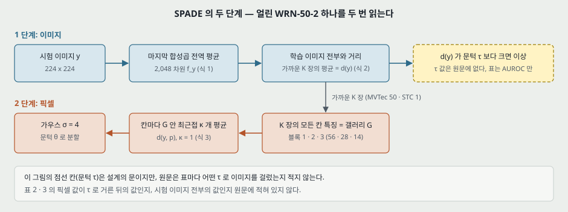

---

## 3. 문제 / 동기 (1 · 2절)

**이 논문이 없앤 전제: 위치를 찾으려면 특징이나 재구성 망을 배워야 한다는 것.**

논문이 문제를 적는 순서는 이렇다.

1. 조립 라인 검사는 사람에게 맡기기 어렵다(임금 · 주의 지속 시간 · 복제 불가 · 품질 불균일). 「주의 지속 시간이 20 분까지 낮을 수 있다」 는 보안 기술 안내서 [14] 를 인용한 값이다.
2. 이상의 분포는 학습 때 안 보이고, 정상 데이터는 모으기 쉽다.
3. 이미지 안 어디가 이상인지도 찾아야 한다. 설명 가능성과 작업자의 신뢰 때문이다.
4. 앞선 이미지 단위 방법을 재구성 · 분포 · 분류 셋으로 나누고 약점을 적는다. 재구성 쪽은 손실 설계와 기저 선택에 민감하고, 분포 쪽은 실제 이미지가 단순한 모수 가정을 안 따르며 비모수 방법은 표본이 많이 든다.
5. Bergman 외 [3] 이 자기 지도 특징이 ImageNet 특징만 못하고 kNN 이 그 방법들을 크게 넘는다고 보였다. **그런데 kNN 은 분할 지도가 없다**(초록).
6. 위치 찾기 쪽 앞선 연구로 CNN 특징 k-평균 · 오토인코더와 GAN · CAVGA · Student 를 들고, Student 는 「still requiring an expensive training stage」 라 적는다.

논문이 내세우는 답: **「more accurate, faster, more stable than previous methods and does not require a dedicated training stage」**(4쪽). 앞의 셋 중 표로 재는 것은 첫째뿐이고(8 · 12 · 16절), 넷째는 설계에서 나오는 사실이다.

---

## 4. 핵심 기술 (3절)

**① 특징 뽑기 (3.1절).** ImageNet 사전학습 WRN-50-2 를 얼린다. 이미지 특징은 마지막 합성곱 층의 전역 평균이다(14쪽에서 2,048 차원이라 적는다).

$$f_i = F(x_i) \qquad (1)$$

초기화 때 학습 이미지 전부의 특징을 계산해 저장하고, 추론 때는 시험 이미지 것만 뽑는다.

**② 이미지 kNN (3.2절).** 시험 이미지 $y$ 에서 가까운 학습 이미지 $K$ 장을 찾고 평균 거리를 점수로 쓴다.

$$d(y) = \frac{1}{K} \sum_{f \in N_K(f_y)} \lVert f - f_y \rVert^2 \qquad (2)$$

$d(y)$ 가 문턱 $\tau$ 보다 크면 이상이다. 「대부분의 이미지는 정상이고 소수만 이상으로 지정될 것으로 기대한다」 고 적는다. **문장은 「Euclidean metric」 이고 식은 제곱이다.** $K > 1$ 에서 제곱 평균과 거리 평균은 순위가 다를 수 있는데 어느 쪽으로 돌렸는지는 식이 유일한 근거다.

**③ 칸 맞대기 (3.3절).** 앞 단계에서 이상으로 표시된 이미지에 대해, $K$ 장의 칸 특징을 모두 모아 갤러리 $G$ 를 만든다.

$$G = \lbrace F(x_1, p) \mid p \in P \rbrace \cup \dots \cup \lbrace F(x_K, p) \mid p \in P \rbrace$$

$$d(y, p) = \frac{1}{\kappa} \sum_{f \in N_\kappa(F(y, p))} \lVert f - F(y, p) \rVert^2 \qquad (3)$$

$d(y, p) > \theta$ 면 그 칸이 이상이다. **식 (3) 에 자리 제약이 없다.** 시험 칸 하나가 갤러리의 어느 자리든 맞댈 수 있다. 논문이 한 장 정렬을 피한 이유는 셋이다: 정상 부품 조합이 여럿이면 한 장 정렬이 실패한다, 작은 데이터나 변화가 큰 물체에서는 모든 면에서 닮은 한 장이 없어 거짓 양성이 나온다, 이미지 차이는 손실 함수에 민감하다.

**④ 특징 피라미드 (3.4절).** 앞 층은 해상도가 높고 맥락이 적으며, 뒤 층은 그 반대다. 「마지막 $M$ 개 블록의 출력을 잇는다」 고 적는다.

**⑤ 설정값 (3.5절, 전부 원문).**

| 항목 | 값 | 원문에 안 적힌 것 |
|---|---|---|
| 백본 | ImageNet 사전학습 Wide-ResNet50 x 2 | 라이브러리와 가중치 판 |
| MVTec 입력 | 256 x 256 으로 줄인 뒤 224 x 224 로 자른다 | 가운데 자르기인지, 지표를 낼 때 잘린 16 픽셀 띠를 어떻게 하는지 |
| STC 입력 | 256 x 256 | 자르기 없음. 장면별 모델인지 하나인지 |
| 지표 해상도 | 256 x 256, 필요하면 `cv2.INTERAREA` | 224 를 256 으로 어떻게 맞추는지 |
| 칸 특징 | 블록 1 (56 x 56) · 2 (28 x 28) · 3 (14 x 14), 「all with equal weights」 | 해상도가 다른 지도를 잇는 방법(보간), 정규화, 「같은 무게」 의 뜻 |
| $K$ | MVTec 50, STC 1(「실행 시간 때문에」) | 표 1 의 이미지 점수에 같은 $K = 50$ 을 썼는지(적힌 $K$ 는 하나다) |
| $\kappa$ | 모든 실험 1 | |
| 후처리 | 칸 점수에 가우스 필터 $\sigma = 4$ | 어느 해상도 기준의 $\sigma$ 인지 |
| STC 표본 | 학습은 「roughly 5000」 장으로, 시험은 [31] 과 맞추려고 5 분의 1 로 줄인다 | 뽑는 법 |

**물음에 답한다 — 이 편이 무엇을 적었는가.**

| 물음 | 원문 |
|---|---|
| 정렬 | 명시적 정렬을 하지 않는다. 「target image 와 $K \ge 1$ 장 사이 대응을 찾으므로 explicitly align 하지 않아도 된다」(6쪽). **MVTec AD 의 물체 자세나 정렬 정도에 대한 문장은 없다** |
| $k$ 값 | $K$ = 50 / 1, $\kappa$ = 1 (7쪽). **$K$ 를 바꾼 표는 표 7 의 10 하나이고 $\kappa$ 를 바꾼 표는 없다. 어떻게 골랐는지 적혀 있지 않고 검증 집합 언급이 없다** |
| 층 | 위 표. 이미지 단계는 마지막 합성곱, 픽셀 단계는 블록 1 · 2 · 3 |
| 입력 크기 | 위 표 |
| 추론 비용 | 복잡도를 말로만 적고(「kNN 은 데이터 크기에 선형」, 13 · 14쪽) **시간 · 메모리 수는 없다** |
| 부류 평균의 흩어짐 | **없다.** 표 1 ~ 7 어디에도 표준편차 · 범위 · 실행 수가 없다 |

---

## 5. 평가 (읽은 범위)

- **데이터셋**: MVTec AD(질감 5 · 물체 10, 학습은 정상만). STC(장면 12). 그림 1 에만 102 Category Flower 의 한 부류와 Caltech-UCSD Birds 200 의 정성 예시가 있다. 학습 · 시험 장수는 원문에 적혀 있지 않다.
- **지표**: 이미지 ROCAUC, 픽셀 ROCAUC, PRO(FPR 0 ~ 0.3).
- **비교 상대**: **전부 다른 논문이 낸 값을 옮겨 왔다.** 이 편이 다시 돌린 상대는 없다(「For each setting, we compared against the methods that reported the suitable metric」, 8쪽). 상대는 모두 학습을 하는 쪽이거나(오토인코더 · GAN · 교사-학생) 고전적 기준선이다.
- **장비**: 본문에 적혀 있지 않다.

| 표 | 데이터 · 지표 | SPADE | 가장 가까운 상대 | 차 (내가 센 것) |
|---|---|---:|---|---:|
| 1 | MVTec 이미지 ROCAUC | 85.5 | ITAE 83.9 | +1.6 |
| 2 | MVTec 픽셀 ROCAUC | 96.0 | CAVGA-Ru 89 | +7.0 |
| 3 | MVTec PRO | 91.7 | Student 85.7 (단일 수용장) | +6.0 |
| 4 | STC 이미지 ROCAUC | 71.9 | ITAE 72.5 | **−0.6** |
| 5 | STC 픽셀 ROCAUC | 89.9 | CAVGA-Ru 85 | +4.9 |

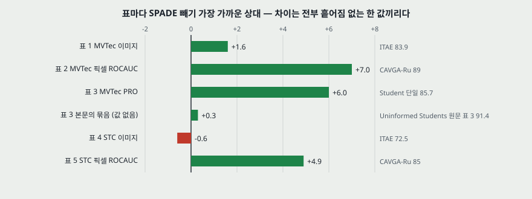

---

## 6. 실험 분석 (논문의 표 · 그림마다)

**직접 돌리지 않는다.** 논문이 낸 실험을 표 · 그림 하나씩 같은 틀로 읽는다. 내가 다시 낸 값은 「내가 센 것」 으로 밝힌다.

| 표 · 그림 | 무엇을 바꿨나 (변인) | 무엇을 고정했나 | 결과 | 반복 수 · 흩어짐 | 주장이 결과보다 센가 |
|---|---|---|---|---|---|
| **표 1** | 방법 다섯(Geom · GANomaly · AEL2 · ITAE · SPADE) | MVTec 15 부류 평균 이미지 ROCAUC. **이 편이 돌린 것은 SPADE 첫 단계 하나**이고 나머지는 옮긴 값. 입력 · 전처리는 방법마다 다를 수 있다 | 67.2 · 76.2 · 75.4 · 83.9 · **85.5** | 적혀 있지 않다. 부류별 칸도 없다 | **세다.** 「outperform a range of state-of-the-art methods」 의 근거가 ITAE 와의 차 1.6 하나이고 흩어짐이 없다. 이 값은 DN2 와 같은 단계라(8쪽) SPADE 의 새 장치와 무관하다 |
| **표 2** | 방법 여덟, 부류 15 | MVTec 픽셀 ROCAUC. 상대는 Bergmann 외 [5] 와 Venkataramanan 외 [31] 에서 옮겼다. CAVGA-Ru 는 평균 한 칸뿐 | 평균 87 · 82 · 74 · 78 · 75 · 77 · 89 · **96.0** | 적혀 있지 않다. 상대 값은 정수(원문이 소수 둘째 자리) | **평균은 맞고 「all methods」 는 세다.** 15 부류 중 3 부류에서 상대가 높다: Grid 94 대 93.7, Tile 93 대 87.4, Wood 91 대 88.5(내가 센 것). TI 평균은 질감 5 부류, VM 평균은 6 부류 값이라 96.0 과 같은 분모가 아니다 |
| **표 3** | 방법 여덟, 부류 15 | MVTec PRO, FPR 0 ~ 0.3. 상대는 Bergmann 외 [6] 표 1 에서 옮겼다(그 표의 K-Means · AnoGAN 두 열은 뺐다) | 평균 85.7 · 64 · 47.9 · 79 · 63.9 · 69.4 · 51.5 · **91.7** | 적혀 있지 않다 | **평균 순서는 맞다.** 2 부류에서 상대가 높고 Tile 은 일곱 상대 중 다섯이 높다(91.2 · 89.7 · 87.0 · 82.2 · 79.7 대 75.9). **「앙상블도 넘는다」 는 값이 표에 없다**(9절) |
| **표 4** | 방법 일곱 | STC 이미지 ROCAUC. SPADE 는 $K = 1$, 학습을 「roughly 5000」 장으로 줄이고 시험 5 분의 1. 상대가 같은 부분 집합인지 적혀 있지 않다 | 67.9 · 68.0 · 69.7 · 71.2 · 60.9 · **72.5(ITAE)** · 71.9 | 적혀 있지 않다 | **본문은 맞고 앞뒤 문장이 세다.** 11쪽 「comparable」 은 표와 맞는다. 2쪽 「state-of-the-art performance both on image-level and pixel-level」 은 STC 이미지에서 −0.6 이다. 시험을 줄인 이유가 [31] 과 맞추려는 것이라 표 4 의 상대 여섯과 맞춘 것은 아니다 |
| **표 5** | 방법 넷 | STC 픽셀 ROCAUC. 시험 5 분의 1 은 CAVGA-Ru [31] 와 맞췄다고 적는다 | 74 · 76 · 85 · **89.9** | 적혀 있지 않다 | **순서는 맞다.** 「by a significant margin」 의 근거는 4.9 차이 하나다. 약한 감독판 CAVGA-Rw 를 뺀 까닭은 적었다(「이상 감독을 안 쓰므로」) |
| **표 6** | 칸 특징 단계: 14 · 28 · 56 단독, 세 단계 잇기 | MVTec PRO, $K = 50$ 으로 읽힌다(표 6 의 SPADE 열이 표 3 과 15 칸 모두 같다, 내가 맞춘 것) | 평균 89.38 · 89.6 · 87.74 · **91.7** | 적혀 있지 않다 | **평균은 맞고 원인 문장은 세다.** 「56 은 맥락이 모자라 크게 해친다」 의 맥락은 잰 값이 아니다. 56 단독이 15 중 7 부류에서 잇기보다 높다(10절). 단계 선택에 시험 값을 쓴 것인지 적혀 있지 않다 |
| **표 7** | 고르는 방식: 무작위 10 장 대 kNN 10 장 | 그 밖은 기본값으로 읽힌다. **캡션에 지표 이름이 없다.** 값 범위와 앞 표로 보아 PRO 로 읽었다(내 판단) | Grid 73.2 · 86.3, 평균 89.2 · **91.4** | **무작위를 몇 번 뽑았는지 적혀 있지 않다.** 부류별 칸은 Grid 하나 | **맞다, 다만 Grid 를 골라 보였다고 스스로 적는다.** 다른 14 부류는 표에 없다. 이 표는 무작위 대비의 몫이고 먼저 고르기의 손실은 재지 않는다(7절) |
| **그림 1** | 없음 (정성 예시) | 꽃 + 곤충, 앨버트로스 색, 새의 붉은 점 | 세 예시의 검출 마스크 | 수치 없음. 학습 장수 · 실험 설정이 없다 | 캡션이 「An evaluation」 이라 적지만 잰 값이 없고 실험 절에 데이터셋이 안 나온다. 10쪽의 「more qualitative results ... in Fig. 1」 이 MVTec 표 뒤에 오는데 그림 1 은 MVTec 이 아니다 |
| **그림 2** | 없음 (정성 예시) | MVTec Hazelnut · Metal nut | 대응이 없는 칸이 이상으로 표시된다 | 수치 없음 | 예시 고르는 기준이 없다. 본문은 Hazelnut 만 설명한다 |
| **그림 3** | 없음 (정성 예시) | Cable · Grid · STC 자전거 | 마스크 | 수치 없음 | 예시 고르는 기준이 없다. 실패 예시는 세 그림 어디에도 없다 |

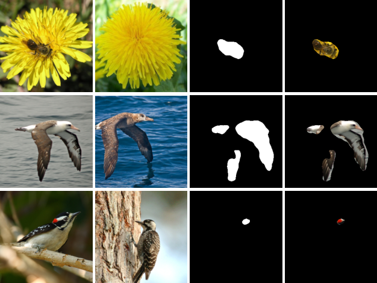

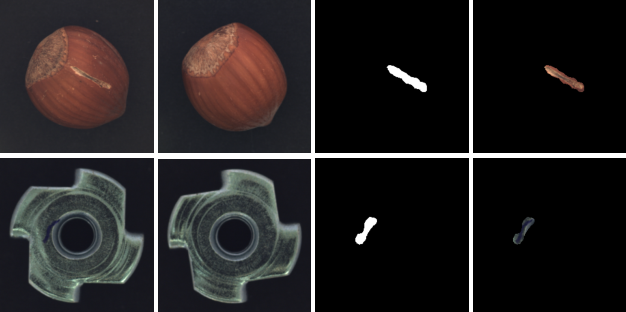

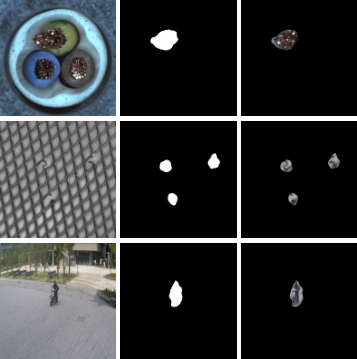

**인쇄 평균을 다시 냈다 (내가 센 것).** 표 2 · 3 · 6 에서 부류 칸이 있는 열 열아홉을 평균 내면, 정수로 인쇄된 열은 반올림해 같고 소수로 인쇄된 열은 ±0.09 안이다. 가장 큰 차는 표 3 의 CNN-Dict 51.587 대 51.5 다. 표 2 SPADE 는 96.027, 표 3 SPADE 는 91.727 이다.

**옮긴 값을 원문과 맞췄다.** 표 2 의 여섯 열(AESSIM · AEL2 · AnoGAN · CNN Dict · TI · VM)은 MVTec AD 원문 표 3 의 ROC AUC 줄과 같고, 표 3 의 일곱 상대 열은 Uninformed Students 원문 표 1 과 같다. 어긋남은 둘이다: 표 2 Toothbrush 의 TI 칸이 「-」 없이 비어 있고, 표 3 에서 Carpet 과 Zipper 의 1-NN · OC-SVM 이 같은 값(51.2 · 35.5)인데 **이것은 옮겨 쓴 잘못이 아니라 Uninformed Students 원문 표 1 이 이미 그렇다**(K-Means 칸 0.253 도 같다). 표 1 · 4 · 5 의 상대 값은 그 원 편을 열지 않아 맞추지 않았다.

**비교 조건.** 상대 값은 다른 전처리와 다른 해상도에서 재어졌을 수 있고 이 편은 그 차이를 적지 않는다. 그래서 위 표의 차이는 「같은 조건에서 돌린 차」 로 읽지 않는다.

---

## 7. 먼저 고르는 단계가 픽셀 성능을 얼마나 잃게 하는가

PatchCore 원문은 이렇게 적는다: 계산 한계 때문에 SPADE 는 픽셀 판정 전에 먼저 고르는 단계가 필요하고, 그 단계는 전역 평균에 기댄 **약한 이미지 판정**이라 저해상도 · ImageNet 쪽 표현을 끌어들인다. 여기서 물음이 나왔다.

**답: 이 편에서는 그 값이 나오지 않는다. 안 잰 것이지 못 재는 것이 아니다.** 학습 전체를 갤러리로 쓴 행이 없다.

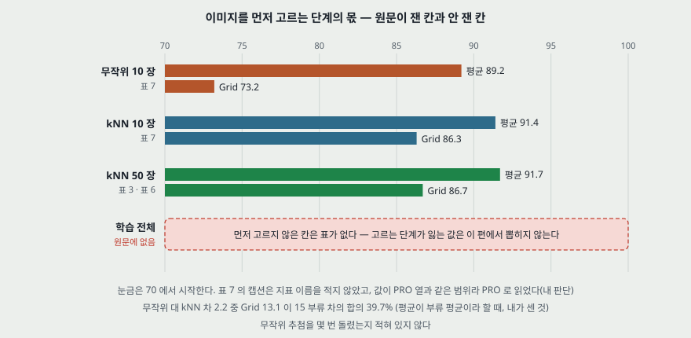

표에서 뽑을 수 있는 것은 옆자리 셋이다.

| 비교 | 평균 차 | Grid 차 | 뜻 |
|---|---:|---:|---|
| kNN 10 장 - 무작위 10 장 (표 7) | +2.2 | +13.1 | 같은 장수에서 **고르는 방식**의 몫 |
| kNN 50 장 - kNN 10 장 (표 3 · 표 7) | +0.3 | +0.4 | **장수**의 몫. 표 7 지표가 PRO 일 때. 흩어짐이 없다 |
| 학습 전체 - kNN 50 장 | 표 없음 | 표 없음 | 물음이 묻는 칸 |

**내가 센 것 넷.**

- 평균 2.2 가 부류 평균의 차라면 15 부류 차의 합이 33.0 이고 Grid 13.1 이 그 39.7% 다. Grid 를 뺀 14 부류의 차 평균은 1.42 다. 다른 14 부류의 값이 없어 부류 사이의 차이는 모른다.
- $K = 50$ 은 부류당 평균 학습 241.9 장(3,629 / 15, 이 수는 MVTec AD 쪽 값이고 원문에 없다)의 20.7% 이고 $K = 10$ 은 4.1% 다. 부류별 학습 장수가 다르므로 부류별 비는 다르다.
- **갤러리가 부분 집합이면 칸마다 최근접 거리는 작아질 수 없다.** $G' \subset G$ 면 $\min_{f \in G'} \lVert f - F \rVert^2 \ge \min_{f \in G} \lVert f - F \rVert^2$ 다. 정상 칸과 이상 칸의 거리가 함께 오르므로 ROCAUC 의 방향은 이 식만으로 안 나온다.
- 무작위 10 장(표 7) 89.2 곁에 놓을 값으로, PatchCore 원문 표 S5 에서 **학습을 10 장으로 줄인** SPADE 재구현의 PRO 가 89.6 ± 0.1 이다. 고르기 없이 10 장이라는 점에서 닮았지만 재구현 설정과 뽑는 법을 몰라 같은 조건의 값으로 읽지 않는다.

**문이 하나 더 있다.** 설계(3.3절)대로라면 $d(y) \le \tau$ 인 이미지는 픽셀 단계로 안 가고, 그 이미지의 결함 칸은 하나도 안 잡힌다. 이 손실은 **장수와 다른 둘째 손실**이다. 그런데 $\tau$ 값이 원문에 없고, 표 2 · 3 을 어떤 이미지들로 냈는지 적혀 있지 않다. 지표 설명(9쪽)은 「각 픽셀을 거리로 점수 매겨 문턱을 훑는다」 뿐이다. **두 지표가 문을 안 거친 값으로 읽히지만(내 판단) 원문이 그렇게 말하지는 않는다.** 이미지 ROCAUC 85.5 만으로는 어떤 $\tau$ 에서 몇 장을 놓치는지 안 나온다.

**PatchCore 쪽 값으로도 안 풀린다.** PatchCore 원문 표 5 는 재구현 SPADE (85.3, 96.6, 91.5)와 PatchCore-100% 를 나란히 두지만, 두 방법은 먼저 고르기 말고도 원 설계 기준으로 층(블록 1 · 2 · 3 대 2 · 3), 이웃 집계, 점수 재가중이 다르다. **먼저 고르기 하나의 몫을 그 차이로 읽을 수 없다.**

---

## 8. 이미지 단계와 DN2 — 표 1

**표 1 의 「SPADE」 85.5 는 칸 맞대기를 쓰지 않는다.** 8쪽이 「ROCAUC of the first step of our method」, 「the first stage of our method is identical with DN2」 라고 스스로 적는다. 그러니 초록의 「state-of-the-art performance on unsupervised anomaly detection」 중 이미지 쪽 근거는 DN2 와 같은 단계의 값이다.

**DN2 를 쓰는 방식은 둘이다.** (가) 이미지 점수 그 자체(식 2). (나) 픽셀 단계로 넘길 $K$ 장 고르기. 같은 $K$ 를 두 일에 쓴다. 이미지 점수에 맞는 $K$ 와 갤러리에 맞는 $K$ 가 같아야 할 까닭은 적혀 있지 않고, 두 $K$ 를 따로 돌린 표는 없다.

**이미지 점수에 칸 점수를 쓰지 않았다.** 칸 지도가 있으므로 최댓값을 이미지 점수로 삼는 길이 있는데 이 편에서는 안 돌렸다. 픽셀 ROCAUC 96.0 과 이미지 ROCAUC 85.5 사이의 간격이 여기서 나온다고 볼 수 있지만(내 판단) 이 편에 그 비교는 없다. PatchCore 원문은 칸 점수의 최댓값 쪽으로 가서 이미지 AUROC 99.1 을 내지만, 그 차이도 그 하나의 몫은 아니다.

**DN2 인용 번호가 앞뒤로 어긋난다.** 3.2절(5쪽)은 「DN2 [4]」, 4.1절(8쪽)은 「DN2 [3]」 이다. 참고 문헌에서 [3] 이 Deep Nearest Neighbor Anomaly Detection 이고 [4] 는 Classification-based Anomaly Detection for General Data 다. 3.1절의 「자기 지도 특징이 ImageNet 특징만 못하다는 Bergman 외 [4] 의 분석」 도 2절(4쪽)에서는 [3] 으로 적은 내용이다. **DN2 를 뜻하는 자리는 [3] 으로 읽었다**(내 판단, DN2 원문은 안 읽었다).

---

## 9. 픽셀 ROCAUC 와 PRO — 표 2 · 3

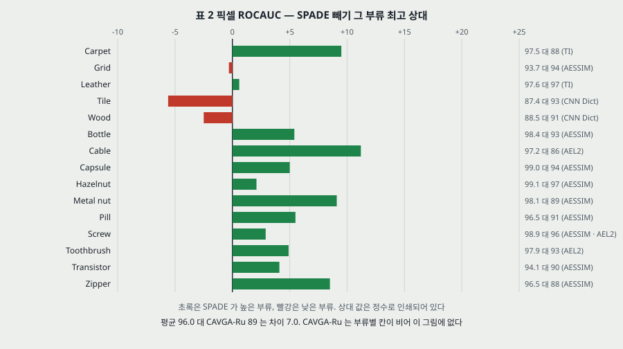

**표 2 (내가 센 것).** 부류별로 SPADE 가 최고가 아닌 자리는 Grid(−0.3) · Tile(−5.6) · Wood(−2.5) 셋이고 셋 다 질감이다. Grid 의 상대 94 는 소수 둘째 자리 0.94 를 옮긴 값이라 −0.3 은 반올림 폭 안이다. 질감 다섯의 SPADE 평균은 92.94, 물체 열의 평균은 97.57 이다. Tile 은 픽셀 87.4 · PRO 75.9 로 두 지표 모두 가장 낮다.

**분모가 다른 평균 둘.** TI 75 는 질감 5 부류, VM 77 은 6 부류의 평균이다. 같은 칸만 맞대면 TI 75.20 대 SPADE 92.94, VM 77.17 대 98.13 이다(내가 센 것).

**CAVGA-Ru 는 평균 하나만 있다.** 그래서 「가장 가까운 상대」 와의 차 7.0 은 부류로 풀어 볼 수 없다.

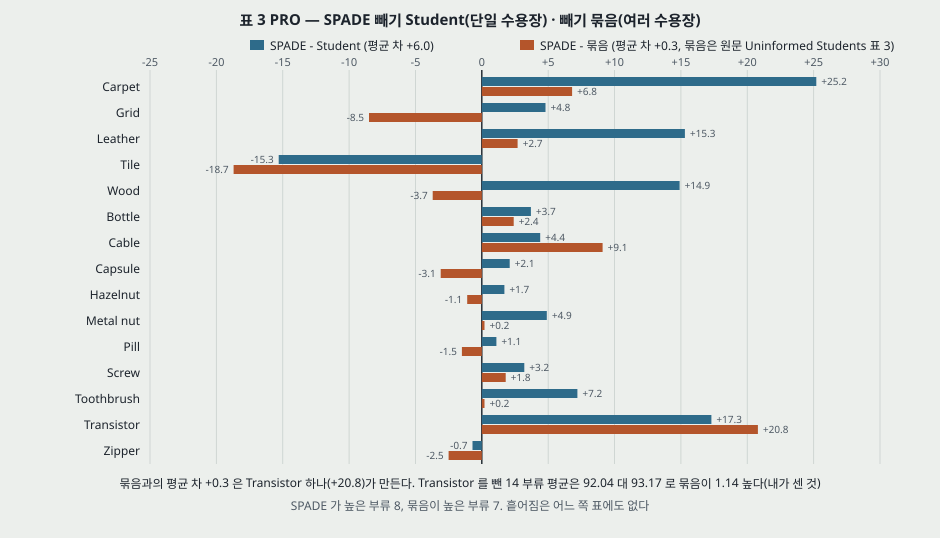

**표 3 의 Student 는 단일 수용장 값이다.** Uninformed Students 원문 표 3 에서 $p = 65$ 열의 평균이 0.857 이고 여러 수용장을 묶은 열이 0.914 다. 본문(10쪽)은 이렇게 적는다: 「Bergmann 외는 더 좋은 앙상블도 냈다. ... 우리는 그 앙상블도 넘는다.」 **그 앙상블 값은 이 편 표에 없다.**

**원문을 열어 맞댔다 (내가 센 것, 묶음 열은 Uninformed Students 원문 표 3).**

| | 값 |
|---|---|
| 평균 | SPADE 91.73 대 묶음 91.40, 차 **+0.33** |
| 부류 수 | SPADE 가 높은 부류 8, 묶음이 높은 부류 7 |
| 가장 큰 차 | Transistor +20.8, Tile −18.7, Cable +9.1, Grid −8.5 |
| Transistor 뺀 14 부류 평균 | 92.04 대 93.17, 차 **−1.14** |

**「outperform the ensemble approach as well」 은 평균으로는 참이고, 부류 하나를 빼면 뒤집히는 참이다.** 어느 쪽 값에도 흩어짐이 없어 0.33 의 순서를 매기지 않는다. 다른 전처리에서 재었을 수 있다는 것도 같다.

**PatchCore 원문과 맞췄다 (내가 맞춘 것).**

| PatchCore 원문의 자리 | SPADE 값 | 이 편의 값 | 같은가 |
|---|---:|---:|---|
| 표 1 · S1 (이미지) | 85.5 | 85.5 (표 1) | 같다. 부류별 칸은 양쪽 다 없다 |
| 표 2 · S2 (픽셀) | 96.0, 부류 15 | 96.0, 부류 15 (표 2) | **15 칸 모두 같다** |
| 표 3 · S3 (PRO) | 91.7, 부류 15 | 91.7, 부류 15 (표 3) | **Tile 만 다르다: 표 S3 은 75.6, 이 편은 75.9.** 나머지 14 칸은 같다 |
| 표 6 (mSTC 픽셀) | 89.9 | 89.9 (표 5) | 같다 |
| 표 5 (재구현) | (85.3, 96.6, 91.5), 0.66 초 | (85.5, 96.0, 91.7), 시간 없음 | **다른 실행이다.** 차는 −0.2 · +0.6 · −0.2. PatchCore 쪽이 WideResNet50 으로 다시 구현해 잰 값이고, 이 편의 값이 아니다 |
| 표 S5 (적은 표본) | 1 ~ 50 장의 재구현 값 | 대응 표 없음 | **이 편에 적은 표본 실험이 없다.** 「very small datasets 에서 돌아간다」(12쪽)는 문장뿐이다 |

재구현의 $K$ · 층 설정은 PatchCore 원문의 SPADE 가 나오는 줄에서 찾지 못했다. **PatchCore 표 S3 의 75.6 과 이 편 75.9 중 어느 쪽이 맞는지는 이 편 v1 · v2 를 안 읽어 가리지 못했다**(판 차이일 수 있다).

---

## 10. 단계 소거 — 표 6

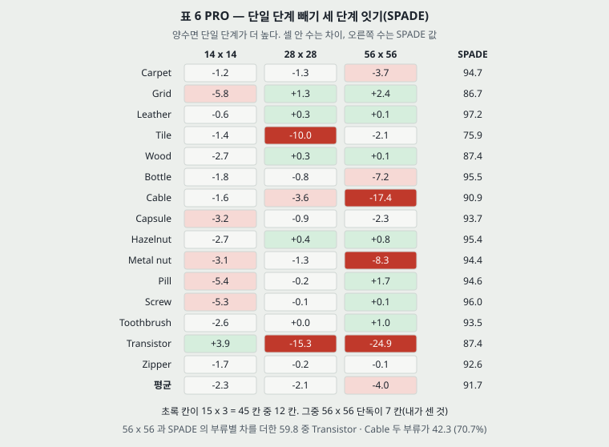

**원문의 말.** 「너무 높은 해상도(56 x 56)는 맥락이 모자라 성능을 크게 해치고, 위층만 쓰면 해상도가 낮아 줄어든다. 전부 합치면 가장 좋다.」(11 · 12쪽)

**내가 센 것.**

| 묶음 | 14 | 28 | 56 | 세 단계 잇기 |
|---|---:|---:|---:|---:|
| 15 부류 평균 | 89.38 | 89.63 | 87.74 | 91.73 |
| 질감 5 | 86.04 | 86.50 | **87.74** | 88.38 |
| 물체 10 | 91.05 | 91.20 | 87.74 | 93.40 |
| Transistor · Cable 뺀 13 | 89.24 | 91.16 | 90.78 | 92.12 |

- **단일 단계가 잇기보다 높은 칸이 45 칸 중 12 칸이다**(14: 1, 28: 4, 56: 7). 하나라도 높은 부류가 15 중 8 이다.
- **56 x 56 이 해치는 것은 질감이 아니라 일부 물체다.** 질감 다섯에서는 56 단독이 단일 셋 중 가장 높다. SPADE 와 56 의 부류별 차를 더하면 59.8 이고 Transistor(24.9)와 Cable(17.4)이 42.3, 곧 70.7% 다. 둘을 빼면 56 은 14 를 넘는다.
- **Transistor 는 14 단독(91.3)이 잇기(87.4)보다 3.9 높다.** 잇기가 단일을 언제나 넘는 것은 아니다.
- 부류마다 단일 하나를 골라 평균 내면 91.94 로 잇기 91.73 보다 0.21 높다. **이 값은 시험 값으로 고른 것이라 성능으로 적지 않는다.** 표가 「잇기가 가장 좋다」 를 평균 한 줄로만 받친다는 뜻이다.
- 표 6 의 평균 열은 소수 둘째 자리이고 SPADE 만 첫째 자리다. 재계산 값(89.38 · 89.63 · 87.74)은 인쇄와 맞는다.

**두 어긋남.** (가) 3.4절은 「마지막 $M$ 개 블록을 잇는다. $M$ 을 바꾼 결과는 실험 절에 있다」 인데 표 6 은 $M$ 을 바꾸지 않고 단일 단계를 잰다. 블록 1 · 2 · 3 은 「마지막 $M$ 개」 도 아니다(네 번째 블록이 빠져 있다). (나) 3.4절은 「concatenate」, 3.5절은 「all with equal weights」 다. 해상도가 다른 지도를 잇는 법이 없어서 **보간해 이어 붙인 뒤 한 거리를 재는지, 단계마다 거리를 재서 같은 무게로 더하는지를 원문으로 가를 수 없다.**

**둘씩 쓴 행이 없다.** 28 + 14 같은 조합을 안 돌려서, PatchCore 가 쓰는 블록 2 · 3 조합과의 비교는 이 편에서 안 나온다.

---

## 11. STC — 표 4 · 5

- **$K = 1$ 이라 설정이 다르다.** 「due to the runtime considerations」 라 적어, 비용을 이유로 MVTec 설정을 옮기지 않은 자리다. 다만 시간 수는 없다.
- **학습을 「roughly 5000」 장으로 줄인 값이다.** 원 학습 집합 크기와 줄이는 법이 없다.
- **픽셀 89.9 대 이미지 71.9.** 간격 18.0 은 MVTec 의 10.5(96.0 대 85.5)보다 크다(내가 센 것). 원문은 이 간격을 다루지 않는다. 감시 영상은 이상이 이미지의 작은 일부이고 전역 평균이 그것을 흐린다고 추측할 수 있지만, **이 편이 재지 않았다.**
- **이상의 정의가 MVTec 과 다르다.** 「비표준 행동을 하는 보행자 · 보행자가 아닌 움직이는 물체」 인데 입력은 프레임 한 장이다. 움직임은 정지 이미지에 없다. 표 5 값이 움직임 없이 어디까지 잡았는지는 적혀 있지 않다.

---

## 12. 비용 — 원문에 시간이 없다

**원문이 적은 말.** 「fast」(2쪽) · 「faster」(4쪽) · 「virtually no training time」(초록) · 「scalable」(6쪽) · 「quite suitable for practical deployment from a complexity and runtime perspective」(14쪽). **초 · 메모리 · 장치 값은 17 쪽 어디에도 없다.** 낮추는 논리는 셋이다: 이미지 단계는 2,048 차원 전역 특징이라 빠르다, 칸 탐색을 $K$ 장으로 제한한다, 대부분 정상이므로 소수만 픽셀 단계로 간다. 분할은 시간이 덜 급하다는 말과 KDTree · PatchMatch 로 줄일 수 있다는 말은 돌린 값 없는 제안이다.

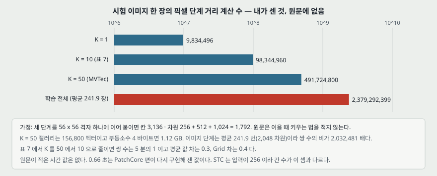

**내가 센 것 (가정이 든 셈, 원문에 없음).** 세 단계를 56 x 56 격자 하나에 잇는다고 잡으면 칸 3,136, 차원 $256 + 512 + 1{,}024 = 1{,}792$ 이고 시험 한 장의 픽셀 단계 거리 계산 수는 칸 수 곱하기 갤러리 크기다.

| 설정 | 갤러리 벡터 | 쌍 거리 수 | 저장(4 바이트) | $K = 50$ 대비 |
|---|---:|---:|---:|---:|
| $K = 1$ | 3,136 | 9,834,496 | 0.02 GB | 0.02 배 |
| $K = 10$ | 31,360 | 98,344,960 | 0.22 GB | 0.2 배 |
| $K = 50$ | 156,800 | 491,724,800 | 1.12 GB | 1 배 |
| 학습 전체(평균 241.9 장) | 758,703 | 2,379,292,399 | 5.44 GB | 4.84 배 |

- 이미지 단계는 평균 241.9 번(2,048 차원)이라, 픽셀 단계 $K = 50$ 과의 쌍 수 비가 2,032,481 배다.
- 단계마다 따로 맞댄다면 쌍 수는 524,378,400 이고 56 x 56 칸이 그 93.8% 다. 해석이 갈려도 56 칸이 비용을 정한다.
- **평균 학습 장수로 치면 학습 전체의 쌍 수가 $K = 50$ 의 4.84 배다.** 표 7 지표가 PRO 일 때 $K$ 를 50 에서 10 으로 줄이면 쌍 수는 5 분의 1 이고 값 차는 0.3 이다. 다만 **$K = 1$ 은 STC 입력 256(칸 수가 다르다)이므로 이 표의 첫 줄은 MVTec 크기로 친 값이다.**
- **저장 칸의 해석이 하나 더 있다.** 3.1절의 「모든 학습 이미지의 특징을 저장」 이 칸 특징까지 뜻하면 3,629 장에 81.6 GB 이고, 전역 특징만 뜻하면 고른 $K$ 장을 추론 때 백본에 다시 통과시켜야 한다. **원문으로 가를 수 없다.**

**시간을 재려면 어디를 봐야 하나.** 0.66 초는 PatchCore 원문 표 5 의 재구현 값이고 백본 앞 계산을 포함한다. 장치와 설정이 이 편과 같다는 근거가 없으므로 이 편의 값으로 적지 않는다.

---

## 13. 이 논문이 스스로 적은 한계

1. **첫 단계가 틀리는 경우를 한쪽만 적는다.** 이상으로 잘못 판정한 이미지는 칸을 표시하지 않기를 바란다고 적는다(5쪽). 이상을 정상으로 놓친 쪽은 적지 않는다.
2. **칸 kNN 은 이미지 kNN 보다 「significantly slower」 다**(14쪽). 복잡도가 데이터 크기에 선형이라 크거나 고차원이면 문제가 된다고 적는다(13 · 14쪽).
3. **STC 에서는 실행 시간 때문에 $K = 1$ 로 줄이고 데이터가 커서 학습을 「roughly 5000」 장으로 줄였다**(7쪽).
4. **미세조정한 특징이 이 방법을 넘을 것으로 기대한다**(14쪽, 「expect it it improve over our method」). 사전학습 특징을 고정한 것이 끝이 아니라고 스스로 적는다.
5. **앙상블을 안 썼다**(10쪽). 「probably improve」 는 돌린 값이 없다.

---

## 14. 논문이 적지 않은 것 — 내가 읽으며 짚은 자리

| 자리 | 빈칸 |
|---|---|
| 흩어짐 | 표 일곱 어디에도 없다. 학습이 없어 같은 가중치로 다시 돌리면 같은 값이 나올 쪽이지만(내 판단), 표 7 의 무작위와 STC 표본 줄이기는 다를 수 있다. 부류 사이 표본 표준편차는 표 3 SPADE 에서 5.49(75.9 ~ 97.2, 내가 센 것)이고 이것은 재현 흩어짐이 아니다 |
| 선택에 쓴 데이터 | $K$ · 단계 · $\sigma$ 를 무엇으로 골랐는지 없다. 검증 집합 언급이 없고, MVTec AD 의 학습 집합에는 이상이 없다 |
| $\tau$ | 값도 정하는 법도 없다. 기준선 표들과 같은 문턱 없는 지표만 내므로 **현장의 문턱 문제를 안 건드린다** |
| 실패 예시 | 그림 셋 모두 성공 예시다 |
| 안정성 | 4쪽의 「more stable」 을 재는 표가 없다 |
| 시험 집합의 비율 | 14쪽의 「대다수가 정상이라 소수만 픽셀 단계로 간다」 가 비용 논리의 전제인데, 평가에 쓴 시험 집합의 정상 · 이상 비율이 없고 그 비율로 시간을 잰 값도 없다 |
| 자르기의 영향 | 224 로 자르면 넓이의 76.6% 가 남는다(내가 센 것, 가운데 자르기라 할 때). 띠에 걸린 결함의 처리가 없다 |
| 칸 특징의 정규화 | 블록 출력은 값 크기가 다를 수 있는데 잇기 전 정규화 여부가 없다 |

---

## 15. 읽을 때 헷갈리는 지점

- **「SPADE」 열의 뜻이 표마다 다르다.** 표 1 · 4 는 첫 단계(DN2 와 같은 것), 표 2 · 3 · 5 · 6 은 픽셀 단계를 포함한 전체, 표 7 은 $K = 10$ 이다.
- **「pixel」 은 픽셀이 아니라 특징 지도의 칸이다.** 지표는 256 x 256 에서 내지만 맞대는 격자는 56 x 56 까지다.
- **$K$ 와 $\kappa$ 가 섞여 쓰인다.** 9쪽의 「distance to its K nearest correspondences」 는 식 (3) 으로는 $\kappa$ 다.
- **「Sub-image」 와 「pixel-level」 은 같은 뜻으로 쓰인다.** 조각 단위 분류가 아니라 분할이다.
- **「first stage」 가 두 자리다.** 3.1절은 특징 뽑기를, 3.2절은 kNN 을 각각 첫 단계라 부른다. 이 노트는 3.2절의 뜻으로 쓴다.
- **이름 표기.** MVTech · MVTtec · MVTec, Bergmann · Bregmann 이 섞여 있다. 8쪽의 「ImageNet (which is very different from ImageNet dataset)」 은 문장 그대로 뜻이 안 맞고, 「MVTec 과 다른 ImageNet」 으로 읽었다(내 판단).

---

## 16. 원문 안의 어긋남 모음

| 자리 | 말 | 맞대 본 것 | 판정 |
|---|---|---|---|
| 초록 · 2쪽 | 이미지 · 픽셀 모두 최신 성능 | 표 4 71.9 대 72.5 | STC 이미지는 아니다. 본문 11쪽 「comparable」 은 맞다 |
| 4쪽 | more accurate, faster, more stable | 시간 · 흩어짐 칸 없음 | 셋 중 첫째만 표가 있다 |
| 3.2 · 4.1절 | DN2 [4] · DN2 [3] | 참고 문헌 | 번호 어긋남 (8절) |
| 3.4절 | $M$ 을 바꾼 결과를 보인다 | 표 6 은 단일 단계 | 바꾸지 않았다 (10절) |
| 3.4 · 3.5절 | concatenate · equal weights | | 둘 사이 절차가 없다 (10절) |
| 9쪽 | significantly outperforms all methods | 표 2 부류 3 곳 | 평균으로만 맞다 |
| 10쪽 | 앙상블도 넘는다 | 표에 값 없음. 원문 묶음 91.4 | 0.33 차, 부류 8 대 7 (9절) |
| 10쪽 | 더 많은 정성 결과는 그림 1 | 그림 1 은 꽃 · 새 | MVTec 예시는 그림 2 · 3 이다 |
| 12쪽 | 전부 합치면 가장 좋다 | 표 6 부류 8 곳에서 단일이 높다 | 평균으로만 맞다 (10절) |
| 표 7 | 캡션 | 지표 이름 없음 | PRO 로 읽었다(내 판단) |
| PatchCore 표 S3 | Tile 75.6 | 이 편 표 3 · 6 은 75.9 | 다른 값 (9절) |

---

## 17. 내가 가져갈 것

**하나. 닿는 자리 — 연구에서 쓰는 방법의 비교 상대.** PatchCore 의 설계 셋이 이 편과의 차이로 읽힌다: 먼저 고르기를 없앤다, 칸 특징에서 블록 1 을 뺀다, 이미지 점수를 전역 평균이 아니라 칸 점수에서 낸다. **이 편의 표만으로는 그중 어느 것의 몫도 정하지 못한다.** 블록 1 의 56 x 56 이 쌍 수를 정하고(12절) 단독 평균이 셋 중 가장 낮아(10절) PatchCore 가 블록 1 을 뺀 것과 방향은 같다. 다만 2 · 3 조합 행이 없어 잇기 안에서 블록 1 의 몫은 안 나온다.

**둘. 옮겨 쓸 수 있는 것 — 맞대는 방법 셋.** (가) **「SPADE」 같은 이름 하나가 표마다 다른 설정을 가리키는지 먼저 본다**(15절). (나) **「앙상블도 넘는다」 처럼 값 없는 비교 문장은 원문을 열어 부류별로 맞댄다.** 평균 0.33 이 Transistor 한 칸이 만든 것인지 그 표에서는 안 보였다. (다) **부분 칸만 있는 평균(TI 5 부류 · VM 6 부류)을 15 부류 평균과 한 줄에 놓지 않는다.** 내 표를 쓸 때도 같다.

**셋. 지금 확인된 것은 여기까지다.**

| 층 | 내용 |
|---|---|
| 논문이 잰 것 | 표 1 ~ 7 의 평균과 부류별 값. 무작위 10 장 대 kNN 10 장. 단일 단계 대 세 단계 잇기 |
| 논문이 말만 한 것 | 빠르다 · 안정적이다 · 확장된다 · 앙상블을 넘는다(값 없음) · 작은 데이터에서 돌아간다 · 미세조정이 더 나을 것이다 · 맥락이 모자라 56 이 나쁘다 |
| 내가 책상에서 센 것 | 평균 재계산, 부류별 순위, 묶음과의 대조, Grid 몫 39.7%, 56 차의 70.7%, 쌍 거리 수와 저장. 쌍 거리 수는 「56 x 56 격자 하나」 가정이 든 값 |
| 아무도 안 잰 것 (이 편 안에서) | 먼저 고르기가 잃는 값, $\tau$ 의 영향, 추론 시간 |

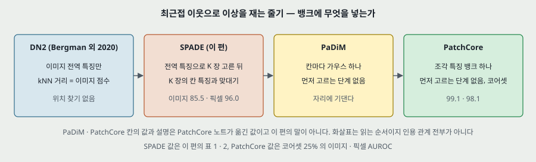

---

## 18. 남는 질문

- **학습 전체를 갤러리로 쓰면 PRO 와 픽셀 ROCAUC 가 얼마나 오르나.** 이 편에 없다. PatchCore 쪽 표로도 다른 변인이 섞여 안 뽑힌다. 먼저 고르기만 끈 비교가 있는 편을 찾아야 한다.
- **표 2 · 3 은 문턱 $\tau$ 를 거쳤나.** 코드가 본문에 없다. 다른 판(v1 · v2)이나 재구현 문서에 적혀 있는지 본다.
- **이미지 점수를 칸 점수 최댓값으로 바꾸면 85.5 에서 얼마나 오르나.** 이 편에서 안 돌렸다. PatchCore 표의 99.1 은 다른 변인이 섞인 값이다.
- **PatchCore 표 S3 의 Tile 75.6 은 판 차이인가, 옮겨 쓰며 생긴 차이인가.** v1 · v2 표를 맞대면 가려진다.
- **Tile 에서 왜 무너지나.** 픽셀 87.4 · PRO 75.9 로 SPADE 의 최저이고 Student 는 91.2 다. 원문은 언급하지 않는다. 28 단독은 65.9 로 더 낮다.
- **Transistor 는 왜 14 단독이 높고 56 단독이 62.5 인가.** 부품이 빠지거나 자리가 바뀌는 결함이면 칸 맞대기에 맥락이 필요해서일 수 있지만(내 추측), 이 편에는 결함 종류별 값이 없다.

---

## 19. 다음에 읽을 것

| 논문 | 이 노트의 어느 자리에서 나오는가 | 무엇을 확인하고 싶은가 |
|---|---|---|
| **DN2** — Deep Nearest Neighbor Anomaly Detection (Bergman · Cohen · Hoshen, arXiv 2020) — 원문 참고 문헌 [3] | 8절 | 첫 단계의 원 출처. $K$ 를 어떻게 골랐고 이미지 점수를 어떻게 평가했는가 |
| **CAVGA** — Attention Guided Anomaly Detection and Localization in Images (Venkataramanan 외) — 원문 참고 문헌 [31] | 9 · 11절 | 표 2 · 5 의 가장 가까운 상대. 평균 89 · 85 의 조건, STC 를 줄인 방식 |
| **ITAE** — Inverse-Transform AutoEncoder for Anomaly Detection (Huang 외) — 원문 참고 문헌 [19] | 8 · 11절 | 표 1 · 4 의 가장 가까운 상대 |
| **PatchMatch** (Barnes 외, ACM ToG 2009) — 원문 참고 문헌 [2] | 12절 | 빠르게 할 길이라 제안만 한 것. 자리 지역성 가정이 정렬 안 된 이미지에서 남는가 |
| **Feature Pyramid Networks** (Lin 외, CVPR 2017) — 원문 참고 문헌 [22] | 10절 | 「아이디어가 비슷하다」 고 적은 자리. 다른 해상도를 잇는 법 |

---

## 20. 참고 문헌

**원리는 원 출처, 구현은 그 라이브러리의 논문으로 가른다.** 이 편의 구현 라이브러리는 본문에 적혀 있지 않다.

- [3] Bergman, L., Cohen, N., Hoshen, Y. (2020). Deep nearest neighbor anomaly detection. arXiv:2002.10445. — 첫 단계. **읽지 않았다.**
- [4] Bergman, L., Hoshen, Y. (2020). Classification-based anomaly detection for general data. ICLR. — 본문이 DN2 번호로도 인용한다(8절). **읽지 않았다.**
- [5] Bergmann, P. 외 (2019). MVTec AD. CVPR. — 데이터셋, 표 2 의 상대. **표 3 만 열어 맞췄다.**
- [6] Bergmann, P. 외. Uninformed students. arXiv:1911.02357 (이 편이 적은 서지). — PRO, 표 3 의 상대. **표 1 · 3 만 열어 맞췄다.**
- [31] Venkataramanan, S. 외 (2019). Attention guided anomaly detection and localization in images. arXiv:1911.08616. — **읽지 않았다.**
- [23] Luo, W. 외 (2017). A revisit of sparse coding based anomaly detection in stacked RNN framework. ICCV. — STC. **읽지 않았다.**
- [19] Huang, C. 외 (2019). Inverse-transform autoencoder for anomaly detection. arXiv:1911.10676. — **읽지 않았다.**
- [2] Barnes, C. 외 (2009). PatchMatch. ACM ToG. — **읽지 않았다.**
- [22] Lin, T.-Y. 외 (2017). Feature pyramid networks for object detection. CVPR. — **읽지 않았다.**
- Roth, K. 외 (2022). Towards total recall in industrial anomaly detection. CVPR. — 이 편을 비교 상대로 쓴 편. **SPADE 가 든 표만 대조했다**(읽은 파일은 arXiv v2).

---

## 21. 경로

| 무엇 | 어디 |
|---|---|
| 원문 PDF (arXiv v3, 17 쪽) | `papers/arXiv20_SPADE_Sub_Image_Anomaly_Detection_with_Deep_Pyramid_Correspondences.pdf` |
| 이 노트 | `notes/arXiv20_SPADE_Sub_Image_Anomaly_Detection_with_Deep_Pyramid_Correspondences.md` |
| 이 노트의 그림 (직접 그린 것) | `figures/arXiv20_SPADE/fig01_pipeline.svg` 부터 `fig08_lineage.svg` 까지 여덟 |
| 이 노트의 그림 (원문에서 잘라 낸 것) | `figures/arXiv20_SPADE/paper_fig1_flowers_birds.png` · `paper_fig2_hazelnut_metalnut.png` · `paper_fig3_cable_grid_stc.png` |
| 그림과 재계산 코드 | `figures/arXiv20_SPADE/make_figures.py` — 표준 라이브러리만 쓴다. `python make_figures.py` 를 돌리면 이 노트의 「내가 센 것」 을 찍고 그림 여덟을 다시 만든다 |
| 원문 그림을 잘라 내는 코드 | `figures/arXiv20_SPADE/crop_paper_figures.py` — PyMuPDF 가 필요하다 |
